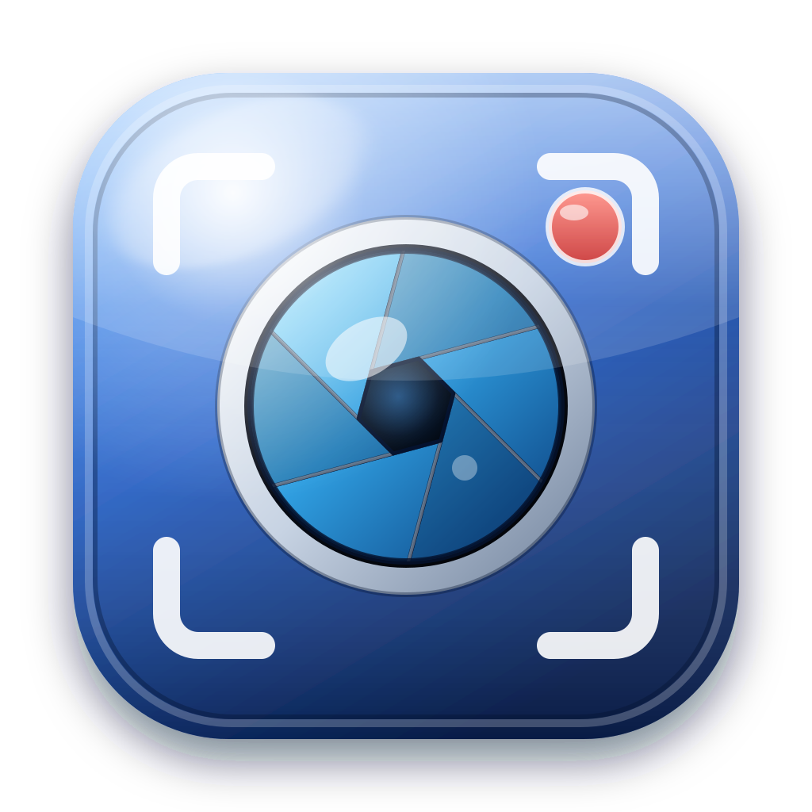

# CaptureMaster

Windows · macOS · Linux(Ubuntu) 용 화면 캡처 / 주석 / 화면 녹화 프로그램.
데스크톱 셸은 Tauri 2 이고, 화면은 React 18 + Vite 5 입니다.

- 사용 방법: [UsersGuide.md](UsersGuide.md)
- 내부 구조: [Architecture.md](Architecture.md)



## 주요 기능

| 영역 | 내용 |
|---|---|
| 캡처 | 전체 화면 · 특정 창 · 드래그 영역(전체 화면 오버레이) · 지연 캡처(카운트다운) · 캡처 시 창 자동 숨김 · 클립보드 복사 |
| 녹화 | 전체 화면 또는 특정 창 동영상 녹화(WebM VP9/VP8, 지원 시 MP4) · fps/비트레이트 · 시스템 소리(Windows) · 마이크 · 일시정지/재개 · 항상 위에 뜨는 녹화 컨트롤 창 · 녹화 중 창 최소화 |
| 편집 | 선택/이동/크기조절, 펜, 사각형, 타원, 화살표, 직선, 텍스트, 형광펜, 모자이크, 번호 배지, 자르기 · Undo/Redo(100단계) · Ctrl+휠 확대/축소 · 복사/붙여넣기(이미지·주석) |
| 문서 | `.cmcap` 캡처 파일(이미지+주석) 저장/열기 — 별도 아이콘, 설치 시 시스템 등록 · PNG/JPEG/WebP/BMP 내보내기 · 이미지/동영상 파일 열기 · URL 에서 이미지 열기(진행 표시) · 탭으로 여러 문서 |
| 인쇄 | 모든 문서 / 현재 문서 / 사용자 지정(문서 선택, 현재 문서의 선택 영역) · 가로/세로 · 페이지 맞춤 |
| UI | 타이틀 바에 이름+버전, 아이콘 툴바(모든 버튼 툴팁, 언어 전환 버튼, 우측에 설정·정보), 상태 바(우측 하단 크기 변경 마커), 최소 크기로 시작(툴바·시작 화면이 모두 보이는 크기), 컨텍스트 메뉴, **다크 20 · 라이트 20 테마와 사용자 정의 테마**, 한국어/영어, 시스템 폰트·크기·스타일, 최근 파일 10개(개별/전체 삭제), 열어본 폴더 기억, 설정 자동 저장/복원. 툴바 테마 버튼은 다음 테마로 바꾸고, 옆의 목록에서 직접 고릅니다. 설정은 탭으로 나뉩니다. 스크롤 바는 표시하지 않습니다. |
| 팝업 | 설정·정보·오류·진행률·인쇄·소스 선택·영역 선택·녹화 컨트롤이 모두 **독립 OS 창** — 메인 창을 닫으면 함께 종료, 첫 프레임까지 그린 뒤 표시(깜빡임 없음) |
| 안전 | 종료 시 저장 여부 확인, 오류 팝업에 상세 내용(렌더러·메인 프로세스 모두) + 복사 버튼, 최소 창 폭 = 툴바 폭 |

## 실행

```bash
npm install
npm start          # Vite 개발 서버 + Tauri
```

`CM_USER_DATA=<폴더>` 환경 변수를 주면 개발 실행이 별도 프로필(설정·창 상태·단일 인스턴스 잠금)을 사용합니다.

## 빌드 / 설치 파일

```bash
npm run build:win     # Tauri NSIS 설치 파일. 만든 뒤 프로젝트 루트로 복사한다.
```

```bash
npm run clean         # dist/ build/icons/ src/build-info.json 삭제
npm run clean:all     # 위 항목 + node_modules/ + src-tauri/target/ (다시 npm install 필요)
```

아이콘은 `assets/icon.svg`(앱)와 `assets/file-icon.svg`(.cmcap 문서)에서 `npm run generate:icons` 로
생성되며, 앱에 필요한 아이콘은 `src-tauri/icons/` 에 복사됩니다. 설치 파일·언인스톨러·바로가기 모두 같은 아이콘을 씁니다.

### 설치 동작

- **Windows (NSIS, Tauri)** — 설치를 시작하기 전에 설치 언어(한국어/영어)를 고릅니다. 바로가기 페이지에서 바탕화면과 시작 메뉴 바로가기를 각각 선택할 수 있습니다. 이미 실행 중인 CaptureMaster 가 있으면 알림을 띄우고 두 번째 복사본은 종료합니다. `.cmcap` 형식을 등록합니다.

## 테스트

```bash
npm test                          # 단위 테스트: history / settings / document / themes / ico
```

## 구조 (요약)

```
src-tauri/  tauri.conf.json Cargo.toml  src/{lib.rs commands.rs capture.rs dialogs.rs single_instance.rs state.rs}  windows/hooks.nsh
src/        App.jsx DialogHost.jsx i18n.js themes.js styles.css main.jsx
  lib/      document.js history.js render.js image.js capture.js platform.js dialogBus.js settings.js fonts.js errors.js format.js
  components/ Editor.jsx Toolbar.jsx chrome.jsx common.jsx VideoView.jsx Icons.jsx ErrorBoundary.jsx
  dialogs/  DialogFrame.jsx SettingsDialog.jsx SimpleDialogs.jsx CaptureDialogs.jsx
scripts/    generate-icons.mjs generate-build-info.mjs sync-public-svgs.mjs free-port.mjs clean.mjs
test/       *.test.mjs
```

자세한 설명은 [Architecture.md](Architecture.md) 를 보세요.

---

**CaptureMaster** — screen capture & recording for Windows, macOS and Linux.
Author: SHKWON (knix008@naver.com) · License: MIT
