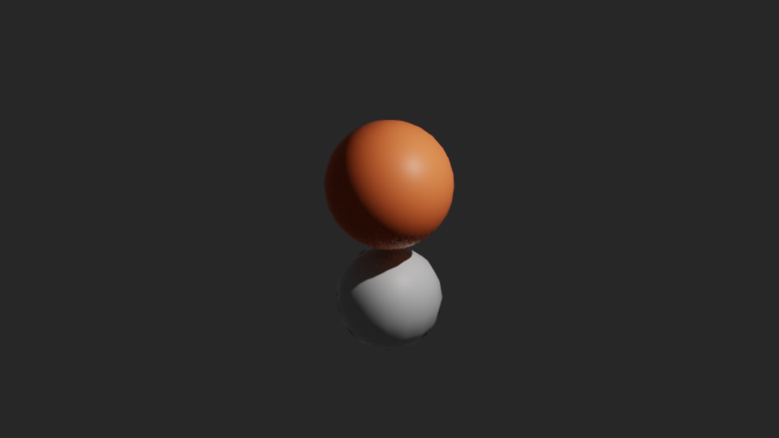
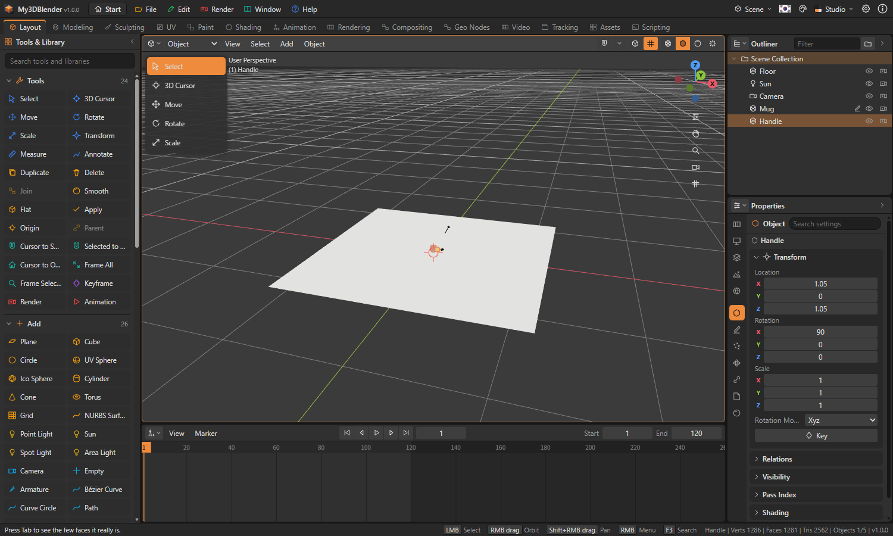
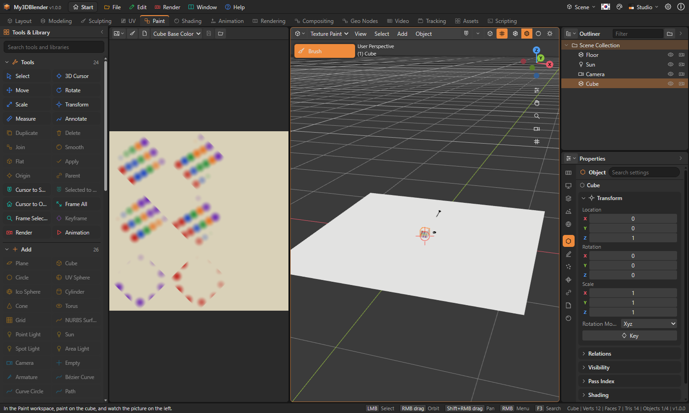
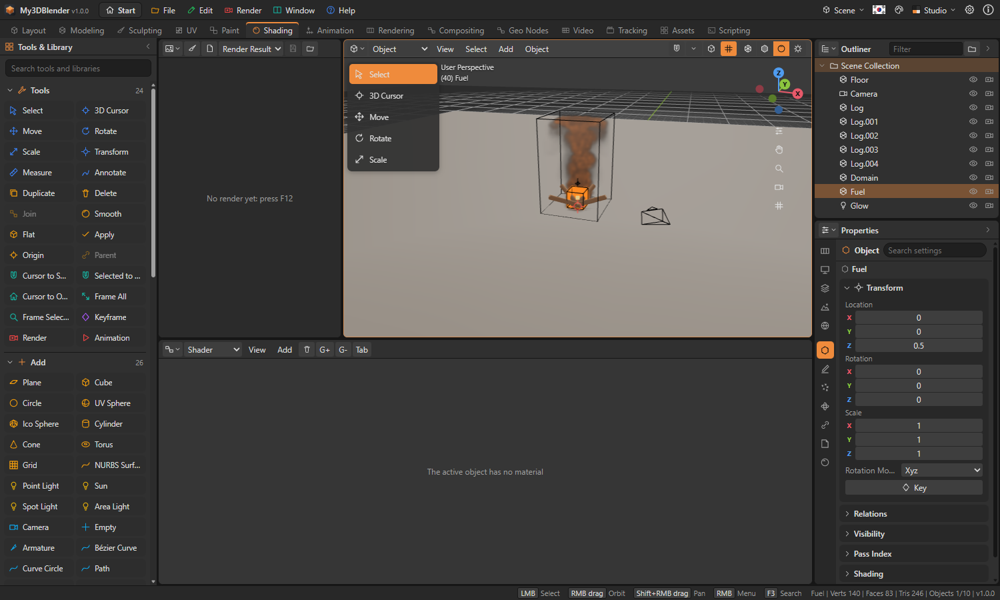
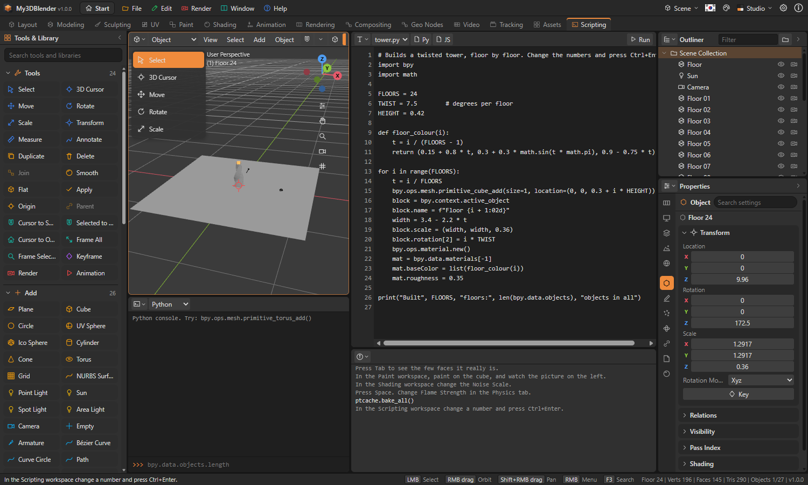
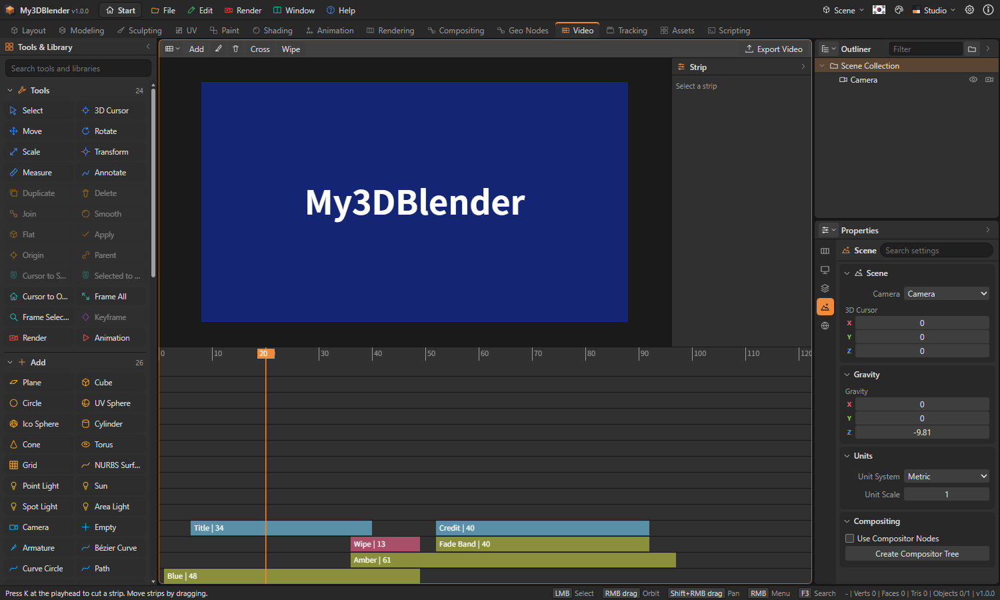
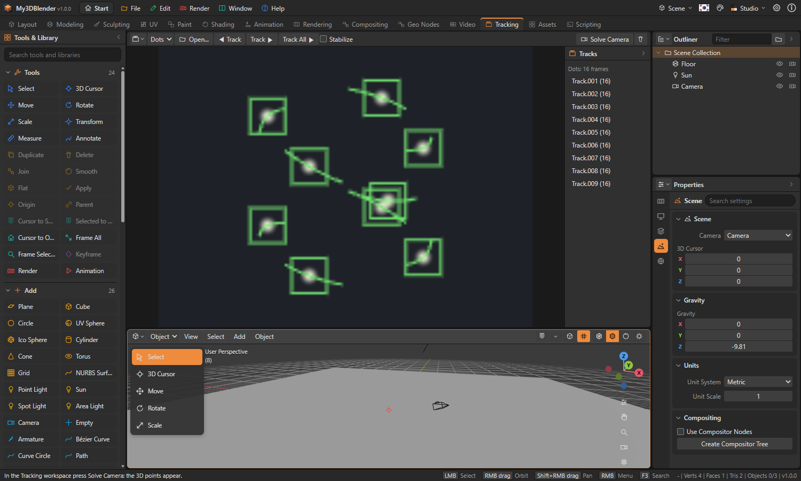

# My3DBlender Tutorial

A hands-on course for first-time users. Followed from the start, it goes from the basics to simulation, Python and video editing. Each tutorial takes from 5 to 20 minutes. To see a finished one, open its sample from the start screen.

## The tutorial inside the program

At the first start a window asks whether to run the tutorial (**Help › Tutorial** opens it too). The picture in that window and in the tutorial's first and last steps is the very picture the tutorial makes: a rounded cube with a coloured ball on top, the ball moved in time, rendered through the camera.



It is exactly what the Render step gives when every step is done with **Do It for Me**. Done by hand, yours may differ a little in colour or place.

## Before you start

| Action | Input |
|---|---|
| Turn the view | Drag with the middle button, Alt + left button, or drag the axis widget at the top right |
| Zoom | Wheel |
| Pan | Shift + drag with the middle button |
| Undo | Ctrl + Z |

Keys go to the area the mouse is over. If a key does nothing, move the mouse over the 3D view.

## Tutorial 1. Make a mug (beginner)

Sample: `subsurf-mug`



### The body

1. On the start screen press **New Project**.
2. With the cube selected and the mouse over the 3D view, press X to delete it.
3. Choose **Add › Mesh › Cylinder** in the header.
4. Open the **Adjust Last Operation** panel at the bottom left and set Vertices to 48.

### Hollow it out

1. Press Tab for Edit Mode, then 3 for face selection.
2. Click the top face.
3. Press I. In the panel set Thickness to 0.1.
4. Press E, move the mouse down and click to confirm, down to just above the bottom.

### The handle

1. Press Tab to go back to Object Mode.
2. Choose **Add › Mesh › Torus**.
3. Press G, X, type 1 and press Enter to move it aside.
4. Press R, X, type 90 and press Enter to stand it up.
5. Shift-click the mug and the handle and press Ctrl + J to join them.

### Smooth and colour it

1. In the Modifiers tab of the Properties editor choose **Add Modifier › Generate › Subdivision Surface**.
2. Choose **Object › Shade Smooth**.
3. In the Material tab press **New Material**, and set the base colour and a Roughness of 0.2.
4. Check the result with the Material Preview button at the right of the header.

### Spin and render it

1. Select the mug and press I at frame 1.
2. Move the timeline to frame 120, press R, Z, type 360 and press Enter. Press I again.
3. Right-click in the timeline, choose **Interpolation › Linear** and press Space to play.
4. Set Samples to 64 in the Render tab and press F12.
5. **Render › Save Render** saves a PNG. Ctrl + S saves the project.

## Tutorial 2. Unwrap by seams and paint (intermediate)

Sample: `texture-painted`



1. In a **New Project** select the cube, press Tab, then 2 for edge selection.
2. Press A to select all and choose **Mesh › Edge › Mark Seam**. The red lines are where it is cut.
3. Press U. In the **UV** workspace see the six faces laid out.
4. Press Tab to leave, and go to the **Paint** workspace.
5. Press N for the sidebar and press **Add Paint Texture**.
6. Choose a colour and drag on the cube. The paint carries on over the corners, and the picture on the left shows it.
7. With the brush button of the Image Editor on the left, you can also drag on the picture.

## Tutorial 3. A bouncing ball and its path (intermediate)

Samples: `bouncing-ball`, `motion-paths`

1. In a **New Project** delete the cube, choose **Add › Mesh › UV Sphere**, and press G, Z, 3, Enter to raise it.
2. Press I at frame 1.
3. Move to frame 12, press G, Z to bring it to the floor, and press I.
4. Repeat at frames 24 and 36, each time a little lower.
5. Drag keys in the Dope Sheet to change the timing.
6. **Object › Animation › Calculate Motion Path** draws the ball's way as a line. Set its start and end in the Adjust Last Operation panel.
7. **Onion Skin** shows it before and after the current frame, in blue and green.

## Tutorial 4. Make smoke (advanced)

Samples: `smoke-plume`, `campfire`



1. In a **New Project** make the cube larger: press S, 3, Enter. It becomes the domain.
2. In the Physics tab press **Smoke Domain**. The box turns into lines.
3. Add **Add › Mesh › Ico Sphere**, put it low in the box with G, Z, -2, Enter, and shrink it with S, 0.4, Enter.
4. In the Physics tab press **Smoke Flow**.
5. In the Output tab set the frames from 1 to 40, and press **Bake All Simulations**.
6. Press Space to play. The smoke rises.
7. Change the flow's type to **Both** and bake again, and it catches fire. Press F12 to render.

## Tutorial 5. Build with Python (advanced)

Samples: `python-tower`, `python-grid`



1. Go to the **Scripting** workspace. The Text Editor has `script.py` open.
2. Replace its text with this.

```
import bpy
from math import sin, cos

for i in range(36):
    a = i * 0.35
    bpy.ops.mesh.primitive_ico_sphere_add(radius=0.25, location=(cos(a) * 3, sin(a) * 3, i * 0.12))
    bpy.context.active_object.name = f"Bead {i:02d}"

print("Made", len(bpy.data.objects), "objects")
```

3. Press Ctrl + Enter. A spiral appears, and one Ctrl + Z takes it all away.
4. A mistake is reported in the status bar with its line number.
5. Type `len(bpy.data.objects)` in the console.

## Tutorial 6. Edit a video (advanced)

Samples: `title-card`, `story-scenes`



1. Go to the **Video** workspace.
2. Choose **Add › Color** in the header. In the panel on the right set Length to 48.
3. Drag the ruler to frame 30 and choose **Add › Color** again. It overlaps the first, so it goes to the channel above. Change its colour.
4. With the later strip selected, press **Cross**. The overlap now fades.
5. **Add › Text** adds a title; edit it in the panel.
6. Move the playhead and press K to cut, X to delete.
7. **Export Video** saves a WebM file.

## Tutorial 7. Motion tracking (advanced)

Sample: `camera-solve`



1. On the start screen open the **Motion Tracking** sample. The Tracking workspace opens.
2. The track list on the right has 9 tracks. Move the timeline and the markers follow the dots.
3. Press **Solve Camera**. Points and a camera appear in the 3D view.
4. See the solve error under the track list.
5. To try your own, **Open** a video, click clear points in the picture to place markers, and press **Track ▶**.

## Next steps

- Open the samples level by level and follow the hints in the status bar. The list is in `sample/README.md`.
- Everything the program does is in the [User's Guide](UsersGuide.en.md).
- **Help › Feature Coverage** shows what is implemented.
