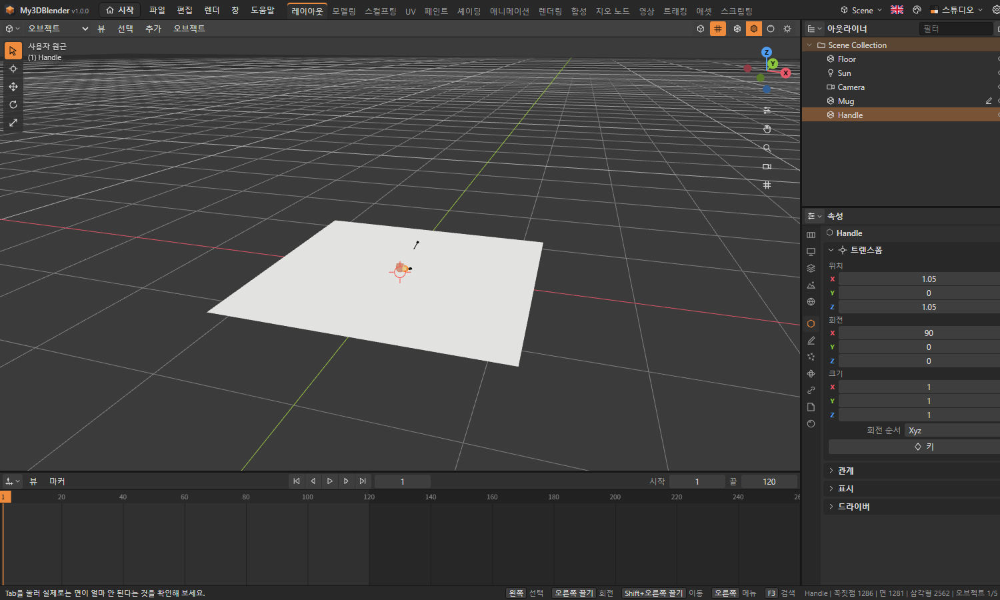
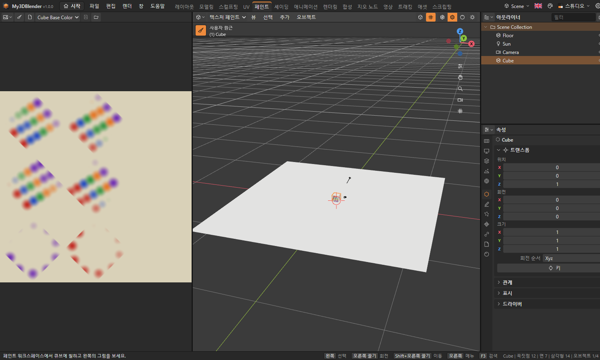
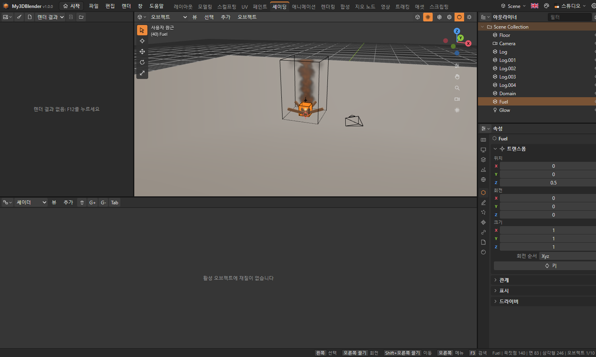
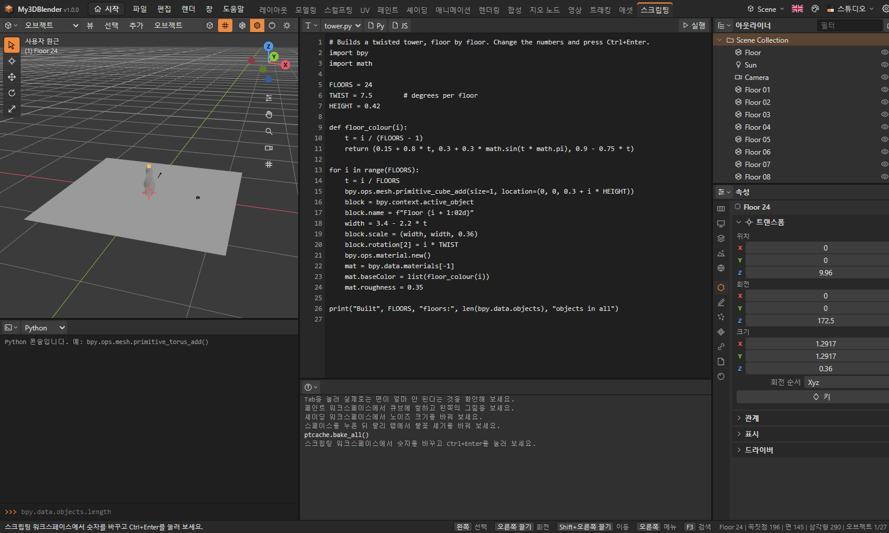
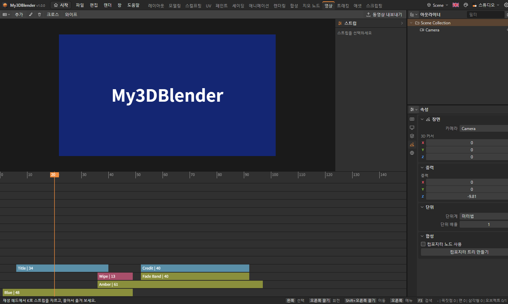
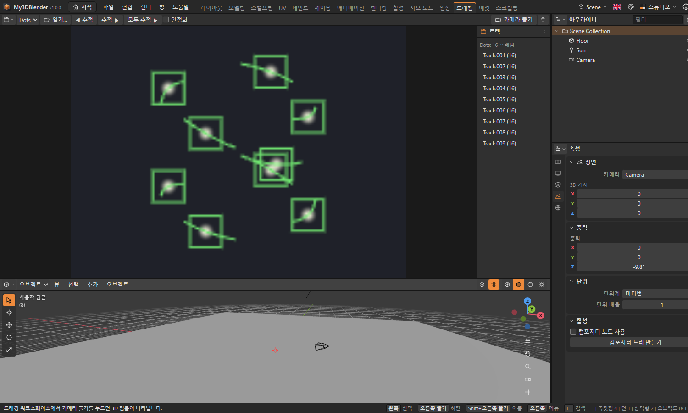

# My3DBlender 튜토리얼

처음 쓰는 사람을 위한 실습입니다. 앞에서부터 따라 하면 기본 조작에서 시뮬레이션, Python, 영상 편집까지 익힐 수 있습니다. 튜토리얼마다 짧게는 5분, 길게는 20분쯤 걸립니다. 완성본이 궁금하면 시작 화면의 샘플을 열어 보세요.

## 시작하기 전에

| 조작 | 입력 |
|---|---|
| 보는 방향 돌리기 | 가운데 버튼 끌기, Alt + 왼쪽 버튼 끌기, 또는 오른쪽 위 축 표시 끌기 |
| 확대·축소 | 휠 |
| 옮겨 보기 | Shift + 가운데 버튼 끌기 |
| 실행 취소 | Ctrl + Z |

단축키는 마우스가 올라가 있는 영역으로 전달됩니다. 키를 눌러도 반응이 없으면 마우스를 3D 뷰 위로 옮기세요.

## 튜토리얼 1. 머그잔 만들기 (초급)

샘플: `subsurf-mug`



### 몸통

1. 시작 화면에서 **새 프로젝트**를 누릅니다.
2. 큐브가 선택된 상태에서 3D 뷰 위에 마우스를 두고 X를 눌러 지웁니다.
3. 머리글의 **추가 › 메시 › 원기둥**을 고릅니다.
4. 왼쪽 아래 **마지막 작업 조정** 패널을 펼쳐 꼭짓점을 48로 바꿉니다.

### 속 파내기

1. Tab으로 편집 모드에 들어가 3을 눌러 면 선택으로 바꿉니다.
2. 윗면을 눌러 선택합니다.
3. I를 누릅니다. 패널에서 두께를 0.1로 정합니다.
4. E를 누르고 마우스를 아래로 움직인 다음 왼쪽 버튼으로 확정합니다. 바닥 조금 위까지 내립니다.

### 손잡이

1. Tab으로 오브젝트 모드로 돌아옵니다.
2. **추가 › 메시 › 토러스**를 고릅니다.
3. G, X를 누르고 1을 입력한 뒤 Enter로 옆으로 옮깁니다.
4. R, X를 누르고 90을 입력한 뒤 Enter로 세웁니다.
5. 머그와 손잡이를 Shift를 누른 채 차례로 선택하고 Ctrl + J로 합칩니다.

### 다듬고 칠하기

1. 속성 에디터의 모디파이어 탭에서 **모디파이어 추가 › 생성 › 서브디비전 표면**을 고릅니다.
2. **오브젝트 › 부드러운 셰이딩**을 고릅니다.
3. 재질 탭에서 **새 재질**을 누르고 기본 색과 거칠기(0.2)를 정합니다.
4. 머리글 오른쪽의 재질 미리보기 버튼으로 결과를 확인합니다.

### 돌리고 렌더하기

1. 머그를 선택하고 프레임 1에서 I를 누릅니다.
2. 타임라인의 프레임을 120으로 옮기고, R, Z를 누른 뒤 360을 입력해 Enter로 확정합니다. 다시 I를 누릅니다.
3. 타임라인 위에서 오른쪽 버튼을 눌러 **보간 › 선형**을 고른 뒤 스페이스로 재생합니다.
4. 렌더 탭에서 샘플을 64로 정하고 F12를 누릅니다.
5. **렌더 › 렌더 저장**으로 PNG를 저장합니다. Ctrl + S로 프로젝트를 저장합니다.

## 튜토리얼 2. 심으로 펼치고 칠하기 (중급)

샘플: `texture-painted`



1. **새 프로젝트**에서 큐브를 선택하고 Tab, 2를 눌러 엣지 선택으로 바꿉니다.
2. A로 모두 선택한 뒤 **메시 › 엣지 › 심 표시**를 고릅니다. 빨간 선이 잘릴 곳입니다.
3. U를 누릅니다. **UV** 워크스페이스에서 여섯 면이 펼쳐진 것을 봅니다.
4. Tab으로 나와 **페인트** 워크스페이스로 갑니다.
5. N으로 사이드바를 열고 **칠할 텍스처 추가**를 누릅니다.
6. 색을 고르고 큐브 위를 끕니다. 모서리를 넘어가도 이어져 칠해지고 왼쪽 그림에 같이 나타납니다.
7. 왼쪽 이미지 에디터의 브러시 단추를 켜고 그림 위를 끌어도 칠해집니다.

## 튜토리얼 3. 튀는 공과 모션 경로 (중급)

샘플: `bouncing-ball`, `motion-paths`

1. **새 프로젝트**에서 큐브를 지우고 **추가 › 메시 › UV 구**를 고른 뒤, G, Z, 3, Enter로 올립니다.
2. 프레임 1에서 I를 누릅니다.
3. 프레임을 12로 옮기고 G, Z로 바닥까지 내린 뒤 I를 누릅니다.
4. 프레임 24, 36에서 높이를 조금씩 줄이며 반복합니다.
5. 도프 시트에서 키를 끌어 타이밍을 고칩니다.
6. **오브젝트 › 애니메이션 › 모션 경로 계산**을 고르면 공의 길이 선으로 나타납니다. 시작과 끝은 마지막 작업 조정 패널에서 정합니다.
7. **어니언 스킨**을 고르면 앞뒤 프레임의 모습이 파랗고 초록색으로 보입니다.

## 튜토리얼 4. 연기 피우기 (고급)

샘플: `smoke-plume`, `campfire`



1. **새 프로젝트**에서 큐브의 크기를 키웁니다. S, 3, Enter를 누르면 도메인 상자가 됩니다.
2. 물리 탭에서 **연기 도메인**을 누릅니다. 상자가 선으로 바뀝니다.
3. **추가 › 메시 › 아이코 구**를 넣고 G, Z, -2, Enter로 상자 아래쪽에 둡니다. S, 0.4, Enter로 줄입니다.
4. 물리 탭에서 **연기 흐름**을 누릅니다.
5. 시작을 1, 끝을 40프레임으로 출력 탭에서 맞춘 뒤 **모든 시뮬레이션 베이크**를 누릅니다.
6. 스페이스로 재생합니다. 연기가 올라옵니다.
7. 흐름의 종류를 **둘 다**로 바꾸고 다시 베이크하면 불이 붙습니다. F12로 렌더합니다.

## 튜토리얼 5. Python으로 만들기 (고급)

샘플: `python-tower`, `python-grid`



1. **스크립팅** 워크스페이스로 갑니다. 텍스트 에디터에 `script.py`가 열려 있습니다.
2. 내용을 다음으로 바꿉니다.

```
import bpy
from math import sin, cos

for i in range(36):
    a = i * 0.35
    bpy.ops.mesh.primitive_ico_sphere_add(radius=0.25, location=(cos(a) * 3, sin(a) * 3, i * 0.12))
    bpy.context.active_object.name = f"Bead {i:02d}"

print("Made", len(bpy.data.objects), "objects")
```

3. Ctrl + Enter로 실행합니다. 나선이 생기고 Ctrl + Z 한 번에 전부 사라집니다.
4. 틀린 곳이 있으면 상태 표시줄에 몇 번째 줄인지 나옵니다.
5. 콘솔에 `len(bpy.data.objects)`를 입력해 봅니다.

## 튜토리얼 6. 영상 편집 (고급)

샘플: `title-card`, `story-scenes`



1. **영상** 워크스페이스로 갑니다.
2. 머리글의 **추가 › 색**을 고릅니다. 오른쪽 패널에서 길이를 48로 정합니다.
3. 눈금을 끌어 프레임 30으로 옮기고 **추가 › 색**을 한 번 더 고릅니다. 앞 스트립과 겹쳐 위 채널에 놓입니다. 색을 바꿉니다.
4. 뒤 스트립을 고른 채 **크로스**를 누릅니다. 겹친 구간이 부드럽게 바뀝니다.
5. **추가 › 텍스트**로 제목을 넣고 패널에서 내용을 고칩니다.
6. 재생 헤드를 옮기고 K를 눌러 자릅니다. X로 지웁니다.
7. **동영상 내보내기**로 WebM 파일을 저장합니다.

## 튜토리얼 7. 모션 트래킹 (고급)

샘플: `camera-solve`



1. 시작 화면의 샘플 프로젝트에서 **모션 트래킹** 샘플을 엽니다. 트래킹 워크스페이스가 열립니다.
2. 오른쪽 트랙 목록에 트랙이 9개 있습니다. 타임라인을 움직이면 마커가 점을 따라갑니다.
3. **카메라 풀기**를 누릅니다. 오른쪽 3D 뷰에 점들과 카메라가 생깁니다.
4. 트랙 목록 아래의 풀이 오차를 확인합니다.
5. 직접 해 보려면 **열기**로 동영상을 열고, 그림의 뚜렷한 지점을 눌러 마커를 놓은 뒤 **추적 ▶**을 누릅니다.

## 다음 단계

- 시작 화면의 샘플을 난이도별로 열어 상태 표시줄의 안내를 따라 해 봅니다. 샘플 목록은 `sample/README.md`에 있습니다.
- 모든 기능은 [사용자 설명서](UsersGuide.md)에 있습니다.
- 구현 범위는 **도움말 › 기능 구현 현황**에서 확인합니다.
