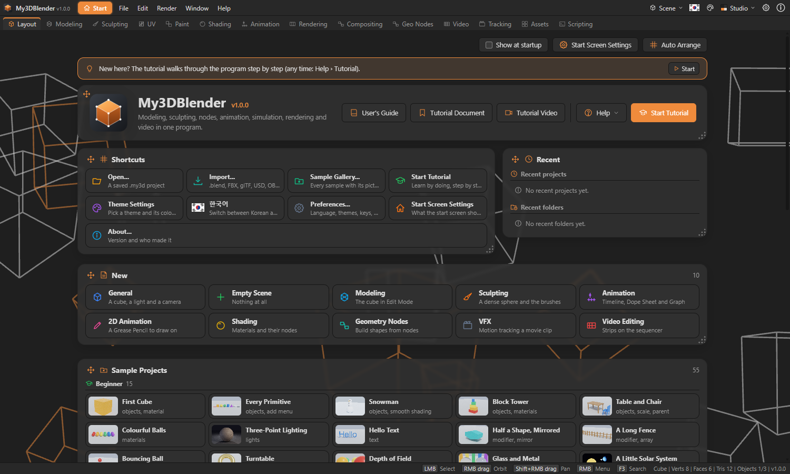
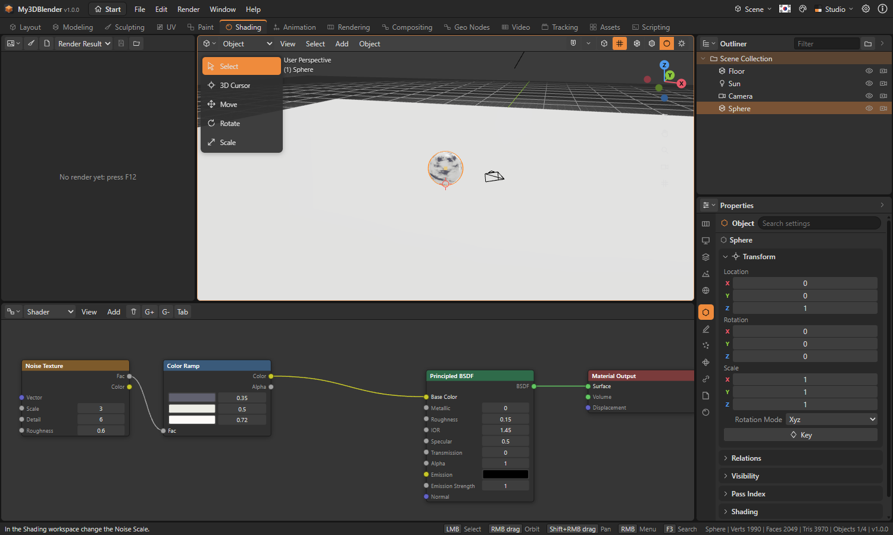
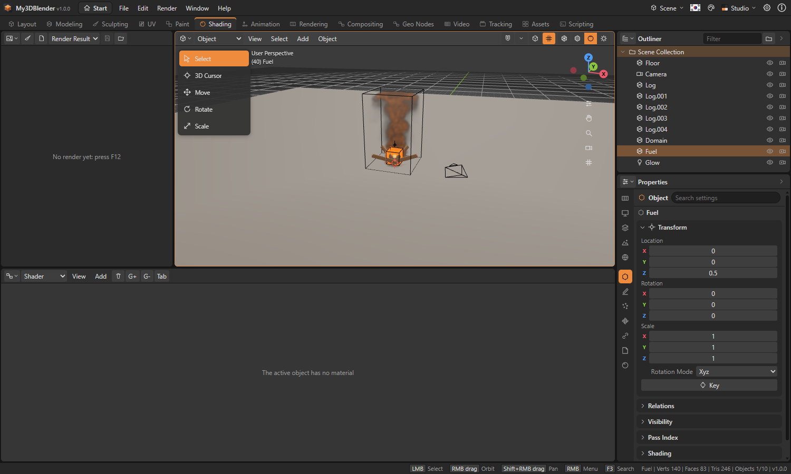
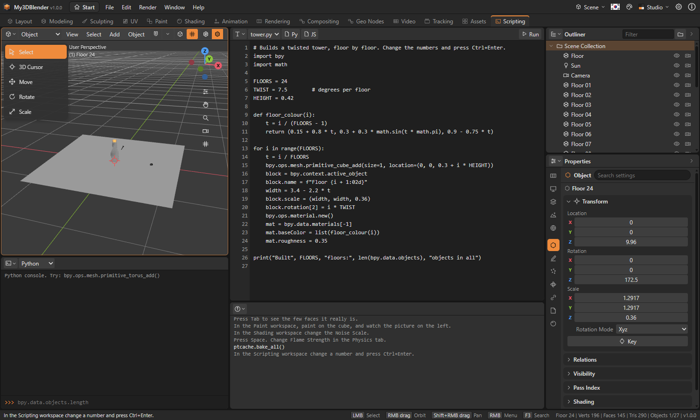
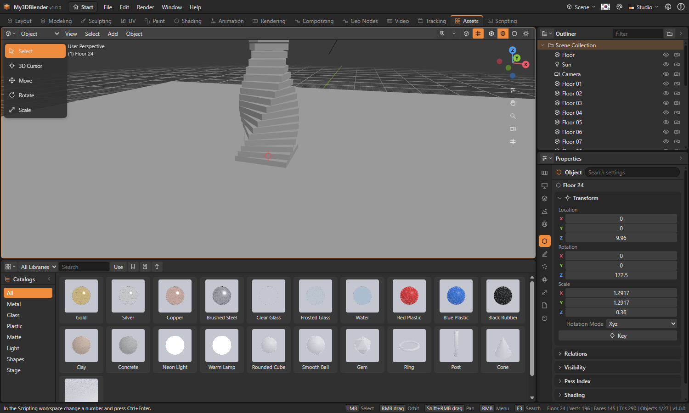
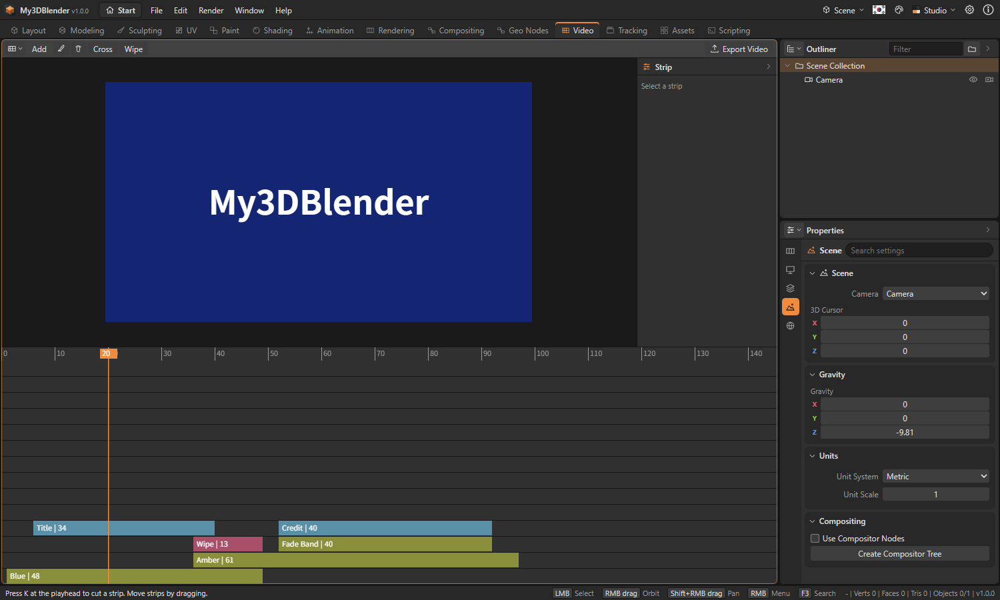
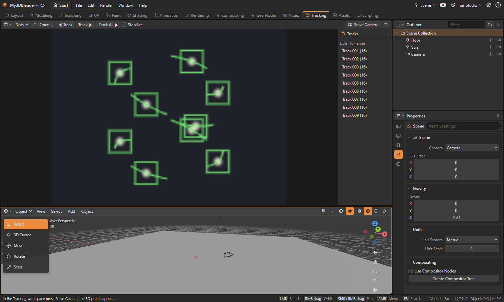

# My3DBlender User's Guide

My3DBlender is a 3D creation program for web browsers, Windows, macOS and Linux. It covers modeling, sculpting, materials and nodes, animation, physics, rendering and scripting in one window. It is an independent program inspired by Blender and has no connection with the Blender Foundation.

It does not yet do everything Blender does. **Help › Feature Coverage** shows, item by item, what is done, partial or planned.

## The start screen

The program opens with the start screen and a window asking whether to run the tutorial. **Run the Tutorial** starts a step-by-step course inside the window. It shows where to look, ticks itself off as you work, and **Do It for Me** moves on for you. **Help › Tutorial** starts it again at any time. Turning off **Show this at startup** in that window stops it coming back, and **Preferences › Start and Tutorial** turns it on again. The **Start** button right of the name in the top bar opens and closes it at any time. Translucent cards sit on a moving background, and the screen scrolls when they do not fit.



- **Tools at the top**: show the start screen at startup, Start Screen Settings, Auto Arrange
- **Banner**: shown at the top until the tutorial has been finished once; **Start** opens the tutorial
- **Intro card**: the program's name and version, **User's Guide**, **Tutorial Document**, **Tutorial Video**, the **Help** menu, and the blue (accent coloured) **Start Tutorial**
- **Shortcuts card**: Open, Import, Sample Gallery, Start Tutorial, Theme Settings, language, Preferences, Start Screen Settings, About, Exit (desktop)
- **Recent card**: beside Shortcuts. Recent projects (× takes one off the list, **Clear** empties it) and the recent folders they are in (a click opens the Open window in that folder)
- **New card**: General, Empty Scene, Modeling, Sculpting, Animation, 2D Animation, Shading, Geometry Nodes, VFX, Video Editing. Each makes a scene for that work and opens its workspace (Sculpting: a dense sphere in Sculpt Mode; 2D Animation: a camera and a Grease Pencil in Draw Mode)
- **Sample Projects card**: 15 beginner, 20 intermediate and 20 advanced samples in a group per level, each with a small picture
- **Theme card**: dark and light themes, with **Theme Settings** at the top right
- **Moving Background card**: 20 backgrounds, **Change Background**, speed, card opacity, **Auto change** and how often (10 s to 5 min)
- **Bottom line**: version and author

A card moves by the four-way arrow left of its title and resizes by its bottom right corner. While dragging, a see-through copy follows the pointer, a dashed outline shows where the card will land, and the others make way so that nothing overlaps. Double-clicking the corner fits the card to its content again, and **Auto Arrange** puts the whole board back. The background and card settings are also in **Preferences › Start and Tutorial**. The tutorial video opens in a window of its own on the desktop, and in a new window on the web.

## Sample projects

The `sample` folder holds samples by level. Choose one from the level groups in the **Sample Projects** section of the start screen, or open the window with larger pictures from **File › Samples**, choose a level and click. The status bar then says what to try. Saving asks for a new name, so the original stays as it is. Samples with a simulation bake it when they open.

| Level | What is in it |
|---|---|
| Beginner | Adding shapes, moving, materials, lights, keyframes, one modifier |
| Intermediate | Several modifiers, shader and world nodes, rigs, cloth, rigid bodies, particles, instances, compositing |
| Advanced | Geometry nodes, smoke, fire, liquid, ocean, Python, add-ons, node groups, OSL, sequencer, motion tracking, NURBS, multiresolution |

## The screen

The bar at the top has the File, Edit, Render, Window and Help menus, the workspace tabs, and the language, theme, preferences and about buttons. Below it are the editor areas, and at the bottom the status bar.

The button at the top left of an area changes its editor type. Right-click an area's header for split, join and maximize. Drag the border between two areas to resize them.

| Workspace | For |
|---|---|
| Layout | Arranging the scene, with a timeline |
| Modeling | Editing meshes |
| Sculpting | Shaping with brushes |
| UV | Unwrapping and adjusting UVs |
| Paint | Painting on textures |
| Shading | Materials and shader nodes |
| Animation | Dope sheet and keyframes |
| Rendering | Render results and settings |
| Compositing | Compositor nodes |
| Geo Nodes | Building shapes with nodes |
| Video | The Video Sequencer |
| Tracking | Movie clips and camera solving |
| Assets | The Asset Browser |
| Scripting | Scripts and the console |

## Moving around in the 3D view

| Action | Input |
|---|---|
| Turn the view | Drag with the right button, the middle button, Alt + left button, or drag the axis widget at the top right |
| Pan | Shift + drag with the right or middle button, or drag the hand button |
| Zoom | Wheel, Ctrl + drag with the right or middle button, or drag the magnifier button |
| Front, right, top view | Numpad 1, 3, 7 (with Ctrl: the opposite side) |
| Camera view | Numpad 0 |
| Perspective / orthographic | Numpad 5 |
| Frame all, frame selected | Home, Numpad . |
| Toolbar, sidebar | T, N |
| Operator search | F3 |

The right button opens the menu when it is pressed without dragging. Every fifth grid line is a heavier one, and zooming redraws the grid with its spacing changed five times over. The grid is always drawn behind the shapes, and looking along an axis it stands across the view. The right column and the side panels fold and unfold with the arrow in their heading. Z opens a round menu of shading modes. The search box at the top of the Properties editor finds settings on the current tab. In Edit Mode, K is the knife: click along the cut and press Enter, and C cuts through to the far side. Shift+Tab turns snapping on and off, and the menu beside it chooses vertex, edge, face or object centre. To make a left button drag turn the view, use **Preferences › Navigation**. On a touchpad, drag the axis widget at the top right, or the hand and magnifier buttons. Clicking an axis looks along it. The buttons on the right of the header choose wireframe, solid, material preview or rendered shading.

## Objects

Click with the left button to select; hold Shift to add to the selection. Drag from an empty spot for box select. Shift + right button places the 3D cursor, and new objects appear there.

| Action | Input |
|---|---|
| Move, rotate, scale | G, R, S |
| Limit to an axis | Then X, Y, Z |
| Type a value | Then a number, Enter to confirm |
| Cancel | Esc or right button |
| Add menu | Shift + A |
| Duplicate, delete | Shift + D, X |
| Hide, show | H, Alt + H |
| Join, set parent | Ctrl + J, Ctrl + P |
| Insert keyframe | I |

To turn the object itself, select it and press R, move the mouse and click, or pick the Rotate tool in the toolbar on the left and drag the ring that appears. The Move and Scale tools work the same way.

### Instances

The same thing drawn many times without making copies. Change the original and they all change.

- **Collection instance**: make a collection, put objects in it, then choose it under **Add › Collection Instance**. The original collection can stay turned off.
- **On vertices or faces**: parent a child to an object and choose vertices or faces under **Object › Instancing**.
- **Object › Instancing › Make Instances Real** turns each one into an ordinary object.

### Several scenes

The scene button at the right of the top bar makes a new scene, copies this one, deletes one and switches between them. Scenes share materials and images.

### NURBS surfaces

**Add › Surface** has patch, cylinder, sphere and torus. In Edit Mode (Tab) the control points show: click to select, G, R and S to move. Curves work the same. Resolution and order are in the Object Data tab.

## Editing meshes

Tab enters Edit Mode. 1, 2 and 3 choose vertex, edge or face selection.

| Tool | Input |
|---|---|
| Extrude | E |
| Inset faces | I |
| Bevel | Ctrl + B |
| Loop cut | Ctrl + R (at the edge nearest the mouse) |
| Make edge/face | F |
| Merge | M |
| Delete | X |
| Select linked | L, Ctrl + L |
| Separate selection | P |
| Rip | V |
| Proportional editing on or off | O (the wheel sets its reach during a transform) |
| Edge crease | Shift + E |
| Unwrap | U |

After a tool with values, such as Inset or Bevel, the **Adjust Last Operation** panel appears at the bottom left of the 3D view. Changing a value recalculates the result on the spot.

The Edge entry of the Mesh menu marks seams, sharp edges and creases. In Edit Mode marked edges show red (seam), cyan (sharp) and pink (crease). A sharp edge breaks smooth shading there; a crease keeps subdivision from rounding that edge. The Normals entry sets custom split normals.

### Unwrapping UVs

Select edges and use Mesh › Edge › Mark Seam to say where to cut, then press U. The mesh splits into islands along the seams, each is flattened keeping its angles as far as it can (LSCM), and they are packed into the square. A closed mesh with no seams is cut by face direction automatically.

**Use Foam** on the Ocean modifier puts foam where the waves fold: white in renders, and readable as the foam attribute. **Use Spray** as well keeps the way the water is squeezed most in the spray attribute (**Invert Spray**: at right angles to it).

**Spectrum** offers Blender's four.

| Spectrum | Sea |
|---|---|
| Phillips | A rough sea. The default |
| Pierson–Moskowitz | A sea fully grown under a long wind |
| JONSWAP | A sea still growing. The shorter the **Fetch** (how far the wind blows, in km), the lower the waves; the higher **Sharpen Peak**, the more one wave length stands out |
| Texel Marsen Arsloe (TMA) | JONSWAP in shallow water. The shallower the **Depth**, the fewer long waves |

Unwrapping is angle based by default, and its options offer Conformal.

The Remesh modifier has Blocks, Smooth and Sharp modes beside Voxel, and these three make quads. The Skin modifier by default makes quads with convex hulls at branches, as Blender does: add Subdivision Surface after it to round it. For one flowing surface, set its method to SMOOTH.

The UV menu of the UV Editor has tools for selected points. **Pin** keeps a point where it is through a new unwrap (shown in red), **Weld** brings selected points to one place, **Stitch** moves another island that shares the vertices up against them, **Align** lines them up, and **Minimize Stretch** evens out spacing to the lengths on the model.

## Modifiers

Add them in the Modifiers tab of the Properties editor. They run in order without changing the original mesh, and Apply bakes one into it. They include Subdivision Surface, Mirror, Array, Solidify, Bevel, Decimate, Boolean, Screw, Weld, Wireframe, Displace, Wave, Smooth, Simple Deform, Cast, Shrinkwrap, Lattice, Armature, Geometry Nodes, Remesh, Multiresolution, Skin and Ocean. Skin grows a surface around edges, and Ocean makes a sea surface that moves with the frame. Multiresolution gains levels from the Subdivide button on its panel; sculpting then stores the result on the top level and leaves the original mesh as it is.

## Sculpt and paint

Choose Sculpt, Vertex Paint, Weight Paint or Texture Paint from the mode list in the header. Drag in the 3D view to apply a brush; hold Ctrl for the opposite effect. The bracket keys or Ctrl + wheel change the brush size. Brush settings are in the N sidebar.

In Sculpt, turning on **Dynamic Topology** in the sidebar divides the mesh around the brush to the detail size. **Voxel Remesh** rebuilds the whole mesh with even faces.

### Texture paint

Go to the Paint workspace and press **Add Paint Texture** in the sidebar: it makes an image and connects it to the material. If the UVs are missing or faces overlap, it unwraps first. Drag on the model to paint; the picture shows in the Image Editor on the left too. The brush button in the Image Editor's header lets you paint on the picture directly.

## Materials and nodes

Make a material in the Material tab of the Properties editor; Use Nodes lets you edit it in the Node Editor. Drag from socket to socket to link, and drag a link off an input to remove it. Add nodes with Shift + A or the right button, and delete them with X.

The Node Editor's header chooses the shader, world, geometry or compositor tree.



### Displacement and volumes

The Material Output node has **Volume** and **Displacement** inputs beside Surface. A Displacement node wired in really moves the mesh at render time, and the relief shows in the shading too. A material's `displacementMethod` of TRUE keeps only the movement, BUMP only the shading. It does not show in the 3D view, and a dense mesh shows it best.

Principled Volume, Volume Scatter and Volume Absorption on the Volume input fill the mesh with that medium. A texture can drive the density, and with no Surface wired the mesh itself does not show. A volume has one colour, and only the CPU engine renders it.

### Repeat and simulation zones

Nodes wired between **Repeat Input** and **Repeat Output** in a geometry tree run that many times, each round from the last. Between **Simulation Input** and **Simulation Output** each frame continues from the one before, and the start frame goes back to the incoming geometry. Changing the tree starts over. A zone carries one geometry and no other values.

### Node groups

Shift-click to pick several nodes and press Ctrl + G to make a group. Links crossing its edge become its sockets. Select the group and press Tab to go in, and Tab again to come out; other nodes using the same group change too. Alt + G ungroups. Groups you made are under **Add › Node Groups**.

### OSL scripts

In a shader tree, **Add › Texture › Script (OSL)** is a node you write code in. Parameters become sockets. It has numbers and triples, control flow and about 40 functions.

```
shader Rings(float Scale = 7, color A = color(1, 0.8, 0.2), output color Color = 0)
{
    Color = A * fract(length(P) * Scale);
}
```

### Object constraints

**Add Constraint** in the Constraints tab is split into four groups as in Blender, and holds all 26 of Blender's object constraints.

| Group | Constraints |
|---|---|
| Motion Tracking | Camera Solver, Follow Track, Object Solver |
| Transform | Copy Location, Rotation, Scale and Transforms, Limit Distance, Location, Rotation and Scale, Maintain Volume, Transformation, Transform Cache |
| Tracking | Clamp To, Damped Track, Locked Track, Stretch To, Track To |
| Relationship | Action, Armature, Child Of, Floor, Follow Path, Pivot, Shrinkwrap |

- **Shrinkwrap** moves onto the target mesh's surface (the nearest face, a vertex, or along one axis), and with a distance stops that far from it. The target is taken as its modifiers leave it.
- **Transformation** takes where the target's location, rotation or scale lies in a range and moves the owner the same share of its own range: added to its location or rotation, or as its scale.
- **Armature** follows one or two bones the way a skinned vertex does, by their weights.
- **Camera Solver** and **Object Solver** use the camera motion solved in the Movie Clip Editor. Camera Solver moves a camera that way; Object Solver turns the same motion into an object moving in front of a camera that stays put.
- **Follow Track** goes where a track is seen: on the camera's line of sight at a depth, or at the solved 3D point with **Use 3D**.
- **Transform Cache** opens an Alembic (.abc) file with **Open Cache File...** and follows the chosen path's transform frame by frame. The path named like the object is chosen first.

Shrinkwrap, Transformation, Armature and Transform Cache were checked against Blender 4.5 for the same places, frame by frame.

### Bone constraints

In an armature's Data tab, each bone has **Add Bone Constraint**: Copy Location, Rotation, Scale and Transforms, Limit Rotation, Location and Scale, Damped Track, Locked Track, Stretch To, Transformation, Spline IK, Armature and Action. The target is another object, or a bone of that armature when you name one. They apply to the result and leave the stored pose alone, and a child bone follows what happened to its parent. **Use Roll** turns a bone's frame about its own length.

An **Action** constraint picks a frame of a stored action from where one of the target's location, rotation or scale axes lies between its minimum and maximum, and puts that frame's pose together with the bone's own. The ways of putting them together (before, after, split, replace) are Blender's, and a rotation range is in degrees. Object constraints have the same Action.

### Grease Pencil

Add a Grease Pencil from the Add menu and drag in the 3D view in Draw mode to make lines. The Data tab sets a layer's colour, thickness, opacity and fill. Lines and fills appear in the 3D view and in renders, and lighting does not change them. **Hold Drawings per Frame** shows only the drawing last made at or before each frame. Set the tool to ERASE to rub out where you drag; the Strokes panel smooths, simplifies, subdivides and converts to a mesh.

With the tool set to SCULPT, dragging reshapes the strokes under the brush: smooth, thickness, strength, grab, push, twist, pinch and randomize, with thickness and strength held per point. The **Interpolate** panel makes a new drawing between the ones before and after the current frame, stroke by stroke in drawing order, and **Interpolate Sequence** fills every frame between them. **Grease Pencil Modifiers** are thickness, offset, noise, smooth, simplify, subdivide, array, mirror, build, tint and opacity; they change what is shown and leave the strokes alone.

## Animation

In the Dope Sheet and Graph Editor, dragging in empty space selects keys with a box, and selected keys move together. A selects all, Alt+A none, X deletes the selection, Shift+D duplicates. Channels are grouped by property, and clicking a group's name folds it. In the Graph Editor a selected key shows handles to drag, and V changes their type (Auto, Vector, Aligned, Free). Clicking a channel on the left brings its extrapolation and F-curve modifiers (Cycles, Noise, Generator, Built-In Function, Stepped, Limits) to the panel on the right. The **Drivers** button in the Graph Editor's header switches to editing drivers. A driver's expression may use only numbers, variables and maths functions. In the NLA, clicking a strip sets its start, scale, repeat, reversal, blend in and out and hold, and it can be split or get a transition to the next strip. On an armature, **Add IK** on a bone gives it live inverse kinematics with a target and a pole, and **Calculate Bone Path** shows where the tip of the bone goes.

Set a frame and press I to key location, rotation and scale. In pose mode I keys every bone of the armature, and **Key Pose** in the Data tab keys one bone. Space plays; the left and right arrows step one frame. Dragging the timeline's ruler changes the frame. The Dope Sheet moves keys in time and the Graph Editor changes their values. The right-button menu chooses the interpolation.

The **Action** menu in the Dope Sheet's and NLA's headers saves the current keys as a named action, and assigns a saved action, adds it as an NLA strip or deletes it. Actions are saved in the file, and bones are found by name. In the Dope Sheet an armature's bone keys show under the object in a **Pose** group, by bone name.

**Object › Animation › Calculate Motion Path** draws the way an object goes. **Onion Skin** shows it faintly before and after the current frame.

## Physics

Turn on Rigid Body, Cloth, Soft Body or Collision in the Physics tab of the Properties editor, then press **Bake All Dynamics** to store the results per frame. Particles are added in the Particles tab.

Rigid bodies really turn and tip over when they hit something. The shape is a box, sphere, capsule, cylinder, cone, convex hull or mesh. Only a body that does not move uses a mesh as its surface; a moving one is treated as its convex hull. **Animated** makes a body follow its keyframes and push aside what it touches.

Select two rigid bodies and press **Rigid Body Tools › Connect Selected**: an empty holding a joint appears between them. There are fixed, point, hinge, slider, piston, generic, spring and motor joints, with limits and breaking. **Bake to Keyframes** turns a simulation into keys you can edit.

Cloth, soft bodies and particles hit the real shape of collision objects. **Self Collision** keeps a cloth off itself, and a coarse cloth folding over does not pass through its own faces.

| Setting | What it does |
|---|---|
| Cloth **Pressure** | The air inside a closed cloth: each unit holds 10% more air than at rest. Negative values shrink it |
| Cloth **Sewing** | Lines that belong to no face (loose edges) become threads that pull their ends together. **Sewing Force** is how much they close at a time |
| Soft body **Aero** | The air resisting the faces. A plate falling flat drops slowly, one falling edge-on drops fast |
| Soft body **Self Collision** | Vertices that are not joined stay **Ball Size** apart |

**Force fields** (**Add › Force Field**) are wind, force, vortex, drag, magnetic, harmonic, turbulence, charge, Lennard-Jones and curve guide. Rigid bodies, cloth, soft bodies, baked particles and smoke all feel them. **Charge** is multiplied by the charge in the particle settings, so like charges push apart; **Lennard-Jones** pushes inside its size and pulls just beyond it. **Curve Guide** pushes along a curve (its own or the one chosen) and pulls things back onto it once they are further than **Min Distance**. Particles feel force fields and collisions only once baked; until then they fly in a plain arc. In the particle settings you can add children, or set **Render As** to OBJECT to scatter copies of another object.

Smoke and liquid flows fill their mesh's real shape, and collision objects are walls they go around. Liquid has viscosity and **Surface Tension**. Surface tension pulls the surface round, and a high value makes the bake slower. **Foam, Spray and Bubbles** makes small particles where the surface moves fast: in the air they fall, on the surface they ride the waves, under it they rise. They are drawn with the second material slot, so add a white one with **Add Foam Material**. Force fields are wind, force, vortex, drag, magnetic, harmonic and turbulence. Smoke does not feel force fields.



| Simulation | How to make one |
|---|---|
| Smoke and fire | **Smoke Domain** on a big box, **Smoke Flow** on a small object in it. The flow's type is smoke, fire or both. Force fields push the smoke as a wind does |
| Liquid | **Liquid Domain** on a big box, **Liquid Flow** where the water starts. An INFLOW keeps pouring. A mesh with **Collision** is an obstacle |
| Dynamic Paint | **Paint Canvas** on a floor, **Paint Brush** on what moves. Set fade, spread and dent. Set the surface to **Waves** and ripples spread from where a brush presses; set it to **Weight** and the wetness goes into a vertex group (**Output Group**) for modifiers such as Mask. A paint surface's **Save Image Sequence** saves a picture over the UVs for every frame (paintmap0001.png, wetmap0001.png…) |

Bakes are not saved in the file: after opening one, press **Bake All Simulations** again. Domains and flows show as lines in the view and not in the render.

## Rendering

F12 renders. There are two engines.

| Engine | What it does |
|---|---|
| Path Tracing (CPU) | Global illumination, glass, metal, depth of field. More samples are cleaner and slower |
| Path Tracing (GPU) | The same idea, faster, on the graphics card. Node materials count as one value, and it does not draw volumes |
| Real-time (GPU) | A fast raster render, with shadows and lights only |

The result appears in the Image Editor; the Render menu saves it as a PNG. For an animation, **Animation File** in the Output tab chooses PNG frames, MP4 or AVI. MP4 is saved as H.264; where there is no encoder the file is saved as AVI with JPEG pictures instead, and the program says so. There is no sound in these files. The Output tab sets the resolution and frame range.

**Volumes** come from **Add › Volume**: fog, clouds and light shafts, drawn by Path Tracing (CPU). **Freestyle** in the Render tab draws lines on silhouettes, creases and borders.

### Render passes

Path Tracing (CPU) gathers Blender's passes on every render. The passes switched on in the View Layer tab appear as outputs of the compositor's **Render Layers** node.

| Group | Passes |
|---|---|
| Data | Depth, mist, normal, position, UV, albedo, emission, object index, material index |
| Light | Diffuse, glossy and transmission, each direct, indirect and colour. Volume direct and indirect, emission, environment, ambient occlusion |
| Cryptomatte | Object, material, asset (the topmost parent) |

- The light passes are light with the colour divided out, as in Blender. Diffuse colour × (diffuse direct + indirect) and the like, all added up, give the rendered image.
- **Mist** follows the World tab's **Mist Pass** (start, depth, falloff), and **Ambient Occlusion** is how much is hidden within the World tab's distance. These two use random numbers of their own, so switching them on does not change the render.
- **Object Index** is the Object tab's **Pass Index**.

**Light groups** are made in the View Layer tab (+, **Add Used**, **Remove Unused**). Lights and glowing meshes choose theirs under **Shading** in the Object tab, the world in the World tab. Each group adds a **Combined_group name** output to the Render Layers node; when every light is in a group, the groups add up to the rendered image.

The **Cryptomatte** node takes names (several, by commas) and makes a matte that keeps only those objects, materials or assets. Where things share a pixel, as on edges, it keeps that share of it. The **Pick** output shows each one in a colour of its own. Ids follow the Cryptomatte specification (MurmurHash3).

The GPU and real-time engines give the image only. There are no motion vector, shadow catcher or shader AOV passes yet.

### Baking

The Bake panel of the Render tab writes the active object's surface into a new image through its UVs: colour, emission, roughness, normals, position, UVs, AO or combined. Without UVs, unwrap first. **Bake from Multiresolution** bakes the sculpted detail of the top level into the base mesh's UVs as a displacement or normal map.

## Scripting

In the Scripting workspace's Text Editor, Ctrl + Enter runs the script. A name ending in `.py` runs as Python, `.js` as JavaScript. The console chooses its language in its header.

The Python here is an interpreter written for this program. It has classes, comprehensions, exceptions, f-strings, `math`, `random` and `mathutils`. Generators work too (`yield`, `yield from`, `send`, `close`); `yield` stands as a statement, on the right of an assignment or in brackets there. It has no C extensions or pip, and `bpy` covers operators and scene data.

```
import bpy
bpy.ops.mesh.primitive_cube_add(size=2, location=(0, 0, 1))
bpy.context.active_object.scale[2] = 3
print(len(bpy.data.objects))
```

Every operator in the menus can be called through `bpy.ops`.



### Add-ons

**Edit › Add-ons › Manage Add-ons** turns them on and off. Gears, Scatter Copies and Mesh Statistics come with the program, and you can install a `.py` or `.js` file. What an add-on adds appears under **Edit › Add-ons** and in F3. An add-on is a program: install only what you trust.

## Asset Browser

In the Assets workspace, materials and shapes are chosen by their pictures. A double-click puts a material on the selection and a shape at the 3D cursor. The header's buttons mark the active object as an asset of this file, or save it to My Library, which stays across files.



## Video Sequencer

In the Video workspace, strips on a timeline make a film.



| Action | Input |
|---|---|
| Add a strip | Add in the header, the right button, or Shift + A |
| Move | Drag a strip (it goes up a channel rather than overlap) |
| Cut | K at the playhead |
| Delete | X |
| Transition | Select an overlapping strip, then Cross or Wipe |
| Change frame | Drag on the ruler |
| Zoom | Wheel |

Strips are colour, text, image, scene, movie clip or sound. **Export Video** records a WebM file in real time. Sound plays but does not go into the exported file.

## Motion tracking

In the Tracking workspace, **Open** opens a video. The sample `camera-solve` has a run of pictures.



1. Click a clear point in the picture to place a marker.
2. **Track ▶** follows it through later frames. It stops where it loses the point.
3. **Stabilize** moves the picture so that the tracks stay still.
4. With four or more tracks, **Solve Camera** makes 3D points and an animated camera. It assumes a far (orthographic) camera, so strong perspective raises the error, shown under the track list.

The solved camera motion is kept with the clip, so other cameras and objects can use it through the **Camera Solver**, **Object Solver** and **Follow Track** constraints.

## Files

glTF (.glb, .gltf) carries a whole scene: hierarchy, materials with base colour textures, skins and armatures, animation, shape keys, cameras and lights. A glTF compressed with Draco or keeping its data in separate files cannot be read, and the message says so. PLY reads both binary and text, and writes binary. FBX, Collada, USD and Alembic also travel as whole scenes, with as much hierarchy, materials, cameras, lights and animation as each format holds.

Projects are saved as `.my3d` files. Import and export are in the File menu. You can also drop a file on the window to import it.

| Format | Import | Export | Notes |
|---|---|---|---|
| OBJ | Yes | Yes | Faces, UVs, lines |
| STL | Yes | Yes | Vertices are welded on import |
| PLY | Yes | Yes | ASCII and binary, with vertex colours |
| glTF (.glb, .gltf) | Yes | Yes | A whole scene: see above |
| Blender (.blend) | Yes | No | Blender 2.48 to 5.x, compressed or not. Objects and parents, weights and shape keys, modifiers, constraints, rigs and animation, lights, cameras, material colours and pictures held in the file. Curves, text and other objects stay as empties at their place, and an import says what it left out |
| FBX | Yes | Yes | Reads binary and ASCII, writes binary 7.4. Hierarchy, materials with embedded textures, skins, shape keys and their animation, cameras, lights, animation |
| USD (.usda, .usdc, .usdz) | Yes | Yes | Hierarchy, transforms over time, meshes and UVs, materials per face, UsdPreviewSurface materials (with a base colour picture inside a .usdz), cameras, lights, skeletons (UsdSkel) with skinned meshes, shape keys (blend shapes) with their values animated, meshes that change shape (points per frame). References, payloads, inherits and the chosen variants are composed, other layers found inside a .usdz. Variants in binary files and layers outside a .usdz are not read |
| Alembic (.abc) | Yes | Yes | The Ogawa layout, as a scene. Hierarchy with transforms on every frame, meshes and UVs (read as a point cache when they change shape), cameras, curves (linear, Bézier, B-spline and NURBS read; written as lines). Alembic holds no lights or materials |
| Collada (.dae) | Yes | Yes | Hierarchy, meshes and UVs, diffuse materials, cameras, lights, armatures with skins, animation. Pictures are named by file only |
| SVG | Yes | No | The same result as Blender's importer: paths (arcs included), rectangles (rounded), circles, ellipses, lines, polylines, polygons, groups, use and symbol, transforms, units and view boxes. Filled shapes become filled 2D curves with one SVGMat material per colour, in a collection named after the file |

File › Append copies objects with their materials from another `.my3d` or `.blend` file.

## Settings and shortcuts

Preferences are six pages chosen from the list on the left, and **Restore Defaults** at the bottom left puts them back as they were. **Interface**: language, theme, interface scale (desktop), status bar, number of recent projects. **3D View**: grid, axis widget, tool names, gizmo size. **Navigation**: orbit, pan and zoom speed, wheel direction, right and left button drags. **Start and Tutorial**: start screen, tutorial question, background. **Packages**: the state of the outside package the program needs (the WebView2 Runtime), downloading and installing it, progress, stop. A failure asks whether to try again. **System**: undo steps, render threads, keys, add-ons. The installer also downloads and installs WebView2 by itself when it is missing, and asks whether to try again when that fails. The theme can also be changed from the top bar. In **Edit Keymap**, find an operator, click its key and press the new one. Backspace removes the key, Esc cancels, and a clash with another operator is marked.

| Action | Input |
|---|---|
| Undo, redo | Ctrl + Z, Ctrl + Shift + Z |
| Save, save as | Ctrl + S, Ctrl + Shift + S |
| Open, new | Ctrl + O, Ctrl + N |
| Maximize area | Ctrl + Space |
| Full screen | F11 |
