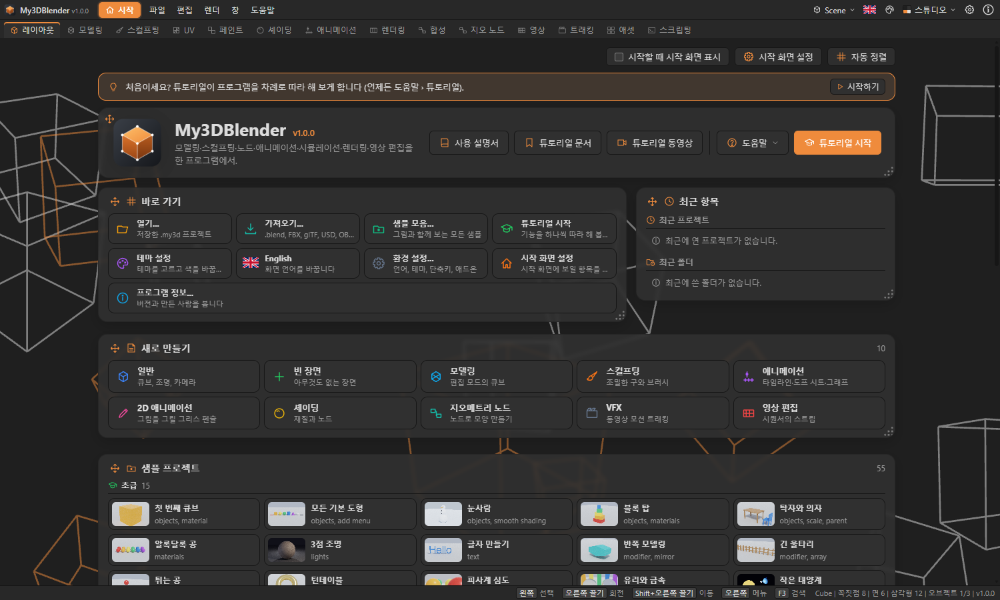
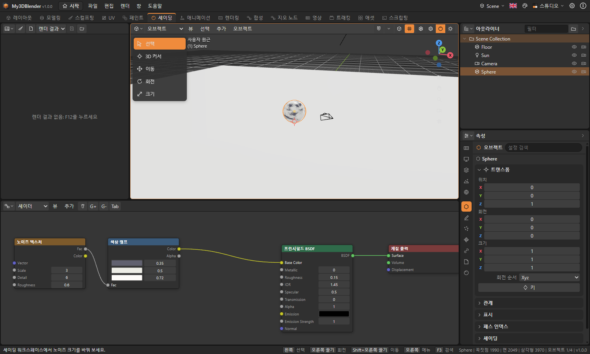
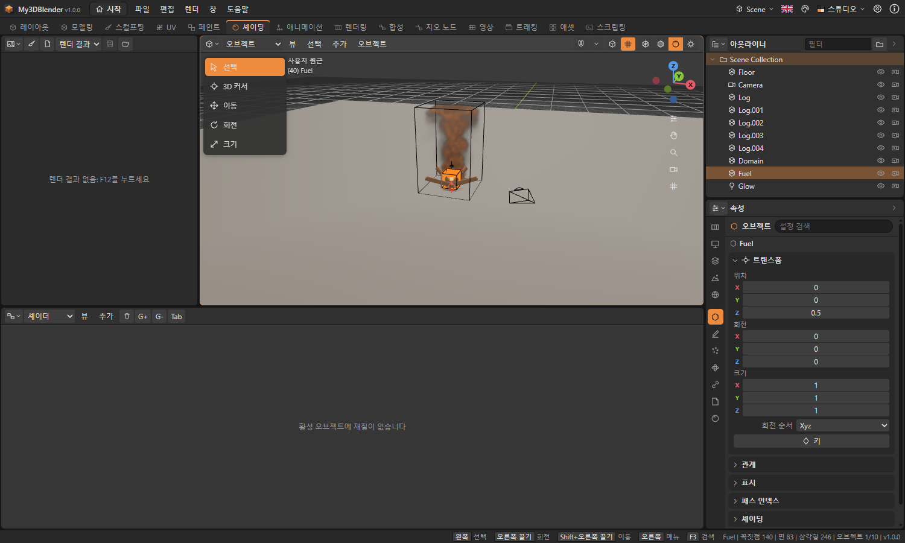
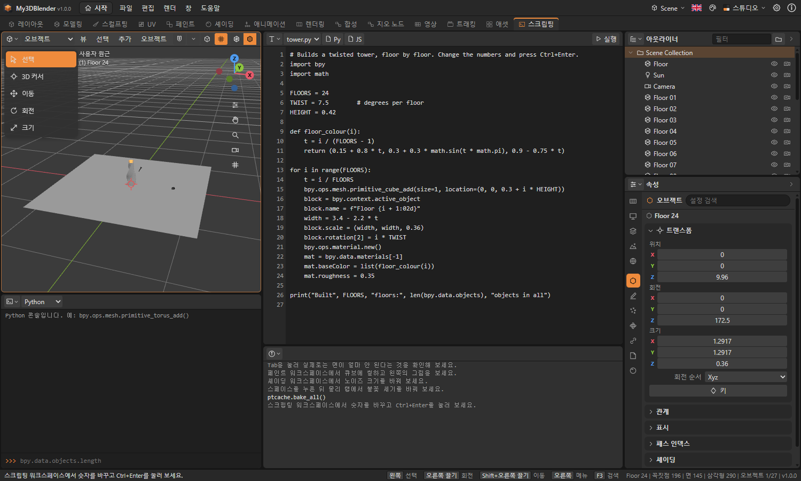
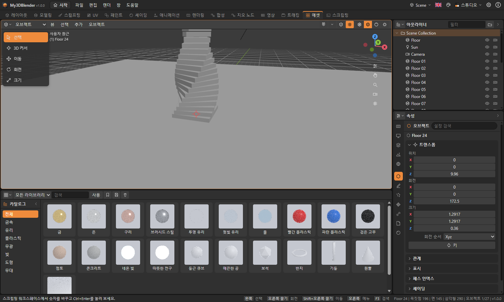
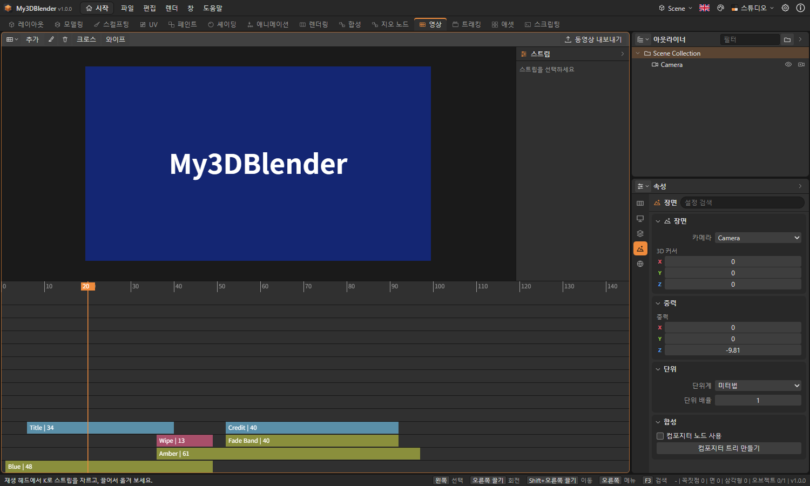
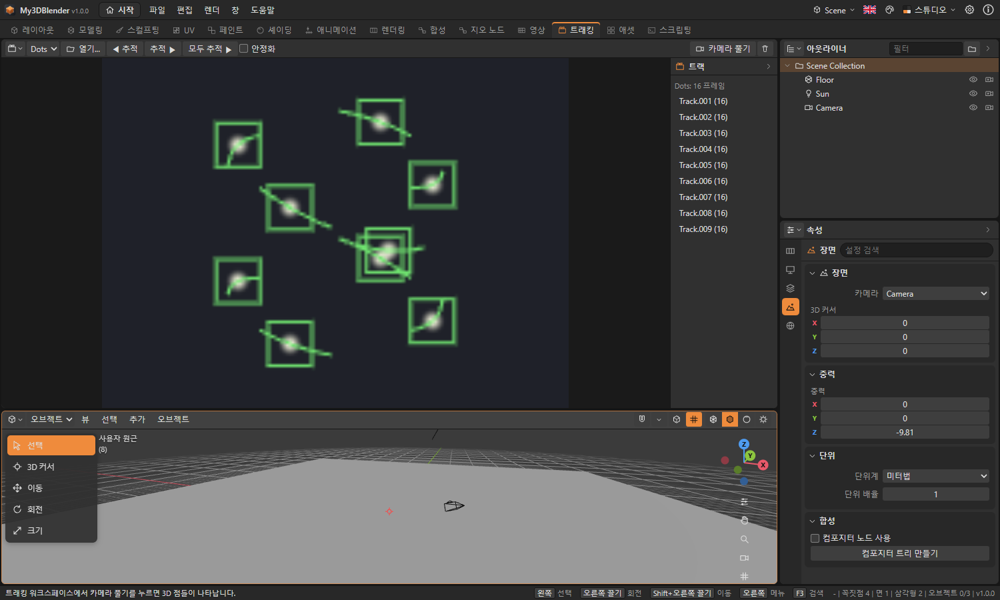

# My3DBlender 사용자 설명서

My3DBlender는 웹 브라우저, Windows, macOS, Linux에서 실행되는 3D 제작 프로그램입니다. 모델링, 스컬프팅, 재질과 노드, 애니메이션, 물리, 렌더링, 스크립팅을 한 화면에서 다룹니다. Blender에서 영감을 받은 독립 프로그램이며 Blender Foundation과 관련이 없습니다.

아직 Blender의 모든 기능이 구현된 것은 아닙니다. 어떤 기능이 완료·부분·예정인지는 **도움말 › 기능 구현 현황**에서 항목별로 확인할 수 있습니다.

## 시작 화면

프로그램을 켜면 시작 화면이 나오고, 튜토리얼을 실행할지 묻는 창이 뜹니다. **튜토리얼 실행**을 누르면 창 안에서 단계별 실습이 시작됩니다. 어디를 볼지 표시되고, 직접 하면 저절로 체크되며, **대신 해 주기**로 넘어갈 수도 있습니다. **도움말 › 튜토리얼**로 언제든 다시 시작합니다. 이 창의 **시작할 때 이 창 표시**를 끄면 다음부터 뜨지 않으며, **환경 설정 › 시작과 튜토리얼**에서 다시 켤 수 있습니다. 맨 위 막대의 이름 오른쪽 **시작** 단추로 언제든 다시 열고 닫습니다. 움직이는 배경 위에 반투명 카드가 놓여 있고, 내용이 길면 화면이 위아래로 스크롤됩니다.



- **맨 위 도구**: 시작할 때 시작 화면 표시, 시작 화면 설정, 자동 정렬
- **안내 띠**: 튜토리얼을 아직 마치지 않았으면 맨 위에 나오고, **시작하기**로 튜토리얼을 엽니다. 튜토리얼을 끝까지 마치면 사라집니다
- **소개 카드**: 프로그램 이름과 버전, **사용 설명서**, **튜토리얼 문서**, **튜토리얼 동영상**, **도움말** 메뉴, 파란색(강조색) **튜토리얼 시작**
- **바로 가기 카드**: 열기, 가져오기, 샘플 모음, 튜토리얼 시작, 테마 설정, 언어, 환경 설정, 시작 화면 설정, 프로그램 정보, 끝내기(데스크톱)
- **최근 항목 카드**: 바로 가기 옆. 최근 프로젝트(× 단추로 목록에서 빼고 **지우기**로 모두 비움)와 그 프로젝트들이 있는 최근 폴더(누르면 그 폴더에서 열기 창이 열림)
- **새로 만들기 카드**: 일반, 빈 장면, 모델링, 스컬프팅, 애니메이션, 2D 애니메이션, 셰이딩, 지오메트리 노드, VFX, 영상 편집. 그 일에 맞는 장면을 만들고 해당 워크스페이스를 엽니다(예: 스컬프팅은 조밀한 구와 스컬프트 모드, 2D 애니메이션은 카메라와 그리기 모드의 그리스 펜슬)
- **샘플 프로젝트 카드**: 초급 15, 중급 20, 고급 20개를 난이도별 묶음으로, 작은 그림과 함께 보여 줍니다
- **테마 카드**: 어두운 테마와 밝은 테마, 오른쪽 위의 **테마 설정**
- **움직이는 배경 카드**: 배경 20종, **움직이는 배경 바꾸기**, 움직임 속도, 카드 불투명도, **자동 변경**과 바꾸는 간격(10초~5분)
- **맨 아래 줄**: 버전, 제작자

카드는 제목 왼쪽의 네 방향 화살표 손잡이를 끌어 옮기고, 오른쪽 아래 모서리를 끌어 크기를 바꿉니다. 끄는 동안 반투명한 복사본이 따라오고 놓일 자리가 점선으로 표시되며, 다른 카드는 겹치지 않게 비켜납니다. 모서리를 두 번 누르면 내용에 맞는 크기로 돌아가고, **자동 정렬**을 누르면 전체가 기본 배치로 돌아갑니다. 배경과 카드 설정은 **환경 설정 › 시작과 튜토리얼**에서도 바꿀 수 있습니다. 튜토리얼 동영상은 데스크톱에서 별도 창으로, 웹에서는 새 창으로 열립니다.

## 샘플 프로젝트

`sample` 폴더에 난이도별 샘플이 있습니다. 시작 화면의 **샘플 프로젝트** 섹션에서 난이도별 묶음 중에 고르거나, **파일 › 샘플**로 큰 그림이 있는 샘플 창을 열어 난이도를 고르고 누릅니다. 샘플을 열면 상태 표시줄에 해 볼 것이 나옵니다. 저장할 때는 새 이름을 묻기 때문에 원본은 바뀌지 않습니다. 시뮬레이션이 있는 샘플은 열 때 자동으로 베이크합니다.

| 난이도 | 내용 |
|---|---|
| 초급 | 도형 추가, 이동, 재질, 조명, 키프레임, 모디파이어 하나 |
| 중급 | 여러 모디파이어, 셰이더·월드 노드, 리그, 천, 강체, 파티클, 인스턴스, 합성 |
| 고급 | 지오메트리 노드, 연기·불·액체, 오션, Python, 애드온, 노드 그룹, OSL, 시퀀서, 모션 트래킹, NURBS, 멀티레졸루션 |

## 화면 구성

맨 위의 막대에는 파일·편집·렌더·창·도움말 메뉴, 워크스페이스 탭, 언어·테마·환경 설정·정보 버튼이 있습니다. 그 아래는 에디터 영역들이고 맨 아래는 상태 표시줄입니다.

각 영역의 왼쪽 위 버튼으로 에디터 종류를 바꿉니다. 영역 머리글에서 오른쪽 버튼을 누르면 분할·합치기·최대화 메뉴가 나옵니다. 영역 사이의 경계선을 끌면 크기가 바뀝니다.

| 워크스페이스 | 용도 |
|---|---|
| 레이아웃 | 장면 배치와 타임라인 |
| 모델링 | 메시 편집 |
| 스컬프팅 | 브러시로 형태 다듬기 |
| UV | UV 펼치기와 수정 |
| 페인트 | 텍스처에 칠하기 |
| 셰이딩 | 재질과 셰이더 노드 |
| 애니메이션 | 도프 시트와 키프레임 |
| 렌더링 | 렌더 결과와 렌더 설정 |
| 합성 | 컴포지터 노드 |
| 지오 노드 | 노드로 형태 만들기 |
| 영상 | 비디오 시퀀서 |
| 트래킹 | 무비 클립과 카메라 풀기 |
| 애셋 | 애셋 브라우저 |
| 스크립팅 | 스크립트와 콘솔 |

## 3D 뷰 조작

| 조작 | 입력 |
|---|---|
| 보는 방향 회전 | 오른쪽 버튼 끌기, 가운데 버튼 끌기, Alt + 왼쪽 버튼 끌기, 또는 오른쪽 위 축 표시 끌기 |
| 이동 | Shift + 오른쪽 또는 가운데 버튼 끌기, 또는 손 모양 단추 끌기 |
| 확대·축소 | 휠, Ctrl + 오른쪽 또는 가운데 버튼 끌기, 또는 돋보기 단추 끌기 |
| 앞·오른쪽·위 시점 | 숫자패드 1·3·7 (Ctrl을 함께 누르면 반대쪽) |
| 카메라 시점 | 숫자패드 0 |
| 원근·직교 전환 | 숫자패드 5 |
| 전체 맞춤, 선택 맞춤 | Home, 숫자패드 . |
| 도구 모음, 사이드바 | T, N |
| 연산자 검색 | F3 |

오른쪽 버튼은 끌지 않고 누르면 메뉴가 열립니다. 격자는 5칸마다 굵은 선이 있으며, 확대·축소하면 칸 간격이 5배씩 바뀌어 다시 그려집니다. 격자는 항상 도형 뒤에 그려지고, 축 방향에서 볼 때는 그 면에 맞게 서서 보입니다. 오른쪽 열과 사이드 패널은 제목 줄의 화살표로 접고 펼칩니다. Z를 누르면 셰이딩을 고르는 원형 메뉴가 뜹니다. 속성 편집기 위쪽의 검색 칸은 현재 탭의 설정을 찾아 줍니다. 편집 모드에서 K는 나이프입니다. 차례로 누르고 Enter로 자르며, C는 뒤까지 관통합니다. Shift+Tab은 스냅을 켜고 끄며, 그 옆 메뉴에서 꼭짓점, 엣지, 면, 오브젝트 중심 중 대상을 고릅니다. 왼쪽 버튼 끌기를 보기 회전으로 바꾸려면 **환경 설정 › 화면 조작**을 씁니다. 터치패드에서는 오른쪽 위의 축 표시와 손 모양, 돋보기 단추를 끌면 됩니다. 축을 클릭하면 그 방향에서 보는 시점으로 바뀝니다. 머리글 오른쪽의 버튼으로 와이어프레임·솔리드·재질 미리보기·렌더 셰이딩을 고릅니다.

## 오브젝트

왼쪽 버튼으로 선택하고, Shift를 누르면 선택에 더합니다. 빈 곳에서 끌면 박스 선택입니다. Shift + 오른쪽 버튼으로 3D 커서를 놓으면 새 오브젝트가 그 자리에 생깁니다.

| 조작 | 입력 |
|---|---|
| 이동·회전·크기 | G, R, S |
| 축 제한 | 이어서 X, Y, Z |
| 수치 입력 | 이어서 숫자, Enter로 확정 |
| 취소 | Esc 또는 오른쪽 버튼 |
| 추가 메뉴 | Shift + A |
| 복제, 삭제 | Shift + D, X |
| 숨기기, 숨김 해제 | H, Alt + H |
| 합치기, 부모 설정 | Ctrl + J, Ctrl + P |
| 키프레임 삽입 | I |

물체 자체를 돌리려면 선택한 뒤 R을 누르고 마우스를 움직여 클릭하거나, 왼쪽 도구 모음의 회전 도구를 골라 나타나는 고리를 끕니다. 이동·크기 도구도 같은 방식입니다.

### 인스턴스

복사본을 만들지 않고 같은 것을 여러 번 그립니다. 원본을 바꾸면 전부 바뀝니다.

- **컬렉션 인스턴스**: 컬렉션을 만들고 물체를 넣은 뒤 **추가 › 컬렉션 인스턴스**에서 고릅니다. 원본 컬렉션은 꺼 두어도 됩니다.
- **꼭짓점·면에 놓기**: 자식 물체를 부모로 묶고 **오브젝트 › 인스턴싱**에서 꼭짓점 또는 면을 고릅니다.
- **오브젝트 › 인스턴싱 › 인스턴스를 실제 오브젝트로**는 각각을 보통 오브젝트로 바꿉니다.

### 여러 장면

맨 위 막대 오른쪽의 장면 단추에서 새 장면, 이 장면 복사, 장면 삭제, 장면 전환을 합니다. 재질과 이미지는 장면끼리 공유합니다.

### NURBS 서피스

**추가 › 서피스**에서 패치, 원기둥, 구, 토러스를 고릅니다. Tab으로 편집 모드에 들어가면 조정점이 보이며, 눌러 선택하고 G·R·S로 옮깁니다. 커브도 같습니다. 해상도와 차수는 오브젝트 데이터 탭에 있습니다.

## 메시 편집

Tab으로 편집 모드에 들어갑니다. 1·2·3으로 꼭짓점·엣지·면 선택을 고릅니다.

| 도구 | 입력 |
|---|---|
| 돌출 | E |
| 면 인셋 | I |
| 베벨 | Ctrl + B |
| 루프 컷 | Ctrl + R (마우스에 가까운 엣지 기준) |
| 엣지/면 만들기 | F |
| 병합 | M |
| 삭제 | X |
| 연결 선택 | L, Ctrl + L |
| 선택 분리 | P |
| 찢기 | V |
| 비례 편집 켜기·끄기 | O (변형 중 휠로 범위 조절) |
| 엣지 크리즈 | Shift + E |
| 펼치기 | U |

인셋이나 베벨처럼 값이 있는 도구를 쓰면 3D 뷰 왼쪽 아래에 **마지막 작업 조정** 패널이 나타납니다. 값을 바꾸면 결과가 그 자리에서 다시 계산됩니다.

메시 메뉴의 엣지 항목에서 심, 샤프, 크리즈를 표시합니다. 표시한 엣지는 편집 모드에서 빨강(심), 청록(샤프), 분홍(크리즈)으로 보입니다. 샤프는 부드러운 셰이딩을 그 엣지에서 끊고, 크리즈는 서브디비전이 그 엣지를 둥글리지 못하게 합니다. 노멀 항목에서 사용자 분할 노멀을 설정할 수 있습니다.

### UV 펼치기

엣지를 고르고 메시 › 엣지 › 심 표시로 자를 곳을 정한 뒤, U로 펼칩니다. 심을 따라 섬으로 나뉘고, 각 섬은 각도를 최대한 유지하도록(LSCM) 평평하게 펴져 정사각형 안에 배치됩니다. 심이 없는 닫힌 메시는 면 방향별로 자동으로 잘라 펼칩니다.

오션 모디파이어의 **거품 사용**을 켜면 파도가 접히는 곳에 거품이 생겨 렌더에서 하얗게 보이고, foam 속성으로도 읽을 수 있습니다. **물보라 사용**을 함께 켜면 물이 가장 많이 눌리는 방향을 spray 속성에 담습니다(**물보라 반전**은 그 직각 방향).

**스펙트럼**은 Blender와 같은 네 가지입니다.

| 스펙트럼 | 바다 |
|---|---|
| 필립스 | 거친 바다. 기본값 |
| 피어슨-모스코위츠 | 바람이 오래 불어 다 자란 바다 |
| JONSWAP | 아직 자라는 바다. **페치**(바람이 부는 거리, km)가 짧을수록 파도가 낮고, **피크 뾰족함**이 클수록 한 길이의 파도가 두드러집니다 |
| TMA (얕은 물) | 얕은 물의 JONSWAP. **깊이**가 얕을수록 긴 파도가 줄어듭니다 |

펼치기는 기본으로 각도 기반 방식을 쓰고, 옵션에서 등각(Conformal)으로 바꿀 수 있습니다.

리메시 모디파이어는 복셀 외에 블록, 부드럽게, 날카롭게 방식이 있고, 이 셋은 사각형 면으로 만듭니다. 스킨 모디파이어의 기본 방식은 Blender처럼 사각형 면과 가지 부분의 볼록 껍질이며, 서브디비전을 뒤에 붙이면 둥글어집니다. 한 덩어리로 흐르는 곡면을 원하면 방식을 SMOOTH로 바꿉니다.

UV 에디터의 UV 메뉴에는 점을 고른 뒤 쓰는 도구가 있습니다. **고정**한 점은 다시 펼쳐도 그 자리에 남고(빨간색으로 표시), **용접**은 고른 점을 한 곳으로 모으고, **꿰매기**는 같은 꼭짓점을 가진 다른 섬을 옮겨 붙입니다. **정렬**은 한 줄로 맞추고, **늘어남 최소화**는 모델의 길이에 맞게 간격을 고릅니다.

## 모디파이어

속성 에디터의 모디파이어 탭에서 추가합니다. 원본 메시를 바꾸지 않고 순서대로 적용되며, 적용 버튼을 누르면 메시에 굳힙니다. 서브디비전 표면, 미러, 배열, 솔리디파이, 베벨, 디시메이트, 불리언, 스크류, 용접, 와이어프레임, 변위, 웨이브, 스무스, 간단 변형, 캐스트, 슈링크랩, 래티스, 아마추어, 지오메트리 노드, 리메시, 멀티레졸루션, 스킨, 오션 등이 있습니다. 스킨은 엣지 주위에 표면을 만들고, 오션은 프레임에 따라 움직이는 바다 면을 만듭니다. 멀티레졸루션은 패널의 세분화 버튼으로 단계를 올리고, 스컬프트 모드에서 칠하면 원본 메시는 그대로 둔 채 맨 위 단계에 저장됩니다.

## 스컬프트와 페인트

머리글의 모드 목록에서 스컬프트, 꼭짓점 페인트, 웨이트 페인트, 텍스처 페인트를 고릅니다. 3D 뷰에서 끌면 칠해지고, Ctrl을 누르면 반대로 작용합니다. 대괄호 키나 Ctrl + 휠로 브러시 크기를 바꿉니다. 브러시 설정은 N 사이드바에 있습니다.

스컬프트에서는 사이드바의 **다이나믹 토폴로지**를 켜면 브러시 주변 메시가 디테일 크기에 맞게 잘게 나뉩니다. **복셀 리메시**는 메시 전체를 고른 면으로 다시 만듭니다.

### 텍스처 페인트

페인트 워크스페이스로 가서 사이드바의 **칠할 텍스처 추가**를 누르면 이미지를 만들어 재질에 연결합니다. UV가 없거나 면끼리 겹치면 먼저 펼칩니다. 모델 위를 끌면 칠해지고, 왼쪽 이미지 에디터에 그림이 함께 나타납니다. 이미지 에디터 머리글의 브러시 버튼을 켜면 그림에 직접 칠할 수도 있습니다.

## 재질과 노드

속성 에디터의 재질 탭에서 새 재질을 만들고, 노드 사용을 누르면 노드 에디터에서 편집할 수 있습니다. 소켓에서 소켓으로 끌면 연결되고, 연결된 입력에서 끌어내면 끊어집니다. Shift + A나 오른쪽 버튼으로 노드를 추가하고, X로 삭제합니다.

노드 에디터 머리글에서 셰이더·월드·지오메트리·컴포지터 트리를 고릅니다.



### 디스플레이스먼트와 볼륨

재질 출력 노드에는 표면 외에 **볼륨**과 **디스플레이스먼트** 입력이 있습니다. 디스플레이스먼트 노드를 연결하면 렌더할 때 메시가 실제로 움직이고 표면에 굴곡도 반영됩니다. 재질의 `displacementMethod`가 TRUE이면 움직임만, BUMP이면 음영만 씁니다. 3D 뷰에는 나타나지 않고, 메시가 조밀할수록 잘 드러납니다.

프린시펄드 볼륨, 볼륨 산란, 볼륨 흡수를 볼륨 입력에 연결하면 메시 안이 그 매질로 채워집니다. 밀도에 텍스처를 연결할 수 있고, 표면을 연결하지 않으면 메시 자체는 보이지 않습니다. 색은 볼륨마다 하나이고 CPU 엔진에서만 렌더됩니다.

### 반복과 시뮬레이션 존

지오메트리 노드의 **반복 입력**과 **반복 출력** 사이에 연결한 노드는 정해진 횟수만큼 되풀이되고, 매번 앞 결과에서 이어집니다. **시뮬레이션 입력**과 **시뮬레이션 출력** 사이는 프레임마다 이전 프레임의 결과에서 이어지며, 시작 프레임에서는 들어오는 지오메트리로 돌아갑니다. 트리를 바꾸면 처음부터 다시 계산합니다. 존 안에서 넘길 수 있는 값은 지오메트리 하나입니다.

### 노드 그룹

노드를 Shift와 함께 눌러 여러 개 고르고 Ctrl + G를 누르면 그룹이 됩니다. 경계를 넘는 연결이 그룹의 소켓이 됩니다. 그룹을 고르고 Tab으로 들어가고 다시 Tab으로 나옵니다. 나올 때 같은 그룹을 쓰는 다른 노드도 함께 바뀝니다. Alt + G는 그룹을 풉니다. 만든 그룹은 **추가 › 노드 그룹**에 나옵니다.

### OSL 스크립트

셰이더 트리의 **추가 › 텍스처 › 스크립트 (OSL)** 노드에는 코드를 직접 씁니다. 매개변수가 소켓이 됩니다. 수치와 삼중값 연산, 제어문, 기본 함수 약 40개를 지원합니다.

```
shader Rings(float Scale = 7, color A = color(1, 0.8, 0.2), output color Color = 0)
{
    Color = A * fract(length(P) * Scale);
}
```

### 오브젝트 컨스트레인트

컨스트레인트 탭의 **컨스트레인트 추가**는 Blender처럼 네 묶음으로 나뉘며, Blender의 오브젝트 컨스트레인트 26종이 모두 있습니다.

| 묶음 | 컨스트레인트 |
|---|---|
| 모션 트래킹 | 카메라 솔버, 트랙 따라가기, 오브젝트 솔버 |
| 트랜스폼 | 위치·회전·크기·트랜스폼 복사, 거리·위치·회전·크기 제한, 부피 유지, 트랜스폼 변환, 트랜스폼 캐시 |
| 따라보기 | 경로에 붙이기, 감쇠 따라보기, 고정 따라보기, 늘이기, 따라보기 |
| 관계 | 액션, 아마추어, 자식, 바닥, 경로 따라가기, 피벗, 수축 감싸기 |

- **수축 감싸기**는 대상 메시의 표면(가장 가까운 면, 꼭짓점, 또는 한 축 방향)으로 옮기며, 거리를 주면 그만큼 떨어져 멈춥니다. 대상은 모디파이어까지 적용된 모습입니다.
- **트랜스폼 변환**은 대상의 위치·회전·크기가 범위 안 어디에 있는지를 같은 비율로 자기 범위에 옮겨, 위치·회전에는 더하고 크기는 바꿉니다.
- **아마추어**는 본 하나나 둘을 골라, 스킨된 꼭짓점처럼 그 본의 움직임을 가중치대로 따라갑니다.
- **카메라 솔버**와 **오브젝트 솔버**는 무비 클립 에디터에서 푼 카메라 움직임을 씁니다. 카메라 솔버는 카메라를 그대로 움직이고, 오브젝트 솔버는 같은 움직임을 고정된 카메라 앞에서 물체가 움직인 것으로 바꿉니다.
- **트랙 따라가기**는 트랙이 보이는 곳으로 옮깁니다. 카메라의 시선 위 정한 깊이에 두거나, **3D 사용**을 켜면 풀어 낸 3D 점에 둡니다.
- **트랜스폼 캐시**는 **캐시 파일 열기...**로 Alembic(.abc) 파일을 열어, 고른 경로의 변환을 프레임마다 그대로 따릅니다. 오브젝트와 이름이 같은 경로가 먼저 골라집니다.

수축 감싸기·트랜스폼 변환·아마추어·트랜스폼 캐시는 Blender 4.5와 같은 위치가 나오는지 프레임마다 확인했습니다.

### 본 컨스트레인트

아마추어의 데이터 탭에서 본마다 **본 컨스트레인트 추가**를 누릅니다. 위치·회전·크기·트랜스폼 복사, 회전·위치·크기 제한, 감쇠 따라보기, 고정 따라보기, 늘이기, 트랜스폼 변환, 스플라인 IK, 아마추어, 액션이 있습니다. 대상은 다른 오브젝트이거나, 본 이름을 적으면 그 아마추어의 본입니다. 저장된 포즈는 그대로 두고 계산 결과에만 적용하며, 부모 본의 결과를 자식 본이 따라갑니다. **롤 사용**을 켜면 본의 축을 자기 축 둘레로 돌릴 수 있습니다.

**액션** 컨스트레인트는 대상의 위치·회전·크기 한 축이 최소와 최대 사이 어디에 있는지에 따라 저장된 액션의 프레임을 골라, 그 프레임의 포즈를 본의 포즈와 합칩니다. 합치는 방식(앞에, 뒤에, 나누어, 바꾸기)은 Blender와 같고, 회전 범위는 도 단위입니다. 오브젝트 컨스트레인트에도 같은 액션이 있습니다.

### 그리스 펜슬

추가 메뉴에서 그리스 펜슬을 만들고 그리기 모드에서 3D 뷰를 끌면 선이 그려집니다. 데이터 탭에서 레이어의 색, 두께, 불투명도, 채우기를 정합니다. 선과 채우기는 3D 뷰와 렌더에 모두 나타나고, 조명의 영향을 받지 않습니다. **프레임별 그림 유지**를 켜면 그 프레임까지 마지막으로 그린 그림만 보입니다. 도구를 ERASE로 바꾸면 끄는 곳이 지워지고, 스트로크 패널에서 부드럽게, 단순화, 세분, 메시로 변환을 할 수 있습니다.

도구를 SCULPT로 바꾸면 끄는 곳의 스트로크가 브러시대로 다듬어집니다. 브러시는 부드럽게, 두께, 세기, 잡기, 밀기, 비틀기, 오므리기, 흩뜨리기가 있고, 두께와 세기는 점마다 달라집니다. **보간** 패널은 현재 프레임 앞뒤의 그림 사이를 그린 순서대로 스트로크끼리 이어 새 그림을 만들고, **시퀀스 보간**은 그 사이의 모든 프레임을 채웁니다. **그리스 펜슬 모디파이어**는 두께, 오프셋, 노이즈, 부드럽게, 단순화, 세분, 배열, 대칭, 빌드, 색조, 불투명도가 있으며, 스트로크는 그대로 두고 보이는 모습만 바꿉니다.

## 애니메이션

도프 시트와 그래프 에디터에서 빈 곳을 끌면 키를 상자로 선택하고, 선택한 키는 함께 움직입니다. A는 전체 선택, Alt+A는 해제, X는 선택 삭제, Shift+D는 복제입니다. 채널은 속성별로 묶이며 묶음 이름을 눌러 접습니다. 그래프 에디터에서 키를 선택하면 핸들이 나타나 끌 수 있고, V로 핸들 종류(자동, 벡터, 정렬, 자유)를 바꿉니다. 왼쪽 채널을 누르면 오른쪽 패널에서 외삽과 F-커브 모디파이어(순환, 노이즈, 다항식, 내장 함수, 계단, 제한)를 다룹니다. 그래프 에디터 머리글의 **드라이버** 단추는 드라이버 편집으로 바꿉니다. 드라이버 식은 숫자, 변수, 수학 함수만 쓸 수 있습니다. NLA에서 스트립을 누르면 시작, 크기, 반복, 거꾸로, 블렌드 인·아웃, 유지를 정하고, 나누거나 다음 스트립으로 이어지는 전환을 넣습니다. 아마추어의 본에는 **IK 추가**로 목표와 폴을 지정하는 실시간 역운동학을 걸고, **본 경로 계산**으로 본 끝의 궤적을 봅니다.

프레임을 정하고 I로 위치·회전·크기에 키프레임을 넣습니다. 포즈 모드에서 I를 누르면 아마추어의 모든 본에 키가 들어가고, 데이터 탭의 **포즈 키**는 그 본에만 넣습니다. 스페이스로 재생하고 왼쪽·오른쪽 화살표로 한 프레임씩 움직입니다. 타임라인 눈금을 끌면 프레임이 바뀝니다. 도프 시트에서는 키를 시간축으로 옮기고, 그래프 에디터에서는 값을 바꿉니다. 오른쪽 버튼 메뉴에서 보간 방식을 고릅니다.

도프 시트와 NLA 머리글의 **액션** 메뉴는 지금의 키를 이름 붙은 액션으로 저장하고, 저장한 액션을 지정하거나 NLA 스트립으로 추가하거나 삭제합니다. 액션은 파일에 함께 저장되고, 본은 이름으로 찾습니다. 도프 시트에서 아마추어의 본 키는 오브젝트 아래 **포즈** 묶음에 본 이름별로 보입니다.

**오브젝트 › 애니메이션 › 모션 경로 계산**은 물체가 지나는 길을 선으로 보여 줍니다. **어니언 스킨**을 켜면 현재 프레임 앞뒤의 모습이 옅게 함께 보입니다.

## 물리

속성 에디터의 물리 탭에서 강체, 천, 소프트 바디, 충돌을 켜고 **모든 시뮬레이션 베이크**를 누르면 결과가 프레임별로 저장됩니다. 파티클은 파티클 탭에서 추가합니다.

강체는 부딪히면 실제로 돌고 넘어집니다. 모양은 상자, 구, 캡슐, 원기둥, 원뿔, 볼록 껍질, 메시 중에서 고릅니다. 메시는 움직이지 않는 강체에서만 표면 그대로 쓰이고, 움직이는 강체는 볼록 껍질로 다룹니다. **애니메이션**을 켜면 키프레임대로 움직이면서 닿는 것을 밀어냅니다.

두 강체를 고른 뒤 **강체 도구 › 선택한 것 연결**을 누르면 그 사이에 제약을 담은 엠프티가 생깁니다. 고정, 점, 경첩, 슬라이더, 피스톤, 일반, 스프링, 모터가 있고 범위 제한과 끊어짐도 설정할 수 있습니다. **키프레임으로 베이크**는 시뮬레이션 결과를 편집할 수 있는 키로 바꿉니다.

천, 소프트 바디, 파티클은 충돌 오브젝트의 실제 모양에 부딪힙니다. 천의 **자기 충돌**을 켜면 천끼리 겹치지 않고, 성긴 천이 접혀도 자기 면을 뚫지 않습니다.

| 설정 | 하는 일 |
|---|---|
| 천의 **압력** | 닫힌 천 안의 공기. 1마다 쉴 때보다 10% 많은 공기를 담습니다. 음수면 쪼그라듭니다 |
| 천의 **재봉** | 면에 속하지 않은 선(느슨한 모서리)이 실이 되어 양 끝을 끌어당깁니다. **재봉 힘**은 한 번에 좁히는 정도입니다 |
| 소프트 바디의 **공기 저항** | 면이 공기를 가르며 받는 저항. 평평하게 떨어지는 판은 천천히, 옆으로 세운 판은 빨리 떨어집니다 |
| 소프트 바디의 **자기 충돌** | 이어지지 않은 정점끼리 **공 크기**만큼 떨어져 있습니다 |

**역장**(**추가 › 역장**)은 바람, 힘, 소용돌이, 끌림, 자기, 조화, 난류, 전하, 레너드-존스, 커브 가이드 중에서 고릅니다. 강체, 천, 소프트 바디, 베이크한 파티클, 연기가 모두 영향을 받습니다. **전하**는 파티클 설정의 전하와 곱해져 같은 부호끼리 밀어내고, **레너드-존스**는 크기 안쪽에서 밀고 바로 바깥에서 당깁니다. **커브 가이드**는 커브(자기 자신이나 고른 커브)를 따라 밀고 **최소 거리**보다 멀어지면 다시 커브로 끌어당깁니다. 파티클은 베이크해야 역장과 충돌의 영향을 받습니다. 그 전에는 포물선으로 날아갑니다. 파티클 설정에서 자식 수를 늘리거나 **렌더 방식**을 OBJECT로 바꿔 다른 오브젝트를 복제해 뿌릴 수 있습니다.

연기와 액체의 흐름은 메시 모양 그대로 채워지고, 충돌 오브젝트는 벽이 되어 그 주위로 돌아갑니다. 액체에는 점성과 **표면 장력**이 있습니다. 표면 장력은 표면을 둥글게 오므리며, 값이 클수록 베이크가 느려집니다. **거품·물보라·기포**를 켜면 빠르게 움직이는 표면에서 작은 입자가 생겨, 공중에서는 떨어지고 표면에서는 물결을 따라가며 물속에서는 떠오릅니다. 이 입자는 두 번째 재질 슬롯으로 그려지므로 **거품 재질 추가**로 흰 재질을 넣어 주세요. 역장은 바람, 힘, 소용돌이, 끌림, 자기, 조화, 난류가 있습니다. 연기는 역장의 영향을 받지 않습니다.



| 시뮬레이션 | 만드는 법 |
|---|---|
| 연기와 불 | 큰 상자에 **연기 도메인**, 그 안의 작은 물체에 **연기 흐름**. 흐름의 종류를 연기, 불, 둘 다 중에서 고릅니다. 역장이 연기를 밀어 바람에 날립니다 |
| 액체 | 큰 상자에 **액체 도메인**, 물이 시작할 자리에 **액체 흐름**. 유입(INFLOW)이면 계속 흘러듭니다. **충돌**을 켠 메시는 장애물이 됩니다 |
| 다이나믹 페인트 | 바닥에 **페인트 캔버스**, 움직이는 물체에 **페인트 브러시**. 옅어짐, 번짐, 패임을 정합니다. 표면을 **파동**으로 바꾸면 브러시가 누른 자리에서 물결이 퍼지고, **웨이트**로 바꾸면 젖은 정도가 버텍스 그룹(**출력 그룹**)에 쓰여 마스크 같은 모디파이어가 씁니다. 페인트 표면은 **이미지 시퀀스 저장**으로 프레임마다 UV 위에 그린 그림(paintmap0001.png, wetmap0001.png…)을 저장합니다 |

베이크 결과는 파일에 저장되지 않습니다. 파일을 다시 열면 **모든 시뮬레이션 베이크**를 다시 눌러 주세요. 도메인과 흐름은 렌더에 나오지 않고 뷰에 선으로만 보입니다.

## 렌더링

F12로 렌더합니다. 렌더 엔진은 두 가지입니다.

| 엔진 | 특징 |
|---|---|
| 경로 추적 (CPU) | 전역 조명, 유리, 금속, 피사계 심도. 샘플 수가 많을수록 깨끗하고 오래 걸립니다 |
| 경로 추적 (GPU) | 같은 원리를 그래픽 카드에서 빠르게 계산합니다. 노드 재질은 한 값으로 계산하고 볼륨은 그리지 않습니다 |
| 실시간 (GPU) | 빠른 래스터 렌더. 그림자와 조명만 반영합니다 |

결과는 이미지 에디터에 표시되며, 렌더 메뉴에서 PNG로 저장합니다. 애니메이션은 출력 탭의 **애니메이션 파일**에서 PNG 묶음, MP4, AVI 중에서 고릅니다. MP4는 H.264로 저장하고, 인코더가 없는 환경에서는 AVI(JPEG)로 저장하면서 그렇게 알려 줍니다. 소리는 들어가지 않습니다. 출력 탭에서 해상도와 프레임 범위를 정합니다.

**볼륨**은 **추가 › 볼륨**에서 넣습니다. 안개, 구름, 빛줄기가 되며 경로 추적(CPU)에서 그립니다. 렌더 탭의 **Freestyle**을 켜면 실루엣, 크리즈, 경계에 선을 그립니다.

### 렌더 패스

경로 추적(CPU)은 렌더할 때마다 Blender와 같은 패스를 모읍니다. 뷰 레이어 탭에서 켠 패스가 컴포지터의 **렌더 레이어** 노드에 출력으로 나타납니다.

| 묶음 | 패스 |
|---|---|
| 데이터 | 깊이, 안개, 노멀, 위치, UV, 알베도, 방출, 오브젝트 인덱스, 재질 인덱스 |
| 빛 | 디퓨즈·글로시·투과 각각의 직접, 간접, 색. 볼륨 직접과 간접, 방출, 환경, 앰비언트 오클루전 |
| 크립토매트 | 오브젝트, 재질, 애셋(맨 위 부모) |

- 빛 패스는 Blender처럼 색을 나눈 빛입니다. 디퓨즈 색 × (디퓨즈 직접 + 간접) 같은 식으로 모두 더하면 렌더 이미지와 같아집니다.
- **안개**는 월드 탭의 **안개 패스**(시작, 깊이, 감쇠)를 따르고, **앰비언트 오클루전**은 월드 탭의 거리 안에서 가려진 정도입니다. 이 두 패스는 이미지와 다른 난수를 써서 켜도 렌더 결과가 바뀌지 않습니다.
- **오브젝트 인덱스**는 오브젝트 탭의 **패스 인덱스**입니다.

**라이트 그룹**은 뷰 레이어 탭에서 만듭니다(+, **사용 중인 것 추가**, **안 쓰는 것 제거**). 조명과 빛나는 메시는 오브젝트 탭의 **셰이딩**에서, 월드는 월드 탭에서 그룹을 고릅니다. 그룹마다 렌더 레이어 노드에 **Combined_그룹 이름** 출력이 생기며, 모든 빛이 그룹에 들어 있으면 그룹들을 더한 것이 렌더 이미지입니다.

**크립토매트** 노드는 이름(쉼표로 여럿)을 받아 그 오브젝트, 재질 또는 애셋만 남기는 매트를 만듭니다. 가장자리처럼 여러 오브젝트가 한 픽셀을 나누는 곳은 그 비율만큼 남습니다. **Pick** 출력은 오브젝트마다 다른 색으로 보여 줍니다. ID는 크립토매트 규격(MurmurHash3)을 따릅니다.

GPU 엔진과 실시간 엔진은 이미지만 냅니다. 모션 벡터, 그림자 캐처, 셰이더 AOV 패스는 아직 없습니다.

### 베이크

렌더 탭의 베이크 패널은 활성 오브젝트의 표면을 UV에 따라 새 이미지로 만듭니다. 종류는 색, 발광, 거칠기, 노멀, 위치, UV, AO, 조합입니다. UV가 없으면 먼저 펼쳐야 합니다. **멀티레졸루션에서 베이크**는 조각한 최상위 레벨의 세부를 기본 메시의 UV에 디스플레이스먼트나 노멀 맵으로 굽습니다.

## 스크립팅

스크립팅 워크스페이스의 텍스트 에디터에서 Ctrl + Enter로 실행합니다. 이름이 `.py`로 끝나면 Python, `.js`로 끝나면 JavaScript로 실행합니다. 콘솔은 머리글에서 언어를 고릅니다.

여기의 Python은 이 프로그램에 직접 구현한 인터프리터입니다. 클래스, 컴프리헨션, 예외, f-문자열, `math`, `random`, `mathutils`를 쓸 수 있습니다. 제너레이터(`yield`, `yield from`, `send`, `close`)도 됩니다. `yield`는 문장, 대입의 오른쪽, 그 안의 괄호에만 쓸 수 있습니다. C 확장과 pip는 없고, `bpy`는 연산자와 장면 데이터를 다룹니다.

```
import bpy
bpy.ops.mesh.primitive_cube_add(size=2, location=(0, 0, 1))
bpy.context.active_object.scale[2] = 3
print(len(bpy.data.objects))
```

메뉴에 있는 연산자는 모두 `bpy.ops`로 부를 수 있습니다.



### 애드온

**편집 › 애드온 › 애드온 관리**에서 켜고 끕니다. 기어, 복사본 흩뿌리기, 메시 통계가 들어 있고, `.py`나 `.js` 파일을 설치할 수도 있습니다. 애드온이 만든 작업은 **편집 › 애드온**과 F3 검색에 나옵니다. 애드온은 프로그램이므로 믿을 수 있는 것만 설치하세요.

## 애셋 브라우저

애셋 워크스페이스에서 재질과 도형을 그림으로 고릅니다. 더블 클릭하면 재질은 선택한 물체에 입혀지고 도형은 3D 커서 위치에 생깁니다. 머리글 단추로 활성 물체를 이 파일의 애셋으로 표시하거나 내 라이브러리에 저장합니다. 내 라이브러리는 파일이 달라도 남습니다.



## 비디오 시퀀서

영상 워크스페이스에서 스트립을 시간축에 놓아 영상을 만듭니다.



| 조작 | 입력 |
|---|---|
| 스트립 추가 | 머리글의 추가, 오른쪽 버튼, 또는 Shift + A |
| 옮기기 | 스트립을 끌기 (겹치면 위 채널로 올라갑니다) |
| 자르기 | 재생 헤드에서 K |
| 삭제 | X |
| 전환 | 겹친 스트립을 고르고 크로스 또는 와이프 |
| 프레임 이동 | 눈금을 끌기 |
| 확대·축소 | 휠 |

스트립은 색, 텍스트, 이미지, 장면, 동영상 클립, 소리 중에서 고릅니다. **동영상 내보내기**는 WebM 파일을 실제 시간대로 녹화합니다. 소리는 재생만 되고 내보내는 파일에는 들어가지 않습니다.

## 모션 트래킹

트래킹 워크스페이스의 **열기**로 동영상을 엽니다. 샘플 `camera-solve`에는 연속 이미지 클립이 들어 있습니다.



1. 그림의 뚜렷한 지점을 눌러 마커를 놓습니다.
2. **추적 ▶**으로 뒤 프레임까지 따라갑니다. 지점을 놓치면 거기서 멈춥니다.
3. **안정화**를 켜면 트랙이 멈춰 있도록 그림이 움직입니다.
4. 트랙이 4개 이상이면 **카메라 풀기**로 3D 점과 애니메이션 카메라를 만듭니다. 멀리 있는 카메라(직교)로 계산하므로 원근이 강하면 오차가 커집니다. 오차는 트랙 목록 아래에 나옵니다.

풀어 낸 카메라 움직임은 클립에 함께 저장되므로, 다른 카메라나 물체에 **카메라 솔버**, **오브젝트 솔버**, **트랙 따라가기** 컨스트레인트를 걸어 쓸 수 있습니다.

## 파일

glTF(.glb, .gltf)는 장면 전체를 주고받습니다. 계층, 재질과 기본 색 텍스처, 스킨과 아마추어, 애니메이션, 셰이프 키, 카메라, 조명이 함께 옮겨집니다. Draco로 압축했거나 데이터를 별도 파일에 둔 glTF는 읽지 못하며, 그 이유를 알려 줍니다. PLY는 이진과 텍스트를 모두 읽고 이진으로 씁니다. FBX, Collada, USD, Alembic도 장면 단위로 주고받으며, 각 형식이 담을 수 있는 계층·재질·카메라·조명·애니메이션이 함께 옮겨집니다.

프로젝트는 `.my3d` 파일로 저장합니다. 가져오기와 내보내기는 파일 메뉴에 있습니다. 파일을 창에 끌어다 놓아도 가져올 수 있습니다.

| 형식 | 가져오기 | 내보내기 | 참고 |
|---|---|---|---|
| OBJ | 가능 | 가능 | 면, UV, 선 |
| STL | 가능 | 가능 | 가져올 때 꼭짓점을 합칩니다 |
| PLY | 가능 | 가능 | ASCII와 바이너리, 꼭짓점 색 포함 |
| glTF (.glb, .gltf) | 가능 | 가능 | 장면 전체: 위 설명 참고 |
| Blender (.blend) | 가능 | 불가 | Blender 2.48~5.x, 압축 파일 포함. 오브젝트와 부모, 가중치와 셰이프 키, 모디파이어, 제약, 리그와 애니메이션, 조명, 카메라, 재질 색과 파일에 포함된 그림. 커브, 글자 같은 다른 오브젝트는 그 자리의 엠프티로 남고, 빠진 것은 가져온 뒤 알려 줍니다 |
| FBX | 가능 | 가능 | 바이너리와 ASCII를 읽고 바이너리 7.4로 씁니다. 계층, 재질과 포함된 텍스처, 스킨, 셰이프 키와 그 애니메이션, 카메라, 조명, 애니메이션 |
| USD (.usda, .usdc, .usdz) | 가능 | 가능 | 계층, 시간에 따른 변환, 메시와 UV, 면별 재질, UsdPreviewSurface 재질(.usdz 안의 기본 색 그림 포함), 카메라, 조명, 스켈레톤(UsdSkel)과 스킨된 메시, 셰이프 키(블렌드 셰이프)와 그 값의 애니메이션, 모양이 바뀌는 메시(프레임별 점). 참조·페이로드·상속과 고른 변형을 합쳐 읽고, 다른 레이어는 .usdz 안에서 찾습니다. 바이너리 파일의 변형과 .usdz 밖의 레이어는 읽지 않습니다 |
| Alembic (.abc) | 가능 | 가능 | Ogawa 형식, 장면 단위. 계층과 프레임마다의 변환, 메시와 UV(프레임마다 모양이 바뀌면 포인트 캐시로 읽음), 카메라, 커브(선형·베지어·B-스플라인·NURBS를 읽고 선으로 씀). Alembic에는 조명과 재질이 없습니다 |
| Collada (.dae) | 가능 | 가능 | 계층, 메시와 UV, 확산 색 재질, 카메라, 조명, 아마추어와 스킨, 애니메이션. 그림은 파일 이름으로만 가리킵니다 |
| SVG | 가능 | 불가 | Blender의 가져오기와 같은 결과. 경로(호 포함), 사각형(둥근 모서리), 원, 타원, 선, 폴리라인, 다각형, 그룹, use와 symbol, 변환, 단위와 뷰 박스. 채운 도형은 채운 2D 커브가 되고 색마다 SVGMat 재질 하나, 파일 이름의 컬렉션에 들어갑니다 |

파일 › 추가(Append)는 다른 `.my3d`나 `.blend` 파일의 오브젝트를 재질과 함께 복사해 옵니다.

## 설정과 단축키

환경 설정은 왼쪽 목록에서 고르는 여섯 쪽이고, 왼쪽 아래의 **기본값으로 되돌리기**로 처음 상태로 돌아갑니다. **화면**: 언어, 테마, 화면 크기(데스크톱), 상태 표시줄, 최근 프로젝트 수. **3D 뷰**: 격자, 축 표시, 도구 이름, 기즈모 크기. **화면 조작**: 회전·이동·확대 속도, 휠 방향, 오른쪽·왼쪽 버튼 끌기. **시작과 튜토리얼**: 시작 화면, 튜토리얼 묻기, 배경. **패키지**: 필요한 외부 패키지(WebView2 런타임)의 설치 상태, 받아서 설치, 진행률, 중지. 실패하면 다시 설치할지 묻습니다. **시스템**: 실행 취소 단계, 렌더 스레드, 단축키, 애드온. 설치 프로그램도 WebView2가 없으면 자동으로 받아 설치하며, 실패하면 다시 시도할지 묻습니다. 테마는 맨 위 막대에서 바로 바꿀 수도 있습니다. **단축키 편집**에서 작업을 찾아 키 칸을 누른 뒤 새 키를 누르면 바뀝니다. Backspace는 키를 없애고 Esc는 취소하며, 다른 작업과 겹치면 표시됩니다.

| 조작 | 입력 |
|---|---|
| 실행 취소, 다시 실행 | Ctrl + Z, Ctrl + Shift + Z |
| 저장, 다른 이름으로 저장 | Ctrl + S, Ctrl + Shift + S |
| 열기, 새로 만들기 | Ctrl + O, Ctrl + N |
| 영역 최대화 | Ctrl + 스페이스 |
| 전체 화면 | F11 |
