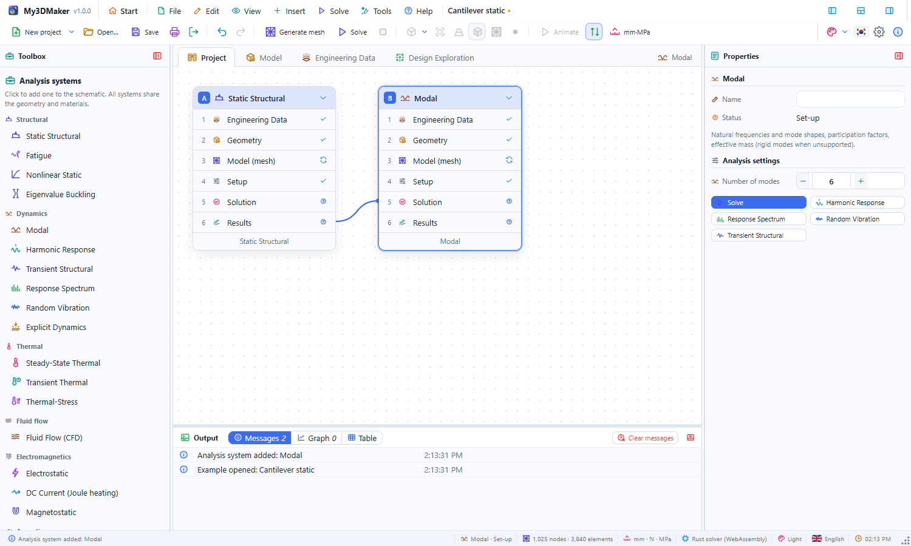
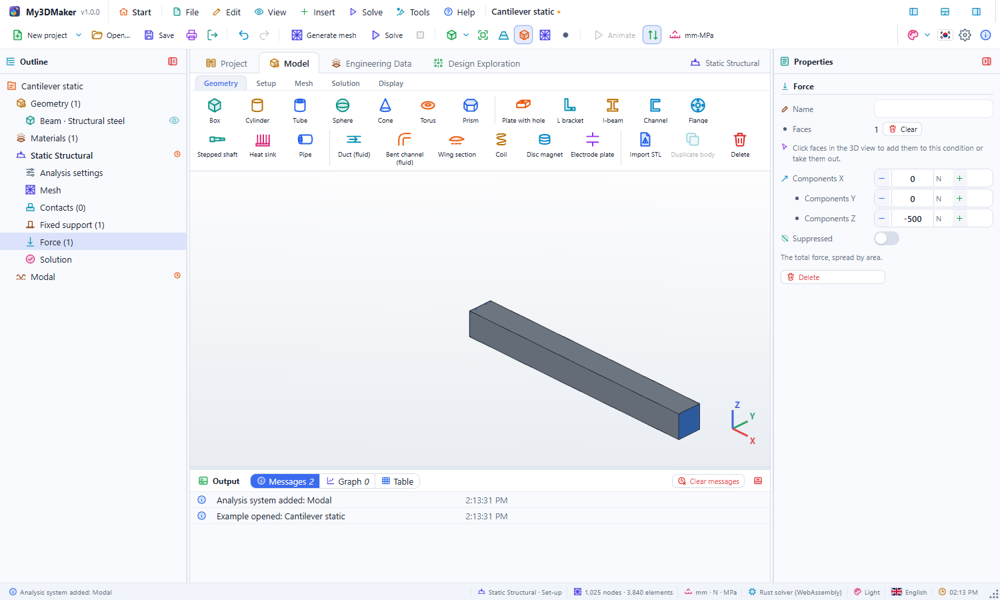
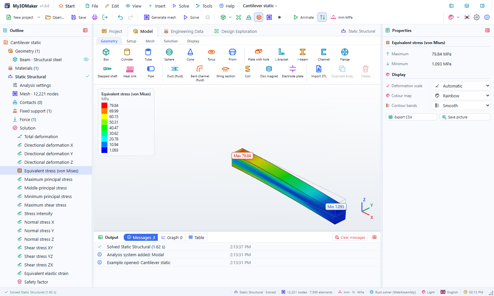
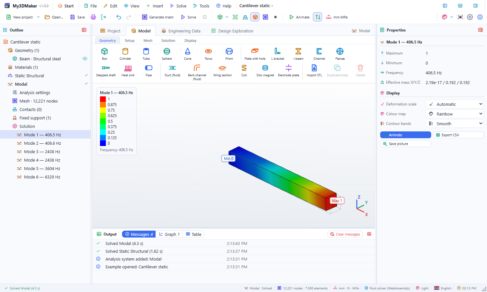
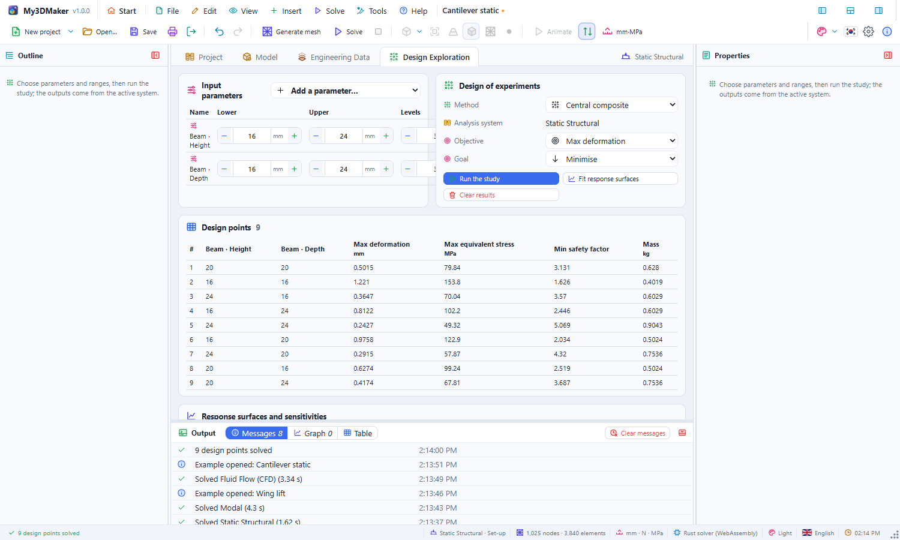

# My3DMaker Tutorial — Stress and vibration of a bracket

Starting from an empty project, this tutorial finds the static stress of an L bracket, then its natural frequencies with the same model, then compares designs by varying its thickness. It takes about fifteen minutes.

## 1. Project and analysis system

1. On the start page click **New analysis system › Static Structural**. A new project with a static structural system opens on the **Project** tab.
2. Follow the block's cells from top to bottom: Engineering Data → Geometry → Model → Setup → Solution → Results.

## 2. Geometry

1. Click the **Geometry** cell: the **Model** tab opens.
2. Click **Geometry › L bracket** in the ribbon.
3. In the Properties panel on the right, under **Dimensions**, set width 80, height 80, thickness 8, depth 40, hole diameter 12 (with − / + or by typing).
4. Set **Material** to **Aluminium alloy**.

## 3. Support and load

1. Click **Setup › Fixed support** in the ribbon.
2. In the 3D view click the back face of the upright leg (the large face towards −X). It turns deep blue and the outline shows **Fixed support (1)**. Click a wrong face again to take it out.
3. Add a **Force** and click the end face of the horizontal leg (the small face towards +X).
4. Set **Components Z** to −800 N.

## 4. Mesh and solve

1. Choose **Mesh** in the outline: element size 4 mm, order **Quadratic (TET10)**.
2. **Generate mesh** shows it; the statistics give the node and element counts and the quality histogram.
3. Click **Solve** (F5). After a few seconds the results appear under **Solution**.

## 5. Results

1. Choose **Equivalent stress (von Mises)**. The peak is in the inside corner where the legs meet.
2. With **Deformation scale** on automatic the deformed shape is exaggerated, drawn with the undeformed outline.
3. **Safety factor** shows the margin to yield; below 1 the material yields.
4. In the bottom panel's **Table**, check that the fixed support's reaction is 800 N.

## 6. Vibration with the same model

1. Back on the **Project** tab, choose ▾ › **Add linked Modal** on the static block. A modal system with the same supports appears to its right.
2. Click its **Solution** cell to solve it.
3. Choose **Mode 1** and click **Animate**. The **Table** lists each mode's frequency and effective mass.

## 7. Design exploration

1. Make the static system active and open the **Design Exploration** tab.
2. **Add a parameter…**: the bracket's **thickness** and **depth**; the range is ±20 % of the current value.
3. Objective **Max equivalent stress**, goal **Minimise**.
4. **Run the study**: nine design points are solved, then the response surfaces, sensitivities and the optimum candidate show.

## 8. Report

**File › Print report** (Ctrl+P) previews an A4 report with the current result picture and colour scale, the result summary, the model, the conditions and a chart, to print or save as PDF. **Export › Report (HTML)** saves the same as a web page.

## Next

- Open examples of the other physics: heat sink, flow around a wing, solenoid coil, duct acoustics, topology optimisation.
- The user's guide (F1) lists every condition and result.
