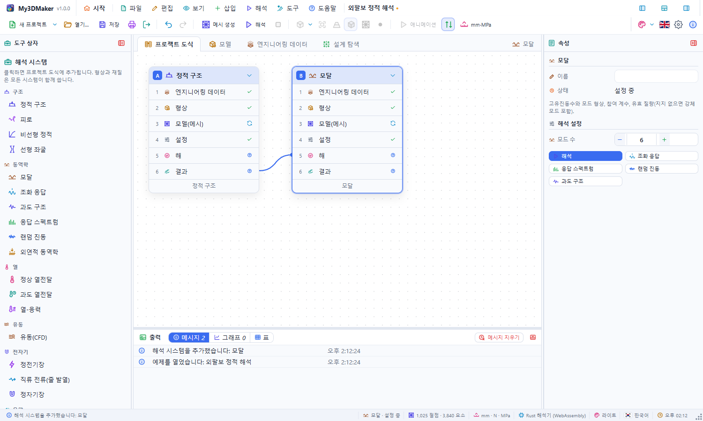
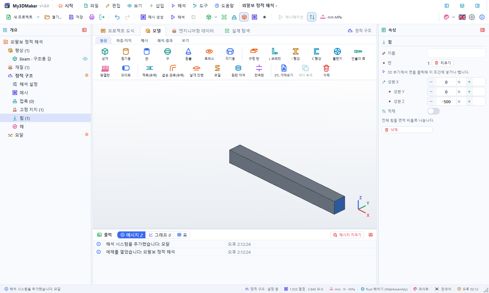
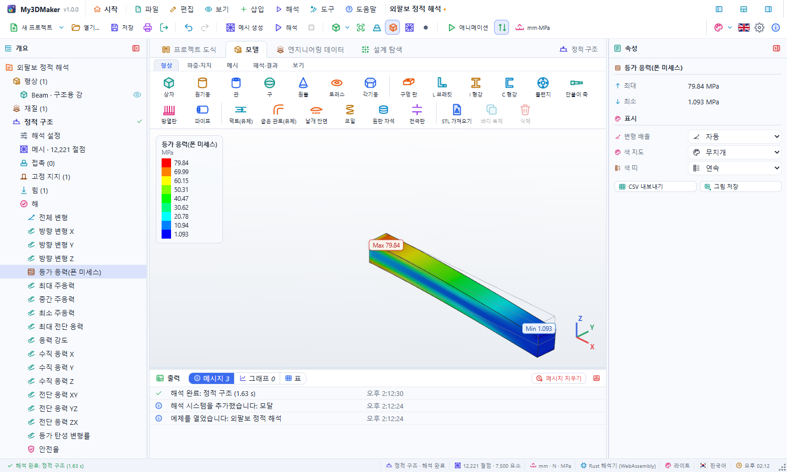
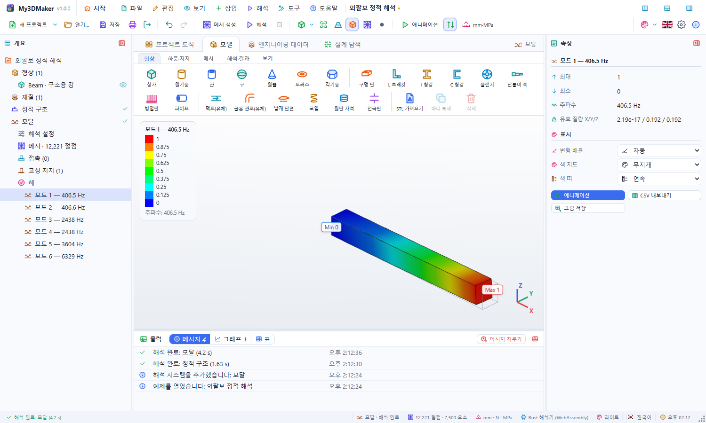
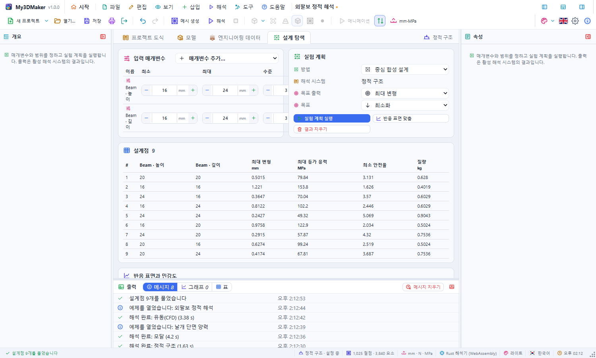

# My3DMaker 튜토리얼 — 브래킷의 응력과 진동

이 튜토리얼에서는 빈 프로젝트에서 시작해 L 브래킷의 정적 응력을 구하고, 같은 모델로 고유진동수를 구한 뒤, 두께를 매개변수로 바꿔 가며 설계를 비교합니다. 15분쯤 걸립니다.

## 1. 프로젝트와 해석 시스템

1. 시작 화면의 **새 해석 시스템 › 정적 구조**를 누릅니다. 새 프로젝트에 정적 구조 시스템이 생기고 **프로젝트 도식** 탭이 열립니다.
2. 블록의 칸을 위에서 아래로 따라가면 됩니다: 엔지니어링 데이터 → 형상 → 모델 → 설정 → 해 → 결과.

## 2. 형상 만들기

1. **형상** 칸을 누르면 **모델** 탭이 열립니다.
2. 리본 **형상 › L 브래킷**을 누릅니다.
3. 오른쪽 속성 패널의 **치수**에서 너비 80, 높이 80, 두께 8, 깊이 40, 구멍 지름 12로 바꿉니다. 값은 − / + 단추나 직접 입력으로 바꿉니다.
4. **재질**에서 **알루미늄 합금**을 고릅니다.

## 3. 지지와 하중

1. 리본 **하중·지지 › 고정 지지**를 누릅니다.
2. 3D 보기에서 세로 다리의 뒷면(−X 쪽 큰 면)을 클릭합니다. 면이 진한 파랑으로 바뀌고 개요에 **고정 지지 (1)**이 나옵니다. 잘못 고른 면은 다시 클릭하면 빠집니다.
3. **힘**을 추가하고 가로 다리의 끝면(+X 쪽 작은 면)을 클릭합니다.
4. 오른쪽 속성 패널의 **성분 Z**를 −800 N으로 합니다.

## 4. 메시와 해석

1. 개요의 **메시**를 고르고 요소 크기를 4 mm, 요소 차수를 **2차 (TET10)**로 둡니다.
2. **메시 생성**으로 메시를 확인합니다. 메시 통계에 절점·요소 수와 품질 분포가 나옵니다.
3. 도구 모음의 **해석**(F5)을 누릅니다. 몇 초 뒤 **해** 아래에 결과가 생깁니다.

## 5. 결과 보기

1. **등가 응력(폰 미세스)**을 고릅니다. 최대 응력은 두 다리가 만나는 안쪽 모서리에 생깁니다.
2. 오른쪽 속성 패널에서 **변형 배율**을 자동으로 두면 변형된 모양이 과장되어 보입니다. **변형 전 윤곽**이 함께 그려집니다.
3. **안전율**을 고르면 항복 강도 대비 여유가 나옵니다. 1보다 작은 곳은 항복합니다.
4. 아래 패널 **표**에서 고정 지지의 반력이 800 N인지 확인합니다.

## 6. 같은 모델로 진동 해석

1. **프로젝트 도식**으로 돌아가 정적 구조 블록의 ▾ › **모달 연결 추가**를 고릅니다. 지지가 이어진 모달 시스템이 오른쪽에 생깁니다.
2. 모달 블록의 **해** 칸을 누르면 해석이 시작됩니다.
3. 결과에서 **모드 1**을 고르고 **애니메이션**을 누릅니다. 아래 패널 **표**에 모드별 진동수와 유효 질량이 나옵니다.

## 7. 설계 탐색

1. 정적 구조 시스템을 활성화하고 **설계 탐색** 탭을 엽니다.
2. **매개변수 추가…**에서 브래킷의 **두께**와 **깊이**를 더합니다. 범위는 기본값의 ±20 %입니다.
3. 목표 출력을 **최대 등가 응력**, 목표를 **최소화**로 둡니다.
4. **실험 계획 실행**을 누릅니다. 설계점 9개를 풀고 반응 표면, 민감도, 최적 후보를 보여 줍니다.

## 8. 보고서

**파일 › 보고서 인쇄**(Ctrl+P)는 현재 결과 그림과 색 막대, 결과 요약, 모델, 조건, 그래프가 들어간 A4 보고서를 미리 봅니다. 인쇄하거나 PDF로 저장합니다. **내보내기 › 보고서(HTML)**는 같은 내용을 웹 문서로 저장합니다.

## 다음 단계

- 예제 프로젝트에서 다른 물리 분야를 열어 보세요: 방열판의 열해석, 날개 주위 유동, 솔레노이드 코일, 덕트 음향, 위상 최적화.
- 사용 설명서(F1)에 모든 조건과 결과가 정리되어 있습니다.
