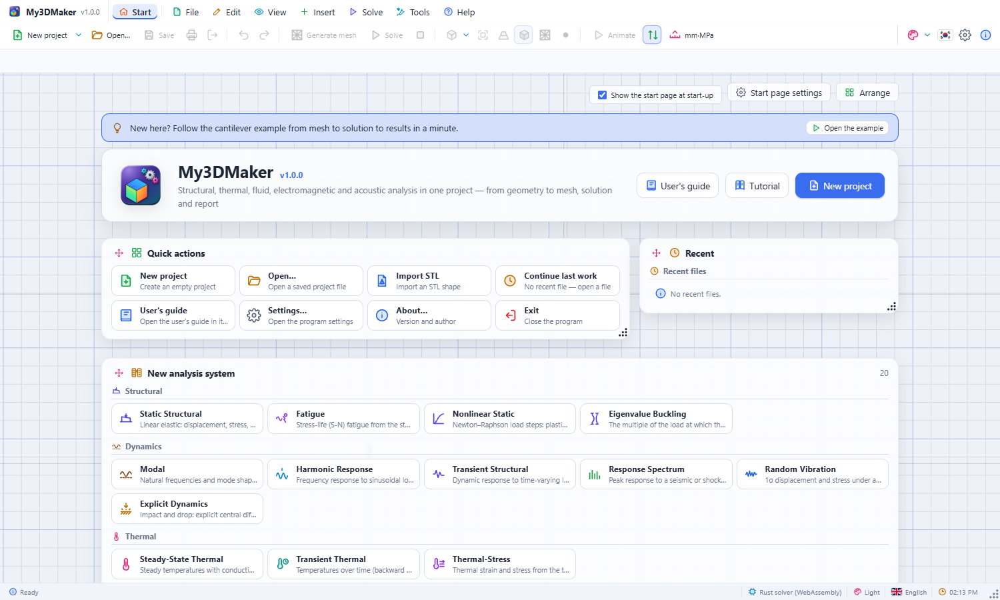
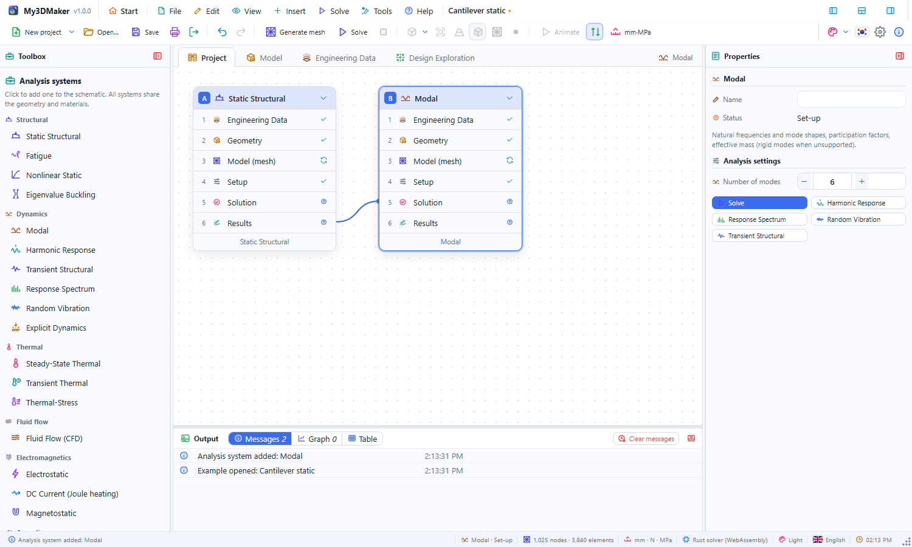
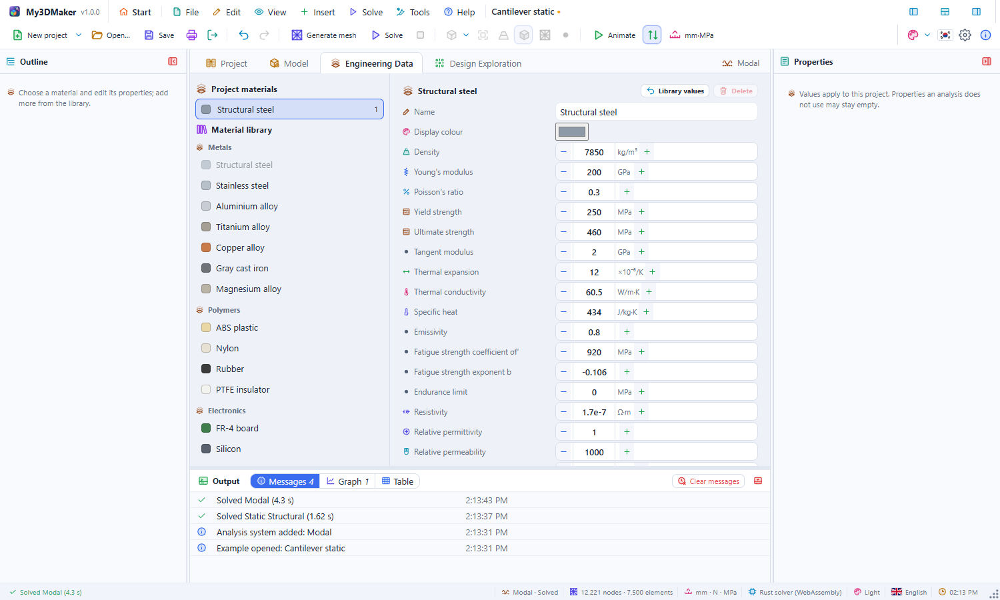
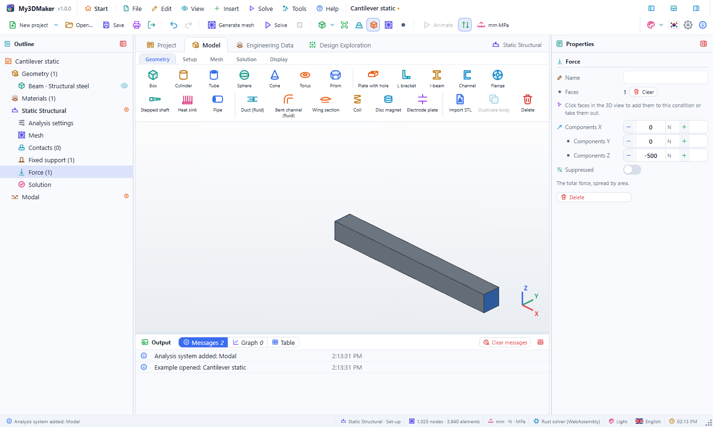
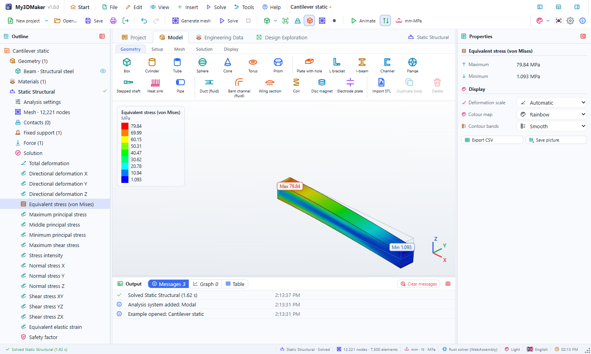
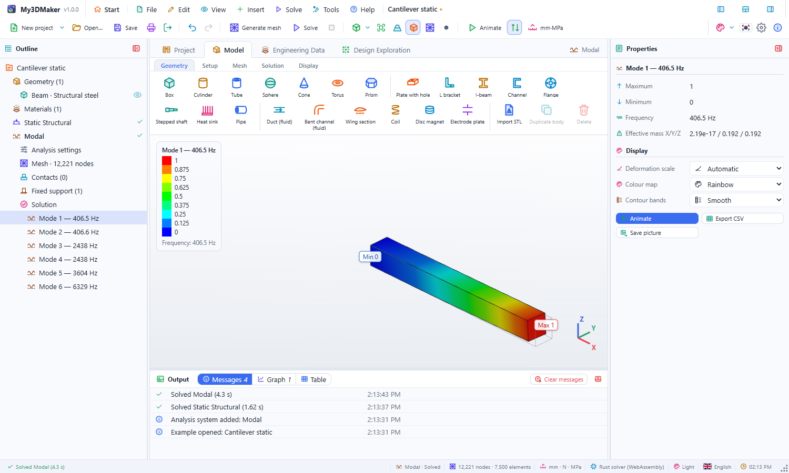
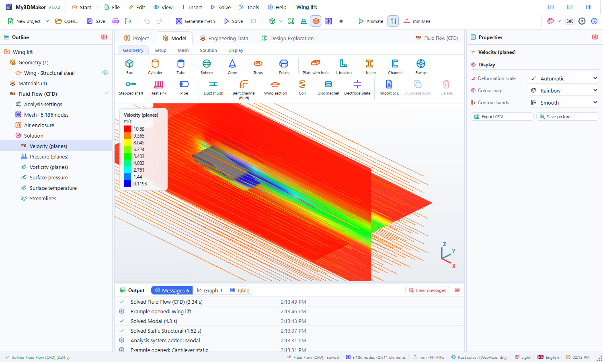
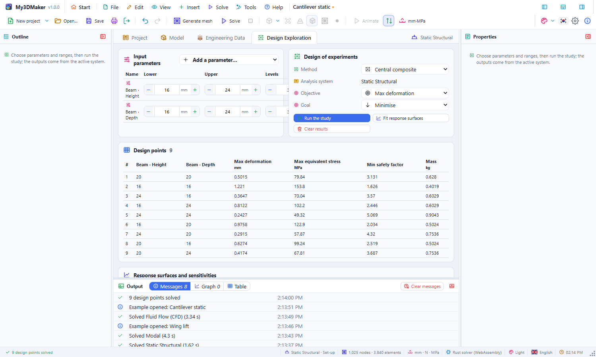

# My3DMaker User's Guide

My3DMaker analyses parts and assemblies in 3D. One project covers structural analysis (static, modal, buckling, harmonic, transient, response spectrum, random vibration, fatigue, nonlinear, explicit dynamics), heat transfer (steady, transient, thermal stress), fluid flow (CFD with heat transfer), electromagnetics (electrostatics, DC current, magnetostatics), acoustics (modal, harmonic), topology optimisation and design exploration.

The solvers are written in Rust. The desktop app (Windows, macOS, Linux) runs them natively; the web version runs the same code compiled to WebAssembly. Both give the same results.

## 1. The window

- **Menu bar**: Start, File, Edit, View, Insert, Solve, Tools, Help, with the window buttons at the right.
- **Toolbar**: new project, open, save, print, export, undo/redo, generate mesh, solve, stop, view direction, display style, animation, unit system, theme, language, settings, about. When the window is narrow the names go and the icons stay.
- **Workspace tabs**: Project, Model, Engineering Data, Design Exploration.
- **Left panel**: the outline (Model tab) or the toolbox (Project tab).
- **Right panel (Properties)**: the properties and settings of the selection (dimensions, material, load values, analysis settings, result display).
- **Bottom panel (Output)**: messages, graph, table.
- Each panel has an icon, a title and a collapse button in its head; collapsed, only the expand button and a vertical title stay. The three buttons at the right of the menu bar (left of the window buttons) collapse and expand the left, bottom and right panels. Drag the lines between panels to resize them.
- **Right-click menus** fit each panel: outline items (rename, material, hide, show only this body, suppress, duplicate, delete, solve, add linked …), the toolbox, the schematic, the properties, the output (copy messages, save a chart or copy its data, copy tables) and the 3D view (select or hide a body, add a condition on this face, add or remove a face, views, display styles).
- **Status bar**: progress, active system, mesh size, units, solver, theme, language, clock. Drag the bottom-right corner to resize the window.

## 2. The start page

Cards move by their handle and resize from their corner; **Arrange** restores the first layout.

- **Actions**: new project, open, import STL, continue, user's guide, settings, about, exit
- **Recent**: recently opened projects
- **New analysis system**: the 20 analyses by physics; a click starts a project with that system
- **Example projects**: 31 examples with geometry, materials, loads and supports in place, ready to solve
- **Background**: the moving background and its speed

## 3. The project schematic

Each analysis system is a block; its cells are the order of work:

1. **Engineering Data**: materials
2. **Geometry**: bodies
3. **Model (mesh)**: element size and order
4. **Setup**: analysis settings, loads and supports
5. **Solution**: solve
6. **Results**: see the results

The mark at the right of a cell is its state: green tick done, grey question mark to do, amber arrows out of date, red failed.

- Click a system in the **toolbox** on the left to add it.
- The block's ▾ (or its right-click menu) offers **linked** follow-ups that take over its loads and supports and appear to its right with an arrow: static → buckling, fatigue, nonlinear; modal → harmonic, transient, spectrum, random; thermal → thermal stress.
- All systems share the geometry and the materials.

## 4. Geometry

Add bodies from the **Geometry** ribbon of the **Model** tab:

- Primitives: box, cylinder, tube, sphere, cone, torus, prism
- Parts: plate with hole, L bracket, I-beam, channel, flange, stepped shaft, heat sink, pipe
- Fluid and electromagnetics: duct, bent channel, wing section, coil, disc magnet, electrode plate
- **Import STL**: a closed triangle mesh (binary or text)

Choose a body in the outline: the details show its name, material, suppression, local element size, dimensions, position and rotation. Change values with − / + or by typing. The eye hides a body. Touching bodies share nodes and are bonded.

Z is up; lengths are in mm.

## 5. Engineering Data

Pick a project material on the left and edit its properties on the right. The library holds 21 materials (metals, polymers, electronics, magnetic materials, fluids). Values apply to this project only.

| Analysis | Properties used |
|---|---|
| Structural | density, Young's modulus, Poisson's ratio, yield and ultimate strength, tangent modulus |
| Fatigue | fatigue strength coefficient σf′, exponent b, endurance limit |
| Thermal | conductivity, specific heat, thermal expansion, emissivity |
| Electric | resistivity, relative permittivity |
| Magnetic | relative permeability |
| Fluid and acoustics | density, viscosity, speed of sound, volumetric expansion |

## 6. Mesh

Choose **Mesh** in the outline to set the element size, element order and maximum nodes. Size 0 is automatic (a 25th of the model). **Generate mesh** builds it and shows the node and element counts, element quality, aspect ratio and the quality histogram.

- **Linear (TET4)**: fast. Explicit dynamics and magnetostatics use linear elements.
- **Quadratic (TET10)**: better stresses and frequencies; mid-side nodes follow curved surfaces.

The mesher splits a rectilinear grid into tetrahedra and moves the boundary nodes onto the surfaces: faces parallel to the axes are exact, curved faces are approximated to the element size.

## 7. Loads and supports

The **Setup** ribbon shows only the conditions the active system understands. A new condition is selected in the outline; **click faces** in the 3D view to add them or take them out. Conditions on bodies take their bodies in the details.

| Category | Conditions |
|---|---|
| Supports | fixed, displacement, frictionless, elastic |
| Loads | force, pressure, moment, bearing load, gravity, acceleration, rotational velocity, thermal condition |
| Explicit | initial velocity, rigid wall |
| Thermal | temperature, convection, heat flux, heat flow, radiation, heat generation, heat power, body temperature |
| Electric | voltage (faces or bodies), current, volume and surface charge |
| Magnetic | coil (loop or straight), permanent magnet |
| Acoustic | normal velocity, acoustic pressure, absorbing |
| Fluid | inlet, outlet (internal flow) |

Colours: supports blue, loads red, thermal orange, electric purple, magnetic teal, acoustic pink, fluid green; the selected condition deep blue.

**Contacts**: touching bodies are bonded by default. A contact can be bonded, no separation, frictionless, rough or frictional; frictionless and frictional are solved by the nonlinear static analysis. **Find contacts** finds the touching body pairs in the mesh.

## 8. Solving

**Solve** (F5) solves the active system, **Solve all** every system. The progress window and the status bar show the stage (meshing, assembling, solving equations, the eigenproblem …); **Stop** ends it.

| System | Method |
|---|---|
| Static, thermal stress | 4/10-node tetrahedra, preconditioned conjugate gradients (incomplete Cholesky + rigid-body coarse space) |
| Modal, buckling, acoustic modes | LOBPCG eigensolver |
| Harmonic, spectrum, random | mode superposition |
| Transient structural | Newmark average acceleration |
| Nonlinear | Newton–Raphson, J2 plasticity, total Lagrangian large deflection, penalty contact, step bisection |
| Explicit | central differences, corotational tetrahedra, plasticity, erosion |
| Thermal | steady and backward Euler, radiation by iteration |
| Fluid | Cartesian projection method, semi-Lagrangian advection, eddy-viscosity turbulence, buoyancy, conjugate heat |
| Electromagnetics | nodal elements (electrostatic, DC), edge elements (magnetostatic) |
| Topology | SIMP, sensitivity filter, optimality criteria |

## 9. Results

Choose a result under **Solution**: the 3D view shows the contours, the colour scale and max/min labels. Click a face to read the value there.

- **Deformation scale**: automatic, true scale, undeformed, ×10, ×100, ×1000
- **Colour map**: rainbow, viridis, cool–warm, thermal, grayscale / **bands**: smooth, 8, 12, 16
- **Animation**: mode shapes, harmonic response, transient and explicit frames, temperatures over time
- **Planes**: flow and field results show on mid-planes of the domain; the flow also draws streamlines.

The **Graph** tab shows frequency response, phase, displacement and temperature histories, load–displacement, energies, compliance convergence, the flow residual and natural frequencies. The **Table** tab lists modes (frequency, effective mass, cumulative share), buckling factors, reactions, heat out, drag and lift, magnetic forces, terminal currents and the summary values.

## 10. Design exploration

1. **Add a parameter…** — a dimension or a load value — and set its lower, upper and levels.
2. Choose the method (central composite, full factorial, Latin hypercube), the objective and minimise or maximise.
3. **Run the study** solves the active system at every design point and tabulates the outputs.
4. Quadratic response surfaces follow: R², sensitivity bars, the optimum candidate and a map over the first two parameters.

## 11. Files, export, printing

- Project file: `.my3d` (JSON). Results are not stored; a reopened project shows its systems as **out of date**.
- Export: report (HTML), CSV (result values and chart data), picture (PNG), optimised topology (STL)
- **Print report** (Ctrl+P): an A4 report — the current result picture, its colour scale, the result summary, the model, the conditions and a chart — previewed, printed or saved as PDF.

## 12. Settings

The settings window (Ctrl+,), **Simulation** tab: unit system (mm·N·MPa or SI), colour map, bands, deformation scale, undeformed outline, max/min labels, animation speed, plane opacity, default element order, 3D display style. The other tabs: general, appearance (40-odd themes and a custom one), fonts, start page.

## 13. Shortcuts

| Key | Action |
|---|---|
| Ctrl+N / Ctrl+O / Ctrl+S | New / open / save |
| Ctrl+Shift+S | Save as |
| Ctrl+Z / Ctrl+Y | Undo / redo |
| Delete | Delete the selection |
| Ctrl+D | Duplicate the body |
| F5 | Solve |
| F | Zoom to fit |
| Ctrl+P | Print report |
| F1 | User's guide |
| Esc | Stop the animation |

Mouse: left drag rotates, right or middle drag pans, the wheel zooms, a click picks a face.

## 14. Accuracy and limits

- The examples' cantilever deflection, natural frequency and buckling load agree with beam theory within 5 % (checked by the automated tests).
- Flow is computed on a uniform Cartesian grid without resolved boundary layers: use drag coefficients to compare designs.
- Magnetostatics uses linear materials (constant permeability).
- The web version runs single-threaded WebAssembly, two to three times slower than the desktop app; use the desktop app for large models.
