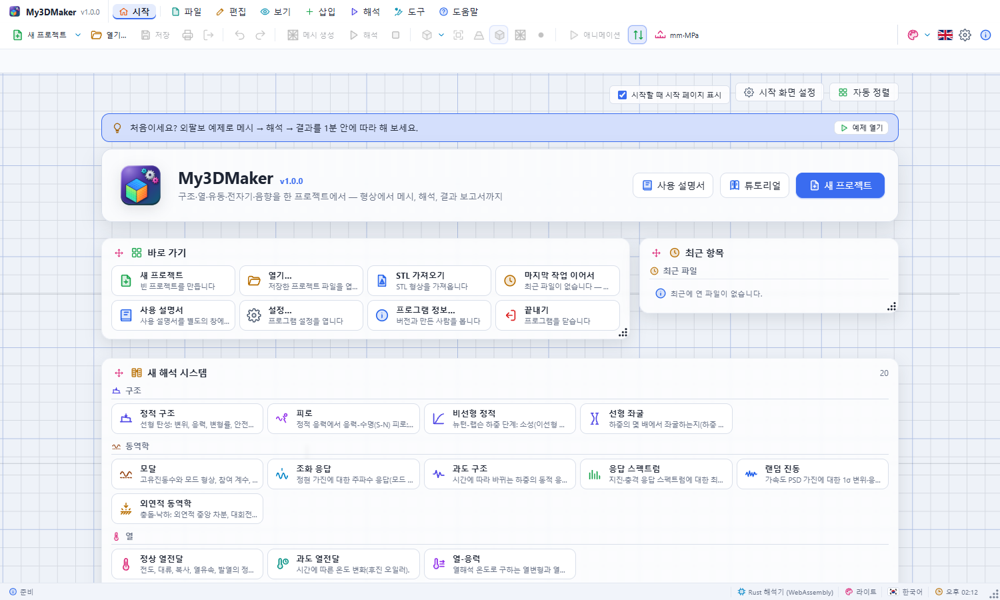
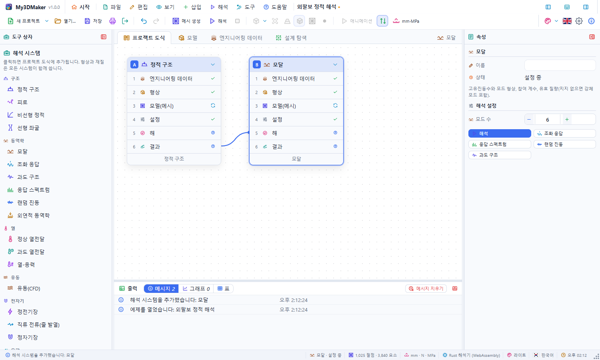
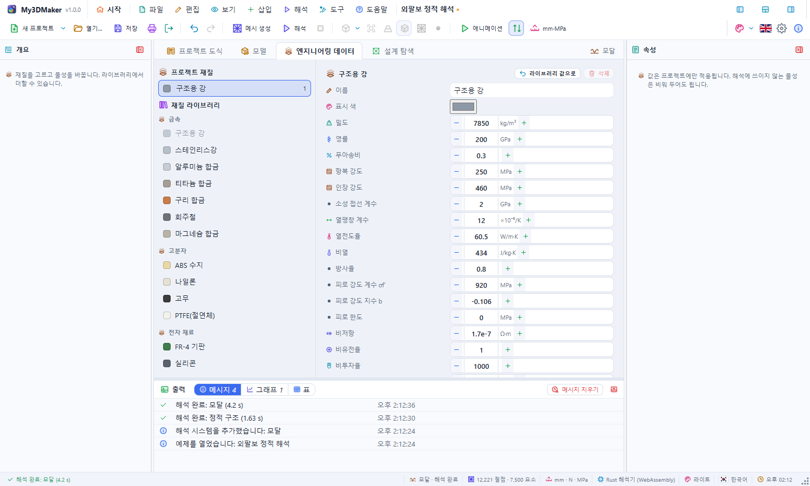
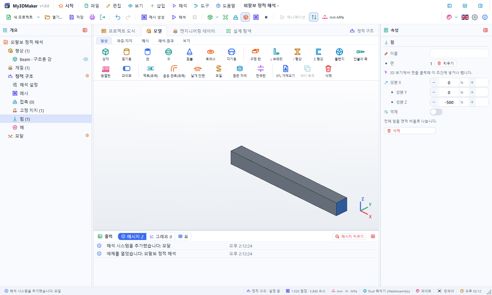
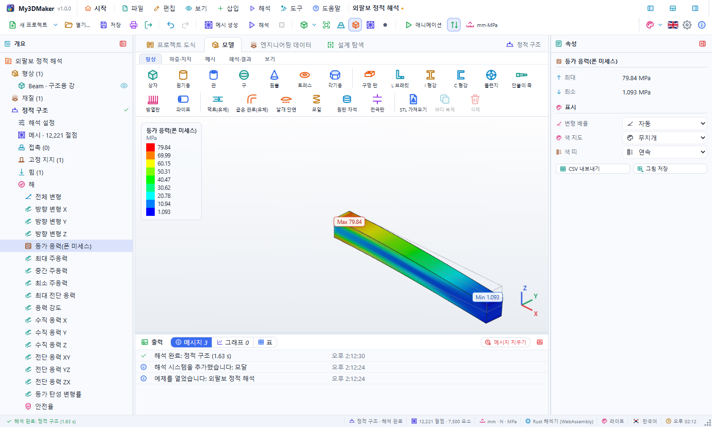
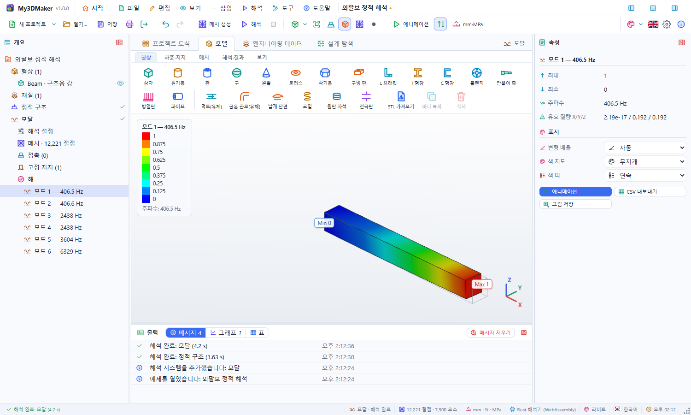
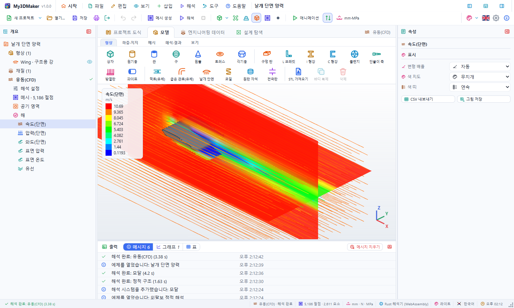
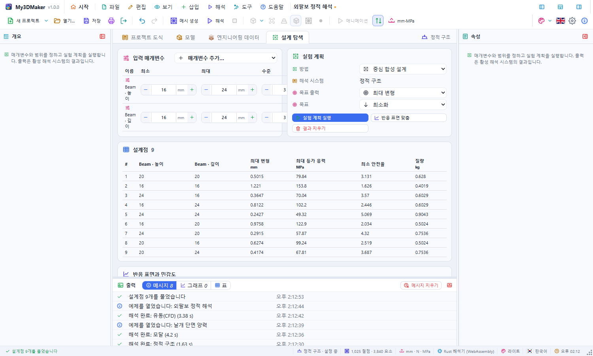

# My3DMaker 사용 설명서

My3DMaker는 부품과 조립품을 3D로 해석하는 프로그램입니다. 구조(정적·모달·좌굴·조화·과도·응답 스펙트럼·랜덤 진동·피로·비선형·외연적 동역학), 열(정상·과도·열응력), 유동(CFD, 열전달 포함), 전자기(정전기장·직류 전류·정자기장), 음향(모달·조화), 위상 최적화와 설계 탐색을 한 프로젝트에서 다룹니다.

해석기는 Rust로 작성되어 있습니다. 데스크톱 앱(Windows·macOS·Linux)에서는 네이티브로, 웹 브라우저에서는 같은 코드를 WebAssembly로 컴파일해 실행합니다. 결과는 두 환경에서 같습니다.

## 1. 화면 구성

- **메뉴 표시줄**: 시작, 파일, 편집, 보기, 삽입, 해석, 도구, 도움말. 오른쪽 끝에 창 단추가 있습니다.
- **도구 모음**: 새 프로젝트, 열기, 저장, 인쇄, 내보내기, 되돌리기, 메시 생성, 해석, 중지, 보기 방향, 표시 방식, 애니메이션, 단위계, 테마, 언어, 설정, 프로그램 정보. 창이 좁으면 이름이 숨고 아이콘만 남습니다.
- **작업 탭**: 프로젝트 도식, 모델, 엔지니어링 데이터, 설계 탐색.
- **왼쪽 패널**: 개요(모델 탭) 또는 도구 상자(프로젝트 탭).
- **오른쪽 패널(속성)**: 선택한 항목의 속성과 설정(치수, 재질, 하중 값, 해석 설정, 결과 표시 방식).
- **아래 패널(출력)**: 메시지, 그래프, 표.
- 패널마다 머리에 아이콘·제목·접기 단추가 있고, 접으면 펴기 단추와 세로 제목만 남습니다. 메뉴 표시줄 오른쪽(창 단추 왼쪽)의 세 단추로 왼쪽·아래·오른쪽 패널을 한 번에 접고 펼 수 있습니다. 패널 사이 경계선을 끌어 너비와 높이를 바꿉니다.
- **오른쪽 클릭 메뉴**는 패널마다 다릅니다: 개요 항목(이름 바꾸기, 재질, 숨기기·이 바디만 보이기, 억제, 복제, 삭제, 해석, 연결 추가 …), 도구 상자, 프로젝트 도식, 속성, 출력(메시지 복사, 그래프 저장·자료 복사, 표 복사), 3D 보기(바디 선택·숨기기, 이 면에 조건 추가, 면 넣기·빼기, 보기 방향, 표시 방식).
- **상태 표시줄**: 진행 상황, 활성 해석 시스템, 메시 크기, 단위계, 해석기 종류, 테마, 언어, 시계. 오른쪽 아래 모서리를 끌어 창 크기를 바꿉니다.

## 2. 시작 화면

시작 화면의 카드는 손잡이로 옮기고 모서리로 크기를 바꿀 수 있습니다. **자동 정렬**은 처음 배치로 되돌립니다.

- **바로 가기**: 새 프로젝트, 열기, STL 가져오기, 이어서 작업, 사용 설명서, 설정, 프로그램 정보, 끝내기
- **최근 항목**: 최근에 연 프로젝트
- **새 해석 시스템**: 물리 분야별 20가지 해석. 누르면 새 프로젝트에 그 시스템이 추가됩니다.
- **예제 프로젝트**: 31개. 각 예제는 형상, 재질, 하중과 지지가 모두 설정되어 있어 바로 해석할 수 있습니다.
- **배경**: 움직이는 배경의 종류와 속도

## 3. 프로젝트 도식

해석 시스템은 블록으로 표시됩니다. 블록의 칸은 작업 순서입니다.

1. **엔지니어링 데이터**: 재질
2. **형상**: 바디
3. **모델(메시)**: 요소 크기와 차수
4. **설정**: 해석 설정, 하중과 지지
5. **해**: 해석 실행
6. **결과**: 결과 보기

칸 오른쪽의 표시는 상태입니다. 초록 체크는 완료, 회색 물음표는 아직, 노란 화살표는 다시 해석이 필요한 상태, 빨간 표시는 오류입니다.

- 왼쪽 **도구 상자**에서 해석 시스템을 누르면 추가됩니다.
- 블록 머리의 ▾ 또는 오른쪽 클릭 메뉴에서 **연결 추가**를 고르면 그 시스템의 하중과 지지를 이어받는 시스템이 오른쪽에 생기고 화살표로 이어집니다. 예: 정적 → 좌굴·피로·비선형, 모달 → 조화·과도·스펙트럼·랜덤, 열 → 열응력.
- 형상과 재질은 모든 시스템이 함께 씁니다.

## 4. 형상

**모델** 탭의 리본 **형상**에서 바디를 추가합니다.

- 기본 도형: 상자, 원기둥, 관, 구, 원뿔, 토러스, 각기둥
- 부품: 구멍 판, L 브래킷, I 형강, C 형강, 플랜지, 단붙이 축, 방열판, 파이프
- 유체·전자기: 덕트, 굽은 관로, 날개 단면, 코일, 원판 자석, 전극판
- **STL 가져오기**: 닫힌 삼각형 메시(이진·텍스트)

개요에서 바디를 고르면 세부 정보에 이름, 재질, 억제, 국부 요소 크기, 치수, 위치와 회전이 나옵니다. 값은 − / + 단추나 직접 입력으로 바꿉니다. 눈 단추로 바디를 숨깁니다. 맞닿은 바디는 절점을 공유해 결합됩니다.

좌표는 Z가 위입니다. 길이는 mm입니다.

## 5. 엔지니어링 데이터

왼쪽에서 프로젝트 재질을 고르고 오른쪽에서 물성을 고칩니다. 라이브러리에는 금속, 고분자, 전자 재료, 자성 재료, 유체 등 21가지 재질이 있습니다. 값은 이 프로젝트에만 적용됩니다.

| 해석 | 쓰는 물성 |
|---|---|
| 구조 | 밀도, 영률, 푸아송비, 항복 강도, 인장 강도, 소성 접선 계수 |
| 피로 | 피로 강도 계수 σf′, 피로 강도 지수 b, 피로 한도 |
| 열 | 열전도율, 비열, 열팽창 계수, 방사율 |
| 전기 | 비저항, 비유전율 |
| 자기 | 비투자율 |
| 유동·음향 | 밀도, 점성 계수, 음속, 부피 팽창 계수 |

## 6. 메시

개요의 **메시**를 고르면 요소 크기, 요소 차수, 최대 절점 수를 정합니다. 요소 크기 0은 자동(모델 크기의 1/25)입니다. **메시 생성**을 누르면 메시를 만들고 절점·요소 수, 요소 품질, 종횡비와 품질 분포를 보여 줍니다.

- **1차 (TET4)**: 빠릅니다. 외연적 동역학과 정자기장은 1차 요소를 씁니다.
- **2차 (TET10)**: 응력과 진동수가 더 정확합니다. 곡면에서는 중간 절점이 표면에 맞춰집니다.

메시는 직교 격자를 사면체로 나누고 경계 절점을 표면으로 옮겨 만듭니다. 축에 나란한 면은 정확히 맞춰지고 곡면은 요소 크기에 따라 근사됩니다.

## 7. 하중과 지지

리본 **하중·지지**에는 활성 시스템에 맞는 조건만 나옵니다. 조건을 추가하면 개요에서 선택된 상태가 되고, 3D 보기에서 **면을 클릭**하면 그 면이 조건에 들어가거나 빠집니다. 바디가 대상인 조건은 세부 정보에서 바디를 고릅니다.

| 분류 | 조건 |
|---|---|
| 지지 | 고정, 변위, 마찰 없는 지지, 탄성 지지 |
| 하중 | 힘, 압력, 모멘트, 베어링 하중, 중력, 가속도, 회전 속도, 열 조건 |
| 외연적 | 초기 속도, 강체 벽 |
| 열 | 온도, 대류, 열유속, 열 유량, 복사, 내부 발열, 발열량, 바디 온도 |
| 전기 | 전압(면 또는 바디), 전류, 체적·표면 전하 |
| 자기 | 코일(원형·직선), 영구 자석 |
| 음향 | 진동 속도, 음압, 흡음 |
| 유동 | 입구, 출구(내부 유동) |

조건의 색: 지지 파랑, 하중 빨강, 열 주황, 전기 보라, 자기 청록, 음향 분홍, 유동 초록. 선택한 조건은 진한 파랑입니다.

**접촉**: 맞닿은 바디는 기본으로 결합됩니다. 접촉을 추가하면 결합, 분리 없음, 마찰 없음, 거침, 마찰을 고를 수 있습니다. 마찰 없음과 마찰은 비선형 정적 해석에서 계산됩니다. **접촉 자동 찾기**는 메시에서 맞닿은 바디 쌍을 찾습니다.

## 8. 해석

도구 모음의 **해석**(F5)은 활성 시스템을, **모두 해석**은 프로젝트의 모든 시스템을 풉니다. 진행 창과 상태 표시줄에 단계(메시, 행렬 조립, 방정식 풀이, 고유값 풀이 …)와 진행률이 나오며 **중지**로 멈출 수 있습니다.

해석 방법 요약:

| 시스템 | 방법 |
|---|---|
| 정적·열응력 | 4·10절점 사면체, 전처리 켤레 기울기법(불완전 촐레스키 + 강체 운동 조대 공간) |
| 모달·좌굴·음향 모달 | LOBPCG 고유값 풀이 |
| 조화·스펙트럼·랜덤 | 모드 중첩 |
| 과도 구조 | 뉴마크 평균 가속도 |
| 비선형 | 뉴턴-랩슨, J2 소성, 전체 라그랑지 대변형, 벌칙 접촉, 하중 단계 이분 |
| 외연적 | 중앙 차분, 공회전 사면체, 소성, 요소 제거 |
| 열 | 정상·후진 오일러, 복사는 반복 |
| 유동 | 직교 격자 투영법, 반라그랑지 대류, 와점성 난류, 부력, 공액 열전달 |
| 전자기 | 정전기장·직류: 절점 요소, 정자기장: 에지 요소 |
| 위상 최적화 | SIMP, 민감도 필터, 최적성 조건 |

## 9. 결과

개요 **해** 아래의 결과를 고르면 3D 보기에 등고선, 색 막대, 최대·최소 표시가 나옵니다. 면을 클릭하면 그 점의 값을 보여 줍니다.

- **변형 배율**: 자동, 실제 배율, 변형 없음, ×10, ×100, ×1000
- **색 지도**: 무지개, 비리디스, 냉온, 열화상, 흑백 / **색 띠**: 연속, 8, 12, 16
- **애니메이션**: 모드 형상, 조화 응답, 과도·외연적 프레임, 과도 온도
- **단면**: 유동과 전자기장은 영역 가운데의 단면에 표시되고, 유동은 유선도 그립니다.

아래 패널의 **그래프**는 주파수 응답, 위상, 변위·온도 이력, 하중-변위 곡선, 에너지, 컴플라이언스 수렴, 유동 잔차, 고유진동수 막대를 보여 줍니다. **표**는 모드(진동수, 유효 질량, 누적 비율), 좌굴 배수, 반력, 열 방출, 항력·양력, 전자기력, 단자 전류, 요약 값입니다.

## 10. 설계 탐색

1. **매개변수 추가…**에서 치수나 하중 값을 고르고 최소·최대·수준을 정합니다.
2. 방법(중심 합성 설계, 완전 요인, 라틴 하이퍼큐브)과 목표 출력, 최소화·최대화를 고릅니다.
3. **실험 계획 실행**을 누르면 설계점마다 활성 시스템을 풀고 출력을 표로 모읍니다.
4. 이어서 2차 반응 표면을 맞추고 R², 민감도 막대, 최적 후보와 앞 두 매개변수의 반응 지도를 보여 줍니다.

## 11. 파일, 내보내기, 인쇄

- 프로젝트 파일: `.my3d` (JSON). 결과는 저장되지 않으며, 다시 열면 시스템이 **다시 해석 필요** 상태가 됩니다.
- 내보내기: 보고서(HTML), CSV(결과 값과 그래프 자료), 그림(PNG), 위상 최적 형상(STL)
- **보고서 인쇄**(Ctrl+P): A4 보고서(현재 결과 그림, 색 막대, 결과 요약, 모델, 조건, 그래프)를 미리 보고 인쇄하거나 PDF로 저장합니다.

## 12. 설정

설정 창(Ctrl+,)의 **해석** 탭: 단위계(mm·N·MPa 또는 SI), 색 지도, 색 띠, 변형 배율, 변형 전 윤곽, 최대·최소 표시, 애니메이션 속도, 단면 불투명도, 기본 요소 차수, 3D 표시 방식. 그 밖에 일반, 모양(테마 40여 종과 사용자 테마), 글꼴, 시작 화면 설정이 있습니다.

## 13. 단축키

| 키 | 동작 |
|---|---|
| Ctrl+N / Ctrl+O / Ctrl+S | 새 프로젝트 / 열기 / 저장 |
| Ctrl+Shift+S | 다른 이름으로 저장 |
| Ctrl+Z / Ctrl+Y | 되돌리기 / 다시 실행 |
| Delete | 선택 항목 삭제 |
| Ctrl+D | 바디 복제 |
| F5 | 해석 |
| F | 전체 보기 |
| Ctrl+P | 보고서 인쇄 |
| F1 | 사용 설명서 |
| Esc | 애니메이션 멈춤 |

마우스: 왼쪽 끌기 회전, 오른쪽·가운데 끌기 이동, 휠 확대·축소, 클릭은 면 선택.

## 14. 정확도와 한계

- 예제의 외팔보 처짐, 고유진동수, 좌굴 하중은 보 이론과 5% 이내로 맞습니다(자동 시험으로 확인).
- 유동은 균일 직교 격자로 계산합니다. 경계층을 세밀하게 풀지 않으므로 항력 계수는 경향 비교용으로 쓰세요.
- 정자기장은 선형 재질(비투자율 일정)입니다.
- 웹 판은 한 스레드의 WebAssembly로 실행되어 데스크톱보다 2~3배 느립니다. 큰 모델은 데스크톱 앱을 쓰세요.
