# MyAgents — 사용 설명서 / User's Guide

<!-- lang:ko -->
## 한국어

### MyAgents란

MyAgents는 AI 에이전트와 자동화를 **노드를 끌어다 놓아** 만드는 프로그램입니다. 트리거, AI, 도구, 조건, 반복, 사람 승인을 노드로 놓고 선으로 이으면 워크플로가 됩니다. 실행하면 캔버스에서 어느 노드가 돌고 있는지, 데이터가 어느 선을 따라 흐르는지, 몇 번 반복했는지, 어디서 실패했는지 바로 보입니다.

- **개발자**: 코드(JavaScript) 노드, HTTP 요청, 웹훅, JSON 표현식, 명령 실행, 노드별 입출력 JSON, 출력 고정(pin)
- **사무직**: 16가지 템플릿, "설명으로 만들기"(하고 싶은 일을 글로 쓰면 초안 생성), 승인 단계, 채팅 시험

키가 없어도 **오프라인 시험 모델**로 모든 템플릿이 돌아갑니다. 실제 모델은 "모델 · 키" 화면에서 연결합니다.

### 화면 구성

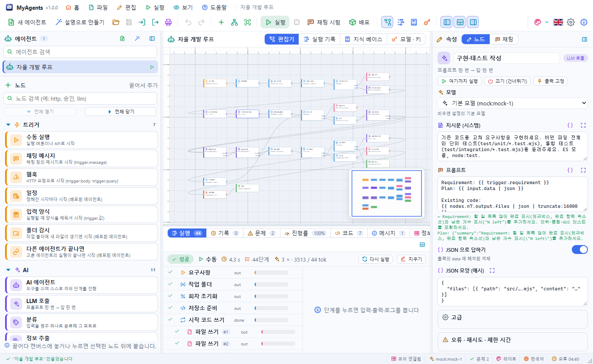

| 위치 | 내용 |
| --- | --- |
| 메뉴 · 툴바 | 파일, 편집, 실행, 보기, 도움말. 툴바의 실행(▶), 채팅 시험, 배포 |
| 왼쪽 위 | 내 에이전트 목록 (검색, 우클릭 메뉴) |
| 왼쪽 아래 | 노드 팔레트: 끌어다 놓거나 누르면 선택한 노드 뒤에 붙습니다. 위의 "전체 열기 / 전체 닫기"로 그룹을 한 번에 펼치고 접습니다 |
| 가운데 | 캔버스 (편집기) · 실행 기록 · 지식 베이스 · 모델 · 키 |
| 오른쪽 | 노드 탭(선택한 노드의 설정, 아무것도 선택하지 않으면 에이전트 설정) · 채팅 탭 |
| 아래 | 실행(단계별 시간 막대, 입력·출력·로그, 승인 카드) · 기록 · 문제 · 메시지 · 정보 |

패널 머리의 오른쪽 끝 단추(툴바와 같은 아이콘)로 패널을 접습니다. 접힌 패널은 아이콘과 제목만 보이는 좁은 띠가 되고, 띠를 누르면 다시 펼쳐집니다.

### 시작 화면

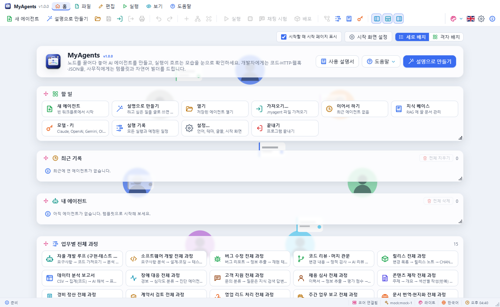

시작 화면은 **세로 배치**(카드 한 줄에 하나)가 기본입니다. 오른쪽 위에서 "격자 배치"로 바꿀 수 있습니다. 카드는 손잡이로 옮기고 오른쪽 아래 모서리로 크기를 바꿉니다. 맨 위 프로그램 정보(아이콘 · 이름 · 설명 · 단추)는 움직이지 않습니다.

- **최근 기록**: 최근에 연 에이전트. 줄 끝의 ✕ 는 기록에서만 지우고(에이전트는 남음), "전체 지우기"는 기록을 비웁니다.
- **내 에이전트**: 줄 끝의 휴지통은 그 에이전트를 삭제하고, "전체 삭제"는 확인 후 모든 에이전트를 지웁니다(실행 기록은 남음).

### 캔버스 조작

- **노드 추가**: 팔레트에서 끌어다 놓기, 팔레트 항목 누르기, 캔버스 더블클릭, 툴바 "+", 키 `A`
- **연결**: 노드 오른쪽의 출력 포트(●)에서 다른 노드로 끌기. 빈 곳에 놓으면 이어 붙일 노드를 고르는 메뉴가 뜹니다
- **도구 연결**: AI 에이전트 아래의 "도구" 포트(◆)에서 노드로 선을 그으면 그 노드(와 그 뒤의 흐름)가 에이전트의 도구가 됩니다. 다른 AI 에이전트를 이으면 다중 에이전트가 됩니다
- **이동 · 선택**: 노드 끌기, 빈 곳 끌기 = 화면 이동, Shift/Ctrl+끌기 = 상자 선택, 휠 = 확대/축소
- **편집**: `Delete` 삭제, `Ctrl+C`/`Ctrl+V` 복사·붙여넣기, `Ctrl+D` 복제, 화살표 = 미세 이동, `Ctrl+Z`/`Ctrl+Y` 되돌리기
- **정리**: "자동 정렬"(Ctrl+Shift+A)은 캔버스 모양에 맞춰 긴 흐름을 여러 줄로 나눠 배치합니다. "화면에 맞추기"(F)는 전체가 보이게 가로·세로 가운데로 맞춥니다. 미니맵을 눌러도 이동합니다
- **격자와 눈금자**: 바탕의 옅은 5 × 5 격자는 위·왼쪽 눈금자와 같은 간격이며, 확대·축소하면 너무 촘촘하거나 성글어지기 전에 5배 간격으로 다시 그려집니다. 마우스 위치는 눈금자에 붉은 선으로 표시됩니다

### 노드 종류

| 분류 | 노드 |
| --- | --- |
| 트리거 | 수동 실행(시험 입력 JSON), 채팅 메시지, 웹훅, 일정(분 간격·매일·매주·cron), 입력 양식(실행할 때 칸을 채움), 폴더 감시(새 파일), 다른 에이전트가 끝나면 |
| AI | AI 에이전트(도구·기억·최대 단계), LLM 호출(JSON 답 가능), 분류(범주마다 포트), 정보 추출, 요약, 번역, 감정 분류, 그림 분석, 다시 쓰기, 핵심어 뽑기, 문서에 묻기 |
| 지식 | 지식 검색(RAG), 지식 추가, 글 조각내기, 지식으로 답하기(근거 포함) |
| 흐름 제어 | 조건 분기, 값으로 분기, 반복(각 항목), 합치기, 변수 설정, 텍스트 템플릿, 코드(JavaScript), 기다리기, 중지, 카운터, A/B 나누기, 품질 검사, 묶음 나누기 |
| 데이터 변환 | CSV, 목록 거르기·정렬·집계·나누기·정규식·중복 제거, 형식 바꾸기, 표 만들기, 열 계산, 열 고르기, 평평하게 |
| 개발 도구 | 테스트 실행, 프로젝트 읽기, git, SQLite, 차이 비교, 코드 검사(lint), 빌드 |
| 도구·데이터 | HTTP 요청, 웹 페이지 읽기, 다른 에이전트 호출, 파일 읽기·쓰기, 명령 실행, JSON 변환, 날짜·시간, 팀 채팅 알림, 읽기(입력 소스), 저장(출력 대상), RSS·뉴스 피드 |
| 사람 참여 | 승인 요청, 사람에게 묻기, 알림 |
| 출력 | 응답 (실행 결과 · 채팅 답 · 웹훅 응답) |
| 메모 | 캔버스 위의 메모 (실행되지 않음) |

모든 실행 노드에는 **재시도 횟수, 재시도 간격, 제한 시간, 오류 처리**(실행 중지 / 오류를 출력으로 계속 / 오류 포트로 보내기)가 있습니다.

### 입력 소스와 출력 형식

**읽기(입력 소스)** 노드는 작업 폴더의 파일, URL, 직접 쓴 글, 앞 단계의 값에서 읽어 형식대로 풉니다. **저장(출력 대상)** 노드는 값을 고른 형식으로 파일에 쓰거나(확장자 자동) 다음 단계로만 넘깁니다(data: URL).

| 형식 | 읽기 결과 | 쓰기 |
| --- | --- | --- |
| 텍스트 · Markdown | `text` (Markdown은 `headings`, `html` 도) | 그대로 |
| HTML | `text`, `markdown`, `title` | Markdown을 꾸민 HTML 문서로 |
| CSV · JSON · Excel(.xlsx) | `items`(행 목록), `columns`, `count` | 행 목록을 표로 |
| PDF | `text`, `pages` | Markdown을 A4 문서로 (한글 포함, 제목·목록·쪽 번호) |
| Word(.docx) | `text`, `markdown`(제목·목록) | 제목·목록·굵게를 살린 문서 |
| 그림(png·jpg·gif·webp·bmp·svg) | `width`, `height`, `dataUrl` | 그림 그대로, 글이면 SVG 카드 |

그림은 **그림 분석** 노드로 모델에게 보여 줄 수 있습니다(Claude, OpenAI, Gemini, Ollama의 비전 모델, Cursor).

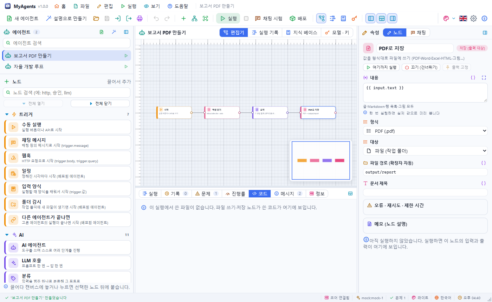

### 표현식

설정 칸에 `{{ … }}`를 쓰면 앞 단계의 값을 넣습니다.

| 이름 | 뜻 |
| --- | --- |
| `input` | 바로 앞 노드의 출력 (LLM·에이전트는 `input.text`) |
| `trigger` | 트리거가 받은 값 (채팅: `trigger.message`, 웹훅: `trigger.body`, `trigger.query`) |
| `nodes.<노드 이름>.output` | 이름으로 다른 노드의 출력 |
| `vars.<이름>` | 변수 (에이전트 설정의 변수, 변수 설정 노드) |
| `item`, `index` | 반복 안에서 지금 항목과 순번 |

필터: `| upper`, `| lower`, `| trim`, `| json`, `| length`, `| join:", "`, `| truncate:100`, `| default:"없음"`, `| pluck:"name"`, `| first`, `| last`, `| date`, `| parse` 등. `a || b`는 앞이 비면 뒤를 씁니다. 한 번 실행하면 각 칸 아래에 **실제 값으로 계산한 미리보기**가 나옵니다. `{}` 버튼은 쓸 수 있는 변수 목록을 보여 줍니다.

### 실행과 결과 보기

- **실행**(Ctrl+Enter): 수동 트리거의 시험 입력으로 실행합니다. 웹훅 트리거면 요청 본문을 물어봅니다. 저장하지 않은 변경도 그대로 실행됩니다(기록에 "저장 전" 표시)
- **실행 중**: 돌고 있는 노드는 파랗게 빛나고, 끝난 노드는 초록(성공) 또는 빨강(실패), 기다리는 노드는 주황입니다. 데이터는 선을 따라 점으로 흐르고, 반복한 노드에는 `×N`, 포트에는 지나간 횟수가 붙습니다. 에이전트가 도구를 부르면 노드 위에 도구 이름이 보입니다
- **아래 "실행" 탭**: 단계마다 시간 막대(언제 얼마나 걸렸는지)가 있고, 누르면 그 단계의 입력, 출력, 로그를 봅니다
- **여기까지 실행**: 노드의 설정에서 그 노드와 앞 노드만 실행합니다
- **출력 고정**: 한 번 실행한 노드의 출력을 고정하면 다음 실행부터 그 노드는 실제로 돌지 않고 고정값을 씁니다. API 비용 없이 뒤쪽을 시험할 때 씁니다
- **기록 탭 / 실행 기록 화면**: 지난 실행을 다시 열면 캔버스에 그때의 상태가 그려집니다
- **중지**(Shift+F5)

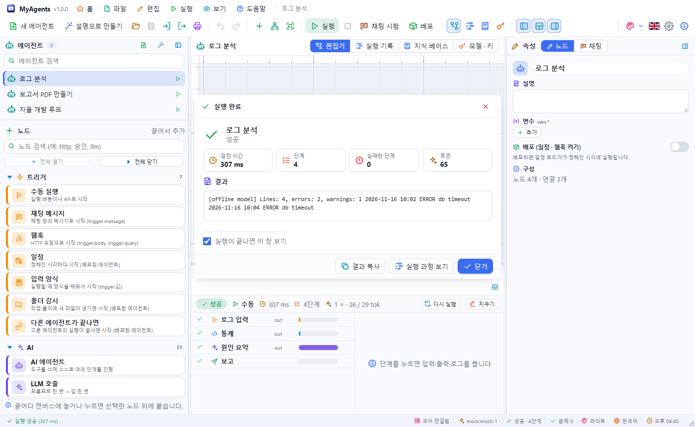

**진행률 탭**은 노드의 단계(phase)별 진행, 회차, 테스트 노드의 회차별 통과·실패를 보여 줍니다. **코드 탭**은 실행이 쓴 파일, 판 수, 바뀐 줄(+/−)을 보여 주고 파일을 고르면 내용과 바뀐 줄을 강조해 보여 줍니다.

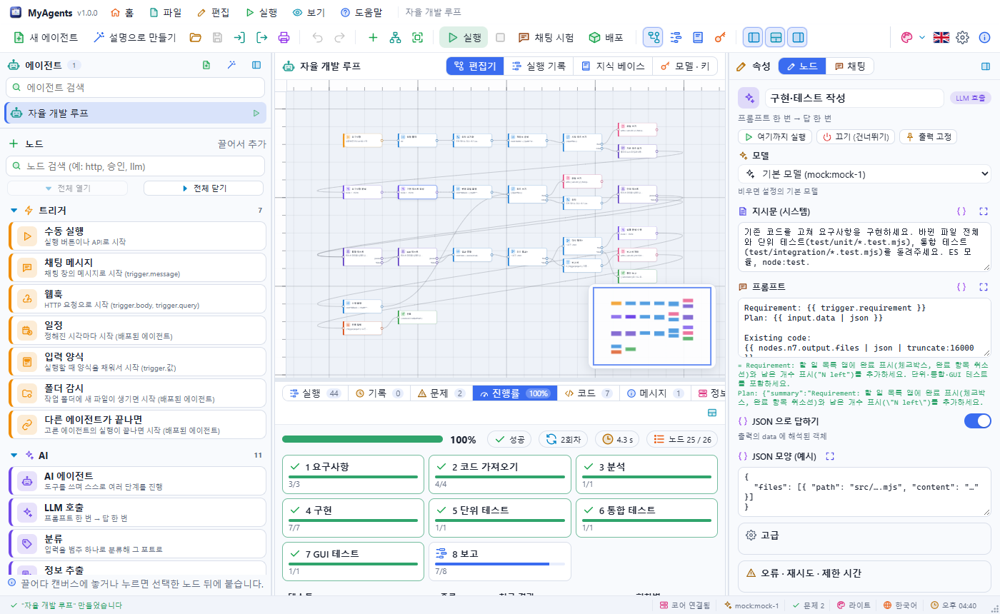

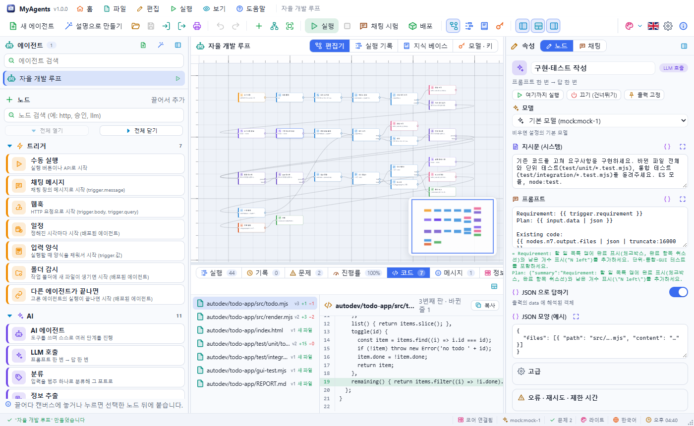

### 사람 승인

"승인 요청" 노드에 오면 실행이 멈추고 노드가 주황으로 깜박입니다. 아래 실행 탭의 카드에서 의견을 쓰고 **승인** 또는 **거절**을 누르면 그 포트로 이어집니다. 기다릴 시간을 정하면 지나서 거절로 갑니다. "사람에게 묻기"는 양식 칸을 채워 보냅니다.

### 채팅 시험

"채팅 메시지" 트리거가 있는 에이전트는 오른쪽 **채팅** 탭에서 대화로 시험합니다. 답마다 실행이 캔버스에 보이고, 말풍선의 작은 버튼으로 그 실행을 엽니다. AI 에이전트의 "대화 기억"이 켜져 있으면 같은 세션의 앞 대화를 기억합니다. "새 대화"는 새 세션, "기억 지우기"는 이 에이전트의 기억을 모두 지웁니다.

### 웹훅과 일정 (배포)

- 저장한 에이전트에 웹훅 트리거가 있으면 에이전트 설정(오른쪽, 아무것도 선택하지 않은 상태)에 **웹훅 주소**가 나옵니다. 주소에 비밀값이 들어 있어 따로 로그인이 필요 없고, 새로 만들 수 있습니다. 응답 방식은 "끝날 때까지 기다려 결과를 응답" 또는 "바로 202"입니다. 응답 노드의 HTTP 상태도 정할 수 있습니다
- **배포**를 켜면 일정 트리거가 정해진 시각에 실행됩니다(프로그램이 켜져 있는 동안). 배포할 때 오류가 있으면 문제 탭에 보여 주고 배포하지 않습니다

### 지식 베이스 (RAG)

"지식 베이스" 화면에서 만들고, 파일(txt, md, html, csv, json, 코드 …)을 추가하거나 글을 붙여넣거나 웹 페이지를 가져옵니다. 문서는 이 컴퓨터에만 저장되며 BM25 키워드 검색으로 찾습니다(외부 임베딩 서비스 불필요, 한국어는 두 글자 조각까지 색인). "검색 시험"으로 에이전트가 무엇을 찾을지 미리 봅니다. 처음 실행하면 샘플 지식 베이스(환불·배송·상담 시간·API)가 만들어집니다.

### 모델 · 키

| 공급자 | 설정 |
| --- | --- |
| Anthropic Claude | API 키 (기본 모델 claude-opus-5-5). 환경 변수 ANTHROPIC_API_KEY 도 읽습니다 |
| OpenAI | API 키 (OPENAI_API_KEY) |
| Google Gemini | API 키 (GEMINI_API_KEY) |
| Ollama | 로컬 서버 주소 (기본 `http://127.0.0.1:11434`), 키 없음. 설치·실행 상태와 모델 수가 카드에 보입니다 |
| Cursor | Cursor 대시보드의 API 키 (CURSOR_API_KEY). 호출마다 클라우드 에이전트를 실행해 결과 글을 받습니다. 서버 주소 뒤에 `#https://github.com/org/repo@branch` 를 붙이면 그 저장소에서 일합니다 |
| OpenAI 호환 | LM Studio, vLLM, Groq, OpenRouter 등 서버 주소와 키 |
| 오프라인 시험 모델 | 네트워크·키 없음. 템플릿 시험용 |

카드마다 모델을 골라 "시험 호출"로 연결을 확인하고, "모델 목록"으로 쓸 수 있는 모델을 불러오고, "기본 모델로"를 누르면 모델을 비워 둔 노드가 그것을 씁니다. 키는 데이터 폴더의 `credentials.json`에만 저장되고 화면에는 앞뒤 네 글자만 보입니다. 같은 화면에서 "명령 실행" 노드 허용과 작업 폴더(파일·명령 노드가 쓰는 폴더)를 정합니다.

**로컬 Ollama**: 설치되어 있지 않거나, 꺼져 있거나, 고른 모델이 없으면 시험 호출이나 실행이 실패할 때 창이 떠서 **자동 설치**(Windows는 winget 또는 공식 설치 파일, macOS는 Homebrew, Linux는 공식 스크립트) · **시작** · **모델 내려받기**를 진행률과 함께 해 줍니다. 처음 불러오는 큰 모델은 몇 분 걸릴 수 있어 시간 제한 없이 기다립니다. 웹 서버에서는 다운로드 페이지만 안내합니다.

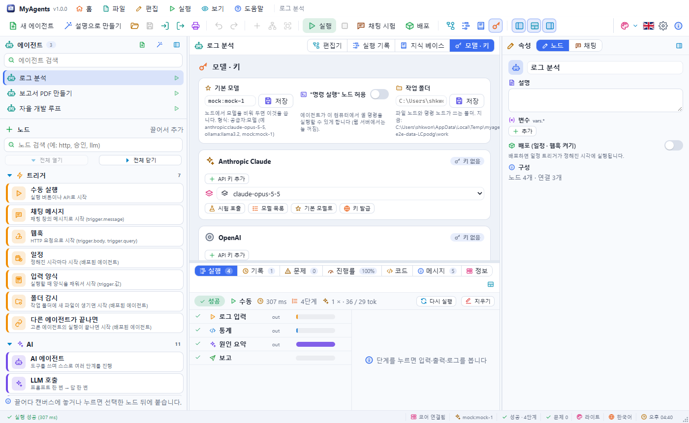

설정 › **AI 모델 키** 탭에서도 공급자별 키를 추가·변경·삭제하고 기본 모델을 고를 수 있습니다(같은 저장소).

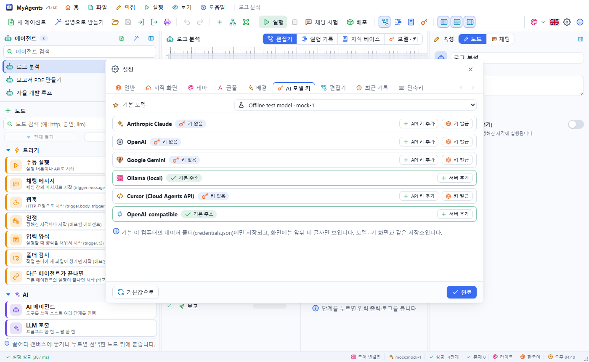

### 실행 결과 창 · 인쇄

실행이 끝나면 **결과 창**이 상태, 걸린 시간, 단계 수, 실패한 단계, 토큰, 결과를 보여 줍니다("결과 복사", "실행 과정 보기"). 설정 › 편집기 또는 창 아래의 확인란으로 끌 수 있습니다.

**인쇄**(Ctrl+P)는 별도의 창입니다. 왼쪽에서 프린터와 매수, 용지 크기·방향·여백·배율·색, 머리글·바닥글·쪽 번호, 인쇄할 내용(에이전트 개요, 흐름도, 노드와 설정, 마지막 실행)을 고르면 오른쪽 미리보기가 바로 바뀝니다. 흐름도는 "용지 맞춤"이면 용지 모양에 맞게 다시 배치됩니다. **인쇄**를 누르면 데스크톱에서는 고른 프린터로 바로 인쇄되고, "PDF로 저장"도 있습니다.

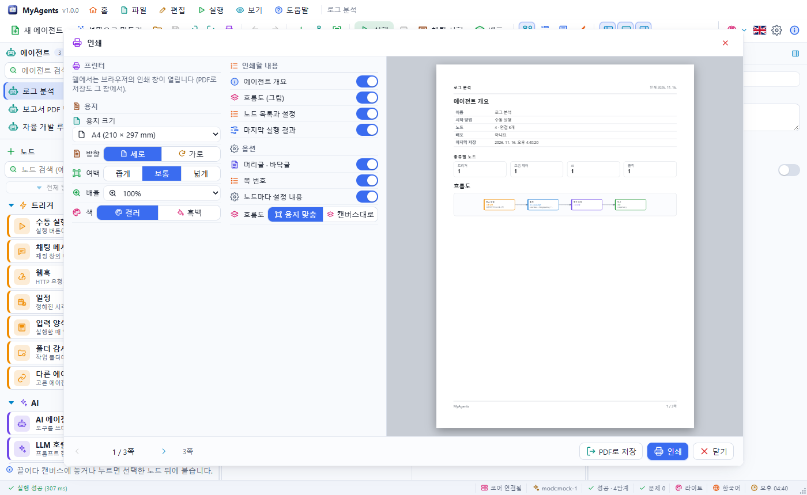

### 튜토리얼

시작 화면이 열릴 때 "튜토리얼을 실행할까요?" 창이 뜹니다. **튜토리얼 시작**을 누르면 화면의 각 부분(시작 화면, 템플릿, 설명으로 만들기, 팔레트, 캔버스, 속성, 실행, 진행률·코드, 채팅, 모델·키, 인쇄, 도움말)을 차례로 비추며 설명합니다. 이전·다음 단추나 ←/→ 키로 움직이고 Esc 로 끝냅니다. 창 아래의 "시작할 때 이 창 보이기"를 끄거나 설정 › 시작 화면 › "튜토리얼 실행 팝업창 보여주기"를 끄면 다음부터 뜨지 않으며, 도움말 › 튜토리얼로 언제든 다시 볼 수 있습니다.

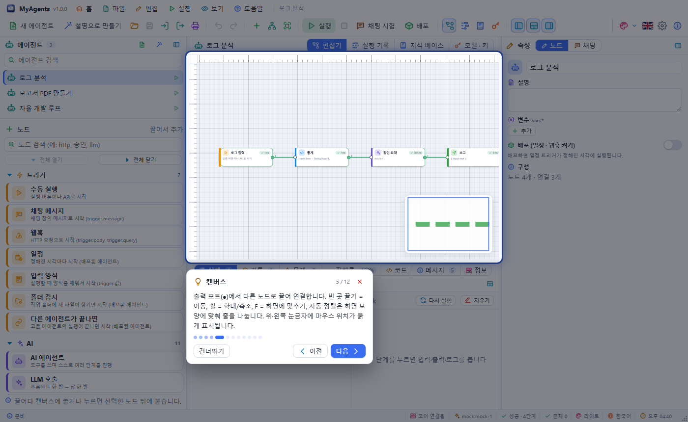

### 설명으로 만들기

툴바의 **설명으로 만들기**(Ctrl+Shift+N)에 하고 싶은 일을 쓰면 워크플로 초안을 만듭니다. 실제 모델이 있으면 모델이 노드 목록을 보고 설계하고, 없으면 키워드(매일, 웹훅, 채팅, 승인, 요약, 번역, 분류, 문서, 파일, 알림 …)로 만듭니다.

### 파일

에이전트는 데이터 폴더의 `agents/<id>.json`에 저장됩니다. **내보내기**는 `.myagent` 파일을 만들고(웹훅 비밀값은 빠짐), **가져오기**나 끌어다 놓기로 다시 들여옵니다.

### 웹 서버로 쓰기

`npm run build:web` 후 `node server/web.js --port 8080 --password <비밀번호>`로 실행하면 브라우저에서 같은 화면을 씁니다. 비밀번호가 없으면 127.0.0.1에서만 받습니다. 웹 서버에서는 "명령 실행" 노드가 늘 꺼집니다.

### 단축키

설정 › 단축키에 전체 목록이 있습니다. 자주 쓰는 것: `Ctrl+N` 새 에이전트, `Ctrl+S` 저장, `Ctrl+Enter` 실행, `A` 노드 추가, `F` 화면에 맞추기, `Ctrl+Shift+C` 채팅, `F2` 이름 바꾸기.

<!-- lang:en -->
## English

### What MyAgents is

MyAgents builds AI agents and automations by **dragging nodes onto a canvas**. Triggers, AI steps, tools, conditions, loops and human approval are nodes; connecting them makes a workflow. When it runs, the canvas shows which node is working, which connection the data travels, how often a loop ran and where it failed.

- **Developers**: a Code (JavaScript) node, HTTP requests, webhooks, JSON expressions, shell commands, each node's input and output as JSON, pinned outputs
- **Office work**: 16 templates, "Describe it" (write what you want, get a draft), approval steps, a chat tester

Without any key, every template runs on the **offline test model**. Connect real models under "Models & keys".

### The window

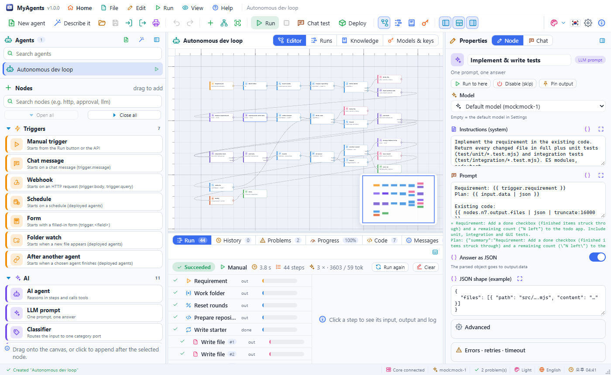

| Where | What |
| --- | --- |
| Menus · toolbar | File, Edit, Run, View, Help. Run (▶), Chat test and Deploy on the toolbar |
| Left, top | Your agents (search, right-click menu) |
| Left, bottom | The node palette: drag onto the canvas, or click to append after the selected node |
| Centre | The canvas (editor) · Runs · Knowledge · Models & keys |
| Right | Node tab (the selected node's settings; with nothing selected, the agent's) · Chat tab |
| Bottom | Run (time bars per step, input · output · log, the approval card) · History · Problems · Messages · Information |

### Start page

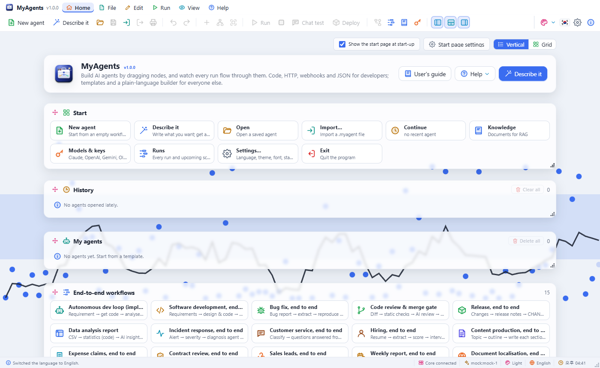

The start page is **vertical** by default (one card per row). Switch to "Grid" at the top right. Move cards by their handle, resize them by the bottom-right corner.

Start page: **History** lists the agents opened lately (✕ forgets one, "Clear all" empties the list; the agents
stay); **My agents** deletes one agent (the bin) or all of them after a confirmation (run records stay). Folded
panels keep a rail with their icon and title; the button at the right end of each panel header folds it.

### Working on the canvas

- **Add**: drag from the palette, click a palette item, double-click the canvas, toolbar "+", key `A`
- **Connect**: drag from an output port (●) on the right of a node to another node. Dropping on empty space offers the node to add there
- **Tools**: draw from an AI agent's "tools" port (◆, at its bottom) to a node: that node (and the flow after it) becomes a tool of the agent. Connect other AI agents for a multi-agent team
- **Move & select**: drag a node; drag empty space to pan; Shift/Ctrl+drag to box-select; wheel to zoom
- **Edit**: `Delete`, `Ctrl+C`/`Ctrl+V`, `Ctrl+D` duplicate, arrow keys nudge, `Ctrl+Z`/`Ctrl+Y`
- **Tidy**: Auto arrange (Ctrl+Shift+A), Fit (F), click the minimap

### Node types

| Category | Nodes |
| --- | --- |
| Triggers | Manual (test input JSON), Chat message, Webhook, Schedule (minutes, daily, weekly, cron) |
| AI | AI agent (tools, memory, max steps), LLM prompt (optional JSON answer), Classifier (a port per category), Extractor |
| Knowledge | Knowledge search (RAG), Add to knowledge |
| Flow | If, Switch, Loop over items, Merge, Set variables, Text template, Code (JavaScript), Wait, Stop |
| Tools & data | HTTP request, Read web page, Call another agent, File read/write, Run command, JSON, Date & time |
| Human | Approval, Ask a person, Notify |
| Output | Respond (run result · chat reply · webhook response) |
| Notes | Sticky notes (never run) |

Every runnable node has **retries, retry delay, timeout and error handling** (stop the run / continue with the error as output / send to an error port).

### Expressions

Write `{{ … }}` in a setting to use earlier values.

| Name | Meaning |
| --- | --- |
| `input` | the previous node's output (LLM and agent: `input.text`) |
| `trigger` | what the trigger received (chat: `trigger.message`; webhook: `trigger.body`, `trigger.query`) |
| `nodes.<node name>.output` | another node's output, by name |
| `vars.<name>` | variables (agent settings, Set variables) |
| `item`, `index` | the current item and its number inside a loop |

Filters: `| upper`, `| lower`, `| trim`, `| json`, `| length`, `| join:", "`, `| truncate:100`, `| default:"none"`, `| pluck:"name"`, `| first`, `| last`, `| date`, `| parse` … `a || b` takes b when a is empty. After one run, each field shows a **preview computed from the real values**; the `{}` button lists the variables you can use.

### Running and reading results

- **Run** (Ctrl+Enter) uses the manual trigger's test input; a webhook trigger asks for a request body. Unsaved changes run as they are (marked "draft" in the history)
- **While it runs**: the working node glows blue, finished nodes turn green (succeeded) or red (failed), waiting nodes orange. Data moves along the connections as dots; looped nodes show `×N` and ports show how often they were used; an agent shows the tool it calls above the node
- **Run tab** (bottom): a time bar per step; click a step for its input, output and log
- **Run to here** (node settings): runs this node and the nodes before it only
- **Pin output**: a pinned node does not run again but hands on its pinned output — test later steps without API costs
- **History tab / Runs view**: reopening a run draws its states on the canvas
- **Stop** (Shift+F5)

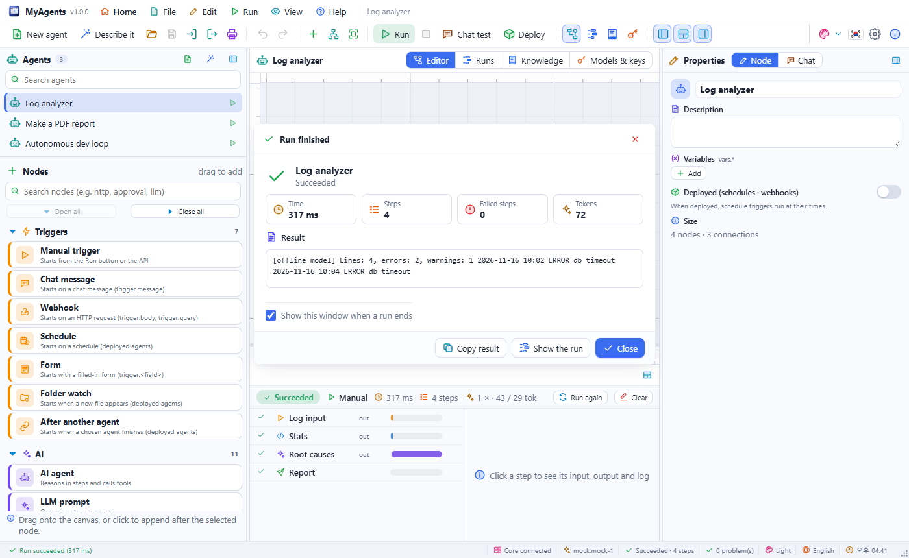

The **Progress tab** shows the phases of the nodes, the round and each test node's passed / failed by round. The **Code tab** lists the files a run wrote with their versions and +/− lines; pick one to read it with the changed lines marked.

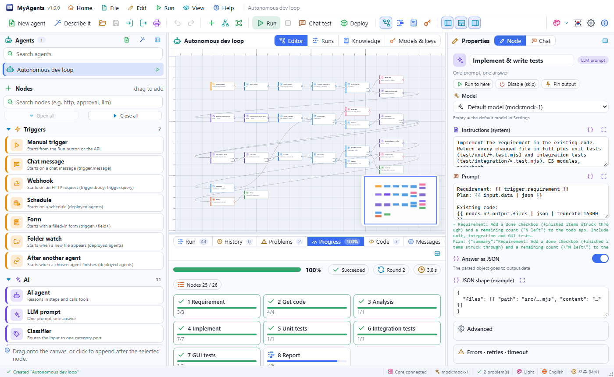

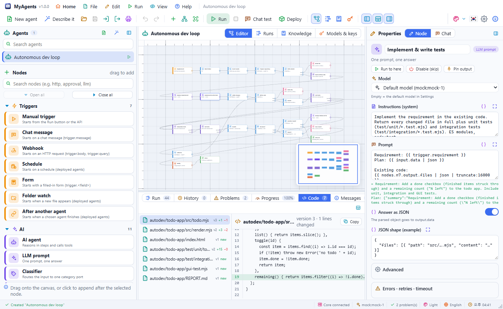

### Human approval

At an Approval node the run pauses and the node blinks orange. In the card of the Run tab, write a comment and press **Approve** or **Reject**; the run continues on that port. With a time limit, it is rejected afterwards. "Ask a person" waits for form fields.

### Chat tester

Agents with a "Chat message" trigger are tested in the right **Chat** tab. Every answer shows its run on the canvas; the small button on a bubble opens that run. With "Conversation memory" on, the AI agent remembers the session. "New chat" starts a new session; "Forget" deletes this agent's memory.

### Webhooks and schedules (deploy)

- A saved agent with a Webhook trigger shows its **webhook URL** in the agent settings (right panel, nothing selected). The URL contains a secret, so no sign-in is needed; you can make a new one. The webhook answers with the result when the run ends, or at once with 202. The Respond node can set the HTTP status
- **Deploy** turns on schedule triggers (while the program runs). Deploying refuses an agent with errors and lists them in Problems

### Knowledge bases (RAG)

Create them in the Knowledge view; add files (txt, md, html, csv, json, code …), pasted text or web pages. Documents stay on this computer and are found with BM25 keyword search (no embedding service; Korean is indexed down to two-letter pieces). "Search test" shows what an agent would find. The first start creates a sample knowledge base (refunds, shipping, support hours, API).

### Models & keys

| Provider | Setting |
| --- | --- |
| Anthropic Claude | API key (default model claude-opus-5-5); ANTHROPIC_API_KEY is read too |
| OpenAI | API key (OPENAI_API_KEY) |
| Google Gemini | API key (GEMINI_API_KEY) |
| Ollama | local server (default `http://127.0.0.1:11434`), no key |
| OpenAI-compatible | LM Studio, vLLM, Groq, OpenRouter … server address and key |
| Offline test model | no network, no key; for trying templates |

"Test call" checks the connection, "List models" loads the available models, "Make default" sets the model for nodes that leave it empty. Keys are stored only in the data folder's `credentials.json`; the page shows four characters at each end. The same view allows "Run command" nodes and sets the work folder (used by File and Command nodes).

**Local Ollama**: when it is not installed, not running or lacks the chosen model, a failed test call or run
opens a window that does it for you with progress: **Install automatically** (winget or the official installer on
Windows, Homebrew on macOS, the official script on Linux), **Start**, or **Download the model**. A big model can
take minutes to load the first time; the test waits without a time limit. The web server only points to the
download page.

**Cursor**: an API key from the Cursor dashboard (CURSOR_API_KEY). Each call runs a cloud agent and returns its
final text; add `#https://github.com/org/repo@branch` after the server address to work in that repository.

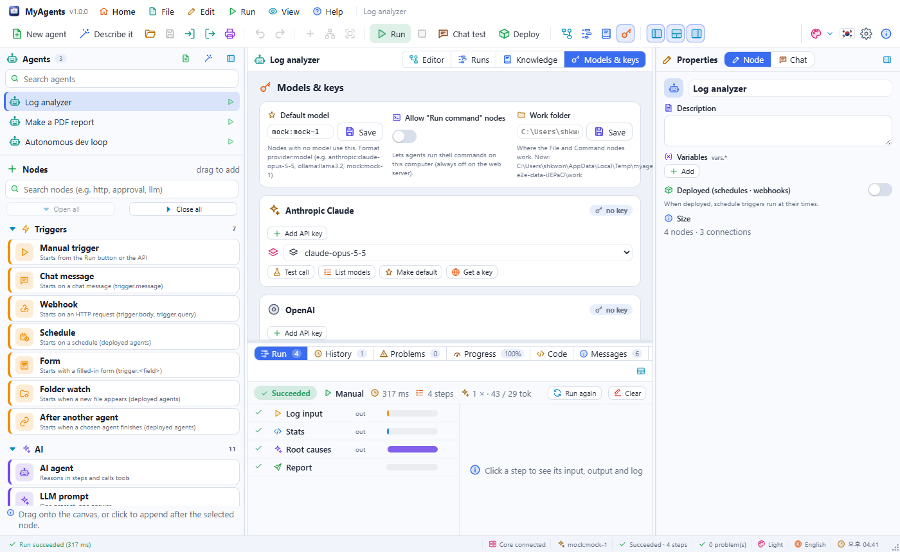

Settings › **AI model keys** adds, changes and deletes keys per provider and sets the default model too (the same store).

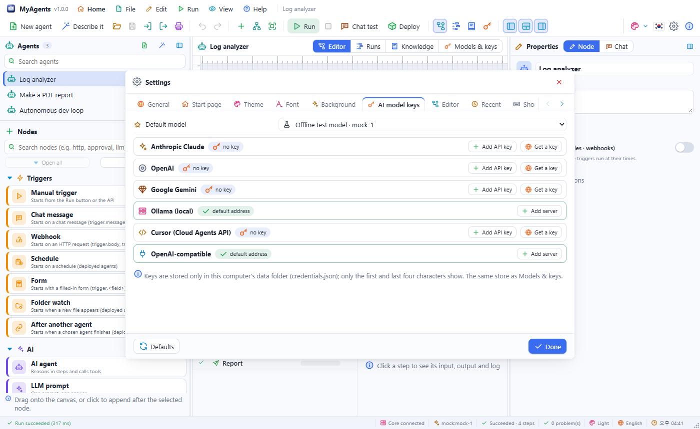

### Input sources and output formats

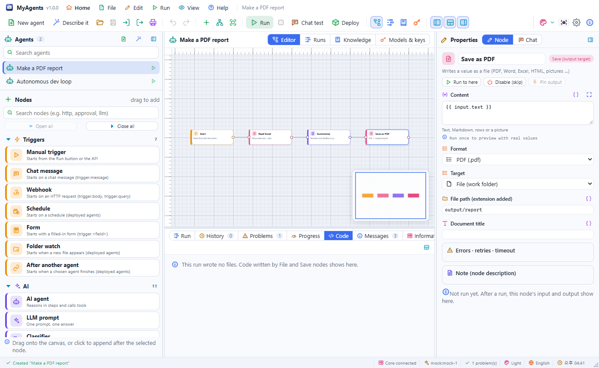

The **Read (input source)** node reads a work-folder file, a URL, typed text or the previous step's value and
parses it; **Save (output target)** writes a value as a file in the chosen format (extension added) or only hands
it on (a data: URL). Text, Markdown, HTML, CSV, JSON, Excel (.xlsx), PDF (Korean included), Word (.docx) and
pictures (png, jpg, gif, webp, bmp, svg) are read and written; rows become tables, Markdown becomes styled HTML,
a PDF or a Word document. The **Image analysis** node shows a picture to a vision model.

### The run result window and printing

When a run ends, a **result window** shows the status, time, steps, failed steps, tokens and the result (Copy
result, Show the run); turn it off in Settings › Editor or with its check box. **Print** (Ctrl+P) opens its own
window: printer and copies, paper size, orientation, margins, scale, colour, header/footer, page numbers and what
to print (overview, flow diagram, nodes and settings, the last run), with a live preview. The flow diagram is laid
out again for the paper ("Fit paper"). **Print** prints straight to the chosen printer on the desktop; Save as PDF
is there too.

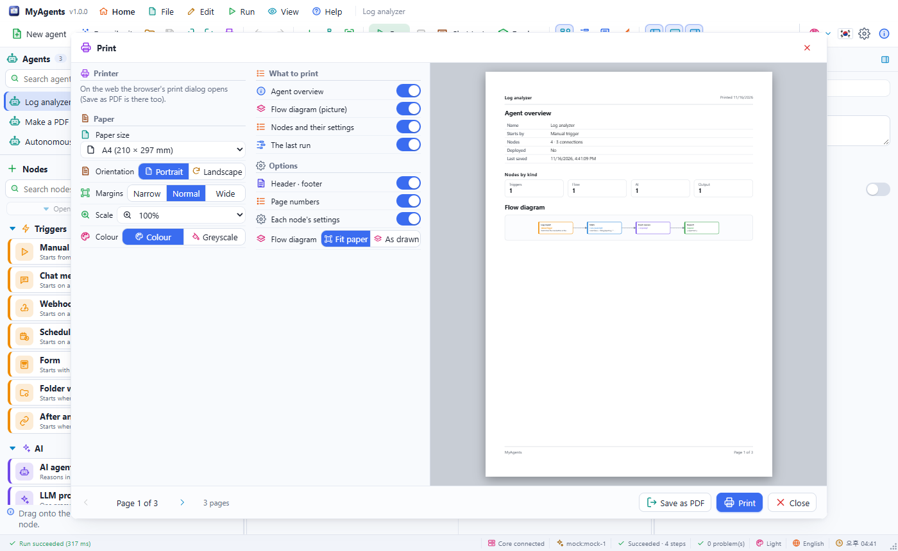

### Tutorial

When the start page opens, a window asks "Run the tutorial?". **Start the tutorial** lights up each part of the window in turn (start page, templates, describe it, palette, canvas, properties, run, progress and code, chat, models and keys, print, help) and explains it; Back / Next or ← / → move, Esc ends it. Turn off "Show this window at start" in that window or Settings › Start page › "Show the tutorial popup at start" to stop it; Help › Tutorial shows it any time.

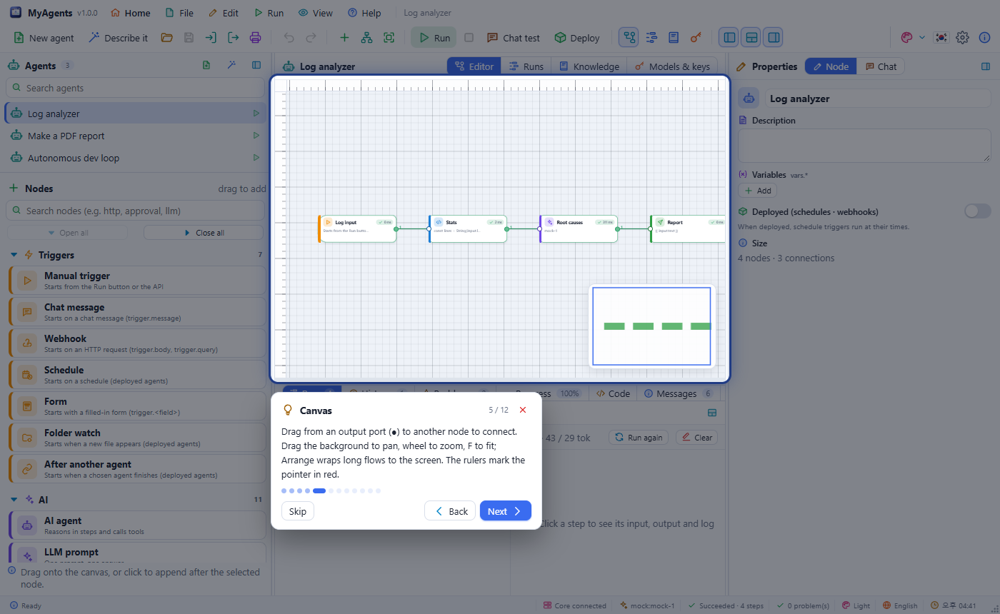

### Describe it

**Describe it** (Ctrl+Shift+N) turns a sentence into a workflow draft. With a real model, the model designs it from the node catalogue; without, keywords decide (daily, webhook, chat, approval, summarise, translate, classify, documents, file, notify …).

### Files

Agents are stored as `agents/<id>.json` in the data folder. **Export** writes a `.myagent` file (without the webhook secret); **Import** or drag and drop brings it back.

### As a web server

After `npm run build:web`, run `node server/web.js --port 8080 --password <password>` and use the same app in a browser. Without a password it listens on 127.0.0.1 only. "Run command" nodes are always off on the web server.

### Shortcuts

Settings › Shortcuts lists them all. Common ones: `Ctrl+N` new agent, `Ctrl+S` save, `Ctrl+Enter` run, `A` add node, `F` fit, `Ctrl+Shift+C` chat, `F2` rename.
