# MyArchitecture 10.0 사용자 가이드

**MyArchitecture** v10.0.0 · 저작자: **SHKWON** (`knix008@naver.com`)

평면도를 그리면 바로 3D 건물이 되는 건축 설계 프로그램입니다. 벽·문·창·방·계단·지붕·기둥으로 평면을 그리고, 스케치업식 매스로 볼륨을 잡고, 3D 에서 해와 그림자·걷기·단면·입면을 보고, 벽 타입·단계·분류·IFC 속성 같은 BIM 정보를 붙이고, 일람표와 공사비를 뽑고, DXF·IFC·glTF/GLB·OBJ·PDF 등으로 주고받는 일을 한 창에서 합니다.

이 문서는 **모든 기능의 참조 설명서**입니다. 처음이라면 1장과 3장을 차례로 읽고, 나머지는 필요할 때 찾아보세요. 프로그램 안의 **따라 하는 튜토리얼**(9장)로 같은 내용을 직접 해 볼 수도 있습니다.

> 표기 약속
> - 메뉴는 **파일 → 예제 열기…** 처럼 화면에 보이는 한국어 이름 그대로 씁니다. 영어 화면을 쓰는 분을 위해 필요한 곳에는 영어 이름을 괄호로 덧붙였습니다.
> - 키는 <kbd>Ctrl</kbd>+<kbd>Z</kbd> 처럼 씁니다. macOS 에서는 <kbd>Ctrl</kbd> 대신 <kbd>⌘</kbd>(Command)도 됩니다.
> - 길이 단위는 따로 말하지 않으면 **mm** 입니다. 프로그램 내부도 모두 mm 로 계산합니다.

---

## 목차

1. [시작하기](#1-시작하기)
2. [화면과 조작](#2-화면과-조작)
3. [평면 그리기](#3-평면-그리기)
4. [편집](#4-편집)
5. [3D 보기](#5-3d-보기)
6. [BIM](#6-bim)
7. [파일](#7-파일)
8. [설정과 꾸미기](#8-설정과-꾸미기)
9. [튜토리얼](#9-튜토리얼)
10. [단축키 전체 표](#10-단축키-전체-표)
11. [문제 해결과 FAQ](#11-문제-해결과-faq)
12. [부록](#12-부록)

---

## 1. 시작하기

### 1.1 설치

| 환경 | 방법 |
| --- | --- |
| Windows | `MyArchitecture_10.0.0_x64-setup.exe` 실행 → 설치 언어(한국어/English) 선택(설치할 때마다 물음) → 이미 설치된 MyArchitecture(이전 판 포함)가 있으면 “이미 설치된 MyArchitecture 가 있습니다… 기존 프로그램을 완전히 삭제합니다” 안내(**확인** = 이전 설치를 지우고 계속, **취소** = 설치 중단) → 이전 데이터(`%APPDATA%\MyArchitecture` 의 설정, 자동 저장)가 있으면 “저장한 데이터(설정, 자동 저장)가 있습니다. 삭제하시겠습니까?”(예/아니요) → 설치 폴더 선택. 사용자 계정에 설치되므로 관리자 권한이 필요 없고, 바탕 화면·시작 메뉴 바로 가기와 `.myarch` 파일 연결이 만들어집니다. **Node.js 나 Rust 같은 다른 프로그램은 설치할 필요가 없습니다** — 화면을 그리는 Microsoft Edge WebView2 는 Windows 10/11 에 들어 있고, 없으면 설치 프로그램이 함께 설치합니다. |
| macOS | dmg 를 열고 응용 프로그램 폴더로 끌어 놓습니다. 서명이 없으므로 처음 한 번은 Control-클릭 → **열기**. |
| Linux | AppImage(`chmod +x` 후 실행), `.deb`(`sudo apt install ./MyArchitecture_…deb`, 필요한 WebKitGTK 를 함께 설치) |
| 웹 | 소스 폴더에서 `npm run serve` 후 브라우저로 `http://localhost:8642` (다른 포트: `PORT=9000 npm run serve`). `file://` 로 직접 열면 동작하지 않습니다. |
| 소스(개발자용) | Node.js 22 이상, Rust, `npm install`, `npm start` |
| 설치 프로그램 만들기(개발자용) | `npm run build:win`(Windows NSIS), `npm run build:mac`(app·dmg), `npm run build:linux`(AppImage·deb), `npm run build:all`(지금 운영 체제에서 만들 수 있는 것 모두). 각 운영 체제의 설치 파일은 그 운영 체제에서 만듭니다. |

### 1.2 실행과 저장 위치

- MyArchitecture 는 **한 번에 하나만** 실행됩니다. 이미 실행 중일 때 `.myarch` 파일(또는 연결된 DXF·IFC·3D 모델 파일)을 더블클릭하면 열려 있는 창에서 열립니다.
- 설정 파일 `settings.json` 위치: Windows `%APPDATA%\MyArchitecture`, macOS `~/Library/Application Support/MyArchitecture`, Linux `~/.config/MyArchitecture`. 웹판은 브라우저 `localStorage` 에 저장합니다. 데스크톱 판의 자동 저장은 Windows 에서 `%LOCALAPPDATA%\com.shkwon.myarchitecture` 에 있습니다.
- 자동 저장(복구용 사본)은 프로젝트 파일과 별개입니다. 비정상 종료 뒤 다음 실행 때 “…의 저장되지 않은 프로젝트를 복구했습니다. 복원할까요?”라고 묻습니다(7.2절).
- 실행할 때마다 **MyArchitecture 10.0에 오신 것을 환영합니다** 팝업이 뜹니다. 네 단계 요약(벽 그리기 → 방·계단·지붕 → 가구 배치 → 3D 로 보고 공유하기)과 **예제 열기 / 새 프로젝트 시작 / 확인** 단추가 있습니다. 창 아래쪽 **시작 시 계속 열기**를 끄면 다음 실행부터 뜨지 않습니다(설정 → 일반 → **시작 시 팝업: 시작 시 팝업 보여주기**와 같은 설정이라 어느 쪽에서 바꿔도 같습니다). 언제든 다시 보려면 **도움말 → 빠른 둘러보기**.
- 프로그램 폴더에는 튜토리얼 전체를 녹화한 동영상 **`MyArchitecture-Tutorial.mp4`** 가 들어 있습니다(9.4절).

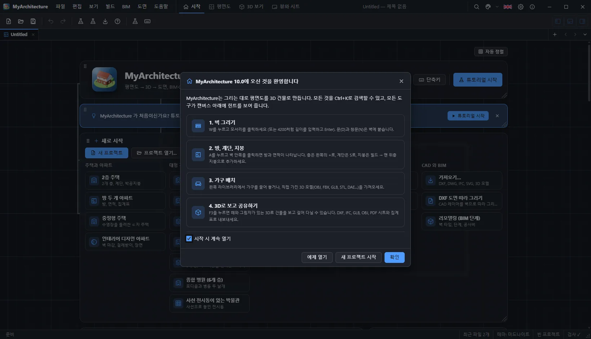
*시작 시 팝업과 **시작 시 계속 열기***

### 1.3 화면 구성

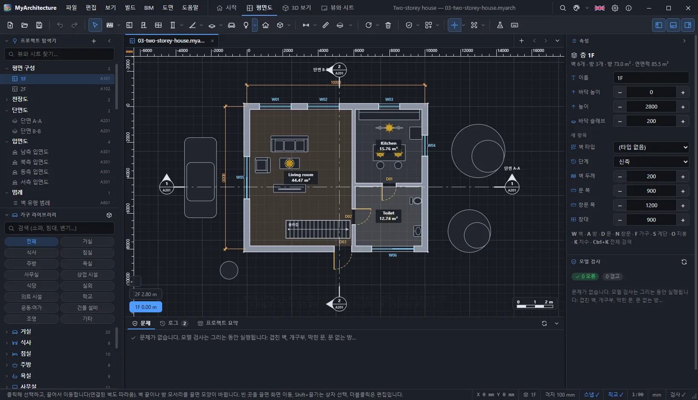
*평면도 화면: 메뉴·탭·도구 모음, 왼쪽 가구 라이브러리, 가운데 도면, 오른쪽 속성, 아래 상태 표시줄*

위에서 아래로:

| 영역 | 내용 |
| --- | --- |
| **제목 표시줄** | 프로그램 아이콘, 메뉴(파일·편집·보기·빌드·BIM·도움말), 바로 뒤에 **보기 탭**(시작 / 평면도 / 3D 보기), 문서 제목, 오른쪽에 돋보기(명령 팔레트, <kbd>Ctrl</kbd>+<kbd>K</kbd>)·테마·언어·설정·정보 단추, 그 오른쪽 끝에 창 단추(최소화·최대화·닫기) |
| **도구 모음** | 보고 있는 탭에 맞는 도구. 맨 앞은 언제나 새로 만들기·열기·저장 / 되돌리기·다시 실행, 그 뒤 튜토리얼·단축키, **오른쪽 끝에** 패널 접기·펴기 단추 세 개(왼쪽 패널 · 하단 패널 · 오른쪽 패널; 켜진 패널의 단추가 강조됨). 도구 모음은 언제나 **한 줄**이고, 창을 가장 작게 줄여도 단추가 가려지지 않습니다: 창의 최소 폭은 가장 긴 탭의 도구 모음이 한 줄에 다 들어가는 폭으로 정해집니다. 화면이 그만큼 넓지 않으면(큰 인터페이스 크기 등) 단추 간격을 줄인 촘촘한 모양으로 한 줄에 담습니다 |
| **왼쪽 패널** | 평면도: 가구 라이브러리와 CAD 레이어 / 3D: 장면·층·표시·단면과 단계·일조 분석 |
| **가운데** | 시작 페이지, 평면 도면(왼쪽 아래에 층 탭) 또는 3D 화면. 그 아래, 좌우 패널 사이에 **하단 패널**(문제 · 로그 · 프로젝트 요약). 좌우 패널은 상태 표시줄까지 이어집니다 |
| **오른쪽 패널** | 평면도: 고른 요소의 속성과 모델 검사 목록 / 3D: 클릭한 요소의 정보 |
| **상태 표시줄** | 힌트와 페이지별 정보 칸, 오른쪽 끝에 창 크기 조절 손잡이 |

자세한 내용은 2장에 있습니다.

### 1.4 시작 페이지

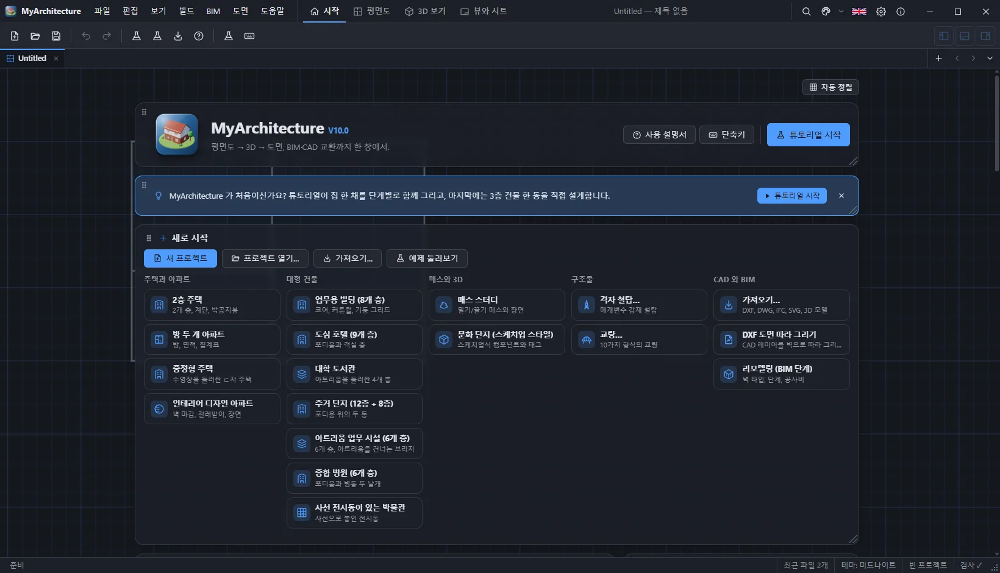
*시작 페이지: 움직이는 배경 위에 놓인 카드들 — 끌어 옮기고 크기를 바꿀 수 있습니다*

프로그램을 켜면 **시작** 탭이 열립니다. 화면 아래쪽 **시작할 때 시작 화면 보기**를 끄면(설정 → 일반 → **시작할 때**와 같은 설정) 데스크톱판은 마지막 프로젝트를 바로 엽니다.

시작 페이지는 **움직이는 배경** 위에 놓인 **카드 보드**입니다.

| 카드 | 내용 |
| --- | --- |
| 앞쪽 카드 | 프로그램 아이콘, 이름과 버전, **사용 설명서** · **단축키**, **튜토리얼 시작** |
| 처음 실행 안내 | 튜토리얼을 권하는 띠. **×** 로 숨깁니다 |
| 새로 시작 | **새 프로젝트 · 프로젝트 열기… · 가져오기… · 예제 둘러보기** 와 종류별 타일: 주택과 아파트, 대형 건물(업무용 빌딩·호텔·도서관·주거 단지), 매스와 3D, 구조물(격자 철탑·교량), CAD 와 BIM. 예제 타일은 그 예제를 출발점으로 엽니다 |
| 최근 | 최근에 열거나 저장한 파일(설정 → 일반 → **최근 파일 기억 개수**, 기본 10개). 누르면 열고, **×** 는 그 항목만 목록에서 지우며(파일은 그대로), **목록 지우기**는 목록을 비웁니다 |
| 배경 | 배경 종류 21가지(청사진, 평면 구성, 스카이라인, 타워 크레인, 매스, 구조 그리드, 트러스교, 태양 궤적, 치수, 바닥 타일, 입자, 별자리, 입면, 벽돌 쌓기, 아케이드, 대지 등고선, 계단, 와이어프레임, 단면 해치, 목조 골조, 3D 모델), **섞기**(정한 초마다 다른 배경), **속도**, **투명도**, **섞기 간격**(셋 다 양옆에 **−**/**+** 단추가 있는 막대: 막대를 누르거나 끌거나, 단추를 누르거나 길게 누르거나, 화살표 키로 조절), **시작할 때마다 무작위 배경** |
| 도움말 | 따라 하는 튜토리얼, 사용 설명서, 단축키, 빠른 둘러보기, 지원 파일 형식, 프로그램 정보, 그리고 날마다 바뀌는 **팁** |
| 예제 | 모든 예제 카드. 평면 그림으로 먼저 그려졌다가 잠시 뒤 3D 그림으로 바뀌고, 누르면 그 예제가 열립니다 |

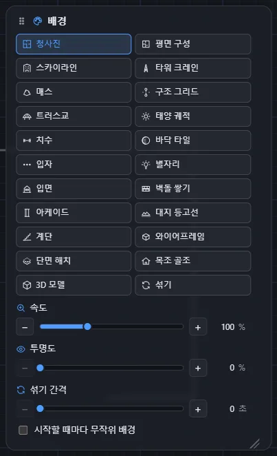
*배경 카드: 속도·투명도·섞기 간격은 양옆에 − / + 가 있는 막대입니다*

**카드 옮기기와 크기 바꾸기**

- 카드 제목 왼쪽의 손잡이(⠿)를 끌면 카드가 마우스를 그대로 따라 움직이고, 놓일 자리가 점선 테두리로 보이며, 다른 카드들은 비켜 주며 부드럽게 미끄러집니다. 놓으면 카드가 그 칸으로 부드럽게 들어가고, 위쪽 빈 자리는 다른 카드가 올라와 메웁니다.
- 카드 오른쪽 아래 모서리를 끌면 크기가 마우스를 따라 연속으로 바뀌고(너비 1 ~ 3열, 높이는 20 px 단위), 놓으면 가장 가까운 칸 크기에 부드럽게 맞춰집니다. 모서리를 **두 번 누르면** 높이가 내용에 맞게 돌아갑니다.
- 손잡이에 초점을 두고 <kbd>Alt</kbd>+<kbd>←</kbd><kbd>→</kbd> 는 한 열씩 옮기고, <kbd>Alt</kbd>+<kbd>↑</kbd><kbd>↓</kbd> 는 위·아래 카드와 자리를 바꾸며, <kbd>Alt</kbd>+<kbd>Shift</kbd>+화살표는 크기를 바꿉니다.
- 오른쪽 위 **자동 정렬**은 카드를 세 열에 다시 채워 배치합니다. 배치와 배경 설정은 저장되어 다음에도 그대로입니다.
- 설정 → 모양 → **애니메이션**을 끄면 배경이 멈추고 카드도 미끄러지지 않고 바로 옮겨집니다.

시작 탭에서 도구 모음은 **따라 하는 튜토리얼 · 예제 열기… · 가져오기… · 사용 설명서** 단추를 보여 줍니다. 평면도와 3D 보기로는 제목 표시줄의 보기 탭(<kbd>F2</kbd> / <kbd>F3</kbd>)으로 갑니다.

### 1.5 예제

**파일 → 예제 열기…** 또는 시작 페이지 카드로 엽니다. 예제는 읽기 전용 원본에서 열리므로, 고친 내용을 남기려면 **다른 이름으로 저장**하세요(“예제 … 을(를) 열었습니다. 변경 내용을 남기려면 새 이름으로 저장하세요.”).

| # | 예제 (파일) | 내용 | 이런 기능을 보여 줍니다 |
| --- | --- | --- | --- |
| 1 | **원룸** (`01-studio.myarch`) | 주방 라인과 샤워실이 있는 원룸, 가구 배치 포함 | 1개 층, 가구 라이브러리, 평지붕 |
| 2 | **방 두 개 아파트** (`02-two-bedroom.myarch`) | 침실 2, 거실·식당·주방, 욕실, 현관 | 방과 면적, 문·창 태그, 일람표 |
| 3 | **2층 주택** (`03-two-storey-house.myarch`) | 계단으로 연결된 2개 층, 박공지붕, 나무와 자동차가 있는 마당 | 층, 계단, 박공지붕, 실외 가구. 시작 페이지 배경에 쓰이는 대표 예제 |
| 4 | **소규모 사무실** (`04-small-office.myarch`) | 오픈 오피스, 유리 회의실, 기둥, 로비 | 기둥, 유리 벽 재료, 사무 가구 |
| 5 | **목조 오두막** (`05-wooden-cabin.myarch`) | 목재 외장과 외쪽지붕의 작은 오두막 | 외쪽지붕, 재료(목재 외장재) |
| 6 | **리모델링 (BIM 단계)** (`06-renovation-bim.myarch`) | 기존·철거·신축 단계, 다층 벽 타입, 그리드, 실 번호, 속성과 공사비 | 단계와 단계 보기, 벽 타입, 구조 그리드, BIM 속성, 공사비 |
| 7 | **매스 스터디** (`07-massing-study.myarch`) | 스케치업식 매스 모델: 포디움, 타워, 원형 건물, 테이퍼 지붕과 장면 애니메이션 | 매스 상자·원기둥·다각형, 테이퍼, 그룹, 밀기/끌기, 장면 재생 |
| 8 | **3층 공동주택** (`08-apartment-block.myarch`) | 계단실을 중심으로 한 2세대 × 3개 층, 구조 그리드 위 기둥, 실 번호 | 여러 층, 그리드와 기둥, 실 번호, ‘2F 단면’ 장면 |
| 9 | **DXF 도면 따라 그리기** (`09-cad-tracing.myarch`) | CAD 레이어로 가져온 AutoCAD 도면을 벽으로 일부 따라 그린 예제 | DXF 가져오기, CAD 레이어 표시/숨김, 따라 그리기 |
| 10 | **업무용 빌딩 (8개 층)** (`10-office-tower.myarch`) | 로비·카페와 7개 사무 층, 콘크리트 코어(계단·엘리베이터 2대·화장실), 커튼월, 9 × 8 m 기둥 그리드, 회의실, 가구 600여 개, 주차장 | 빌딩 규모 도면, 많은 층, 코어와 그리드, 단면 장면 |
| 11 | **주상복합 (5개 층)** (`11-mixed-use.myarch`) | 1층 슈퍼마켓·카페·옷가게와 복도식 아파트 4개 층, 계단과 엘리베이터 | 상업·주거 가구, 층마다 다른 평면, 실 번호와 부서 |
| 12 | **지역 병원** (`12-hospital.myarch`) | 중복도형 2개 층: 접수·대기실·진료실·영상실·약국, 병실과 간호사실 | 의료 가구, 복도형 평면, 모임지붕 |
| 13 | **초등학교** (`13-school.myarch`) | 교실 2개 층, 도서관, 급식실·조리실, 교무실, 박공지붕 체육관 | 학교·운동 가구, 따로 붙인 지붕, 여러 장면 스타일 |
| 14 | **중정형 주택** (`14-courtyard-house.myarch`) | 수영장과 퍼걸러가 있는 중정을 둘러싼 ㄷ자형 주택, 침실 3, 드레스룸, 2대 차고 | 비정형 외곽, 동마다 모임지붕, 다양한 주거 가구 |
| 15 | **문화 단지 (스케치업 스타일)** (`15-sketchup-complex.myarch`) | 캔틸레버 미술관, 원형 공연장과 야외극장, 24층 비틀린 타워, 캐노피, 계단식 주거를 그룹으로 묶은 대형 매스 모델 | 밀기/끌기 매스 60여 개, 그룹, 테이퍼, 모든 스타일의 장면 9개 |
| 16 | **모던 빌라** (`16-modern-villa.myarch`) | 유리 커튼월 뒤의 거실·주방·식당, 차고 위로 2 m 내민 2층, 마스터 스위트, 평지붕, 수영장 | 커튼월, 캔틸레버, 조명, 단면·입면·시트 |
| 17 | **타운하우스** (`17-townhouse.myarch`) | 경계벽 사이의 좁은 3층 연립주택과 계단실 있는 옥상 테라스 | 여러 층에 겹친 계단, 난간 높이 벽, 옥상 테라스 |
| 18 | **모던 팜하우스** (`18-modern-farmhouse.myarch`) | 어두운 목재 외장의 긴 박공 주택, 거실 홀, 손님방, 지붕 아래 침실 | 박공 금속 지붕, 색 지정 외장, 퍼걸러 |
| 19 | **듀플렉스 주택** (`19-duplex.myarch`) | 경계벽을 공유하는 좌우 대칭 2층 주택 두 채 | 대칭 평면, 경계벽 벽 타입, 모임지붕 |
| 20 | **콤팩트 하우스** (`20-compact-house.myarch`) | 외쪽지붕 아래 45 m² 단층 주택 | 작은 평면의 가구 배치, 외쪽지붕 |
| 29 | **도심 호텔 (9개 층)** (`29-hotel.myarch`) | 유리 포디움의 로비·레스토랑·연회장·라운지 바·주방, 회의실과 컨퍼런스 홀, 중복도에 욕실이 딸린 객실 133개가 있는 7개 층, 수영장이 있는 옥상 테라스 | 큰 건물의 중복도 평면, 객실마다 욕실 칸막이, 승강로, 옥상 위 가구와 유리 난간, 실 번호·부서 |
| 30 | **대학 도서관** (`30-university-library.myarch`) | 4개 층을 관통하는 아트리움, 1층 대출 데스크·카페·어린이 도서관·전시실, 위층 열람실·서가·그룹 스터디·세미나실, 갤러리 | 커튼월 외벽, 높이 1100 유리 난간 벽, 아트리움 위 슬래브 구멍, 도면 시트 |
| 31 | **생활 체육관** (`31-sports-centre.myarch`) | 2개 층 높이 체육관(농구 코트·관람석), 탈의실·화장실·장비 창고, 로비·카페, 2층 헬스장·댄스 스튜디오·관람 갤러리 | 위층 바닥이 없는 큰 공간, 장스팬 철골 보, 실내 창, 단면 장면 |
| 32 | **주거 단지 (12층 + 8층)** (`32-residential-complex.myarch`) | 상가·주차층 포디움 위 아파트 타워 두 동, 동마다 주민 로비와 계단·엘리베이터 코어, 64세대 | 높이가 다른 두 동, 층마다 다른 평면, 동별 지붕과 승강로, 주차 구획, 조경 옥상 |
| 33 | **아트리움 업무 시설 (6개 층)** (`33-atrium-office.myarch`) | 커튼월 뒤 건물 길이만큼 뚫린 아트리움 양쪽의 사무 층, 1층 카페·전시실·컨퍼런스룸, 유리 난간을 따라가는 복도, 층마다 보이드를 건너는 브리지 두 개, 반대쪽 모서리의 코어 두 곳 | 6개 층을 관통하는 보이드(위층 슬래브 구멍), 높이 1100 유리 난간 벽과 브리지, 커튼월, 승강로 두 개, 도면 시트 |
| 34 | **종합 병원 (6개 층)** (`34-general-hospital.myarch`) | 입구 홀·응급실·영상의학·약국·검사실·수술실이 있는 2층 포디움과 정원을 사이에 두고 직각으로 뻗은 6층 병동 두 동, 2인 병실과 간호사실 | 블록을 돌려 붙인 날개, 포디움 복도에서 날개 복도로 이어지는 연결 로비, 층마다 다른 외곽선, 동별 모임지붕, 실 번호·부서 |
| 35 | **중정형 학교 (3개 층)** (`35-courtyard-school.myarch`) | 나무를 심은 중정을 둘러싼 네 동, 중복도 교실, 1층 입구 홀·교무실·도서관·급식실·조리실, 과학실·음악실·미술실·컴퓨터실 | 네 동이 만나는 연결 로비, 다른 동에 가린 면은 창 없음, 중정 위가 뚫린 슬래브, 동마다 평지붕, 운동장 |
| 36 | **계단식 테라스 사무소 (5개 층)** (`36-terraced-office.myarch`) | 층마다 4 m 씩 뒤로 물러나는 남향 사무소, 층마다 아래층 지붕의 옥상 테라스로 나가는 문, 북쪽 서비스 띠(계단·엘리베이터·화장실·회의실·탕비실) | 층마다 깊이가 다른 평면, 테라스 지붕 띠와 유리 난간, 높이를 올린 테라스 가구와 퍼걸러, 단면 장면 |
| 37 | **ㄷ자형 아파트 (7개 층)** (`37-u-shaped-apartments.myarch`) | 정원을 둘러싼 본동과 양 날개, 94세대(주방 딸린 거실·침실·욕실), 1층 입구 로비·관리사무소·커뮤니티실·헬스장 | 회전한 날개 두 개, 세 끝마다 계단·엘리베이터 코어, 세대 안의 방에서 방으로 이어지는 미닫이문, 주차 구획 |
| 38 | **사선 전시동이 있는 박물관** (`38-museum.myarch`) | 큰 계단이 있는 로비와 둥근 기둥 위 곡선 캐노피, 넓은 개구부로 이어진 두 층의 전시실 여덟 곳, 뮤지엄숍·카페·교육실·사무실, 약 37° 로 꺾인 단층 전시동 | 사선 벽으로 둘러싸인 방, 벽 없는 개구부, 다각형 캐노피 지붕, 층마다 다른 지붕, 도면 시트 |

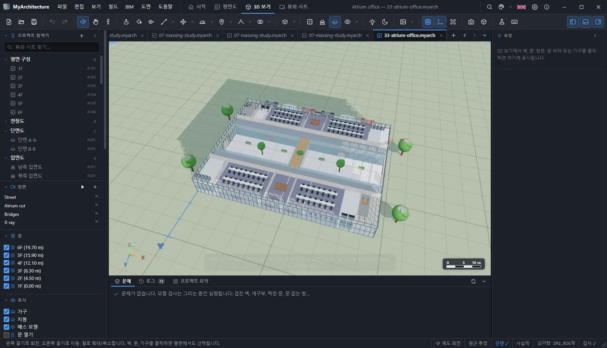
*예제 33 아트리움 업무 시설의 **Atrium cut** 장면: 6개 층 가운데를 비운 아트리움과 브리지*

---

## 2. 화면과 조작

### 2.1 제목 표시줄

제목 표시줄에는 왼쪽부터 다음이 있습니다. 보기 탭을 위한 별도의 탭 줄은 없습니다(열린 도면마다 생기는 문서 탭은 아래 “문서 탭” 참고).

- **메뉴**: 파일 · 편집 · 보기 · 빌드 · BIM · 도움말. 메뉴 하나를 연 채 다른 메뉴 이름 위로 마우스를 옮기면 그 메뉴가 바로 열립니다.
- **보기 탭**: **시작** · **평면도**(<kbd>F2</kbd>) · **3D 보기**(<kbd>F3</kbd>). 평면도 탭에는 모델 검사 결과가 배지로 붙습니다 — 오류가 있으면 오류 개수(빨강), 오류 없이 경고만 있으면 경고 개수(노랑).
- **문서 제목**: 프로젝트 제목(프로젝트 속성의 제목), 저장하지 않은 변경이 있으면 **●**, 그 뒤에 파일 이름. 창 제목도 `● 파일이름 — MyArchitecture 10.0` 형식입니다.
- **돋보기 단추**(제목 표시줄 오른쪽(최소화 단추 왼쪽)): 명령 팔레트를 엽니다(<kbd>Ctrl</kbd>+<kbd>K</kbd>). 툴팁은 “명령, 방, 가구 검색… (Ctrl+K)”. 검색 입력 칸은 팔레트 안에 있습니다(2.6절).
- **제목 표시줄 오른쪽(최소화 단추 왼쪽)의 단추**: 팔레트 아이콘(**무작위 테마**) + ▾(**테마 선택** 목록), 국기(한국어 화면에서는 영국 국기 = English 로, 영어 화면에서는 태극기 = 한국어로), 톱니바퀴(**설정…**), ⓘ(**MyArchitecture 정보**).

제목 표시줄의 어느 것도 숨겨지지 않습니다. 창의 최소 폭이 모든 메뉴·탭·단추가 보이도록 정해지고, 화면이 아주 좁으면 제목 표시줄이 두 줄로 나뉩니다.

#### 문서 탭 (여러 도면 함께 작업하기)

열어 둔 도면마다 **문서 탭**이 하나씩 생깁니다. 문서 탭 줄은 도구 모음 아래, 가운데 작업 영역(평면도·3D·시작 페이지) 바로 위에만 있습니다 — 왼쪽·오른쪽 패널은 도구 모음에 바로 붙어 있습니다.

- **새 프로젝트**(<kbd>Ctrl</kbd>+<kbd>N</kbd>), **열기**(<kbd>Ctrl</kbd>+<kbd>O</kbd>), **예제 열기**, **최근 파일**, 탐색기에서 연 파일, 창에 끌어다 놓은 `.myarch` 파일은 모두 **새 탭**으로 열립니다. 지금 탭이 손대지 않은 빈 “제목 없음”이면 그 탭을 그대로 씁니다. 이미 열려 있는 파일을 다시 열면 그 탭으로 갑니다. DXF·IFC·3D 모델·이미지 **가져오기**는 지금 탭의 도면으로 들어갑니다.
- 탭에는 파일 이름이 보이고, 저장하지 않은 변경이 있으면 **●** 가 붙습니다. 탭 위에 마우스를 올리면 프로젝트 제목과 파일 전체 경로가 나옵니다. 창 제목은 지금 탭을 따릅니다.
- 탭을 누르면 그 도면으로 바뀝니다. 도면마다 되돌리기/다시 실행 기록, 파일 이름, 보던 층·확대 배율·화면 위치, 3D 시점, 모델 검사 결과가 따로 기억됩니다(선택은 풀립니다). 평면도/3D 보기는 그대로 유지됩니다.
- **×** 또는 **가운데 단추 클릭**, <kbd>Ctrl</kbd>+<kbd>W</kbd>, **파일 → 탭 닫기**로 탭을 닫습니다. 저장하지 않은 변경이 있으면 저장할지 먼저 묻습니다. 마지막 탭을 닫으면 빈 “제목 없음” 탭과 시작 페이지가 남습니다. 탭을 오른쪽 클릭하면 **다른 탭 닫기**, **오른쪽 탭 닫기**도 있습니다.
- <kbd>Ctrl</kbd>+<kbd>Tab</kbd> / <kbd>Ctrl</kbd>+<kbd>Shift</kbd>+<kbd>Tab</kbd>(또는 <kbd>Ctrl</kbd>+<kbd>PageDown</kbd> / <kbd>PageUp</kbd>)으로 다음/이전 탭으로 옮겨 갑니다. 탭을 옆으로 끌면 순서가 바뀝니다.
- 탭이 많아 줄에 다 들어가지 않으면 탭 줄이 옆으로 스크롤됩니다. 오른쪽 끝의 **<** / **>** 단추는 탭을 하나씩 왼쪽/오른쪽으로 옮겨 보여 주고, 끝에 닿으면 흐리게 꺼집니다. 마우스 휠로도 스크롤됩니다. **+** 는 새 프로젝트, **▾** 는 열린 도면 전체 목록입니다.
- 창을 닫을 때는 저장하지 않은 탭마다 차례로 저장할지 묻습니다. 자동 저장(복구)도 저장하지 않은 모든 탭을 담고, 복구하면 도면마다 탭으로 열립니다. 대화형 튜토리얼은 자기 탭에서 진행되어 다른 탭의 도면을 건드리지 않습니다.

### 2.2 메뉴 한눈에 보기

| 메뉴 | 항목 |
| --- | --- |
| **파일** | 새 프로젝트, 열기…, 예제 열기…, 최근 파일…, 최근 파일 지우기 / 저장, 다른 이름으로 저장… / 가져오기(DXF, IFC, 3D 모델, 이미지…)…, 가져오기 ▸, 내보내기 ▸ / 인쇄 / PDF…, 프로젝트 속성… / 끝내기 |
| **편집** | 되돌리기, 다시 실행, 되돌리기 기록… / 잘라내기, 복사, 붙여넣기, 복제, 삭제 / 모두 선택, 찾기… / 90° 회전, 좌우 대칭 / 문 뒤집기, 상하 대칭, 크기 조정…, 간격 띄우기… / 그룹, 그룹 해제, 속성… |
| **보기** | 시작 페이지, 평면도, 3D 보기 / 확대, 축소, 화면에 맞추기, 이동 (손) / 격자 표시, 눈금자 표시, 격자와 벽에 스냅, 직교 그리기 (45° 단위) / 치수 표시, 가구 표시, 방 면적 표시, 아래층 표시, 밑그림과 CAD 레이어 표시 / 단계: 모두 보기, 단계: 새 설계, 단계: 기존 건물 / 라이브러리 패널 표시, 속성 패널 표시 / 테마…, 어두운 테마, 밝은 테마, 시스템 테마 / 한국어, English |
| **빌드** | 벽에서 방 감지, 맨 위층 지붕, 외벽 치수 넣기 / 맨 위에 층 추가, 층 속성…, 기본 크기 (벽, 문, 창문)…, CAD 레이어… / 모델 검사, 집계와 수량… |
| **BIM** | 벽 타입…, 선택 요소의 BIM 속성…, 비슷한 요소 선택 / 공사비…, 대지 위치 (일조 분석)… / IFC 내보내기(BIM)…, IFC 가져오기(BIM)… |
| **도움말** | 따라 하는 튜토리얼, 사용 설명서, 단축키, 지원 파일 형식…, 빠른 둘러보기 / 설정…, MyArchitecture 정보 |

켜고 끄는 항목(격자 표시, 스냅, 단계 보기, 걷기 등)은 켜져 있으면 ✓ 표시가 붙고, 지금 쓸 수 없는 항목은 흐리게 보입니다. 단축키가 있는 항목은 오른쪽에 키가 적혀 있습니다.

**그리기**와 **3D** 명령은 따로 메뉴가 없습니다. 모두 도구 모음 단추로 있습니다(2.3절, 5.1절). 장면 추가·장면 애니메이션 재생은 3D 보기 왼쪽의 **장면** 패널에 있습니다.

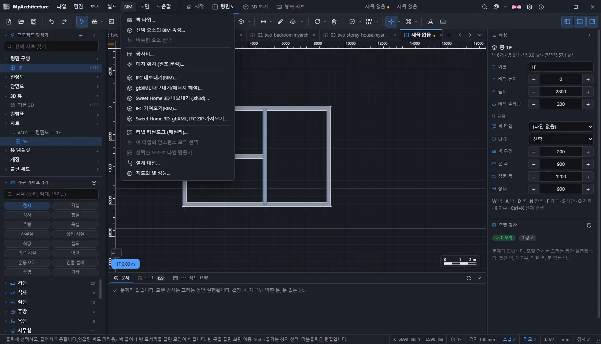
*BIM 메뉴*

### 2.3 도구 모음

마우스를 올리면 이름과 단축키가 툴팁으로 나옵니다. 켜진 도구·옵션은 강조됩니다.

- **언제나**: 새 프로젝트 · 열기… · 저장 | **되돌리기 · 다시 실행** | … | (오른쪽 끝) 따라 하는 튜토리얼 · 단축키 · MyArchitecture 정보
- **되돌리기/다시 실행 단추**의 툴팁은 되돌릴 작업 이름까지 알려 줍니다(예: “되돌리기: 벽 추가 (Ctrl+Z)”). 되돌릴 것이 없으면 흐려집니다.
- **평면도 탭**: 선택 · 벽 · 방 · 문 · 창문 · 기둥 · 계단 · 가구 · 지붕 | 매스 상자 · 매스 원기둥 · 매스 다각형 | 그리드 선 · 치수 · 텍스트 · 선 · 측정 | 90° 회전 · 좌우 대칭 · 삭제 | 벽에서 방 감지 · 벽 타입… · 선택 요소의 BIM 속성… · 모델 검사 · 집계와 수량… | (오른쪽) 스냅 · 직교 · 이동(손) · 격자 · 눈금자 | 축소 · 확대 · 화면에 맞추기
- **3D 탭**: 5.1절 참고.
- **시작 탭**: 1.4절 참고.

도구 모음 단추도 **절대 숨겨지지 않습니다**. 창의 최소 폭이 지금까지 본 가장 넓은 도구 모음에 맞춰지고, 화면 자체가 좁으면 글자 단추가 아이콘으로 줄어들며(툴팁은 그대로), 그래도 넘치면 두 줄로 나뉩니다.

### 2.4 패널

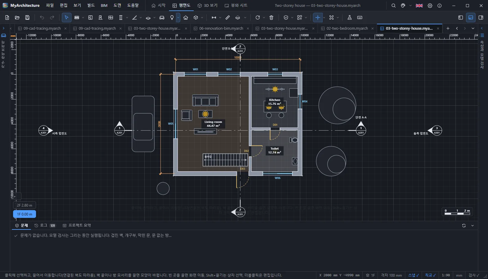
*패널 접기(Ctrl+1 / Ctrl+2): 접힌 패널은 아이콘과 제목으로 남습니다*

- **왼쪽 패널**(<kbd>Ctrl</kbd>+<kbd>1</kbd>, 보기 → 라이브러리 패널 표시)과 **오른쪽 패널**(<kbd>Ctrl</kbd>+<kbd>2</kbd>, 보기 → 속성 패널 표시)은 패널 제목의 **<** / **>** 단추(패널 숨기기)로도 접습니다.
- 접힌 패널은 사라지지 않고 **아이콘과 세로 제목이 있는 좁은 띠**로 남습니다(“가구 라이브러리”, “3D 보기 옵션”, “속성과 모델 검사”, “속성”). 띠를 누르면 다시 펼쳐집니다. 오른쪽 띠에는 모델 검사 오류·경고 개수 배지가 붙습니다.
- 패널과 도면 사이의 경계선을 끌면 폭이 200 ~ 520 px 사이에서 바뀌고, 다음 실행 때도 기억됩니다.
- 시작 탭에서는 양쪽 패널과 하단 패널이 없고, 도구 모음의 패널 단추도 흐리게 꺼집니다.
- 도구 모음 오른쪽 끝의 단추 세 개로도 왼쪽 · 하단 · 오른쪽 패널을 접고 폅니다. 켜진 패널의 단추는 강조되어 보입니다.

#### 하단 패널

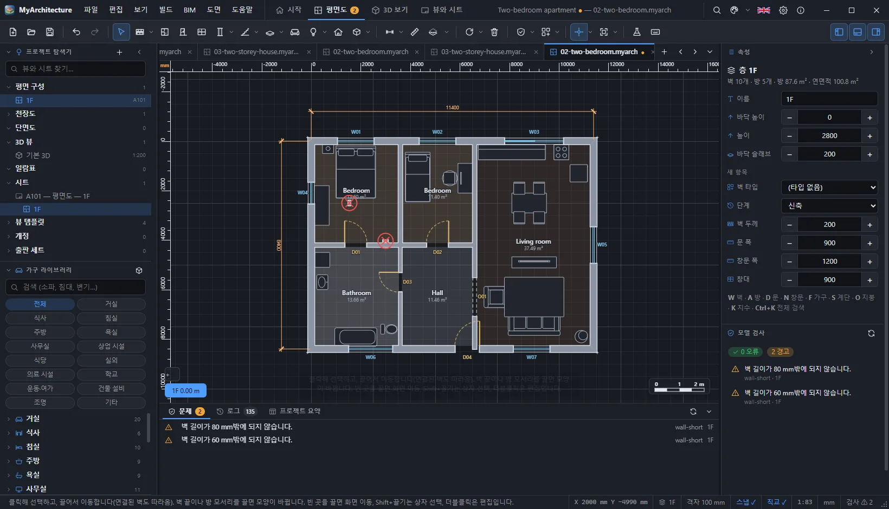
*하단 패널: 좌우 패널 사이, 도면 아래에 문제 · 로그 · 프로젝트 요약 탭이 있습니다*

도면(평면도 · 3D 보기 · 뷰와 시트) 아래, 좌우 패널 사이에 있습니다. <kbd>Ctrl</kbd>+<kbd>3</kbd>, 보기 → **하단 패널 표시**, 도구 모음 오른쪽 끝의 가운데 단추, 또는 탭 줄 오른쪽의 **▾ / ↑** 로 접고 폅니다. 접으면 탭 줄만 남고, 탭을 누르면 다시 펼쳐집니다(펼쳐진 상태에서 지금 탭을 다시 누르면 접힙니다). 위쪽 경계를 끌면 높이가 바뀌고(도면은 240 px 아래로 줄지 않음), 높이·열린 탭·접힘 상태는 다음 실행 때도 기억됩니다.

| 탭 | 내용 |
| --- | --- |
| **문제** | 지금 설계의 모델 검사 결과(오류가 먼저, 그다음 경고). 줄마다 내용 · 검사 코드 · 층. 줄을 누르면 평면도로 가서 그 요소를 고르고 확대합니다. 탭의 숫자 배지는 문제 수(오류가 있으면 빨강, 경고만 있으면 노랑). 오른쪽 ↻ 는 모델 검사를 다시 실행합니다. 모델 검사는 그리는 동안 자동으로 돌고, <kbd>F5</kbd>(빌드 → 모델 검사)는 하단 패널을 이 탭으로 엽니다 |
| **로그** | 이번 실행에서 일어난 일을 시간과 함께: 편집(되돌리기 목록과 같은 이름), 연 파일과 저장한 파일, 화면에 떴던 알림, 모델 검사 결과가 바뀐 때, 프로그램 오류. 다른 탭을 보는 동안 쌓인 수가 탭 배지로 나옵니다. 오른쪽 단추로 **로그 복사**(클립보드, 탭으로 구분된 텍스트)와 **로그 지우기**. 최근 500 줄까지 보관합니다 |
| **프로젝트 요약** | 층 · 벽 · 방 · 바닥 면적(방 면적 합계, m²) · 문 · 창문 · 계단 · 슬래브 · 지붕 · 가구 · 매스 수와 모델 검사(오류 / 경고). 편집할 때마다 바로 바뀝니다 |

오른쪽 패널(속성)의 숫자는 모두 **스테퍼**입니다: 왼쪽 **−**, 오른쪽 **+**, 가운데 값은 직접 입력하고 <kbd>Enter</kbd>. 단추를 누르고 있으면 반복되고, 값 칸에서 방향키로도 한 단계씩 바뀝니다. 오른쪽 패널에서 바꾼 값은 하나하나가 되돌리기 한 단계입니다.

### 2.5 상태 표시줄과 창 크기

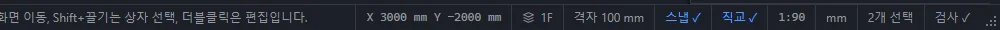
*상태 표시줄: 좌표·층·격자·스냅·직교·축척·단위·선택·검사, 오른쪽 끝은 창 크기 조절 표시*

맨 왼쪽 넓은 칸은 지금 도구의 힌트(없으면 “준비”)입니다. 그 뒤 칸들은 보고 있는 페이지에 따라 다르고, 단추처럼 생긴 칸은 눌러서 바꿀 수 있습니다.

| 페이지 | 칸 (왼쪽 → 오른쪽) |
| --- | --- |
| **평면도** | 커서 좌표 `X … Y …`(지금 단위, Y 는 위쪽이 +) · **층**(누르면 층 속성…) · **격자 100 mm**(누르면 10/25/50/100/250/500/1000 mm 중 선택) · **스냅 ✓/—**(누르면 전환, <kbd>F9</kbd>) · **직교 ✓/—**(누르면 전환, <kbd>F8</kbd>) · 화면 축척 `1:…`(96 dpi 기준 근사) · **단위**(누르면 mm → cm → m → ft → mm 순환) · `n개 선택`(고른 것이 있을 때) · **검사** |
| **3D 보기** | **탐색 방식**(궤도 회전/이동/걷기 — 누르면 걷기 켜기·끄기) · **원근 투영/평행 투영**(누르면 전환) · **단면 ✓/—**(누르면 전환) · 표현 스타일 이름 · `삼각형 n개` · `n개 선택` · **검사** |
| **시작** | `최근 파일 n개` · `테마: …` · `벽 n개`(또는 “빈 프로젝트”) · **검사** |

**검사** 칸은 `검사 ✓`(문제 없음), `검사 ⚠ n`(경고), `검사 ✖ n`(오류)으로 보이며 누르면 모델 검사(<kbd>F5</kbd>)를 실행합니다(평면도로 이동).

**창 크기 조절 손잡이**: 상태 표시줄 오른쪽 아래 모서리의 점 무늬를 끌면 창 크기가 바뀝니다(툴팁 “끌어서 창 크기 변경”). 데스크톱판에서만 보이며, 창이 최대화·전체 화면일 때는 숨습니다.

### 2.6 명령 팔레트와 찾기

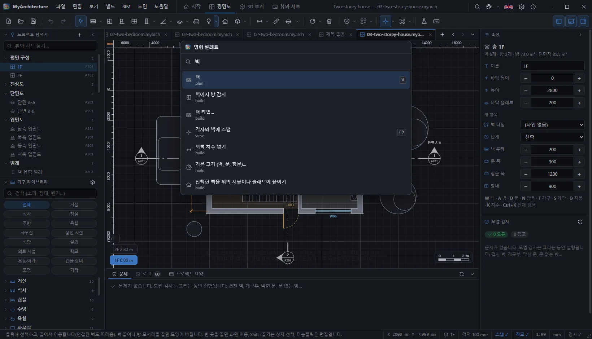
*명령 팔레트(Ctrl+K): 모든 명령·방·층·가구를 검색합니다*

- **명령 팔레트**(<kbd>Ctrl</kbd>+<kbd>K</kbd> 또는 제목 표시줄 오른쪽(최소화 단추 왼쪽)의 돋보기): 모든 명령, 프로젝트의 모든 방(누르면 평면에서 그 방을 선택하고 가운데로), 모든 층(누르면 그 층으로)을 한 목록에서 찾습니다. 입력하면 바로 좁혀지고, <kbd>↑</kbd>/<kbd>↓</kbd> 와 <kbd>Enter</kbd> 로 실행, <kbd>Esc</kbd> 로 닫습니다. 보기 메뉴 끝의 테마·언어 명령(테마…, 어두운 테마, 밝은 테마, 시스템 테마, 한국어, English)도 여기서 실행할 수 있습니다.
- **찾기…**(<kbd>Ctrl</kbd>+<kbd>F</kbd>, 편집 메뉴): 방, 문·창문(태그로), 가구, 텍스트, 층을 찾아 그 자리로 갑니다.

### 2.7 확대·축소와 화면 이동 (평면도)

| 동작 | 방법 |
| --- | --- |
| 확대/축소 | 마우스 휠(커서 기준), 트랙패드 핀치(<kbd>Ctrl</kbd>+휠), <kbd>Ctrl</kbd>+<kbd>=</kbd> / <kbd>Ctrl</kbd>+<kbd>-</kbd>, 도구 모음 확대·축소. 한 칸 배율은 설정 → 단위와 격자 → **휠 확대/축소 속도**(× 0.5 ~ × 3) |
| 전체 보기 | <kbd>Home</kbd>, 도구 모음 **화면에 맞추기**, 빈 곳 오른쪽 클릭 메뉴 |
| 화면 이동 | **빈 곳을 왼쪽 버튼으로 끌기**(기본), 가운데 버튼 끌기, 오른쪽 버튼 끌기, <kbd>Space</kbd>+끌기, <kbd>Shift</kbd>+휠(가로 이동), 두 손가락 터치 |
| 손(이동) 도구 | 보기 → **이동 (손)** 또는 도구 모음 손 단추. 켜져 있으면 요소 위에서도 왼쪽 끌기가 화면 이동입니다. <kbd>Esc</kbd> 나 단추로 끕니다 |

가운데 끌기·오른쪽 끌기·<kbd>Space</kbd>+끌기는 어떤 도구를 쓰는 중에도 항상 화면 이동입니다. 오른쪽 버튼을 **움직이지 않고** 떼면 오른쪽 클릭 메뉴가 열립니다.

설정 → 단위와 격자 → **빈 캔버스에서 왼쪽 끌기**를 **상자 선택**으로 바꾸면 빈 곳 끌기가 상자 선택이 되고, 이동은 가운데·오른쪽·<kbd>Space</kbd> 끌기로 합니다.

### 2.8 격자와 눈금자

- **격자**: 기본은 **선 (5 × 5)** — 가는 선과 5칸마다 또렷한 선. 격자 간격(스냅 간격)은 설정 → 단위와 격자 → **격자**, 또는 상태 표시줄의 격자 칸에서 10 / 25 / 50 / 100 / 250 / 500 / 1000 mm 로 바꿉니다(기본 100 mm). **격자 모양**은 선(5 × 5)/점. 도구 모음·보기 메뉴의 **격자 표시**로 켜고 끕니다.
- **눈금자**: 도면 위·왼쪽 가장자리에 지금 단위로 표시되고, 커서 위치가 주황색으로 표시됩니다. **눈금자 표시**로 켜고 끕니다.

### 2.9 선택

| 동작 | 결과 |
| --- | --- |
| 클릭 | 하나 선택. 그룹에 속한 요소는 그룹 전체가 선택됨 |
| <kbd>Alt</kbd>+클릭 | 그룹 안에서 하나만 선택 |
| <kbd>Shift</kbd>+클릭 또는 <kbd>Ctrl</kbd>+클릭 | 선택에 넣기/빼기 |
| <kbd>Shift</kbd>+끌기 또는 <kbd>Ctrl</kbd>+끌기 | **상자 선택**(4.1절) |
| 빈 곳 클릭 | 선택 해제(<kbd>Esc</kbd> 도 같음) |
| <kbd>Ctrl</kbd>+<kbd>A</kbd> | 지금 층의 모두 선택 |
| 더블클릭 | 속성 창(4.10절) |

마우스를 요소 위에 올리면 강조되고, 커서가 이동(✥) 모양이 됩니다. 손잡이(벽 끝, 방·지붕 꼭짓점, 치수·그리드 끝) 위에서는 십자 커서가 됩니다.

**평면·3D 연동 선택**: 평면에서 고르면 3D 에서 같은 요소가 파랗게 강조되고, 3D 에서 클릭하면 평면에서 선택됩니다. 설정 → 평면도 → **평면·3D 연동 선택**(“평면에서 선택하면 3D에서 강조되고, 그 반대도 마찬가지”)으로 켜고 끕니다.

### 2.10 되돌리기와 다시 실행

- **되돌리기** <kbd>Ctrl</kbd>+<kbd>Z</kbd>, **다시 실행** <kbd>Ctrl</kbd>+<kbd>Y</kbd> 또는 <kbd>Ctrl</kbd>+<kbd>Shift</kbd>+<kbd>Z</kbd>. 실행하면 “되돌리기: 벽 추가”처럼 잠깐 알림이 뜹니다.
- 같은 명령이 **도구 모음**(툴팁에 단계 이름), **편집 메뉴**, 그리고 **평면 도면·층 탭·3D 화면의 오른쪽 클릭 메뉴 맨 위**에 있습니다.
- 한 번 끌기(이동, 모양 바꾸기, 밀기/끌기)는 되돌리기 한 단계입니다. 최대 200 단계까지 기억합니다.
- **편집 → 되돌리기 기록…**: 지난 작업 목록(맨 위가 최신)에서 한 항목을 누르면 그 작업 **이전까지** 한 번에 되돌립니다.

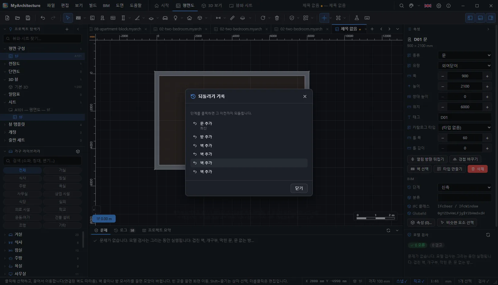
*되돌리기 기록: 지난 작업 목록에서 원하는 시점으로 돌아갑니다*

- 입력 칸에 글자를 쓰는 중에는 <kbd>Ctrl</kbd>+<kbd>Z</kbd> 가 그 칸의 글자 되돌리기로 동작합니다.

---

## 3. 평면 그리기

평면도 탭(<kbd>F2</kbd>)에서 그립니다. 도구 키를 누르거나 도구 모음에서 고르면 도구가 바뀌고, 상태 표시줄(그리고 도면 아래쪽)에 그 도구의 힌트가 나옵니다. <kbd>Esc</kbd> 는 그리던 것을 끝내고, 한 번 더 누르면 **선택** 도구로 돌아갑니다.

### 3.1 도구 목록

| 도구 | 키 | 하는 일 |
| --- | --- | --- |
| 선택 (Select) | <kbd>Esc</kbd> | 클릭 선택, 끌어서 이동, 손잡이로 모양 바꾸기 |
| 벽 (Wall) | <kbd>W</kbd> | 모서리를 차례로 클릭해 벽 |
| 방 (Room) | <kbd>A</kbd> | 벽 안쪽 클릭 → 방과 면적 |
| 문 (Door) | <kbd>D</kbd> | 벽 위 클릭 |
| 창문 (Window) | <kbd>N</kbd> | 벽 위 클릭 |
| 기둥 (Column) | <kbd>C</kbd> | 클릭해 놓기 |
| 계단 (Stair) | <kbd>S</kbd> | 아래쪽, 위쪽 두 점 |
| 가구 (Furniture) | <kbd>F</kbd> | 가구 검색 창 → 클릭해 놓기 |
| 지붕 (Roof) | <kbd>O</kbd> | 건물 안 클릭 → 외곽선 지붕 |
| 매스 상자 (Mass box) | <kbd>B</kbd> | 마주 보는 두 모서리 |
| 매스 원기둥 (Mass cylinder) | <kbd>U</kbd> | 중심, 원 위의 점 |
| 매스 다각형 (Mass shape) | — | 모서리를 차례로 클릭 |
| 그리드 선 (Grid line) | <kbd>G</kbd> | 구조 그리드 선의 두 끝 |
| 치수 (Dimension) | <kbd>K</kbd> | 두 점 → 간격 → 클릭 |
| 텍스트 (Text) | <kbd>T</kbd> | 클릭하고 입력 |
| 선 (Line) | <kbd>L</kbd> | CAD 레이어에 작도선 |
| 측정 (Measure) | <kbd>M</kbd> | 두 점 사이 거리(도면에 남지 않음) |

### 3.2 스냅과 직교

그리는 동안 커서 표시가 무엇에 붙었는지 알려 줍니다.

| 표시 | 뜻 |
| --- | --- |
| 주황 **네모** | 벽 끝점, 방·CAD 선의 꼭짓점, 기둥 중심 |
| 초록 **삼각형** | 벽 중심선 위(벽을 따라 격자 간격으로) |
| **십자** | 격자점 또는 직교 방향 위의 점 |
| 주황 **점선** | 다른 벽 끝과 가로·세로로 줄이 맞음(정렬 안내선) |

- **스냅**(<kbd>F9</kbd>, 보기 → 격자와 벽에 스냅, 상태 표시줄): 끝점·꼭짓점 → 벽 → 격자 순서로 붙습니다. 끄면 커서 위치 그대로입니다.
- **직교**(<kbd>F8</kbd>, 보기 → 직교 그리기 (45° 단위)): 벽·선·방·지붕·계단을 그릴 때 방향이 45° 단위로, 길이가 격자 단위로 맞춰집니다. 그 방향으로 가다 다른 벽의 중심선과 만나면 정확히 그 위에서 끝납니다.
- <kbd>Shift</kbd> 를 누른 채 그리면 그 순간만 **자유 각도**입니다.

### 3.3 벽

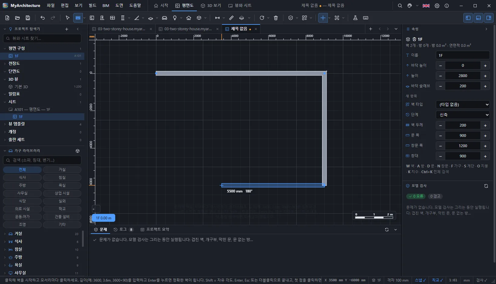
*벽 그리기(W): 클릭할 때마다 벽이 이어지고 길이·각도가 표시됩니다*

1. <kbd>W</kbd> 를 누르고 시작점을 클릭합니다.
2. 모서리마다 클릭합니다. 커서 옆에 지금 벽의 **길이와 각도**(화면 기준 반시계 방향, 0° = 오른쪽)가 표시되고, 두께만큼의 파란 미리 보기가 따라옵니다.
3. 끝내기: <kbd>Enter</kbd>, <kbd>Esc</kbd>, 더블클릭, 같은 점을 다시 클릭, 또는 **첫 점을 클릭**(외곽선이 닫히며 끝남). 오른쪽 클릭도 그리기를 끝냅니다.
4. <kbd>Backspace</kbd> 는 그리는 중에 **마지막 모서리(벽)를 되돌립니다**.

다 그리면 방금 그린 벽들이 선택되고 “벽 n개를 그렸습니다. A를 누르고 그 안쪽을 클릭하면 방이 만들어집니다.”라고 안내합니다.

새 벽의 두께·재료·벽 타입·단계는 다음을 따릅니다.

- 오른쪽 패널(아무것도 고르지 않았을 때)의 **새 항목** 칸: 벽 타입, 단계, 벽 두께(그리고 문 폭, 창문 폭, 창대).
- 빌드 → **기본 크기 (벽, 문, 창문)…** 의 벽 두께·벽 재료.
- 벽 타입을 고르면 두께는 그 타입 레이어 두께의 합입니다.
- 새 벽의 높이는 따로 정하지 않으면 **층 높이**를 따릅니다.

#### 길이 입력

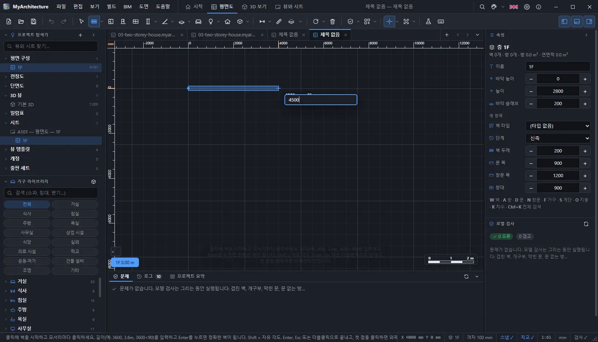
*길이 입력: 그리는 중에 숫자를 치면 정확한 길이(예: 4500, 3.6m, 3600<90)로 벽이 놓입니다*

벽(또는 선)을 그리는 중에 숫자나 `.` 을 치면 커서 옆에 **길이 입력 칸**(“길이(mm, 3.6m, 3600<90)”)이 열립니다. 입력하고 <kbd>Enter</kbd> 를 누르면 지금 커서 방향으로 정확한 길이의 벽이 놓이고 그리기는 계속됩니다.

| 입력 예 | 뜻 |
| --- | --- |
| `3600` | 3600 mm (단위가 없으면 mm) |
| `3.6m` | 3.6 m = 3600 mm |
| `360cm` | 360 cm |
| `3600mm` | 3600 mm |
| `120in`, `120"` | 120 인치 |
| `12'6"`, `12'6`, `12'` | 12 피트 6 인치 / 12 피트 |
| `3600<90` | 길이 3600, **각도 90°**(화면 기준 반시계 방향: 0° 오른쪽, 90° 위, 180° 왼쪽, 270° 아래) |
| `3,6m` | 쉼표도 소수점으로 읽습니다 |

각도를 주지 않으면 지금 커서가 있는 방향(직교가 켜져 있으면 45° 단위로 맞춘 방향)으로 놓입니다.

#### 벽 이음

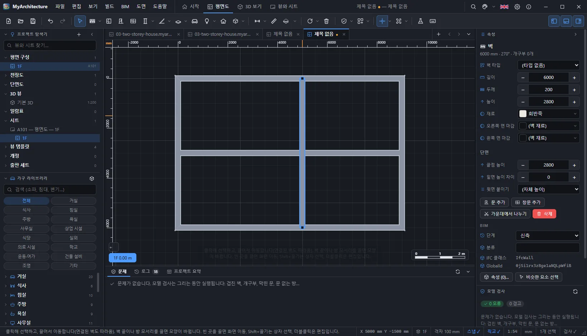
*벽 이음: 모서리는 자동으로 맞물리고, T 자·십자 이음도 깨끗하게 그려집니다*

벽 끝이 다른 벽의 끝이나 중심선에 닿으면 L 자, T 자, 십자 이음이 자동으로 깔끔하게 그려집니다(벽을 잘라 붙일 필요가 없습니다). 칸막이 벽은 끝을 외벽 위에 놓기만 하면 됩니다.

#### 벽 고치기

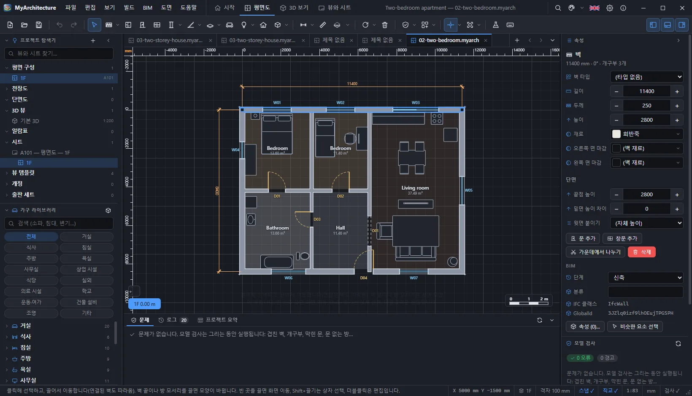
*벽을 고르면 오른쪽에서 두께·높이·벽 타입·재료·단계 등을 바로 고칩니다*

벽을 선택하면 오른쪽 패널 제목에 길이 · 각도 · 개구부 수가 보이고, 다음 칸이 있습니다.

| 칸 | 설명 |
| --- | --- |
| 벽 타입 | (타입 없음) 또는 벽 타입 목록. 고르면 두께가 레이어 합으로 바뀜 |
| 길이 | 바꾸면 끝점이 움직이고 그 끝에 이어진 벽도 따라감 |
| 두께 | 직접 바꾸면 벽 타입이 풀림 |
| 높이 | 층 높이와 같으면 층 높이를 따름(층 높이를 바꾸면 함께 바뀜) |
| 재료 | 벽 재료(12.3절) |

단추: **문 추가**, **창문 추가**(누른 뒤 벽을 클릭), **가운데에서 나누기**, **삭제**. 그 아래 BIM 칸(6장).

- 벽 **끝 손잡이**(작은 네모)를 끌면 그 끝만 움직입니다. 벽 **몸통**을 끌면 벽 전체가 움직이고 이어진 벽들이 늘어나며 따라옵니다(<kbd>Alt</kbd>+끌기는 이어진 벽을 늘리지 않고 이동).
- 벽 위 오른쪽 클릭 메뉴: **여기에 문 추가**, **여기에 창문 추가**, **여기서 벽 나누기**, **일직선 벽 합치기**(지금 층에서 한 줄로 이어진 벽들을 하나로).
- 더블클릭(또는 <kbd>E</kbd>)하면 **벽 속성** 창: 길이, 두께, 높이(+ **층 높이와 같게**), 재료.

### 3.4 방

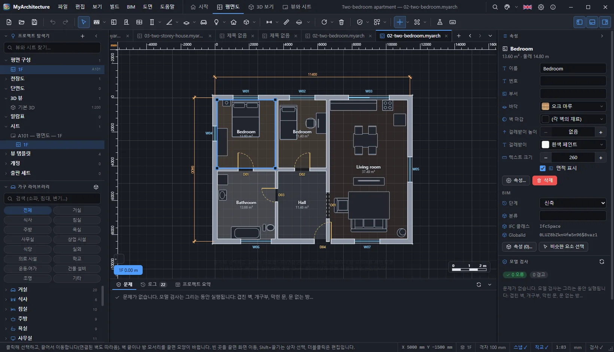
*방(A): 벽으로 둘러싸인 곳을 클릭하면 방이 생기고 이름과 면적이 붙습니다*

- <kbd>A</kbd> 를 누르고 **닫힌 벽 안쪽을 클릭**하면 벽 안쪽 면을 따라 방이 생깁니다. 이름은 크기에 맞게 자동으로 붙고(예: 거실, 침실, 욕실 …), 면적이 알림으로 나옵니다(“방 "…"을(를) 추가했습니다: … m². 두 번 클릭하면 이름을 바꿀 수 있습니다.”).
- **<kbd>Shift</kbd>+클릭**으로 시작하면 모서리를 직접 찍어 그립니다. 첫 점을 다시 클릭하거나 <kbd>Enter</kbd> 로 끝냅니다. 그리는 동안 면적이 커서 옆에 보입니다.
- **빌드 → 벽에서 방 감지**(빈 곳 오른쪽 클릭 → **방 감지**): 지금 층에서 닫힌 공간 중 아직 방이 없는 곳을 모두 방으로 만듭니다.
- 바닥 재료는 기본 **오크 마루**(기본 크기 창의 바닥 재료로 바꿈).

방을 선택하면 오른쪽 패널에 면적·둘레가 보이고, **이름**, **번호**(실 번호), **부서**(용도), **바닥**(재료), **텍스트 크기**, **면적 표시** 칸이 있습니다. 꼭짓점 손잡이를 끌면 모양이 바뀝니다(방 하나만 골랐을 때). 더블클릭하면 **방 속성** 창(이름은 거실·침실·주방·식당·욕실·변기·홀·현관·서재·다용도실·창고·드레스룸·발코니·차고·사무실·회의실·복도·계단 목록에서 고르거나 직접 입력).

### 3.5 문과 창문

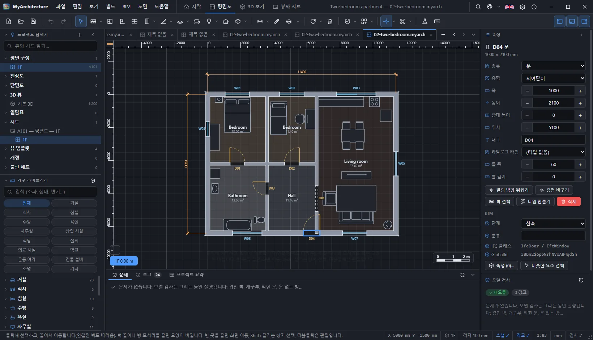
*문(D)·창(N): 벽 위를 클릭하면 들어가고, X 로 여는 방향, H 로 경첩을 바꿉니다*

- <kbd>D</kbd>(문) 또는 <kbd>N</kbd>(창문)을 누르고 벽 위로 커서를 옮기면 미리 보기와 폭이 나옵니다. 클릭하면 들어갑니다.
- 위치는 벽을 따라 격자의 반 칸 단위로 맞춰지고, 벽 끝을 넘지 않도록 조정됩니다.
- 문은 **커서가 있는 쪽으로** 열리고, 경첩은 클릭한 곳에 가까운 쪽 끝에 붙습니다.
- 벽이 너무 짧으면 “이 벽은 너무 짧아 넣을 수 없습니다.”, 이미 문·창이 있으면 “그 자리에 이미 문이나 창문이 있습니다.”
- 새 문·창의 크기와 종류: 기본 크기 창(문 폭 900, 문 높이 2100, 창문 폭 1200, 창문 높이 1200, 창대 900 이 처음 값), 오른쪽 패널의 새 항목 칸.

선택한 문·창:

| 키·단추 | 하는 일 |
| --- | --- |
| <kbd>X</kbd> / **열림 방향 뒤집기** | 문이 열리는 쪽(벽의 어느 면) 바꾸기 |
| <kbd>H</kbd> / **경첩 바꾸기** | 경첩을 반대쪽 끝으로 |
| **벽 선택** | 이 문·창이 달린 벽 선택 |

오른쪽 패널 칸: **종류**(문 / 창문 / 개구부), **유형**(문: 외여닫이·양개·미닫이·차고, 창문: 여닫이창·고정·미닫이), **폭**, **높이**, **창대 높이**, **위치**(벽 시작점에서 중심까지 거리), **태그**. 태그는 비워 두면 문 `D01, D02…`, 창 `W01…`, 개구부 `O01…` 이 층·위치 순서로 자동으로 붙습니다. 더블클릭하면 **문 속성 / 창문 속성** 창(위 항목 + 여닫는 쪽 “벽 왼쪽/벽 오른쪽”, 경첩 “벽 시작점에서/벽 끝에서”).

> 문·창은 벽에 붙어 있으므로 벽을 옮기거나 늘이면 함께 움직입니다. 벽을 지우면 그 벽의 문·창도 지워집니다.

### 3.6 가구

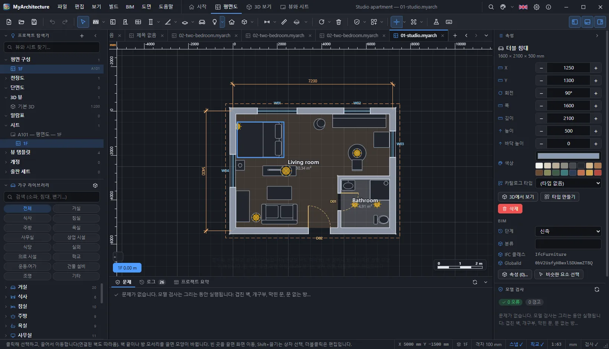
*가구 라이브러리: 분류·검색 후 끌어다 놓거나 눌러서 배치합니다*

**가구 라이브러리**(왼쪽 패널):

- 위쪽 검색 칸(“검색 (소파, 침대, 변기…)”)과 분류 칩: 전체 · 거실 · 식사 · 침실 · 주방 · 욕실 · 사무실 · 실외 · … · 조명 · 기타. 검색 칸에서 <kbd>Enter</kbd> 를 누르면 첫 항목을 고릅니다.
- 검색어도 분류도 없을 때는 맨 위에 **최근 사용** 가구(최대 10개)가 나옵니다.
- 항목마다 평면 모양 그림과 `폭 × 깊이 × 높이`.
- 항목을 **누른 뒤 도면을 클릭**하거나, 항목을 **도면으로 끌어다 놓으면** 배치됩니다.
- **가져온 3D 모델**(7.4절)도 목록 아래에 나와 같은 방법으로 놓습니다. 패널 제목의 3D 모델 단추는 **3D 모델 가져오기(OBJ, FBX, GLB, STL…)…**.

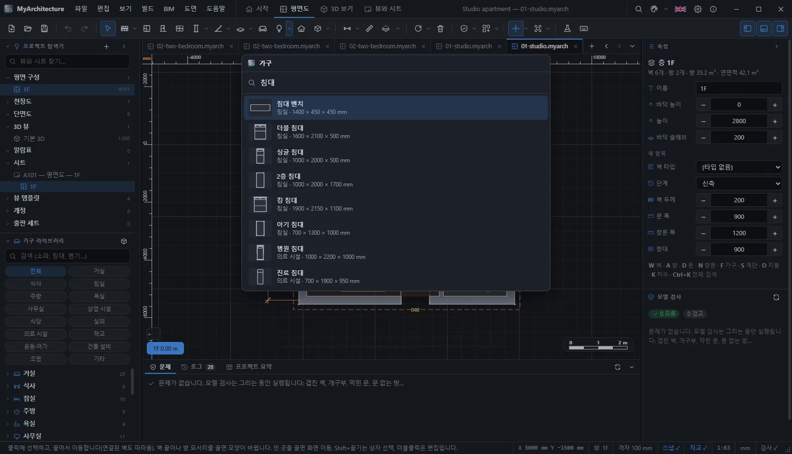
*F 키: 가구를 이름으로 찾아 바로 배치합니다*

**<kbd>F</kbd>(가구 검색)**: “가구 — 이름을 입력하세요(소파, 침대, 싱크대, 자동차 …)” 창에서 이름을 치고 <kbd>Enter</kbd> → 도면을 클릭. 최근에 쓴 가구가 위쪽에 옵니다.

놓는 중에는:

| 키 | 하는 일 |
| --- | --- |
| <kbd>R</kbd> | 미리 보기를 90° 회전 |
| <kbd>Shift</kbd>+<kbd>R</kbd> | 15° 회전 |
| <kbd>Shift</kbd>+클릭 | 놓고 나서도 같은 가구를 계속 놓기 |
| <kbd>Esc</kbd> | 놓기 멈춤 |

가구는 격자의 **반 칸** 단위로 놓이고 움직입니다(끌 때 <kbd>Shift</kbd> 를 누르면 가로·세로로만). 선택하면 오른쪽 패널에 **X, Y, 회전, 폭, 깊이, 높이, 바닥 높이(바닥에서 띄운 높이), 색상** 칸과 **3D에서 보기** 단추가 있습니다. 더블클릭하면 이름·종류(다른 가구로 바꾸기)까지 바꿀 수 있습니다. 전체 목록은 12.3절.

#### 조명

조명 기구는 라이브러리 **조명** 분류의 가구입니다: **천장등, 펜던트 조명, 매입 다운라이트, 스포트라이트, 레일 조명 (스포트 3개), 벽부등, 테이블 램프** — 그리고 **스탠드 조명**(거실)과 **가로등**(실외)도 조명입니다. 평면 도구 모음의 **조명 기구** 단추는 마지막에 쓴 조명(처음에는 천장등)을 놓습니다.

- **놓기**: 다른 가구와 같습니다 — 라이브러리에서 고른 뒤 평면을 클릭하거나, 평면으로 끌어다 놓습니다. 천장 조명은 현재 층의 천장 아래에 저절로 매달립니다(바닥 높이 = 층 높이 − 기구 높이). 벽부등은 1.8 m 높이, 테이블 램프는 바닥에 놓이므로 탁자 위에 두려면 **바닥 높이**를 올립니다.
- **마우스로 옮기기**: 평면에서 가구처럼 끌면 됩니다(격자 반 칸 단위). 3D에서는 조명을 클릭해 선택한 뒤 끌면 그 높이 그대로 미끄러지듯 움직이고(천장등은 천장 아래에 그대로), 놓는 순간 평면도 따라 바뀝니다 — 되돌리기 한 번.
- **평면 기호**: 기구 위에 X 표시가 든 원. **켜져 있으면 노란색으로 채워지고 빛살**이 그려지며, 꺼지면 속이 빈 원입니다. 조명은 아래 가구 위에 그려지고, 클릭하면 아래 탁자보다 조명이 먼저 잡힙니다.
- **켜기 / 끄기**: 오른쪽 패널의 **켜짐** 스위치, 오른쪽 클릭 메뉴(평면·3D)의 **조명 끄기 / 켜기**, 또는 **3D에서 조명을 두 번 클릭**. **모든 조명 켜기 / 끄기**(평면·3D 도구 모음의 전구 단추, 3D 오른쪽 클릭 메뉴)는 모든 조명을 한꺼번에 바꾸며, 하나라도 켜져 있으면 단추가 켜진 상태로 보입니다. 스위치 한 번이 되돌리기 한 단계이고 프로젝트에 저장됩니다.
- **설정**(오른쪽 패널 *조명* 아래): **밝기 (lm)**, **색온도**(전구색 2700 K / 온백색 3000 K, 주백색 4000 K, 주광색 5000 K, 주광 6500 K), **빛 색**(아무 색), 그리고 다운라이트·스포트라이트·레일 조명·가로등은 **빔 각도**.
- **3D**: 켜진 조명은 빛나고 주변을 밝히며, 꺼진 조명은 어둡습니다. **야간 보기 (실내 조명)**(3D 도구 모음의 달 단추, 또는 왼쪽 패널 *표시* 목록의 *야간*)는 해를 끄고 하늘을 어둡게 해 조명만으로 장면을 비춥니다 — 위에서 들여다보려면 지붕이나 위층을 숨기거나 단면을 쓰세요.
- **성능**: 큰 모델도 부드럽게 돌도록 실제 광원은 한 번에 **점광원 12개, 스포트 8개**까지만 씁니다 — 보이는 층(단면 아래)에서 카메라에 가장 가까운 조명들입니다. 나머지도 빛나 보이기는 합니다. 조명은 그림자를 만들지 않습니다. 조명을 켜고 끄거나 설정을 바꿔도 3D 모델을 다시 만들지 않습니다.
- 모델 검사는 천장 조명(2 m 이상)을 충돌 검사에서 빼고, 벽부등은 벽에 닿아도 됩니다.

### 3.7 계단

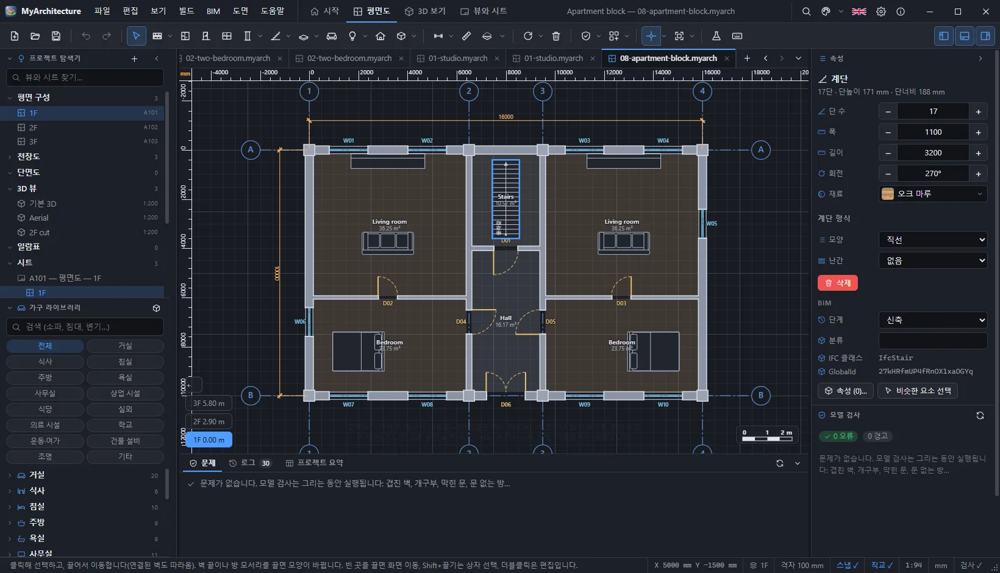
*계단(S)과 기둥(C): 계단은 두 점으로, 기둥은 한 번 클릭으로 놓습니다*

- <kbd>S</kbd> 를 누르고 계단 **아래쪽**을 클릭, 그다음 **위쪽**을 클릭합니다(직교가 켜져 있으면 45° 단위). 600 mm 보다 짧으면 만들어지지 않습니다.
- 단 수는 층 높이(+ 슬래브)를 약 175 mm 로 나눠 자동으로 정해집니다(최소 3단). 폭은 기본 크기의 계단 폭(처음 1000 mm).
- 선택하면 제목에 “n단 · 단높이 … mm · 단너비 … mm” 가 보이고, **단 수, 폭, 길이, 회전, 재료** 칸이 있습니다. 단높이가 200 mm 를 넘으면 “챌판이 200 mm를 넘으면 가파릅니다. 단을 늘리세요.” 경고가 나옵니다.
- 평면에는 진행 방향 화살표와 “올라감” 글자가 그려지고, 3D 에서는 디딤판으로 만들어집니다.

### 3.8 기둥

- <kbd>C</kbd> 를 누르고 클릭합니다. 벽 끝(모서리)에 잘 붙습니다. 놓기 전에 <kbd>R</kbd> 로 돌릴 수 있습니다.
- 크기는 프로젝트 기본 400 × 400 mm. 선택하면 **모양**(사각형/원형), **폭, 깊이, 회전, 재료**. 높이는 층 높이를 따릅니다.

### 3.9 지붕

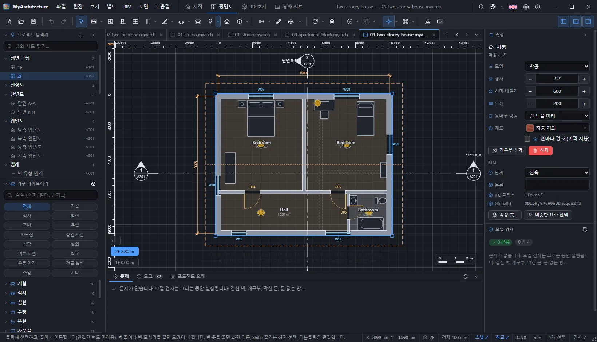
*지붕(O): 맨 위층 위에 박공·모임·외쪽·평지붕을 얹습니다*

지붕을 만드는 세 가지 방법:

1. **빌드 → 맨 위층 지붕**: 맨 위층의 닫힌 외벽 윤곽마다 지붕을 얹습니다(모양은 설정 → 평면도 → **새 지붕**, 기본 박공, 경사 30°, 처마 500). 다시 실행하면 이전에 자동으로 만든 지붕을 바꿔 줍니다. 닫힌 윤곽이 없으면 “맨 위층에 닫힌 벽 윤곽이 없습니다.”
2. <kbd>O</kbd> 를 누르고 **건물 안을 클릭**: 그 층 외벽 윤곽 위에 지붕(처마 400).
3. <kbd>O</kbd> 다음 **<kbd>Shift</kbd>+클릭**으로 지붕 외곽선을 직접 그리기(<kbd>Enter</kbd> 로 마침).

지붕은 그 층 벽 위에 얹힙니다. 평면에서는 점선으로 표시됩니다(설정 → 평면도 → **지붕 (점선)**).

선택하면: **모양**(박공 / 모임 / 외쪽 / 평), **경사**(0 ~ 75°), **처마 내밀기**, **두께**, **용마루 방향**(긴 변을 따라 / 가로질러), **재료**(지붕 기와·슬레이트·금속 지붕·콘크리트). 꼭짓점 손잡이로 모양을 바꿉니다.

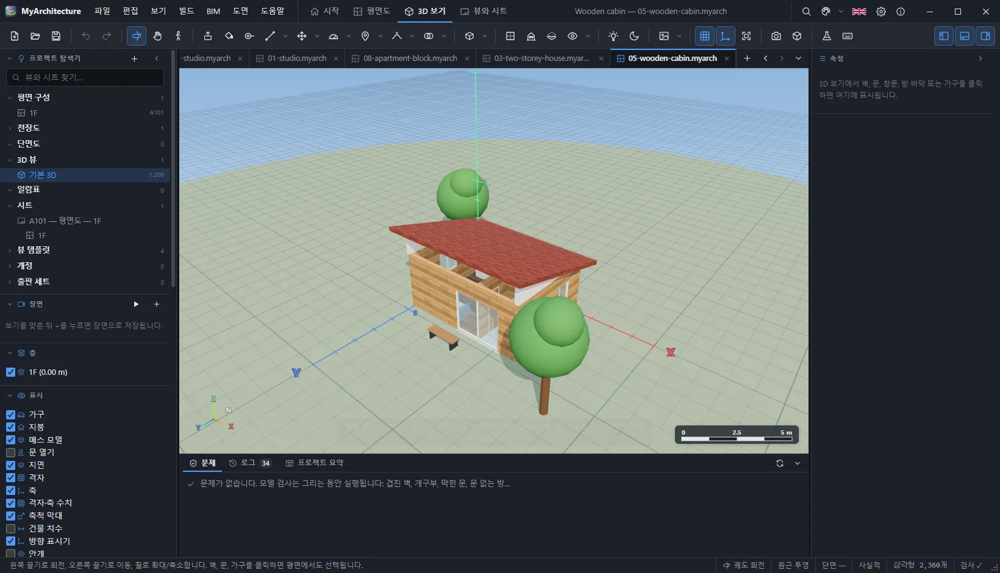
*지붕과 2층이 3D 로 바로 만들어집니다*

### 3.10 층

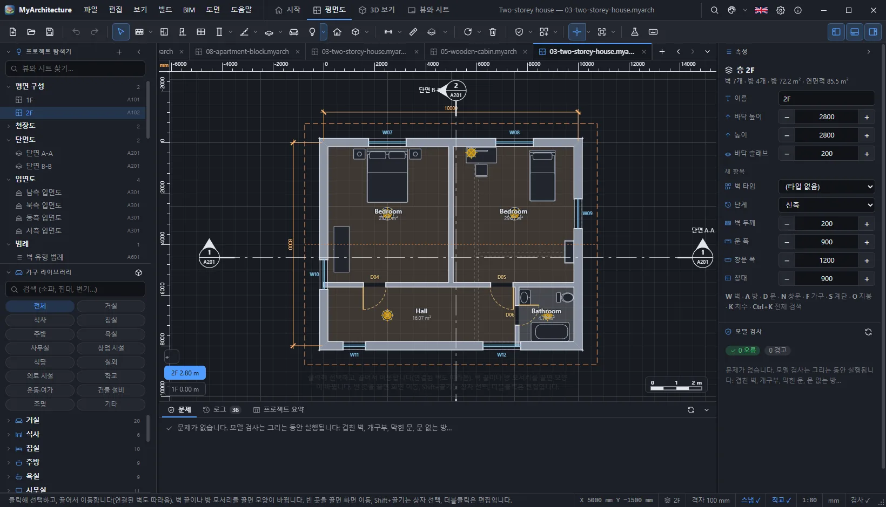
*층 탭: 층을 고르고(+ 로 추가), 아래층은 흐리게 겹쳐 보입니다*

도면 왼쪽 아래에 **층 탭**이 아래층부터 위로 쌓여 있습니다(`1F  0.00 m` 처럼 이름과 바닥 높이).

| 동작 | 결과 |
| --- | --- |
| 탭 클릭 | 그 층 편집. 그리기는 지금 층에만 됩니다 |
| 탭 더블클릭 | 이름 바꾸기 |
| **+** 탭 | 맨 위에 층 추가 — 맨 위층의 **벽과 창문**을 복사(문은 복사하지 않음) |
| 탭 오른쪽 클릭 | 되돌리기 · 다시 실행 / 층 이름 바꾸기… · 층 속성… · 층 복제(벽, 문, 창문) / 층 삭제 |

- **빌드 → 맨 위에 층 추가**는 + 탭과 같습니다. 새 층 이름은 `2F`, `3F`…, 바닥 높이는 아래층 높이 + 층고.
- **층 복제(벽, 문, 창문)** 는 그 층의 벽·문·창·방을 복사해 맨 위에 새 층을 만듭니다.
- **층 삭제**는 그 층과 그 위의 모든 요소를 지웁니다(확인을 묻고, 층이 하나뿐이면 지울 수 없음).
- **층 속성…**(빌드 메뉴, 상태 표시줄 층 칸): 이름, 바닥 높이, 높이(층고, 최소 1000), 바닥 슬래브. “높이를 따로 지정하지 않은 벽은 층 높이를 사용합니다. 층을 위아래로 옮기면 그 층의 모든 요소가 3D에서 함께 움직입니다.” 아무것도 선택하지 않았을 때 오른쪽 패널에도 같은 칸이 있고 층 요약(벽·방 수, 방 면적, 연면적)이 나옵니다.
- 아래층은 흐리게 겹쳐 보입니다(보기 → **아래층 표시**).
- 구조 그리드 선은 모든 층에 공통입니다.

### 3.11 치수, 텍스트, 선, 측정

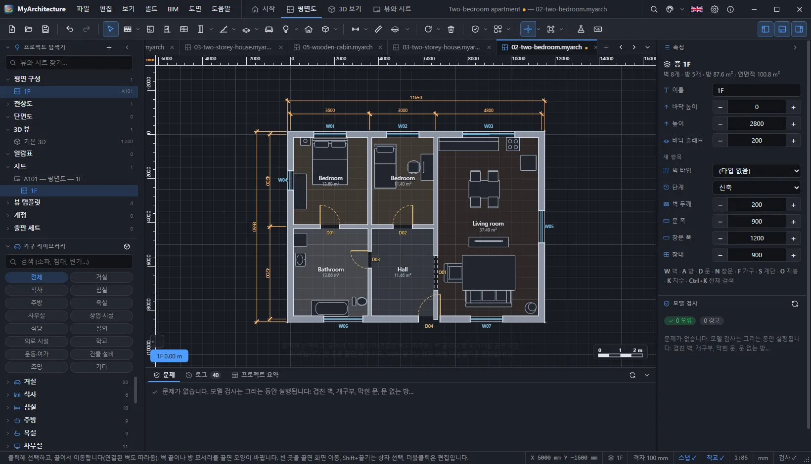
*치수(K)·글자(T)·선(L)·줄자(M): 자동 치수는 바깥 벽을 한 번에 잽니다*

- **치수 <kbd>K</kbd>**: 두 점을 클릭하고, 마우스를 움직여 치수선 위치(간격, 50 mm 단위)를 정한 뒤 한 번 더 클릭. 점은 벽 끝·벽에 붙습니다. 선택하면 **간격**과 **텍스트 재정의**(숫자 대신 쓸 글자), 끝 손잡이로 점 이동.
- **빌드 → 외벽 치수 넣기**(빈 곳 오른쪽 클릭 → **자동 치수**): 지금 층 건물의 전체 가로·세로 치수와 벽 사이 치수 줄을 바깥에 넣습니다. 다시 실행하면 이전 자동 치수를 바꿔 줍니다.
- **텍스트 <kbd>T</kbd>**: 클릭한 곳에 입력 칸이 열립니다. <kbd>Enter</kbd> 로 확정. 선택하면 글자(여러 줄), **크기, 회전, 정렬**(왼쪽/중앙/오른쪽).
- **선 <kbd>L</kbd>**: CAD 레이어에 작도선(폴리선). 점을 차례로 클릭, <kbd>Enter</kbd>·더블클릭으로 끝, 첫 점을 클릭하면 닫힘. 왼쪽 CAD 레이어 목록에서 누른 레이어(강조된 줄)에 그려지고 DXF 로 내보내집니다. 선택하면 **레이어, 색상**.
- **측정 <kbd>M</kbd>**: 두 점을 클릭하면 “거리: … (… m)” 알림. 도면에는 남지 않습니다. 세 번째 클릭은 새 측정, <kbd>Esc</kbd> 로 지움.

보기 → **치수 표시**로 치수를 숨길 수 있습니다(인쇄 옵션은 따로).

### 3.12 구조 그리드

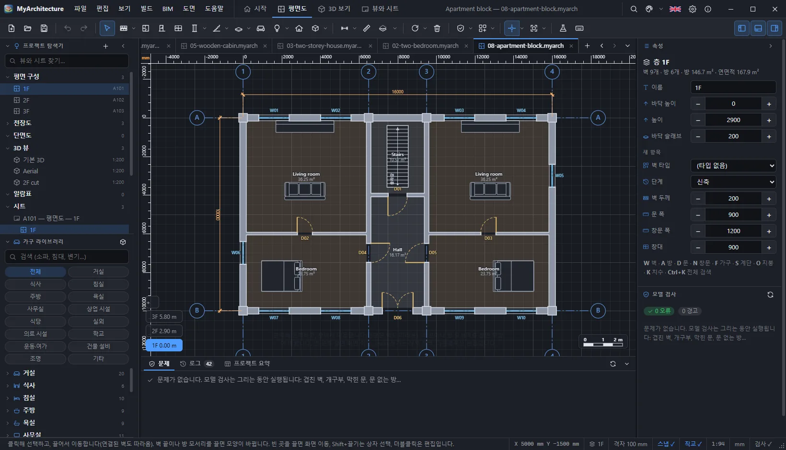
*구조 그리드(G): A, B, C … / 1, 2, 3 … 그리드 선과 버블*

- <kbd>G</kbd>(빈 곳 오른쪽 클릭 → **그리드 선**)를 누르고 그리드 선의 두 끝을 클릭합니다(500 mm 이상).
- 세로선은 `1, 2, 3 …`, 가로선은 `A, B, C …`(26개 넘으면 `A1, A2…`)로 비어 있는 다음 번호가 붙고, 양 끝에 버블이 그려집니다. **모든 층**에 나타납니다.
- 선택하면 **레이블**을 바꿀 수 있고, 끝 손잡이로 길이를 조정합니다. IFC 로 `IfcGrid` 로 내보내집니다.

### 3.13 매스 (스케치업식 매스 모델)

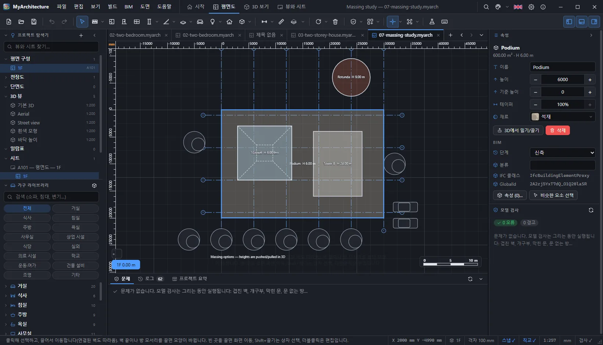
*매스(B 상자 · U 원기둥 · 다각형): 평면에서 그리고 높이·테이퍼를 정합니다*

벽·바닥이 없는 덩어리로 볼륨을 검토할 때 씁니다.

| 도구 | 그리는 법 |
| --- | --- |
| **매스 상자** <kbd>B</kbd> | 마주 보는 두 모서리 클릭 |
| **매스 원기둥** <kbd>U</kbd> | 중심 클릭, 원 위의 점 클릭(32각형) |
| **매스 다각형** | 모서리를 차례로 클릭, <kbd>Enter</kbd> 나 첫 점 클릭으로 돌출 |

새 매스는 높이 3000 mm, 재료 콘크리트, 단계 신축으로 만들어집니다. 선택하면:

| 칸 | 설명 |
| --- | --- |
| 이름 | 매스 이름 |
| 높이 | 매스 높이 |
| 기준 높이 | 층 바닥에서 띄운 높이(포디움 위 타워 등) |
| 테이퍼 | 윗면 크기 비율 0 ~ 100%. 100% = 수직, 0% = 피라미드/원뿔 |
| 재료 | 벽·지붕 재료 |

**3D에서 밀기/끌기** 단추는 3D 탭으로 가서 밀기/끌기 도구를 켭니다(5.9절). 매스도 이동·회전·대칭·크기 조정·간격 띄우기·그룹이 됩니다.

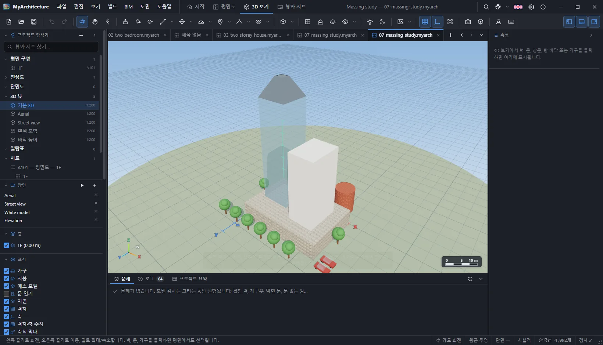
*매스 스터디 예제의 3D 모습*

### 3.14 이미지 밑그림과 CAD 도면 따라 그리기

- 스캔한 도면 이미지를 **이미지 밑그림**으로 가져와(7.4절) 그 위에 벽을 그립니다. 밑그림을 선택하면 **X, Y, 폭, 회전, 불투명도** 칸과 팁(“M으로 이미지에서 길이를 아는 부분을 잰 다음, 그 길이에 맞도록 폭을 설정하세요.”)이 있습니다.
- DXF/SVG 도면은 CAD 레이어로 들어옵니다(7.4절). 그 위에 <kbd>W</kbd> 로 벽을 따라 그리고 레이어를 숨기세요.
- 보기 → **밑그림과 CAD 레이어 표시**로 둘 다 한 번에 숨기고 보입니다.

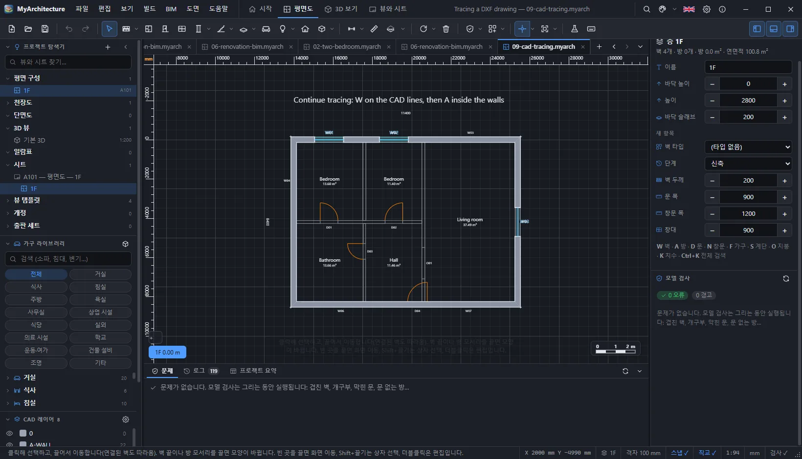
*DXF 따라 그리기: 가져온 CAD 선을 레이어별로 보이고 그 위에 벽을 그립니다*

**CAD 레이어 목록**(왼쪽 패널, 도면이 있거나 레이어가 2개 이상일 때): 눈 아이콘으로 표시/숨기기, 색 견본, 이름, 요소 수. 줄을 누르면 그 레이어가 **선 도구로 그릴 레이어**가 됩니다. 톱니바퀴(또는 빌드 → **CAD 레이어…**)는 레이어 창을 엽니다.

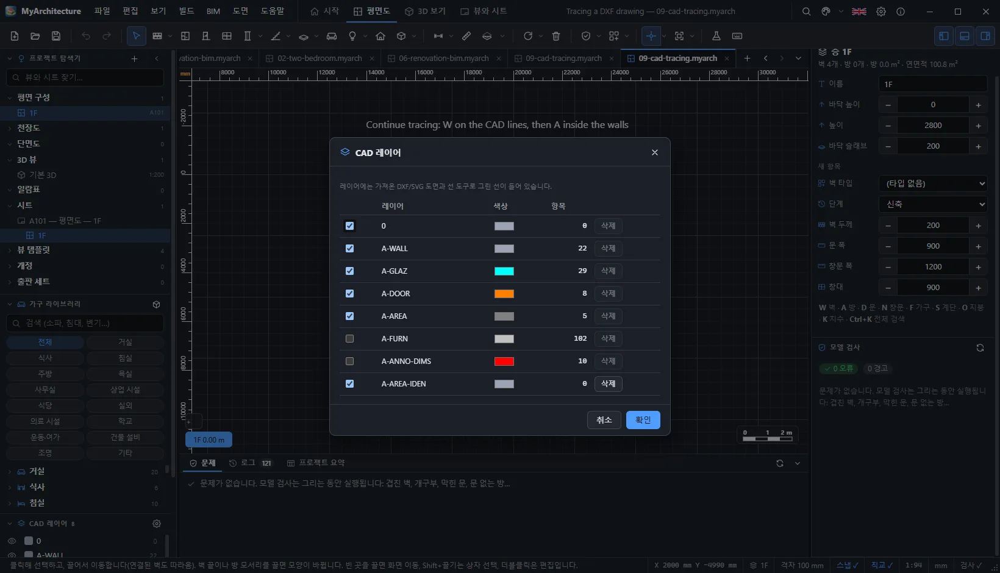
*CAD 레이어 창: 레이어별 표시·색·잠금*

CAD 레이어 창: 레이어마다 표시 체크, 색상, 항목 수, **삭제**(요소가 없는 레이어만, 레이어 `0` 은 지울 수 없음). 10개씩 쪽으로 나뉩니다.

### 3.15 건물 요소 (슬래브, 천장, 보, 난간, 경사로, 샤프트, 커튼월)

모델은 Revit·ArchiCAD 모델이 담는 건물 요소를 그대로 담으므로, 그 프로그램 없이도 설계할 수 있습니다. 도구는 평면 도구 모음에 있으며, 관련 도구는 **분할 버튼**으로 묶입니다 — 버튼은 첫 도구를, 옆의 작은 ▾는 나머지를 보여 줍니다(숨겨진 도구 없이 모두 한 번 클릭 거리입니다).

| 분할 버튼 | 도구 |
|---|---|
| 벽 ▾ | **벽**(<kbd>W</kbd>), **커튼월**(<kbd>V</kbd>) |
| 기둥 ▾ | **기둥**(<kbd>C</kbd>), **보**(<kbd>J</kbd>), **선택한 슬래브나 실에 보 시스템…** |
| 계단 ▾ | **계단**(<kbd>S</kbd>)과 모양 **직선**, **ㄱ자(꺾임 계단참)**, **ㄷ자(되돌림 계단참)**, **나선**; **경사로**; **난간**(<kbd>I</kbd>) |
| 바닥 슬래브 ▾ | **바닥 슬래브**(<kbd>P</kbd>), **천장**, **샤프트 개구부**, **슬래브·천장·지붕 개구부**, **모든 층에 바닥 슬래브**, **이 층의 모든 실에 천장** |
| 타입 카탈로그 ▾ | **타입 카탈로그 (패밀리)…**, **설계 대안…**, **배열 (직선 / 원형)…**, **재료와 열 성능…** |

**바닥 슬래브와 기초.** 벽 안을 클릭하면 건물 외곽 아래에 슬래브가 생기고, Shift+클릭으로 어떤 외곽이든 그릴 수 있습니다(Enter나 첫 점에서 끝). 오른쪽에서 **슬래브 타입**(*Concrete floor 250*, *Insulated floor 300*, *Raft foundation 400* 같은 층 구성 타입. 두께와 열관류율은 층에서 계산), **윗면 높이 차이**(올리거나 내린 바닥), **경사**와 **경사 방향**(가장 낮은 모서리에서부터 올라감), **마감**을 정합니다. **개구부 추가**로 두 모서리를 찍어 구멍을 냅니다. 개구부는 평면·3D·IFC 모두에서 뚫립니다. 슬래브 위의 실은 바닥 마감만 남깁니다.

**천장.** 실 안을 클릭하면 그 위에 천장이 생깁니다(Shift+클릭으로 외곽). 높이 기본값은 위층 바닥에서 300 mm 아래이고, 천장 타입은 *석고보드*와 *흡음 천장재 600×600*입니다. 평면에는 일점쇄선 외곽과 높이("CLG +2.50")로 나타납니다.

**보와 가새.** 양 끝을 클릭합니다. 기둥과 벽 끝에 맞춰집니다. 윗면은 층의 맨 위에 놓이고, **시작점 / 끝점 윗면 높이**를 다르게 하면 경사진 보(가새)가 됩니다. 단면: 직사각형, I형강, T형, 원형. 보는 절단면 위에 있으므로 점선으로 그려집니다. **보 시스템…**은 선택한 슬래브나 실을 입력한 간격과 방향(예: `1200 90`)의 평행한 보로 채웁니다.

**난간.** 경로의 점을 클릭하고 Enter로 끝냅니다. 높이, 밑면 높이, 형식(난간동자, 유리 패널, 막힌 패널), 난간동자 간격, 재료 — 또는 난간 타입을 고릅니다. 계단 난간은 계단의 **난간** 칸(없음, 왼쪽, 오른쪽, 양쪽)에서 정하며, 새 계단은 양쪽에 생깁니다.

**형식별 계단.** 계단의 **모양**: 직선, ㄱ자(꺾임 계단참, *두 번째 계단 길이*), ㄷ자(되돌림 계단참, *계단참 깊이*, *계단 사이 간격*), 나선(*안쪽 반지름*, *회전 각도*. 중심을 클릭한 뒤 바깥 가장자리를 클릭해 그림). 단높이는 모두 같고 마지막 디딤판은 위층 바닥과 같은 높이이며, 속성에 "8 + 8단, 단높이 175 mm"처럼 나옵니다. 예전 직선 계단은 그대로 열립니다.

**경사로.** 중심선을 아래에서 위로 클릭합니다. 오를 높이는 따로 정하지 않으면 위층까지이고, 평면에 기울기("8.3% 1:12")가 나오며 1:12보다 가파르면 모델 검사가 경고합니다.

**샤프트.** 수직 개구부의 두 모서리를 클릭합니다. **아래 층**부터 **위 층**까지 모든 층의 슬래브·천장·지붕을 뚫고, 각 층에 대각선 두 개로 그려집니다.

**커튼월.** 벽처럼 그리며 커튼월 타입을 따릅니다: 가로·세로 그리드 간격(같은 크기 칸 또는 고정 간격), 멀리언 폭과 깊이, 패널과 프레임 재료, 스팬드럴 패널. 커튼월마다 간격을 따로 바꿀 수 있습니다. 커튼월에 넣은 문과 창은 덮는 패널을 대신합니다.

**벽: 윤곽과 붙이기.** 벽의 **끝점 높이**는 윗면을 기울이고, **밑면 높이 차이**는 아래를 들어 올리며, **윗면 붙이기**는 위의 지붕(또는 슬래브)까지 올라가게 합니다 — 박공 아래에서는 지붕을 따라갑니다. 빌드 → *선택한 벽을 위의 지붕이나 슬래브에 붙이기*로 여러 벽을 한 번에 붙입니다.

**변마다 경사 지붕.** **변마다 경사 (외곽 지붕)**를 켜면 변마다 *경사* 켜기/끄기, 경사각, 처마 길이를 정합니다(모든 변 경사 = 모임지붕, 마주 보는 두 변 박공 = 박공지붕, 하나 = 외쪽지붕). **개구부 추가**로 천창과 도머 구멍을 냅니다.

**타입 (패밀리).** **타입 카탈로그**에는 문·창·기둥·보·가구·난간 타입과 그 타입 매개변수(크기, 개폐 방식, 틀 폭과 깊이, 단면, 재료, 기본 창대 높이 …), 커튼월 타입과 바닥·천장 타입, 그리고 모든 재료의 열전도율 λ·밀도·비열과 층 구성 타입의 열관류율이 나오는 **재료** 페이지가 있습니다. **카탈로그 타입**이 정해진 인스턴스는 타입 매개변수를 따르며(인스턴스에서는 흐리게 잠김), 타입을 고치면 모든 인스턴스가 따라 바뀝니다. **인스턴스 모두 선택**, **선택한 요소로 타입 만들기**, **선택한 요소에 적용**은 카탈로그, 속성, 오른쪽 클릭 메뉴에 있습니다. 기본 제공 타입은 늘 있고, 만들거나 바꾼 타입만 파일에 저장됩니다.

**설계 대안.** 설계 대안…에서 대안 묶음(예: "로비"와 대안 A, B)을 만듭니다. 선택한 요소를 대안에 넣으면, 각 묶음에서 활성 대안만 그려지고, 3D로 지어지고, 검사·집계·내보내기됩니다. **활성 대안 확정**은 그 대안을 주 모델로 만들고 나머지를 지웁니다.

**배열과 그룹.** 배열…은 선택한 요소를 직선(X / Y 간격)이나 원형(전체 각도, 중심)으로 반복하며, 사본마다 그룹으로 묶을 수 있습니다(그룹: 4.7절).

**집계와 교환.** 일람표와 수량에 **건물 요소**(모든 슬래브·천장·보·가새·난간·경사로·샤프트·커튼월의 길이·면적·부피·열관류율과 합계)와 **타입**(타입별 인스턴스 수) 페이지가 있고, 벽 타입 페이지에 열관류율이 나오며, 공사비 견적에 슬래브·천장·보·난간·경사로·커튼월이 들어갑니다. IFC 내보내기는 IfcSlab, IfcCovering, IfcBeam/IfcMember, IfcRailing, IfcRamp, 계단판과 계단참이 있는 IfcStair, IfcMember·IfcPlate로 된 IfcCurtainWall, 샤프트의 IfcOpeningElement를 씁니다. DXF는 A-FLOR-SLAB, A-CLNG, S-BEAM, A-FLOR-HRAL, A-FLOR-RAMP, A-SHFT, A-GLAZ-CWMG 레이어에 넣습니다.

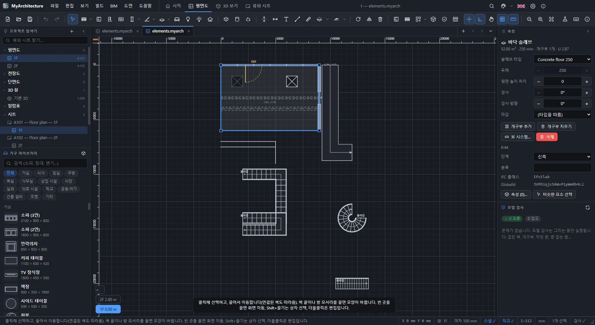
*평면의 건물 요소: 개구부 있는 슬래브, 샤프트, 커튼월, 보, 난간, 경사로, ㄱ자·ㄷ자·나선 계단*

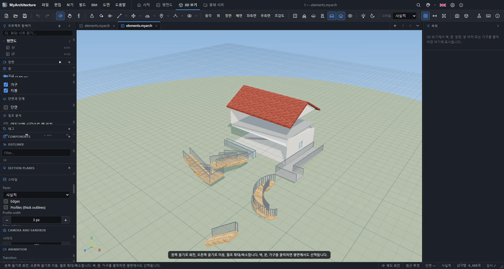
*같은 요소의 3D: 변마다 경사 지붕, 경사 슬래브, 지붕에 붙인 벽*

링크 모델(Revit 링크, ArchiCAD 핫링크·모듈)은 지원하지 않습니다. 다른 모델의 요소는 IFC 가져오기로 이 프로젝트에 들여오세요.

---

## 4. 편집

편집 명령은 대부분 **평면도 탭**에서 동작합니다.

### 4.1 상자 선택

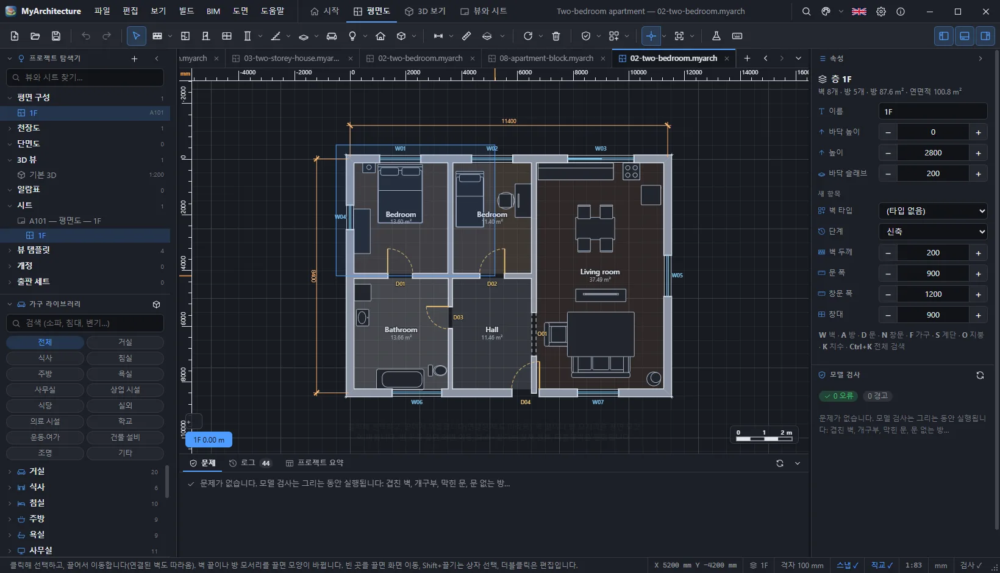
*상자 선택: Shift+끌기(왼→오른쪽은 완전히 포함, 오른→왼쪽은 걸친 것)*

<kbd>Shift</kbd>+끌기(또는 <kbd>Ctrl</kbd>+끌기, 설정에 따라 그냥 끌기):

- **왼쪽 → 오른쪽**(파란 실선 상자): 상자 안에 **완전히 들어간** 것만(윈도 선택).
- **오른쪽 → 왼쪽**(초록 점선 상자): 상자에 **걸친** 것까지(크로싱 선택).
- 상자 선택은 지금 선택에 더해집니다.

### 4.2 이동

- 선택한 것을 끌면 이동합니다. 이동 거리는 격자 단위(가구는 반 칸)로 맞춰지고, <kbd>Shift</kbd> 를 누르면 가로 또는 세로로만.
- 벽을 옮기면 **이어진 벽이 늘어나며 따라오고**, 그 벽의 문·창은 벽 안에 남습니다. <kbd>Alt</kbd>+끌기는 이어진 벽을 늘리지 않습니다.
- 방향키: 격자 한 칸, <kbd>Shift</kbd>+방향키: 열 칸.
- 손잡이 끌기는 이동이 아니라 **모양 바꾸기**(벽 끝, 방·지붕 꼭짓점, 치수·그리드 끝)입니다.

### 4.3 복사, 잘라내기, 붙여넣기, 복제, 삭제

| 명령 | 키 | 설명 |
| --- | --- | --- |
| 복사 | <kbd>Ctrl</kbd>+<kbd>C</kbd> | “n개 항목을 복사했습니다” |
| 잘라내기 | <kbd>Ctrl</kbd>+<kbd>X</kbd> | 복사 후 삭제 |
| 붙여넣기 | <kbd>Ctrl</kbd>+<kbd>V</kbd> | **커서 위치**(격자에 맞춤)에 붙여 넣음. 커서가 도면 밖이면 원래 자리에서 1 m 비켜서. 지금 층에 들어갑니다(다른 층으로 복사할 때 유용) |
| 복제 | <kbd>Ctrl</kbd>+<kbd>D</kbd> | 1 m 오른쪽 아래에 사본 |
| 삭제 | <kbd>Del</kbd> 또는 <kbd>Backspace</kbd> | 벽을 지우면 그 벽의 문·창도 지워짐 |

빈 곳 오른쪽 클릭 메뉴의 **붙여넣기**는 오른쪽 클릭한 자리에 붙여 넣습니다.

### 4.4 회전과 대칭

| 명령 | 키 | 설명 |
| --- | --- | --- |
| 90° 회전 | <kbd>R</kbd> | 선택의 중심을 기준으로 90° |
| 15° 회전 | <kbd>Shift</kbd>+<kbd>R</kbd> | 반대 방향으로 15° |
| 좌우 대칭 / 문 뒤집기 | <kbd>X</kbd> | 선택에 문·창이 있으면 **문의 여는 쪽만 뒤집기**, 아니면 좌우 대칭 |
| 상하 대칭 | <kbd>Y</kbd> | 위아래 대칭 |
| 경첩 바꾸기 | <kbd>H</kbd> | 선택한 문의 경첩 |

### 4.5 크기 조정

**편집 → 크기 조정…**(여러 개 선택 시 오른쪽 패널 **크기 조정…** 단추): “배율 (예: 1.5 또는 50%)”을 입력하면 선택을 그 중심 기준으로 키우거나 줄입니다. `50%` 처럼 퍼센트도 됩니다. 가구는 높이까지 바뀝니다.

### 4.6 간격 띄우기

**편집 → 간격 띄우기…**: “간격 띄우기 거리(mm, 음수 = 안쪽)”를 입력하면 선택한 **방, 매스, 지붕, 닫힌 선**의 평행한 사본을 만듭니다. 양수는 바깥, 음수는 안쪽입니다. 다른 요소에는 쓸 수 없습니다(“간격을 띄울 방, 매스, 지붕 또는 닫힌 선을 선택하세요.”).

### 4.7 그룹

- **그룹** <kbd>Ctrl</kbd>+<kbd>G</kbd>: 두 개 이상 골라 묶습니다(문·창과 그리드 선은 그룹에 들어가지 않음). 그 뒤 아무 항목이나 클릭하면 그룹 전체가 선택되고 함께 움직입니다. <kbd>Alt</kbd>+클릭은 하나만.
- **그룹 해제** <kbd>Ctrl</kbd>+<kbd>Shift</kbd>+<kbd>G</kbd>.
- 그룹 요소를 선택하면 오른쪽 패널에 “그룹의 일부입니다 (n개 항목)…”와 **그룹 해제** 단추가 나옵니다.

### 4.8 여러 개 선택했을 때

오른쪽 패널에 “항목 n개 선택됨”, 종류별 개수와 **회전 · 대칭 · 복제 · 삭제 · 그룹 · 크기 조정…** 단추가 나옵니다. 벽만 골랐다면 **두께**와 **재료**를 한꺼번에 바꿀 수 있습니다.

### 4.9 비슷한 요소 선택

**BIM → 비슷한 요소 선택**(오른쪽 클릭 메뉴, BIM 칸 단추): 지금 층에서 처음 고른 요소와 같은 것을 모두 고릅니다.

- 벽: 같은 벽 타입이면서 같은 두께
- 가구: 같은 종류
- 문·창: 같은 종류, 같은 폭
- 그 밖: 같은 종류 전부(그리드 선은 전체)

### 4.10 속성 창

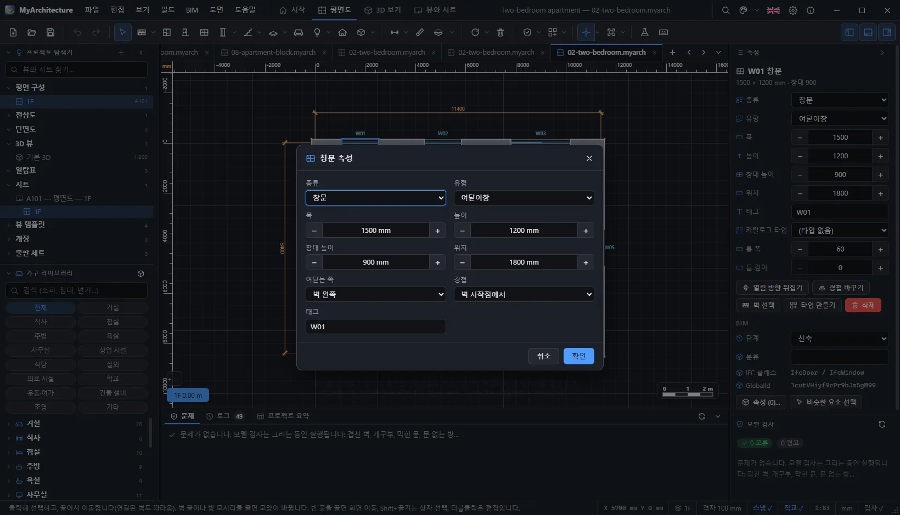
*더블클릭(또는 E): 요소의 모든 속성을 한 창에서 고칩니다*

선택 도구에서 요소를 **더블클릭**하거나 하나를 고르고 <kbd>E</kbd>(편집 → **속성…**)를 누르면 속성 창이 열립니다. 창 안에서 바꾼 것은 **확인**을 누를 때 한 번에(되돌리기 한 단계로) 적용됩니다. 아무것도 고르지 않고 속성…을 실행하면 프로젝트 속성이 열립니다.

| 요소 | 창 이름 | 항목 |
| --- | --- | --- |
| 벽 | 벽 속성 | 길이, 두께, 높이, 층 높이와 같게, 재료 |
| 문·창 | 문 속성 / 창문 속성 | 종류, 유형, 폭, 높이, 창대 높이, 위치, 여닫는 쪽, 경첩, 태그 |
| 방 | 방 속성 | 이름(목록), 바닥, 면적(읽기 전용), 텍스트 크기, 면적 표시 |
| 가구 | (가구 이름) | 이름, 종류, 폭, 깊이, 높이, 바닥에서 높이, 회전, 색상 |
| 계단 | 계단 속성 | 단 수, 폭, 길이, 회전, 재료 |
| 지붕 | 지붕 속성 | 모양, 경사, 처마 내밀기, 두께, 재료 |
| 기둥 | 기둥 속성 | 모양, 폭, 깊이, 회전 |
| 텍스트 | 텍스트 | 글자, 크기, 회전 |
| 그 밖(매스, 치수, 그리드, 선, 밑그림) | — | “오른쪽에서 편집하세요.” — 오른쪽 패널에서 고칩니다 |

### 4.11 오른쪽 클릭 메뉴 (평면)

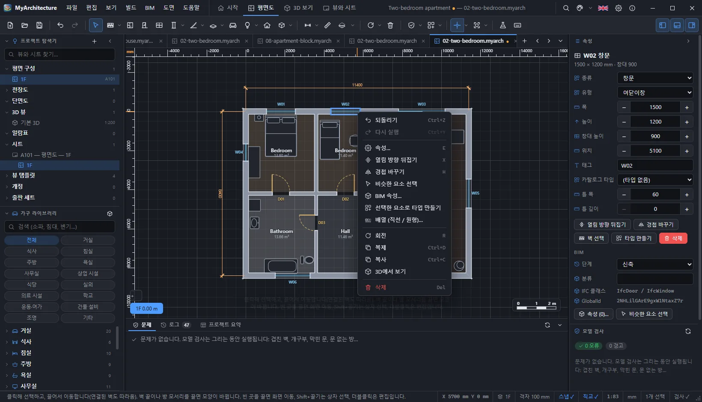
*오른쪽 클릭 메뉴: 맨 위에 되돌리기/다시 실행, 그 아래 고른 요소에 맞는 명령*

선택 도구에서 마우스 오른쪽 버튼을 움직이지 않고 누르면 메뉴가 열립니다. (그리는 중이면 오른쪽 클릭은 그리기를 끝내고, 다른 도구일 때는 선택 도구로 돌아갑니다.)

**요소 위**(그 요소가 선택됨):

1. 되돌리기 · 다시 실행
2. 속성… (<kbd>E</kbd>)
3. 벽이면: 여기에 문 추가 · 여기에 창문 추가 · 여기서 벽 나누기 · 일직선 벽 합치기
4. 문·창이면: 열림 방향 뒤집기 (<kbd>X</kbd>) · 경첩 바꾸기 (<kbd>H</kbd>)
5. 비슷한 요소 선택 · BIM 속성…
6. 회전 (<kbd>R</kbd>) · 복제 (<kbd>Ctrl</kbd>+<kbd>D</kbd>) · 복사 (<kbd>Ctrl</kbd>+<kbd>C</kbd>) · 3D에서 보기
7. 삭제 (<kbd>Del</kbd>)

**빈 곳**: 되돌리기 · 다시 실행 / 붙여넣기 · 방 감지 · 자동 치수 · 모두 선택 · 그리드 선 / 화면에 맞추기.

**층 탭**: 3.10절. **3D**: 5.14절.

---

## 5. 3D 보기

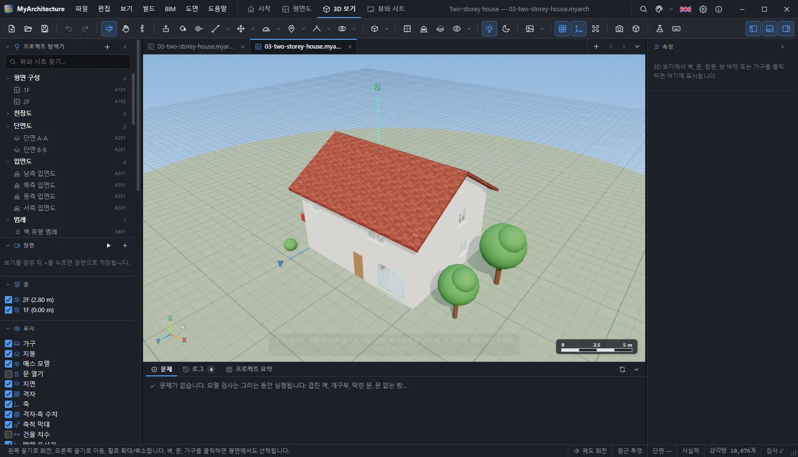
*3D 보기: 왼쪽에 장면·층·표시·단면·태양, 오른쪽에 고른 요소의 속성*

**3D 보기** 탭(<kbd>F3</kbd>, <kbd>F4</kbd> 도 같음)은 평면에서 그린 것을 바로 3D 건물로 보여 줍니다. 평면을 고치면 3D 도 곧 다시 만들어집니다. 처음 열 때 등각 보기로 건물 전체를 맞춥니다.

### 5.1 3D 도구 모음

도구 모음은 **아이콘만** 보여 줍니다. 이름과 단축키는 마우스를 올리면 툴팁으로 나옵니다. 창이 좁아 한 줄에 다 들어가지 않으면 도구 모음이 **두 줄**로 나뉘고, 어떤 단추도 숨겨지지 않습니다.

| 묶음 | 단추 |
| --- | --- |
| 탐색 | 궤도 회전 · 이동 (P) · 걷기 (V) |
| 도구 | 밀기/끌기 · 페인트 통 · 줄자 |
| 시점 | **표준 시점** 단추: 누르면 마지막에 고른 시점, ▾ 에서 등각 · 위 · 정면 · 배면 · 좌측면 · 우측면 · 조감도 (키 <kbd>1</kbd> ~ <kbd>7</kbd>) |
| 표시 | 직교 투영 (O) · 정면 입면 · 현재 층에서 단면 (X) · 문 열기 · 가구 · 지붕 · 안개 |
| 스타일 | **렌더 스타일** 단추와 ▾: 사실적 / 흰색 모형 / 선 그림 / X-레이 |
| 보조 | 격자 (G) · **눈금 있는 축 (X, Y, Z)** · 건물 치수 · 화면에 맞추기 |
| 출력 | 3D 이미지 저장 (PNG)… · 3D 모델 내보내기… |

**눈금 있는 축 (X, Y, Z)** 단추(기본 켜짐, 왼쪽 **표시 → 축**과 같음)는 원점에서 빨강 X · 파랑 Y · 초록 Z 축을 그리고 각 축에 눈금과 숫자를 붙입니다. 눈금 간격은 격자처럼 확대·축소에 따라 바뀝니다(멀리서는 5 m · 1 m, 가까이에서는 0.2 m …). 축과 숫자도 다른 숫자처럼 건물 뒤에서는 가려지고 X-레이 스타일에서만 비쳐 보입니다.

평면도·3D 보기 전환은 도구 모음이 아니라 제목 표시줄의 보기 탭과 **보기** 메뉴(<kbd>F2</kbd> / <kbd>F3</kbd>)에서 합니다.

### 5.2 탐색 (궤도 회전 · 이동)

| 동작 | 궤도 회전(기본) | 이동 모드 (<kbd>P</kbd>) |
| --- | --- | --- |
| 왼쪽 끌기 | 회전 | 화면 이동 |
| 오른쪽 끌기 | 화면 이동 | 회전 |
| 휠 / 가운데 끌기 | 확대·축소(마우스 위치 쪽으로 부드럽게) | 확대·축소 |

- 방향키: 회전(한 번에 7.5°), <kbd>Shift</kbd>+방향키: 화면 이동.
- 모델을 **더블클릭**하면 그 점을 중심으로 가까이 다가갑니다.
- <kbd>Home</kbd>(화면에 맞추기)은 지금 방향 그대로 건물 전체를 맞춥니다.
- 회전 속도와 시야각은 설정 → 3D 보기.
- 오른쪽 위 구석의 **방향 표시기**(X 빨강, Y 파랑, Z 초록)는 지금 방향을 보여 줍니다(표시 옵션 **방향 표시기**).

### 5.3 시점

<kbd>1</kbd> 등각 · <kbd>2</kbd> 위 · <kbd>3</kbd> 정면 · <kbd>4</kbd> 배면 · <kbd>5</kbd> 좌측면 · <kbd>6</kbd> 우측면 · <kbd>7</kbd> 조감도. 카메라가 부드럽게 날아가 건물 전체를 맞춥니다. 도구 모음에는 시점 단추 외에 **정면 입면** 단추도 있습니다.

### 5.4 걷기 (1인칭)

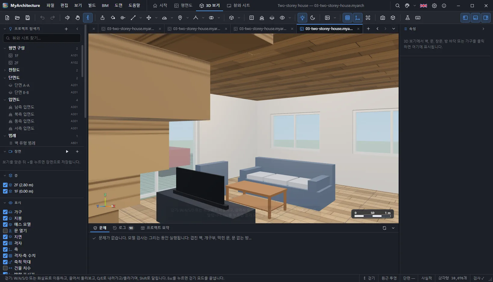
*걷기(V): 사람 눈높이에서 W/A/S/D 로 걸어 다닙니다*

<kbd>V</kbd>(또는 도구 모음의 **걷기** 단추, 상태 표시줄의 탐색 칸)를 누르면 보이는 가장 낮은 층 바닥에서 눈높이 1.6 m 로 섭니다.

| 키·동작 | 하는 일 |
| --- | --- |
| <kbd>W</kbd> / <kbd>↑</kbd> | 앞으로 |
| <kbd>S</kbd> / <kbd>↓</kbd> | 뒤로 |
| <kbd>A</kbd> / <kbd>D</kbd> | 왼쪽 / 오른쪽으로 옆걸음 |
| <kbd>←</kbd> / <kbd>→</kbd> | 왼쪽 / 오른쪽으로 돌기 |
| <kbd>E</kbd> / <kbd>Page Up</kbd> | 올라가기 |
| <kbd>Q</kbd> / <kbd>Page Down</kbd> | 내려가기 |
| <kbd>Shift</kbd> 누른 채 | 달리기(약 3배 빠르게) |
| 끌기 | 둘러보기 |
| 휠 | 앞뒤로 한 걸음(0.5 m) |
| <kbd>Esc</kbd> 또는 <kbd>V</kbd> | 걷기 끝내기 |

걷기는 원근 투영에서만 됩니다(평행 투영이었다면 자동으로 원근으로). 시점 단추를 누르거나 다른 탭으로 가면 걷기가 끝납니다.

### 5.5 평행 투영과 입면

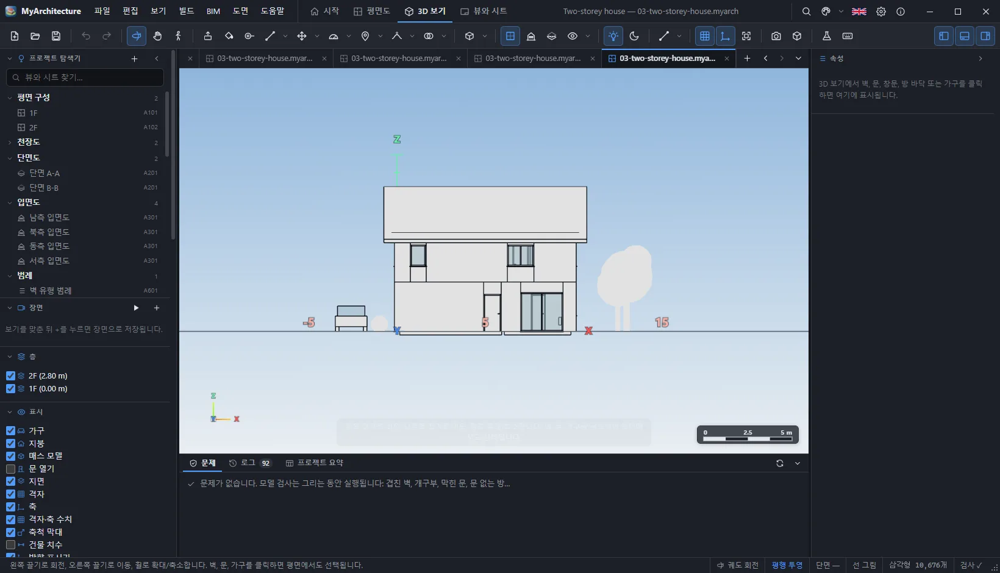
*정면도: 평행 투영(O)으로 입면을 그대로 봅니다*

- <kbd>O</kbd>(직교 투영)는 원근 없이 평행하게 봅니다. 상태 표시줄에는 “평행 투영 / 원근 투영”으로 표시됩니다.
- 도구 모음의 **정면 입면** 단추는 평행 투영 + 선 그림 스타일 + 정면 시점을 한 번에 켜서 입면도처럼 보여 줍니다. 그 상태에서 <kbd>4</kbd> ~ <kbd>6</kbd> 으로 다른 입면을 봅니다.

### 5.6 표현 스타일

도구 모음 **스타일** 목록이나 왼쪽 **단면과 단계** 패널의 **렌더 스타일**에서 고릅니다.

| 스타일 | 모습 |
| --- | --- |
| 사실적 | 재료 색·무늬, 해와 그림자 |
| 흰색 모형 | 모형처럼 모두 흰색, 그림자 |
| 선 그림 | 흰 면 + 검은 모서리선(입면도·스케치 느낌), 그림자 없음 |
| X-레이 | 반투명 푸른 면으로 속을 들여다봄 |

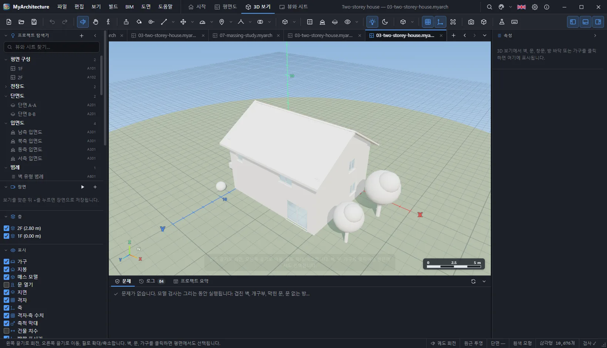
*표현 스타일: 흰색 모형*

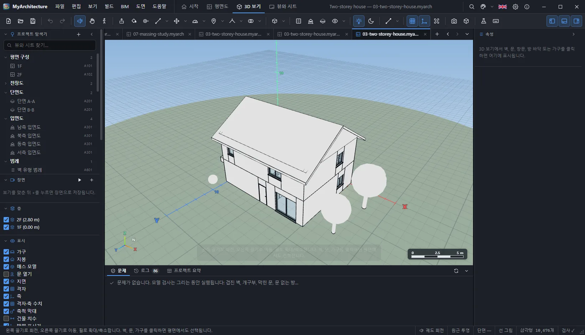
*표현 스타일: 선 그림*

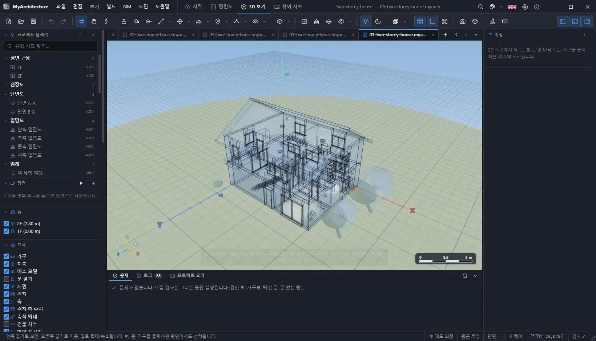
*표현 스타일: X-레이*

### 5.7 단면

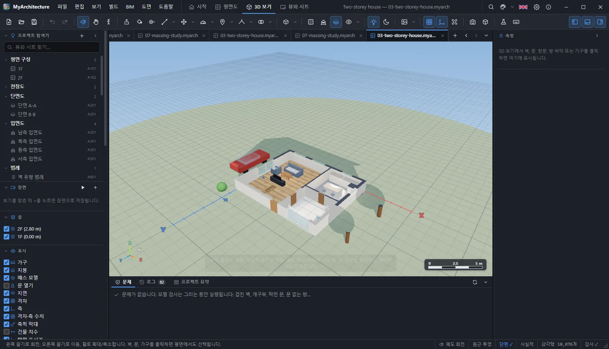
*단면(X): 지금 층을 바닥에서 1.2 m 높이로 잘라 내부를 보여 줍니다*

- <kbd>X</kbd>(도구 모음의 **현재 층에서 단면** 단추, 상태 표시줄 단면 칸)는 **평면에서 편집 중인 층의 바닥 + 1.2 m** 높이에서 건물을 수평으로 잘라 위를 걷어 냅니다. 3D 평면도처럼 내부가 보입니다. 다시 누르면 꺼집니다.
- 왼쪽 **단면과 단계** 패널: **단면** 체크, **절단 높이** 스테퍼(0.1 m 단위)로 높이를 바꿉니다.
- 잘려 나간 부분은 클릭해도 선택되지 않습니다.

### 5.8 왼쪽 패널 (3D 보기 옵션)

위에서부터:

- **페인트 통** 팔레트(페인트 통 도구가 켜져 있을 때만, 5.10절)
- **장면**(5.13절)
- **층**: 층마다 체크(위층부터). 끄면 그 층이 3D 에서 숨습니다(내보내기에서도 빠짐).
- **표시**: 가구 · 지붕 · 매스 모델 · 문 열기 · 지면 · 격자 · 축 · 건물 치수 · 방향 표시기 · 안개
- **단면과 단계**: 단면, 절단 높이, **단계**(모든 단계 / 새 설계 (철거 없음) / 기존(공사 전)), 렌더 스타일
- **일조 분석**(5.12절)
- 맨 아래: 메시 수 · 삼각형 수

표시 항목 설명:

| 항목 | 설명 |
| --- | --- |
| 문 열기 | 문짝을 열린 상태로(걸어 다닐 때 편리) |
| 지면 | 건물 아래 바닥면 |
| 격자 (<kbd>G</kbd>) | 5.8.1 참고 |
| 축 | 원점에서 X(빨강)·Y(파랑)·Z(초록) 축 |
| 건물 치수 | 건물 전체의 W(폭)·D(깊이)·H(높이)를 노란 치수로 |
| 안개 | 멀수록 흐려지는 공기 원근(도구 모음의 **안개** 단추도 같음) |

#### 5.8.1 3D 격자

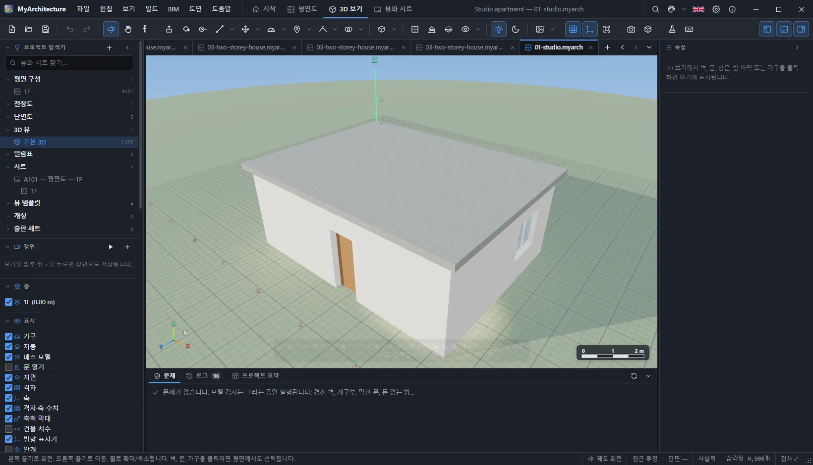
*3D 그리드: 2D 처럼 5칸마다 또렷한 선(5×5), 확대·축소해도 같은 간격으로 보입니다*

3D 격자는 평면의 격자처럼 그려집니다.

- 가는 선 한 칸, **5칸마다 또렷한 선**(5 × 5 블록).
- 확대·축소하면 칸 크기가 **×5 / ÷5** 로 바뀝니다(… 0.2 m · 1 m · 5 m · 25 m …). 그래서 어떤 거리에서 보아도 화면에서 고른 간격을 유지하고, 또렷한 선은 너무 진하지 않은 1.5 px 로, 화면 기준으로 일정합니다.
- 격자는 지금 보는 곳(걷기에서는 서 있는 곳)을 중심으로 펼쳐지고, 또렷한 선을 따라 거리 눈금(m 또는 ft — 설정 → 3D 보기 → **3D 측정 단위**)이 붙습니다.
- <kbd>G</kbd>, 도구 모음 격자 단추, 표시 패널로 켜고 끕니다. 3D 를 처음 열 때 켜져 있을지는 설정 → 3D 보기 → **시작 시 표시: 축척 표시 격자**.

### 5.9 밀기/끌기

*밀기/끌기: 매스나 벽의 윗면을 위아래로 끌어 높이를 바꿉니다*

**밀기/끌기**(도구 모음, 매스의 **3D에서 밀기/끌기** 단추)를 켜고 **매스나 벽의 윗면**을 위아래로 끌면 높이가 50 mm 단위로 바뀝니다(매스 최소 100 mm, 벽 최소 300 mm). 끄는 동안 힌트 칸에 `높이: … m` 가 보입니다. 한 번 끌기가 되돌리기 한 단계입니다. 같은 단추를 다시 누르거나 <kbd>Esc</kbd> 로 도구를 끝냅니다.

### 5.10 페인트 통

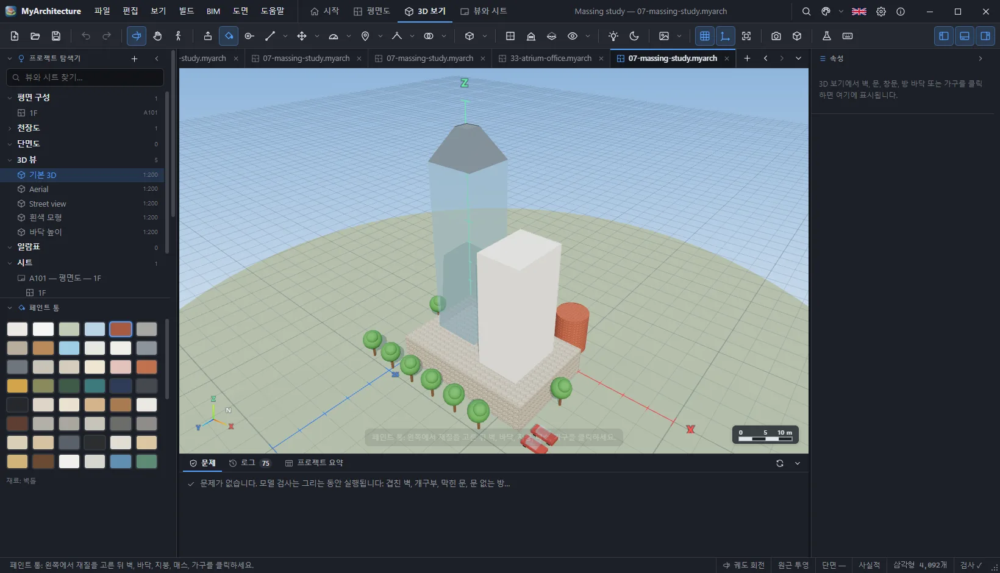
*페인트 통: 왼쪽 팔레트에서 재료를 고르고 벽·바닥·지붕·매스를 클릭합니다*

**페인트 통**을 켜면 왼쪽에 재료 견본(벽·바닥·지붕 재료 전부)이 나옵니다. 견본을 고르고(“재료: …”) 모델을 클릭하면:

| 클릭한 것 | 바뀌는 것 |
| --- | --- |
| 벽, 지붕, 매스, 기둥, 계단 | 재료 |
| 방 바닥 | 바닥 재료 |
| 가구 | 그 재료의 색 |
| 문·창 | 바뀌지 않음 |

### 5.11 줄자

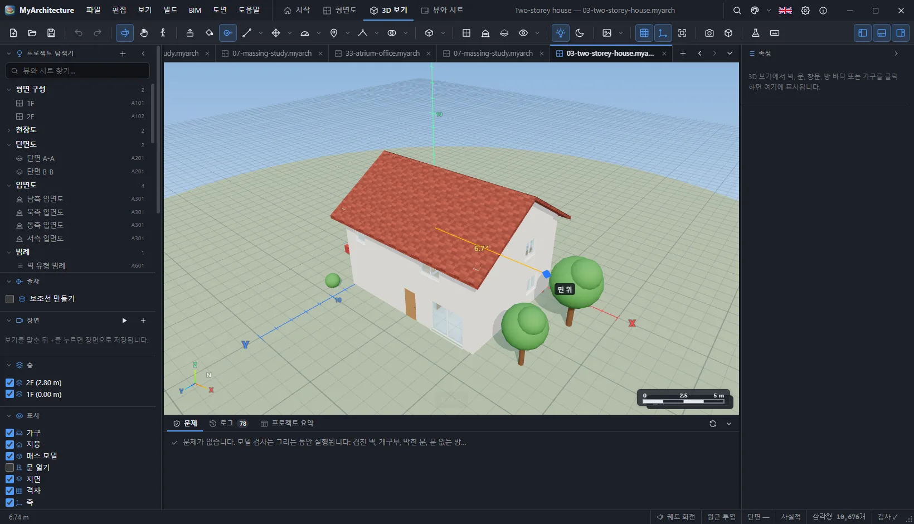
*줄자: 3D 모델 위 두 점 사이의 거리*

**줄자**를 켜고 모델 위 두 점을 클릭하면 두 점 사이에 노란 선과 거리 글자가 남고 “거리: … m” 알림이 뜹니다. 여러 개를 잴 수 있고, <kbd>Esc</kbd>(도구 끄기) 때 지워집니다.

### 5.12 일조 분석

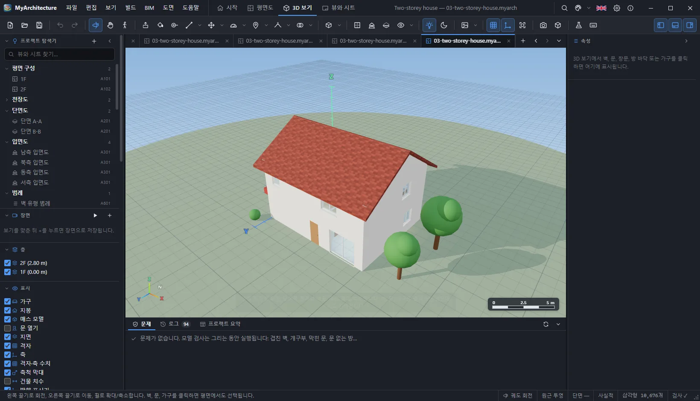
*태양 분석: 대지 위치와 날짜·시각으로 실제 그림자를 봅니다*

왼쪽 **일조 분석** 패널:

- **대지·날짜·시각으로 해 위치**를 끄면: **태양 방위각**(15° 단위)과 **태양 고도**(5° 단위)를 직접 정합니다(기본 135°, 45°).
- 켜면: **월**, **일**, **시각**(30분 단위)으로 실제 해 위치를 계산합니다. 아래에 위도·경도, 방위각, 고도, **일출·일몰** 시각이 표시되고, 해가 지평선 아래면 고도가 `<0` 으로 나옵니다. **대지 위치…** 단추는 프로젝트 속성을 엽니다(위도, 경도, 시간대, 북쪽 방향 — 6.8절).
- 방위각은 북쪽에서 시계 방향이며, 프로젝트의 **북쪽** 회전이 반영됩니다.
- 그림자는 설정 → 3D 보기 → **3D 그림자: 태양 그림자**로 켜고 끕니다(선 그림 스타일에서는 그림자 없음).

### 5.13 장면

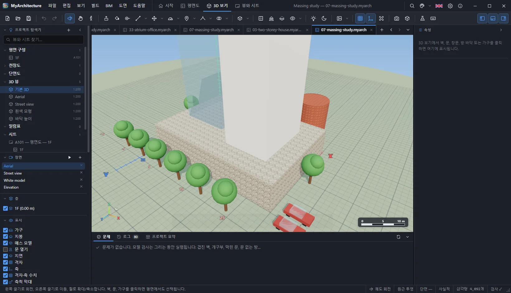
*장면: 지금 시점을 저장하고(+), 눌러서 이동하고, ▶ 로 차례로 재생합니다*

- **장면** 패널의 **+**(또는 3D 오른쪽 클릭 메뉴)는 지금 카메라·투영·표현 스타일·단면 높이·단계 보기를 “장면 1, 장면 2…”로 프로젝트에 저장합니다.
- 장면 이름을 누르면 그 시점으로 부드럽게 날아갑니다. **×** 로 지웁니다.
- **▶**(장면 애니메이션 재생)은 장면을 차례로 돌며 계속 재생합니다(장면마다 약 2.5초). 다시 누르면(■ 정지) 멈춥니다. 장면이 없으면 “먼저 장면을 추가하세요…”.

### 5.14 3D 에서 선택과 오른쪽 클릭

- 벽, 문, 창, 방 바닥, 가구 등을 클릭하면 파랗게 강조되고, 평면에서도 선택됩니다. 오른쪽 패널에 이름, 층, 클릭한 높이와 **평면에서 보기 / 속성…** 단추가 나옵니다.
- 평면의 요소에서 **3D에서 보기**(오른쪽 클릭, 가구 속성 단추)를 누르면 3D 탭에서 강조됩니다.

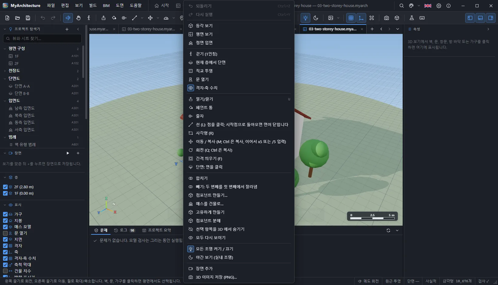
*3D 오른쪽 클릭 메뉴: 되돌리기/다시 실행, 보기 방향, 도구*

오른쪽 버튼을 움직이지 않고 떼면 메뉴: (요소를 클릭한 상태면 맨 위에 **평면에서 보기**) · 되돌리기 · 다시 실행 / 등각 보기 · 평면 보기 · 정면 입면 / 걷기 (1인칭) · 현재 층에서 단면 · 직교 투영 · 문 열기 / 밀기/끌기 · 페인트 통 · 줄자 / 장면 추가 · 3D 이미지 저장 (PNG)…. 오른쪽 끌기는 여전히 화면 이동입니다.

### 5.15 이미지 저장과 3D 내보내기

- **3D 이미지 저장 (PNG)…**: 지금 3D 화면을 그대로 `제목-3d.png` 로 저장합니다.
- **3D 모델 내보내기…**: 7.5절.

### 5.16 스케치업 도구 (그리기, 수정, 컴포넌트, 태그, 단면, 스타일, 샌드박스)

스케치업 파일(.skp)은 닫힌 형식이라 읽을 수 없지만, 스케치업 모델이 담는 것과 스케치업이 하는 일은 3D 탭에서 그대로 할 수 있습니다. 매스는 처음에는 평면 도형을 올린 기둥(밀기/끌기 높이)이고, 3D 에서 면을 그리거나 밀고 당기면 면과 모서리로 된 **메시**가 됩니다. 평면도에서는 메시의 윤곽이 보이고, 이동·회전·대칭·크기 조정·복사가 모두 메시와 함께 움직입니다. 예전 파일은 그대로 열립니다.

도구 모음: **밀기/끌기 (<kbd>U</kbd>) · 페인트 통 · 줄자** 다음에 여섯 개의 묶음 단추가 있습니다. 단추를 누르면 마지막으로 쓴 도구가, ▾ 를 누르면 묶음의 모든 도구가 나옵니다.

| 묶음 | 도구 (단축키) |
|---|---|
| 그리기 | 선 (<kbd>L</kbd>), 자유 곡선, 사각형 (<kbd>R</kbd>), 회전 사각형, 원 (<kbd>C</kbd>), 다각형, 호 (<kbd>A</kbd>), 3점 호, 부채꼴 |
| 수정 | 이동/복사 (<kbd>M</kbd>), 회전 (<kbd>Q</kbd>), 크기 조절 (<kbd>S</kbd>), 간격 띄우기 (<kbd>F</kbd>), 따라가기, 지우개 (<kbd>E</kbd>) |
| 보조 도구 | 각도기, 3D 치수, 3D 문자, 작도 축, 단면 |
| 카메라 | 카메라 위치, 둘러보기, 2점 투시 |
| 샌드박스 | 스무브, 새 지형, 등고선 지형 |
| 솔리드 도구 | 합치기, 빼기, 잘라내기, 교차, 나누기, 외곽 쉘, 면 교차, 컴포넌트 만들기, 매스를 건물로 |

<kbd>U</kbd> 밀기/끌기(여기서는 <kbd>P</kbd> 가 화면 이동), <kbd>T</kbd> 줄자, <kbd>B</kbd> 페인트 통도 3D 에서 바로 고릅니다. 모든 명령은 명령 팔레트(<kbd>Ctrl+K</kbd>)와 3D 오른쪽 클릭 메뉴에도 있습니다.

#### 추정 (스냅)

도구는 클릭-이동-클릭으로 씁니다(왼쪽 끌기는 그대로 화면 회전). 포인터가 **끝점**(초록), **중점**(하늘색), **모서리 위**(빨강), **면 위**(파랑), **보조선**(주황)에 붙고, 앞 점에서 **빨간/초록/파란 축** 방향으로 붙습니다. <kbd>Shift</kbd> 를 누르고 있으면 지금 방향이 고정되고, 화살표 키는 축을 고정합니다(→ 빨강, ← 초록, ↑↓ 파랑). 커서 옆에 무엇에 붙었는지가 표시됩니다. 모서리(또는 그 중점)에 포인터를 한 번 올려 두면, 다음 선이 그 모서리와 **평행**하거나 **수직**인 방향에 붙습니다(자홍색, *모서리와 평행* / *모서리와 수직*).

**측정값 상자** (도구를 쓰는 동안 3D 화면 오른쪽 아래): 지금 길이·크기·반지름·각도·거리가 보이고, 숫자를 치고 <kbd>Enter</kbd> 하면 그 값이 됩니다. `3000`(mm), `3m`, `30cm`, 사각형은 `4000,3000`, 원·다각형은 반지름 또는 `32s`(변의 수), 회전·부채꼴은 각도, 크기 조절은 `2` 또는 `1,1,2`, 복사 뒤에는 `5x`(배열)·`/5`(등분). 입력 중인 값은 노란색으로 보입니다. 선·사각형·회전 사각형·호·부채꼴·줄자·이동 도구에서는 **점**도 칠 수 있습니다. `[x,y,z]` 는 평면 mm 좌표와 절대 높이의 점(`[4000,2000,0]`, 단위도 됨: `[4m,2m,0]`), `<dx,dy,dz>` 는 마지막 점에서 그만큼 떨어진 점(`<0,3000,0>`)입니다.

#### 그리기와 밀기/끌기

- **선**: 점을 차례로 클릭합니다. 시작점을 다시 클릭하면 면이 닫힙니다. 매스의 면 위에 그린 닫힌 도형은 그 면의 일부(따로 밀고 당길 수 있는 면)가 되고, 면의 한 가장자리에서 다른 가장자리까지 그은 선은 면을 둘로 나눕니다. 빈 곳에 그린 닫힌 도형은 두께 없는 새 면, 닫히지 않은 선은 **선(모서리)** 으로 남아 추정과 따라가기 경로에 쓰입니다. <kbd>Esc</kbd> 나 두 번 클릭으로 끝냅니다.
- **사각형 / 원 / 다각형 / 호**: 면 위에서 시작하면 그 면에, 아니면 현재 층 바닥에 그립니다.
- **회전 사각형**: 한 모서리와 한 변의 끝(어느 방향이든)을 클릭한 뒤 그 변에 직각으로 폭을 정합니다. 변의 길이를 입력하고 <kbd>Enter</kbd>, 이어서 폭을 입력해도 됩니다.
- **3점 호**: 시작점, 호가 지나갈 점, 끝점. **부채꼴**: 중심, 반지름, 각도(15°마다 맞춰지고 각도를 입력해도 됨) — 면이 만들어집니다.
- **자유 곡선**: 누른 채 그립니다. 시작점으로 돌아와 놓으면 면, 다른 곳에서 놓으면 선(모서리)이 됩니다.
- **밀기/끌기** (<kbd>U</kbd>): 어느 면이든 끌거나(끌기) 클릭-이동-클릭으로 밉니다. 면을 두 번 클릭하면 마지막 거리만큼 다시 밉니다. 이웃 면이 모두 직각이면 면이 그대로 움직이고(상자의 윗면·옆면), 그렇지 않으면 새 옆면이 생깁니다. 닫힌 매스 안쪽으로 밀면 그만큼 파이고, 끝까지 밀면 구멍이 뚫립니다. <kbd>Ctrl</kbd> 은 항상 새 면을 만들며 밉니다. 평면에서 만든 매스의 윗면은 예전처럼 높이만 바뀝니다.
- **간격 띄우기**: 면을 클릭하고 안쪽으로 움직이면 가장자리를 따라 안쪽 윤곽이 생깁니다(창 프레임, 테라스 난간 띠). 그 안쪽 면을 밀면 오목하게, 당기면 튀어나옵니다.
- **따라가기**: 단면 형상 면(경로 시작점에 세워 그린 면)을 클릭한 뒤 경로를 클릭합니다. 경로는 그린 선이나 면(그 가장자리를 한 바퀴)입니다. 지붕 처마 돌림띠, 걸레받이, 난간, 회전체 기둥을 만듭니다. 모서리는 각을 이등분해 꺾입니다.

#### 이동, 복사, 배열, 회전, 크기

- **이동**: 선택한 것(또는 클릭한 것)의 한 점을 클릭하고 옮길 곳을 클릭합니다. 높이 방향으로도 움직입니다(매스와 가구). <kbd>Ctrl</kbd> 은 복사 — 복사한 직후 `4x` 를 치면 같은 간격으로 네 개, `/4` 는 사이를 네 칸으로 나눈 배열이 됩니다.
- **회전**: 중심(면 위를 클릭하면 그 면의 법선이 회전축), 시작 방향, 각도를 클릭합니다. 15°마다 붙습니다. 수직축이면 모든 요소가, 다른 축이면 매스만 기울어집니다. <kbd>Ctrl</kbd> 복사 뒤 `6x` 는 원형 배열.
- **크기 조절**: 고정점, 기준점, 그리고 배율. 기준점을 축 방향으로 잡으면 그 축만 늘어납니다. 벽·실 같은 평면 요소는 균일하게만 바뀝니다.
- 3D 에서 <kbd>Shift</kbd>+클릭으로 여러 개를 고릅니다.

#### 매스를 건물로

먼저 매스로 건물 모양을 잡은 뒤 BIM 요소로 바꿉니다. 매스(또는 면, 또는 3D 에서 그려 윤곽이 닫히는 선들)를 선택하고 **솔리드 도구 ▾ → 매스를 건물로…** 를 고릅니다(엔터티 정보, 3D 오른쪽 클릭 메뉴, 평면도에서 매스를 오른쪽 클릭한 메뉴에도 있습니다). 매스가 닿는 층마다, 그 층 높이의 가운데에서 자른 매스 윤곽을 따라 고른 벽 타입의 벽이 서고(벽 바깥면이 매스 면과 맞음), 바닥 슬래브(중정은 구멍), 벽 안쪽의 방(중정을 두른 층은 중정을 가로질러 방 두 개), 벽을 따라 창, 1층에는 방마다 출입문이 생깁니다. 맨 위에는 고른 지붕(평지붕, 박공, 모임, 외쪽, 없음)이 얹힙니다. 계단식이나 위로 좁아지는 매스는 위층일수록 작은 바닥이 됩니다. 있는 층은 그 층 높이 그대로 쓰고, 그 위로는 같은 높이의 새 층이 더해집니다. 면이나 닫힌 선은 높이가 없으니 몇 개 층인지 묻습니다. 매스는 없어지거나(숨겨 남길 수도 있음), 변환 전체가 실행 취소 한 번으로 돌아갑니다. 계단과 내부 벽은 직접 더하세요. 1층 위 층에는 아직 문이 없어 모델 검사가 그 방들을 *문이 없는 방* 으로 알려 줍니다.

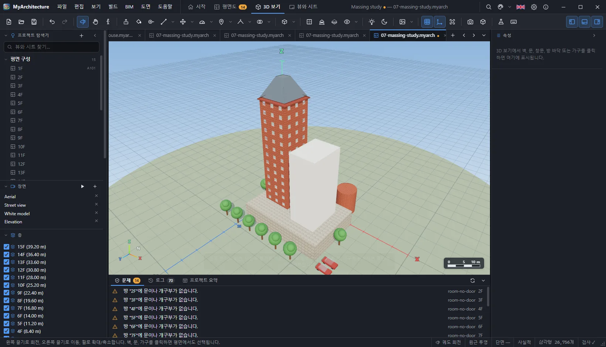
*매스 스터디의 가장 높은 매스를 **매스를 건물로** 바꾼 모습(모임지붕)*

#### 솔리드 도구

닫힌 매스(또는 컴포넌트) 두 개를 선택 순서대로 고른 뒤 **솔리드 도구** ▾ 에서: **합치기**, **빼기**(두 번째를 첫 번째에서 잘라내고 두 번째는 사라짐), **잘라내기**(빼기와 같지만 자르는 쪽이 남음), **교차**(겹친 부분만), **나누기**(세 부분), **외곽 쉘**(모두 합치기). **면 교차**는 매스가 만나는 곳에 모서리만 넣어, 나뉜 면을 따로 칠하거나 밀 수 있게 합니다. 같은 평면에 붙은 면, 겹친 면, 같은 매스끼리도 깨끗한 면으로 합쳐집니다. 재료는 면마다 따라옵니다.

#### 컴포넌트

- **컴포넌트 만들기**: 매스를 골라 **솔리드 도구 ▾ → 컴포넌트 만들기…**(또는 컴포넌트 패널의 +). 이름과 **개구부를 뚫음**(창처럼 벽에 붙음)을 정합니다. 매스는 하나의 정의와 그 자리에 놓인 인스턴스가 됩니다.
- **배치**: 컴포넌트 패널에서 정의의 + → 3D 에서 놓을 곳을 클릭. 개구부를 뚫는 컴포넌트는 클릭한 벽에 붙어 벽에 구멍을 내고 그 안을 채웁니다(평면에서는 개구부로 보이고 벽을 따라 움직입니다).
- **제자리 편집**: 인스턴스를 두 번 클릭하면 파란 상자로 표시되며 편집 중이 됩니다. 이때 밀기/끌기, 페인트, 그리기, 간격 띄우기가 정의를 바꾸고 **모든 복사본이 함께** 바뀝니다. <kbd>Esc</kbd> 로 닫습니다.
- **고유하게 만들기**: 선택한 인스턴스에 정의의 복사본을 줍니다. **분해**: 인스턴스를 보통 매스로 되돌립니다. **다음으로 바꾸기**: 개체 정보에서 다른 정의로 바꿉니다.
- 가져온 3D 모델과 기본 가구도 정의처럼 다룹니다: 같은 모델·같은 종류가 한 정의의 인스턴스이고, 컴포넌트 패널에서 개수를 보고 **인스턴스 선택**, 가구는 **모든 인스턴스에 적용**(이것의 크기·색을 모두에게)이 됩니다.

#### 태그, 아웃라이너, 숨기기

- **태그** 패널: 태그(스케치업의 레이어)마다 보이기 체크, 색, 항목 수. **+** 로 새 태그, 행의 태그 아이콘으로 선택 항목을 그 태그에 지정합니다(개체 정보의 **태그** 상자도 같음). 체크를 끄면 3D 에서 그 항목이 사라지고, **장면**이 어떤 태그가 보이는지 기억합니다. 스타일의 **태그별 색상**은 항목을 태그 색으로 칠합니다.
- **아웃라이너**: 층 → 그룹 → 항목의 목록. 이름으로 거르고, 클릭하면 선택, 눈 아이콘으로 3D 에서 숨기기/보이기. 명령 **선택 항목을 3D 에서 숨기기 / 모두 다시 보이기**.

#### 재료

페인트 통을 고르면 왼쪽에 기본 재료와 **재료** 패널이 나옵니다. **+** 로 새 재료: 이름, 색, **질감 이미지**(PNG/JPG), **질감 크기**(한 장이 덮는 mm), **불투명도**. ⚙ 는 고른 재료(기본 재료 포함)를 편집합니다. 형태를 바꾼(메시) 매스는 면마다 칠해지고, <kbd>Ctrl</kbd>+클릭은 매스 전체를 칠합니다. <kbd>Alt</kbd>+클릭은 클릭한 면의 재료를 집어 옵니다. 질감과 재료는 프로젝트 파일에 들어갑니다.

#### 단면

**단면** 도구로 면을 클릭하면 그 면에 단면이 놓이고(화살표가 남는 쪽을 가리킴) 모델이 잘립니다. 잘린 면은 **단면 채우기** 색으로 채워집니다. **단면** 패널: 이름(두 번 클릭해 바꾸기), 클릭으로 활성 단면 바꾸기(다시 클릭하면 끔), 100 mm 씩 이동, 뒤집기, 삭제, **단면 평면 보기 / 단면 자르기 보기 / 단면 채우기**. 여러 단면을 두고 장면마다 다른 단면을 쓸 수 있습니다. 바닥과 격자는 잘리지 않습니다.

#### 스타일

**스타일** 패널: 면(사실적·흰색 모델·선화·투시), **모서리**와 **모서리 색**, **윤곽선**(실루엣을 굵게, 굵기), **태그별 색상**, 하늘·지평선·배경·지면 색, 단면 채우기 색, 안개 밀도, **워터마크**(문구와 위치 — 화면과 저장한 이미지·애니메이션에 들어감). 스타일은 프로젝트에 저장되고 장면마다 다르게 둘 수 있습니다.

#### 그림자, 카메라

- 그림자 켜기/끄기와 날짜·시각(일조 분석, 5.12절)은 장면에 저장됩니다.
- **카메라 위치**: 설 곳을 클릭하면 눈높이에서 걷기 모드로 들어갑니다. **둘러보기**: 제자리에서 끌어 둘러보기. **2점 투시**: 수직선이 수직으로 남는 건축 투시. **시야각**은 카메라 패널에서 바꿉니다.

#### 보조선, 각도기, 3D 치수와 문자, 축

- **줄자**에 <kbd>Ctrl</kbd>(또는 패널의 **보조선 만들기**)를 쓰면 두 점을 지나는 보조선이 생기고, 길이를 입력하면 그 거리의 보조점이 생깁니다. **각도기**는 꼭짓점·기준선·각도로 기운 보조선을 만듭니다. 보조선은 추정의 대상입니다. 명령 **보조선 모두 삭제**.
- **3D 치수**: 두 점, 그리고 치수선이 놓일 곳. **3D 문자**: 점을 클릭하고 글자를 입력하면 지시선과 함께 놓입니다.
- **작도 축**: 원점과 빨간 축 방향을 클릭하면 추정·사각형이 그 축을 따릅니다.
- **지우개**: 요소와 보조선, 3D 치수·문자, 단면을 클릭해 지웁니다.

#### 샌드박스 (지형)

- **새 지형…**: 폭·깊이·격자 칸을 정하면 모델 아래에 삼각형 격자 지형이 생깁니다.
- **등고선 지형**: 평면에서 등고선(폴리선; DXF 에서 가져온 높이 `z`/`elevation`, 없으면 1 m 간격)을 고른 뒤 실행하면 등고선 사이를 보간한 지형이 생깁니다.
- **스무브**: 지형을 위아래로 끌어 언덕과 골을 만듭니다(반지름은 왼쪽 패널).

#### 장면과 애니메이션

장면은 카메라와 스타일 외에 **보이는 태그, 활성 단면, 스타일 설정, 그림자·날짜·시각, 시야각, 2점 투시**를 저장합니다. **애니메이션** 패널에서 전환·머무름 시간을 정하고 **애니메이션 내보내기…** 로 장면 순회를 **WebM 영상** 또는 **PNG 프레임(ZIP)** 으로 저장합니다.

#### 개체 정보

3D 에서 요소를 클릭하면 오른쪽에 **개체 정보**: 태그, 숨기기, 매스의 부피·겉넓이(닫힌 솔리드인지), 클릭한 면의 넓이, 컴포넌트의 정의와 인스턴스 수와 편집·고유하게·분해·바꾸기. 모델 정보(단위, 대지 위치)는 **파일 → 프로젝트 속성** 과 설정에 있습니다.

#### 내보내기

메시 매스와 컴포넌트, 지형은 glTF/GLB, OBJ, STL, PLY, USDZ, COLLADA, 3MF 로 그대로 나가고(7.5절), IFC 에는 면 Brep(열린 면은 면 모델)으로, 평면 DXF 에는 윤곽으로 나갑니다. IFC 로 내보낸 메시 매스는 다시 가져오면 그대로 돌아옵니다.

예제 **15 문화 단지 (스케치업 스타일)** 에 컴포넌트, 태그, 질감 재료, 보조선, 3D 치수·문자, 단면 두 개, 지형과 이 기능을 쓰는 장면들이 들어 있습니다.

---

## 6. BIM

평면의 요소(벽, 문·창, 방, 기둥, 계단, 가구, 지붕, 매스, 그리드)는 BIM 정보를 함께 가집니다. 요소를 고르면 오른쪽 패널 아래 **BIM** 칸에 나옵니다.

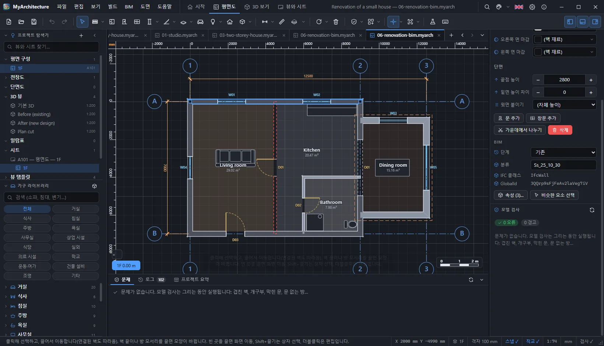
*BIM 속성: 단계, 분류 코드, IFC 클래스, GlobalId, 사용자 속성*

| 칸 | 설명 |
| --- | --- |
| 단계 | 기존 / 신축 / 철거 (그리드에는 없음) |
| 분류 | 분류 코드(예: Uniclass 2015 코드). 분류 체계 이름은 프로젝트 속성에서 |
| IFC 클래스 | 내보낼 IFC 클래스(읽기 전용) — 벽 `IfcWall`, 문·창 `IfcDoor / IfcWindow`, 방 `IfcSpace`, 기둥 `IfcColumn`, 계단 `IfcStair`, 가구 `IfcFurniture`, 지붕 `IfcRoof`, 그리드 `IfcGrid`, 매스 `IfcBuildingElementProxy` |
| GlobalId | IFC GlobalId(22자). 누르면 클립보드에 복사 |
| **속성 (n)…** | 사용자 속성 창(6.4절) |
| **비슷한 요소 선택** | 4.9절 |

### 6.1 벽 타입

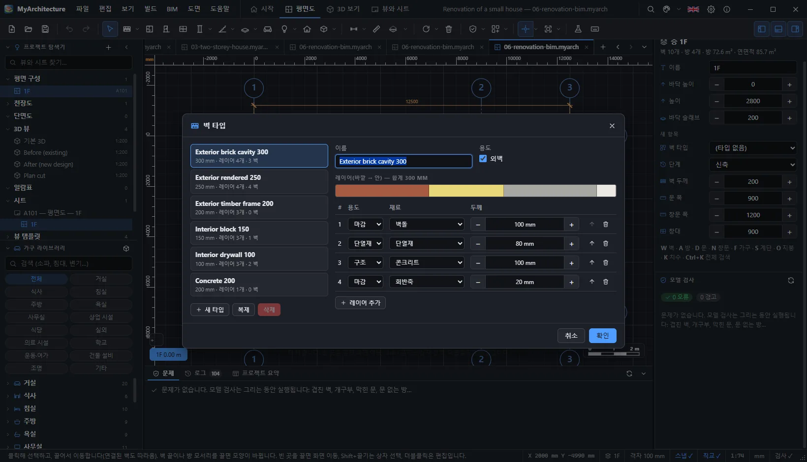
*벽 타입: 재료 층(구조·단열·마감)으로 두께를 정하고 벽에 지정합니다*

**BIM → 벽 타입…**(도구 모음 벽 타입 단추):

- 왼쪽 목록: 타입마다 전체 두께 · 레이어 수 · 그 타입을 쓰는 벽 수. **새 타입**, **복제**, **삭제**(타입이 2개 이상이고 쓰는 벽이 없을 때만).
- 오른쪽: **이름**, **용도: 외벽** 체크, 레이어 단면 그림(바깥이 왼쪽), 레이어 표 — **용도**(마감 / 단열재 / 구조 / 공기층), **재료**(벽 재료 + 단열재·공기층), **두께**(5 mm 단위 스테퍼), 위로 이동, 삭제. **레이어 추가**.
- “레이어(바깥 → 안) — 합계 … mm”. **확인**을 누르면 그 타입을 쓰는 모든 벽의 두께가 새 합계로 바뀝니다.

새 프로젝트에 들어 있는 벽 타입:

| 이름 | 레이어 (바깥 → 안) | 합계 |
| --- | --- | --- |
| Exterior brick cavity 300 | 벽돌 100 · 단열재 80 · 콘크리트 100 · 회반죽 20 | 300 |
| Exterior rendered 250 | 회반죽 20 · 단열재 60 · 콘크리트 150 · 회반죽 20 | 250 |
| Exterior timber frame 200 | 목재 외장재 25 · 단열재 150 · 회반죽 25 | 200 |
| Interior block 150 | 회반죽 15 · 콘크리트 120 · 회반죽 15 | 150 |
| Interior drywall 100 | 흰색 페인트 13 · 단열재 74 · 흰색 페인트 13 | 100 |
| Concrete 200 | 콘크리트 200 | 200 |

벽에 타입 지정: 벽을 고르고 오른쪽 패널 **벽 타입**에서 선택(여러 벽은 고른 뒤 비슷한 요소 선택 등으로). 평면에는 레이어 경계선이 그려집니다. 새로 그릴 벽의 타입은 아무것도 고르지 않았을 때 오른쪽 패널 **새 항목 → 벽 타입**. 벽의 두께를 직접 바꾸면 타입이 풀립니다.

### 6.2 단계 (리모델링)

*단계: 기존(회색)·철거(빨간 점선)·신축 벽을 함께 그리고, 보기 → 단계 로 전후를 비교합니다*

- 요소마다 **단계**: **기존**(옅게), **신축**(보통), **철거**(빨간 점선 윤곽).
- 새로 그릴 요소의 단계: 오른쪽 패널 **새 항목 → 단계**.
- **보기 → 단계: 모두 보기 / 단계: 새 설계 / 단계: 기존 건물**(3D 왼쪽 패널 **단계**도 같음):

| 단계 보기 | 보이는 것 |
| --- | --- |
| 모든 단계 | 전부 |
| 새 설계 (철거 없음) | 기존 + 신축 (공사 후 모습) |
| 기존(공사 전) | 기존 + 철거 (공사 전 모습) |

- 공사비에는 **신축**만 들어갑니다(기존은 0, 철거는 제외).

### 6.3 분류와 IFC

- **분류** 칸에 분류 코드를 적고, **프로젝트 속성 → 분류 체계**(기본 `Uniclass 2015`)에 체계 이름을 적으면 IFC 의 분류 참조로 나갑니다.
- 단계, 벽 타입(레이어 재료), 그리드, 사용자 속성은 모두 IFC 내보내기에 포함됩니다(7.5절).

### 6.4 사용자 속성 (BIM 속성)

*BIM 속성 창: 고른 요소에 내화 등급 같은 속성을 붙입니다*

**BIM → 선택 요소의 BIM 속성…**(오른쪽 클릭 **BIM 속성…**, BIM 칸 **속성 (n)…**):

- **속성 / 값** 표. **속성 추가**로 줄을 더하고 휴지통으로 지웁니다. 속성 이름 칸은 `FireRating, AcousticRating, ThermalTransmittance, LoadBearing, Manufacturer, Model, Cost, Mark, Comments` 를 제안합니다.
- 값이 숫자면 숫자로, `true`/`false` 면 참/거짓으로 저장됩니다.
- 여러 요소를 고르면 “속성이 선택한 요소 n개 모두에 기록됩니다.” 하나면 “IFC에 속성 세트 MyArchitecture_Properties로 내보냅니다.”
- 텍스트·치수·CAD 선·밑그림에는 붙일 수 없습니다. 아무것도 고르지 않으면 “먼저 요소를 하나 이상 선택하세요.”
- 가구에 `price` 속성을 붙이면 공사비의 가구 금액으로 쓰입니다.

### 6.5 일람표 (집계와 수량)

*일람표: 방 · 문과 창 · 벽 타입 · 공사비 · 층 — CSV 로 내보냅니다*

**빌드 → 집계와 수량…**(도구 모음, 파일 → 내보내기 ▸ **집계표 내보내기(CSV)…** 도 같은 창. BIM → **공사비…** 는 같은 창을 **공사비** 탭으로 엽니다):

| 탭 | 열 |
| --- | --- |
| 방 | 층, 방, m², 둘레 (m), 바닥 |
| 문과 창문 | 태그, 종류, 유형, 층, 폭, 높이, 창대 높이 |
| 벽 타입 | 벽 타입(타입 없는 벽은 두께별), 두께, 레이어, 벽 수, 길이(m), 벽 면적 (m²) |
| 층 | 층, 바닥 높이, 벽, 벽 길이 (m), 벽 면적 (m², 개구부 뺀 한 면), 방, 방 면적 (m²), 총면적 (m², 벽 바깥 기준), 문, 창문 |
| 공사비 | 6.6절 |

긴 표는 12줄씩 쪽으로 나뉩니다. 아래에 **합계**(방 면적, 연면적, 문·창 수, 벽 길이와 부피)가 나옵니다.

아래 단추 **방 CSV… · 문·창문 CSV… · 벽 타입 CSV… · 공사비 CSV… · 층 CSV…** 는 그 표를 `제목-rooms.csv` 처럼 저장합니다. CSV 는 UTF-8(BOM 포함)이라 Excel 에서 한글이 깨지지 않습니다.

### 6.6 공사비

*공사비 탭: 단가 × 수량으로 개략 공사비를 냅니다*

**공사비** 탭 위쪽의 단가(스테퍼, 10,000 단위, 직접 입력 가능)를 바꾸면 표가 바로 다시 계산되고, 창을 닫을 때 프로젝트에 저장됩니다(되돌리기 “단가” 한 단계).

| 단가 칸 | 표의 항목 | 수량 | 기본 단가 (KRW) |
| --- | --- | --- | --- |
| 벽 m²당 | 벽 | 신축 벽의 한 면 면적(개구부 제외), m² | 120,000 |
| 바닥 m²당 | 바닥 | 신축 방 면적, m² | 80,000 |
| 지붕 m²당 | 지붕 | 신축 지붕의 평면 면적, m² | 150,000 |
| 문 개당 | 문 | 신축 문 수, 개 | 450,000 |
| 창문 개당 | 창문 | 신축 창 수, 개 | 380,000 |
| 개구부 개당 | 개구부 | 신축 개구부 수, 개 | 100,000 |
| 계단 개당 | 계단 | 신축 계단 수, 개 | 2,500,000 |
| 기둥 개당 | 기둥 | 신축 기둥 수, 개 | 300,000 |
| — | 가구 | 신축 가구, 개 | 가구마다 `price` 속성 합계 |

열: 항목, 수량, 단위, 단가, 금액. 맨 아래 “예상 합계: … KRW”. 수량이 0 인 항목은 표에서 빠집니다.

### 6.7 모델 검사

*모델 검사(F5): 겹친 벽, 막힌 문, 간섭(가구·계단·기둥) 등을 찾고 눌러서 그곳으로 갑니다*

모델 검사는 회로 설계의 ERC/DRC 에 해당하는 건축 검사입니다.

- 기본으로 **그리는 동안 계속** 실행됩니다(설정 → 평면도 → **그리는 동안 모델 검사 실행**).
- <kbd>F5</kbd>(빌드 → 모델 검사, 도구 모음, 상태 표시줄 검사 칸)는 지금 검사하고 “모델 검사: 오류 n개, 경고 n개” 또는 “모델 검사 통과 — 문제가 없습니다.”를 알리며 오른쪽 패널을 엽니다.
- 오른쪽 패널 아래 **모델 검사** 목록: 오류·경고 개수 알약, 항목마다 메시지와 `코드 · 층`. 항목을 누르면 그 층으로 가서 문제 위치를 확대하고 주황 원으로 깜박이며 관련 요소를 선택합니다. ↻ 단추는 다시 검사.
- 문제 위치는 평면에도 표시됩니다. 평면도 탭과 접힌 오른쪽 패널에 개수 배지가 붙습니다.

검사 규칙 전체(메시지는 화면에 나오는 그대로)는 12.2절에 있습니다.

### 6.8 프로젝트 속성과 대지

*프로젝트 속성: 제목·주소·대지 위도/경도·시간대·분류 체계*

**파일 → 프로젝트 속성…**(BIM → **대지 위치 (일조 분석)…** 도 같은 창):

| 항목 | 쓰임 |
| --- | --- |
| 제목 | 문서 제목, 파일 이름 제안, 도면 표제란, IFC 프로젝트 이름 |
| 건축주, 주소 | 표제란 작은 글씨 |
| 작성자, 회사 | 표제란 “작성자”, IFC 작성자·조직 |
| 개정, 날짜 | 표제란 |
| 도면 축척 | 1:20 / 1:50 / 1:100 / 1:200 / 1:500 — 인쇄 기본 축척, SVG 내보내기 크기 |
| 북쪽 | 북쪽 방향 회전(−180° ~ 180°, 5° 단위) — 방위표와 해 방향 |
| 위도, 경도 | 일조 분석(기본 서울 37.57°, 126.98°) |
| 시간대 (UTC+) | 일조 분석 시각(기본 UTC+9, 0.5 단위) |
| 분류 체계 | IFC 분류 참조 이름(기본 Uniclass 2015) |
| 설명 | 메모 |

### 6.9 도면화: 뷰, 시트, 일람표

Revit의 프로젝트 탐색기나 ArchiCAD의 내비게이터처럼, 프로젝트 하나에 **뷰**(평면도·천장도·단면도·입면도·상세·제도 뷰·범례·3D·일람표)와 **시트**(표제란이 있는 도면 한 장)가 함께 저장됩니다. 모든 뷰는 모델에서 바로 만들어지므로 벽을 고치면 단면도·입면도·시트가 함께 바뀝니다.

*뷰와 시트 탭: 왼쪽 프로젝트 탐색기, 가운데 모델에서 만든 단면도, 아래 뷰 조절 막대*

- **프로젝트 탐색기**: 왼쪽 패널 맨 위(평면도·3D 탭)와 **뷰와 시트** 탭(F6)의 왼쪽 패널 전체. 평면도·천장도·단면도·입면도·상세 뷰·제도 뷰·범례·3D 뷰·일람표·시트(배치된 뷰 포함)·뷰 템플릿·개정·출판 세트가 나무 구조로 나옵니다. 누르면 열고, 우클릭하면 속성·가시성·이름 바꾸기·복제·시트에 배치·DXF·삭제 메뉴가 나옵니다. 뷰를 끌어 열린 시트 위에 놓으면 배치됩니다.
- **열리는 곳**: 평면도는 평면도 탭, 3D 뷰(장면)는 3D 탭, 나머지는 **뷰와 시트** 탭에 열립니다. 이 탭 위쪽 띠에 열어 둔 뷰가 탭처럼 남고, 문서 탭(파일)마다 따로 기억됩니다.
- **메뉴**: **도면** 메뉴에 모든 명령이 있고, 평면 도구 모음에는 **뷰** 분할 단추(단면·입면·콜아웃·외부/내부 입면·천장도)와 **주석** 분할 단추가 있습니다.
- 예전 파일을 열면 층마다 평면도·천장도와, 층마다 평면 한 장씩인 시트(A101, A102 …)가 자동으로 생깁니다 — 이전의 인쇄와 같은 구성입니다.

### 6.10 단면도와 입면도

- **단면도**: 평면 도구 모음의 **뷰 ▾ → 단면도**, 또는 **도면 → 단면도**. 단면선의 시작점과 끝점을 클릭하면 됩니다. 그린 방향의 **왼쪽**을 바라보며(동쪽으로 그리면 북쪽을 봄), 기호 우클릭 → **보는 방향 뒤집기**로 바꿉니다. 평면에 단면 기호(머리의 위 칸 = 시트 위 상세 번호, 아래 칸 = 시트 번호)가 생기고, **더블클릭하면 열립니다**. 기호 끝점을 끌어 단면선을 옮기면 뷰가 바로 다시 만들어집니다.
- **입면도**: **뷰 ▾ → 입면도** 후 기호 위치를 클릭하면 건물 쪽(90° 단위)을 바라봅니다. **외부 입면도 (북·남·동·서)** 는 네 개를 한 번에, **실 내부 입면도**는 선택한 실 안쪽 네 벽(A–D)을 만듭니다.
- **도면 내용**: 절단면에 걸린 요소는 **단면(포셰)** 으로 채워지고 재료별 해치(콘크리트 점·벽돌 사선·단열재 지그재그·목재 결 …)가 들어가며, 그 너머의 요소는 **숨은선을 제거한 투영선**으로 그려집니다. 층 높이마다 **레벨선과 머리**(이름, ±0.000 표고), 단면을 지나는 **그리드선과 번호 원**이 자동으로 붙습니다. 벽·슬래브·지붕·계단·기둥·가구, 그리고 새로 추가되는 모든 요소 종류가 3D 모델 그대로 잘리고 투영됩니다.
- **상세 수준**: 개략 = 검은 단면, 보통 = 벽 구조 재료 하나의 해치, 상세 = 벽 유형의 **레이어마다** 띠와 해치·경계선.
- **자르기 영역**(점선 사각형, 모서리 손잡이로 크기 조절)과 **먼 쪽 자르기 깊이**(뷰 속성)로 보이는 범위를 정합니다.

### 6.11 천장도, 콜아웃, 제도 뷰, 범례

- **천장도**: 층마다 있습니다(프로젝트 탐색기 → 천장도, 또는 **현재 층 천장도**). 절단 높이(기본 2300 mm)에서 위를 본 모습을 평면 방향 그대로 그리고, 실 이름과 천장 높이(CH), 조명 기호를 붙입니다.
- **콜아웃(상세 뷰)**: **콜아웃** 도구로 평면이나 단면 위에 영역을 끌면 그 부분을 큰 축척(기본 1:20, 상세)으로 보여 주는 상세 뷰가 생기고, 원본 뷰에 콜아웃 기호가 그려집니다.
- **제도 뷰**: 모델 없이 선·영역·글자만 그리는 빈 뷰(표준 상세 등).
- **범례**: 벽 유형(레이어 띠와 두께)이나 벽 재료 목록을 그립니다.

### 6.12 뷰 속성, 가시성/그래픽, 뷰 템플릿

- **뷰 조절 막대**(뷰 아래): 축척, 상세 수준, 자르기 켜기/보이기, 가시성/그래픽, 사용 중인 템플릿과 생성 상태.
- **뷰 속성…**: 이름, 참조 번호, 축척, 상세 수준, **단계 필터**(전체 / 신축 / 기존), 뷰 템플릿, 절단 높이(평면·천장도 — 평면에서는 절단 높이보다 높은 창은 빠지고 그 위의 가구는 점선), 먼 쪽 자르기 깊이, 단면 방향 뒤집기, 자르기.
- **가시성 / 그래픽…**: 범주별 보이기/숨기기(벽·문·창·실·기둥·계단·가구·조명·지붕·매스·슬래브 … 그리고 치수·글자·태그·그리드·레벨·뷰 기호·상세선·채움 영역·개정 구름·기호), 단면·입면에서는 범주별 **단면 채움 색** 재지정.
- **뷰 템플릿…**: 축척·상세 수준·단계·숨길 범주를 묶어 여러 뷰에 한꺼번에 적용합니다(“적용할 뷰” 체크). 템플릿이 있는 뷰는 그 값이 우선합니다. 기본 템플릿 4개: 건축 평면 1:100, 가구 평면 1:50, 시공 단면 1:50, 프레젠테이션 입면 1:100.

### 6.13 주석

평면 도구 모음의 **주석 ▾**, 뷰와 시트 탭의 **치수 ▾ / 글자 ▾ / 상세 ▾** 분할 단추에 있습니다. 주석은 그 뷰에만 속하고 글자 크기는 용지 mm로 정해져 어느 축척에서도 같은 크기로 인쇄됩니다.

| 도구 | 사용법 |
| --- | --- |
| 정렬 / 선형 치수 | 두 점 → 치수선 위치 클릭(선형은 움직이는 방향으로 수평·수직 결정) |
| 연속 치수 | 점들을 차례로 클릭 → Enter → 치수선 위치 |
| 각도 / 반지름 / 호 길이 | 꼭짓점·두 변 / 중심·호 위 점(Shift = 지름) / 중심·시작·끝 |
| 지점 표고 | 한 점 — 단면·입면에서는 그 높이, 평면에서는 층 표고 |
| 지시선 글자, 키노트 | 화살표 끝 → 글자 위치 → 입력 |
| 태그 | 실·문·창·벽·가구를 클릭. **매개변수를 읽습니다**: 실 = 이름과 면적, 문/창 = 기호(D01 …), 벽 = 유형 이름, 가구 = 이름. 속성에서 `{name} {area} {width}×{height} {department}` 같은 레이블로 바꿉니다. **태그 없는 요소 모두 태그…** 는 한 번에 붙입니다 |
| 기호 | 방위표, 화살표, 생략선, 중심 표시, 십자 |
| 개정 구름 | 모서리 클릭, Enter로 닫기 — 최근 개정에 연결되어 그 시트의 개정표에 올라갑니다 |
| 채움 영역 / 가림 영역 | 모서리 클릭 — 패턴(해치·교차·콘크리트·벽돌·단열재·흙·목재·유리·채움)과 테두리 선 |
| 상세선 | 선 스타일(가는·중간·굵은·숨은·중심·상부·철거 …)로 그림. **도면 → 선 스타일…** 에서 굵기·색·패턴 편집 |

주석을 누르면 선택되고 끌어 옮기며, 손잡이로 점을 고치고, 더블클릭으로 글자를 고칩니다. Delete로 지웁니다.

### 6.14 시트와 출판

*시트: 단면도 두 개가 배치된 A1 시트와 표제란, 개정표*

- **새 시트**: 번호가 A101, A102 … 처럼 이어집니다. **뷰 배치…** 로 고르거나, 탐색기에서 뷰를 끌어 놓으면 빈 곳에 그 뷰의 축척으로 배치됩니다. 뷰포트를 끌어 옮기고, 더블클릭하면 그 뷰가 열립니다. 평면·천장도·단면·입면·상세·범례·**3D(숨은선 액소노메트릭)**·**일람표**를 놓을 수 있고, 일반 뷰는 시트 하나에만 놓입니다(다른 시트용은 복제).
- 뷰포트 아래에는 상세 번호·뷰 이름·축척 제목이, 오른쪽에는 **표제란**(회사, 프로젝트, 건축주·주소, 개정표, 작성/검토/승인, 날짜, 축척 — 서로 다르면 “도면 표기”, 상태, 시트 이름, 시트 번호, 현재 개정)이 그려집니다. 필드는 **시트 속성…**, 프로젝트 정보는 파일 → 프로젝트 속성에서 고칩니다.
- **개정…**: 순번·이름·날짜·설명·수신·발행자·발행 여부. 시트에 체크했거나 그 시트의 뷰에 개정 구름이 있으면 개정표에 올라갑니다.
- **시트 목록(도면 목록)**: 시트 번호·이름·현재 개정·날짜의 일람표 — 표지 시트에 놓습니다.
- **출판…**: 시트를 골라(또는 저장한 **출판 세트**로) **인쇄 / PDF**(인쇄 창이 “시트” 모드로 열려 시트마다 자기 용지 크기로 인쇄), **SVG**, **DXF**(시트마다 파일 하나)로 내보냅니다. 인쇄 창에서도 **인쇄: 층별 평면 / 시트**를 고를 수 있습니다.
- **뷰 또는 시트를 DXF로 내보내기…**: 뷰는 건물 1:1 mm, 시트는 용지 mm(AutoCAD R12). 선 굵기별 레이어 A-HEAVY / A-MEDIUM / A-THIN, 글자는 A-TEXT.

### 6.15 일람표 뷰

**새 일람표…** 에서 범주(실, 문, 창, 벽, 가구, 기둥, 층, 시트, 뷰)를 고르면 표가 뷰로 열립니다.

- **필드, 필터, 정렬…**: 필드 고르기와 순서, 필터(=, ≠, >, <, ≥, ≤, 포함), 정렬 두 단계, **그룹(소계 포함)**, 총계, **계산 값**(예: `area * 1.1` — 필드 키와 + − * / 괄호).
- 열 머리를 누르면 정렬, 편집 가능한 셀(이름, 번호, 문 크기, 창대, 층 높이, 사용자 속성 …)은 **더블클릭해 고치면 모델이 바뀝니다**.
- **CSV 내보내기…**(Excel용 UTF-8), 시트에 표로 배치.

---

## 7. 파일

### 7.1 새로 만들기, 열기, 저장

| 명령 | 키 | 설명 |
| --- | --- | --- |
| 새 프로젝트 | <kbd>Ctrl</kbd>+<kbd>N</kbd> | 빈 평면(층 `1F`, 층고 2800, mm 단위). 평면도 탭으로 가며 “새 프로젝트입니다. W를 눌러 벽을 그리세요.” |
| 열기… | <kbd>Ctrl</kbd>+<kbd>O</kbd> | `.myarch`(그리고 가져올 수 있는 모든 형식 — 형식에 맞는 가져오기로 넘어감) |
| 저장 | <kbd>Ctrl</kbd>+<kbd>S</kbd> | 이미 경로가 있으면 묻지 않고 덮어씀 |
| 다른 이름으로 저장… | <kbd>Ctrl</kbd>+<kbd>Shift</kbd>+<kbd>S</kbd> | 새 파일 이름(기본: 제목`.myarch`) |
| 끝내기 | <kbd>Alt</kbd>+<kbd>F4</kbd> | 데스크톱판만 |

- 저장하지 않은 변경이 있으면 새로 만들기·열기·예제·튜토리얼·끝내기 전에 “닫기 전에 "…"의 변경 내용을 저장할까요?” — **취소 / 저장 안 함 / 저장**.
- 파일(프로젝트, DXF, 3D 모델, 이미지 …)을 창으로 **끌어다 놓아도** 열리거나 가져와집니다. 평면도 탭에 놓은 3D 모델과 이미지는 놓은 자리에 들어갑니다. 끌어다 놓은 프로젝트는 원래 경로를 알 수 없어 처음 **저장**할 때 위치를 묻습니다(탐색기에서 두 번 클릭해 연 파일은 그 자리에 저장됩니다).
- `.myarch` 는 JSON 텍스트 파일로, 프로젝트의 모든 것(층, 요소, 벽 타입, 단가, 장면, 가져온 3D 모델과 밑그림 이미지)을 담습니다.

### 7.2 자동 저장과 복구

- 설정 → 일반 → **자동 저장: 복구용 사본 보관**(기본 켬), **자동 저장 간격**(10초 ~ 10분, 기본 30초).
- 저장하지 않은 변경이 있을 때만 복구용 사본을 씁니다. 정상적으로 저장하면 지워집니다.
- 다음 실행 때 사본이 있으면 **작업 복구** 창: “…의 저장되지 않은 프로젝트를 복구했습니다. 복원할까요?” — **복원**(변경 표시 ● 상태로 열림) / **버리기**.

### 7.3 최근 파일

*최근 파일: 10개까지 기억하고 하나씩 지우거나 목록을 비웁니다*

- 열거나 저장한 파일(가져온 DXF·3D 모델 등 포함)을 새것부터 **10개**까지 기억합니다(설정 → 일반 → **최근 파일 기억 개수**, 1 ~ 30). 시작 페이지의 최근 목록에도 같은 개수가 보입니다.
- **파일 → 최근 파일…**: 이름·경로·시각 목록. 누르면 열고, **×**(목록에서 제거)는 하나만 지우고, **목록 지우기**는 전부 지웁니다. 파일 자체는 지워지지 않습니다.
- **파일 → 최근 파일 지우기**, 시작 페이지 **목록 지우기**도 같습니다(“최근 파일 목록을 지웠습니다.”).
- 열 수 없는 파일(옮겨졌거나 지워짐)은 열려고 할 때 목록에서 빠집니다.

### 7.4 가져오기

*가져오기: DXF·SVG·IFC·3D 모델·이미지*

**파일 → 가져오기(DXF, IFC, 3D 모델, 이미지…)…**(<kbd>Ctrl</kbd>+<kbd>I</kbd>)는 지원하는 모든 파일을 고르는 창을 엽니다. **파일 → 가져오기 ▸** 는 형식별 명령 목록입니다: 가져오기(전체) · DXF 도면 가져오기… · IFC 가져오기(BIM)… · Sweet Home 3D, gbXML 또는 IFC ZIP 가져오기… · 3D 모델 가져오기(OBJ, FBX, GLB, STL…)… · SVG 도면 가져오기… · 이미지를 트레이싱 밑그림으로 가져오기….

| 형식 | 가져오는 방법 |
| --- | --- |
| **DXF** (.dxf) | **DXF 도면 가져오기** 창: **파일의 단위**(자동 감지 / mm / cm / m / 인치 / 피트), **층**(넣을 층), **도면을 평면 원점으로 옮기기**. 선, 폴리선, 호, 원, 스플라인, 텍스트, 블록, 해치 윤곽이 각자의 CAD 레이어로 들어옵니다. 텍스트(ASCII) DXF 와 **바이너리 DXF**(AutoCAD 의 DXFOUT 바이너리 옵션, R12 ~ 2018)를 모두 읽습니다. 끝나면 “… 가져옴: 도면 요소 n개, 텍스트 n개 (단위)”, 주의할 점이 있으면 **가져오기 메모** 창 |
| **DWG** (.dwg) | DXF 와 같은 **DWG 도면 가져오기** 창. AutoCAD R13 ~ 2025 가 저장한 파일(DWG R13·R14·2000·2004·2007·2010·2013·2018 형식)을 직접 읽습니다. 모형 공간의 선, 폴리선, 호, 원, 타원, 스플라인, 텍스트·MTEXT, 블록(중첩·축척·회전), 치수, 해치 윤곽, 지시선이 원래 레이어(색·켜짐/꺼짐 포함)로 들어옵니다. 그 밖에: **다중 지시선**(지시선·화살촉·연결선·문자), **표**(표의 익명 블록, 없으면 셀 격자와 셀 문자), **다중선**, **나선**, 호 길이 치수·공차, **무한선·광선**(도면 범위의 두 배에서 자름), **와이프아웃**(윤곽), **래스터 이미지**(그림 파일이 도면 옆에 있으면 트레이싱 밑그림, 없으면 테두리), **영역·3D 솔리드·바디**(ACIS 모형의 모서리: 직선·원·호·타원, 스플라인 모서리는 직선으로), R2018 **여러 줄 속성**, 그리고 읽는 법이 따로 없는 객체(메시, 서피스, 프록시·타사 객체 등)는 파일에 저장된 **프록시 그래픽**으로 그립니다. 파일에 **레이아웃**(도면 공간)이 있으면 창에 **공간**이 나옵니다: **모델 공간**(기본) / **레이아웃: 이름**(그 레이아웃의 객체와, 뷰포트마다 축척·잘라 낸 모델; 뷰포트에서 동결한 레이어는 빼고) / **모든 레이아웃을 나란히**(모델 오른쪽에 레이아웃을 차례로, 레이어는 `레이아웃|레이어`). **외부 참조**(XREF)는 참조한 .dwg/.dxf 가 가져오는 도면과 같은 폴더에 있으면(데스크톱) 읽어서 그 자리에 `XREF|레이어` 레이어로 넣고, 없으면 메모에 알립니다. 빛(LIGHT)·OLE 객체·PDF 밑그림처럼 그릴 것이 없는 객체만 건너뛰고 **가져오기 메모**에 개수를 알려 줍니다. R12 이전 파일과 암호가 걸린 도면은 열 수 없습니다 |
| **SVG** (.svg) | **SVG 도면 가져오기** 창(위와 같은 항목). 경로, 도형, 텍스트가 `SVG` 레이어로 들어옵니다. `<use>`·`<symbol>` 은 펼쳐 넣고, 경로 위 텍스트(`<textPath>`)는 경로 시작점에서 경로 방향으로 놓인 한 줄 텍스트가 됩니다. **들어 있는 이미지**(`<image>`)는 SVG 의 위치·크기·회전 그대로 **밑그림**(이미지를 가져올 때와 같음)이 됩니다 — `data:` 로 들어 있는 이미지는 어디서나, SVG 옆 폴더의 이미지 파일(상대 경로)은 데스크톱판에서 읽습니다. 웹 주소로 연결된 이미지, 클리핑 경로·마스크(잘리지 않은 채로 들어옴)는 **가져오기 메모**에 적힙니다 |
| **IFC** (.ifc) | **지금 프로젝트를 바꿉니다**(저장 확인). 층, 벽, 문·창, 방, 슬래브, 지붕, 계단, 기둥, 가구를 읽어 새 프로젝트(이름 `파일이름.myarch`, 저장 안 된 상태)로 엽니다. “… 가져옴: 층 n개, 벽 n개, 문/창문 n개, 방 n개.” |
| **Sweet Home 3D** (.sh3d) | IFC 처럼 **지금 프로젝트를 바꿉니다**. **모든 버전**의 파일을 읽습니다: 5.3 이후는 Home.xml, 그 전 파일은 Java 직렬화된 집 데이터. 층, 벽(곡선 벽은 짧은 직선으로, 바깥 면의 색이나 텍스처), 문·창문(우리 개구부로), 바닥 텍스처·색이 있는 방, 치수선, 글자, 폴리라인, 방위표를 읽습니다. **가구·조명·지붕**을 어떻게 가져올지 대화상자에서 고릅니다: **파일의 3D 모델 사용**(기본) — 가구마다 파일에 들어 있는 OBJ / DAE / 3DS 모델과 텍스처, 모델 회전, 대칭, 크기, 높이, 색·재질 바꿈을 그대로 살린 **모델 가구**가 되고, 같은 모델을 쓰는 가구는 프로젝트에 저장된 모델 하나를 함께 씁니다(라이브러리의 **가져온 3D 모델**). Sweet Home 3D 지붕(가구로 되어 있음)도 모델로 들어옵니다 — 또는 **MyArchitecture 가구 모양 사용**: 이름으로 라이브러리의 가장 가까운 항목에 맞추고(없으면 크기·색이 같은 상자), 계단은 계단으로, 지붕 가구는 **외곽선으로 만든 우리 지붕**이 됩니다. 벽·바닥 텍스처는 그림을 담은 **프로젝트 재료**가 됩니다(그림이 없으면 가장 가까운 기본 재료). 조명은 빛 없이 들어오고(빛은 라이브러리 조명으로), 천장 텍스처는 가져오지 않으며, 벽은 양면에 마감 하나만 보입니다 |
| **gbXML** (.gbxml, .xml) | Revit, ArchiCAD, Vectorworks, OpenStudio 의 에너지 분석용 모델. IFC 처럼 **지금 프로젝트를 바꿉니다**. 층, 벽, 문·창문, 공간(→ 방), 지붕을 읽습니다. 벽 두께는 구성 재료에서, 없으면 200 mm. 한 벽이 공간마다 여러 면으로 나뉘어 있으면(같은 CADObjectId) 다시 벽 하나로 잇습니다. 평지붕은 공간마다 나뉜 조각을 한 지붕으로 합치고, **경사 지붕**은 이어진 면끼리 묶어 면마다 기울기·방향을 재서 **박공·모임·외쪽 지붕**(물매, 윤곽, 처마 내밀기, 높이, 방향)으로 다시 만듭니다. 세 가지 중 어느 것에도 맞지 않는 지붕(ㄱ자·골이 있는 지붕, 물매가 다른 지붕 등)은 그 경사면 그대로의 **매스**가 되어 3D 모양이 맞게 보입니다. 박공 끝의 삼각형 면은 벽이 아니라 지붕이 그립니다. UTF-16 파일도 읽습니다 |
| **ifcXML** (.ifcxml, .xml) | XML 로 쓴 IFC. **IFC4 ifcXML**(`<ifcXML>`)과 **IFC2x3 ifcXML**(`<iso_10303_28>`)을 모두 읽어 .ifc 와 똑같이 가져옵니다(층, 벽, 문·창, 방, 슬래브, 지붕, 계단, 기둥, 가구, 벽 타입, 속성) |
| **IFC ZIP** (.ifczip) | 압축을 풀어 안의 .ifc 또는 .ifcxml 을 IFC 와 똑같이 가져옵니다 |
| **3D 모델** (.obj .fbx .glb .gltf .stl .dae .3mf .3ds .ply .wrl .amf) | **3D 모델 가져오기 — 이름** 창: **파일의 단위**(자동 감지 …), **위쪽 축**(자동 / Y가 위쪽 / Z가 위쪽). 모델은 **가구 하나**가 되어 지금 층의 화면 가운데(또는 놓은 자리)에 들어오고 프로젝트 파일 안에 저장됩니다. 가구 라이브러리 “가져온 3D 모델”에서 몇 번이든 다시 놓을 수 있습니다. OBJ 는 같은 폴더의 같은 이름 `.mtl` 재질도 읽습니다 |
| **Rhino 3DM** (.3dm) | 먼저 **Rhino 3DM 가져오기** 창에서 고릅니다. **3D 모델**: 위의 3D 모델처럼 가구 하나가 됩니다. 파일의 단위(ModelUnitSystem)를 그대로 쓰고, 서피스·폴리서피스·돌출(Extrusion)·메시·SubD 를 레이어와 재질 색으로, 블록(InstanceDefinition)은 변환을 적용해 펼쳐 넣습니다. 파일에 렌더 메시가 저장되어 있으면 그대로 쓰고, 없으면(“작게 저장”, 스크립트로 만든 파일) 평평한 면은 정확히, 굽은 면은 근사로 삼각형을 만듭니다. 숨긴 레이어·객체, 커브·점·문자·치수·해치·조명은 넣지 않고 **가져오기 메모**에 개수를 적습니다. **평면 도면**: DXF 와 같은 창(단위·층·원점으로 옮기기, **서피스·폴리서피스·메시의 모서리도 포함**)으로, 위에서 본 모습 — 커브, 서피스·메시 모서리와 윤곽, 점(작은 ×), 문자·텍스트 점 — 이 Rhino 레이어마다 CAD 레이어 하나로(레이어 색·숨김 그대로) 들어와 그 위에 벽을 따라 그릴 수 있습니다. 원·호는 원·호로 남고, 위에서 겹쳐 보이는 모서리는 하나로 합칩니다. Rhino 2 ~ 8 파일을 읽으며, 읽기 엔진(McNeel 의 openNURBS/rhino3dm, WebAssembly 약 2.7 MB)은 .3dm 을 처음 가져올 때만 불러옵니다 |
| **이미지** (.png .jpg .jpeg .webp .gif .bmp) | **이미지를 트레이싱 밑그림으로 가져오기** 창: **평면에서의 이미지 폭**(mm), **불투명도**(10 ~ 100%). 지금 층에 밑그림으로 깔립니다 |
| **프로젝트** (.myarch, .json) | 열기와 같습니다 |

### 7.5 내보내기

**파일 → 내보내기 ▸**: DXF 내보내기(AutoCAD)… · DWG 내보내기 (AutoCAD 2000)… · IFC 내보내기(BIM)… · gbXML 내보내기(에너지 해석)… · Sweet Home 3D 내보내기 (.sh3d)… · 3D 모델 내보내기… · 평면을 PDF로 내보내기… · 평면을 SVG로 내보내기 · 평면을 PNG 이미지로 내보내기 · 집계표 내보내기(CSV)…. 파일 이름은 프로젝트 제목을 바탕으로 제안됩니다.

| 내보내기 | 옵션과 결과 |
| --- | --- |
| **DXF** | **층** 선택, **층마다 파일 하나**(체크하면 층마다 `제목-층.dxf`), **DXF 버전**. 밀리미터, 표준 레이어(A-WALL, A-DOOR, A-GLAZ, A-AREA, A-FURN, A-ANNO-DIMS …). **AutoCAD R12 — 최대 호환성**(기본)은 모든 CAD 프로그램에서 열립니다. **AutoCAD 2000 / 2004 / 2007 / 2010 / 2013 / 2018** 은 요즘 형식으로 씁니다: 핸들과 OBJECTS 섹션(배치·그룹·플롯 스타일), LWPOLYLINE, 여러 줄 텍스트는 MTEXT 하나, 가구는 종류·크기마다 **블록** 하나와 놓인 자리마다 INSERT, 레이어마다 선 두께와 설명, `$INSUNITS`=mm, 2004 부터 **트루 컬러**, 2007 부터 UTF-8 텍스트(그 전은 `\U+XXXX` 표기). 고른 버전은 다음에도 기억합니다 |
| **DWG** | **층** 선택, **층마다 파일 하나**. DXF 내보내기와 같은 내용(같은 표준 레이어, 벽, 개구부, 방, 가구 블록, 치수, 문자, CAD 도면)을 **AutoCAD 2000 DWG**(AC1015, 가장 널리 읽히는 DWG 형식)로 씁니다: 밀리미터(`$INSUNITS`=mm), 레이어·선 종류·문자 스타일·블록 표, LINE·LWPOLYLINE·ARC·CIRCLE·TEXT·MTEXT·INSERT·HATCH. AutoCAD, BricsCAD, DraftSight 등 DWG 를 읽는 프로그램에서 열립니다. DWG 2000 에는 트루 컬러가 없어 가장 가까운 색 번호(ACI)로 씁니다 |
| **IFC** | **IFC 버전**: IFC4 (Reference View) / IFC2X3 (Coordination View 2.0). **파일 형식**: **IFC (STEP 텍스트, .ifc)** / **ifcXML (.ifcxml)** — 같은 내용을 ISO 10303-28 XML 로(IFC4 는 IFC4 ifcXML, IFC2X3 은 IFC2x3 ifcXML) / **IFC ZIP (.ifczip)** — .ifc 를 압축한 ZIP. 층, 개구부가 있는 벽, 문, 창, 공간, 바닥 슬래브, 지붕, 계단, 기둥, 가구 + 벽 타입, 단계, 분류, 그리드, 사용자 속성. Revit, ArchiCAD, BIMcollab, Solibri 등 IFC 뷰어용 |
| **gbXML** | **gbXML 버전**: gbXML 7.03 / 6.01(예전 프로그램용), **파일 확장자** .xml / .gbxml, **건물 용도**. OpenStudio, DesignBuilder, IES VE, Revit 시스템 해석 같은 에너지 해석 프로그램용. 방마다 **공간(Space)**(면적, 부피, 닫힌 껍질), 벽은 벽 중심선의 **면(Surface)** 으로 양옆 방이 바뀌는 곳에서 나뉘고 양쪽 공간이 붙습니다(외벽 / 내벽 / 지하 벽). 바닥은 맨 아래층이면 지면 슬래브, 아래에 방이 있으면 그 방의 천장과 같은 **층간 바닥**, 위가 비면 노출 바닥. 지붕 아래 방은 지붕면, 위에 아무것도 없는 방은 평지붕을 받습니다. 문·창문은 **개구부**(여닫이 창 / 고정 창 / 미닫이 문 / 여닫이 문), 벽 타입은 레이어별 재료 두께·열전도율이 있는 **구성(Construction)**. 다면체는 밖에서 보아 반시계 방향(법선이 바깥, 첫 공간에서 멀어지는 쪽). 대지 위치(주소·위도·경도·북쪽 방향)는 프로젝트 속성에서. 철거 단계 요소는 넣지 않고, 매스는 그늘(Shade) 면이 됩니다. **먼저 방을 그리세요**: 방이 없으면 공간이 없습니다 |
| **Sweet Home 3D** | Sweet Home 3D 5.3 이상에서 열리는 **.sh3d** 집: 층, 벽(모서리에서 이어지고 재료 색이나 텍스처 그림으로), 바닥 색·텍스처가 있는 방, 문·창문, 가구, 조명, 계단, 기둥, 지붕, 매스 — 모든 가구에 **OBJ 모델**을 붙입니다: 라이브러리 가구는 3D 보기에 그려지는 모양, 가져온 모델은 저장된 모델(텍스처 포함), 문·창문·계단·지붕은 그 형상의 모델 — 그리고 치수선, 글자, 평면 폴리라인, 방위표. 다시 가져오면 집이 그대로 돌아옵니다 |
| **3D 모델** | 7.5.1 참고 |
| **PDF** | 인쇄 창(7.6절)을 PDF 저장용으로 엽니다 |
| **SVG** | 지금 층 평면을 실제 축척(도면 축척)의 mm 크기 SVG 로 `제목-층.svg` |
| **PNG** | **이미지 폭**(1000 ~ 8000 px), **색상: 흑백**. 지금 층 평면을 흰 바탕 이미지로 |
| **CSV** | 일람표 창(6.5절) |

*IFC 내보내기: IFC4 또는 IFC2X3*

#### 7.5.1 3D 모델 내보내기

*3D 내보내기: GLB·glTF·OBJ·STL·DAE·3MF·USDZ·PLY, 단위 선택*

3D 도구 모음의 **3D 모델 내보내기…** 단추(또는 내보내기 ▸):

| 형식 | 용도 | 파일 |
| --- | --- | --- |
| GLB (glTF binary) | Blender, Unity, Unreal, 웹 뷰어, Windows 3D Viewer — 색상과 텍스처 | `.glb` |
| glTF (JSON) | GLB와 같지만 데이터가 내장된 텍스트 파일 | `.gltf` |
| OBJ + MTL (ZIP) | 거의 모든 3D 프로그램; 재질은 MTL 파일에 | `제목-obj.zip` |
| Collada (DAE) | SketchUp, 3ds Max, Blender | `.dae` |
| FBX | 직접 저장하지 않습니다: GLB 또는 DAE를 Blender로 가져와 FBX로 내보내세요 | (선택 불가) |
| STL | 3D 프린팅, 기계 CAD — 형상만 | `.stl` (바이너리) |
| 3MF | 색상 포함 3D 프린팅 (Windows 3D Builder, PrusaSlicer, Cura) | `.3mf` (항상 mm) |
| PLY | 메시 교환(MeshLab, CloudCompare) | `.ply` |
| USDZ | Apple AR Quick Look (iPhone, iPad, Mac) | `.usdz` |

**단위**: 미터(glTF 표준) / 밀리미터(3D 프린팅, CAD). **3D 보기에 보이는 것만** 내보냅니다(숨긴 층, 가구, 지붕은 빠짐).

### 7.6 인쇄와 PDF

![인쇄 창: 왼쪽은 프린터·용지·여백·축척·내용 설정, 오른쪽은 실제 시트 미리 보기, [인쇄] 는 바로 인쇄](docs/images/ko/print-preview.webp)
*인쇄 창: 왼쪽은 프린터·용지·여백·축척·내용 설정, 오른쪽은 실제 시트 미리 보기, [인쇄] 는 바로 인쇄*

**파일 → 인쇄 / PDF…**(<kbd>Ctrl</kbd>+<kbd>P</kbd>)는 **인쇄 창**을 엽니다. 창 맨 위 제목 막대에는 프로그램 아이콘과 “인쇄”, 닫기 단추(✕)가 있고, 창은 편집기의 대부분을 차지합니다(오른쪽 아래 모서리를 끌어 크기를 바꿀 수 있습니다). **왼쪽**에서 페이지를 자세히 설정하면 **오른쪽 미리 보기**의 실제 시트가 바로 바뀝니다.

왼쪽 설정(제목을 눌러 접고 펼 수 있고, 길면 이 칸만 스크롤됩니다):

- **프린터**(데스크톱판)
  - **프린터**: 이 컴퓨터의 프린터 목록. 처음에는 운영 체제의 기본 프린터가 골라져 있고, 마지막에 쓴 프린터를 기억합니다.
  - **매수**: 1–99부.
  - **색상**: 색상 / 흑백. 흑백은 시트를 검정·회색으로 그리고 프린터에도 흑백으로 보냅니다.
- **페이지**
  - **용지 크기**: A4, A3, A2, A1, A0, A5, Letter, Legal, Tabloid, **사용자 지정 크기**(너비 × 높이 mm, 50–2000).
  - **방향**: 가로 / 세로. 미리 보기의 종이 모양이 바로 바뀝니다.
  - **여백**: 없음, 좁게(5 mm), 보통(10 mm), 넓게(20 mm), **사용자 지정**(위·아래·왼쪽·오른쪽 mm). 미리 보기에는 여백이 파란 점선으로 보입니다(인쇄되지 않음).
- **도면**
  - **축척**: 페이지에 맞춤, 1:20 … 1:1000, **사용자 지정**(1 : N). 기본은 프로젝트의 도면 축척입니다. 고른 축척에서 도면이 종이를 벗어나면 미리 보기 아래에 “1:N 축척에서는 도면이 페이지를 벗어납니다.” 가 나오고, 벗어난 부분은 잘립니다.
  - **페이지 가운데에 배치**: 끄면 도면을 왼쪽 위에 맞춥니다.
  - **층(층마다 시트 한 장)**: 인쇄할 층(기본은 지금 층), **모두 선택**. 하나도 없으면 “층을 하나 이상 선택하세요”.
  - **페이지 범위**: 모든 페이지 / 페이지 지정(예: `1-2, 4`).
- **표시할 내용**: 가구, 치수, 방 면적, 지붕 (점선), CAD 레이어, 텍스트와 라벨, 구조 그리드.
- **시트 구성**: 도면 테두리, 표제란, 방위표와 축척 막대, 머리글(프로젝트 이름과 날짜), 바닥글(페이지 번호). 표제란 내용은 파일 → 프로젝트 속성에서 가져옵니다.

오른쪽 미리 보기: 위쪽 막대의 ◀ ▶ 로 페이지를 넘기고(“1 / 2 페이지”), − / + 로 확대·축소, **맞춤** 으로 창에 맞춥니다. 아래 줄에 장 수, 용지, 방향, 축척, 색상, 매수가 요약됩니다.

시트에는 테두리, 오른쪽 아래 **표제란**(제목, 건축주·주소, 도면 “평면도 — 층”, 축척, 도면 번호 n / 전체, 작성자, 날짜, 개정), 왼쪽 아래 **방위표**(북쪽 회전 반영)와 **축척 막대**가 들어갑니다(각각 끌 수 있음).

단추:

| 단추 | 결과 |
| --- | --- |
| PDF로 저장… | 고른 시트를 PDF 한 파일로 — 종이 크기 그대로, 추가 여백 없음. 데스크톱판은 Chromium 으로 인쇄해 만들고, **웹판**은 프로그램이 직접 **벡터 PDF** 를 씁니다: 선·면·점선·투명도·텍스트가 그대로 벡터로 들어가고 텍스트는 선택·검색할 수 있습니다. 라틴 글자는 Helvetica, 한글은 PDF 표준 한글 글꼴(HYGoThic-Medium, Adobe-Korea1)로 넣고 글꼴 파일은 넣지 않으므로, PDF 보기 프로그램이 시스템 한글 글꼴(맑은 고딕 등)로 보여 줍니다 |
| SVG로 저장… | 시트마다 mm 크기 SVG 파일 |
| 취소 | 인쇄하지 않고 닫기 |
| **인쇄** | (데스크톱판) 고른 프린터로 **바로 인쇄**합니다 — 운영 체제 인쇄 창이 다시 뜨지 않습니다. 끝나면 “…(으)로 n장을 보냈습니다.” 가 나옵니다. 웹판에는 **인쇄…** 가 있고 브라우저 인쇄 창이 열립니다 |

용지·방향·여백·프린터·색상·시트 구성은 다음에 열 때도 그대로입니다(용지는 설정 → 출력 → 기본 용지와 같이 바뀝니다).

### 7.7 닫힌 형식 (SKP, RVT, PLN)

이 형식들은 제작사 전용 비공개 형식이라 직접 읽지 못합니다. 열려고 하면 **지원하지 않는 형식** 창이 다음 방법을 알려 주고 **지원 파일 형식…** 단추를 보여 줍니다. Rhino 의 .3dm 은 공개 형식(openNURBS)이라 직접 가져옵니다(7.4).

| 파일 | 방법 |
| --- | --- |
| SKP (SketchUp) | SketchUp 에서 파일 → 내보내기 → 3D 모델 → **Collada (.dae), OBJ 또는 glTF** 로 내보낸 뒤 가져오세요 |
| RVT (Revit) | Revit 에서 File → Export → **IFC** 로 내보낸 뒤 가져오세요. 벽·개구부·방만 필요하면 File → Export → **gbXML** 도 됩니다 |
| PLN (ArchiCAD) | ArchiCAD 에서 **IFC 로 저장**한 뒤 가져오세요 (gbXML 내보내기도 가져올 수 있습니다) |

ifcXML(.ifcxml)과 IFC ZIP(.ifczip)은 닫힌 형식이 아닙니다 — IFC 처럼 바로 가져오고 IFC 내보내기의 **파일 형식**으로 쓸 수 있습니다(7.4절, 7.5절).

*지원 형식: 열기·가져오기·내보내기 형식 목록*

**도움말 → 지원 파일 형식…** 은 12.1절의 표를 보여 줍니다.

---

## 8. 설정과 꾸미기

### 8.1 설정 창

*설정(Ctrl+,): 일반·도면·벽·3D·출력 등 탭, 숫자는 − / + 로 조절*

**도움말 → 설정…**(<kbd>Ctrl</kbd>+<kbd>,</kbd>, 제목 표시줄 톱니바퀴). 탭은 **일반 · 모양 · 단위와 격자 · 평면도 · 3D 보기 · 출력**. **확인**으로 적용, **취소**로 버림, **기본값으로 재설정**(왼쪽 아래)은 확인을 거쳐 모든 설정을 처음 값으로(테마는 Midnight).

#### 일반

| 항목 | 값 | 기본 |
| --- | --- | --- |
| 언어 | 한국어 / English | 시스템 언어 |
| 시작할 때 | 시작 페이지 표시 / 마지막 프로젝트 다시 열기 | 시작 페이지 |
| 최근 파일 기억 개수 | 1 ~ 30 (시작 페이지·최근 파일 목록에 보이는 개수) | 10 |
| 시작 시 팝업 | 시작 시 팝업 보여주기 (팝업의 **시작 시 계속 열기**와 같은 설정) | 켬 |
| 자동 저장 | 복구용 사본 보관 | 켬 |
| 자동 저장 간격 | 10 s, 15 s, 30 s, 1 min, 2 min, 5 min, 10 min | 30 s |

#### 모양

| 항목 | 값 | 기본 |
| --- | --- | --- |
| 테마 | 지금 테마 이름 + **테마…** 단추(테마 갤러리) | Midnight |
| 화면 크기 | 80% ~ 150% (80, 90, 100, 110, 125, 140, 150) | 100% |
| 애니메이션 | 대화 상자, 메뉴, 시작 페이지에 애니메이션 사용 | 켬 |
| 힌트 | 캔버스에 도구 힌트 표시 | 켬 |
| 힌트 표시 시간 | 항상, 3, 5, 7, 10, 15, 30 s | 7 s |

#### 단위와 격자

| 항목 | 값 | 기본 |
| --- | --- | --- |
| 단위 | mm / cm / m / 피트 / 인치(피트 단위 표시) | mm |
| 격자 | 10, 25, 50, 100, 250, 500, 1000 mm | 100 mm |
| 격자 모양 | 선 (5 × 5) / 점 | 선 |
| 격자 | 격자 표시 | 켬 |
| 눈금자 | 캔버스 가장자리에 눈금자 표시 | 켬 |
| 스냅 | 격자, 벽 끝점, 벽에 스냅 | 켬 |
| 도면 | 벽을 45° 단위로 그리기 (Shift를 누르면 임의 각도) | 켬 |
| 빈 캔버스에서 왼쪽 끌기 | 보기 이동 (Shift+드래그 = 상자 선택) / 상자 선택 | 보기 이동 |
| 휠 확대/축소 속도 | × 0.5 ~ × 3 | × 1 |

단위는 좌표·길이 표시와 눈금자에 쓰입니다(내부와 입력 기본은 mm, 길이 입력에는 단위를 붙일 수 있음). 상태 표시줄 단위 칸으로도 바꿉니다.

#### 평면도

| 항목 | 값 | 기본 |
| --- | --- | --- |
| 벽 그리기 | 채우기 (포셰) / 해치 / 윤곽선만 | 채우기 |
| 표시 | 치수 · 가구 · 방 면적 · 문·창문 태그 | 모두 켬 |
| 표시 | 아래층 (흐리게) · 지붕 (점선) · 이미지 밑그림 · CAD 레이어 | 모두 켬 |
| 검사 항목 | 그리는 동안 모델 검사 실행 | 켬 |
| 평면·3D 연동 선택 | 평면에서 선택하면 3D에서 강조되고, 그 반대도 마찬가지 | 켬 |
| 새 지붕 | 박공 / 모임 / 외쪽 / 평 | 박공 |

#### 3D 보기

| 항목 | 값 | 기본 |
| --- | --- | --- |
| 3D 배경 | 하늘 / 테마 색 | 하늘 |
| 3D 그림자 | 태양 그림자 | 켬 |
| 시야각 | 20° ~ 90° (5° 단위) | 45° |
| 회전 속도 | × 0.25 ~ × 3 | × 1 |
| 3D 측정 단위 | 미터(m) / 피트(ft) — 격자 눈금, 건물 치수, 줄자 | 미터 |
| 시작 시 표시 | 축척 표시 격자 · 지면 | 모두 켬 |
| 태양 방위각 | 0° ~ 355° | 135° |
| 태양 고도 | 5° ~ 90° | 45° |

#### 출력

| 항목 | 값 | 기본 |
| --- | --- | --- |
| 기본 용지 | A4, A3, A2, A1, A0, Letter, Tabloid | A3 |

#### 기본 크기 (빌드 메뉴)

**빌드 → 기본 크기 (벽, 문, 창문)…** 는 새로 그릴 요소의 크기입니다(“새 벽, 문, 창문에 이 크기가 쓰입니다.”): 벽 두께(200), 계단 폭(1000), 문 폭(900), 문 높이(2100), 창문 폭(1200), 창문 높이(1200), 창대(900), 텍스트 크기(300), 문 종류(외여닫이/양개/미닫이), 창문 유형(여닫이창/고정/미닫이), 벽 재료(회반죽), 바닥 재료(오크 마루). 괄호는 처음 값입니다. 이 값들은 프로그램 설정으로 저장되어 다른 프로젝트에도 쓰입니다.

### 8.2 테마

*테마: 다크·라이트 40가지와 사용자 테마*

- 제목 표시줄 **팔레트 단추**: 무작위 테마(“테마: 이름” 알림).
- **▾ (테마 선택)**: 맨 위에 **사용자 테마** 목록과 그 설정(**새 사용자 테마…**, 사용자 테마의 **×**(삭제), **시스템 설정 따르기**), 그 아래에 어두운 테마 20 · 밝은 테마 20 두 열. 지금 테마가 강조됩니다.
- **테마 갤러리**(설정 → 모양 → 테마…, 명령 팔레트 “테마…”): 견본 카드 갤러리와 “시스템의 밝은/어두운 설정을 따릅니다(마지막으로 고른 어두운 테마와 밝은 테마 사용)” 체크.
- **사용자 테마** 창: 이름, 유형(어둡게/밝게), 강조색, 배경, 패널, 텍스트 색. 바꾸는 즉시 프로그램 전체와 평면 캔버스에 미리 적용됩니다. **테마 저장**.
- 평면 도면과 3D 배경(하늘 그라데이션)도 테마의 밝기를 따릅니다.

*테마 ▾: 사용자 테마와 설정이 맨 위, 그 아래 어두운·밝은 테마 두 열*

*라이트 테마의 평면도*

**보기** 메뉴 끝의 **테마…**, **어두운 테마**, **밝은 테마**, **시스템 테마**(그리고 명령 팔레트)로도 바로 바꿀 수 있습니다.

### 8.3 언어

제목 표시줄 오른쪽(최소화 단추 왼쪽)의 **국기 단추**(한국어 ↔ English), 설정 → 일반 → 언어, 또는 명령 팔레트의 **한국어 / English**. 바로 바뀌며 다시 시작할 필요가 없습니다. 처음 실행할 때는 시스템 언어가 한국어면 한국어로 시작합니다.

### 8.4 화면 크기 (UI 배율)

설정 → 모양 → **화면 크기**로 글자·단추·패널 전체를 80% ~ 150% 로 키우거나 줄입니다. 고해상도 화면이나 발표할 때 유용합니다.

### 8.5 정보 창

*정보 창: 버전과 빌드 정보*

**도움말 → MyArchitecture 정보**(제목 표시줄 ⓘ): 프로그램 아이콘, “건축 도면 및 3D 도구” 설명과 기능 네 줄, 그리고 프로그램 · 빌드(커밋·브랜치) · 빌드 날짜 · 작성자 · 판(데스크톱/웹) · 운영 체제 · 런타임 · 3D 엔진(three.js) · 라이브러리(가구·재료 수) · 파일 형식 · 언어 / 테마 · 라이선스(프리웨어) 표. **정보 복사**는 이 표를 클립보드로 복사합니다(문의할 때 붙여 넣으세요).

---

## 9. 튜토리얼

**도움말 → 따라 하는 튜토리얼**(시작 페이지 첫 카드, 도구 모음의 플라스크 단추)은 실제 프로그램을 움직이며 모든 기능을 가르칩니다. 지금 프로젝트를 바꾸므로 저장하지 않은 변경이 있으면 먼저 저장 여부를 묻습니다.

### 9.1 두 가지 모드

*튜토리얼 보기 모드: 프로그램이 직접 각 단계를 실행합니다*

- **보기**: 프로그램이 커서를 움직이며 각 단계를 직접 실행합니다. ▶ **자동 재생** / ■ **일시 정지**, **이전 단계**, **다음 단계 실행**, **속도** 0.5× · 1× · 2× · 4×.

*튜토리얼 따라 하기 모드: 할 곳이 표시되고, 직접 하면 자동으로 확인합니다*

- **따라 하기**: “직접 해 보세요:” 아래 할 일이 나오고, 눌러야 할 곳이 화면에 표시됩니다. 해내면 자동으로 확인하고(“✓ 잘했습니다!”) 잠시 뒤 다음 단계로 넘어갑니다. 막히면 **보여 주기**(프로그램이 대신 실행), 할 일이 없는 설명 단계는 **다음**, 건너뛰려면 **건너뛰기**.

튜토리얼 창은 제목 부분을 끌어 옮길 수 있고, 위쪽 목록에서 레슨을 바로 고를 수 있습니다. 진행 막대와 “단계 n / 전체”가 보입니다. 앞 레슨의 결과가 필요한 레슨을 바로 고르면 “앞 레슨의 결과를 빠르게 만드는 중…” 후에 시작합니다. 단계가 예상대로 끝나지 않으면 **다시 시도 / 건너뛰기**를 고릅니다.

### 9.2 레슨 목록 (21개 레슨, 135단계)

| # | 레슨 | 다루는 것 |
| --- | --- | --- |
| 1 | 화면 둘러보기 | 예제 열기, 전체 보기, 화면 이동, 층 바꾸기, 3D 보기, 평면으로 돌아가기 |
| 2 | 벽 그리기 | 새 프로젝트, 외벽 네 개, 칸막이 벽, 길이를 입력해 그리기, 벽 두께, 벽 옮기기와 되돌리기, 되돌리기·다시 실행 단추 |
| 3 | 문과 창문 | 현관문, 창문 두 개, 안쪽 문, 여는 방향 바꾸기, 문 폭 |
| 4 | 방과 면적 | 벽 안을 클릭해 방 만들기, 방 이름 바꾸기, 방 번호와 면적 |
| 5 | 가구 배치 | 라이브러리에서 고르기, 회전, 검색해서 놓기, 끌어서 옮기기, 속성 창 |
| 6 | 편집: 선택, 복사, 그룹 | 영역 선택, 복제와 삭제, 되돌리기 기록, 그룹 만들기, 그룹 풀기, 크기 조정 |
| 7 | 치수, 문자, 그리드 | 자동 치수, 치수 직접 넣기, 문자, 거리 재기, 구조 그리드, CAD 선 |
| 8 | 층과 계단 | 계단, 위층 추가, 층 속성, 아래층으로 |
| 9 | 지붕과 기둥 | 지붕 자동 생성, 모임지붕으로, 기둥 |
| 10 | 매스 모델링 (스케치업 방식) | 매스 상자, 높이와 테이퍼, 원기둥 매스, 밀기/끌기, 페인트 통, 줄자, 장면 저장과 재생 |
| 11 | BIM: 벽 타입, 속성, 단계 | 벽 타입, 벽에 타입 지정, BIM 속성, 시공 단계, 비슷한 요소 선택, 집계표와 공사비 |
| 12 | 모델 검사 | 문제 만들어 보기, 검사 실행, 고치기 |
| 13 | 3D 보기 자세히 | 시점, 표현 스타일, 단면, 직교 투영과 입면, 걸어서 둘러보기, 일조 분석, 3D 에서 선택 |
| 14 | 가져오기와 내보내기 | DXF 가져오기, 3D 모델 가져오기, 이미지 밑그림, 3D 내보내기, DXF·IFC 내보내기, 인쇄와 PDF |
| 15 | 설정과 화면 꾸미기 | 설정, 테마, 단위, 상태 표시줄과 창 크기, 패널 접기 |
| 16 | 예제로 고급 기능 익히기 | 리모델링: 단계와 벽 타입, 매스 스터디: 장면 재생, 공동주택: 3개 층과 단면, DXF 따라 그리기 |
| 17 | 단면도·입면도·시트 | 단면선 그리기, 단면도 열기, 외부 입면도, 시트에 배치, 일람표 뷰, 출판 |
| 18 | 스케치업 도구: 면 그리기, 밀기/끌기, 컴포넌트, 태그, 단면 | 면 위에 사각형, 그 면을 끌어 올리기, 컴포넌트로 만들기, 태그로 숨기기, 단면 평면 |
| 19 | 인테리어, 재질, 철탑과 교량 | 인테리어 예제, 방의 벽 마감, 걸레받이, 3D 로 보기, 격자 철탑, 교량, 교량 고치기 |
| 20 | 실전: 3층 근린생활시설 설계 | 새 프로젝트, 외벽 타입 고르기, ㄱ자 외벽, 칸막이벽과 코어, 출입문, 카페 문은 양개문으로, 안쪽 문, 창문, 방과 이름, 구조 그리드와 기둥, 계단, 2층 올리기, 2층은 넓은 사무실, 방 자동 찾기와 위층 계단, 3층과 평지붕, 바닥 슬래브, 사무 가구, 모델 검사, 3D 로 확인 |
| 21 | 실전: 아트리움과 사선 날개가 있는 복합 건물 | 새 프로젝트, 세 면의 외벽, 유리 커튼월, 45° 로 꺾인 날개, 아트리움과 코어를 나누는 벽, 커튼월의 출입문과 안쪽 문, 창문, 방 자동 찾기와 이름, 계단, 2층: 복사하고 문, 방, 계단, 3층과 평지붕, 바닥 슬래브, 아트리움을 위까지 뚫기, 모델 검사, 3D 단면으로 확인 |

레슨 2 ~ 14 는 작은 집 하나를 차례로 완성합니다. 레슨 1, 2, 16 ~ 21 은 혼자서도 시작할 수 있습니다. 레슨 20 은 빈 도면에서 3층 근린생활시설 한 동을 처음부터 끝까지 설계하고, 레슨 21 은 더 복잡한 건물 — 남쪽 커튼월, 45° 로 꺾인 날개, 3개 층을 관통해 지붕까지 샤프트로 뚫는 아트리움이 있는 3층 업무 시설 — 을 설계합니다. 모든 레슨을 마치면 만든 프로젝트가 그대로 열려 있으니 저장하거나 계속 고쳐 보세요.

### 9.3 튜토리얼과 내 설정

튜토리얼이 열려 있는 동안에는 레슨이 설명한 대로 동작하도록 그리기 설정(격자, 스냅, 직교, 단위, 단계 보기, 패널 표시, 3D 보기 상태 등)을 **잠시 기본값으로** 바꿉니다. 튜토리얼을 닫으면(✕ **튜토리얼 끝내기**) **내 설정이 그대로 돌아옵니다**. 테마, 언어, 화면 크기, 애니메이션, 힌트, 자동 저장, 최근 파일 수, 시작 설정은 처음부터 건드리지 않습니다.

### 9.4 튜토리얼 동영상

프로그램 폴더의 **`MyArchitecture-Tutorial.mp4`** 는 튜토리얼(레슨 1 ~ 19)을 보기 모드로 녹화한 동영상입니다. 프로그램을 켜지 않고 미리 보거나, 강의 자료로 쓰세요.

---

## 10. 단축키 전체 표

**도움말 → 단축키**(<kbd>Ctrl</kbd>+<kbd>/</kbd>, 도구 모음 키보드 단추)에서도 같은 키를 일반 · 평면도 · 탐색 · 3D 묶음으로 볼 수 있습니다.

*단축키 목록(Ctrl+/ 또는 도움말 → 단축키)*

### 일반

| 키 | 동작 |
| --- | --- |
| <kbd>Ctrl</kbd>+<kbd>K</kbd> | 명령 팔레트 — 모든 명령, 방, 층 검색 |
| <kbd>Ctrl</kbd>+<kbd>N</kbd> | 새 프로젝트 |
| <kbd>Ctrl</kbd>+<kbd>O</kbd> | 열기 |
| <kbd>Ctrl</kbd>+<kbd>S</kbd> | 저장 |
| <kbd>Ctrl</kbd>+<kbd>Shift</kbd>+<kbd>S</kbd> | 다른 이름으로 저장 |
| <kbd>Ctrl</kbd>+<kbd>I</kbd> | 가져오기 (DXF, IFC, 3D 모델, 이미지…) |
| <kbd>Ctrl</kbd>+<kbd>P</kbd> | 인쇄 / PDF |
| <kbd>Ctrl</kbd>+<kbd>Z</kbd> | 되돌리기 |
| <kbd>Ctrl</kbd>+<kbd>Y</kbd> 또는 <kbd>Ctrl</kbd>+<kbd>Shift</kbd>+<kbd>Z</kbd> | 다시 실행 |
| <kbd>Ctrl</kbd>+<kbd>F</kbd> | 찾기 |
| <kbd>Ctrl</kbd>+<kbd>,</kbd> | 설정 |
| <kbd>Ctrl</kbd>+<kbd>/</kbd> | 단축키 |
| <kbd>Ctrl</kbd>+<kbd>1</kbd> / <kbd>Ctrl</kbd>+<kbd>2</kbd> / <kbd>Ctrl</kbd>+<kbd>3</kbd> | 왼쪽 / 오른쪽 / 하단 패널 접기·펴기 |
| <kbd>F1</kbd> | 사용 설명서 |
| <kbd>F2</kbd> | 평면도 |
| <kbd>F3</kbd> (또는 <kbd>F4</kbd>) | 3D 보기 |
| <kbd>F5</kbd> | 모델 검사 |
| <kbd>F6</kbd> | 뷰와 시트 (단면도, 입면도, 시트, 일람표) |
| <kbd>F8</kbd> | 직교 그리기 켜기/끄기 |
| <kbd>F9</kbd> | 스냅 켜기/끄기 |
| <kbd>Home</kbd> | 화면에 맞추기 (평면·3D) |
| <kbd>Alt</kbd>+<kbd>F4</kbd> | 끝내기 (데스크톱) |

### 평면도 — 도구

| 키 | 도구 |
| --- | --- |
| <kbd>W</kbd> | 벽 |
| <kbd>A</kbd> | 방 |
| <kbd>D</kbd> / <kbd>N</kbd> | 문 / 창문 |
| <kbd>C</kbd> | 기둥 |
| <kbd>S</kbd> | 계단 |
| <kbd>F</kbd> | 가구 (검색 창) |
| <kbd>O</kbd> | 지붕 |
| <kbd>B</kbd> / <kbd>U</kbd> | 매스 상자 / 매스 원기둥 |
| <kbd>G</kbd> | 그리드 선 |
| <kbd>K</kbd> | 치수 |
| <kbd>T</kbd> | 텍스트 |
| <kbd>L</kbd> | 선 |
| <kbd>M</kbd> | 측정 |
| <kbd>Esc</kbd> | 그리기 끝 → 측정·계단 취소 → 손 모드 끄기 → 선택 도구 → 선택 해제 (차례로) |

### 평면도 — 편집

| 키 | 동작 |
| --- | --- |
| <kbd>R</kbd> / <kbd>Shift</kbd>+<kbd>R</kbd> | 90° 회전 / 반대로 15° 회전 (가구·기둥을 놓는 중에는 미리 보기 회전) |
| <kbd>X</kbd> / <kbd>Y</kbd> | 좌우 대칭(문이면 여는 쪽 뒤집기) / 상하 대칭 |
| <kbd>H</kbd> | 문 경첩 바꾸기 |
| <kbd>E</kbd> 또는 더블클릭 | 속성 편집 |
| <kbd>Ctrl</kbd>+<kbd>C</kbd> / <kbd>Ctrl</kbd>+<kbd>X</kbd> / <kbd>Ctrl</kbd>+<kbd>V</kbd> | 복사 / 잘라내기 / 붙여넣기(커서 위치) |
| <kbd>Ctrl</kbd>+<kbd>D</kbd> | 복제 |
| <kbd>Ctrl</kbd>+<kbd>A</kbd> | 모두 선택 |
| <kbd>Ctrl</kbd>+<kbd>G</kbd> / <kbd>Ctrl</kbd>+<kbd>Shift</kbd>+<kbd>G</kbd> | 그룹 / 그룹 해제 |
| <kbd>Del</kbd> / <kbd>Backspace</kbd> | 삭제 |
| 방향키 / <kbd>Shift</kbd>+방향키 | 격자 한 칸 / 열 칸 이동 |
| <kbd>Ctrl</kbd>+<kbd>=</kbd> / <kbd>Ctrl</kbd>+<kbd>-</kbd> | 확대 / 축소 |

### 평면도 — 그리는 중

| 키 | 동작 |
| --- | --- |
| 숫자 또는 `.` | 길이 입력 칸 열기 (벽·선) |
| <kbd>Enter</kbd> | 그리기 끝(벽·선·방·지붕·매스 다각형) |
| <kbd>Backspace</kbd> | 마지막 모서리 되돌리기 |
| <kbd>Shift</kbd> 누른 채 | 자유 각도 |
| <kbd>Shift</kbd>+클릭 | 방·지붕: 모서리 직접 그리기 / 가구: 계속 놓기 |
| <kbd>Alt</kbd>+끌기 | 이어진 벽을 늘리지 않고 이동 |
| <kbd>Alt</kbd>+클릭 | 그룹 안의 하나만 선택 |

### 탐색 (평면도)

| 키·동작 | 결과 |
| --- | --- |
| 휠 / <kbd>Ctrl</kbd>+휠 / 핀치 | 확대·축소 |
| <kbd>Shift</kbd>+휠 | 가로 이동 |
| 빈 곳 끌기, 가운데·오른쪽 끌기, <kbd>Space</kbd>+끌기 | 화면 이동 |
| <kbd>Shift</kbd>+끌기, <kbd>Ctrl</kbd>+끌기 | 상자 선택 (오른쪽에서 왼쪽: 걸침) |
| 오른쪽 클릭 (움직이지 않고) | 오른쪽 클릭 메뉴 |

### 3D

| 키·동작 | 결과 |
| --- | --- |
| 왼쪽 끌기 / 오른쪽 끌기 / 휠 | 회전 / 이동 / 확대·축소 (이동 모드에서는 왼쪽·오른쪽이 바뀜) |
| 더블클릭 | 그 점으로 다가가기 |
| <kbd>1</kbd> ~ <kbd>7</kbd> | 등각 / 위 / 정면 / 배면 / 좌측면 / 우측면 / 조감도 |
| <kbd>P</kbd> | 이동 모드 |
| <kbd>V</kbd> | 걷기 (WASD, Q/E 위/아래, 끌어서 둘러보기) |
| <kbd>O</kbd> | 직교(평행) 투영 |
| <kbd>X</kbd> | 단면 |
| <kbd>G</kbd> | 격자 |
| <kbd>U</kbd> | 밀기/끌기 (면을 두 번 클릭: 마지막 거리만큼 다시) |
| <kbd>L</kbd> <kbd>R</kbd> <kbd>C</kbd> <kbd>A</kbd> <kbd>M</kbd> <kbd>Q</kbd> <kbd>S</kbd> <kbd>F</kbd> <kbd>E</kbd> <kbd>T</kbd> <kbd>B</kbd> | 선, 사각형, 원, 호, 이동, 회전, 크기 조절, 간격 띄우기, 지우개, 줄자, 페인트 통 |
| 도구를 쓰는 중 입력 + <kbd>Enter</kbd> | 측정값 상자: 길이, `w,d`, 각도, `5x` / `/5`, 점 `[x,y,z]` 또는 `<dx,dy,dz>` |
| 방향키 / <kbd>Shift</kbd>+방향키 | 회전 / 이동 (그리는 중에는 빨강·초록·파랑 축 고정) |
| <kbd>Esc</kbd> | 도구(밀기/끌기·페인트 통·줄자) 끄기 → 걷기·이동 모드 끝내기 |

### 걷기 중

| 키 | 동작 |
| --- | --- |
| <kbd>W</kbd> <kbd>A</kbd> <kbd>S</kbd> <kbd>D</kbd> | 앞 / 왼쪽 / 뒤 / 오른쪽 |
| <kbd>↑</kbd> <kbd>↓</kbd> | 앞 / 뒤 |
| <kbd>←</kbd> <kbd>→</kbd> | 왼쪽 / 오른쪽으로 돌기 |
| <kbd>E</kbd> / <kbd>Page Up</kbd>, <kbd>Q</kbd> / <kbd>Page Down</kbd> | 올라가기, 내려가기 |
| <kbd>Shift</kbd> | 달리기 |
| 끌기 / 휠 | 둘러보기 / 한 걸음 앞뒤 |
| <kbd>Esc</kbd>, <kbd>V</kbd> | 걷기 끝 |

---

## 11. 문제 해결과 FAQ

**프로그램이 열리지 않거나 두 번째 창이 안 열립니다.**
MyArchitecture 는 하나만 실행됩니다. 이미 실행 중이면 그 창이 앞으로 나오고 파일이 그 창에서 열립니다. 작업 표시줄에서 기존 창을 찾아 보세요.

**벽이 원하는 각도로 안 그려집니다 / 길이가 100 단위로만 바뀝니다.**
직교(<kbd>F8</kbd>)가 켜져 있으면 45° 단위·격자 단위로 맞춰집니다. <kbd>Shift</kbd> 를 누른 채 그리거나, 직교·스냅(<kbd>F9</kbd>)을 끄거나, 격자 간격을 줄이거나, 숫자로 길이와 각도(`3600<30`)를 입력하세요.

**A 로 클릭했는데 방이 안 생깁니다.**
벽이 완전히 닫혀 있어야 합니다. 벽 끝이 서로(또는 다른 벽 위에) 정확히 닿았는지 확인하세요 — 벽을 그릴 때 끝점(주황 네모)이나 벽(초록 삼각형) 스냅 표시가 떠야 닿은 것입니다. 닫히지 않은 곳은 <kbd>Shift</kbd>+클릭으로 모서리를 직접 그려 방을 만들 수 있습니다. 너무 작은 영역(0.01 m² 미만)은 무시됩니다.

**문을 넣으려는데 “이 벽은 너무 짧아 넣을 수 없습니다.”**
벽 길이가 문 폭 + 20 mm 보다 짧습니다. 오른쪽 패널 **새 항목 → 문 폭**을 줄이거나 벽을 늘리세요. 벽이 여러 조각으로 나뉘어 있으면 오른쪽 클릭 → **일직선 벽 합치기**.

**빈 곳을 끌었는데 상자 선택이 아니라 화면이 움직입니다.**
기본값입니다. <kbd>Shift</kbd>+끌기를 쓰거나, 설정 → 단위와 격자 → 빈 캔버스에서 왼쪽 끌기 → **상자 선택**으로 바꾸세요.

**요소를 끌었는데 화면만 움직입니다.**
손(이동) 모드가 켜져 있습니다. <kbd>Esc</kbd> 나 도구 모음의 손 단추로 끄세요.

**3D 가 비어 있거나 일부가 안 보입니다.**
3D 왼쪽 패널의 **층** 체크, **표시**(가구·지붕·매스 모델), **단계** 보기, **단면**을 확인하세요. 탐색이 꼬였으면 <kbd>1</kbd>(등각) 또는 <kbd>Home</kbd>. “3D 보기를 사용할 수 없습니다”가 나오면 그래픽 드라이버(WebGL)를 확인하세요.

**3D 에서 클릭해도 선택이 안 됩니다.**
밀기/끌기·페인트 통·줄자 도구가 켜져 있으면 클릭이 도구로 갑니다. <kbd>Esc</kbd> 로 끄세요. 단면으로 잘려 나간 부분은 선택되지 않습니다.

**모델 검사 경고를 무시하고 싶습니다.**
경고는 작업을 막지 않습니다. 그리는 동안 계속 검사하는 것이 거슬리면 설정 → 평면도 → **그리는 동안 모델 검사 실행**을 끄고 필요할 때 <kbd>F5</kbd> 를 누르세요.

**가져온 DXF 가 너무 크거나 작습니다 / 엉뚱한 곳에 있습니다.**
가져오기 창에서 **파일의 단위**를 직접 고르고, **도면을 평면 원점으로 옮기기**를 체크하세요. 그다음 <kbd>Home</kbd>.

**가져온 3D 모델 크기가 이상합니다 / 누워 있습니다.**
가져오기 창의 **파일의 단위**와 **위쪽 축**(Y가 위쪽 / Z가 위쪽)을 바꿔 다시 가져오세요. 들어온 뒤에도 오른쪽 패널에서 폭·깊이·높이를 바꾸거나 크기 조정…을 쓸 수 있습니다.

**DWG 파일을 열고 싶습니다.**
**파일 → 가져오기…** 로 바로 가져옵니다(AutoCAD R13 ~ 2025 가 저장한 파일). 레이아웃은 가져오기 창의 **공간**에서 고르고, 외부 참조와 이미지는 같은 폴더에 두면 함께 들어옵니다. DWG 로 내보내려면 **파일 → 내보내기 ▸ → DWG 내보내기 (AutoCAD 2000)…**. R12 이전 파일은 AutoCAD 에서 DXF 로 저장해 가져오세요.

**SKP / RVT / PLN 파일을 열고 싶습니다.**
직접 읽을 수 없습니다. 7.7절처럼 DAE·OBJ·glTF / IFC·gbXML 로 바꿔서 가져오세요.

**모델을 에너지 해석 프로그램(OpenStudio, DesignBuilder, IES VE…)으로 보내려면?**
방을 그린(또는 **방 감지**) 뒤 **파일 → 내보내기 ▸ → gbXML 내보내기(에너지 해석)…** 를 쓰세요(7.5절). 방이 공간, 벽·바닥·지붕이 양쪽 공간이 붙은 면, 문·창문이 개구부가 됩니다. 예전 프로그램이 7.03 을 못 읽으면 **gbXML 버전**을 6.01 로 고르세요.

**gbXML 로 가져온 경사 지붕이 매스로 들어왔습니다.**
박공·모임·외쪽 지붕으로 맞출 수 없는 지붕(ㄱ자 지붕, 골이 있거나 물매가 서로 다른 지붕)은 원래 경사면 그대로의 매스로 가져와 3D 모양을 지킵니다. 필요하면 매스를 지우고 지붕 도구로 다시 그리세요.

**웹판에서 PDF 로 저장하려면?**
인쇄 창의 **PDF로 저장…** 을 누르세요. 웹판도 시트를 벡터 PDF 한 파일로 바로 내려받습니다(7.6절). 한글이 네모로 보이면 PDF 보기 프로그램에 한글 글꼴이 없는 것입니다 — 다른 보기 프로그램(브라우저, Acrobat Reader)으로 열거나 **SVG로 저장…** 을 쓰세요.

**저장 안 하고 꺼졌습니다.**
자동 저장이 켜져 있었다면 다음 실행 때 **작업 복구** 창에서 **복원**을 누르세요(7.2절).

**튜토리얼을 하고 나니 격자·단위 설정이 바뀌었습니다.**
튜토리얼은 닫을 때 설정을 되돌립니다. 튜토리얼 창의 ✕(튜토리얼 끝내기)로 닫았는지 확인하세요. 프로그램을 강제로 껐다면 설정 창에서 다시 맞추세요.

**화면이 너무 작거나 큽니다 / 창을 더 좁힐 수 없습니다.**
설정 → 모양 → **화면 크기**를 바꾸세요. 창의 최소 크기는 메뉴·탭·도구 모음 단추가 하나도 가려지지 않도록 정해지므로, 화면 크기를 줄이면 창도 더 좁힐 수 있습니다.

**설정을 처음으로 돌리고 싶습니다.**
설정 → **기본값으로 재설정**. 완전히 지우려면 프로그램을 끄고 `settings.json`(1.2절 위치)을 지우세요.

**F1 을 눌렀는데 설명서가 안 열립니다.**
<kbd>F1</kbd> 은 프로그램 폴더의 `docs/USERSGUIDE.ko.html`(영어 화면에서는 `USERSGUIDE.en.html`)을 별도 창으로 엽니다. 이 HTML 은 이 문서(`UsersGuide.md`)로 만들어지므로, 열리지 않으면 `UsersGuide.md` 를 직접 열어도 같은 내용입니다.

---

## 12. 부록

### 12.1 지원 형식 표

| 형식 | 확장자 | 가져오기 | 내보내기 | 용도 |
| --- | --- | :---: | :---: | --- |
| MyArchitecture 프로젝트 | .myarch | ✓ | ✓ | 전체(JSON) |
| AutoCAD DXF | .dxf | ✓ | ✓ | 2D 도면(ASCII·바이너리); CAD 레이어로 가져오고 A-WALL/A-DOOR… 레이어로 R12 또는 AutoCAD 2000–2018 형식으로 내보냄 |
| AutoCAD DWG | .dwg | ✓ | ✓ | AutoCAD R13 ~ 2025 의 2D 도면 (DWG R13 ~ 2018 형식); DXF 처럼 CAD 레이어로 가져옴(레이아웃, 외부 참조, 다중 지시선, 표, 이미지, 솔리드 모서리 포함); DXF 와 같은 레이어로 AutoCAD 2000 DWG 내보내기 |
| IFC (BIM) | .ifc | ✓ | ✓ | IFC4 / IFC2X3: 층, 벽, 문, 창문, 공간, 슬래브, 지붕, 계단, 기둥, 가구 |
| ifcXML | .ifcxml | ✓ | ✓ | XML 로 쓴 IFC (IFC4·IFC2x3 ifcXML): .ifc 처럼 읽고 씀 |
| IFC ZIP | .ifczip | ✓ | ✓ | .ifc 또는 .ifcxml 을 담은 ZIP: .ifc 처럼 읽고 씀 |
| Sweet Home 3D | .sh3d | ✓ | ✓ | 가져오기: 모든 버전 (5.3부터 Home.xml, 그 전은 Java 직렬화 데이터): 층, 색·텍스처가 있는 벽, 문, 창문, 바닥 텍스처가 있는 방, 가구·조명·지붕은 파일의 3D 모델로 (또는 카탈로그 모양으로), 계단, 치수, 글자, 방위. 내보내기: 가구·문·창·계단·지붕의 OBJ 모델을 담은 Home.xml |
| gbXML | .gbxml .xml | ✓ | ✓ | 에너지 해석 모델(Revit·ArchiCAD·OpenStudio·DesignBuilder…): 층, 면으로 둘러싼 공간, 벽, 지붕(박공·모임·외쪽으로 복원), 바닥, 문, 창문, 구성 — 7.03 / 6.01 |
| glTF / GLB | .gltf .glb | ✓ | ✓ | 재질 포함 3D (Blender, Unity, 웹) |
| Wavefront OBJ (+MTL) | .obj | ✓ | ✓ | 재질 포함 3D (ZIP 안의 OBJ + MTL) |
| STL | .stl | ✓ | ✓ | 3D 프린팅 (형상만) |
| Collada | .dae | ✓ | ✓ | SketchUp, Blender, 3ds Max |
| 3MF | .3mf | ✓ | ✓ | 색상 포함 3D 프린팅 |
| PLY | .ply | ✓ | ✓ | 점 / 메시 교환 |
| USDZ | .usdz | — | ✓ | Apple AR Quick Look |
| FBX | .fbx | ✓ | — | Autodesk 모델 (가구) |
| 3DS | .3ds | ✓ | — | 3ds Max 모델 |
| VRML / AMF | .wrl .amf | ✓ | — | 이전 3D 형식 |
| Rhino 3DM | .3dm | ✓ | — | Rhino 2 ~ 8 모델(openNURBS): 레이어 색과 블록을 살린 3D 모델로, 또는 위에서 본 모습을 따라 그릴 CAD 레이어로 |
| SVG | .svg | ✓ | ✓ | 2D 벡터 도면; 들어 있는 이미지는 따라 그리기용 밑그림이 됨 |
| PDF | .pdf | — | ✓ | 표제란이 있는 벡터 도면 시트(인쇄 창, 데스크톱과 웹) |
| PNG / JPG / WebP | .png .jpg .webp (가져오기는 .jpeg .gif .bmp 도) | ✓ | ✓ | 이미지: 트레이싱 밑그림으로 가져오기, 평면 또는 3D 이미지로 내보내기 |
| CSV | .csv | — | ✓ | 방, 문/창문, 벽 타입, 공사비, 층 집계표 |
| SKP / RVT / PLN | | — | — | 비공개 형식: 해당 프로그램에서 내보낸 DAE/OBJ, IFC 또는 gbXML 을 사용하세요 |

Windows 설치본은 `.myarch` 와 함께 DXF, IFC, SVG, OBJ, STL, PLY, GLB, glTF, FBX, DAE, 3MF, 3DS, WRL, AMF 를 MyArchitecture 로 열 수 있게 연결할 수 있습니다.

### 12.2 모델 검사 규칙 표

| 코드 | 규칙 | 등급 | 화면 메시지 | 기준 |
| --- | --- | --- | --- | --- |
| `wall-short` | 두께보다 짧은 벽 | 경고 | 벽 길이가 {len} mm밖에 되지 않습니다. | 길이 < max(50 mm, 두께 × 0.75) |
| `wall-duplicate` | 겹친 벽 | 오류 | 두 벽이 {len} mm 겹칩니다. | 같은 선 위의 두 벽이 두께(최소 50 mm)보다 많이 겹침 |
| `opening-outside` | 벽 끝을 벗어난 개구부 | 오류 | {tag}이(가) 벽 끝을 넘어갑니다. | 문·창이 벽 시작·끝 밖으로 나감 |
| `opening-overlap` | 겹친 개구부 | 오류 | {a}와(과) {b}이(가) 겹칩니다. | 한 벽의 이웃한 문·창이 겹침 |
| `opening-tall` | 벽보다 높은 개구부 | 오류 | {tag}이(가) 벽보다 높습니다 ({h} mm > {wh} mm). | 창대 + 높이 > 벽 높이 |
| `door-blocked` | 가구가 문 열림을 막음 | 경고 | {tag}을(를) 끝까지 열 수 없습니다: 여닫는 범위에 가구가 있습니다. | 여닫이 문(미닫이·차고문 제외)의 회전 범위에 높이 150 mm 이상 가구 |
| `furniture-wall` | 벽 안에 놓인 가구 | 경고 | 가구가 벽과 겹칩니다. | 가구가 벽 몸체와 겹침(러그·2 m 이상 높이에 띄운 가구·개구부 앞 제외) |
| `room-small` | 아주 작은 방 | 경고 | 방 "{name}"은(는) {a} m²밖에 되지 않습니다. | 면적 < 1.5 m² |
| `room-overlap` | 겹친 방 | 경고 | 방 "{a}"와(과) "{b}"이(가) 겹칩니다. | 같은 층 두 방이 겹침 |
| `room-no-door` | 문이나 개구부가 없는 방 | 경고 | 방 "{name}"에 문이나 개구부가 없습니다. | 방 둘레 가까이에 문·개구부가 없고 방 안에 계단도 없음 |
| `stair-top` | 맨 위층의 계단 | 경고 | 맨 위층의 계단이 어디로도 이어지지 않습니다. | 위층이 없는 층의 계단 |
| `clash-furniture` | 간섭: 가구끼리 | 경고 | 간섭: 가구 두 개가 겹칩니다. | 높이 범위가 겹치는 두 가구(의자·바 스툴·사무용 의자, 러그 제외) |
| `clash-stair` | 간섭: 계단과 벽 | 오류 | 간섭: 계단이 벽과 부딪칩니다. | 계단 평면이 벽과 겹침 |
| `clash-column` | 간섭: 문이나 창문 안의 기둥 | 오류 | 간섭: 기둥이 {tag}을(를) 막고 있습니다. | 기둥이 문·창 자리와 겹침 |

`{tag}` 는 문·창 태그(D01, W02 …), `{name}` 은 방 이름입니다.

### 12.3 재료 목록

| 재료 | 벽 | 바닥 | 지붕 | 벽 타입 레이어 |
| --- | :---: | :---: | :---: | :---: |
| 회반죽 | ✓ | | | ✓ |
| 흰색 페인트 | ✓ | | | ✓ |
| 세이지 페인트 | ✓ | | | ✓ |
| 하늘색 페인트 | ✓ | | | ✓ |
| 벽돌 | ✓ | | | ✓ |
| 콘크리트 | ✓ | ✓ | ✓ | ✓ |
| 석재 | ✓ | ✓ | | ✓ |
| 목재 외장재 | ✓ | | | ✓ |
| 유리 | ✓ | | | ✓ |
| 흰색 타일 | ✓ | ✓ | | ✓ |
| 오크 마루 | | ✓ | | |
| 월넛 마루 | | ✓ | | |
| 회색 타일 | | ✓ | | |
| 대리석 | | ✓ | | |
| 카펫 | | ✓ | | |
| 잔디 | | ✓ | | |
| 지붕 기와 | | | ✓ | |
| 슬레이트 | | | ✓ | |
| 금속 지붕 | | | ✓ | |
| 단열재 | | | | ✓ |
| 공기층 | | | | ✓ |

기둥은 벽 재료, 계단은 바닥 재료, 매스는 벽·지붕 재료를 씁니다.

### 12.4 가구 목록

기본 크기는 폭 × 깊이 × 높이(mm)이며, 놓은 뒤 자유롭게 바꿀 수 있습니다.

| 분류 | 가구 (기본 크기) |
| --- | --- |
| **거실** | 소파 (3인) 2100×900×800 · 소파 (2인) 1600×900×800 · 안락의자 850×850×800 · 커피 테이블 1100×600×420 · TV 장식장 1800×450×500 · 책장 900×350×1900 · 사이드 테이블 500×500×550 · 화분 500×500×1200 · 러그 2000×1400×10 · 스탠드 조명 400×400×1650 · 업라이트 피아노 1500×600×1250 |
| **식사** | 식탁 (4인) 1400×800×750 · 식탁 (6인) 1800×900×750 · 원형 테이블 1000×1000×750 · 의자 450×500×900 · 바 스툴 400×400×750 |
| **침실** | 더블 침대 1600×2100×500 · 싱글 침대 1000×2000×500 · 2층 침대 1000×2000×1700 · 옷장 1200×600×2100 · 협탁 450×400×500 · 서랍장 1000×500×800 · 책상 1200×600×750 |
| **주방** | 주방 조리대 2400×600×900 · 싱크대 1200×600×900 · 쿡탑 600×600×900 · 냉장고 700×700×1800 · 아일랜드 식탁 1800×900×900 · 식기세척기 600×600×850 |
| **욕실** | 변기 400×700×800 · 세면대 600×450×850 · 욕조 1700×750×550 · 샤워기 900×900×2000 · 세탁기 600×600×850 |
| **사무실** | 사무용 책상 1600×800×750 · 사무용 의자 600×600×1000 · 파일 캐비닛 500×600×1300 · 회의 탁자 2400×1200×750 |
| **실외** | 자동차 1800×4500×1500 · 나무 3000×3000×5000 · 관목 1000×1000×900 · 벤치 1500×450×450 |
| **기타** | 상자 1000×1000×1000 · 원기둥 600×600×1000 |

모두 44가지이며, 이 밖에 가져온 3D 모델을 가구처럼 쓸 수 있습니다(7.4절).

### 12.5 프로젝트 기본값

| 항목 | 값 |
| --- | --- |
| 벽 두께 / 벽(층) 높이 | 200 / 2800 mm |
| 문 폭 × 높이 | 900 × 2100 mm |
| 창 폭 × 높이, 창대 | 1200 × 1200 mm, 900 mm |
| 바닥 슬래브 | 200 mm |
| 기둥 크기 | 400 × 400 mm |
| 계단 폭 | 1000 mm |
| 텍스트 크기 | 300 mm |
| 도면 축척 | 1:100 |
| 대지 | 위도 37.57°, 경도 126.98°, UTC+9, 북쪽 0° |
| 통화 | KRW |
