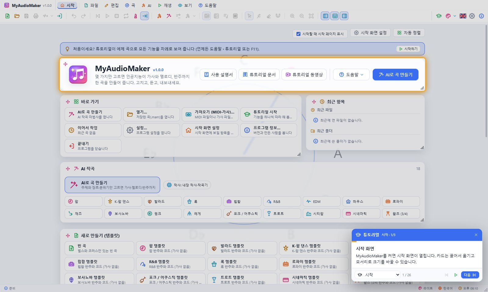
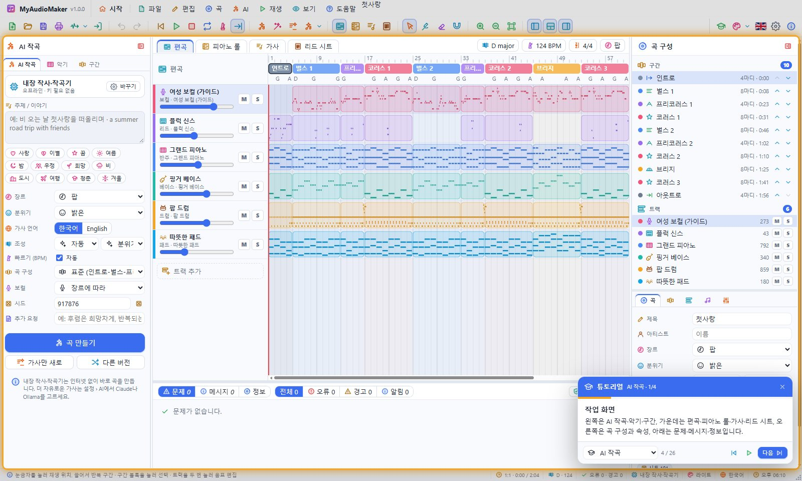
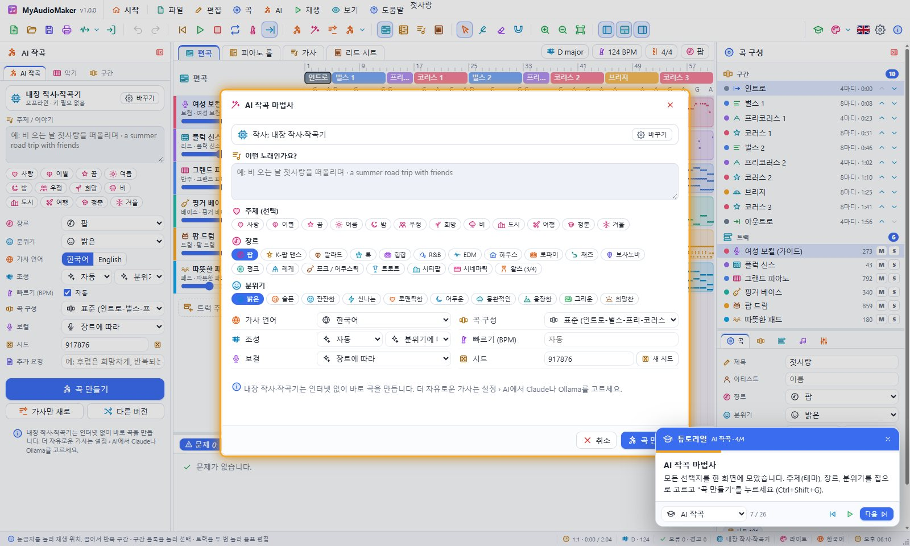
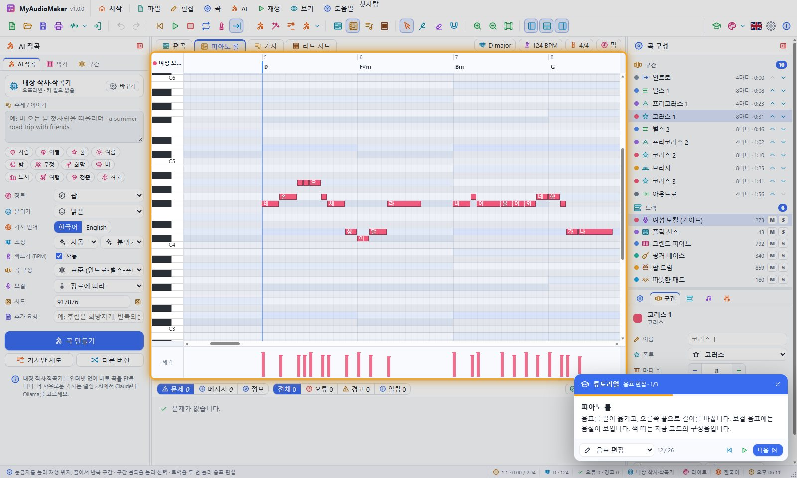
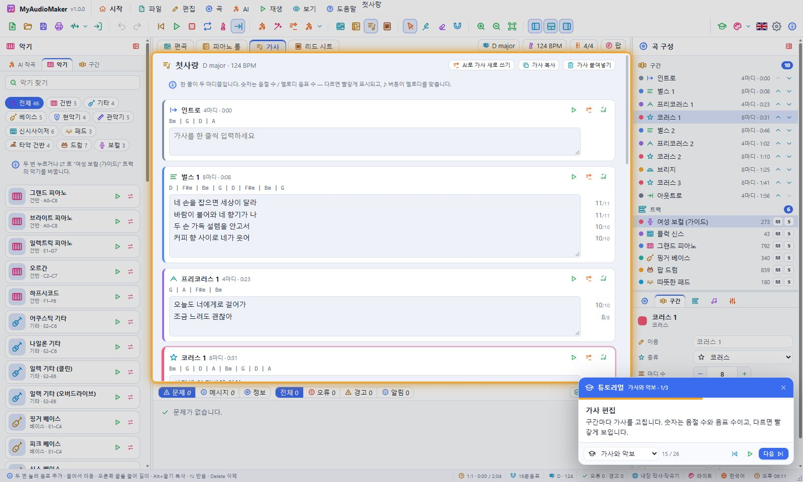
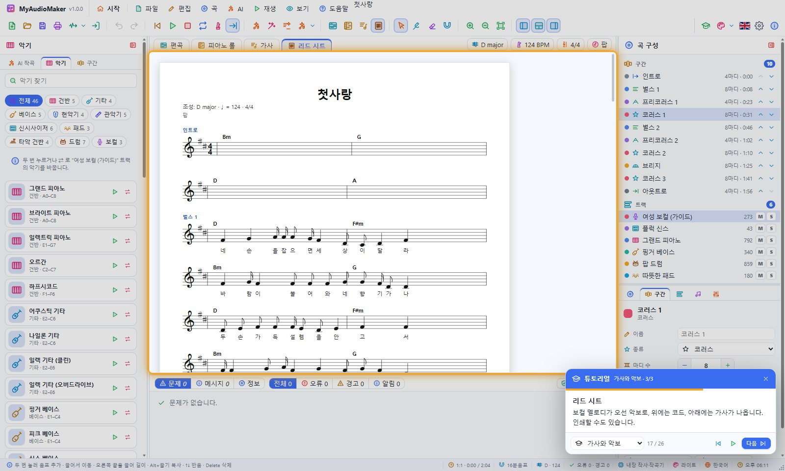

# MyAudioMaker

Windows · macOS · Linux · 웹에서 쓰는 **AI 작곡 프로그램**입니다. 주제·장르·분위기만 고르면 AI가 **가사, 멜로디, 코드, 반주, 베이스, 드럼**까지 한 곡을 만들어 줍니다. 편곡 화면·피아노 롤·가사 편집기·리드 시트에서 고치고, 내장 신시사이저와 가이드 보컬로 듣고, WAV·스템·MIDI·LRC로 내보내고, 악보와 가사를 인쇄합니다. vanilla JavaScript(Vite) 화면과 Tauri 2(Rust) 데스크톱 셸로 만들었고, 창·설정·사용 설명서·인쇄의 모양은 MySketchBook과 같습니다.


- 버전: 1.0.0
- 사용법: [doc/UsersGuide.md](doc/UsersGuide.md) (English: [doc/UsersGuide.en.md](doc/UsersGuide.en.md)) — 앱 안에서는 **도움말 › 사용 설명서**
- 튜토리얼 문서: [doc/Tutorial.html](doc/Tutorial.html) (English: [doc/Tutorial.en.html](doc/Tutorial.en.html)) — 앱 안에서는 **도움말 › 튜토리얼 문서**
- 구조(개발자용): [ARCHITECTURE.md](ARCHITECTURE.md)

## 화면

| | |
|---|---|
|  |  |
| 시작 화면 — AI 작곡·장르·템플릿·예제 곡·최근 파일 | 작업 화면 — AI 작곡 패널 · 편곡 · 곡 개요 · 속성 |
|  |  |
| AI 작곡 마법사 — 주제·장르·분위기·조·빠르기·형식·보컬 | 피아노 롤 — 그리기·지우기·벨로시티·코드 음 표시 |
|  |  |
| 가사 화면 — 구간별 가사, 음절 수/음표 수 | 리드 시트 — 멜로디·코드·가사 악보 |

그림은 튜토리얼을 웹 버전에서 실행하며 찍은 것입니다 (`npm run tutorial:docs`).

## 주요 기능

### AI 작곡과 작사

- **한 번에 한 곡** — 주제(예: "비 오는 날 첫사랑을 떠올리며"), 장르 18종, 분위기 10종, 가사 언어(한국어·영어), 조, 빠르기, 곡 형식 8종, 보컬(여성·남성·합창·없음), 씨앗 값. 같은 씨앗과 설정이면 같은 곡이 나옵니다.
- **가사를 쓰는 AI 세 가지** (설정 › AI)
  - **내장 작사기** — 인터넷도 키도 필요 없습니다. 12개 주제의 한국어·영어 표현 묶음에서 줄을 고르고, 운이 맞는 줄을 짝지우고, 후렴은 훅을 되풀이합니다. 한국어 조사(은/는, 과/와 …)는 받침에 맞춥니다.
  - **Claude (Anthropic)** — 사용자 본인의 **API 키**로 Claude가 제목·구간 구성·가사·마디별 코드를 씁니다 (기본 모델 claude-opus-5-5, claude-sonnet-5-5 · claude-haiku-5-5 선택 가능). 답은 JSON 스키마로 받고, 모르는 구간 종류·읽을 수 없는 코드·너무 긴 구간은 고쳐서 씁니다. 키는 이 컴퓨터에만 보관되고 Anthropic으로만 보내집니다. 사용료는 사용자 계정에 청구됩니다.
  - **Ollama (이 컴퓨터)** — 로컬 모델(예: llama3.1, 한국어는 qwen2.5)로 인터넷 없이.
- 멜로디·반주·베이스·드럼은 항상 이 컴퓨터의 작곡기가 AI의 계획에 맞춰 씁니다: 가사 음절 하나에 음표 하나, 강박의 긴 음은 코드 음, 줄마다 윤곽(아치·하강 …), 후렴은 더 높게, 장르별 반주 패턴(발라드 아르페지오, 록 파워 코드, 레게 스캥크, 보사노바, 왈츠 …), 구간 끝 필인과 크래시.
- **가사 새로 쓰기**(`Ctrl+L`), **다른 버전**, 구간별 **다시 만들기**(전체·코드·멜로디·리드·반주·베이스·드럼).

### 편집

- **편곡** — 구간 블록·코드·트랙을 한눈에, 눈금자를 끌어 반복 구간, 트랙별 M/S·볼륨, 구간 추가·복제·삭제·순서 바꾸기, 곡 형식 바꾸기, 코드 직접 입력(`C G | Am | % | F G`).
- **피아노 롤** — 선택·그리기·지우개, 격자(4분~32분·셋잇단), 복사·붙여넣기·퀀타이즈, 반음·옥타브 이동, 벨로시티 레인, 다른 트랙 고스트, 코드 음 띠, 드럼 이름 행.
- **가사** — 구간 카드마다 가사와 음절 수/음표 수(다르면 빨강), 고친 가사에 멜로디 자동 맞춤, 전체 복사·붙여넣기(`[Verse 1]` 머리말).
- **리드 시트** — 높은음자리표 오선에 멜로디·코드·가사, 조표·임시표, 구간 이름.
- **악기 44종**(10분류)과 드럼 키트 7종, 곡 정보(조·빠르기·박자·스윙), 조옮김, 문제 검사(음역·음절 불일치·읽을 수 없는 코드 …).

### 듣기와 내보내기

- **내장 신시사이저** — 발진기·필터·엔벨로프로 모든 악기, 잡음과 스윕 사인으로 드럼. 소리 파일이 필요 없습니다.
- **가이드 보컬** — 포먼트 합성으로 음절의 모음을 노래합니다(여성·남성·합창). 실제 사람 목소리가 아니라 멜로디 확인용입니다.
- 반복·메트로놈·따라가기, 믹스(마스터·리버브·컴프레서·레벨 미터).
- **내보내기** — WAV(44.1/48 kHz, 16/24/32비트 float, 정규화), 트랙별 스템, MIDI(타입 1, 구간 마커, 가사 이벤트), 가사 TXT, 시간 가사 LRC, 코드 차트, 곡 JSON.
- **가져오기** — MIDI(`.mid`·`.midi`·`.kar`, 가사 이벤트가 있는 트랙은 보컬로), 가사(`.txt`·`.lrc`).
- **인쇄** — 리드 시트·가사(1·2단)·코드 차트·편곡표·곡 요약, 용지·방향·여백, 표제란과 테두리, PDF로 저장.

### 프로그램

- 시작 화면 카드(이동·크기 조절), 템플릿 15종, **예제 곡 24곡**(8묶음), 움직이는 배경 20종, 첫 실행 환영 창.
- 튜토리얼 8개 장 26단계(실제 화면에서 진행, 자동 재생), 사용 설명서·튜토리얼 문서 창(목차·찾기·언어 전환·인쇄).
- 설정 10개 탭, 밝은·어두운·사용자 테마, 한국어·영어, 실행 취소 100단계, `.mam` 파일 연결, 여러 개 동시 실행.

## 요구 사항

- Node.js 22 이상, npm
- 데스크톱 실행/빌드: Rust(stable)와 [Tauri 2 준비물](https://tauri.app/start/prerequisites/) — Windows는 WebView2와 MSVC 빌드 도구, macOS는 Xcode 명령줄 도구, Linux는 `libwebkit2gtk-4.1`·`libgtk-3` 개발 패키지
- 웹 버전: 최신 Edge · Chrome · Firefox · Safari (Web Audio)
- Claude를 쓰려면 Anthropic API 키 ([console.anthropic.com](https://console.anthropic.com)), Ollama를 쓰려면 [Ollama](https://ollama.com) 설치

## 실행 방법

```bash
npm install          # 의존성 설치
npm start            # 데스크톱 앱 (개발 모드, 수정이 바로 반영됨)
npm run dev          # 웹 버전 (Vite, http://127.0.0.1:5494)
npm test             # 모든 테스트
```

- `npm start`는 5494 포트를 다른 프로그램이 쓰고 있으면 127.0.0.1과 ::1 모두에서 비어 있는 다음 포트를 골라 Vite와 `tauri dev`를 띄웁니다.
- `npm run dev`는 고정 포트 5494를 씁니다(`vite.config.js`).
- 웹 버전에서 Ollama를 쓰려면 Ollama가 웹 주소를 허용하도록 `OLLAMA_ORIGINS`를 설정해야 할 수 있습니다.

### 테스트

| 명령 | 내용 |
|---|---|
| `npm test` | js · package · rust · web · tutorial 범주를 실행하고 요약 표를 보여 줍니다 (`test-results/results.json`) |
| `npm test -- --desktop` | 위 + 데스크톱 E2E (디버그 exe + WebView2 CDP, Windows) |
| `npm test -- --installer` | 위 + 설치 프로그램 검사 (`npm run build:win`을 실행) |
| `npm run test:quick` | 창·브라우저 없이 빠른 범주만 |
| `npm run test:unit` | JS 단위 테스트 (음악 이론·작곡기·가사·입출력·배경) |
| `npm run test:web` | 헤드리스 Edge로 웹 앱 E2E |
| `node --test test/static/docs.test.js` | 문서 검사 (두 설명서의 장 구성, 단축키 표, 링크, 튜토리얼 단계 수) |

`MYAUDIOMAKER_E2E_ONLY=<정규식>`으로 이름이 맞는 E2E 사례만 돌립니다.

### 빌드

| 명령 | 결과 |
|---|---|
| `npm run build:win` | Windows 설치 파일 `MyAudioMaker-Setup-1.0.0.exe` (NSIS, 한국어/영어, 현재 사용자 설치) |
| `npm run build:mac` | macOS `.dmg` (macOS에서) |
| `npm run build:linux` | Linux `.deb` · `.rpm` · `.AppImage` (Linux에서) |
| `npm run build:all` | 지금 OS에서 만들 수 있는 설치 파일 모두 |
| `npm run build:web` | 웹 버전 `dist/` — 아무 정적 웹 서버로 올립니다. 확인: `npm run preview` |
| `npm run build:docs` | 사용 설명서·튜토리얼 HTML (`doc/`, `public/doc/`) |
| `npm run tutorial:docs` | 튜토리얼 각 단계 화면 캡처(한국어·영어) 후 문서 다시 만들기 |
| `npm run tutorial:video` | 튜토리얼 자동 재생 녹화 영상 (ffmpeg 필요) |
| `npm run samples` | 예제 곡 `samples/*.mam` 다시 만들기 |
| `npm run build:icons` | 아이콘(앱·.mam 파일) 다시 만들기 |
| `npm run notices` | 제3자 라이선스 `licenses/` 다시 만들기 |
| `npm run clean` | 빌드 결과 지우기 (`dist/`, `src-tauri/target/`, `release/`, `test-results/` …). 미리 보기: `npm run clean -- --dry-run` |

Tauri는 교차 빌드를 하지 않으므로 각 OS의 설치 파일은 그 OS에서 만듭니다. 만든 설치 파일은 `release/`와 프로젝트 루트에 복사됩니다. 설치 파일에는 문서(`doc/`), 예제(`samples/`), 라이선스(`licenses/`)가 리소스로 들어갑니다.

## 폴더 구성

```
MyAudioMakerMultiOSV10/
├─ index.html            앱 페이지 (주 창 · 팝업 창 · 문서 창이 모두 이 페이지)
├─ src/
│  ├─ main.js            진입점: 주 창 / 팝업 / 문서 보기 창 고르기
│  ├─ app.js             주 창: 명령·메뉴·툴바·단축키, 화면 4개, AI 작곡, 재생, 파일, 내보내기, 인쇄
│  ├─ popup.js           팝업 창(메뉴·설정·확인·진행률·정보 …), popups-music.js: 작곡 마법사·오디오 내보내기·AI 설정
│  ├─ viewer.js          사용 설명서·튜토리얼 문서·동영상 창
│  ├─ music/             음악 이론, 악기, 장르·분위기, 음절, 가사 은행·작사기, 작곡기, AI(Claude·Ollama), 검사, 예제, 리드 시트
│  ├─ audio/             신시사이저 음색, 가이드 보컬(포먼트), 재생기·믹서·오프라인 렌더링
│  ├─ io/                WAV 인코더, MIDI 읽기/쓰기, .mam(ZIP) · 가사 · 코드 차트
│  ├─ ui/                편곡 화면, 피아노 롤, 패널 HTML, 시작 화면, 배경 애니메이션, 튜토리얼
│  ├─ print/             인쇄 창, 용지 배치, 인쇄 장(리드 시트·가사·코드·편곡·요약), PDF
│  ├─ domain/            설정(AI 키는 따로 보관), 최근 파일, 도움말 문서 정보
│  ├─ platform/          데스크톱(Tauri)/웹 차이: 파일 대화상자, 팝업 창
│  └─ i18n/              한국어·영어 문자열 (music.js가 음악 화면 문구)
├─ src-tauri/            Rust: 파일 입출력, 팝업·문서 창, 인쇄, 글꼴, 창 위치, 여러 실행, 설치 훅(windows/hooks.nsh)
├─ samples/              예제 곡 .mam 24개
├─ licenses/             제3자 라이선스 (THIRD-PARTY-NOTICES.txt)
├─ doc/                  사용 설명서(UsersGuide.md · UsersGuide.en.md), 생성된 HTML 문서, tutorial/images/
├─ public/               웹 빌드에 그대로 들어가는 파일 (public/doc/ = doc/ 복사본)
├─ scripts/              start · build · build-docs · tutorial-capture · make-samples · render-icons · make-notices · test
├─ test/                 unit/ · static/ · e2e/ (웹·데스크톱) · installer/
└─ assets/               앱·파일 아이콘 원본
```

## 라이선스와 출처

- 프로그램: © SHKWON (knix008@naver.com).
- 모든 소리는 프로그램이 합성하며 녹음된 샘플을 쓰지 않습니다. 예제 곡의 가사와 곡은 프로그램이 만든 것입니다.
- 사용한 오픈 소스: @anthropic-ai/sdk (MIT), fflate (MIT), Tauri (MIT/Apache-2.0) — 원문은 [licenses/](licenses/) 에 있습니다.
- Claude API 사용은 [Anthropic 이용 약관](https://www.anthropic.com/legal)을 따릅니다. AI가 만든 가사와 곡의 이용 책임은 사용자에게 있습니다.
