# MyAudioMaker User's Guide

MyAudioMaker is a songwriting program: pick a few things and the AI writes a whole song — **lyrics, melody, chords, accompaniment, bass and drums**. Edit the song in the arrangement, the piano roll, the lyrics editor and the lead sheet, listen with the built-in synthesizer and guide voice, export WAV, stems, MIDI and LRC, and print. The Windows, macOS and Linux desktop apps and the web version share the same screens.

This guide uses the names shown on screen. Menu paths are written like **File › Export › Export MIDI…**. `Ctrl` in shortcuts is `⌘` on macOS. If you are new, follow the [tutorial](Tutorial.en.html) (F11) first: 8 chapters and 26 steps show every feature in turn.

## 1. Getting started

### 1.1 Installing and running

- **Windows** — run `MyAudioMaker-Setup-<version>.exe`. The installer language (Korean/English) is also the program's first language. It installs for the current user, so no administrator rights are needed. An earlier installation is removed first, and you are asked whether to delete its user data (settings, recent files, AI settings and API key …).
- **macOS** — open the `.dmg` and drag MyAudioMaker to Applications.
- **Linux** — `.deb` (Debian/Ubuntu), `.rpm` (Fedora …) or `.AppImage`.
- **Web** — open the address where the web build (`dist/`) is served in Edge, Chrome, Firefox or Safari. Browsers play sound only after a first click on the page.

The installer registers `.mam` files, so a double-click in Explorer or Finder opens them. The 24 sample songs are also in the installation's `samples/` folder.

### 1.2 The start page

MyAudioMaker opens on the **start page**. The **Start** button at the left of the menu bar (or `Ctrl+Shift+H`) opens and closes it at any time; the open song stays.

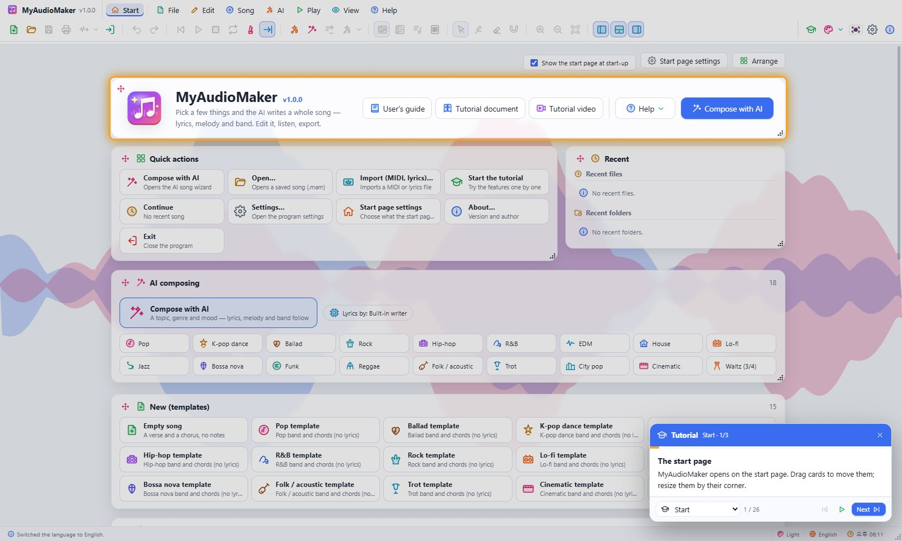

| Card | Contents |
|---|---|
| Top (title) | **User's guide** · **Tutorial document** · **Tutorial video**, the **Help** menu, **Compose with AI** |
| **Launcher** | Compose with AI · Open… · Import (MIDI, lyrics)… · Start tutorial · Continue · Settings… · Start page settings · About… · Exit |
| **Recent** | Recent songs and folders. Click to open, ✕ to remove from the list, **Clear all** |
| **AI composing** | **Compose with AI** and the AI that writes lyrics now; 18 genres (a click opens the AI wizard with that genre) |
| **New (templates)** | An empty song and 14 genre templates — band and chords, no lyrics or vocal |
| **Sample songs** | 24 finished songs (Pop · K-pop, ballads, hip-hop · R&B, electronic, rock · folk, jazz · bossa · city pop, trot · waltz · cinematic, English lyrics) |
| **Moving background** | 20 music-themed animations, Shuffle background, Background image…, speed, card opacity, random at start, automatic change |

- Move a card by its handle (✥) at the top left; resize it from its bottom-right corner (a double-click on the corner fits the content). **Arrange** puts the cards back.
- With **Show the start page at start-up** off, the program starts straight on the **Pop template**.
- On the first start the **welcome window** offers: start the tutorial, open a sample, later. **Help › Welcome** opens it again.

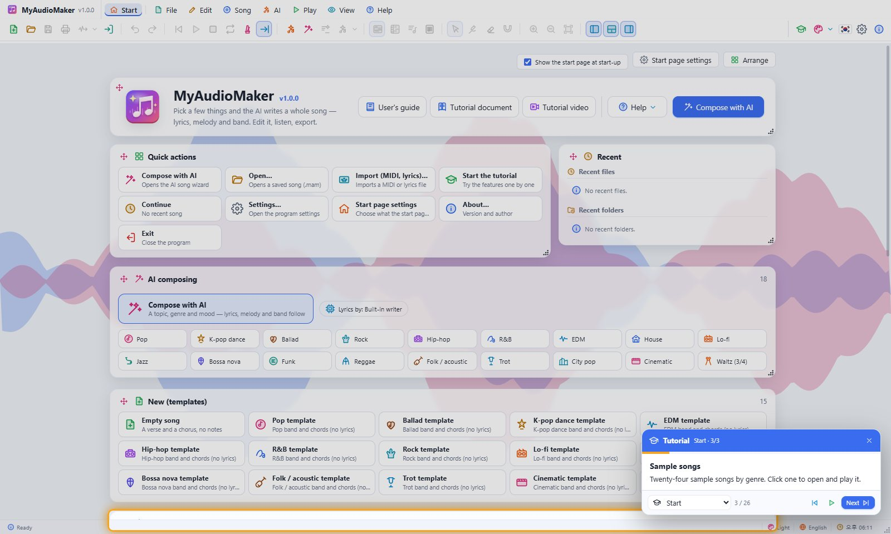

### 1.3 The workspace

Opening a song shows the workspace.

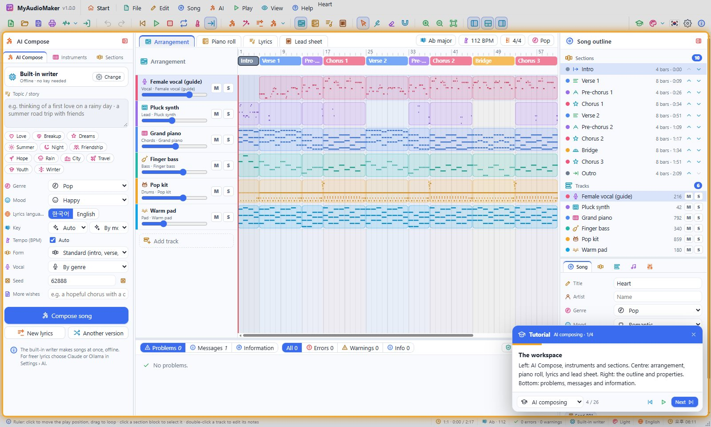

| Area | Contents |
|---|---|
| Menu bar | Start · File · Edit · Song · AI · Play · View · Help, the open song's name (● when unsaved) |
| Toolbar | files · undo · transport · AI · views · editing tools · zoom · panels; on the right tutorial · theme · language · settings · about |
| View tabs | **Arrangement · Piano roll · Lyrics · Lead sheet**; on the right key · tempo · time signature · genre |
| Left panel | **AI Compose · Instruments · Sections** |
| Right panel | top: **Song outline** (sections and tracks) · bottom: **Song · Section · Track · Notes · Mix** tabs |
| Bottom panel | **Problems · Messages · Information** |
| Status bar | notices, play position (bar:beat · time / total), snap, key and tempo, problem count, lyrics AI, theme, language, clock |

Collapse and expand panels with their header buttons, **View › Show**, `Ctrl+Shift+1` (left) · `Ctrl+Shift+2` (right) · `Ctrl+J` (bottom), and drag their edges to resize them. In a narrow window the last toolbar groups move into the **»** menu.

## 2. Composing with AI

### 2.1 The AI Compose panel

The **AI Compose** tab of the left panel makes songs.

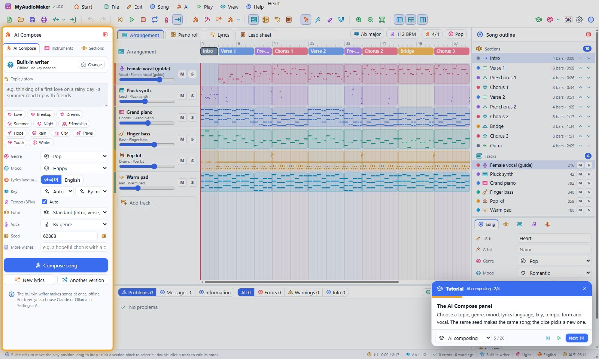

| Item | Meaning |
|---|---|
| Lyrics AI | The AI that writes lyrics and plans now. **Change** opens Settings › AI (2.3) |
| Topic / story | What the song is about, e.g. "thinking of a first love on a rainy day", "a summer road trip with friends" |
| Theme chips | Love · Breakup · Dreams · Summer · Night · Friendship · Hope · Rain · City · Travel · Youth · Winter (none: found from the topic) |
| Genre | 18 genres (2.4) |
| Mood | Happy · Sad · Calm · Energetic · Romantic · Dark · Dreamy · Epic · Nostalgic · Hopeful |
| Lyrics language | 한국어 / English |
| Key | Auto, or a tonic (C–B) and major · minor · dorian · mixolydian. **By mood** is minor for sad, dark and epic moods |
| Tempo (BPM) | Auto (from genre and mood) or your own |
| Form | Standard · Short · Simple · Ballad · K-pop · EDM · AABA · Loop (instrumental) |
| Vocal | By genre · female · male · choir · none (instrumental) |
| Seed | The same seed and settings make the same song; 🎲 picks a new one |
| More wishes | Sent to Claude or Ollama with the request (e.g. "a hopeful chorus with a catchy hook") |

- **Compose song** (`Ctrl+G`) makes and opens a new song; unsaved changes to the open song are asked about first.
- **New lyrics** (`Ctrl+L`) rewrites the sung sections of the open song and sets the new words to the melody; chords and band stay.
- **Another version** keeps the genre, form, key and tempo and changes only the seed.

A composed song is made of:

- **Sections** — intro, verse, pre-chorus, chorus, bridge, interlude, build-up, drop, outro. Later choruses repeat the first chorus's words and tune.
- **Chords** — the genre's progressions (sevenths for jazz, R&B and lo-fi), a dominant before a chorus for lift, and the tonic at the end.
- **The vocal melody** — one note per lyric syllable; long strong-beat notes on chord tones, a contour per line (arch, fall …), choruses higher, and lines with the same syllable count repeat their rhythm.
- **Lead** — a hook built from the chorus tune where nobody sings (intro, interlude, drop, outro), short answers at line ends where they do.
- **Accompaniment** — in the genre's style (pop blocks and eighths, ballad arpeggios, rock power chords, reggae skank, bossa nova, waltz …) with voice leading.
- **Bass** — root eighths, root–fifth, walking, 808 sub, funk, reggae, bossa nova …
- **Drums** — grooves per section, fills before the next section, crashes on new sections, lighter intros.
- **Pads and arpeggios** — under the high-energy sections.

### 2.2 The AI song wizard

Open it from **AI › AI song wizard…** (`Ctrl+Shift+G`), the toolbar's wand, the start page's **Compose with AI** or a genre tile. Every choice is on one page as chips; press **Compose song**.

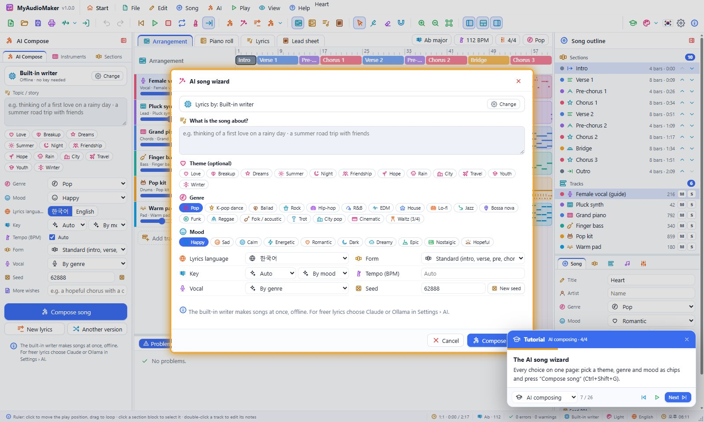

### 2.3 Choosing the lyrics AI (built-in · Claude · Ollama)

**Settings › AI** chooses the AI that writes lyrics and plans.

| AI | Meaning |
|---|---|
| **Built-in writer** | The lyric writer and composer inside the program. Always works, without internet or a key. Lines come from phrase banks (12 themes in Korean and English), rhyming pairs preferred, and the chorus repeats its hook. |
| **Claude (Anthropic)** | Claude writes the title, lyrics and chords per section. Needs **your own API key** from the Anthropic Console (console.anthropic.com); usage is billed to your account. Models: claude-opus-5-5 (default, best) · claude-sonnet-5-5 · claude-haiku-5-5 (fast and cheap). |
| **Ollama (this computer)** | A model served by Ollama on this computer (e.g. llama3.1; for Korean a multilingual model such as qwen2.5). No internet needed. Default address `http://localhost:11434`. |

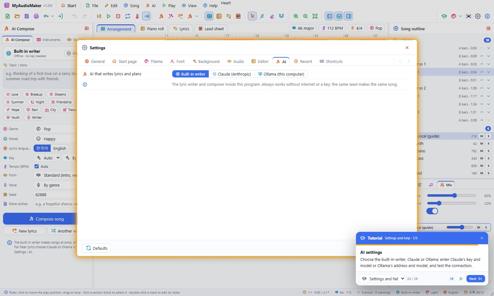

- The AI writes the **title, the section list, the lyrics line by line and the chords bar by bar**. The melody, accompaniment, bass and drums always come from the composer on this computer, following that plan.
- Answers come in a fixed format (a JSON schema); unknown section types, unreadable chords and over-long sections are repaired.
- With Claude chosen but no key, the built-in writer is used.
- **Connection test** sends Claude a short request, or asks Ollama for its models, and shows the result.
- **Your key and privacy**: the API key is kept on this computer (the program's storage) and sent only to Anthropic. A settings reset or a new installation keeps it; it is deleted when you answer **Yes** to the installer's user-data question. A request contains your topic, genre, mood, lyrics language, form and wishes.
- To use Ollama from the web build, Ollama may need `OLLAMA_ORIGINS` set to allow the web address.

### 2.4 Genres and moods

| Genre | Tempo | Character |
|---|---|---|
| Pop | 96–124 | I–V–vi–IV family, piano, finger bass, pluck synth |
| K-pop dance | 112–128 | syncopated bass, supersaw stabs, arpeggio, build-ups |
| Ballad | 64–80 | piano arpeggios, strings, slow drums |
| Rock | 110–150 | power chords, overdrive guitar, eighth-note bass |
| Hip-hop | 82–96 | 808 sub bass and drums, electric piano, swing |
| R&B | 70–96 | seventh chords, comping, syncopation |
| EDM | 124–130 | build-ups and drops, off-beat bass, supersaw |
| House | 118–126 | four-on-the-floor, off-beat organ and bass |
| Lo-fi | 70–88 | sevenths, upright bass, vibraphone, swing |
| Jazz | 100–150 | ii–V–I, walking bass, brushes, strong swing |
| Bossa nova | 116–140 | nylon guitar rhythm, flute |
| Funk | 96–116 | sixteenth-note bass, brass stabs |
| Reggae | 70–90 | one drop, skank, organ |
| Folk / acoustic | 84–112 | strummed guitar, root–fifth bass |
| Trot | 120–138 | "kung-jjak" rhythm, saxophone |
| City pop | 100–118 | major sevenths, electric piano, brass |
| Cinematic | 70–100 | strings and choir pads, timpani-like toms |
| Waltz (3/4) | 84–132 | three beats, bass on one, chords on two and three |

The mood sets major or minor, the tempo (about ±15 %), and the melody's range and density.

## 3. The arrangement

The **Arrangement** tab (`1`) shows the whole song at a glance.

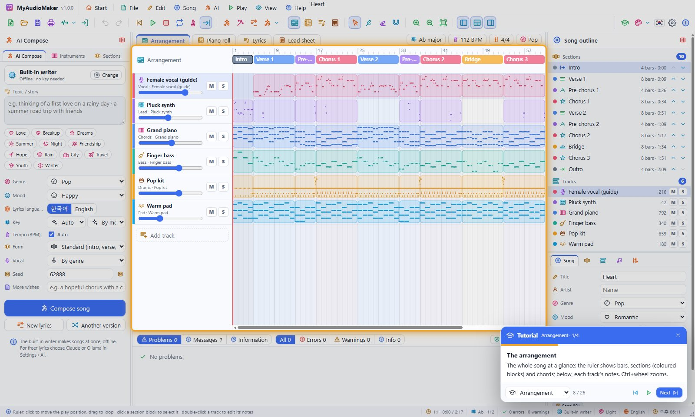

- **Ruler** — on top the bar numbers and the loop region, in the middle the **section blocks** (coloured by type), below them the chords.
  - Click the ruler to move the play position; **drag it to set a loop**.
  - Click a section block to select it; double-click to open it in the Lyrics view. Right-click for the section menu.
- **Tracks** — the header on the left shows name, role and instrument, **M** (mute), **S** (solo) and a volume slider; on the right each section's notes in miniature. Double-click a track to open the piano roll there.
- Zoom: `Ctrl+wheel`, **View › Zoom in / Zoom out / Zoom to fit** (`Ctrl+=` · `Ctrl+-` · `Ctrl+0`). `Shift+wheel` scrolls sideways.

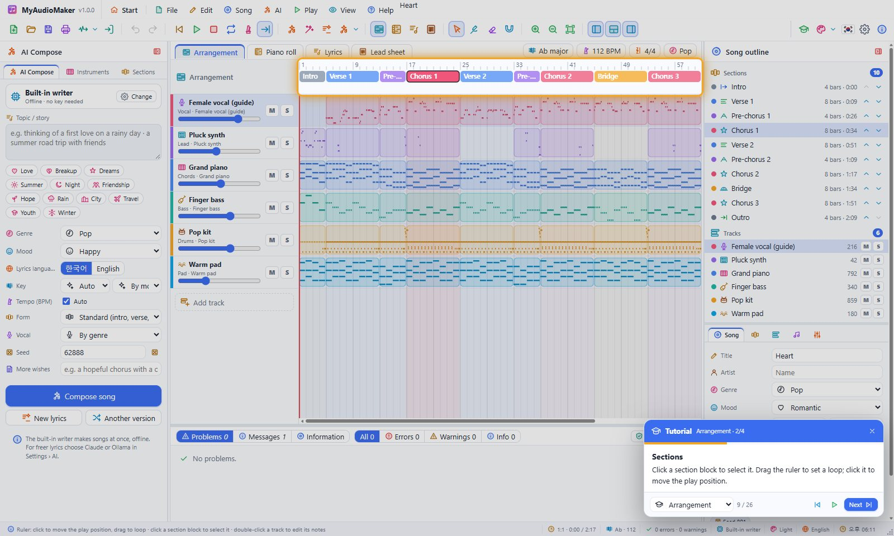

### 3.1 Editing sections

- **Add section** — click a card in the **Sections** tab of the left panel to insert it after the selected section. Its chords come from the genre and its band is written at once. **Song › Add section** does the same.
- **Change the form** — the form list under the Sections tab rebuilds the song in that form (instruments and mix stay).
- **Duplicate · delete · earlier · later** — the **Song** menu, a section's right-click menu, ▲▼ in the outline. To be asked before deleting: Settings › General › **Ask before deleting a section or track**.
- **Section tab** (bottom right) — name, type, bars (more bars repeat the chords into them and write their band), energy, **chords**, the section it repeats.

### 3.2 Regenerate

**Regenerate** in the Section tab or **AI › Regenerate** writes one part of the selected section again; other sections stay.

| Part | What it does |
|---|---|
| Everything | chords and every part (`Ctrl+Shift+R`) |
| Chords | another of the genre's progressions |
| Melody | a new tune for the same words (repeated choruses follow) |
| Lead / hook | new hook and answers |
| Accompaniment · bass · drums | that part |

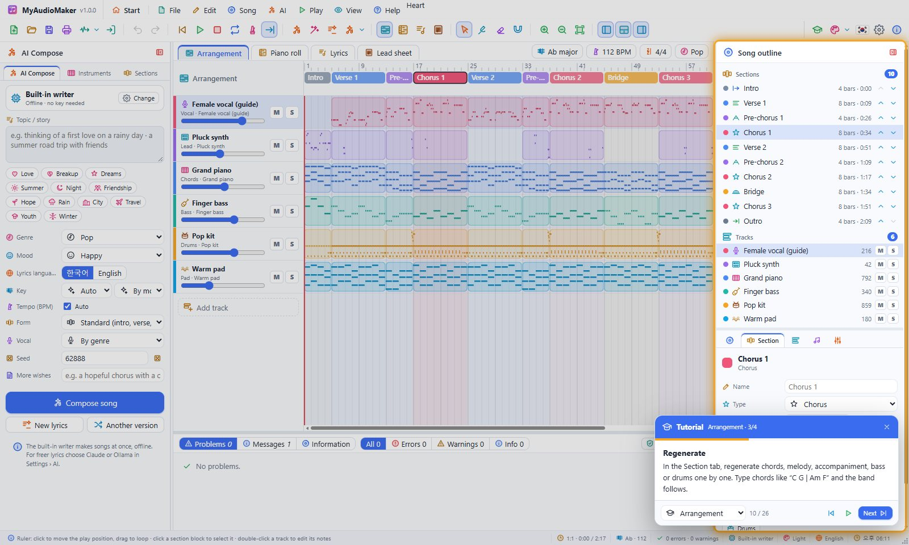

### 3.3 Typing chords

Type into the Section tab's **Chords** field with bars split by `|`, e.g. `C G | Am | % | F G` (`%` repeats the bar before). Enter rewrites the accompaniment, bass and pad for the new chords. Readable chords: `C`, `Am`, `F#m7`, `Bbmaj7`, `G7`, `Dsus4`, `Edim`, `Caug`, `Bm7b5`, `Cadd9`, `G/B`, `Dm9` … A line with an unreadable chord is refused with a notice.

### 3.4 Tracks and instruments

- **Add track** — **Add track** under the arrangement or **Song › Add track**, then choose an instrument.
- **Instruments** tab (left) — 44 instruments: keys 5, guitars 4, basses 5, strings 4, winds 5, synths 6, pads 3, mallets 4, drums 7, vocals 3. ▶ previews; a double-click or ⇄ puts it on the selected track.
- **Track tab** — name, role (the part Regenerate writes on it), instrument, volume, pan, reverb, colour, mute and solo.

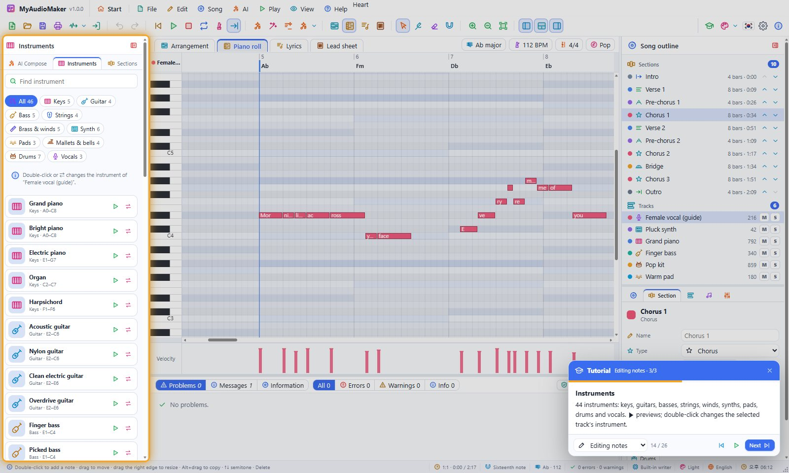

## 4. The piano roll

The **Piano roll** tab (`2`) edits the selected track's notes.

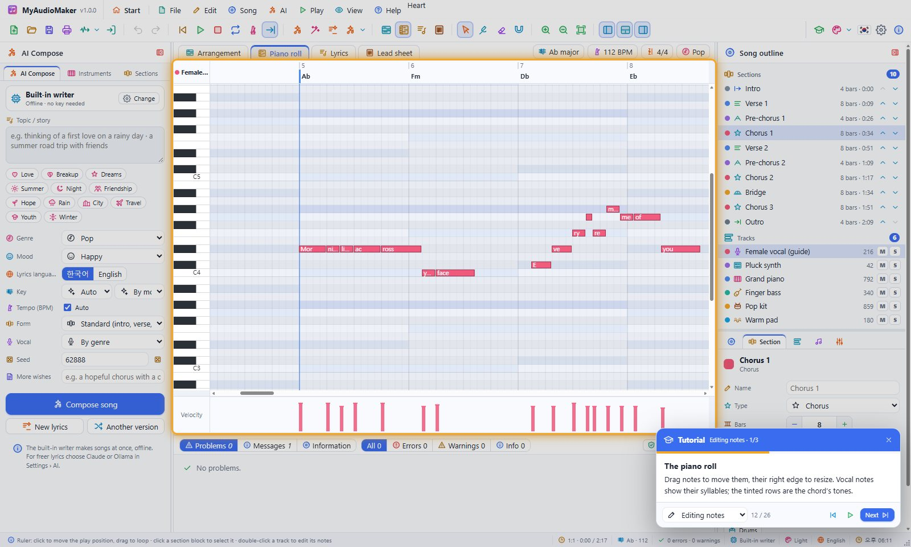

- Click a key on the left to hear it. Drum tracks show drum names (kick, snare, hi-hat …) instead of keys.
- The ruler shows bars and chords; coloured marks are section starts. Click it to move the play position.
- The key's notes are lighter rows; the sounding chord's tones are tinted bands (Settings › Editor › **Show chord tones**).
- Vocal notes show their syllables.
- **Ghost notes of other tracks** shows the other tracks faintly behind.
- Drag in the **Velocity** lane at the bottom to set note velocities (only the selected notes, when some are selected).

| Tool | Use |
|---|---|
| **Select** (`V`) | click, Shift+click or drag a box to select; drag to move (snapped); drag the right edge to resize; `Alt`+drag to copy; double-click empty space to add a note |
| **Draw** (`D`) | click for a note of the last length; drag to set its length |
| **Erase** (`E`) | click or drag across notes |

- **Snap** — quarter · eighth · sixteenth · thirty-second · eighth triplet · sixteenth triplet · off (toolbar, status bar, **Edit › Snap**).
- Selected notes: `↑` `↓` a semitone, `Shift+↑` `Shift+↓` an octave, `←` `→` by the grid, `Shift+←` `Shift+→` length, `Delete`, `Ctrl+D` duplicate, `Q` quantize, `Ctrl+C` · `Ctrl+X` · `Ctrl+V` (pastes at the play position).
- **Notes tab** (right) — pitch (e.g. `C4`, `F#5`), start and length in beats (a quarter note = 1 beat), velocity, syllable.
- Zoom: `Ctrl+wheel` (time), `Alt+wheel` (row height).

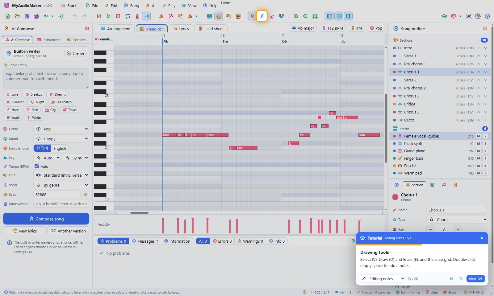

## 5. Lyrics and the lead sheet

### 5.1 The Lyrics view

The **Lyrics** tab (`3`) has one card per section.

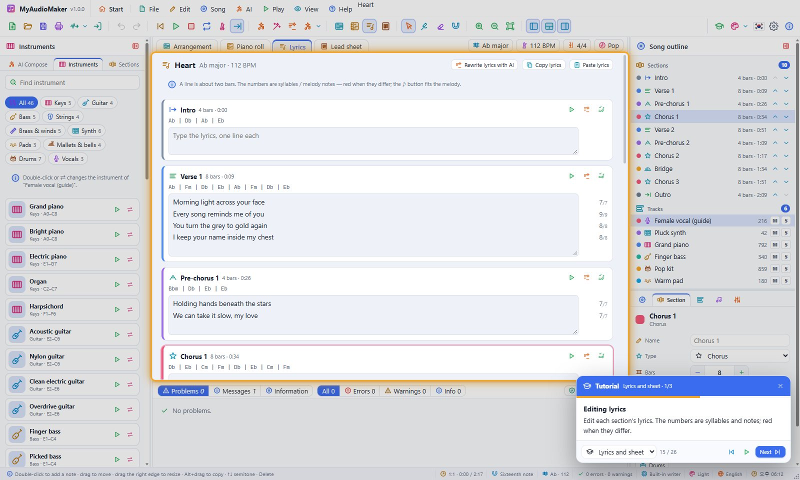

- A card shows the section's name, bars, start time and chords; on the right ▶ (play this section), AI (rewrite just this section) and ♪ (set lyrics to melody).
- A lyric line is about two bars. The numbers on the right are **syllables / melody notes**, red when they differ.
- Edited lyrics get a new melody that fits their syllables when you leave the field (Settings › Editor › **Set edited lyrics to the melody automatically**); sections that repeat this one (a second chorus) follow.
- **Copy lyrics / Paste lyrics** — copies all lyrics with headers such as `[Verse 1]`; pasting finds sections by those headers (without headers the sung sections are filled in order).
- **Syllables** — in Korean one character is one syllable; English words are split by vowel groups (morning → mor·ning). The guide voice sings each syllable's vowel (a · e · i · o · u).

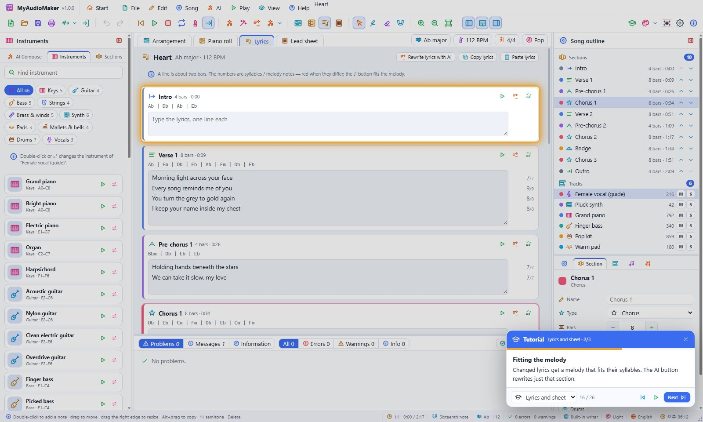

### 5.2 The lead sheet

The **Lead sheet** tab (`4`) shows the vocal melody (the lead when there is no vocal) on a treble staff, with chords above, lyrics below, section names at the start of their lines, and the key and time signature on the first line. Notes outside the key signature get ♯ · ♭ · ♮. Busy melodies take two bars a line, others four. Zoom with `Ctrl+=` · `Ctrl+-`.

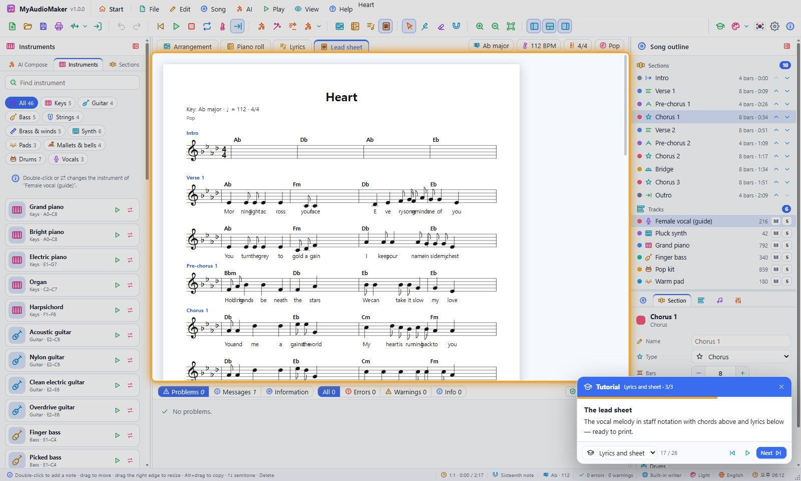

## 6. Listening and the mix

- **Play / pause** — `Space` or `F5`. **Stop** (`Enter`) goes back to the start. `Home` · `End` go to the start and end; `←` `→` move a bar.
- **Loop** (`L`) — repeats the loop region dragged on the ruler. **Loop selected section** makes the selected section the loop.
- **Metronome** (`M`), **Follow playhead** — the views follow the play position while playing.
- **Built-in synthesizer** — every instrument from oscillators, filters and envelopes; drums from noise and swept sines. No sound files needed.
- **Guide voice** — female, male, choir. Not a real voice: it sings the melody on the syllables' vowels as a guide (formant synthesis, vibrato, a short burst for consonants).
- **Mix tab** — master volume, reverb amount, compressor; each track's volume, mute and solo, and a level meter.
- **Swing** (Song tab) — plays off-beat eighths late (playback, WAV and MIDI).

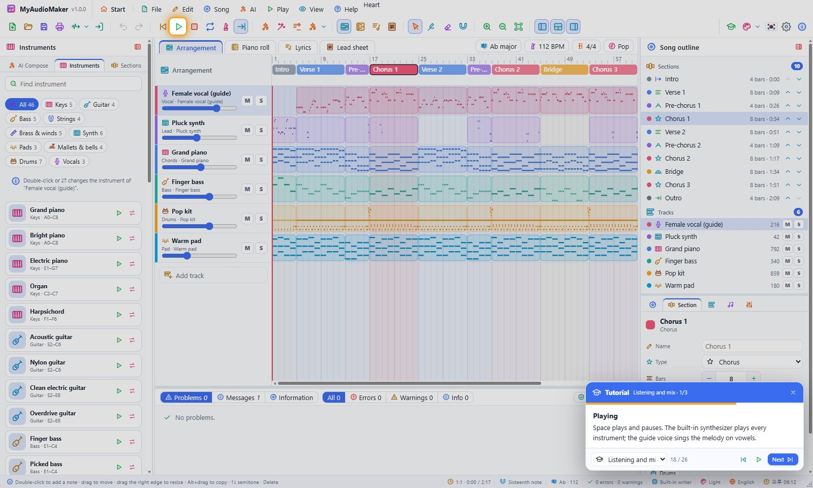

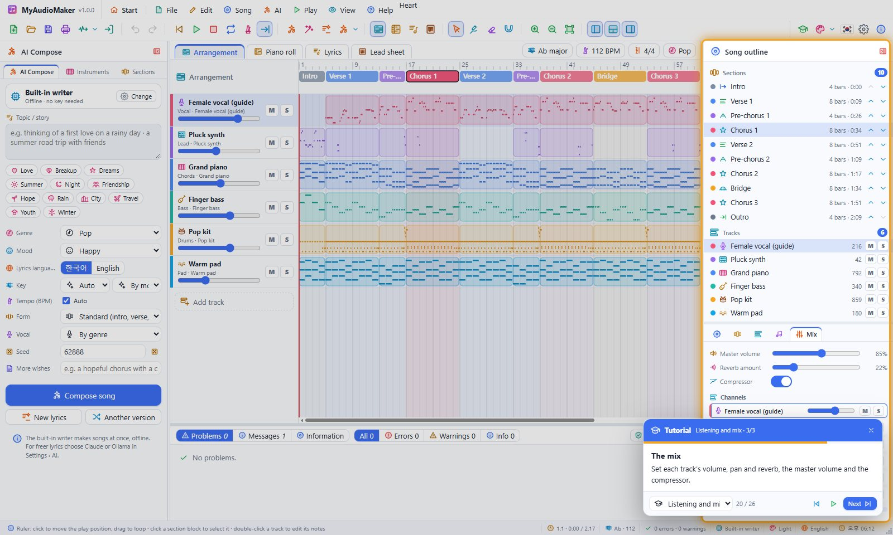

## 7. Song properties and transposing

The **Song** tab on the right sets title, artist, genre, mood, key, tempo, time signature, swing and lyrics language. The key, tempo and metre chips to the right of the view tabs open it.

- Changing the **key** moves the chords and every pitched note with it. Major ↔ minor only respells the chords.
- **Transpose song up / down** (`Ctrl+Shift+↑` / `Ctrl+Shift+↓`).
- Below: length, bars, tracks, notes and seed.

## 8. Files

### 8.1 Saving and opening

- **Save** (`Ctrl+S`) · **Save as** (`Ctrl+Shift+S`) — a `.mam` file (a ZIP holding `song.json`). The web build uses the browser's save window or a download.
- **Open** (`Ctrl+O`) — `.mam`, MIDI and lyrics files. **Recent** (`Ctrl+R`) and recent folders.
- Drag and drop — drop a `.mam`, `.mid`, `.txt` or `.lrc` file on the window.
- Settings › General › **Reopen the last song when starting**.

### 8.2 Importing

**File › Import (MIDI, lyrics)…** (`Ctrl+I`):

- **MIDI** (`.mid` · `.midi` · `.kar`) — tempo, time signature, track names, instruments (General MIDI programs) and notes. A track with lyric events becomes the vocal, its syllables on its notes. The song is split into eight-bar sections.
- **Lyrics** (`.txt` · `.lrc`) — become the open song's lyrics and are set to the melody. Headers such as `[Chorus]` pick sections; LRC time tags are removed.

### 8.3 Exporting

**File › Export** or the toolbar's export button:

| Format | Contents |
|---|---|
| **Export audio (WAV)** (`Ctrl+E`) | whole song · loop region · selected section, 44.1/48 kHz, 16/24-bit or 32-bit float, normalise to −1 dB, tail, which tracks |
| **Export stems (per track)** | one WAV per track (a folder on the desktop, a ZIP on the web) |
| **MIDI** (`Ctrl+Shift+E`) | type 1, tempo, metre and key signature, section markers, instruments per track, drums on channel 10, lyric events on the vocal track |
| **Lyrics (TXT)** | lyrics with section headers |
| **Timed lyrics (LRC)** | each line at its first note — for karaoke and music players |
| **Chord chart** | chords bar by bar per section with lyrics |
| **Song data (JSON)** | the whole song |

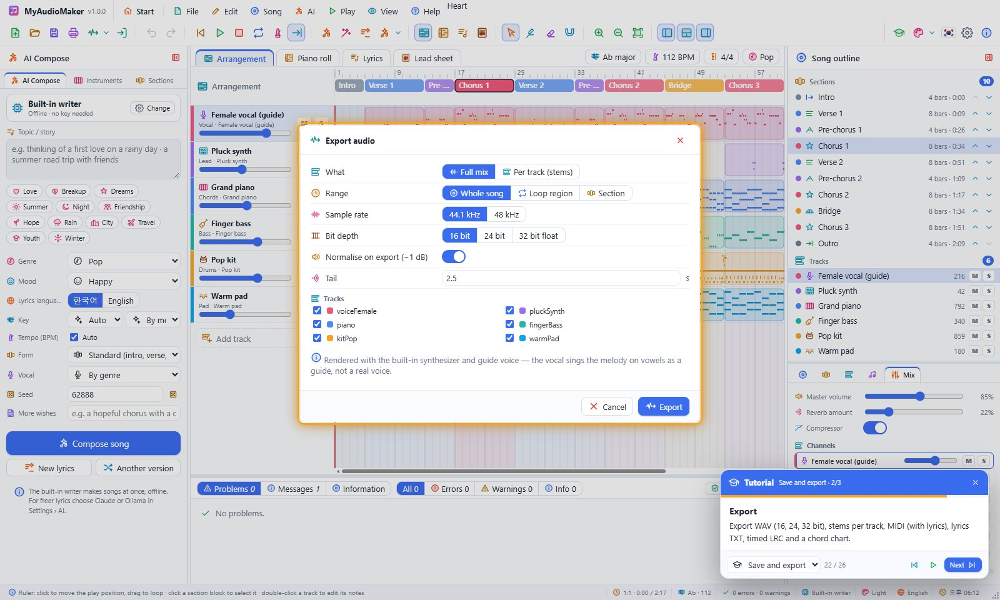

## 9. Printing

**File › Print…** (`Ctrl+P`) opens the print window: choices on the left, the preview on the right.

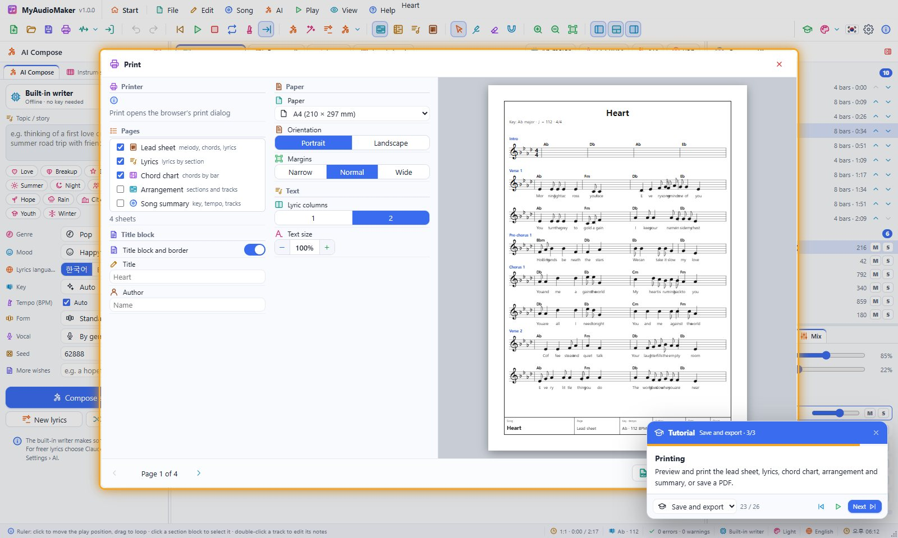

| Page | Contents |
|---|---|
| **Lead sheet** | melody, chords and lyrics (several sheets) |
| **Lyrics** | lyrics by section, one or two columns |
| **Chord chart** | chords in bar boxes per section |
| **Arrangement** | a timeline of sections and tracks, a section table (start, bars, chords) |
| **Song summary** | key, tempo, metre, genre, mood, length, tracks |

- Printer and copies (desktop), paper (A3–A5, B4, B5, Letter, Legal, Tabloid), orientation, margins, lyric columns, text size.
- **Title block and border** — song, page, key and tempo, author, date, sheet number; title and author can be changed.
- **Save as PDF** — the desktop makes a PDF of the same sheets; the web build makes a PDF of sheet pictures and downloads it.
- `PageUp` · `PageDown` turn the pages.

## 10. Problems, messages and information

The bottom panel checks the song as you work. Click an item to show its section or track.

| Check | Level |
|---|---|
| No tracks · every track muted | warning · error |
| Notes after the end · notes outside an instrument's range · doubled notes | warning |
| A wide vocal range (more than 19 semitones) | warning |
| Lines with more or fewer syllables than notes · very long lines · lyrics without a melody | warning |
| Unreadable chords | error |
| Sections without chords · sung sections without lyrics · empty tracks · a very slow or fast tempo · long notes a semitone against the chord · very loud tracks | info |

The **Messages** tab keeps notices and errors; **Information** shows the song, key, length, tracks, lyrics and the AI that made it.

## 11. Settings

**Settings…** (`Ctrl+,`):

| Tab | Contents |
|---|---|
| General | language, reopen the last song, ask before deleting a section or track, status bar clock, status bar, last folder, tutorial |
| Start page | start page and welcome window, recent files and folders, sample songs, moving background, tutorial banner |
| Theme | dark and light themes, system, a custom theme (your own colours) |
| Font | font, size, weight, italic, row height, zoom |
| Background | 20 moving backgrounds, an image or none, speed, random, automatic change, image opacity and fit |
| Audio | playback volume, metronome, follow playhead, hear notes when clicked, sample rate, bit depth and normalising (export defaults), sound check |
| Editor | snap, ghost notes, chord tones, set edited lyrics to the melody automatically, lyrics language, default vocal |
| AI | lyrics AI (built-in, Claude, Ollama), API key and model, Ollama address and model, connection test (2.3) |
| Recent | recent files and folders, clearing them |
| Shortcuts | every shortcut |

The toolbar's palette button switches light and dark (▼ opens the list), and the flag button switches the **language** (`Ctrl+Shift+L`).

## 12. Shortcuts

| Shortcut | Action |
|---|---|
| `Space` | Play / pause |
| `Enter` | Stop (back to start) |
| `Home / End` | To start / end |
| `← / →` | A bar back / forward |
| `L` | Loop |
| `M` | Metronome |
| `F5` | Play / pause |
| `1 / 2 / 3 / 4` | Arrangement / piano roll / lyrics / lead sheet |
| `V` | Select tool |
| `D` | Draw tool |
| `E` | Erase tool |
| `Q` | Quantize |
| `↑ / ↓` | Notes a semitone up / down |
| `Shift+↑ / ↓` | Notes an octave up / down |
| `← / → (notes selected)` | Move notes by the grid |
| `Shift+← / →` | Shorten / lengthen notes |
| `Alt+drag` | Copy notes |
| `Double-click empty space` | Add a note |
| `Ctrl+wheel` | Zoom in |
| `Alt+wheel` | Piano roll row height |
| `Ctrl+G` | Compose with AI |
| `Ctrl+Shift+G` | AI song wizard |
| `Ctrl+L` | Rewrite lyrics with AI |
| `Ctrl+Shift+R` | Everything |
| `Ctrl+M` | Set lyrics to melody |
| `Ctrl+N` | New song |
| `Ctrl+O` | Open |
| `Ctrl+S` | Save |
| `Ctrl+Shift+S` | Save as |
| `Ctrl+I` | Import (MIDI, lyrics) |
| `Ctrl+E` | Export audio (WAV) |
| `Ctrl+Shift+E` | Export MIDI |
| `Ctrl+P` | Print |
| `Ctrl+Z` | Undo |
| `Ctrl+Y` | Redo |
| `Ctrl+X / C / V` | Copy |
| `Ctrl+D` | Duplicate |
| `Delete` | Delete |
| `Ctrl+A` | Select all |
| `Esc` | Stop · deselect |
| `Ctrl+= / −` | Zoom in |
| `Ctrl+0` | Zoom to fit |
| `Ctrl+Shift+↑ / ↓` | Transpose song up |
| `Ctrl+Shift+1 / 2` | Left panel (AI, instruments, sections) |
| `Ctrl+J` | Problems panel |
| `Ctrl+Shift+L` | Switch language |
| `Ctrl+Shift+H` | Start page |
| `Ctrl+,` | Settings |
| `F11` | Tutorial |
| `F1` | About |

## 13. Tutorial and help

- **Tutorial** (`F11`, **Help › Tutorial**) — 8 chapters and 26 steps on a sample song, in the real screens (start · AI composing · arrangement · editing notes · lyrics and sheet · listening and mix · save and export · settings and help). The card at the bottom right has **Next** / **Previous**, **auto play**, the chapter list, and ✕ or `Esc`. At the end your song and settings come back.
- **Tutorial document** · **Tutorial video** · **User's guide** — in their own windows (new tabs on the web), with a chapter list, find, language switch and printing.
- **About** (`F1`) — version, build and author.

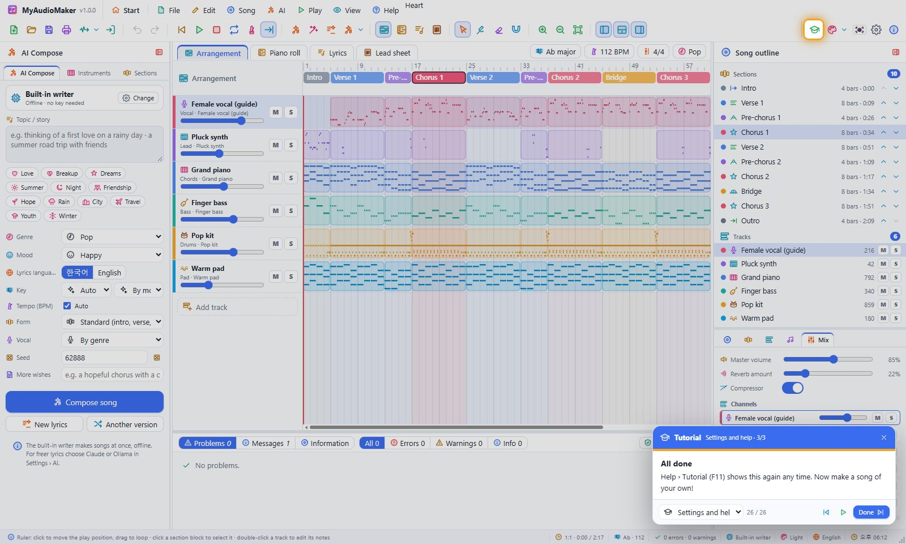

## 14. Troubleshooting

| Symptom | Fix |
|---|---|
| No sound | The web build plays only after a click. Check the system volume, Settings › Audio › Playback volume, the Mix tab's master volume and the tracks' M and S. **Settings › Audio › Sound check**. |
| "No Anthropic API key" | Enter it in Settings › AI or choose the built-in writer. |
| "The API key is not valid" | Paste the key again (no spaces). Check in the Console that the key is active and billing is set up. |
| "Cannot reach Ollama" | Check that `ollama serve` runs and the address is right. The web build may need `OLLAMA_ORIGINS`. |
| "Ollama does not have that model" | Run `ollama pull <model>`. |
| Red lyric numbers | **Set lyrics to melody** (`Ctrl+M`) or the card's ♪. |
| The vocal is too high or low | Change the key in the Song tab or choose another vocal (female, male). |
| An exported WAV sounds quiet | Turn on **Normalise (−1 dB)** in the export window. |
| No save window in the web build | Browsers without a save window download the file instead. |

If a problem stays, copy the error window's text with **Copy** and report it.
