# MyAudioMaker 사용 설명서

MyAudioMaker는 몇 가지만 고르면 인공지능이 **가사·멜로디·코드·반주·베이스·드럼**까지 한 곡을 만들어 주는 작곡 프로그램입니다. 만든 곡은 편곡 화면, 피아노 롤, 가사 편집기, 리드 시트(악보)에서 고치고, 내장 신시사이저와 가이드 보컬로 들으며, WAV·스템·MIDI·LRC로 내보내고 인쇄합니다. Windows · macOS · Linux 데스크톱 앱과 웹 브라우저에서 같은 화면으로 동작합니다.

이 설명서는 화면의 메뉴·버튼·패널 이름을 그대로 씁니다. 메뉴 경로는 **파일 › 내보내기 › MIDI로 내보내기…** 처럼 적습니다. 단축키의 `Ctrl`은 macOS에서 `⌘`입니다. 처음이라면 [튜토리얼](Tutorial.html)(F11)을 먼저 따라 해 보세요. 8개 장, 26단계로 모든 기능을 차례로 보여 줍니다.

## 1. 시작하기

### 1.1 설치와 실행

- **Windows** — `MyAudioMaker-Setup-<버전>.exe`를 실행합니다. 설치 언어(한국어/English)를 고르면 프로그램도 그 언어로 시작합니다. 현재 사용자 계정에 설치되므로 관리자 권한이 필요 없습니다. 이미 설치된 MyAudioMaker가 있으면 먼저 지우고 다시 설치하며, 예전 사용자 데이터(설정·최근 파일·AI 설정과 API 키 등)를 지울지 묻습니다.
- **macOS** — `.dmg`를 열고 MyAudioMaker를 응용 프로그램 폴더로 끌어다 놓습니다.
- **Linux** — `.deb`(Debian/Ubuntu), `.rpm`(Fedora 등) 또는 `.AppImage`.
- **웹** — 웹 버전(`dist/`)을 올린 주소를 Edge · Chrome · Firefox · Safari로 엽니다. 브라우저는 화면을 한 번 누른 뒤부터 소리를 냅니다.

설치하면 `.mam` 파일이 MyAudioMaker에 연결되어, 탐색기·Finder에서 두 번 클릭하면 열립니다. 예제 곡 40곡이 설치 폴더의 `samples/`에도 들어 있습니다.

### 1.2 시작 화면

프로그램을 켜면 **시작 화면**이 나옵니다. 메뉴 막대 왼쪽의 **시작** 버튼(또는 `Ctrl+Shift+H`)으로 언제든 다시 열고 닫을 수 있으며, 작업 중인 곡은 그대로 남아 있습니다.

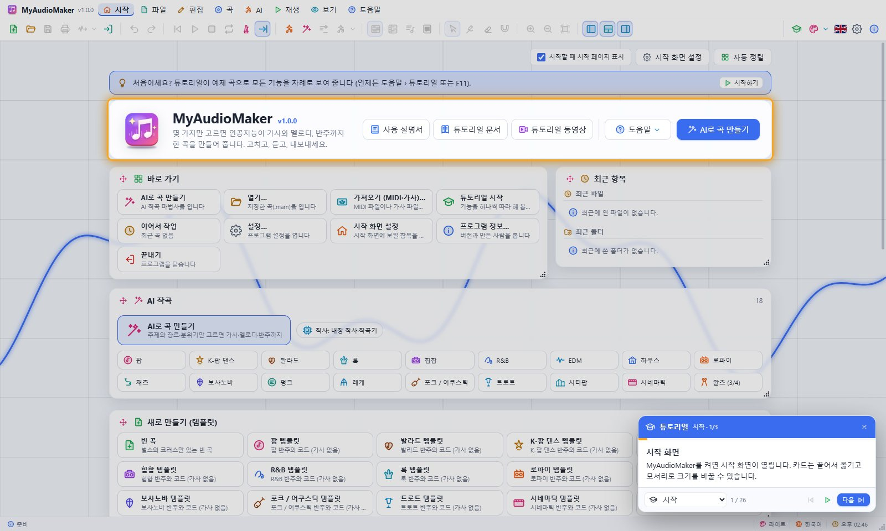

| 카드 | 내용 |
|---|---|
| 맨 위(제목) | **사용 설명서** · **튜토리얼 문서** · **튜토리얼 동영상**, **도움말** 메뉴, **AI로 곡 만들기** |
| **바로 가기** | AI로 곡 만들기 · 열기… · 가져오기 (MIDI·가사)… · 튜토리얼 시작 · 이어서 작업 · 설정… · 시작 화면 설정 · 프로그램 정보… · 끝내기 |
| **최근 항목** | 최근 곡과 최근 폴더. 클릭하면 열고, ✕로 목록에서 지우고, **모두 지우기** |
| **AI 작곡** | **AI로 곡 만들기** 버튼과 지금 가사를 쓰는 AI, 장르 18가지 (누르면 그 장르로 AI 작곡 마법사가 열림) |
| **새로 만들기 (템플릿)** | 빈 곡과 장르별 템플릿 14가지 — 반주와 코드만 있고 가사·보컬은 없음 |
| **예제 곡** | 완성된 예제 40곡, 분야마다 5곡 (팝·K-팝, 발라드, 힙합·R&B, 일렉트로닉, 록·포크, 재즈·보사노바·시티팝, 트로트·왈츠·시네마틱, 영어 가사) |
| **움직이는 배경** | 음악을 주제로 한 배경 애니메이션 20가지, 움직이는 배경 바꾸기, 배경 이미지…, 움직임 속도, 카드 불투명도, 시작할 때 무작위, 자동 변경 |

- 맨 위의 **프로그램 이름·정보 카드는 고정**되어 옮기거나 크기를 바꿀 수 없고, 다른 카드를 그 위로 놓을 수도 없습니다.
- 나머지 카드는 왼쪽 위의 손잡이(✥)를 끌어 옮기고, 오른쪽 아래 모서리를 끌어 크기를 바꿉니다(모서리를 두 번 누르면 내용에 맞춤). **자동 정렬**은 처음 배치로 되돌립니다.
- 위쪽의 **시작할 때 시작 페이지 표시**를 끄면 다음부터는 **팝 템플릿**으로 바로 시작합니다.
- 처음 켤 때는 **시작 안내 창**이 뜹니다: 튜토리얼 시작, 예제 곡 열기, 나중에. **도움말 › 시작 안내 창**으로 다시 열 수 있습니다.

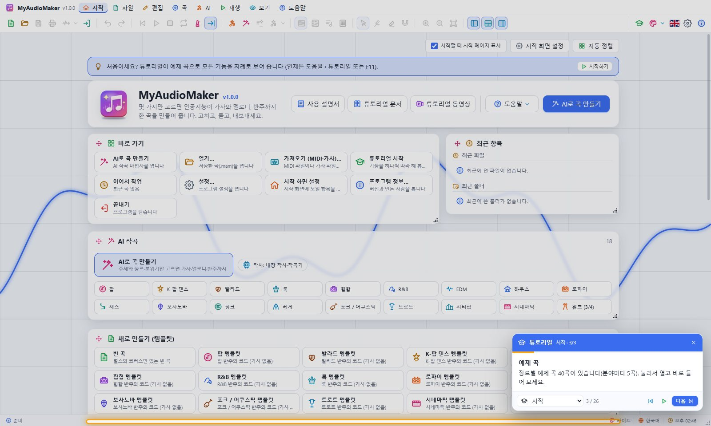

### 1.3 작업 화면

곡을 열면 작업 화면이 됩니다.

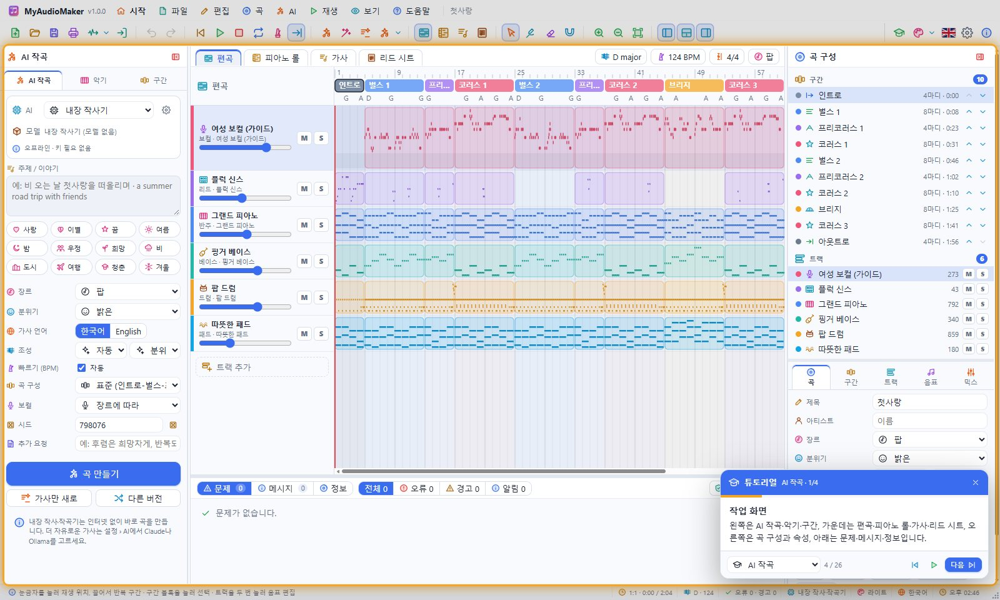

| 영역 | 내용 |
|---|---|
| 메뉴 막대 | 시작 · 파일 · 편집 · 곡 · AI · 재생 · 보기 · 도움말, 열린 곡 이름(저장하지 않았으면 ●) |
| 도구 모음 | 파일 · 실행 취소 · 재생 · AI · 화면 · 편집 도구 · 확대 · 패널, 오른쪽에 튜토리얼 · 테마 · 언어 · 설정 · 정보 |
| 화면 탭 | **편곡 · 피아노 롤 · 가사 · 리드 시트**, 오른쪽에 조성 · 빠르기 · 박자 · 장르 |
| 왼쪽 패널 | **AI 작곡 · 악기 · 구간** |
| 오른쪽 패널 | 위: **곡 구성**(구간과 트랙 목록) · 아래: **곡 · 구간 · 트랙 · 음표 · 믹스** 탭 |
| 아래 패널 | **문제 · 메시지 · 정보** |
| 상태 표시줄 | 알림, 재생 위치(마디:박 · 시간 / 전체), 격자 맞춤, 조성·빠르기, 문제 수, 작사 AI, 테마, 언어, 시각 |

패널은 머리글의 접기 버튼이나 **보기 › 보이기**, `Ctrl+Shift+1`(왼쪽) · `Ctrl+Shift+2`(오른쪽) · `Ctrl+J`(아래)로 접고 펼치며, 경계선을 끌어 너비·높이를 바꿉니다. 창이 좁으면 도구 모음의 뒤쪽 묶음이 **»** 메뉴로 들어갑니다.

## 2. AI로 곡 만들기

### 2.1 AI 작곡 패널

왼쪽 패널의 **AI 작곡** 탭에서 곡을 만듭니다.

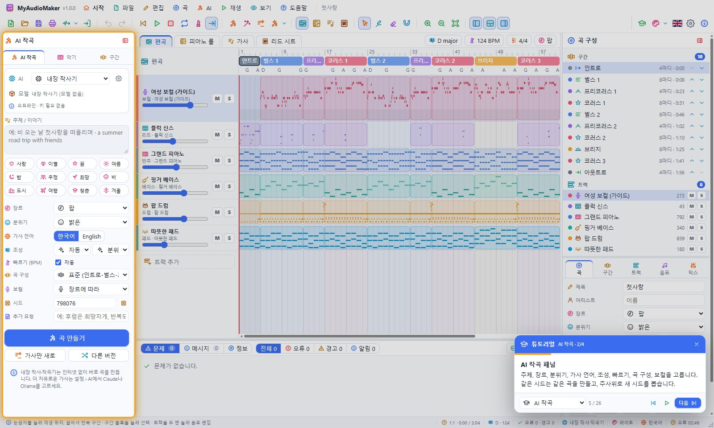

| 항목 | 설명 |
|---|---|
| AI | 가사와 곡 구성을 쓰는 AI: 내장 작사기 · Claude · Ollama. 고르면 바로 설정에 저장됩니다. ⚙는 설정 › AI (2.3절) |
| 모델 | 고른 AI의 모델. Claude는 Opus(가장 좋음)·Sonnet(균형)·Haiku(빠르고 저렴)·직접 입력한 모델, Ollama는 이 컴퓨터에 설치된 모델(↻로 다시 읽기). 내장 작사기는 모델이 없습니다 |
| 주제 / 이야기 | 노래가 말할 내용. 예: "비 오는 날 첫사랑을 떠올리며", "a summer road trip with friends" |
| 주제 칩 | 사랑 · 이별 · 꿈 · 여름 · 밤 · 우정 · 희망 · 비 · 도시 · 여행 · 청춘 · 겨울 (고르지 않으면 주제 글에서 찾음) |
| 장르 | 18가지 (2.4절) |
| 분위기 | 밝은 · 슬픈 · 잔잔한 · 신나는 · 로맨틱한 · 어두운 · 몽환적인 · 웅장한 · 그리운 · 희망찬 |
| 가사 언어 | 한국어 / English |
| 조성 | 자동 또는 으뜸음(C~B)과 장조·단조·도리안·믹솔리디안. **분위기에 따라**는 슬픈·어두운·웅장한 분위기에서 단조 |
| 빠르기 (BPM) | 자동(장르와 분위기로) 또는 직접 |
| 곡 구성 | 표준 · 짧게 · 간단히 · 발라드 · K-팝 · EDM · AABA · 루프(연주곡) |
| 보컬 | 장르에 따라 · 여성 · 남성 · 합창 · 없음(연주곡) |
| 시드 | 같은 시드와 같은 설정은 같은 곡을 만듭니다. 🎲로 새 시드 |
| 추가 요청 | Claude·Ollama에 함께 보내는 말 (예: "후렴은 희망차게, 반복되는 훅") |

- **곡 만들기**(`Ctrl+G`)는 새 곡을 만들어 엽니다. 지금 곡에 저장하지 않은 변경이 있으면 먼저 묻습니다.
- **가사만 새로**(`Ctrl+L`)는 지금 곡의 노래 구간 가사를 새로 쓰고 멜로디를 새 가사에 맞춥니다. 코드와 반주는 그대로입니다.
- **다른 버전**은 같은 장르·구성·조성·빠르기로 시드만 바꿔 새로 만듭니다.

만들어진 곡은 이렇게 구성됩니다.

- **구간** — 인트로, 벌스, 프리코러스, 코러스, 브리지, 간주, 빌드업, 드롭, 아웃트로. 두 번째 코러스부터는 첫 코러스의 가사와 멜로디를 반복합니다.
- **코드** — 장르의 코드 진행(재즈·R&B·로파이는 7화음), 코러스 앞에서는 딸림화음으로 기대감을 만들고 마지막은 으뜸화음으로 끝납니다.
- **보컬 멜로디** — 가사의 음절마다 음표가 하나씩. 강박의 긴 음은 코드 구성음, 줄마다 아치형·하강형 같은 윤곽, 코러스는 더 높게, 같은 음절 수의 줄은 같은 리듬을 반복합니다.
- **리드** — 노래가 없는 구간(인트로·간주·드롭·아웃트로)에서 코러스 선율로 만든 훅, 노래 구간에서는 줄 끝의 짧은 응답.
- **반주** — 장르 스타일(팝 블록·8비트, 발라드 아르페지오, 록 파워 코드, 레게 스캥크, 보사노바, 왈츠 등)과 성부 진행.
- **베이스** — 루트 8분음, 루트-5도, 워킹 베이스, 808 서브, 펑크, 레게, 보사노바 등.
- **드럼** — 구간별 그루브, 다음 구간 앞의 필인, 새 구간의 크래시, 인트로는 가볍게.
- **패드 · 아르페지오** — 에너지가 높은 구간에 깔림.

### 2.2 AI 작곡 마법사

**AI › AI 작곡 마법사…**(`Ctrl+Shift+G`), 도구 모음의 마법봉, 시작 화면의 **AI로 곡 만들기**나 장르 타일로 엽니다. 모든 선택지를 한 화면에 모아 칩으로 고르고 **곡 만들기**를 누릅니다.

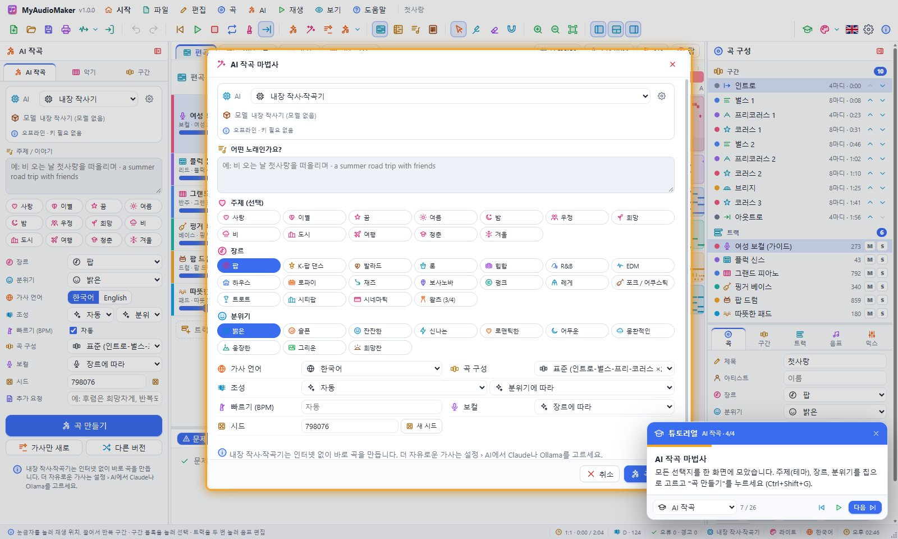

### 2.3 작사 AI 고르기 (내장 · Claude · Ollama)

**설정 › AI**에서 가사와 곡 구성을 쓰는 AI를 고릅니다.

| AI | 설명 |
|---|---|
| **내장 작사·작곡기** | 프로그램 안의 작사기와 작곡 엔진. 인터넷·키 없이 언제나 동작합니다. 주제별 문장 은행(한국어·영어 각 12주제)에서 줄을 골라 각운이 맞는 쌍을 우선하고, 코러스는 훅을 반복합니다. |
| **Claude (Anthropic)** | Claude가 제목·가사·구간별 코드를 씁니다. Anthropic 콘솔(console.anthropic.com)에서 만든 **내 API 키**가 필요하며 사용량에 따라 요금이 부과됩니다. 모델: claude-opus-5-5(기본·가장 좋음) · claude-sonnet-5-5 · claude-haiku-5-5(빠르고 저렴). |
| **Ollama (내 컴퓨터)** | 내 컴퓨터에서 실행 중인 Ollama의 모델(예: llama3.1, 한국어는 qwen2.5 같은 다국어 모델)이 씁니다. 인터넷이 필요 없습니다. 주소 기본값 `http://localhost:11434`. |

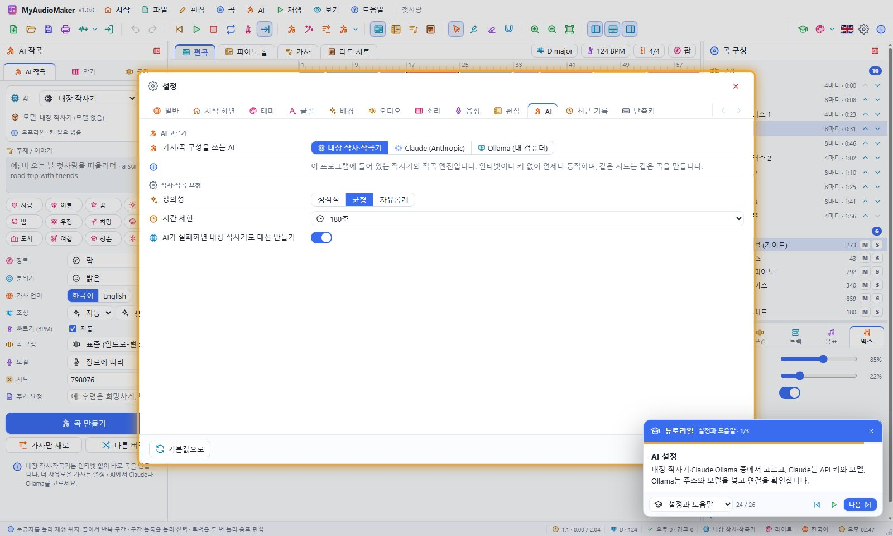

- AI가 쓰는 것은 **제목 · 구간 목록 · 줄별 가사 · 마디별 코드**입니다. 멜로디·반주·베이스·드럼은 언제나 이 컴퓨터의 작곡 엔진이 그 계획을 받아 만듭니다.
- AI의 답은 정해진 형식(JSON 스키마)으로 받고, 모르는 구간 종류·읽을 수 없는 코드·지나치게 긴 구간은 고쳐서 씁니다.
- **AI와 모델은 쓰는 곳에서 바로 고릅니다**: AI 작곡 패널 맨 위와 AI 작곡 마법사 맨 위의 **AI**·**모델** 목록. 고른 값은 설정 › AI와 상태 표시줄에도 그대로 나타납니다.
- Claude를 골랐지만 키가 없으면 내장 작사기로 만들고, 패널에 그 사실을 경고로 보여 줍니다.

설정 › AI의 항목:

| 항목 | 설명 |
|---|---|
| 가사·곡 구성을 쓰는 AI | 내장 작사·작곡기 · Claude · Ollama |
| Anthropic API 키 | Claude용 키 (보기 · 지우기) |
| Claude 모델 | claude-opus-5-5 (가장 좋음) · claude-sonnet-5-5 (균형) · claude-haiku-5-5 (빠르고 저렴) · **다른 모델 직접 입력** (모델 ID 칸이 나타남) |
| 생각 깊이 | Claude가 답하기 전에 생각하는 정도: 빠르게 · 보통 · 깊게. 깊을수록 다듬어지지만 느리고 요금이 늘어납니다 |
| Ollama 주소 · 모델 | 주소, 설치된 모델 목록(**설치된 모델 다시 읽기**), 목록에 없는 모델 이름 직접 입력 |
| 창의성 | 정석적 · 균형 · 자유롭게 — 익숙한 표현과 진행부터 새로운 표현과 뜻밖의 코드까지 (Ollama는 temperature도 바뀜) |
| 시간 제한 | 60초 · 120초 · 180초 · 300초 · 600초 — 넘으면 요청을 그만둡니다 |
| AI가 실패하면 내장 작사기로 대신 만들기 | 켜 두면 Claude·Ollama가 실패해도(키 오류·연결 실패·시간 초과 …) 내장 작사기가 곡을 만들고 이유를 알려 줍니다. 취소는 대신 만들지 않습니다 |
- **연결 확인**은 Claude에는 짧은 요청을, Ollama에는 모델 목록을 물어 결과를 보여 줍니다.
- **키와 개인 정보**: API 키는 이 컴퓨터(프로그램의 저장소)에만 저장되고 Anthropic으로만 보내집니다. 설정 초기화나 새로 설치해도 키는 남으며, 설치 프로그램이 사용자 데이터를 지울지 물을 때 **예**를 고르면 함께 지워집니다. 요청에는 주제·장르·분위기·가사 언어·곡 구성·추가 요청이 담깁니다.
- 웹판에서 Ollama를 쓰려면 Ollama 쪽에 `OLLAMA_ORIGINS`(웹판 주소 허용)를 설정해야 할 수 있습니다.

### 2.4 장르와 분위기

| 장르 | 빠르기 | 특징 |
|---|---|---|
| 팝 | 96–124 | I–V–vi–IV 계열, 피아노·핑거 베이스·플럭 신스 |
| K-팝 댄스 | 112–128 | 싱코페이션 베이스, 슈퍼쏘 스탭, 아르페지오, 빌드업 |
| 발라드 | 64–80 | 피아노 아르페지오, 현악, 느린 드럼 |
| 록 | 110–150 | 파워 코드, 오버드라이브 기타, 8분음 베이스 |
| 힙합 | 82–96 | 808 서브 베이스와 드럼, 일렉트릭 피아노, 스윙 |
| R&B | 70–96 | 7화음 진행, 컴핑, 싱코페이션 |
| EDM | 124–130 | 빌드업·드롭, 오프비트 베이스, 슈퍼쏘 |
| 하우스 | 118–126 | 네 박 킥, 오프비트 오르간·베이스 |
| 로파이 | 70–88 | 7화음, 업라이트 베이스, 비브라폰, 스윙 |
| 재즈 | 100–150 | ii–V–I, 워킹 베이스, 브러시, 강한 스윙 |
| 보사노바 | 116–140 | 나일론 기타 리듬, 플루트 |
| 펑크 | 96–116 | 16비트 베이스, 브라스 스탭 |
| 레게 | 70–90 | 원 드롭, 스캥크, 오르간 |
| 포크 / 어쿠스틱 | 84–112 | 스트럼 기타, 루트-5도 베이스 |
| 트로트 | 120–138 | 쿵짝 리듬, 색소폰 |
| 시티팝 | 100–118 | 메이저 7, 일렉트릭 피아노, 브라스 |
| 시네마틱 | 70–100 | 현악·합창 패드, 팀파니 같은 탐 |
| 왈츠 (3/4) | 84–132 | 3박자, 한 박에 베이스 두·세 박에 화음 |

분위기는 장조·단조와 빠르기(약 ±15%), 멜로디의 음역과 촘촘함을 바꿉니다.

## 3. 편곡 화면

**편곡** 탭(`1`)은 곡 전체를 한눈에 보여 줍니다.

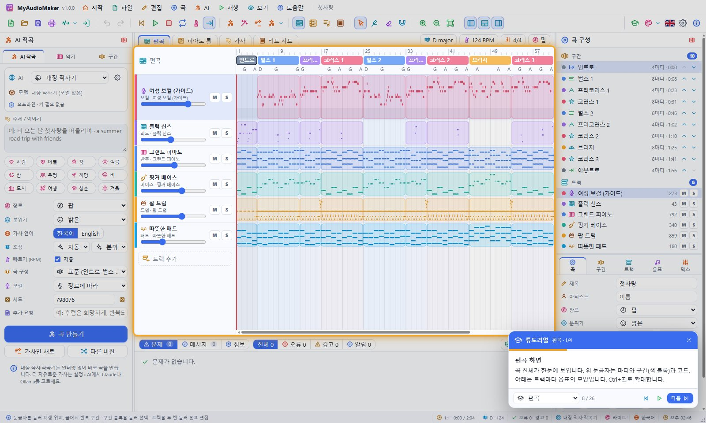

- **눈금자** — 맨 위는 마디 번호와 반복 구간, 가운데는 **구간 블록**(색으로 종류 구분), 아래는 코드입니다.
  - 눈금자를 누르면 재생 위치가 옮겨지고, **끌면 반복 구간**이 정해집니다.
  - 구간 블록을 누르면 그 구간이 선택되고, 두 번 누르면 가사 화면에서 그 구간을 엽니다. 오른쪽 클릭으로 구간 메뉴.
- **트랙** — 왼쪽 머리글에 이름 · 역할 · 악기, **M**(음소거) · **S**(솔로), 볼륨 막대. 오른쪽에는 구간마다 음표 모양이 미리 보입니다. 트랙을 두 번 누르면 피아노 롤에서 그 위치를 엽니다.
- **보컬 트랙**은 더 높게 그려져 음표 막대 아래에 **가사**가 나옵니다. 확대해서 자리가 넉넉하면 음절이 각 음표 아래에, 아니면 가사 한 줄이 그 줄의 첫 음표부터 나옵니다. 설정 › 편집 › **편곡 화면의 보컬 트랙에 음표와 가사 보이기**로 끌 수 있습니다.
- 확대·축소: `Ctrl+휠`, **보기 › 확대 / 축소 / 전체 보기**(`Ctrl+=` · `Ctrl+-` · `Ctrl+0`). `Shift+휠`은 가로 이동입니다.

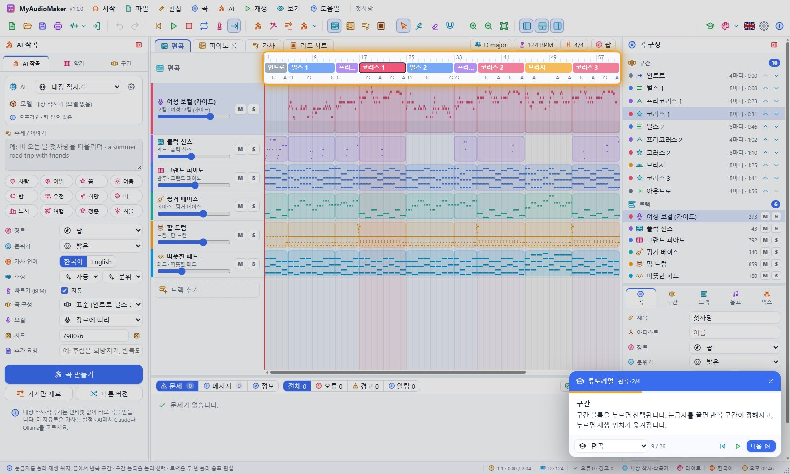

### 3.1 구간 편집

- **구간 추가** — 왼쪽 패널 **구간** 탭의 카드를 누르면 선택한 구간 뒤에 넣습니다. 코드는 장르에서, 반주·베이스·드럼은 바로 만들어집니다. **곡 › 구간 추가** 메뉴도 같습니다.
- **곡 구성 바꾸기** — 구간 탭 아래의 구성 목록을 누르면 곡을 그 구성으로 다시 만듭니다 (악기와 믹스는 유지).
- **복제 · 삭제 · 앞으로 · 뒤로** — **곡** 메뉴, 구간 오른쪽 클릭, 곡 구성 목록의 ▲▼. 지우기 전에 묻게 하려면 설정 › 일반의 **구간·트랙을 지우기 전에 묻기**.
- **구간 탭** (오른쪽 아래) — 이름, 종류, 마디 수(늘리면 코드가 반복되어 채워지고 새 마디의 반주가 만들어짐), 에너지, **코드**, 반복할 구간.

### 3.2 다시 만들기

구간 탭의 **다시 만들기**나 **AI › 다시 만들기**로 선택한 구간의 한 부분만 새로 만듭니다. 다른 구간은 그대로입니다.

| 부분 | 하는 일 |
|---|---|
| 전부 | 코드와 모든 파트 (`Ctrl+Shift+R`) |
| 코드 | 장르의 다른 코드 진행 |
| 멜로디 | 가사는 그대로 새 선율 (반복 코러스도 따라감) |
| 리드·훅 | 간주 훅과 응답 |
| 반주 · 베이스 · 드럼 | 각 파트 |

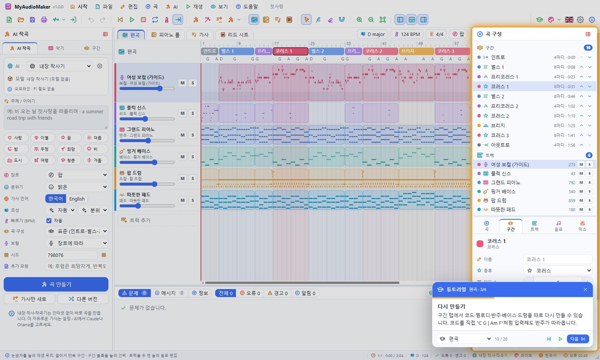

### 3.3 코드 직접 입력

구간 탭의 **코드** 칸에 마디를 `|`로 나눠 씁니다. 예: `C G | Am | % | F G` (`%`는 앞 마디 반복). Enter를 누르면 반주·베이스·패드가 새 코드로 다시 만들어집니다. 읽을 수 있는 코드: `C`, `Am`, `F#m7`, `Bbmaj7`, `G7`, `Dsus4`, `Edim`, `Caug`, `Bm7b5`, `Cadd9`, `G/B`, `Dm9` 등. 읽을 수 없는 코드가 있으면 적용하지 않고 알립니다.

### 3.4 트랙과 악기

- **트랙 추가** — 편곡 화면 아래의 **트랙 추가**나 **곡 › 트랙 추가**에서 악기를 고릅니다.
- **악기** 탭 (왼쪽) — 44가지 악기: 건반 5, 기타 4, 베이스 5, 현악기 4, 관악기 5, 신시사이저 6, 패드 3, 타악 건반 4, 드럼 7, 보컬 3. ▶로 미리 듣고, 두 번 누르거나 ⇄로 선택한 트랙의 악기를 바꿉니다.
- **트랙 탭** — 이름, 역할(다시 만들기가 이 트랙에 쓰는 파트), 악기, 볼륨, 좌우, 리버브, 색, 음소거·솔로.

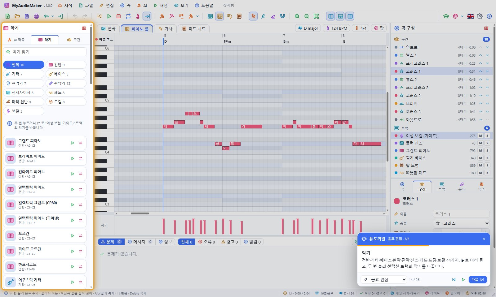

## 4. 피아노 롤

**피아노 롤** 탭(`2`)에서 선택한 트랙의 음표를 고칩니다.

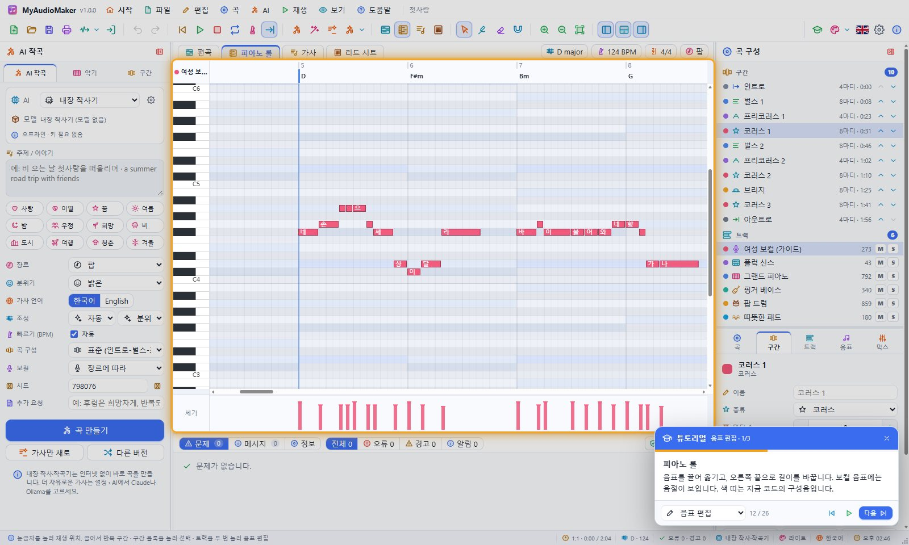

- 왼쪽 건반을 누르면 그 음을 들려 줍니다. 드럼 트랙은 건반 대신 드럼 이름(킥·스네어·하이햇…)이 줄마다 나옵니다.
- 위쪽 눈금자에는 마디와 코드, 색 띠는 구간의 시작입니다. 눈금자를 누르면 재생 위치가 옮겨집니다.
- 조성의 음은 밝게, 지금 코드의 구성음은 색 띠로 보입니다 (설정 › 편집 › **코드 구성음 표시**).
- 보컬 음표에는 음절이 쓰여 있습니다.
- **다른 트랙 음표 흐리게 보기**를 켜면 다른 트랙이 뒤에 흐리게 보입니다.
- 아래 **세기** 칸을 끌어 음표의 세기를 바꿉니다 (선택한 음표가 있으면 그 음표만).

| 도구 | 사용법 |
|---|---|
| **선택** (`V`) | 누르기·Shift+누르기·상자로 선택, 끌어서 이동(격자에 맞춤), 오른쪽 끝을 끌어 길이, `Alt`+끌기로 복사, 빈 곳을 두 번 눌러 음표 추가 |
| **그리기** (`D`) | 누르면 마지막 길이의 음표, 끌면 길이를 정함 |
| **지우개** (`E`) | 누르거나 끌어서 지우기 |

- **격자 맞춤** — 4분음표 · 8분음표 · 16분음표 · 32분음표 · 8분 셋잇단 · 16분 셋잇단 · 맞춤 없음 (도구 모음, 상태 표시줄, **편집 › 격자 맞춤**).
- 선택한 음표: `↑` `↓` 반음, `Shift+↑` `Shift+↓` 옥타브, `←` `→` 격자만큼 이동, `Shift+←` `Shift+→` 길이, `Delete` 지우기, `Ctrl+D` 복제, `Q` 격자에 맞추기(퀀타이즈), `Ctrl+C` · `Ctrl+X` · `Ctrl+V`(재생 위치에 붙여넣기).
- **음표 탭**(오른쪽) — 음높이(예: `C4`, `F#5`), 시작·길이(박, 4분음표 = 1박), 세기, 음절.
- 확대: `Ctrl+휠`(가로), `Alt+휠`(줄 높이).

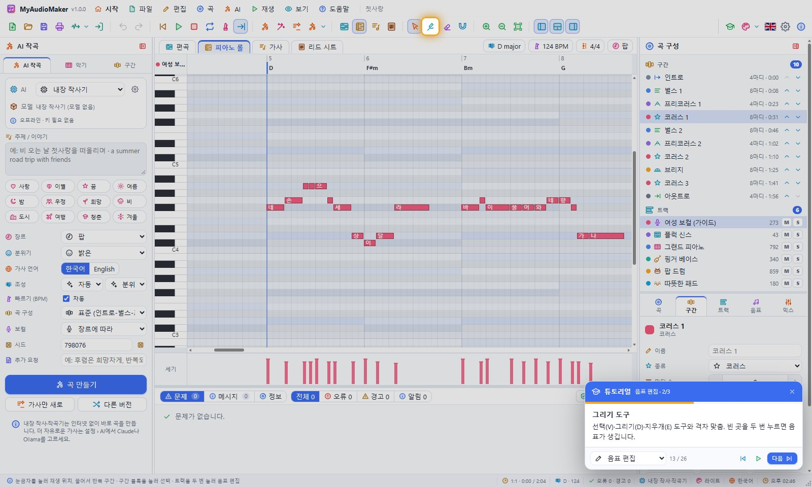

## 5. 가사와 리드 시트

### 5.1 가사 화면

**가사** 탭(`3`)은 구간마다 카드 하나입니다.

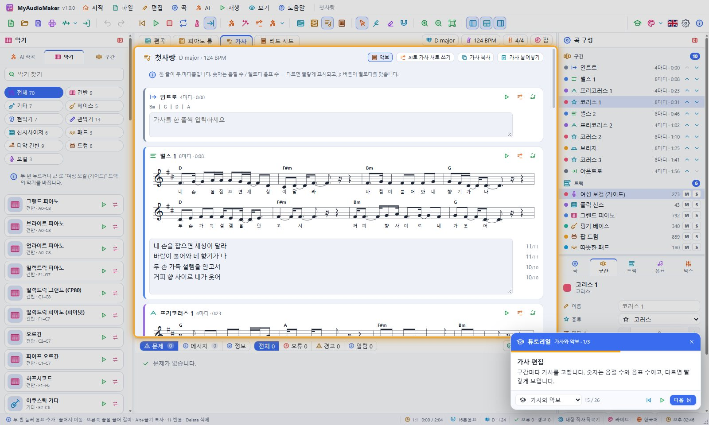

- 노래가 있는 구간은 카드 위쪽에 **멜로디 악보**가 나옵니다: 코드는 위에, 각 음절은 자기 음표 바로 아래에. 재생하는 동안 지금 부르는 음표가 강조됩니다. 머리줄의 **악보** 버튼(설정 › 편집 › **가사 화면에 멜로디 악보 보이기**)으로 숨기거나 보입니다.
- 카드 위에는 구간 이름·마디 수·시작 시각과 코드, 오른쪽에 ▶(이 구간 재생), AI(이 구간 가사만 새로 쓰기), ♪(가사에 멜로디 맞추기).
- 가사는 한 줄이 약 두 마디입니다. 오른쪽 숫자는 **음절 수 / 멜로디 음표 수**이고, 다르면 빨갛게 보입니다.
- 가사를 고치고 칸을 벗어나면 멜로디가 음절 수에 맞게 다시 만들어지고(설정 › 편집 › **가사를 고치면 멜로디 자동 맞춤**), 그 구간을 반복하는 구간(2절 코러스)도 따라 바뀝니다.
- **가사 복사 / 가사 붙여넣기** — 곡 전체 가사를 `[벌스 1]` 같은 머리글과 함께 복사하고, 붙여 넣을 때 머리글로 구간을 찾습니다 (머리글이 없으면 노래 구간에 차례로 채움).
- **음절** — 한국어는 한 글자가 한 음절, 영어는 모음 묶음으로 나눕니다 (morning → mor·ning). 가이드 보컬은 음절의 모음(아·에·이·오·우)으로 노래합니다.

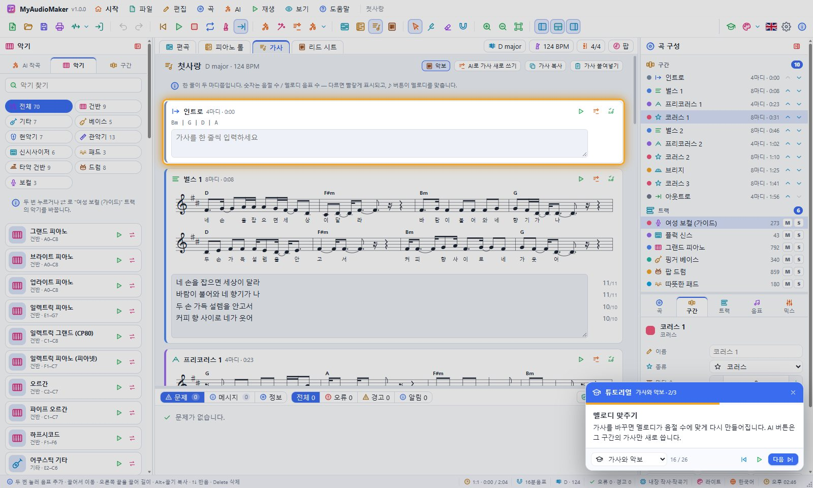

### 5.2 리드 시트

**리드 시트** 탭(`4`)은 보컬 멜로디(보컬이 없으면 리드)를 높은음자리표 악보로 보여 줍니다. 위에 코드, 각 음표 아래에 그 음절, 구간 이름이 줄 머리에, 첫 줄에 조표와 박자표가 들어갑니다.

- 멜로디는 16분음표 격자로 읽어 **쉼표·점음표·붙임줄**로 씁니다. 박이나 마디를 넘는 음은 붙임줄로 이어지고(음절은 첫 음표에만), 8분·16분음표는 박마다 **빔**으로 묶입니다.
- 조표에 없는 음에는 ♯ · ♭ · ♮가 붙고, 같은 마디 안에서는 다시 붙이지 않습니다.
- 음표 간격은 길이와 음절 너비를 함께 따져 정하므로 가사가 서로 겹치지 않습니다. 한 줄에는 들어가는 만큼(최대 여섯 마디) 넣고, 구간은 늘 새 줄에서 시작합니다.
- 재생하는 동안 지금 부르는 음표가 강조됩니다. 확대·축소는 `Ctrl+=` · `Ctrl+-`. 인쇄(9장)도 같은 악보입니다.

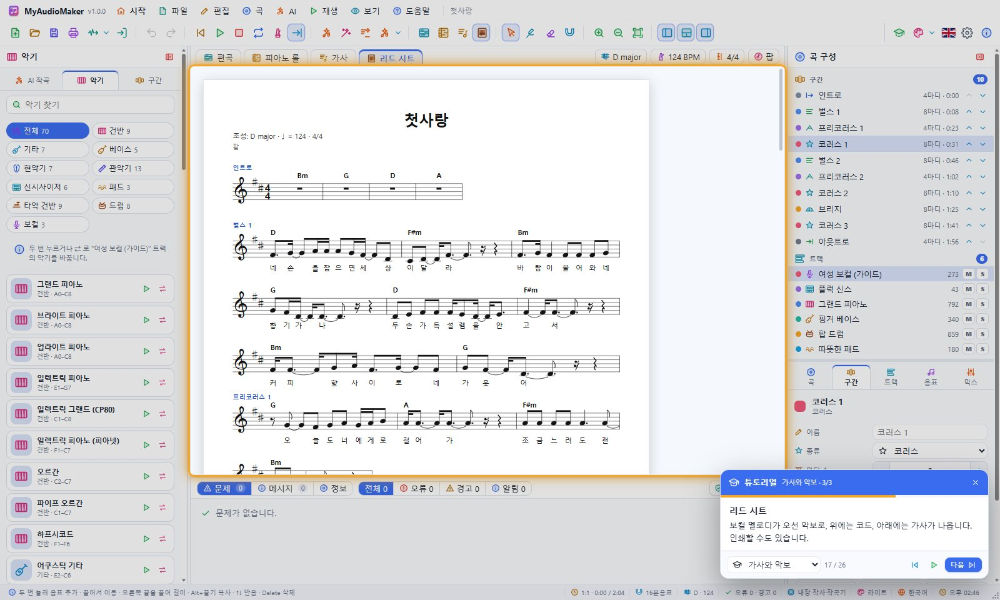

## 6. 듣기와 믹스

- **재생 / 일시 정지** — `Space` 또는 `F5`. **정지**(`Enter`)는 처음으로 돌아갑니다. `Home` · `End`는 처음·끝으로, `←` `→`는 한 마디씩 옮깁니다.
- **반복 재생** (`L`) — 눈금자를 끌어 정한 반복 구간을 되풀이합니다. **선택한 구간 반복**은 선택한 구간을 반복 구간으로 정합니다.
- **메트로놈** (`M`), **재생 위치 따라가기** — 재생하는 동안 화면이 재생 위치를 따라갑니다.
- **가사 따라 보기** — 재생하는 동안 화면 아래에 지금 부르는 가사 줄이 크게 떠서, 멜로디를 막대로(높은 음은 위로) 보여 주고 부른 음절은 강조색으로, 지금 부르는 음절은 크게 표시합니다. 아래에는 다음 줄이 나옵니다. **보기 › 표시 › 가사 따라 보기**나 설정 › 편집에서 켜고 끕니다.
- **실제 녹음한 악기** — 70개 악기 가운데 49개는 실제 악기를 녹음한 소리로 연주합니다: 그랜드·업라이트·일렉트릭 피아노, 파이프 오르간, 현악(바이올린·비올라·첼로·콘트라베이스·피치카토·트레몰로), 금관(트럼펫·트롬본·호른·튜바), 목관(플루트·클라리넷·오보에·바순), 색소폰(알토·테너·바리톤), 하프, 말렛(비브라폰·마림바·글로켄슈필·실로폰·튜뷸러벨·팀파니), 일렉트릭 기타(클린·크런치·오버드라이브·디스토션·재즈), 베이스(핑거·피크·업라이트·콘트라베이스), 드럼(어쿠스틱·팝·록·브러시·로파이·타악기). 약 60 MB가 프로그램과 함께 설치되며, 재생·내보내기 전에 필요한 악기를 불러오고(시간이 걸리면 진행률 창) 인터넷이 필요 없습니다.
- **내장 신시사이저** — 녹음이 없는 악기(해먼드 오르간, 신스 리드·베이스·패드, 합창 패드, 808·일렉트로 드럼, 어쿠스틱·나일론 기타 등)는 오실레이터·필터·엔벨로프로 만듭니다. 녹음 파일이 없거나 손상되어도 이 소리로 대신 연주합니다.
- **AI 음성** — 보컬 트랙을 실제 사람처럼 노래하는 신경망 음성(DiffSinger 음성 뱅크)으로 부릅니다. 기본은 TIGER 음성 뱅크입니다(한국어는 억양이 조금 섞입니다).
  - 처음 재생할 때 **설정 › AI 음성**에서 음성 뱅크와 보코더의 **라이선스(비상업)**에 한 번 동의하면, 필요한 파일(약 580 MB)을 **자동으로 내려받고** 진행률(받은 양·속도·검사·압축 풀기)을 보여 줍니다. 받은 뒤에는 인터넷 없이 동작합니다.
  - 곡을 바꾸면 다음 재생 때 바뀐 줄만 다시 렌더링합니다(진행률 창, 취소하면 이번에는 가이드 보컬). 3분 곡 처음 렌더링은 컴퓨터에 따라 2~5분 걸립니다.
  - 내보내기(WAV·스템)도 AI 음성으로 렌더링하며, 음성 뱅크 라이선스상 **비상업 용도**로만 쓸 수 있습니다.
- **가이드 보컬** — 여성·남성·합창. AI 음성을 끄거나 아직 준비되지 않았을 때, 멜로디를 음절의 모음으로 부르는 안내용 합성 목소리입니다.
- **믹스 탭** — 마스터 볼륨, 리버브 양, 컴프레서, 트랙마다 볼륨·음소거·솔로와 재생 레벨 미터.
- **스윙** (곡 탭) — 뒷박 8분음표를 늦게 연주합니다 (재생·WAV·MIDI에 적용).

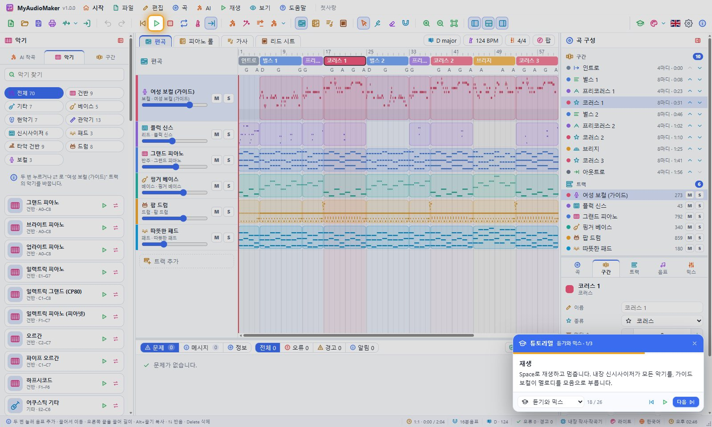

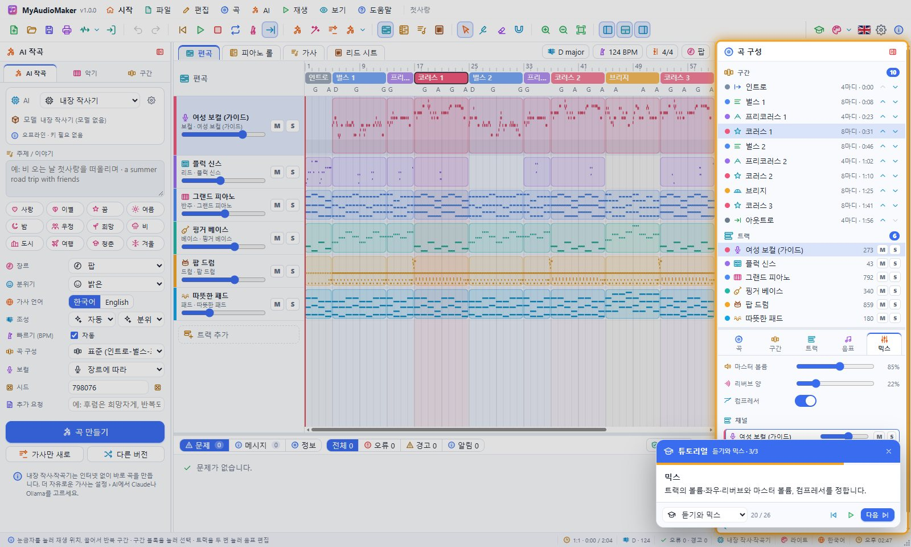

## 7. 곡 정보와 조옮김

오른쪽 **곡** 탭에서 제목, 아티스트, 장르, 분위기, 조성, 빠르기, 박자, 스윙, 가사 언어를 정합니다. 화면 탭 오른쪽의 조성·빠르기·박자 칩을 누르면 이 탭이 열립니다.

- **조성** 을 바꾸면 코드와 모든 음(드럼 제외)이 함께 옮겨집니다. 장조↔단조는 코드 표기만 다시 씁니다.
- **곡 반음 올리기 / 내리기** (`Ctrl+Shift+↑` / `Ctrl+Shift+↓`).
- 아래에는 길이 · 마디 수 · 트랙 수 · 음표 수 · 시드가 나옵니다.

## 8. 파일

### 8.1 저장과 열기

- **저장** (`Ctrl+S`) · **다른 이름으로 저장** (`Ctrl+Shift+S`) — `.mam` 파일(ZIP 안에 `song.json`)로 저장합니다. 웹판은 브라우저의 저장 창 또는 내려받기를 씁니다.
- **열기** (`Ctrl+O`) — `.mam`, MIDI, 가사 파일. **최근 항목**(`Ctrl+R`)과 최근 폴더.
- 끌어다 놓기 — 창에 `.mam` · `.mid` · `.txt` · `.lrc` 파일을 놓으면 엽니다.
- 설정 › 일반 › **시작할 때 지난번에 연 곡 다시 열기**.

### 8.2 가져오기

**파일 › 가져오기 (MIDI·가사)…** (`Ctrl+I`):

- **MIDI** (`.mid` · `.midi` · `.kar`) — 빠르기, 박자, 트랙 이름, 악기(General MIDI 프로그램), 음표를 가져옵니다. 가사 이벤트가 있는 트랙은 보컬이 되어 음절이 음표에 붙습니다. 곡은 8마디 단위 구간으로 나뉩니다.
- **가사** (`.txt` · `.lrc`) — 지금 곡에 가사로 넣고 멜로디를 맞춥니다. `[코러스]` 같은 머리글로 구간을 찾고, LRC의 시간 표시는 지웁니다.

### 8.3 내보내기

**파일 › 내보내기** 또는 도구 모음의 내보내기 버튼:

| 형식 | 내용 |
|---|---|
| **오디오로 내보내기 (WAV)** (`Ctrl+E`) | 곡 전체 · 반복 구간 · 선택한 구간, 44.1/48 kHz, 16/24비트·32비트 실수, −1 dB 음량 맞추기, 끝 여운, 포함할 트랙 |
| **트랙별로 내보내기 (스템)** | 트랙마다 WAV 하나 (데스크톱은 폴더에, 웹은 ZIP으로) |
| **MIDI** (`Ctrl+Shift+E`) | 형식 1, 템포·박자·조표, 구간 마커, 트랙별 악기, 드럼은 10번 채널, 보컬 트랙에 가사 이벤트 |
| **가사 (TXT)** | 구간 머리글과 가사 |
| **시간 맞춘 가사 (LRC)** | 줄마다 첫 음의 시각 — 노래방·음악 플레이어용 |
| **코드표** | 구간별 마디 코드와 가사 |
| **곡 데이터 (JSON)** | 곡 전체 |

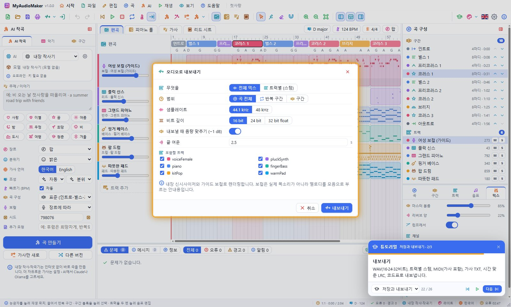

## 9. 인쇄

**파일 › 인쇄…** (`Ctrl+P`)는 인쇄 창을 엽니다. 왼쪽에서 고르고 오른쪽에서 미리 봅니다.

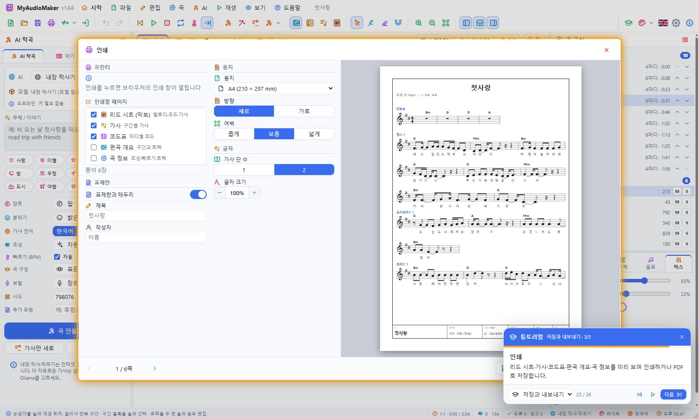

| 페이지 | 내용 |
|---|---|
| **리드 시트 (악보)** | 멜로디·코드·가사 (여러 장) |
| **가사** | 구간별 가사, 1단 또는 2단 |
| **코드표** | 구간마다 마디 칸에 코드 |
| **편곡 개요** | 구간과 트랙의 시간표, 구간 표(시작·마디·코드) |
| **곡 정보** | 조성·빠르기·박자·장르·분위기·길이·트랙 |

- 프린터와 매수(데스크톱), 용지(A3~A5, B4·B5, Letter, Legal, Tabloid), 방향, 여백, 가사 단 수, 글자 크기.
- **표제란과 테두리** — 곡, 페이지, 조성·빠르기, 작성자, 날짜, 장 번호. 제목과 작성자를 바꿀 수 있습니다.
- **PDF로 저장** — 데스크톱은 같은 종이로 PDF를 만들고, 웹은 종이 그림으로 PDF를 만들어 내려받습니다.
- `PageUp` · `PageDown`으로 쪽을 넘깁니다.

## 10. 문제 · 메시지 · 정보

아래 패널은 곡을 계속 검사합니다. 항목을 누르면 그 구간이나 트랙을 보여 줍니다.

| 검사 | 수준 |
|---|---|
| 트랙이 없음 · 모든 트랙 음소거 | 경고 · 오류 |
| 곡 끝 뒤의 음표 · 악기 음역 밖의 음표 · 겹친 음표 | 경고 |
| 보컬 음역이 넓음 (19반음 넘게) | 경고 |
| 가사 음절 수와 음표 수가 다른 줄 · 너무 긴 줄 · 멜로디 없는 가사 | 경고 |
| 읽을 수 없는 코드 | 오류 |
| 코드가 없는 구간 · 가사가 없는 노래 구간 · 비어 있는 트랙 · 아주 느리거나 빠른 빠르기 · 코드와 반음으로 부딪치는 긴 음 · 아주 큰 볼륨 | 알림 |

**메시지** 탭은 알림과 오류 기록, **정보** 탭은 곡·조성·길이·트랙·가사·만든 AI를 보여 줍니다.

## 11. 설정

**설정…** (`Ctrl+,`):

| 탭 | 내용 |
|---|---|
| 일반 | 언어, 지난번 곡 다시 열기, 구간·트랙을 지우기 전에 묻기, 상태 표시줄 시계, 상태 표시줄, 마지막 폴더, 튜토리얼 |
| 시작 화면 | 시작 화면·시작 안내 창, 최근 파일·폴더, 예제 곡, 움직이는 배경, 튜토리얼 안내 띠 |
| 테마 | 어두운 테마·밝은 테마 목록, 시스템, 사용자 테마(색 직접 고르기) |
| 글꼴 | 글꼴, 크기, 굵기, 기울임, 줄 높이, 화면 확대 |
| 배경 | 움직이는 배경 20가지·이미지·없음, 속도, 무작위, 자동 변경, 이미지와 불투명도·맞춤 |
| 오디오 | 재생 볼륨, 메트로놈, 재생 위치 따라가기, 음표를 누르면 소리 듣기, 샘플레이트·비트 깊이·음량 맞추기(내보내기 기본값), 소리 확인 |
| 악기 소리 | 녹음한 악기 소리 라이브러리의 상태(분류별), **소리 확인**·**모든 소리를 풀어서 확인**, **다시 받기 / 고치기**(웹판은 사이트에서, 데스크톱은 입력한 받을 위치에서), 출처와 라이선스 |
| AI 음성 | 보컬 엔진(AI 음성 / 가이드 신스), 음성 뱅크 목록·상태, **내려받기 · 다시 받기 · 지우기**(진행률 표시, 설정 창을 닫아도 계속 받음), 라이선스 보기·동의, **음성 뱅크 가져오기(.zip)**, 화자, 렌더링 품질(10·20·50), 계산 장치(자동·GPU·CPU), 목소리 들어 보기 |
| 편집 | 격자 맞춤, 다른 트랙 음표 흐리게, 코드 구성음 표시, 가사를 고치면 멜로디 자동 맞춤, 가사 화면의 멜로디 악보, 보컬 트랙의 음표와 가사, 가사 따라 보기, 가사 언어, 기본 보컬 |
| AI | 작사 AI(내장·Claude·Ollama), API 키, Claude 모델(직접 입력 포함)·생각 깊이, Ollama 주소·모델, 창의성, 시간 제한, 실패 시 내장 작사기, 연결 확인 (2.3절) |
| 최근 기록 | 최근 파일·폴더 목록과 지우기 |
| 단축키 | 모든 단축키 |

**테마**는 도구 모음의 팔레트 버튼(누르면 밝게/어둡게, ▼로 목록)에서도 고르고, **언어**는 국기 버튼(`Ctrl+Shift+L`)으로 바꿉니다.

## 12. 단축키

| 단축키 | 동작 |
|---|---|
| `Space` | 재생 / 일시 정지 |
| `Enter` | 정지 (처음으로) |
| `Home / End` | 처음 / 끝으로 |
| `← / →` | 한 마디 앞 / 뒤로 |
| `L` | 반복 재생 |
| `M` | 메트로놈 |
| `F5` | 재생 / 일시 정지 |
| `1 / 2 / 3 / 4` | 편곡 / 피아노 롤 / 가사 / 리드 시트 |
| `V` | 선택 도구 |
| `D` | 그리기 도구 |
| `E` | 지우개 도구 |
| `Q` | 격자에 맞추기 (퀀타이즈) |
| `↑ / ↓` | 음표 반음 위 / 아래 |
| `Shift+↑ / ↓` | 음표 옥타브 위 / 아래 |
| `← / → (음표 선택 시)` | 음표 격자만큼 이동 |
| `Shift+← / →` | 음표 길이 줄이기 / 늘리기 |
| `Alt+끌기` | 음표 복사 |
| `빈 곳 두 번 누르기` | 음표 추가 |
| `Ctrl+휠` | 확대 |
| `Alt+휠` | 피아노 롤 줄 높이 |
| `Ctrl+G` | AI로 곡 만들기 |
| `Ctrl+Shift+G` | AI 작곡 마법사 |
| `Ctrl+L` | AI로 가사 새로 쓰기 |
| `Ctrl+Shift+R` | 전부 |
| `Ctrl+M` | 가사에 멜로디 맞추기 |
| `Ctrl+N` | 새 곡 |
| `Ctrl+O` | 열기 |
| `Ctrl+S` | 저장 |
| `Ctrl+Shift+S` | 다른 이름으로 저장 |
| `Ctrl+I` | 가져오기 (MIDI·가사) |
| `Ctrl+E` | 오디오로 내보내기 (WAV) |
| `Ctrl+Shift+E` | MIDI로 내보내기 |
| `Ctrl+P` | 인쇄 |
| `Ctrl+Z` | 실행 취소 |
| `Ctrl+Y` | 다시 실행 |
| `Ctrl+X / C / V` | 복사 |
| `Ctrl+D` | 복제 |
| `Delete` | 삭제 |
| `Ctrl+A` | 모두 선택 |
| `Esc` | 정지 · 선택 해제 |
| `Ctrl+= / −` | 확대 |
| `Ctrl+0` | 전체 보기 |
| `Ctrl+Shift+↑ / ↓` | 곡 반음 올리기 |
| `Ctrl+Shift+1 / 2` | 왼쪽 패널 (AI·악기·구간) |
| `Ctrl+J` | 문제 패널 |
| `Ctrl+Shift+L` | 언어 전환 |
| `Ctrl+Shift+H` | 시작 페이지 |
| `Ctrl+,` | 설정 |
| `F11` | 튜토리얼 |
| `F1` | 프로그램 정보 |

## 13. 튜토리얼과 도움말

- **튜토리얼** (`F11`, **도움말 › 튜토리얼**) — 예제 곡으로 8개 장, 26단계(시작 · AI 작곡 · 편곡 · 음표 편집 · 가사와 악보 · 듣기와 믹스 · 저장과 내보내기 · 설정과 도움말)를 실제 화면에서 보여 줍니다. 오른쪽 아래 카드의 **다음** / **이전**, **자동 재생**, 장 목록, ✕ 또는 `Esc`. 끝나면 사용자의 곡과 설정이 원래대로 돌아옵니다.
- **튜토리얼 문서** · **튜토리얼 동영상** · **사용 설명서** — 별도 창(웹은 새 탭)에서 엽니다. 문서 창에는 장 목록, 찾기, 언어 전환, 인쇄가 있습니다.
- **프로그램 정보** (`F1`) — 버전, 빌드 정보, 만든 사람.

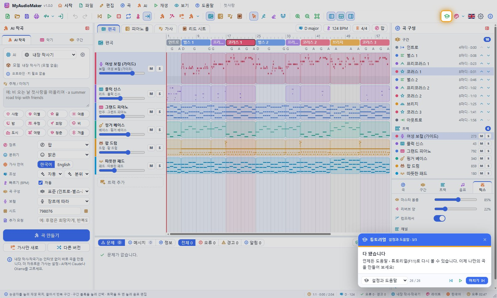

## 14. 문제 해결

| 증상 | 해결 |
|---|---|
| 소리가 나지 않음 | 웹판은 화면을 한 번 누른 뒤 재생합니다. 운영체제 볼륨, 설정 › 오디오 › 재생 볼륨, 믹스 탭의 마스터 볼륨, 트랙의 M·S를 확인하세요. **설정 › 오디오 › 소리 확인**. |
| "Anthropic API 키가 없습니다" | 설정 › AI에 키를 넣거나 내장 작사·작곡기를 고르세요. |
| "API 키가 올바르지 않습니다" | 키를 다시 복사해 넣으세요 (앞뒤 공백 없이). 콘솔에서 키가 유효한지, 결제가 설정되었는지 확인하세요. |
| "Ollama에 연결할 수 없습니다" | `ollama serve`가 실행 중인지, 주소가 맞는지 확인하세요. 웹판은 `OLLAMA_ORIGINS`가 필요할 수 있습니다. |
| "AI가 정한 시간 안에 답하지 않았습니다" | 설정 › AI › 시간 제한을 늘리거나, 더 빠른 모델(Haiku)·생각 깊이 "빠르게"를 고르세요. |
| "그 모델을 찾을 수 없습니다" | 설정 › AI에서 모델(직접 입력한 모델 ID)을 확인하세요. |
| "Ollama에 그 모델이 없습니다" | `ollama pull <모델>`로 받으세요. |
| 가사 숫자가 빨갛다 | **가사에 멜로디 맞추기** (`Ctrl+M`) 또는 카드의 ♪. |
| 보컬이 너무 높거나 낮다 | 곡 탭에서 조성을 옮기거나 다른 보컬(여성·남성)을 고르세요. |
| 내보낸 WAV가 작게 들림 | 내보내기 창의 **음량 맞추기 (−1 dB)** 를 켜세요. |
| 저장할 때 웹판에서 창이 안 뜸 | 브라우저가 파일 저장 창을 지원하지 않으면 내려받기 폴더에 저장됩니다. |

문제가 계속되면 오류 창의 **복사**로 내용을 복사해 알려 주세요.
