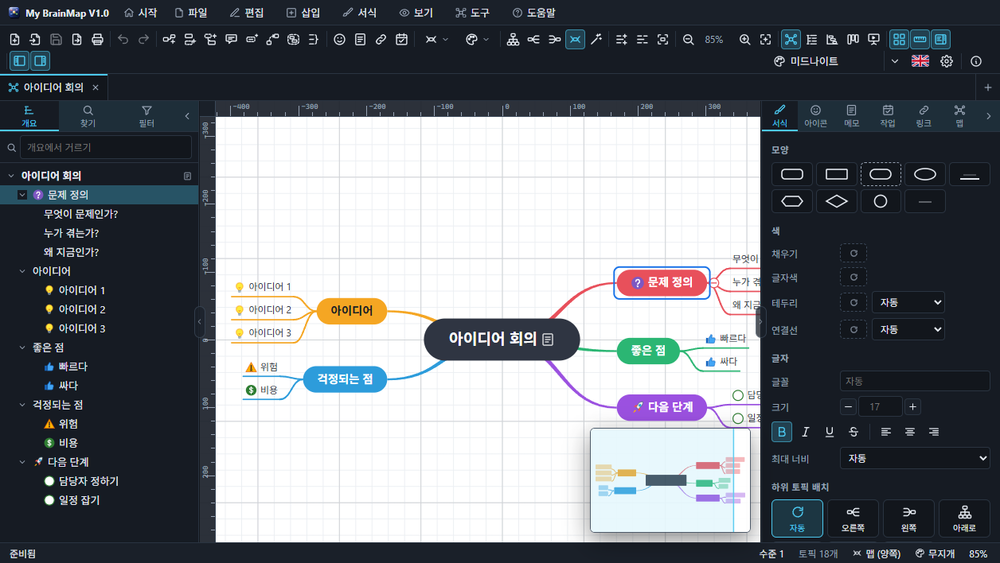

# MyBrainMap (MultiOS)

MindManager 처럼 쓰는 마인드맵 프로그램입니다. 중심 토픽에서 가지를 펼쳐 생각을 정리하고, 아이콘 · 태그 · 메모 · 작업 정보를 붙이고, 개요와 간트 차트로 보고, 프레젠테이션까지 합니다.
**Windows · macOS · Linux** 데스크톱 앱(Tauri)과 **웹 브라우저**에서 같은 화면, 같은 기능으로 동작합니다.

- UI: React 18 + Vite, 모든 그림은 직접 만든 SVG 렌더러(라이브러리 없음)
- 데스크톱: Tauri 2 셸 + Node 서비스(사이드카) — 웹 서버와 같은 `core/` 를 씁니다
- 화면 스타일은 [My Editor (MyEditorMultiOSV20)](../MyEditorMultiOSV20) 와 같습니다: 프레임 없는 창, 메뉴 막대 · 아이콘 도구 모음, 테마 40종 + 사용자 테마, 한국어 / English, 시작 화면의 움직이는 배경, 별도 창의 설정 · 도움말



## 주요 기능

- **토픽**: 중심 · 주 · 하위 토픽, 플로팅 토픽, 설명선. `Enter` 형제, `Tab` 하위, `Ctrl+Shift+Insert` 상위. 선택한 채 바로 입력(한글 IME 포함), 두 번 눌러 편집, 여러 줄
- **끌어서 옮기기**: 토픽 위(하위) · 가장자리(형제) · 빈 곳(**연결된 채로 이동**), `Alt`+빈 곳(플로팅으로 떼기), 여러 개 선택, 사각형 선택
- **정리**: 위→아래 · 왼→오 · 오→왼 · 양쪽으로 다시 그리기(도구 모음 · `Ctrl+Alt+↓ → ← M`), 자동 정리(`Ctrl+Shift+L`)
- **레이아웃 9종**: 맵(양쪽) · 오른쪽 · 왼쪽 · 조직도(아래/위) · 트리(오른쪽/왼쪽) · 타임라인 · 피시본, 가지마다 하위 배치 따로
- **맵 스타일 16종**: 앱 테마 따라가기 + 클래식 · 무지개 · 파스텔 · 미드나이트 · 네온 · 청사진 · 종이 · 흑백 · 숲 · 노을 · 바다 · 비즈니스 · 캔디 · 그래파이트 · 스케치. 선 모양(곡선 · 직선 · 꺾은선 · 둥근 꺾은선), 가지 색, 배경, 간격, 번호 매기기
- **토픽 서식**: 모양 9종, 채우기 · 글자 · 테두리 · 연결선 색과 두께, 글꼴 · 크기 · 굵게 · 기울임 · 밑줄 · 취소선 · 맞춤, 최대 너비, 서식 복사/붙이기
- **아이콘**: 우선순위 1–9, 진행률, 깃발, 표정, 화살표, 기호 28종 / **태그**
- **메모**(Markdown + 미리보기), **하이퍼링크**(웹 · 파일 · 맵 안의 토픽), **첨부 파일**, **그림**(파일 · 클립보드 · 끌어 놓기)
- **작업 정보**: 시작일 · 마감일 · 기간 · 마일스톤 · 진행률 · 작업량 · 담당
- **관계선**(곡선 손잡이, 이름, 점선, 화살표, 색), **경계**(둥근 · 사각 · 구름, 이름), **요약 괄호**(`Ctrl+]`)
- **댓글**(작성자 · 날짜 · 말풍선 표시), **사용자 속성**(이름 = 값)
- **보기**: 맵 · 개요(편집 가능한 목록 + 작업 열) · 간트 차트(막대 끌어 일정 변경) · **칸반 보드**(주 토픽 = 열, 카드 끌어 옮기기), 가지만 보기(F4)
- **캔버스**: 격자 · 눈금자 · 전체 보기 창(도구 모음 On/Off, `Ctrl+Alt+G / R / O`), 왼쪽 · 오른쪽 패널 접기/펴기(`Ctrl+Alt+S / P`), 모든 항목에 아이콘이 있는 컨텍스트 메뉴(토픽 · 빈 곳 · 관계선 · 탭 · 왼쪽 패널 항목)
- **튜토리얼**: 설치 후 처음 실행하면 저절로 시작하는 21단계 안내(화면을 비추며 설명, "직접 보기"로 실행) + 연습용 튜토리얼 맵
- **시작 화면**: 맨 위의 튜토리얼, 템플릿, 예제 16종 바로 열기, 마인드맵을 주제로 한 3D 배경 21종(아이콘 버튼)
- **찾기 · 바꾸기**(정규식, 메모 포함), **필터 / 맵 인덱스**(우선순위 · 아이콘 · 태그 · 진행 상태 · 마감일, 흐리게 / 숨기기)
- **프레젠테이션**(F5): 주 토픽마다 한 장, 카메라 이동과 흐림 효과
- **가져오기**: FreeMind/Freeplane `.mm`, XMind `.xmind`, MindManager `.mmap`, OPML, Markdown, 텍스트 개요
- **내보내기**: PNG · JPEG · SVG · PDF · Word(.docx) · HTML · Markdown · OPML · 텍스트 · FreeMind · XMind · CSV, 맵을 그림으로 클립보드 복사
- **인쇄**: 미리보기, 용지 · 방향 · 여백, 한 쪽 맞추기 또는 2/4/6/9쪽 나누기, 머리글 · 바닥글, 프린터 선택(데스크톱)
- **예제 맵 16종**(앱 출시 계획 · 4P · 이탈 원인 피시본 · 조직도 · 로드맵 · 공부 계획 · 여행 · 사이트맵 · 블로그 · 목표 · 체크리스트 · 아키텍처 · 책 요약 · 린 캔버스 · 위험 관리 · 브레인스토밍)
- **템플릿 14종**(튜토리얼 · 브레인스토밍 · 프로젝트 계획 · 회의록 · SWOT · 의사결정 · 주간 계획 · 피시본 · 조직도 · 로드맵 · 독서 노트 · OKR · 학습 · 여행)
- 실행 취소 / 다시 실행(맵마다, 모든 편집), 바꾼 맵을 닫거나 끝낼 때 저장 여부 묻기, 탭, 세션 복원(저장 안 한 맵 포함), 자동 저장, 바깥에서 바뀐 파일 다시 읽기
- 도움말 창(16장, 스크린샷 32장, 검색), 단축키 목록, [기능 문서](doc/README.md), 튜토리얼 영상 `MyBrainMap-Tutorial.mp4`

## 실행

```
npm install
npm start          # 데스크톱 앱 (tauri dev — Vite 5201 + Node 서비스)
npm run dev        # Vite 만 (브라우저, API 는 npm run web:serve 가 5202 에서)
npm run web        # 웹 버전: 빌드 후 http://127.0.0.1:5202
```

데스크톱 개발 실행에는 Rust(cargo)와 Node.js 가 필요합니다. 웹 서버 옵션은 `node server/server.js --port 8080 --host 0.0.0.0 --token 비밀` (토큰 없이 바깥에 열지 마세요).

## 설치 파일 만들기

각 운영체제에서 실행합니다. 만들어진 설치 파일은 프로젝트 루트로 복사됩니다.

```
npm run build:win     # Windows — NSIS 설치 파일 하나 (설치할 때 언어 선택)
npm run build:mac     # macOS  — .app, .dmg
npm run build:linux   # Linux  — .deb, .AppImage
```

설치 파일에는 Node 실행 파일과 `core/` · `host/` 만 들어갑니다(서비스는 Node 기본 모듈만 씁니다).

## 샘플 파일

`samples/ko`, `samples/en` 에 실제 주제로 완성된 예제 맵 16개(`src/lib/samples.js` — 앱의 **예제 맵…** 갤러리와 같은 것), 템플릿으로 만든 맵 14개, 그리고 `import/` 에 같은 예제를 `.mm` · `.xmind` · `.opml` · `.md` 로 저장한 가져오기 연습 파일이 있습니다. `npm run samples` 로 다시 만듭니다.

## 도움말 화면

도움말 본문은 `src/help/ko`, `src/help/en` 의 Markdown, 스크린샷은 `src/help/images/<lang>` 입니다. `npm run build && npm run help:media` 가 웹 빌드를 헤드리스 Edge/Chrome 에서 조작해 스크린샷을 다시 찍습니다.

## 테스트

```
npm test            # 단위 테스트 80개 (결과는 영어, 색이 있는 표): 모델, 레이아웃(9종 겹침 없음), 형식 왕복, ZIP, 세션, 다국어 키, 도움말,
                    #   그리고 MindManager · EdrawMind · SmartDraw · Lucidchart 기능 비교 36개 (test/parity.test.mjs)
npm run build && npm run smoke     # GUI 스모크: 헤드리스 브라우저에서 실제 마우스·키보드(한글 IME 포함) 54단계, 8개 구역
npm run build && npm run test:gui  # 모든 메뉴 · 도구 모음 · 컨텍스트 메뉴 명령 322개를 실제로 눌러 확인 + 첫 실행 튜토리얼 (영어 UI로 실행)
npm run tutorial:video           # 튜토리얼 영상 MyBrainMap-Tutorial.mp4 와 doc/images 그림 (ffmpeg 필요, FFMPEG=경로)
```

모든 테스트는 결과를 **영어로** 출력합니다. GUI 테스트(`smoke`, `test:gui`)도 `npm test` 와 같은 모양으로 구역마다 ✓ / ✗ 를 색으로 보여 주고, 끝에 구역별 표 · 실패 목록 · 통과/실패 막대를 출력합니다(`scripts/gui-report.mjs`). `NO_COLOR=1` 이면 색을 끕니다.

```
```

## 데이터 위치

| OS | 폴더 |
| --- | --- |
| Windows | `%APPDATA%\MyBrainMap` |
| macOS | `~/Library/Application Support/MyBrainMap` |
| Linux | `~/.config/MyBrainMap` (웹 서버 기본값은 `~/.config/my-brainmap`) |

`session.json` 에 설정, 열린 맵, 저장하지 않은 맵, 최근 파일이 있습니다. `MTM_USER_DATA` 환경 변수로 데스크톱 앱의 폴더를 바꿀 수 있습니다(테스트용).

## 문서

- [doc/](doc/README.md) — 기능별 상세 문서(그림 포함), [기능 비교](doc/feature-parity.md), [테스트와 검증](doc/testing.md)
- [UsersGuide.md](UsersGuide.md) — 사용자 가이드
- [Architecture.md](Architecture.md) — 구조

## 사용 라이브러리

React, Vite, Tauri 2 (dialog · opener 플러그인), marked, DOMPurify. 설치 파일 아이콘은 sharp 로 만듭니다.

## License

MIT © 2026 SHKWON
