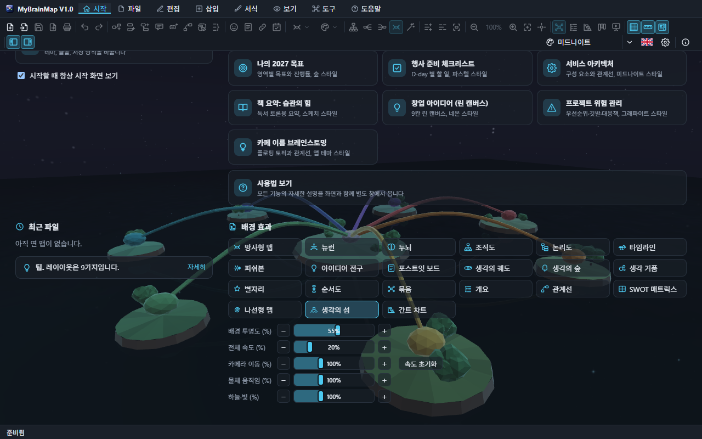
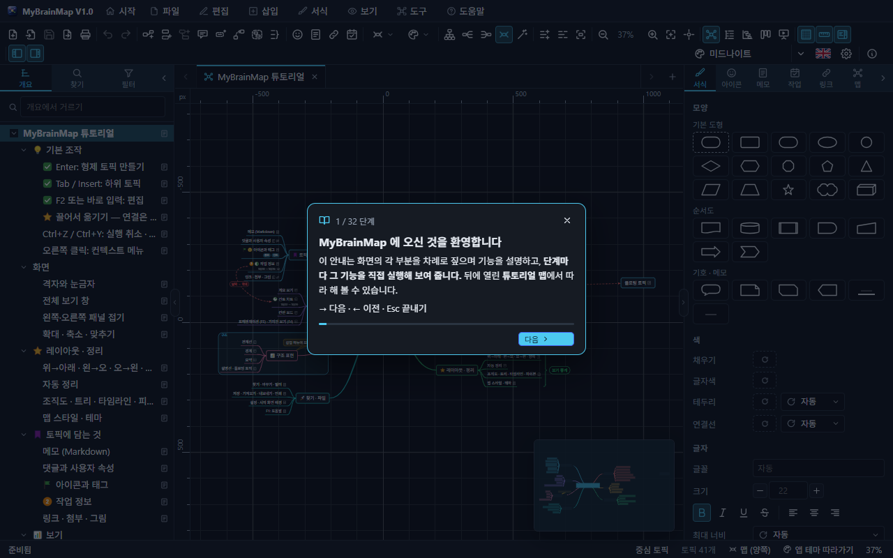
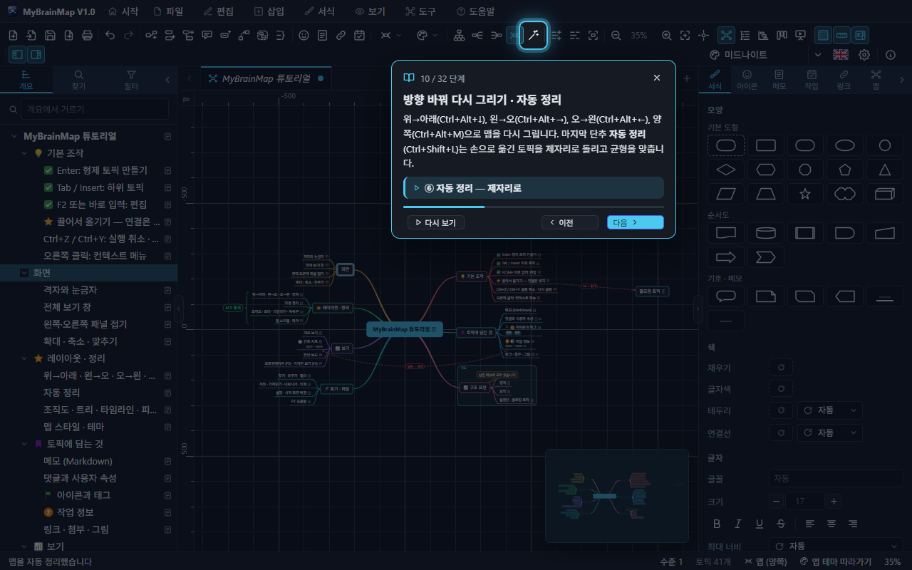
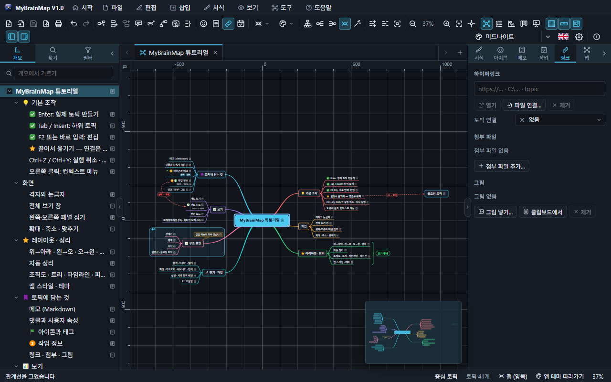

# 1. 시작 화면과 튜토리얼

처음 실행하면(또는 메뉴 막대의 **시작**을 누르면) 시작 화면이 나옵니다.

| 묶음 | 내용 |
| --- | --- |
| 시작하기 | **튜토리얼**(맨 위), 새 맵, 템플릿에서 새 맵, 열기, 가져오기, 예제 맵, 설정 |
| 템플릿으로 시작 | 브레인스토밍, 프로젝트 계획, 회의록, SWOT, 의사결정, 피쉬본, 조직도, 로드맵, OKR |
| 예제 맵 | 실제 주제로 완성된 예제 16가지 — 누르면 바로 열립니다 |
| 최근 파일 · 팁 | 최근에 연 맵과 사용 팁 |
| 배경 효과 | 시작 화면 뒤의 3D 장면, 투명도, 속도 |

"시작할 때 항상 시작 화면 보기"를 끄면 이전에 열었던 맵이 있을 때 시작 화면을 건너뜁니다.

## 배경 효과

시작 화면 뒤에는 마인드맵을 주제로 한 3D 장면이 천천히 움직입니다. 21가지 장면 모두 버튼에 아이콘이 있습니다.

| 장면 | | | |
| --- | --- | --- | --- |
| 방사형 맵 | 뉴런 | 두뇌 | 조직도 |
| 논리도 | 타임라인 | 피쉬본 | 아이디어 전구 |
| 포스트잇 보드 | 생각의 궤도 | 생각의 숲 | 생각 거품 |
| 별자리 | 순서도 | 묶음 | 개요 |
| 관계선 | SWOT 매트릭스 | 나선형 맵 | 생각의 섬 |
| 간트 차트 | | | |

- **배경 투명도** — 100% 면 장면 없이 테마 색만 남습니다.
- **전체 속도 · 카메라 이동 · 물체 움직임 · 하늘·빛** — 장면의 세 가지 시계를 따로 조절합니다. 0% 는 멈춤입니다.
- 같은 설정이 **설정 › 시작 화면**에도 있습니다. 장면은 테마의 강조 색을 따라 물듭니다.

## 튜토리얼

**설치 후 처음 실행하면 튜토리얼이 저절로 시작됩니다.** 그 뒤에는 **시작하기 › 튜토리얼**이나 **도움말 › 튜토리얼**로 언제든 다시 엽니다.

### 단계별 안내

튜토리얼을 열면 화면 위에 **단계별 안내**가 나타납니다. 32단계 동안 화면의 한 부분씩 밝게 비추고(나머지는 어둡게), 옆의 카드에 그 기능을 설명합니다. 단계가 열리면 그 기능이 튜토리얼 맵에서 **한 동작씩 저절로 실행**되고, 비추는 곳이 동작을 따라 옮겨 가며 카드에 "지금 하는 일"(① ② ③ …)이 표시됩니다. 데모가 바꾼 맵은 다음 단계로 넘어갈 때 원래대로 돌아갑니다.

| 조작 | 하는 일 |
| --- | --- |
| **다음** / `→` / `Enter` | 다음 단계 |
| **이전** / `←` | 이전 단계 |
| **다시 보기** | 그 단계의 데모를 처음부터 한 번 더 실행합니다 |
| **×** / `Esc` | 안내 끝내기 |

단계: 환영 → 메뉴 막대 → 파일 → 토픽 만들기 → 끌어서 옮기기 → 실행 취소 → 격자 · 눈금자 → 확대 · 축소 → 전체 보기 창 → 다시 그리기 · 자동 정리 → 레이아웃 9가지 → 가지 하나만 다르게 → 맵 스타일 · 테마 → 서식 → 아이콘 · 우선순위 · 진행률 → 메모 · 댓글 · 속성 → 작업 정보 → 링크 · 첨부 → 관계선 → 경계 → 요약 → 설명선 · 플로팅 토픽 → 접기 · 가지만 보기 → 왼쪽 패널 → 패널 접기 → 보기 → 칸반 보드 → 내보내기 → 인쇄 미리 보기 → 테마 · 설정 → 도움말 → 마무리.

안내를 끝까지 보거나 끝내면 다음 실행부터는 저절로 열리지 않습니다.

### 튜토리얼 맵

안내 뒤에 열리는 **튜토리얼 맵**은 모든 기능을 차례로 따라 해 보는 연습용 맵입니다. (도움말 › 튜토리얼 맵만 열기로 안내 없이 맵만 열 수도 있습니다.)

| 단원 | 다루는 기능 |
| --- | --- |
| 기본 조작 | Enter · Tab · F2, 끌어서 옮기기(연결 유지 · Alt 로 떼기), 실행 취소, 오른쪽 클릭 메뉴 |
| 화면 | 격자와 눈금자, 전체 보기 창, 패널 접기, 확대 · 축소 |
| 레이아웃 · 정리 | 방향 바꿔 다시 그리기, 자동 정리, 레이아웃, 맵 스타일 — 요약 괄호의 예 |
| 토픽에 담는 것 | 메모, 댓글과 사용자 속성, 아이콘과 태그, 작업 정보, 링크 · 첨부 · 그림 |
| 구조 표현 | 관계선, 경계, 요약, 설명선 · 플로팅 토픽 — 경계와 설명선의 예 |
| 보기 | 개요, 간트, 칸반, 프레젠테이션 · 가지만 보기 |
| 찾기 · 파일 | 찾기 · 필터, 저장 · 가져오기 · 내보내기 · 인쇄, 설정, 도움말 |

토픽마다 메모에 **해 보기**가 적혀 있습니다. 튜토리얼 맵을 마음대로 고쳐도 되고, 다시 열면 처음 상태로 나옵니다. 영상으로 보려면 `MyBrainMap-Tutorial.mp4` 를 여세요.
