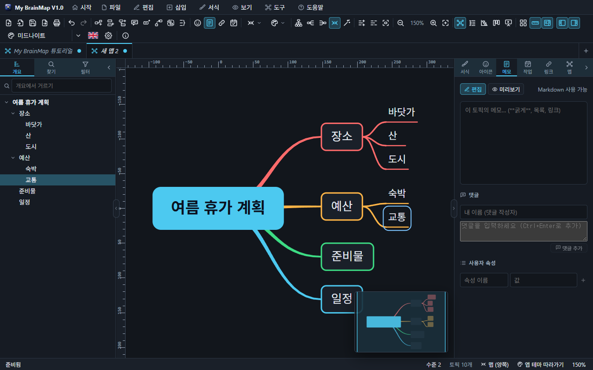
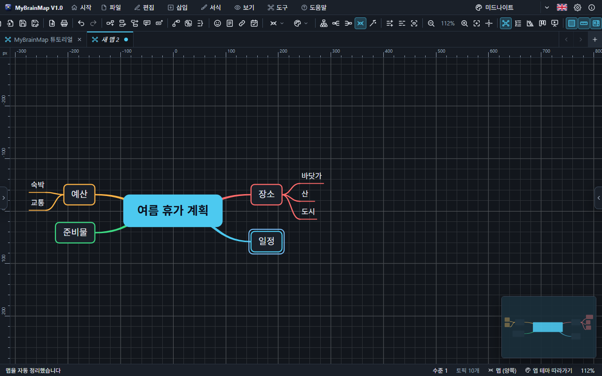
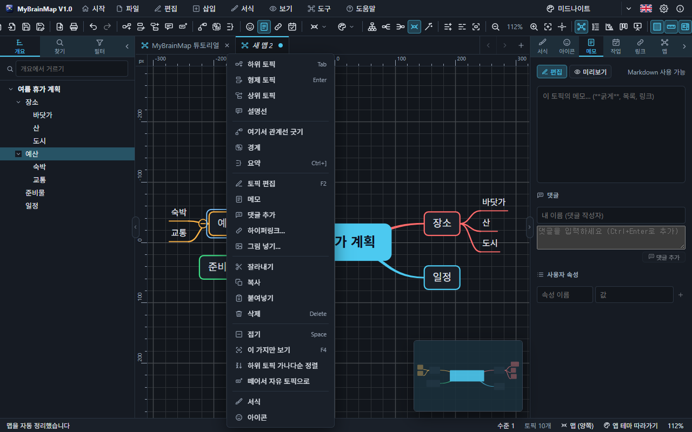

# 2. 화면 구성

위에서부터 **메뉴 막대**, **도구 모음**, **탭**, 그리고 가운데 **맵 캔버스**와 양옆의 **사이드바(왼쪽)** · **작업 창(오른쪽)**, 맨 아래 **상태 표시줄**입니다.

## 메뉴 막대

시작 · 파일 · 편집 · 삽입 · 서식 · 보기 · 도구 · 도움말. 모든 메뉴 항목에 아이콘과 단축키가 표시됩니다.

| 메뉴 | 주요 항목 |
| --- | --- |
| 파일 | 새 맵, 템플릿, 예제, 열기, 가져오기, 최근 파일, 저장, 내보내기, 그림으로 복사, 인쇄, 닫기 |
| 편집 | 실행 취소 · 다시 실행, 잘라내기 · 복사 · 붙여넣기, 삭제, 선택, 순서 바꾸기, 정렬, 찾기 |
| 삽입 | 하위 · 형제 · 상위 토픽, 설명선, 플로팅 토픽, 빠른 입력, 관계선, 경계, 요약, 메모, 링크, 첨부, 그림 |
| 서식 | 서식 · 아이콘 창, 굵게 · 기울임 · 밑줄, 글자 크기, 모양, 우선순위, 서식 지우기 |
| 보기 | 맵 · 개요 · 간트 · 칸반, 시작 화면, 패널 · 도구 모음 · 상태 표시줄, 격자 · 눈금자 · 전체 보기 창, 확대 · 축소, 펼치기 · 접기, 가지만 보기, 프레젠테이션, 전체 화면 |
| 도구 | 레이아웃 9가지, 맵 스타일, 양쪽 균형, 자동 정리, 방향 바꿔 다시 그리기 4가지, 번호 매기기, 필터, 설정 |
| 도움말 | 도움말(F1), 단축키, 튜토리얼, 예제 맵, 정보 |

## 도구 모음

| 묶음 | 버튼 |
| --- | --- |
| 파일 | 새 맵, 열기, 저장, 내보내기, 인쇄 |
| 실행 취소 | 실행 취소, 다시 실행 |
| 토픽 | 하위 · 형제 · 상위 토픽, 설명선, 플로팅 토픽, 관계선, 경계, 요약 |
| 내용 | 아이콘, 메모, 링크, 작업 (작업 창의 그 탭을 엽니다) |
| 맵 | 레이아웃 고르기, 맵 스타일 고르기 |
| 정리 | 위→아래 · 왼→오 · 오→왼 · 양쪽으로 다시 그리기, 자동 정리 |
| 펼치기 | 모두 펼치기, 모두 접기, 가지만 보기 |
| 확대 | 축소, 비율(누르면 100%), 확대, 맵 전체 |
| 보기 | 맵, 개요, 간트, 칸반, 프레젠테이션 |
| 화면 | 격자, 눈금자, 전체 보기 창 |
| 패널 | 왼쪽 패널, 오른쪽 패널 |

오른쪽 끝에는 테마(누르면 다음 테마), 언어(국기), 설정, 정보가 있습니다. 창이 좁으면 도구 모음은 묶음 단위로 두 줄이 됩니다. 버튼에 마우스를 올리면 이름과 단축키가 보입니다.

## 격자 · 눈금자 · 전체 보기 창

- **격자** — MyCAD 와 같은 방식의 5 × 5 칸 묶음. 100% 에서 작은 칸은 20 단위, 묶음은 100 단위이고, 묶음 선은 굵게, 칸 선은 가늘게, 0 을 지나는 축 선은 더 진하게 그립니다(색은 맵 배경에 글자색을 조금 섞은 것). 확대 · 축소해도 칸은 화면에서 10 ~ 50 픽셀을 유지합니다 — 그 범위를 넘으면 칸 단위가 5배(묶음이 새 칸)나 1/5(칸이 새 묶음)이 되어, 격자가 늘 같은 모양으로 이어집니다. (`Ctrl+Alt+G`)
- **눈금자** — 위와 왼쪽 가장자리(22 픽셀, MyCAD 와 같은 모양). 0 은 중심 토픽의 가운데입니다. 격자의 묶음 선마다 숫자가 붙은 긴 눈금, 칸 선마다 짧은 눈금이 안쪽 가장자리에서 자라 **눈금과 격자선이 정확히 겹칩니다**. 왼쪽 눈금자의 숫자는 위로 세워 쓰고, 모서리에 단위(px)를, 마우스 위치는 두 눈금자에 주황색 표시로 보여 줍니다. (`Ctrl+Alt+R`)
- **전체 보기 창** — 오른쪽 아래 작은 창에 맵 전체와 지금 보이는 부분(틀)이 그려집니다. 켜 두면 맵이 화면에 다 들어와도 항상 보이고, 누르거나 끌면 그곳으로 화면이 이동합니다. (`Ctrl+Alt+O`)

세 가지는 도구 모음, 보기 메뉴, 빈 곳의 오른쪽 클릭 메뉴, 설정 › 맵에서 켜고 끕니다. 처음에는 모두 켜져 있습니다.

## 패널 접고 펴기

- 패널과 맵 사이 경계의 가운데에 있는 작은 화살표를 누르거나, 경계를 두 번 누르면 패널이 접힙니다.
- 접힌 패널은 맵 가장자리에 나타나는 작은 탭을 눌러 다시 폅니다.
- 패널 머리 오른쪽의 화살표 단추, 도구 모음의 패널 버튼, `Ctrl+Alt+S`(왼쪽) · `Ctrl+Alt+P`(오른쪽)도 같은 일을 합니다.
- 경계를 끌면 너비가 바뀝니다.

### 왼쪽 패널 (사이드바)

**개요**(맵 전체를 나무 구조로), **찾기**(찾기 · 바꾸기), **필터**(우선순위 · 아이콘 · 태그 · 진행 상태 · 마감일). 항목을 누르면 그 토픽이 선택되고 화면 가운데로 오며, **오른쪽 클릭하면 토픽 메뉴**가 열립니다.

### 오른쪽 패널 (작업 창)

선택한 토픽의 **서식 · 아이콘 · 메모(댓글 · 사용자 속성) · 작업 · 링크**, 맵 전체의 **맵** 탭.

## 컨텍스트 메뉴

오른쪽 클릭하면 그 자리에서 쓸 수 있는 명령이 나옵니다. **모든 항목에 아이콘**이 있고, 단축키가 있는 항목은 단축키도 보입니다.

| 어디서 | 메뉴 |
| --- | --- |
| 토픽 | 하위 · 형제 · 상위 토픽, 설명선, 관계선 시작, 경계, 요약, 편집, 메모, 링크, 그림, 잘라내기 · 복사 · 붙여넣기 · 삭제, 접기, 가지만 보기, 정렬, 자리 되돌리기, 떼어서 자유 토픽으로, 서식, 아이콘 |
| 빈 곳 | 여기에 플로팅 토픽, 붙여넣기, 맵 전체, 펼치기 · 접기, 자동 정리, 방향 바꿔 다시 그리기, 격자 · 눈금자 · 전체 보기 창, 맵 스타일, 모두 선택 |
| 관계선 | 이름, 점선, 양쪽 화살표, 방향 뒤집기, 곡선 초기화, 색, 삭제 |
| 탭 | 닫기, 다른 탭 닫기, 모두 닫기, 저장, 폴더 열기, 경로 복사 |
| 왼쪽 패널 항목 | 토픽 메뉴와 같음 |

## 상태 표시줄

왼쪽에 최근 메시지, 오른쪽에 선택 수 또는 수준, 토픽 수, 필터 상태, 레이아웃, 맵 스타일, 확대 비율. 레이아웃과 스타일은 눌러서 바로 바꿉니다.
