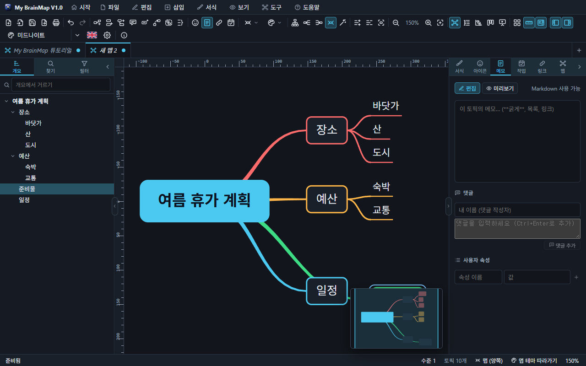
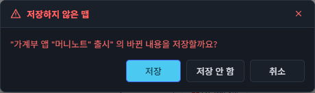

# 3. 토픽 만들기와 편집

## 토픽의 종류

| 종류 | 설명 |
| --- | --- |
| 중심 토픽 | 맵의 한가운데. 맵마다 하나 |
| 주 토픽 · 하위 토픽 | 중심 토픽에서 뻗는 가지 |
| 설명선 | 토픽 위에 말풍선처럼 붙는 토픽 (`Ctrl+Shift+Enter`) |
| 플로팅 토픽 | 어느 가지에도 속하지 않고 아무 데나 놓이는 토픽 |

## 키보드로 만들기

| 키 | 하는 일 |
| --- | --- |
| `Enter` | 형제 토픽 (중심 토픽에서는 하위 토픽) |
| `Shift+Enter` | 앞쪽 형제 토픽 |
| `Tab` / `Insert` | 하위 토픽 |
| `Ctrl+Shift+Insert` | 상위 토픽 끼워 넣기 |
| `Ctrl+Shift+Enter` | 설명선 |
| `Ctrl+Shift+Q` | 빠른 입력 — 들여 쓴 여러 줄을 한 번에 토픽으로 |
| 빈 곳 두 번 누르기 | 그 자리에 플로팅 토픽 |

## 편집

토픽을 고르고 글자를 치면 바로 편집됩니다(한글 입력도 첫 글자부터). `F2` 나 두 번 누르기도 편집입니다. `Shift+Enter` 는 줄바꿈, `Enter` 는 끝내기, `Esc` 는 취소입니다.

## 끌어서 옮기기 — 연결은 유지

*"준비물"을 빈 곳으로 끌어 놓았습니다. 중심 토픽과의 연결선이 그대로 이어져 있습니다.*

| 놓는 곳 | 결과 |
| --- | --- |
| 다른 토픽의 가운데 | 그 토픽의 하위 토픽 |
| 다른 토픽의 위 · 아래 가장자리 (조직도: 왼쪽 · 오른쪽) | 그 앞 · 뒤의 형제 토픽 |
| **빈 곳** | **연결된 채로 그 자리로 옮겨짐** — 하위 토픽, 연결선, 관계선이 함께 따라옵니다 |
| `Alt` 를 누른 채 빈 곳 | 가지에서 떼어 플로팅 토픽 |

- 여러 토픽을 선택해 함께 끌 수 있습니다.
- 손으로 옮긴 토픽은 오른쪽 클릭 메뉴 **자리 되돌리기**, 도구 모음의 **자동 정리**, 또는 **방향 바꿔 다시 그리기**로 제자리에 돌아옵니다.
- 옮긴 자리는 맵 파일에 저장됩니다. 다른 가지로 옮기면 그 자리는 버리고 새 가지의 배치를 따릅니다.
- 자기 하위 토픽 안으로는 옮길 수 없습니다.

## 선택

누르기는 하나, `Ctrl`+누르기는 더하기/빼기, `Shift`+누르기는 더하기, `Shift` 나 `Ctrl` 을 누른 채 빈 곳을 끌면 사각형 선택입니다. 화살표 키로 토픽 사이를 옮겨 다닙니다.

## 실행 취소 · 다시 실행

`Ctrl+Z` / `Ctrl+Y`(또는 `Ctrl+Shift+Z`). 토픽 추가 · 삭제 · 이동 · 글자 · 서식 · 레이아웃 · 자동 정리 · 칸반 이동 등 **모든 편집**이 한 단계씩 되돌아갑니다. 슬라이더를 끌거나 메모를 칠 때처럼 연속된 같은 편집은 한 단계로 묶입니다. 맵마다 실행 취소 기록이 따로 있습니다.

## 저장 여부 묻기

바꾼 맵(탭에 ● 표시)을 닫거나 프로그램을 끝내면 **저장 · 저장 안 함 · 취소**를 묻습니다. 취소하면 맵이 그대로 열려 있습니다. 설정 › 일반 › "닫을 때 저장 여부 묻기"로 끌 수 있습니다.
