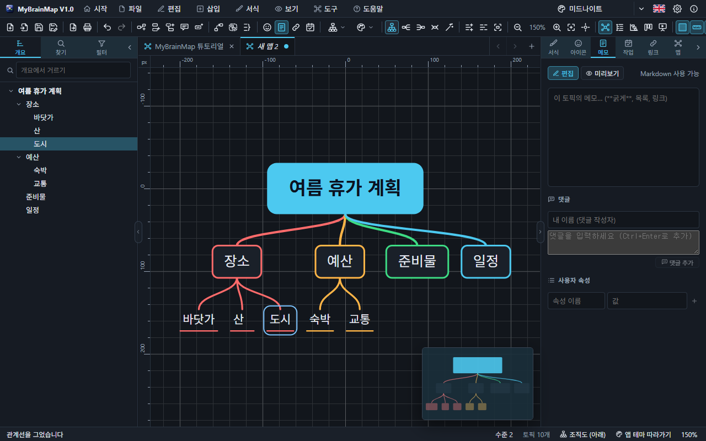

# 4. 레이아웃과 정리

## 방향 바꿔 다시 그리기

도구 모음의 다시 그리기 단추 네 개(도구 메뉴, 빈 곳의 오른쪽 클릭 메뉴에도 있음):

| 단추 | 단축키 | 결과 |
| --- | --- | --- |
| 위→아래 | `Ctrl+Alt+↓` | 조직도처럼 아래로 펼침 |
| 왼쪽→오른쪽 | `Ctrl+Alt+→` | 모든 가지를 오른쪽으로 |
| 오른쪽→왼쪽 | `Ctrl+Alt+←` | 모든 가지를 왼쪽으로 |
| 양쪽 | `Ctrl+Alt+M` | 방사형 맵 (양쪽 균형) |

다시 그리면 손으로 옮긴 토픽도 모두 제자리로 돌아갑니다.

## 자동 정리

**자동 정리**(`Ctrl+Shift+L`, 도구 › 자동 정리)는 레이아웃 방향은 그대로 두고, 손으로 옮긴 토픽을 모두 제자리로 돌리고, 방사형 맵이면 양쪽 균형을 다시 맞춥니다. 실행 취소로 되돌릴 수 있습니다.

## 레이아웃 9가지

| 레이아웃 | 모양 |
| --- | --- |
| 맵 (양쪽) | 중심에서 오른쪽과 왼쪽으로 |
| 오른쪽 맵 · 왼쪽 맵 | 한쪽으로만 |
| 조직도 (아래 · 위) | 위→아래 또는 아래→위 |
| 트리 (오른쪽 · 왼쪽) | 들여 쓴 목록 모양 |
| 타임라인 | 가로 시간 축 위에 주 토픽 |
| 피쉬본 | 원인 분석 — 등뼈와 비스듬한 뼈 |

**가지마다 다른 배치**: 토픽 하나를 고르고 작업 창 › 서식 › 하위 토픽 배치에서 바꾸면 그 가지만 다르게 펼쳐집니다(9가지 레이아웃 모두에서). 중심 토픽을 고르고 바꾸면 맵 전체의 레이아웃이 바뀌고(아래로 = 조직도, 목록 = 트리, 자동 = 맵), 피시본의 원인(주 토픽)에 배치를 주면 그 하위 토픽이 그 방향으로 펼쳐지고 뼈는 묶음을 돌아 척추까지 이어집니다.

## 맵 스타일

맵 스타일 단추(도구 모음)나 작업 창 › 맵 탭에서 색 구성(자동 · 클래식 · 무지개 · 파스텔 · 미드나이트 · 네온 · 비즈니스 · 바다 · 종이 · 칠판 · 청사진 …), 연결선 모양(곡선 · 직선 · 꺾은선 · 둥근 꺾은선 — 꺾은선은 한 토픽의 하위 토픽 선이 모두 한 줄기에서 갈라지고, 선택한 토픽의 ◆ 손잡이나 서식 › 꺾임 위치로 꺾이는 곳을 5~95% 사이에서 옮깁니다), 가지 색, 간격, 배경, 번호 매기기를 고릅니다. 토픽마다 모양(둥근 사각형 · 사각형 · 캡슐 · 타원 · 밑줄 · 육각형 · 마름모 · 원 · 없음), 채우기, 글자색, 테두리, 글꼴을 작업 창 › 서식에서 바꿉니다.
