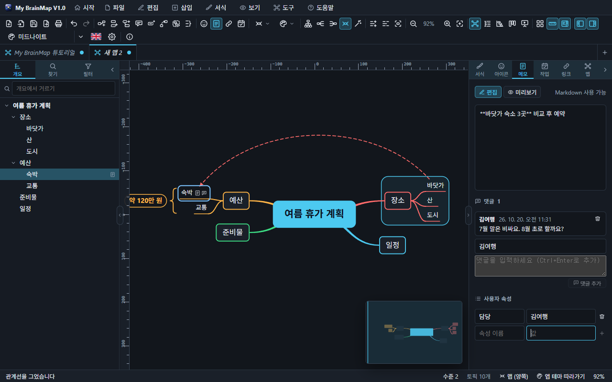
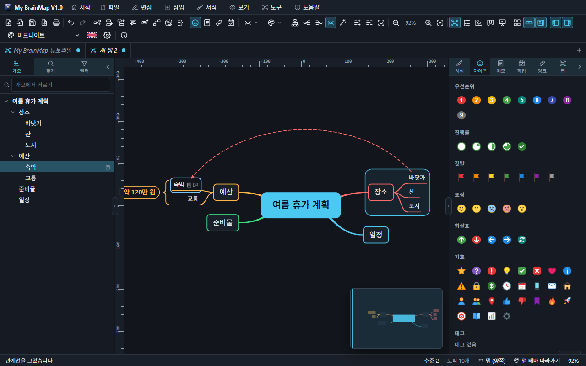

# 5. 토픽에 담는 것

## 메모 · 댓글 · 사용자 속성

작업 창 › **메모** 탭(`Ctrl+T`):

- **메모** — Markdown(굵게, 목록, 링크, 제목 …)으로 긴 글을 씁니다. **미리보기**로 확인합니다. 메모가 있는 토픽에는 종이 표시가 붙습니다.
- **댓글** — 작성자 이름을 적고 댓글을 씁니다(`Ctrl+Enter` 로 추가). 댓글마다 작성자와 날짜가 남고, 휴지통으로 지웁니다. 댓글이 있는 토픽에는 **말풍선 표시**가 붙고, 표시를 누르면 메모 탭이 열립니다. 작성자 이름은 기억됩니다.
- **사용자 속성** — "담당 = 김여행", "예산 = 120만 원"처럼 이름과 값의 쌍. 이름을 비우거나 휴지통을 누르면 그 줄이 지워집니다.

메모 · 댓글 · 속성은 모두 맵 파일에 저장되고, 메모는 찾기와 내보내기(Word · HTML · Markdown …)에도 들어갑니다.

## 아이콘 · 태그

작업 창 › **아이콘** 탭: 우선순위 1~9, 진행률(0 · 25 · 50 · 75 · 100%), 깃발, 표정, 화살표, 기호 아이콘과 태그. 자주 쓰는 태그는 기억되어 다시 고를 수 있습니다. `Ctrl+Shift+1`…`9` 는 우선순위, `Ctrl+Shift+0` 은 지우기입니다.

## 작업 정보

작업 창 › **작업** 탭: 시작일 · 마감일 · 기간, 진행률, 우선순위, 담당, 작업량(시간), 마일스톤. 날짜가 있는 토픽은 토픽 아래에 한 줄로 표시되고, 간트 차트와 칸반 카드에 나옵니다. CSV 로 작업 목록을 내보낼 수 있습니다.

## 링크 · 첨부 · 그림

작업 창 › **링크** 탭:

- **하이퍼링크**(`Ctrl+K`) — 웹 주소, 파일, 또는 맵 안의 다른 토픽. 링크 표시를 누르면 엽니다.
- **첨부** — 파일을 토픽에 끌어 놓거나 "첨부 추가"로 고릅니다.
- **그림** — 파일에서 넣거나, 그림을 복사한 뒤 `Ctrl+V`. 그림은 맵 파일 안에 저장됩니다.
