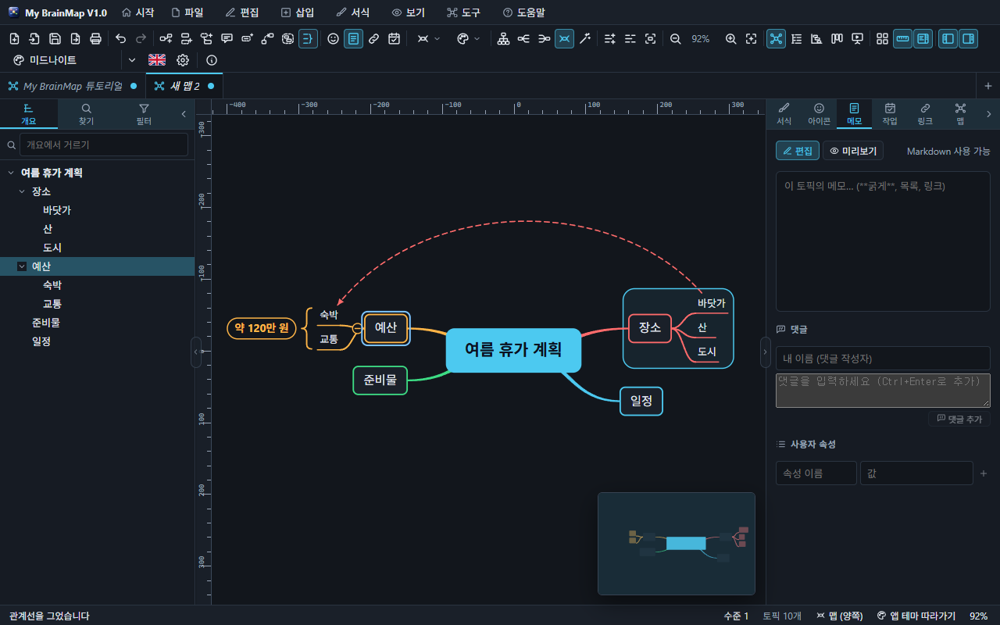

# 6. 구조 표현

*"바닷가 → 숙박" 관계선, "장소" 가지의 경계, "예산" 하위 토픽의 요약 괄호.*

## 관계선

가지와 상관없이 두 토픽을 잇는 곡선입니다.

1. 토픽을 고르고 도구 모음의 관계선 단추(`Ctrl+Shift+R`)를 누른 뒤, 이을 토픽을 누릅니다. 두 토픽을 선택한 채 누르면 바로 이어집니다.
2. 관계선을 누르면 손잡이 두 개가 나와 곡선을 끌어 바꿉니다.
3. 오른쪽 클릭 메뉴: 이름, 점선 / 실선, 양쪽 화살표, 방향 뒤집기, 곡선 초기화, 색, 삭제.

## 경계

가지 하나를 테두리로 묶습니다(`Ctrl+Shift+B`). 둥근 사각형과 구름 모양이 있고, 오른쪽 클릭 메뉴 **경계 이름**으로 제목을 붙입니다.

## 요약

하위 토픽이 있는 토픽을 고르고 **삽입 › 요약**(`Ctrl+]`, 도구 모음의 요약 단추)을 누르면 하위 토픽들 옆에 괄호가 생기고 요약 글이 붙습니다.

- 요약 글은 가지 색을 따릅니다. 두 번 누르거나 메뉴 **요약 이름 바꾸기**로 고칩니다.
- 다시 `Ctrl+]`(또는 메뉴 **요약 없애기**)를 누르면 없어집니다.
- 오른쪽 · 왼쪽으로 펼친 가지에 그려지며, 그림 · PDF 로 내보낼 때도 함께 나옵니다.

## 설명선

토픽 위에 말풍선처럼 붙는 토픽(`Ctrl+Shift+Enter`). 주의 사항이나 덧붙이는 말에 씁니다. 설명선에도 하위 토픽을 달 수 있습니다.

## 플로팅 토픽

어느 가지에도 속하지 않는 토픽입니다. 빈 곳을 두 번 누르거나, 가지의 토픽을 `Alt` 를 누른 채 빈 곳에 놓거나, 오른쪽 클릭 메뉴 **떼어서 자유 토픽으로**를 고릅니다. 플로팅 토픽도 하위 토픽과 관계선을 가질 수 있고, 끌어서 아무 데나 옮깁니다.
