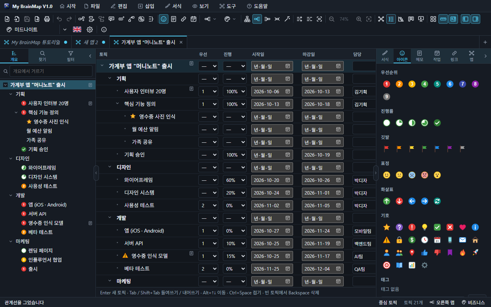
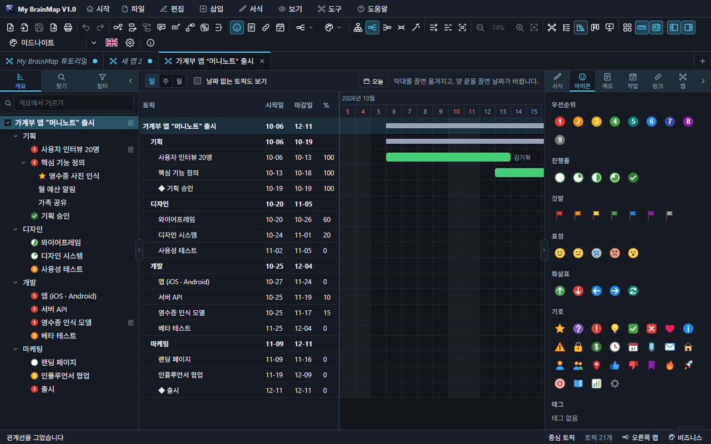
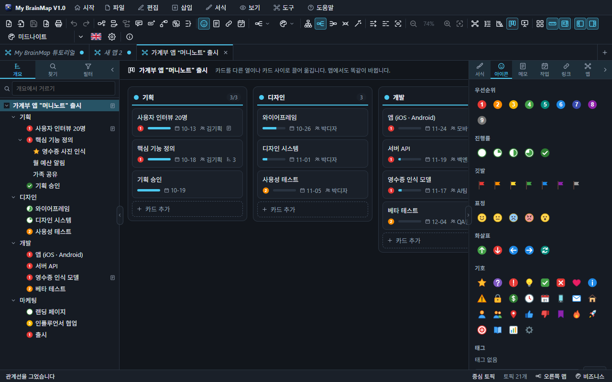
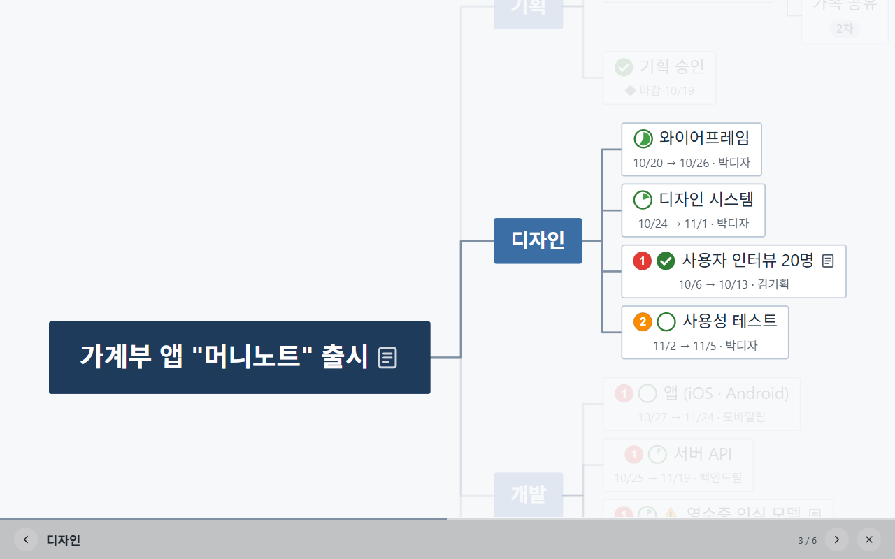

# 7. 보기

같은 맵을 네 가지로 봅니다: **맵 · 개요 · 간트 차트 · 칸반 보드**. 도구 모음의 보기 단추나 보기 메뉴로 바꾸고, 어느 보기에서 고쳐도 같은 맵이 바뀝니다(실행 취소도 공유).

## 개요 보기

맵을 들여 쓴 목록으로 보고 편집합니다. `Enter` 로 다음 줄, `Tab` / `Shift+Tab` 으로 들여쓰기 · 내어쓰기, 끌어서 순서를 바꿉니다.

## 간트 차트

시작일 · 마감일이 있는 토픽을 달력 위의 막대로 보여 줍니다. 막대를 끌면 날짜가 옮겨지고, 양 끝을 끌면 시작 · 마감이 바뀝니다. 진행률이 막대를 채우고, 마일스톤은 마름모, 오늘은 빨간 선입니다. 위쪽 가지는 요약 막대가 됩니다. 눈금은 일 · 주 · 월.

## 칸반 보드

주 토픽은 **열**, 그 하위 토픽은 **카드**입니다. 카드에는 우선순위, 진행률, 마감일, 담당, 하위 토픽 · 메모 · 댓글 수가 보입니다.

- 카드를 다른 열로 끌면 그 주 토픽의 하위 토픽으로, 카드 사이에 놓으면 그 자리로 옮겨집니다. 맵에서도 똑같이 바뀌고 `Ctrl+Z` 로 되돌립니다.
- 열 아래 **카드 추가**로 하위 토픽을, 오른쪽 끝 **열 추가**로 주 토픽을 만듭니다.
- 카드나 열 머리를 누르면 선택되어 작업 창에서 편집합니다.

## 프레젠테이션

`F5`. 중심 토픽에서 시작해 가지마다 한 장씩 보여 줍니다. `→` / `Space` 다음, `←` 이전, `Esc` 끝내기.

## 가지만 보기

`F4`. 선택한 가지만 남기고 나머지를 숨깁니다. 다시 `F4` 나 `Esc` 로 돌아옵니다.
