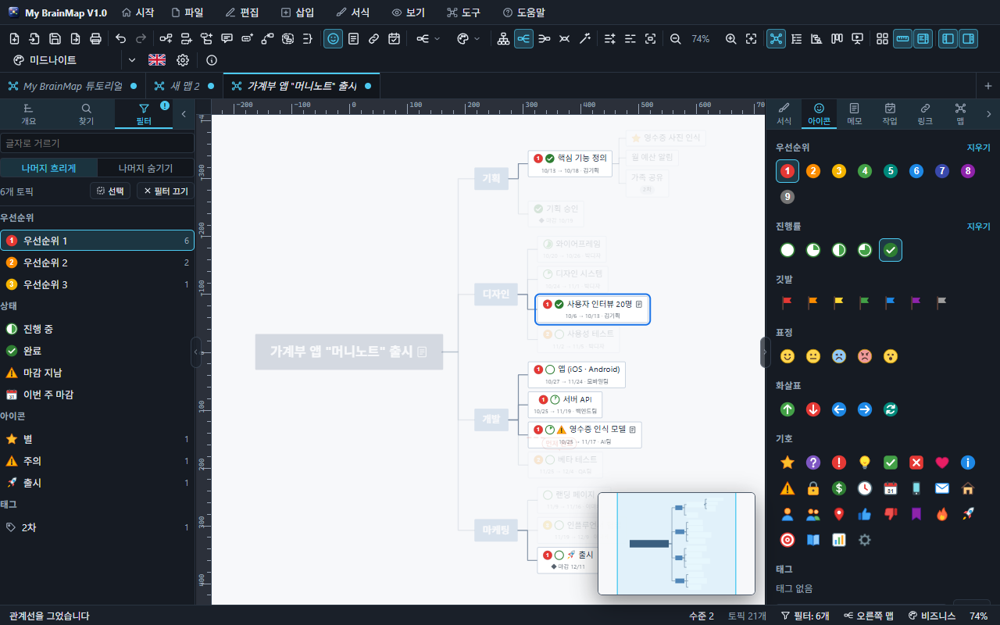
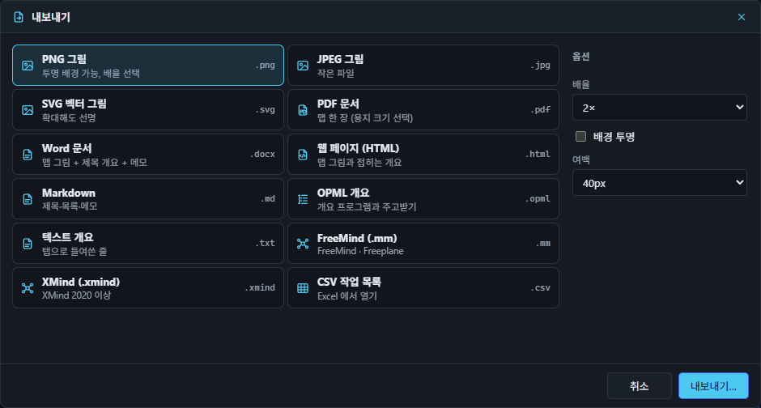
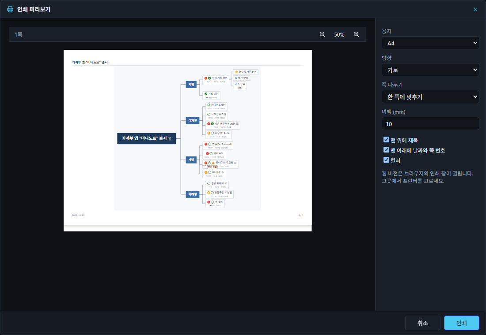
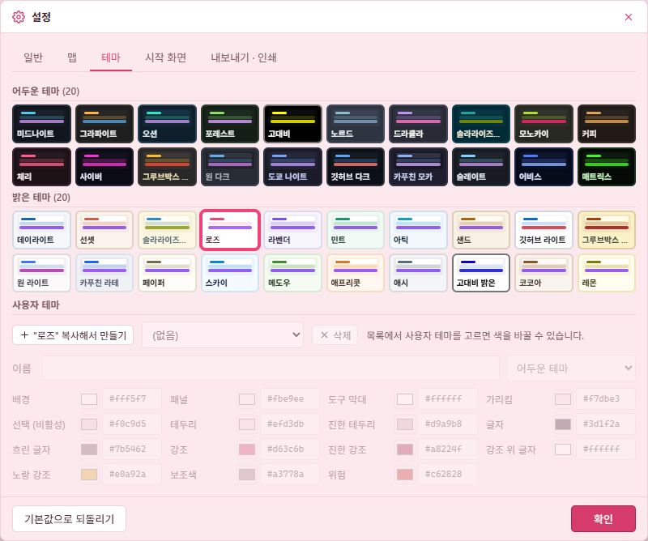
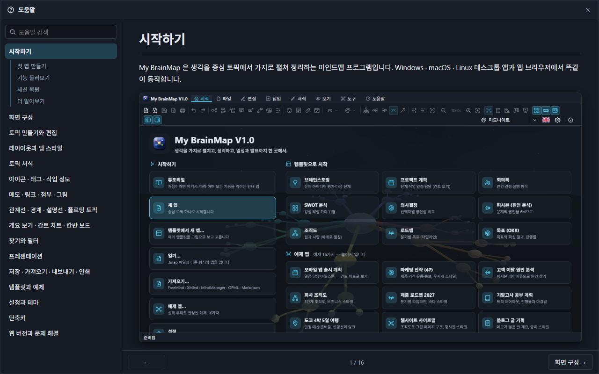

# 8. 찾기 · 파일 · 설정 · 도움말

## 찾기와 필터

- **찾기 · 바꾸기**(`Ctrl+F` / `Ctrl+H`) — 왼쪽 패널 › 찾기. 대소문자 구분, 단어 단위, 정규식, 메모에서 찾기. 찾은 토픽을 모두 선택하거나 한꺼번에 바꿉니다. `F3` 은 다음 찾기.
- **필터** — 왼쪽 패널 › 필터. 맵에 쓰인 우선순위 · 아이콘 · 태그와 그 개수가 나오고, 고르면 나머지 토픽이 **흐려지거나 숨겨집니다**. 진행 중 · 완료 · 마감 지남 · 이번 주로도 거릅니다.

## 저장 · 가져오기 · 내보내기 · 인쇄

- **저장**(`Ctrl+S`) — `.tmap` 파일(JSON). 그림, 메모, 댓글, 속성, 손으로 옮긴 자리까지 한 파일에 들어갑니다. 자동 저장(창을 떠날 때 / 몇 초 뒤)을 설정할 수 있고, 열려 있던 맵은 다음 실행 때 다시 열립니다.
- **열기 · 가져오기** — FreeMind(.mm), XMind(.xmind), MindManager(.mmap), OPML, Markdown, 텍스트 개요. 파일을 창에 끌어 놓아도 됩니다.
- **내보내기**(`Ctrl+E`) — PNG, JPEG, SVG, PDF, Word(.docx), HTML, Markdown, OPML, 텍스트, FreeMind, XMind, CSV 작업 목록. 그림은 배율 · 투명 배경 · 여백을 고릅니다. `Ctrl+Shift+C` 는 맵을 그림으로 복사.

- **인쇄**(`Ctrl+P`) — 용지(A3 · A4 · A5 · Letter · Legal), 방향, 여백, 쪽 수(한 장에 맞추기 · 2~9쪽 나누기), 머리글 · 바닥글, 컬러 / 흑백을 미리 보며 고릅니다.

## 설정

`Ctrl+,`. 설정은 고정 크기의 별도 창(데스크톱)으로 열리고, 바꾸는 즉시 적용 · 저장됩니다.

| 탭 | 내용 |
| --- | --- |
| 일반 | 언어(한국어 · English), 도구 모음 · 상태 표시줄 · 패널, 패널 너비, 맞춤법 검사, 양쪽 자동 균형, 세션 복원, 닫을 때 저장 여부 묻기, 바뀐 파일 다시 읽기, 자동 저장 |
| 맵 | 새 맵의 레이아웃 · 스타일 · 글꼴 · 글자 크기, 부드러운 이동, 휠 확대, 격자, 눈금자, 전체 보기 창 |
| 테마 | 어두운 테마 20 · 밝은 테마 20, 사용자 테마(색 15가지 직접 지정) |
| 시작 화면 | 시작할 때 시작 화면 보기, 배경 장면 21가지 · 투명도 · 속도 |
| 내보내기 · 인쇄 | 그림 배율 · 여백 · 투명 배경, 용지 · 방향 · 여백 · 쪽 · 머리글 · 바닥글 · 컬러 |

"기본값으로 되돌리기"는 언어와 창 배치를 뺀 설정을 처음으로 돌립니다.

## 도움말

`F1` 이나 도움말 메뉴의 **도움말**을 누르면 별도 창이 열립니다(웹에서는 새 창). 왼쪽 목차와 검색, 장마다 그림, 아래쪽의 앞 · 뒤 이동이 있고, 한국어 · 영어 두 언어로 쓰여 있습니다.
