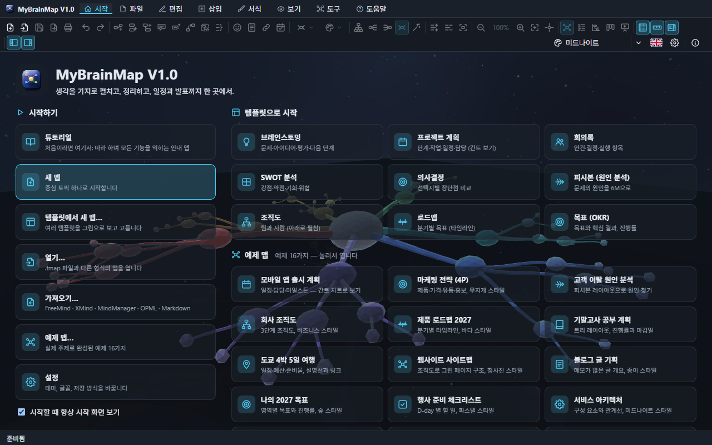

# MyBrainMap 기능 문서

MyBrainMap 은 생각을 중심 토픽에서 가지로 펼쳐 정리하는 마인드맵 프로그램입니다. Windows · macOS · Linux 데스크톱 앱(Tauri)과 웹 브라우저에서 똑같이 동작합니다.

## 튜토리얼 영상

프로젝트 폴더의 **`MyBrainMap-Tutorial.mp4`** 는 모든 기능을 차례로 보여 주는 녹화 영상입니다(한국어 자막). 같은 내용을 프로그램 안에서 직접 따라 하려면 시작 화면 **시작하기 › 튜토리얼**을 누르세요.

영상과 이 문서의 그림은 `npm run build && npm run tutorial:video` 로 실제 프로그램을 조작해 다시 만들 수 있습니다(ffmpeg 필요).

## 목차

| 문서 | 내용 |
| --- | --- |
| [1. 시작 화면과 튜토리얼](01-start-and-tutorial.md) | 시작 화면, 배경 효과 21가지, 튜토리얼 맵, 예제 맵 |
| [2. 화면 구성](02-screen.md) | 메뉴, 도구 모음, 격자 · 눈금자 · 전체 보기 창, 패널 접기, 컨텍스트 메뉴 |
| [3. 토픽 만들기와 편집](03-topics.md) | 키보드로 만들기, 편집, 끌어서 옮기기(연결 유지), 실행 취소 |
| [4. 레이아웃과 정리](04-layouts.md) | 방향 바꿔 다시 그리기, 자동 정리, 레이아웃 9가지, 맵 스타일 |
| [5. 토픽에 담는 것](05-content.md) | 메모, 댓글, 사용자 속성, 아이콘, 작업 정보, 링크 · 첨부 · 그림 |
| [6. 구조 표현](06-structure.md) | 관계선, 경계, 요약, 설명선, 플로팅 토픽 |
| [7. 보기](07-views.md) | 개요, 간트 차트, 칸반 보드, 프레젠테이션, 가지만 보기 |
| [8. 찾기 · 파일 · 설정 · 도움말](08-find-files-settings.md) | 찾기와 필터, 저장 · 가져오기 · 내보내기 · 인쇄, 설정, 도움말 창 |
| [9. 단축키](09-shortcuts.md) | 모든 단축키 |
| [기능 비교](feature-parity.md) | MindManager · EdrawMind · SmartDraw · Lucidchart 와의 기능 비교와 검증 테스트 |
| [테스트와 검증](testing.md) | 단위 테스트, GUI 스모크 테스트, 팝업 창 크기 검사 |

프로그램 안의 **도움말(F1)** 은 같은 내용을 별도 창에서 보여 줍니다.
