# MyCAD 1.0 튜토리얼

> 레슨 33개, 단계 158개. 앱의 **도움말 › 따라 하는 튜토리얼**(시작 페이지의 첫 카드)과 같은 순서·같은 좌표입니다. 앱에서는 **보기**(자동으로 보여 줌)와 **직접 하기**(해 보면 다음으로 넘어감)를 고를 수 있고, 같은 내용의 동영상이 프로젝트 폴더의 `MyCAD-Tutorial.mp4`에 있습니다.

## 목차

| 레슨 | | 단계 | 앱에서 |
|---:|---|---:|---|
| 0 | [설치와 시작 페이지](#레슨-0-설치와-시작-페이지) | | |
| 1 | [둘러보기](#레슨-1-둘러보기) | 6 | 도움말 › 따라 하는 튜토리얼 › 레슨 1 |
| 2 | [선과 도형 그리기](#레슨-2-선과-도형-그리기) | 10 | 도움말 › 따라 하는 튜토리얼 › 레슨 2 |
| 3 | [정밀 입력·스냅·단위](#레슨-3-정밀-입력스냅단위) | 7 | 도움말 › 따라 하는 튜토리얼 › 레슨 3 |
| 4 | [선택과 수정](#레슨-4-선택과-수정) | 12 | 도움말 › 따라 하는 튜토리얼 › 레슨 4 |
| 5 | [치수와 주석](#레슨-5-치수와-주석) | 10 | 도움말 › 따라 하는 튜토리얼 › 레슨 5 |
| 6 | [속성과 레이어](#레슨-6-속성과-레이어) | 4 | 도움말 › 따라 하는 튜토리얼 › 레슨 6 |
| 7 | [부품 라이브러리](#레슨-7-부품-라이브러리) | 3 | 도움말 › 따라 하는 튜토리얼 › 레슨 7 |
| 8 | [3D 솔리드](#레슨-8-3d-솔리드) | 6 | 도움말 › 따라 하는 튜토리얼 › 레슨 8 |
| 9 | [2D에서 3D로: 돌출·회전·로프트·스윕](#레슨-9-2d에서-3d로-돌출회전로프트스윕) | 4 | 도움말 › 따라 하는 튜토리얼 › 레슨 9 |
| 10 | [불리언: 빼기·합치기·교차](#레슨-10-불리언-빼기합치기교차) | 3 | 도움말 › 따라 하는 튜토리얼 › 레슨 10 |
| 11 | [도면 뷰와 단면](#레슨-11-도면-뷰와-단면) | 2 | 도움말 › 따라 하는 튜토리얼 › 레슨 11 |
| 12 | [3D 보기 자세히](#레슨-12-3d-보기-자세히) | 3 | 도움말 › 따라 하는 튜토리얼 › 레슨 12 |
| 13 | [파일: 저장·열기·가져오기·내보내기](#레슨-13-파일-저장열기가져오기내보내기) | 5 | 도움말 › 따라 하는 튜토리얼 › 레슨 13 |
| 14 | [인쇄와 3D 프린팅](#레슨-14-인쇄와-3d-프린팅) | 2 | 도움말 › 따라 하는 튜토리얼 › 레슨 14 |
| 15 | [설정과 모양](#레슨-15-설정과-모양) | 3 | 도움말 › 따라 하는 튜토리얼 › 레슨 15 |
| 16 | [도움말](#레슨-16-도움말) | 3 | 도움말 › 따라 하는 튜토리얼 › 레슨 16 |
| 17 | [조립과 움직임](#레슨-17-조립과-움직임) | 3 | 도움말 › 따라 하는 튜토리얼 › 레슨 17 |
| 18 | [정확한 솔리드 (OpenCASCADE)](#레슨-18-정확한-솔리드-opencascade) | 3 | 도움말 › 따라 하는 튜토리얼 › 레슨 18 |
| 19 | [CAM 3D 가공과 시뮬레이션](#레슨-19-cam-3d-가공과-시뮬레이션) | 2 | 도움말 › 따라 하는 튜토리얼 › 레슨 19 |
| 20 | [FEM 해석: 판과 솔리드](#레슨-20-fem-해석-판과-솔리드) | 2 | 도움말 › 따라 하는 튜토리얼 › 레슨 20 |
| 21 | [Python 콘솔과 매크로](#레슨-21-python-콘솔과-매크로) | 2 | 도움말 › 따라 하는 튜토리얼 › 레슨 21 |
| 22 | [2D 편집: 자르기·연장·모깎기·모따기](#레슨-22-2d-편집-자르기연장모깎기모따기) | 4 | 도움말 › 따라 하는 튜토리얼 › 레슨 22 |
| 23 | [스케치 구속과 보조선](#레슨-23-스케치-구속과-보조선) | 5 | 도움말 › 따라 하는 튜토리얼 › 레슨 23 |
| 24 | [클론·작업 평면·문제 검사](#레슨-24-클론작업-평면문제-검사) | 7 | 도움말 › 따라 하는 튜토리얼 › 레슨 24 |
| 25 | [제작 도면: 풍선·기하 공차·데이텀](#레슨-25-제작-도면-풍선기하-공차데이텀) | 6 | 도움말 › 따라 하는 튜토리얼 › 레슨 25 |
| 26 | [PartDesign: 포켓·구멍·모따기·두께](#레슨-26-partdesign-포켓구멍모따기두께) | 6 | 도움말 › 따라 하는 튜토리얼 › 레슨 26 |
| 27 | [형상 검사·메시·역설계](#레슨-27-형상-검사메시역설계) | 5 | 도움말 › 따라 하는 튜토리얼 › 레슨 27 |
| 28 | [건축 (BIM) 1: 벽·창문·슬래브·지붕·실](#레슨-28-건축-bim-1-벽창문슬래브지붕실) | 6 | 도움말 › 따라 하는 튜토리얼 › 레슨 28 |
| 29 | [건축 (BIM) 2: 기둥·계단·층·철근·물량표·IFC](#레슨-29-건축-bim-2-기둥계단층철근물량표ifc) | 7 | 도움말 › 따라 하는 튜토리얼 › 레슨 29 |
| 30 | [CAM 2D: 윤곽·포켓·드릴 G 코드](#레슨-30-cam-2d-윤곽포켓드릴-g-코드) | 3 | 도움말 › 따라 하는 튜토리얼 › 레슨 30 |
| 31 | [FEM 골조 해석](#레슨-31-fem-골조-해석) | 3 | 도움말 › 따라 하는 튜토리얼 › 레슨 31 |
| 32 | [스프레드시트·스크립트 콘솔·매크로 기록](#레슨-32-스프레드시트스크립트-콘솔매크로-기록) | 4 | 도움말 › 따라 하는 튜토리얼 › 레슨 32 |
| 33 | [로봇·보기·도구 메뉴](#레슨-33-로봇보기도구-메뉴) | 7 | 도움말 › 따라 하는 튜토리얼 › 레슨 33 |
| | [부록 A. 단축키](#부록-a-단축키) · [B. 지원 파일 형식](#부록-b-지원-파일-형식) · [C. 기능 찾아보기](#부록-c-기능-찾아보기) | | |

### 이 문서를 읽는 법

- **굵은 글씨**는 화면에 보이는 이름(버튼·메뉴·탭)입니다.
- `L`, `Ctrl+Z` 처럼 코드 글꼴은 누르는 키나 입력하는 글자입니다.
- 좌표는 mm, (x, y) 입니다. 튜토리얼은 5 mm 격자 스냅을 켜고 시작합니다.
- 각 단계의 그림은 그 단계를 마친 화면입니다(앱이 실제로 실행해서 찍었습니다).

---

## 레슨 0. 설치와 시작 페이지

1. **Windows**: `MyCAD_1.0.0_x64-setup.exe`(또는 `.msi`)를 실행합니다. **macOS**: `.dmg`, **Linux**: `.deb`·`.AppImage`. 웹 버전은 `dist/`를 웹 서버에 올리면 됩니다.
2. 처음 실행하면 **시작 페이지**가 열립니다. 탭 줄 맨 왼쪽의 **집 탭**으로 언제든 돌아옵니다(**보기 › 시작 페이지**). 설정 › 일반에서 시작할 때 보일지 고릅니다.
3. 시작 페이지의 **할 수 있는 일** 카드마다 그 일을 배우는 **레슨**과 **샘플**이 있습니다. 아래 **샘플**은 모두 클릭 한 번에 새 탭으로 열립니다(저장하면 새 이름을 묻습니다).

*시작 페이지: 할 수 있는 일(레슨·샘플), 빠른 시작, 최근 파일, 오늘의 팁, 샘플*

### 튜토리얼 화면

- 튜토리얼 패널은 끌어서 옮길 수 있습니다. 위쪽 목록에서 레슨을 고르고, **보기**는 재생·일시 정지·이전·다음과 속도(0.5×–4×)를, **직접 하기**는 **보여 주기**·**건너뛰기**를 씁니다.
- 중간 레슨부터 시작하면 앞 레슨의 결과를 자동으로 준비합니다.

*튜토리얼 보기: 커서가 실제 화면을 조작하고, 패널이 단계를 설명합니다*

*튜토리얼 직접 하기: 할 일과 클릭할 곳(빨간 원)이 표시되고, 해내면 다음 단계로 넘어갑니다*

---

## 레슨 1. 둘러보기

### 목표

화면 구성(메뉴·툴바·탭·도구 패널·캔버스·속성 패널·상태 표시줄)을 익히고, 시작 페이지에서 샘플을 열어 확대·이동·3D 보기를 해 봅니다.

### 따라 하기

1. **시작 페이지** — 시작 페이지에서 할 수 있는 일, 튜토리얼, 샘플, 최근 파일을 고릅니다. 메뉴 줄 맨 왼쪽의 집 버튼(또는 탭 줄의 집 탭)으로 언제든 돌아옵니다.

   

   *둘러보기 · 시작 페이지*

2. **샘플 열기** — 샘플 카드를 누르면 그 도면이 새 탭으로 열립니다. 플랜지 샘플을 엽니다.

   

   *둘러보기 · 샘플 열기*

3. **전체 보기와 확대** — 전체 보기(Home)는 도면 전체를 화면에 맞춥니다. Ctrl+휠이나 + / − 버튼으로 확대·축소합니다.

   

   *둘러보기 · 전체 보기와 확대*

4. **화면 이동** — 화면 이동 도구(또는 가운데 버튼·스페이스+끌기)로 도면을 옮겨 봅니다.

   

   *둘러보기 · 화면 이동*

5. **패널 접고 펴기** — 왼쪽 도구 패널과 오른쪽 속성 패널은 툴바 버튼(Ctrl+1, Ctrl+2)으로 접고 폅니다. 왼쪽 패널의 각 묶음 머리글을 누르면 그 묶음만 접힙니다.

   

   *둘러보기 · 패널 접고 펴기*

6. **3D 보기** — 3D 보기(Ctrl+Shift+3)는 닫힌 윤곽을 두께가 있는 판으로, 솔리드를 그대로 보여 줍니다. 다시 누르면 2D로 돌아갑니다.

   

   *둘러보기 · 3D 보기*

### 직접 해 보기

- 메뉴 줄 맨 왼쪽의 집 버튼을 누르세요.
- 샘플에서 "플랜지"를 누르세요.
- 툴바의 확대(+) 버튼과 전체 보기 버튼을 눌러 보세요.
- 화면 이동 도구를 고르고 캔버스를 끌어 보세요.
- 툴바의 3D 보기 버튼을 누르세요.

### 팁

- Home 키는 전체 보기, Ctrl+휠은 커서 위치를 중심으로 확대합니다.
- 가운데 버튼을 누른 채 끌거나 스페이스를 누른 채 끌면 어떤 도구에서도 화면을 옮길 수 있습니다.

### 자주 하는 실수

- 샘플을 고쳐 저장하면 새 이름을 묻습니다 — 샘플 원본은 바뀌지 않습니다.

### 확인

- [ ] 시작 페이지
- [ ] 샘플 열기
- [ ] 전체 보기와 확대
- [ ] 화면 이동
- [ ] 패널 접고 펴기
- [ ] 3D 보기

---

## 레슨 2. 선과 도형 그리기

### 목표

2D 그리기 도구 10가지(선·사각형·원·호·타원·정다각형·폴리선·스플라인·점)를 격자에 맞춰 써 봅니다.

### 따라 하기

1. **새 도면** — 새 도면(Ctrl+N)을 만듭니다. 격자 스냅이 켜져 있어 클릭이 5 mm 격자에 맞습니다.

   

   *선과 도형 그리기 · 새 도면*

2. **선 (L)** — 선 도구로 (0,0) → (60,0) → (60,40)을 클릭합니다. 클릭할 때마다 선이 이어지고 Esc로 끝냅니다.

   

   *선과 도형 그리기 · 선 (L)*

3. **사각형 (R)** — 사각형은 두 모서리를 클릭합니다: (80,0)과 (140,40).

   

   *선과 도형 그리기 · 사각형 (R)*

4. **원 (C)** — 원은 중심 (20,70)을 클릭하고, 반지름 15가 되도록 (35,70)을 클릭합니다.

   

   *선과 도형 그리기 · 원 (C)*

5. **호 (3점)** — 호는 시작점, 지나는 점, 끝점의 세 점으로 그립니다: (45,60), (60,75), (75,60).

   

   *선과 도형 그리기 · 호 (3점)*

6. **타원** — 타원은 중심 (100,70), 긴 축의 끝 (120,70), 짧은 축 반지름 (100,80)을 클릭합니다.

   

   *선과 도형 그리기 · 타원*

7. **정다각형** — 정다각형은 중심 (145,70)과 꼭짓점 (155,70)을 클릭합니다. 변의 수는 도구 옵션에서 바꿉니다.

   

   *선과 도형 그리기 · 정다각형*

8. **폴리선** — 폴리선은 여러 점을 이어 한 객체로 만듭니다. (0,95), (30,100), (50,90), (70,100)을 클릭하고 Enter.

   

   *선과 도형 그리기 · 폴리선*

9. **스플라인** — 스플라인은 클릭한 점을 부드럽게 지나는 곡선(NURBS)입니다. (85,95), (100,105), (115,90), (130,100)을 클릭하고 Enter.

   

   *선과 도형 그리기 · 스플라인*

10. **점** — 점 도구는 기준점을 찍습니다: (150,95).

   

   *선과 도형 그리기 · 점*

### 직접 해 보기

- 툴바의 새 도면 버튼을 누르세요.
- 선 도구로 표시된 세 점을 차례로 클릭하고 Esc를 누르세요.
- 사각형 도구로 두 모서리를 클릭하세요.
- 원 도구로 중심과 반지름 점을 클릭하세요.
- 호 도구로 세 점을 클릭하세요.
- 타원 도구로 세 점을 클릭하세요.
- 정다각형 도구로 중심과 꼭짓점을 클릭하세요.
- 폴리선 도구로 네 점을 클릭하고 Enter를 누르세요.
- 스플라인 도구로 네 점을 클릭하고 Enter를 누르세요.
- 점 도구로 표시된 곳을 클릭하세요.

### 팁

- 그리는 중에 오른쪽 클릭은 Enter와 같습니다(끝내기).
- 폴리선·스플라인은 첫 점을 다시 클릭하면 닫힙니다.
- 도구 단축키: L 선, R 사각형, C 원, A 호 등 — 툴팁에 나옵니다.

### 자주 하는 실수

- Esc를 한 번 누르면 그리던 것이 취소되고, 한 번 더 누르면 선택 도구로 돌아갑니다.

### 확인

- [ ] 새 도면
- [ ] 선 (L)
- [ ] 사각형 (R)
- [ ] 원 (C)
- [ ] 호 (3점)
- [ ] 타원
- [ ] 정다각형
- [ ] 폴리선
- [ ] 스플라인
- [ ] 점

---

## 레슨 3. 정밀 입력·스냅·단위

### 목표

좌표·상대 좌표·극좌표를 입력해 정확한 크기로 그리고, 객체 스냅·직교·길이 단위와 축척 막대를 다룹니다.

### 따라 하기

1. **좌표 입력** — 그리는 중에 숫자를 치면 명령 칸에 들어갑니다. 선 도구에서 0,0 → @80,0 → @0,50 → @-80,0을 입력하면 정확한 크기의 선이 됩니다.

   

   *정밀 입력·스냅·단위 · 좌표 입력*

2. **극좌표: 거리<각도** — @40<60은 마지막 점에서 40 mm, 60° 방향입니다. 100,0에서 시작해 @40<60을 입력합니다.

   

   *정밀 입력·스냅·단위 · 극좌표: 거리<각도*

3. **객체 스냅 (F3)** — 객체 스냅을 켜면 커서가 끝점·중간점·중심 등에 달라붙습니다. 끝점 (80,50) 근처를 클릭해 원의 중심을 정확히 맞춥니다.

   

   *정밀 입력·스냅·단위 · 객체 스냅 (F3)*

4. **직교 모드 (F8)** — 직교 모드에서는 선이 수평·수직으로만 그려집니다.

   

   *정밀 입력·스냅·단위 · 직교 모드 (F8)*

5. **길이 단위** — 설정 › 일반 › 길이 단위에서 mm·cm·m·in·ft를 고릅니다. 도면은 mm로 저장되고 보이는 값만 바뀝니다. 인치로 바꿉니다.

   

   *정밀 입력·스냅·단위 · 길이 단위*

   

   *길이 단위 — 창*

6. **다른 단위로 입력** — 숫자 뒤에 단위를 붙이면 자동으로 바뀝니다. 원의 반지름을 25.4mm로 입력하면 1 in가 됩니다.

   

   *정밀 입력·스냅·단위 · 다른 단위로 입력*

7. **축척 막대** — 캔버스 왼쪽 아래 축척 막대는 막대 길이가 실제 몇 mm인지와 화면 축척을 보여 줍니다. 끌어서 옮기고, 끝선을 끌어 길이를 바꾸며, 툴바 버튼으로 켜고 끕니다.

   

   *정밀 입력·스냅·단위 · 축척 막대*

### 직접 해 보기

- 선 도구를 고르고 명령 칸에 0,0 · @80,0 · @0,50 · @-80,0을 차례로 입력하세요.
- 선 도구로 100,0을 입력한 뒤 @40<60을 입력하세요.
- 툴바의 스냅을 켜고, 원 도구로 끝점 근처를 클릭하세요.
- 직교를 켜고 비스듬히 선을 그어 보세요.
- 설정(톱니바퀴) › 일반에서 길이 단위를 인치로 바꾸세요.
- 원 도구에서 120mm,40mm 와 @25.4mm<0을 입력하세요.

### 팁

- 좌표에도 단위를 붙일 수 있습니다: 2in,30mm.
- 스냅 종류(끝점·중간점·중심·사분점·교차점·근처점)는 설정 › 스냅에서 고릅니다.

### 자주 하는 실수

- 명령 칸에 입력한 뒤 Enter를 눌러야 점이 찍힙니다.

### 확인

- [ ] 좌표 입력
- [ ] 극좌표: 거리<각도
- [ ] 객체 스냅 (F3)
- [ ] 직교 모드 (F8)
- [ ] 길이 단위
- [ ] 다른 단위로 입력
- [ ] 축척 막대

---

## 레슨 4. 선택과 수정

### 목표

객체를 선택하고 이동·복사·회전·대칭·크기 조정·간격 띄우기·배열·분해·삭제를 하고, 실행 취소로 되돌립니다.

### 따라 하기

1. **준비: 사각형과 원** — 수정할 도형을 그립니다: 사각형 (0,0)–(40,30)과 원 중심 (100,20), 반지름 10.

   

   *선택과 수정 · 준비: 사각형과 원*

2. **선택** — 선택 도구로 객체를 클릭하면 선택되고 속성 패널에 속성이 나옵니다. 왼쪽→오른쪽으로 끌면 완전히 들어간 것만, 오른쪽→왼쪽은 걸친 것까지 선택합니다.

   

   *선택과 수정 · 선택*

3. **이동 (M)** — 선택한 사각형을 이동 도구로 기준점 (0,0)에서 (10,10)으로 옮깁니다.

   

   *선택과 수정 · 이동 (M)*

4. **복사** — 복사 도구는 기준점에서 여러 번 복사합니다. (10,10)에서 (60,10)으로 복사하고 Esc.

   

   *선택과 수정 · 복사*

5. **회전** — 복사한 사각형을 기준점 (60,10)에 대해 30° 돌립니다. 기준점을 클릭한 뒤 각도 30을 입력합니다.

   

   *선택과 수정 · 회전*

6. **대칭** — 원을 x = 130 축에 대칭 복사합니다: 축의 두 점 (130,0), (130,40).

   

   *선택과 수정 · 대칭*

7. **크기 조정** — 첫 번째 원을 중심 (100,20)에 대해 2배로 키웁니다: 기준점을 클릭하고 2 입력.

   

   *선택과 수정 · 크기 조정*

8. **간격 띄우기** — 간격 띄우기는 같은 모양을 일정 거리만큼 띄워 그립니다. 간격 5로 원의 바깥쪽을 클릭합니다.

   

   *선택과 수정 · 간격 띄우기*

9. **배열 복사** — 배열 창에서 행·열과 간격(직사각형) 또는 개수와 각도(원형)를 정해 한 번에 복사합니다. 점을 3열 × 2행으로 복사합니다.

   

   *선택과 수정 · 배열 복사*

   

   *배열 복사 — 창*

10. **분해** — 분해는 사각형을 폴리선으로, 폴리선·다각형·부품을 선과 호로 풉니다. 사각형을 두 번 분해하면 선 네 개가 됩니다.

   

   *선택과 수정 · 분해*

11. **실행 취소·다시 실행** — Ctrl+Z로 되돌리고 Ctrl+Y로 다시 합니다. 툴바의 화살표 버튼도 같습니다.

   

   *선택과 수정 · 실행 취소·다시 실행*

12. **삭제** — 선택한 객체는 Delete 키로 지웁니다.

   

   *선택과 수정 · 삭제*

### 직접 해 보기

- 사각형과 원을 그리세요.
- 사각형의 변을 클릭하세요.
- 사각형을 선택하고 이동 도구로 두 점을 클릭하세요.
- 사각형을 선택하고 복사 도구로 기준점과 새 위치를 클릭하세요.
- 사각형을 선택하고 회전 도구로 기준점을 클릭한 뒤 30을 입력하세요.
- 원을 선택하고 대칭 도구로 축의 두 점을 클릭하세요.
- 원을 선택하고 크기 조정 도구로 중심을 클릭한 뒤 2를 입력하세요.
- 간격 띄우기 도구로 원을 클릭하고 바깥쪽을 클릭하세요.
- 객체를 선택하고 수정 묶음의 "배열 복사…"를 누르세요.
- 사각형을 선택하고 분해를 누르세요.
- 점들을 선택하고 Delete를 누르세요.

### 팁

- Shift(또는 Ctrl)+클릭은 선택에 더하거나 뺍니다.
- 선택한 객체의 손잡이(작은 사각형)를 끌면 모양을 바로 바꿉니다.

### 자주 하는 실수

- 수정 도구는 먼저 선택해야 켜집니다.

### 확인

- [ ] 준비: 사각형과 원
- [ ] 선택
- [ ] 이동 (M)
- [ ] 복사
- [ ] 회전
- [ ] 대칭
- [ ] 크기 조정
- [ ] 간격 띄우기
- [ ] 배열 복사
- [ ] 분해
- [ ] 실행 취소·다시 실행
- [ ] 삭제

---

## 레슨 5. 치수와 주석

### 목표

선형·정렬·지름·반지름·각도 치수, 문자, 지시선, 해칭, 중심선, 거리 재기를 넣습니다.

### 따라 하기

1. **준비: 판과 구멍** — 치수를 넣을 판 (0,0)–(100,60)과 구멍 (50,30) 반지름 20을 그립니다.

   

   *치수와 주석 · 준비: 판과 구멍*

2. **선형 치수** — 선형 치수: 두 점 (0,0), (100,0)을 클릭하고 치수선 위치 (50,-12)를 클릭합니다.

   

   *치수와 주석 · 선형 치수*

3. **정렬 치수** — 정렬 치수는 두 점을 잇는 방향으로 잽니다: (100,0), (100,60), 위치 (112,30).

   

   *치수와 주석 · 정렬 치수*

4. **지름·반지름 치수** — 지름 치수: 원을 클릭하고 지시선 방향 (80,50)을 클릭합니다.

   

   *치수와 주석 · 지름·반지름 치수*

5. **각도 치수** — 각도 치수: 꼭짓점 (0,0), 첫 방향 (40,0), 둘째 방향 (0,40)을 클릭합니다.

   

   *치수와 주석 · 각도 치수*

6. **문자** — 문자 도구로 (0,75)를 클릭하고, 속성 패널의 내용 칸에 "커버 플레이트"를 씁니다.

   

   *치수와 주석 · 문자*

7. **지시선** — 지시선: 화살표 끝 (62,38), 꺾임 (85,80), (100,80)을 클릭하고 Enter. 메모는 속성 패널에서 고칩니다.

   

   *치수와 주석 · 지시선*

8. **해칭** — 해칭 도구로 닫힌 영역 안 (10,10)을 클릭합니다. 안쪽 원은 구멍으로 남습니다. 무늬·배율·각도는 도구 옵션입니다.

   

   *치수와 주석 · 해칭*

9. **중심선** — 중심선은 일점쇄선으로 중심선 레이어에 그려집니다: (30,30) → (70,30).

   

   *치수와 주석 · 중심선*

10. **거리 재기** — 거리 재기는 두 점 사이의 거리·각도·Δx·Δy를 알려 줍니다: (0,0) → (100,60).

   

   *치수와 주석 · 거리 재기*

### 직접 해 보기

- 사각형과 원을 그리세요.
- 선형 치수 도구로 세 점을 클릭하세요.
- 정렬 치수 도구로 세 점을 클릭하세요.
- 지름 치수 도구로 원과 방향을 클릭하세요.
- 각도 치수 도구로 세 점을 클릭하세요.
- 문자 도구로 클릭한 뒤 속성 패널에서 내용을 바꾸세요.
- 지시선 도구로 세 점을 클릭하고 Enter를 누르세요.
- 해칭 도구로 사각형 안(원 바깥)을 클릭하세요.
- 중심선 도구로 두 점을 클릭하세요.
- 거리 재기 도구로 두 점을 클릭하세요.

### 팁

- 치수 문자는 속성 패널에서 바꿉니다. <> 는 잰 값을 뜻합니다: "<> H7".
- 치수 소수 자리와 문자 높이는 설정 › 도면·글꼴에서 정합니다.

### 자주 하는 실수

- 해칭은 닫힌 영역 안을 클릭해야 합니다 — 열린 선만 있으면 "닫힌 윤곽이 없습니다"라고 나옵니다.

### 확인

- [ ] 준비: 판과 구멍
- [ ] 선형 치수
- [ ] 정렬 치수
- [ ] 지름·반지름 치수
- [ ] 각도 치수
- [ ] 문자
- [ ] 지시선
- [ ] 해칭
- [ ] 중심선
- [ ] 거리 재기

---

## 레슨 6. 속성과 레이어

### 목표

속성 패널에서 크기·위치·스타일을 정확히 고치고(계산식·단위 포함), 레이어로 도면을 정리합니다.

### 따라 하기

1. **속성 패널에서 고치기** — 원을 선택하고 반지름 칸에 25를 입력합니다. − / + 버튼으로 한 단계씩 바꿀 수도 있습니다.

   

   *속성과 레이어 · 속성 패널에서 고치기*

2. **계산식과 단위** — 숫자 칸에는 계산식(10*2+2)과 다른 단위(1in)를 쓸 수 있습니다. 반지름에 1in를 입력하면 25.4 mm가 됩니다.

   

   *속성과 레이어 · 계산식과 단위*

3. **선 종류·굵기·색** — 선 종류를 파선으로, 굵기를 0.5 mm로 바꿉니다. 비워 두면 레이어를 따릅니다.

   

   *속성과 레이어 · 선 종류·굵기·색*

4. **레이어** — 레이어 묶음에서 새 레이어를 만들고, 눈 아이콘으로 숨기고, 자물쇠로 잠급니다. 이름을 누르면 현재 레이어가 됩니다.

   

   *속성과 레이어 · 레이어*

### 직접 해 보기

- 원을 선택하고 속성 패널의 반지름을 바꾸세요.
- 반지름 칸에 1in를 입력하세요.
- 속성 패널에서 선 종류를 바꾸세요.
- 레이어 묶음의 "레이어 추가"를 누르세요.

### 팁

- − / + 버튼은 길이 단위에 맞는 간격(mm 1, in 0.125…)으로 바꿉니다.
- 잠근 레이어의 객체는 선택되지 않습니다.

### 자주 하는 실수

- 여러 객체를 선택하면 공통 속성(레이어·색·선)만 나옵니다.

### 확인

- [ ] 속성 패널에서 고치기
- [ ] 계산식과 단위
- [ ] 선 종류·굵기·색
- [ ] 레이어

---

## 레슨 7. 부품 라이브러리

### 목표

부품 라이브러리에서 기어·볼트 등 표준 부품을 넣고 치수를 바꿉니다.

### 따라 하기

1. **기어 넣기** — 부품 묶음에서 기어를 고르면 부품 창이 열립니다. 모듈·잇수를 정하고 넣기를 누른 뒤 도면에 클릭해 놓습니다.

   

   *부품 라이브러리 · 기어 넣기*

   

   *기어 넣기 — 창*

2. **볼트와 너트** — ISO 볼트·너트·와셔·베어링 등 36가지 부품이 있습니다. M10 볼트를 놓습니다.

   

   *부품 라이브러리 · 볼트와 너트*

3. **부품 치수 바꾸기** — 부품을 선택하면 속성 패널에서 치수를 바로 바꿉니다. 기어 잇수를 30으로 바꿉니다.

   

   *부품 라이브러리 · 부품 치수 바꾸기*

### 직접 해 보기

- 부품 묶음에서 기어를 넣으세요.
- 부품 묶음에서 볼트를 넣으세요.
- 기어를 선택하고 잇수를 바꾸세요.

### 팁

- 부품을 분해하면 일반 선과 호가 되어 자유롭게 고칠 수 있습니다.

### 자주 하는 실수

- 부품 창에서 넣기를 누른 뒤 도면을 클릭해야 놓입니다.

### 확인

- [ ] 기어 넣기
- [ ] 볼트와 너트
- [ ] 부품 치수 바꾸기

---

## 레슨 8. 3D 솔리드

### 목표

FreeCAD Part 방식의 3D 솔리드를 넣고 3D 보기에서 돌려 보며 위치를 바꿉니다.

### 따라 하기

1. **상자 넣기** — 3D 도형 묶음의 상자를 누르면 솔리드 창에서 크기와 위치를 정합니다. 60 × 40 × 20 상자를 넣습니다.

   

   *3D 솔리드 · 상자 넣기*

2. **원기둥** — 원기둥(반지름 10, 높이 40)을 상자 위 (30,20)에 넣습니다. 원뿔·구·토러스·튜브·쐐기·각기둥·타원체·나선도 같습니다.

   

   *3D 솔리드 · 원기둥*

   

   *원기둥 — 창*

3. **3D로 보기** — 3D 보기로 바꿉니다. 왼쪽 끌기로 돌리고, 휠로 확대하며, 오른쪽 끌기로 옮깁니다.

   

   *3D 솔리드 · 3D로 보기*

4. **시점 바꾸기** — 3D 막대에서 위·정면·오른쪽·등각 시점을 고릅니다.

   

   *3D 솔리드 · 시점 바꾸기*

5. **위치와 회전** — 솔리드를 선택하면 속성 패널에서 X·Y·Z 위치와 회전을 바꿉니다. 원기둥을 z = 20으로 올립니다.

   

   *3D 솔리드 · 위치와 회전*

6. **2D로 돌아가기** — 3D 보기 버튼을 다시 누르면 2D로 돌아갑니다. 솔리드는 2D에서 윤곽으로 보입니다.

   

   *3D 솔리드 · 2D로 돌아가기*

### 직접 해 보기

- 3D 도형 묶음에서 상자를 넣으세요.
- 원기둥을 넣으세요.
- 3D 보기 버튼을 누르세요.
- 원기둥을 선택하고 Z를 바꾸세요.
- 3D 보기 버튼을 다시 누르세요.

### 팁

- 3D 보기에서 솔리드를 클릭하면 선택되고 속성이 나옵니다.
- 솔리드 창의 미리보기는 음영 등각 투상입니다.

### 자주 하는 실수

- 2D에서는 솔리드가 바닥 윤곽으로만 보입니다 — 3D 보기로 확인하세요.

### 확인

- [ ] 상자 넣기
- [ ] 원기둥
- [ ] 3D로 보기
- [ ] 시점 바꾸기
- [ ] 위치와 회전
- [ ] 2D로 돌아가기

---

## 레슨 9. 2D에서 3D로: 돌출·회전·로프트·스윕

### 목표

2D 윤곽에서 돌출·회전·로프트·스윕으로 3D 솔리드를 만듭니다.

### 따라 하기

1. **돌출 (Pad)** — 닫힌 윤곽(사각형 + 안쪽 원)을 선택하고 돌출하면 구멍 뚫린 판이 됩니다. 높이 15.

   

   *2D에서 3D로: 돌출·회전·로프트·스윕 · 돌출 (Pad)*

2. **회전 (Revolve)** — 단면 윤곽을 축 둘레로 돌립니다. (80,0)–(95,0)–(95,30)–(85,30)–(80,0) 폴리선을 그려 Y축 둘레로 360° 돌립니다.

   

   *2D에서 3D로: 돌출·회전·로프트·스윕 · 회전 (Revolve)*

3. **로프트 (Loft)** — 두 윤곽 사이를 부드럽게 잇습니다. 사각형과 원을 선택해 높이 30으로 로프트합니다.

   

   *2D에서 3D로: 돌출·회전·로프트·스윕 · 로프트 (Loft)*

4. **스윕 (Sweep)** — 경로를 따라 원형 단면을 쓸어 관을 만듭니다. 폴리선 경로를 그려 반지름 3으로 스윕합니다.

   

   *2D에서 3D로: 돌출·회전·로프트·스윕 · 스윕 (Sweep)*

### 직접 해 보기

- 사각형과 원을 그려 선택하고 "돌출"을 누르세요.
- 닫힌 폴리선을 선택하고 "회전"을 누르세요.
- 두 윤곽을 선택하고 "로프트"를 누르세요.
- 열린 폴리선을 선택하고 "스윕"을 누르세요.

### 팁

- 돌출은 바깥 윤곽 안의 윤곽을 구멍으로 만듭니다.
- 로프트는 선택한 순서대로 아래·위가 됩니다.

### 자주 하는 실수

- 회전 윤곽은 축을 가로지르면 안 됩니다.

### 확인

- [ ] 돌출 (Pad)
- [ ] 회전 (Revolve)
- [ ] 로프트 (Loft)
- [ ] 스윕 (Sweep)

---

## 레슨 10. 불리언: 빼기·합치기·교차

### 목표

불리언(빼기·합치기·교차)으로 솔리드를 결합하고, 분해로 되돌립니다.

### 따라 하기

1. **빼기 (Cut)** — 판(상자)에서 원기둥을 빼 구멍을 뚫습니다. 판을 먼저, 원기둥을 다음에 선택하고 빼기를 누릅니다.

   

   *불리언: 빼기·합치기·교차 · 빼기 (Cut)*

2. **합치기 (Fuse)** — 두 솔리드를 하나로 합칩니다. 구멍 뚫린 판과 새 상자를 합칩니다.

   

   *불리언: 빼기·합치기·교차 · 합치기 (Fuse)*

3. **분해로 되돌리기** — 불리언은 FreeCAD처럼 트리로 남습니다. 분해하면 원래 솔리드로 돌아갑니다.

   

   *불리언: 빼기·합치기·교차 · 분해로 되돌리기*

### 직접 해 보기

- 두 솔리드를 선택하고 "빼기"를 누르세요.
- 두 솔리드를 선택하고 "합치기"를 누르세요.
- 불리언 솔리드를 선택하고 분해를 누르세요.

### 팁

- 빼기는 처음 선택한 솔리드에서 나머지를 뺍니다.
- 불리언 결과는 FreeCAD의 Part::Cut/MultiFuse로 저장됩니다.

### 자주 하는 실수

- 솔리드를 두 개 이상 선택해야 불리언이 켜집니다.

### 확인

- [ ] 빼기 (Cut)
- [ ] 합치기 (Fuse)
- [ ] 분해로 되돌리기

---

## 레슨 11. 도면 뷰와 단면

### 목표

솔리드에서 3각법 투영 도면(숨은선 포함)과 등각 투상, 단면 윤곽을 만듭니다.

### 따라 하기

1. **투영 도면 만들기** — 솔리드에서 정면·평면·우측면(숨은선 포함)과 등각 투상도를 자동으로 그립니다.

   

   *도면 뷰와 단면 · 투영 도면 만들기*

   

   *투영 도면 만들기 — 창*

2. **단면** — 높이 z = 5에서 자른 단면 윤곽을 그립니다.

   

   *도면 뷰와 단면 · 단면*

### 직접 해 보기

- 솔리드를 선택하고 "도면 뷰 만들기"를 누르세요.
- 솔리드를 선택하고 "단면 만들기"를 누르세요.

### 팁

- 숨은선은 숨은선 레이어에 들어갑니다 — 레이어로 숨길 수 있습니다.

### 확인

- [ ] 투영 도면 만들기
- [ ] 단면

---

## 레슨 12. 3D 보기 자세히

### 목표

3D 보기의 시점·와이어프레임·좌표축과 광원(해)을 다룹니다.

### 따라 하기

1. **보기 스타일과 좌표축** — 3D 막대의 스타일 단추로 기본 · 음영 · 숨은선 · X-Ray · 스케치 · 와이어프레임 등 10가지 보기를 고릅니다. 좌표축(눈금 포함)도 켜고 끕니다. 바닥 격자는 확대해도 5 × 5 칸으로 보입니다.

   

   *3D 보기 자세히 · 보기 스타일과 좌표축*

2. **광원 (해)** — 해 아이콘을 끌어 빛의 방향을 바꾸고, 두 번 누르면 켜고 끕니다. 해를 클릭하면 방위·고도·세기·색·그림자가 속성 패널에 나옵니다.

   

   *3D 보기 자세히 · 광원 (해)*

3. **2D로** — 3D 보기를 닫습니다.

   

   *3D 보기 자세히 · 2D로*

### 직접 해 보기

- 3D 막대의 스타일 단추를 눌러 X-Ray 나 스케치를 골라 보세요.
- 해를 끌거나 클릭해 속성 패널에서 방위를 바꾸세요.
- 3D 보기 버튼을 누르세요.

### 팁

- Ctrl+Shift+G로 광원을 켜고 끕니다.
- 3D 바닥 격자도 2D처럼 확대해도 5×5 칸이 유지됩니다.

### 확인

- [ ] 보기 스타일과 좌표축
- [ ] 광원 (해)
- [ ] 2D로

---

## 레슨 13. 파일: 저장·열기·가져오기·내보내기

### 목표

도면을 저장·열고, 다른 CAD 형식(DXF·SVG·IGES·HP-GL·Gerber·Excellon·FreeCAD·STEP)을 가져오고 내보냅니다.

### 따라 하기

1. **저장과 열기** — Ctrl+S로 .mcad 파일로 저장하고 Ctrl+O로 엽니다. 최근 파일 목록과 마지막 폴더를 기억하며, 시작할 때 지난 도면을 다시 엽니다.

   

   *파일: 저장·열기·가져오기·내보내기 · 저장과 열기*

2. **다른 CAD 도면 열기** — DXF(텍스트·바이너리, R12–2018), SVG, IGES, HP-GL, Gerber, Excellon을 엽니다. FreeCAD가 만든 IGES를 엽니다.

   

   *파일: 저장·열기·가져오기·내보내기 · 다른 CAD 도면 열기*

3. **PCB 거버** — Gerber는 PCB 동박·실크 레이어의 표준 형식입니다. 패드·배선(선 굵기 유지)·구리 영역이 그대로 열립니다.

   

   *파일: 저장·열기·가져오기·내보내기 · PCB 거버*

4. **내보내기** — 내보내기 메뉴: DXF R12·2000, SVG, IGES, HP-GL/2, PNG, 3D 프린팅(STL), 그리고 FreeCAD·STEP·3MF 등 3D 형식.

   

   *파일: 저장·열기·가져오기·내보내기 · 내보내기*

   

   *내보내기 — 창*

5. **끌어 놓기** — 탐색기에서 도면·3D 모델 파일을 끌어다 놓으면 열리고, 그림은 배경이 되며, 글은 문자로 붙습니다.

   

   *파일: 저장·열기·가져오기·내보내기 · 끌어 놓기*

### 직접 해 보기

- 시작 페이지의 "파일 교환" 샘플이나 열기(Ctrl+O)로 DXF·IGES·SVG 파일을 여세요.
- Gerber 샘플을 열어 보세요.

### 팁

- 바이너리 DXF와 옛 ANSI(cp949 등) DXF도 열립니다.
- 지원 형식 전체는 도움말 › 프로그램 정보 › 지원 파일 형식에 있습니다.

### 자주 하는 실수

- 가져온 도면은 저장할 때 .mcad 이름을 묻습니다(원본 형식은 그대로).

### 확인

- [ ] 저장과 열기
- [ ] 다른 CAD 도면 열기
- [ ] PCB 거버
- [ ] 내보내기
- [ ] 끌어 놓기

---

## 레슨 14. 인쇄와 3D 프린팅

### 목표

인쇄 미리보기로 용지에 맞춰 인쇄·PDF로 저장하고, STL로 3D 프린팅 파일을 만듭니다.

### 따라 하기

1. **인쇄 미리보기** — 인쇄(Ctrl+P) 창에서 용지·방향·여백·축척·표제란·흑백과 인쇄할 범위(도면·레이어·선택)를 정합니다. PDF로도 저장됩니다.

   

   *인쇄와 3D 프린팅 · 인쇄 미리보기*

   

   *인쇄 미리보기 — 창*

2. **3D 프린팅 (STL)** — STL 창은 닫힌 윤곽을 두께가 있는 판으로 만들어 미리 보여 줍니다(구멍 포함). 솔리드도 같이 들어갑니다.

   

   *인쇄와 3D 프린팅 · 3D 프린팅 (STL)*

   

   *3D 프린팅 (STL) — 창*

### 팁

- 흑백 인쇄를 켜면 색 선도 검게 나옵니다.

### 확인

- [ ] 인쇄 미리보기
- [ ] 3D 프린팅 (STL)

---

## 레슨 15. 설정과 모양

### 목표

설정 창의 각 탭과 테마·툴바·패널 모양을 바꿉니다.

### 따라 하기

1. **설정 창** — 설정(Ctrl+,)에는 일반·모양·글꼴·배경·도면·스냅·최근 파일·단축키 탭이 있습니다.

   

   *설정과 모양 · 설정 창*

   

   *설정 창 — 창*

2. **테마** — 테마 버튼은 다음 테마로, ▾는 다크·라이트 40가지 테마를 고르는 창을 엽니다. 사용자 정의 테마도 만들 수 있습니다.

   

   *설정과 모양 · 테마*

3. **툴바와 패널 묶음** — 창이 좁으면 툴바를 두 줄로 바꿉니다. 왼쪽 패널의 묶음 머리글을 눌러 접고, 위쪽 버튼으로 모두 접거나 폅니다.

   

   *설정과 모양 · 툴바와 패널 묶음*

### 직접 해 보기

- 테마 버튼을 눌러 보세요.

### 팁

- 사용자 정의 테마는 모양 탭에서 색을 하나씩 고릅니다.

### 확인

- [ ] 설정 창
- [ ] 테마
- [ ] 툴바와 패널 묶음

---

## 레슨 16. 도움말

### 목표

도움말: 기능표, 프로그램 정보(지원 형식), 튜토리얼과 이 문서.

### 따라 하기

1. **기능표** — 도움말 › 기능표는 FreeCAD의 기능과 하나씩 맞대어 지원·부분 지원·미지원을 보여 줍니다.

   

   *도움말 · 기능표*

   

   *기능표 — 창*

2. **프로그램 정보와 지원 형식** — 프로그램 정보(F1)에는 빌드 정보와 "지원 파일 형식" 탭이 있습니다.

   

   *도움말 · 프로그램 정보와 지원 형식*

   

   *프로그램 정보와 지원 형식 — 창*

3. **튜토리얼 다시 보기** — 튜토리얼은 도움말 메뉴와 시작 페이지에서 언제든 다시 엽니다. doc/Tutorial.md에 그림과 함께 같은 내용이 있습니다.

   

   *도움말 · 튜토리얼 다시 보기*

### 팁

- 튜토리얼 동영상은 프로젝트 폴더의 MyCAD-Tutorial.mp4입니다.

### 확인

- [ ] 기능표
- [ ] 프로그램 정보와 지원 형식
- [ ] 튜토리얼 다시 보기

---

## 레슨 17. 조립과 움직임

### 목표

조인트로 이은 조립품을 움직여 보고, 재생 막대와 구동 값을 다룹니다.

### 따라 하기

1. **움직이는 샘플** — 샘플 "단기통 엔진 (움직임)"을 열면 3D 보기에서 바로 움직입니다. 크랭크 · 커넥팅 로드 · 피스톤이 조인트로 이어져 닫힌 고리를 이루고, MyCAD 가 매 순간 고리를 풀어 피스톤 자리를 구합니다 (FreeCAD Assembly).

   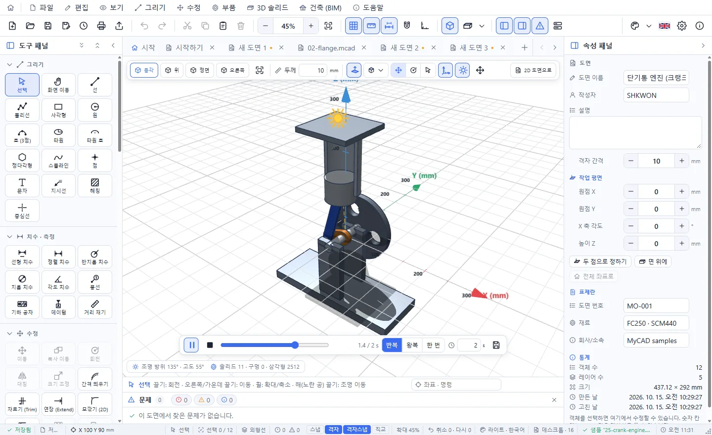

   *조립과 움직임 · 움직이는 샘플*

2. **재생 막대** — 3D 보기 아래의 재생 막대: 재생 · 일시 정지, 처음으로, 시간 슬라이더(끌면 그 순간), 반복 · 왕복 · 한 번, 한 바퀴 시간. 저장 단추는 지금 자세를 도면에 남깁니다.

   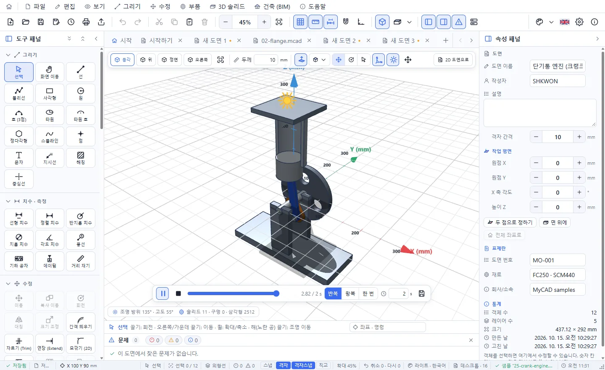

   *조립과 움직임 · 재생 막대*

3. **조인트와 구동** — 솔리드 두 개를 차례로 고르고(먼저 고른 것이 바탕) 3D 솔리드 메뉴의 회전 조인트를 누르면 경첩이 생깁니다. 속성 패널에서 구동 시작 → 끝 값을 정하면 재생할 때 그만큼 돕니다. 기어 · 벨트 · 랙 · 나사는 연동 비율로 잇습니다.

   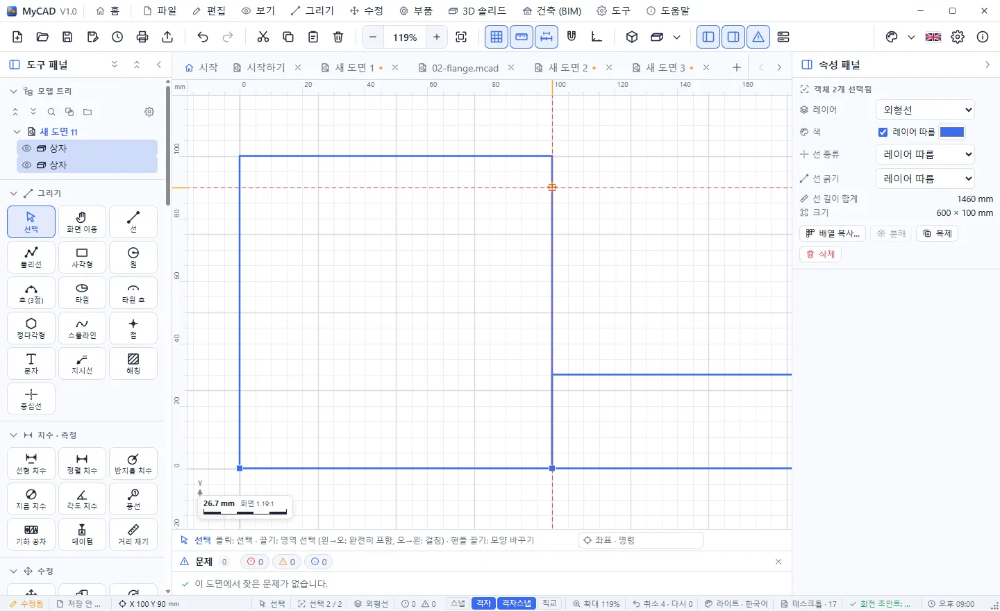

   *조립과 움직임 · 조인트와 구동*

### 직접 해 보기

- 시작 페이지에서 "단기통 엔진 (움직임)" 샘플을 여세요.
- 재생 막대의 일시 정지 단추를 누르세요.
- 솔리드 두 개를 차례로 고르고 회전 조인트를 넣으세요.

### 팁

- 기어 · 벨트 · 랙 · 나사는 연동 비율로 서로 따라 돕니다.

### 자주 하는 실수

- 조인트는 솔리드 두 개를 차례로 골라야 켜집니다(먼저 고른 것이 바탕).

### 확인

- [ ] 움직이는 샘플
- [ ] 재생 막대
- [ ] 조인트와 구동

---

## 레슨 18. 정확한 솔리드 (OpenCASCADE)

### 목표

OpenCASCADE 커널로 곡면 그대로의 불리언 · 모깎기 · 구배를 만들고, 3D 에서 모서리를 골라 모깎기합니다.

### 따라 하기

1. **곡면 위 불리언** — FreeCAD 와 같은 OpenCASCADE 커널로 불리언 · 모깎기 · 구배가 곡면 그대로 계산되고 부피도 정확합니다. STEP · IGES · FCStd 로 내보내도 원통 · 구 같은 곡면이 그대로 갑니다.

   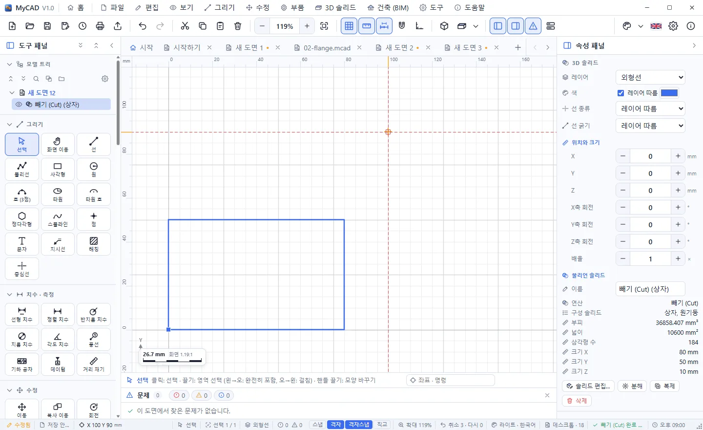

   *정확한 솔리드 (OpenCASCADE) · 곡면 위 불리언*

2. **모깎기와 구배** — 솔리드를 고르고 3D 솔리드 › 모깎기로 모서리를 둥글게, 구배(Draft)로 옆면을 기울입니다 — 주조 · 사출의 빼기 구배.

   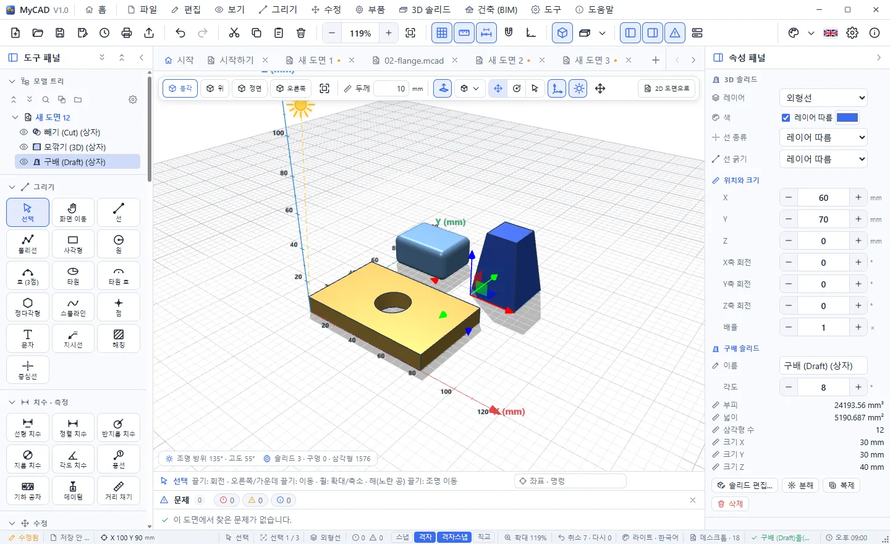

   *정확한 솔리드 (OpenCASCADE) · 모깎기와 구배*

3. **3D 에서 모서리 고르기** — 모깎기를 선택하고 속성 패널의 "3D 에서 모서리 고르기"를 누르면 모서리가 파랗게 보입니다. 누르는 모서리만 둥글게 됩니다(주황). 고른 모서리는 위치 · 방향으로 기억해 상자 크기가 바뀌어도 다시 찾습니다 (위상 이름).

   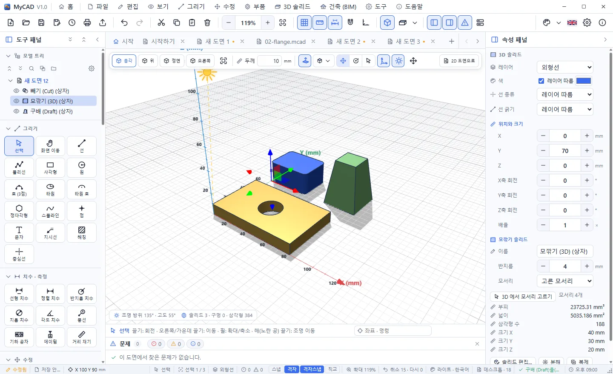

   *정확한 솔리드 (OpenCASCADE) · 3D 에서 모서리 고르기*

### 직접 해 보기

- 두 솔리드를 고르고 빼기를 누르세요.
- 솔리드를 고르고 모깎기나 구배를 넣으세요.
- 모깎기를 고르고 "3D 에서 모서리 고르기"를 눌러 모서리 하나를 누르세요.

### 팁

- 커널이 준비되기 전에는 메시로 계산하고, 준비되면 정확한 형상으로 다시 계산합니다.

### 확인

- [ ] 곡면 위 불리언
- [ ] 모깎기와 구배
- [ ] 3D 에서 모서리 고르기

---

## 레슨 19. CAM 3D 가공과 시뮬레이션

### 목표

솔리드를 3D 황삭 · 정삭하고 시뮬레이션으로 가공 결과를 확인합니다.

### 따라 하기

1. **3D 황삭 · 정삭** — 솔리드를 고르고 CAM 을 열면 3D 가공이 골라집니다. 황삭은 층마다 남길 두께를 두고 깎고, 정삭은 볼 엔드밀이 표면을 따라갑니다(드롭 커터: 공구가 모델을 파고들지 않음).

   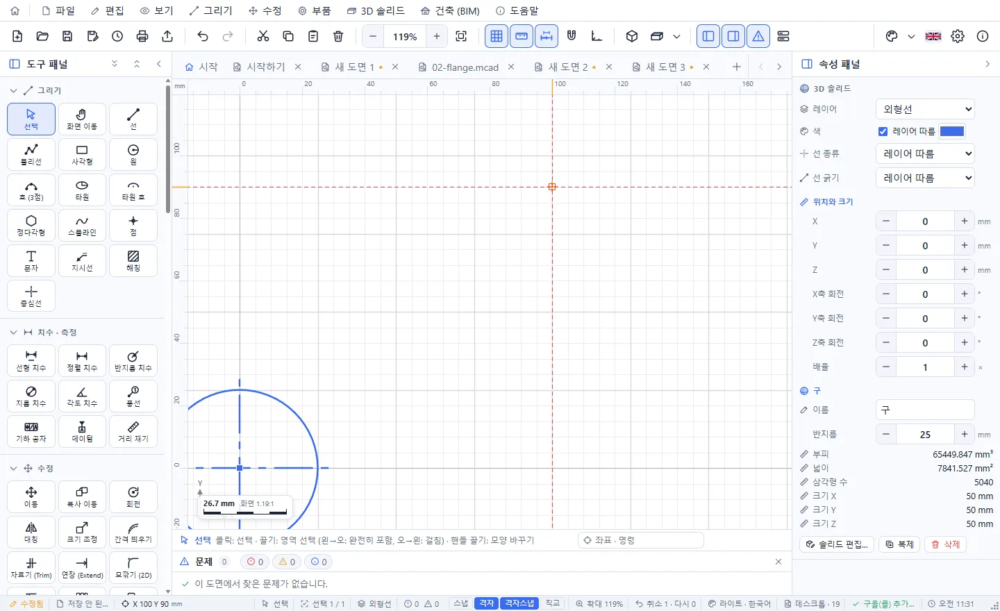

   *CAM 3D 가공과 시뮬레이션 · 3D 황삭 · 정삭*

   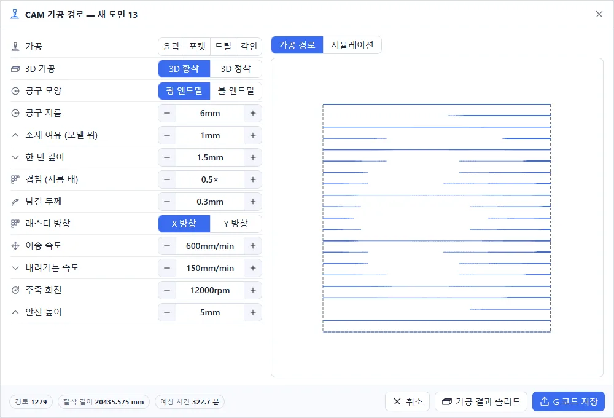

   *3D 황삭 · 정삭 — 창*

2. **시뮬레이션과 가공 결과** — CAM 창의 시뮬레이션 탭에서 재생하면 소재가 깎이는 모습을 보고 과절삭 · 남은 살을 검사합니다. "가공 결과 솔리드"는 깎인 소재를 도면에 솔리드로 넣습니다.

   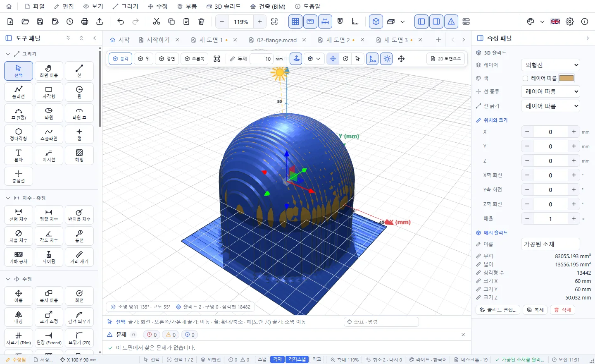

   *CAM 3D 가공과 시뮬레이션 · 시뮬레이션과 가공 결과*

### 팁

- "가공 결과 솔리드"로 깎인 소재를 도면에 넣어 비교할 수 있습니다.

### 확인

- [ ] 3D 황삭 · 정삭
- [ ] 시뮬레이션과 가공 결과

---

## 레슨 20. FEM 해석: 판과 솔리드

### 목표

판의 평면 응력과 솔리드의 3D 응력을 FEM 으로 풉니다.

### 따라 하기

1. **판 응력 (평면 응력)** — 닫힌 윤곽(구멍 포함)을 고르고 FEM 판 응력 해석을 엽니다. 변마다 고정과 하중을 주면 폰 미제스 응력 색과 변형 모양이 나오고, 구멍 둘레의 응력 집중(약 3배)도 보입니다.

   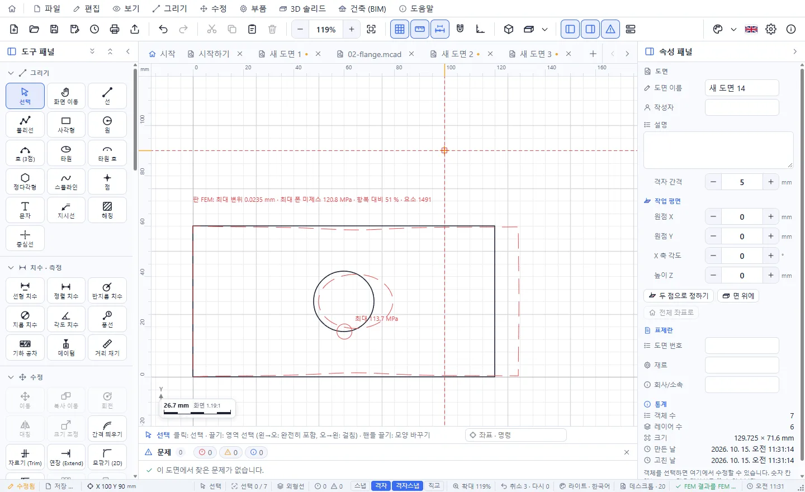

   *FEM 해석: 판과 솔리드 · 판 응력 (평면 응력)*

2. **솔리드 (3D) 와 CalculiX** — 솔리드를 고르고 FEM 솔리드 해석을 엽니다. 육면체 요소로 채워 고정 면 · 하중 면 · 자중을 주고 풉니다. .inp 로 저장하면 CalculiX · FreeCAD FEM 에서 열리고, CalculiX 가 설치돼 있으면 같은 모델을 풀어 비교합니다(차이 1 % 안).

   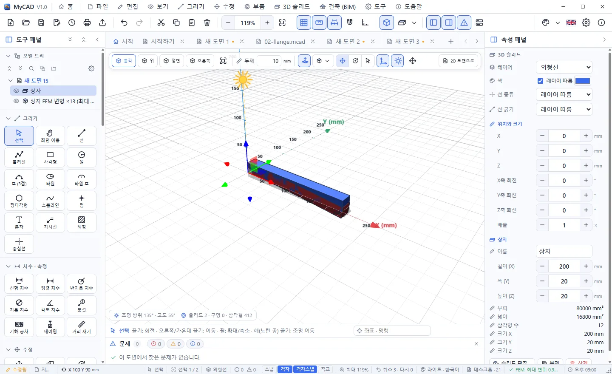

   *FEM 해석: 판과 솔리드 · 솔리드 (3D) 와 CalculiX*

   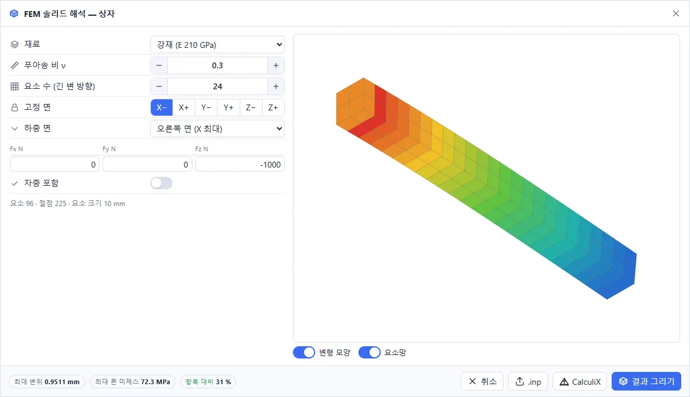

   *솔리드 (3D) 와 CalculiX — 창*

### 팁

- .inp 로 저장하면 CalculiX · FreeCAD FEM 에서 같은 모델을 엽니다.

### 확인

- [ ] 판 응력 (평면 응력)
- [ ] 솔리드 (3D) 와 CalculiX

---

## 레슨 21. Python 콘솔과 매크로

### 목표

FreeCAD 매크로와 같은 Python 으로 모델을 만들고 애드온 관리자로 매크로를 설치합니다.

### 따라 하기

1. **Python 으로 모델 만들기** — 스크립트 콘솔(Ctrl+Shift+J)에서 Python 을 고르면 FreeCAD 매크로처럼 씁니다: import Part, Part.makeBox(…).cut(…), Part.show(…). mycad 모듈로 도면 전체를 다룹니다.

   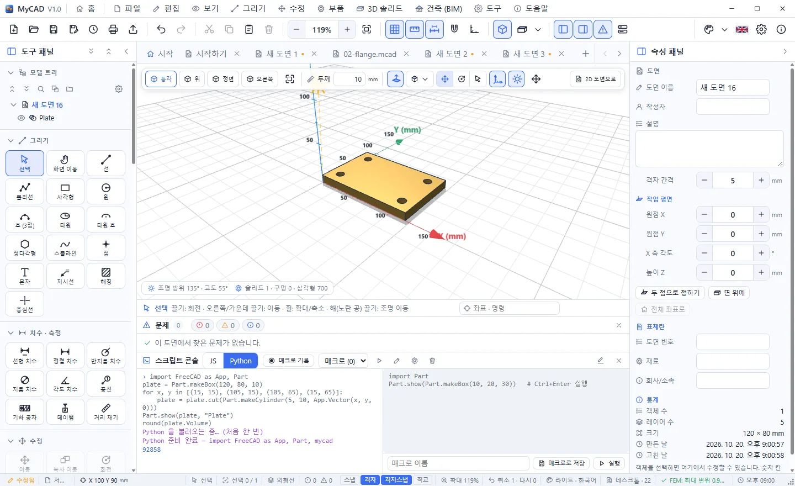

   *Python 콘솔과 매크로 · Python 으로 모델 만들기*

2. **애드온 관리자** — 애드온 관리자는 MyCAD 와 함께 오는 매크로 목록에서, 또는 웹 주소 · 파일에서 매크로(Python · JavaScript)를 설치 · 업데이트 · 제거하고 실행합니다.

   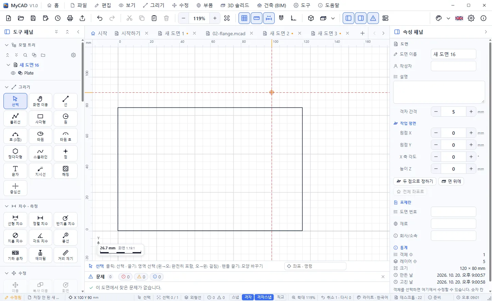

   *Python 콘솔과 매크로 · 애드온 관리자*

   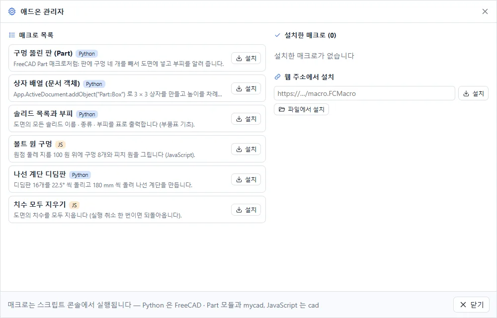

   *애드온 관리자 — 창*

### 직접 해 보기

- 콘솔에서 Python 을 고르고 Part.show(Part.makeBox(10, 20, 30)) 를 실행하세요.

### 팁

- Python 매크로는 도구 › 매크로 디버거로 한 줄씩 실행해 볼 수 있습니다.

### 확인

- [ ] Python 으로 모델 만들기
- [ ] 애드온 관리자

---

## 레슨 22. 2D 편집: 자르기·연장·모깎기·모따기

### 목표

자르기 · 연장 · 모깎기 · 모따기로 2D 도형을 다듬습니다.

### 따라 하기

1. **자르기 (X)** — 자르기 도구로 선을 누르면 다른 선과 만나는 곳까지 누른 쪽이 잘려 나갑니다. 가로선 (0,20)–(100,20)과 세로선 (50,0)–(50,40)을 그리고 가로선의 오른쪽 (80,20)을 누릅니다.

   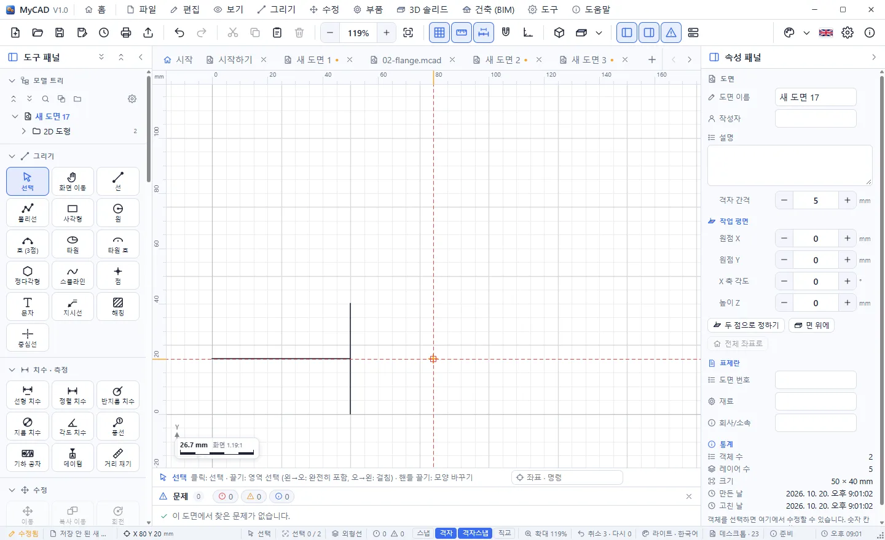

   *2D 편집: 자르기·연장·모깎기·모따기 · 자르기 (X)*

2. **연장 (W)** — 연장 도구로 선의 끝 가까이를 누르면 다음 선까지 늘어납니다. 짧은 선 (0,35)–(30,35)를 그리고 오른쪽 끝 (28,35)를 누르면 세로선 x = 50까지 닿습니다.

   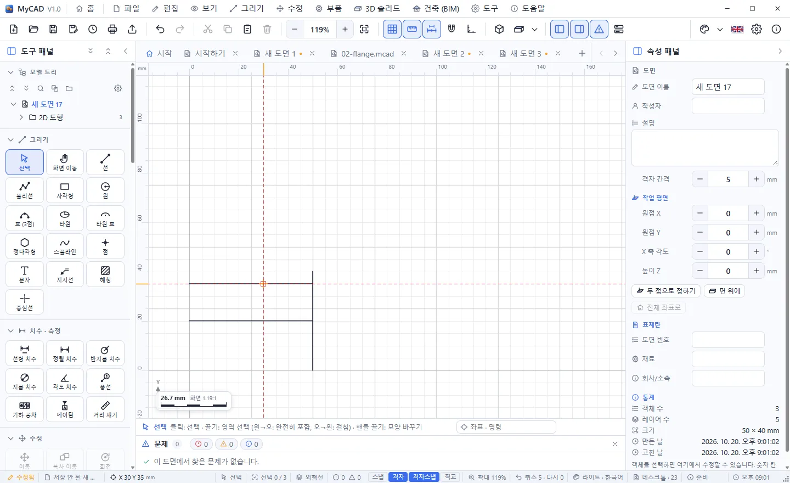

   *2D 편집: 자르기·연장·모깎기·모따기 · 연장 (W)*

3. **모깎기 (J)** — 모깎기는 두 선이 만나는 모서리를 호로 둥글게 합니다. 모서리 (90,60)에서 만나는 두 선을 그리고, 모깎기 도구에서 반지름 10을 입력한 뒤 남길 쪽의 두 선을 차례로 누릅니다.

   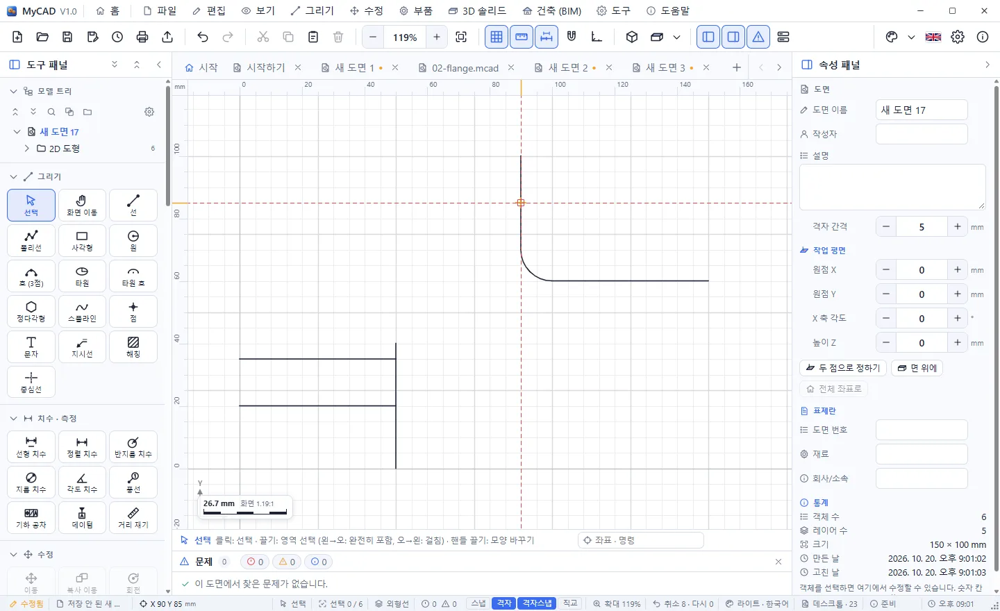

   *2D 편집: 자르기·연장·모깎기·모따기 · 모깎기 (J)*

4. **모따기 (K)** — 모따기는 모서리를 비스듬히 잘라 냅니다. 폴리선이나 사각형은 모서리 하나만 누르면 됩니다. 사각형 (0,60)–(60,100)의 오른쪽 위 모서리를 누릅니다.

   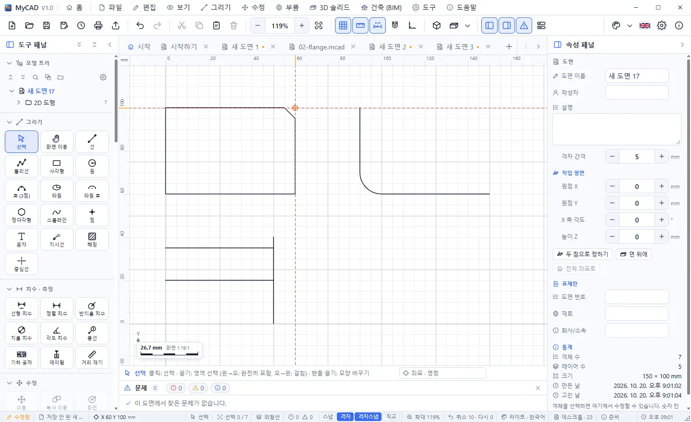

   *2D 편집: 자르기·연장·모깎기·모따기 · 모따기 (K)*

### 직접 해 보기

- 두 선을 엇갈리게 그리고, 자르기 도구로 잘라 낼 부분을 누르세요.
- 연장 도구로 짧은 선의 끝 가까이를 누르세요.
- 모깎기 도구에서 반지름을 입력하고 두 선을 차례로 누르세요.
- 사각형을 그리고 모따기 도구로 모서리를 누르세요.

### 팁

- 모깎기 반지름 · 모따기 거리는 도구를 고른 뒤 명령 칸에 입력합니다.

### 자주 하는 실수

- 모깎기는 남길 쪽을 눌러야 합니다 — 반대쪽을 누르면 그쪽이 남습니다.

### 확인

- [ ] 자르기 (X)
- [ ] 연장 (W)
- [ ] 모깎기 (J)
- [ ] 모따기 (K)

---

## 레슨 23. 스케치 구속과 보조선

### 목표

보조선과 기하 · 치수 구속으로 스케치를 정확하게 맞춥니다(FreeCAD Sketcher).

### 따라 하기

1. **보조선** — 보조선은 파란 점선으로 바뀌어 스냅과 구속에는 쓰이지만 돌출·CAM·내보내기·인쇄에서는 빠집니다. 원을 그리고 스케치 구속 묶음의 "보조선"을 누릅니다.

   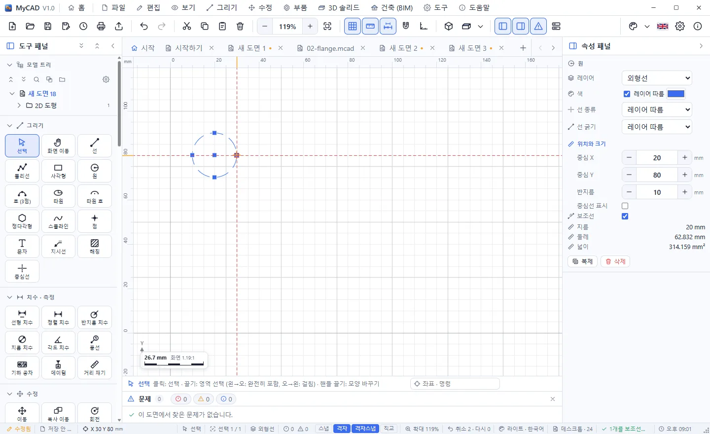

   *스케치 구속과 보조선 · 보조선*

2. **기하 구속: 일치·직각** — 대충 그린 두 선을 차례로 고르고 "일치"를 누르면 끝점이 만나고, "직각"을 누르면 직각이 됩니다. 도면에 보라색 구속 표시가 붙습니다.

   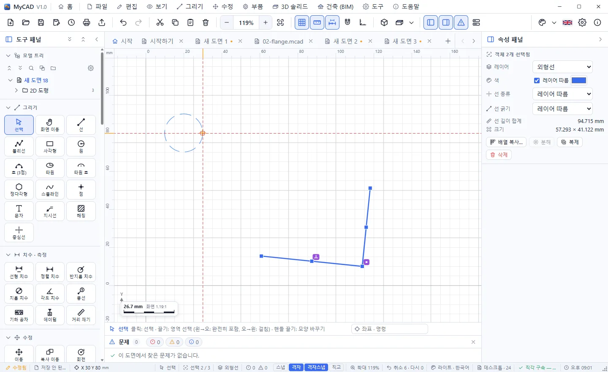

   *스케치 구속과 보조선 · 기하 구속: 일치·직각*

3. **치수 구속: 수평·거리** — 첫 선만 골라 "수평"과 "거리"를 누르고, 속성 패널의 구속 조건 목록에서 거리 값을 60으로 고칩니다. 풀이기가 도형을 맞추고 다른 선은 직각을 지키며 따라옵니다.

   

   *스케치 구속과 보조선 · 치수 구속: 수평·거리*

4. **자유도와 구속 상태** — 스케치 구속 묶음 아래에 자유도 n · 완전 구속 · 중복 구속 · 충돌이 나옵니다. 끝점을 끌면 구속을 지키며 나머지가 따라옵니다. 반지름 · 지름 · 각도 · 접선 · 동심 · 대칭 · 고정도 같은 방법으로 겁니다.

   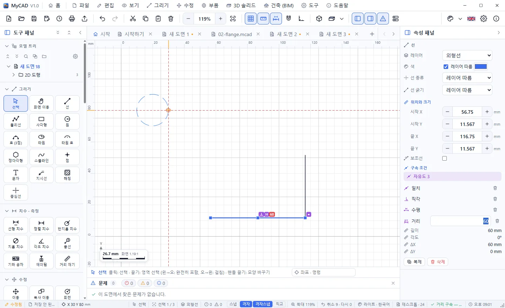

   *스케치 구속과 보조선 · 자유도와 구속 상태*

5. **스케치·Draft 도구 메뉴** — 수정 메뉴의 스케치 도구에는 FreeCAD Sketcher 의 구속 · 선택(진단) · B-스플라인 · 표시 명령이, Draft 도구에는 늘이기 · 업그레이드 · 경로 배열 · 정리 · 스냅이 모두 있습니다.

   

   *스케치 구속과 보조선 · 스케치·Draft 도구 메뉴*

### 직접 해 보기

- 객체를 선택하고 스케치 구속 묶음의 "보조선"을 누르세요.
- 두 선을 차례로 고르고 "일치"와 "직각"을 누르세요.
- 선을 고르고 "거리"를 누른 뒤 속성 패널에서 값을 바꾸세요.

### 팁

- 구속 값은 속성 패널의 구속 조건 목록에서 고치거나 지웁니다.

### 자주 하는 실수

- 충돌 · 중복 구속이 나오면 마지막에 건 구속을 지우세요.

### 확인

- [ ] 보조선
- [ ] 기하 구속: 일치·직각
- [ ] 치수 구속: 수평·거리
- [ ] 자유도와 구속 상태
- [ ] 스케치·Draft 도구 메뉴

---

## 레슨 24. 클론·작업 평면·문제 검사

### 목표

클론 · 작업 평면 · 문제 패널 · 눈금자를 씁니다.

### 따라 하기

1. **클론** — 클론은 원본을 따라 모양이 바뀌는 복사본입니다(FreeCAD Draft Clone). 사각형을 선택해 "클론"을 누르고, 클론을 이동 도구로 오른쪽으로 옮깁니다.

   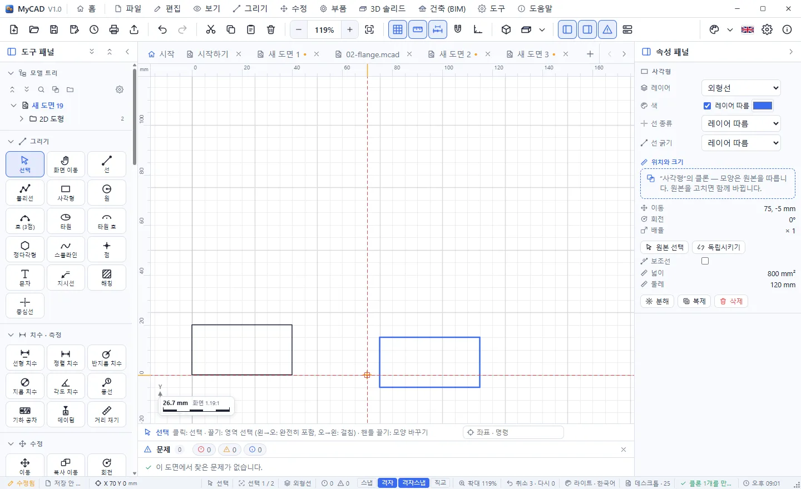

   *클론·작업 평면·문제 검사 · 클론*

2. **원본을 고치면 클론도** — 원본 사각형의 폭을 속성 패널에서 60으로 바꾸면 클론도 같이 바뀝니다. 클론은 위치 · 회전 · 크기 · 대칭과 색 · 레이어만 따로 갖습니다.

   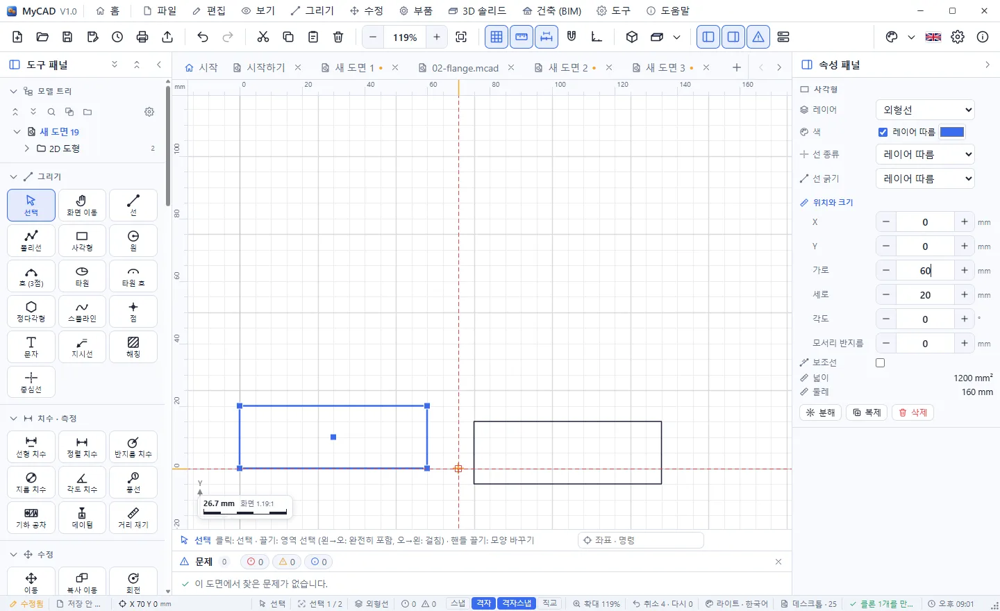

   *클론·작업 평면·문제 검사 · 원본을 고치면 클론도*

3. **독립시키기** — 클론을 선택하면 속성 패널에 "원본 선택"과 "독립시키기"가 나옵니다. 독립시키면 보통 객체가 되어 원본을 더 이상 따르지 않습니다.

   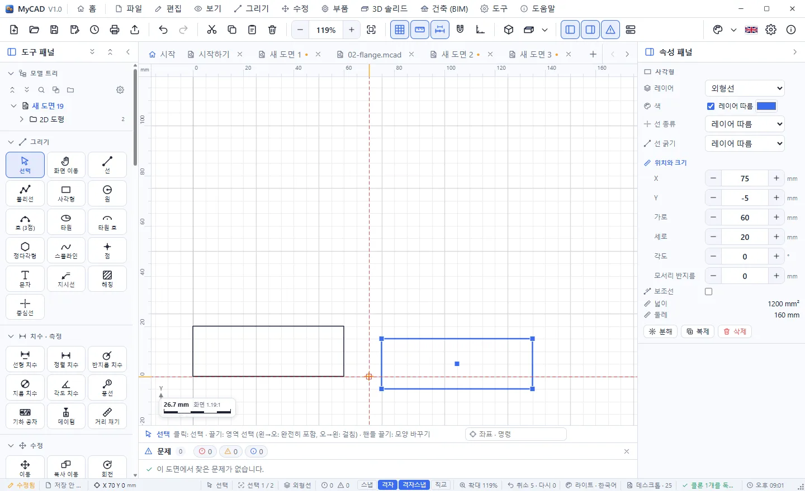

   *클론·작업 평면·문제 검사 · 독립시키기*

4. **작업 평면** — 수정 › 작업 평면: 원점 (100,10)을 누르고 X 축이 향할 점 (100,60)을 누릅니다. 이제 좌표 입력 · 격자 · 직교 · 상태 표시줄이 이 평면 기준이라 @30,0은 위쪽으로 30입니다.

   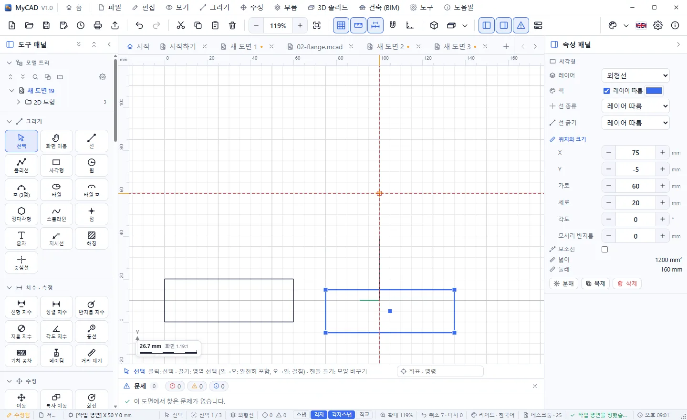

   *클론·작업 평면·문제 검사 · 작업 평면*

5. **전체 좌표로** — 아무것도 고르지 않으면 속성 패널에 작업 평면의 원점 · 각도 · 높이 Z(새 솔리드가 놓이는 높이)가 나옵니다. "전체 좌표로"를 누르면 원래대로 돌아갑니다.

   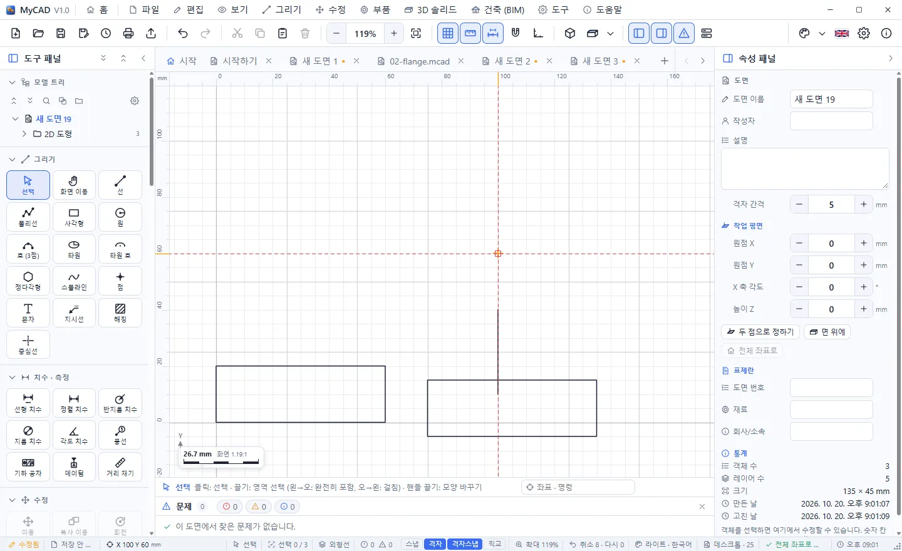

   *클론·작업 평면·문제 검사 · 전체 좌표로*

6. **문제 패널 (Ctrl+Shift+M)** — 문제 패널은 길이 0인 객체 · 겹친 객체 · 맞닿지 않은 끝점 · 거의 닫힌 윤곽 같은 실수를 오류 · 경고 · 참고로 보여 줍니다. 줄을 누르면 그 객체로 갑니다. 같은 자리에 선을 두 번 그려 봅니다.

   

   *클론·작업 평면·문제 검사 · 문제 패널 (Ctrl+Shift+M)*

7. **눈금자 (Ctrl+R)** — 캔버스 위와 왼쪽의 눈금자는 커서 위치를 표시하고, 왼쪽 위 모서리에 단위가 나옵니다. 툴바 버튼으로 끄고 켭니다.

   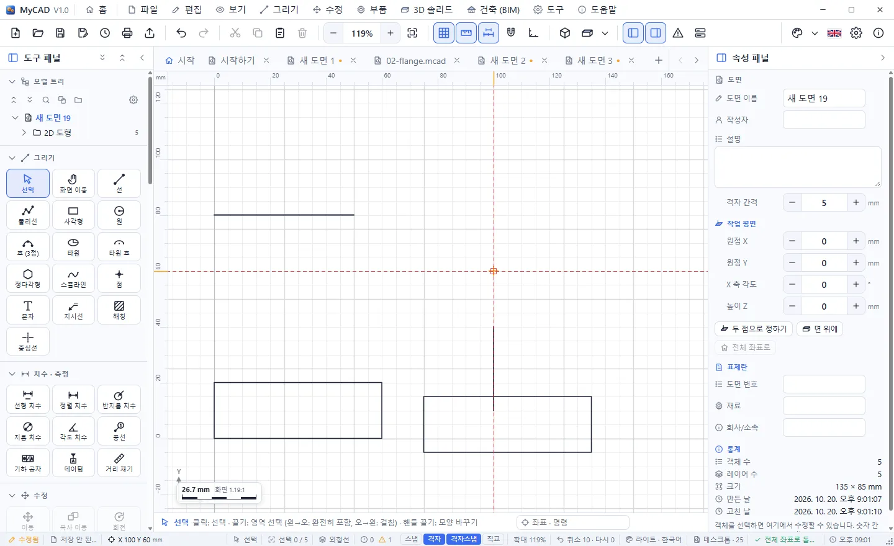

   *클론·작업 평면·문제 검사 · 눈금자 (Ctrl+R)*

### 직접 해 보기

- 객체를 선택하고 수정 묶음의 "클론"을 누르세요.
- 원본을 선택하고 폭을 바꾸세요.
- 클론을 선택하고 속성 패널의 "독립시키기"를 누르세요.
- 수정 메뉴의 작업 평면에서 두 점을 누르세요.
- 속성 패널의 "전체 좌표로"를 누르세요.
- 툴바의 문제 패널 버튼을 누르세요.

### 팁

- 작업 평면의 높이 Z 는 새 솔리드와 돌출이 놓일 높이입니다.

### 확인

- [ ] 클론
- [ ] 원본을 고치면 클론도
- [ ] 독립시키기
- [ ] 작업 평면
- [ ] 전체 좌표로
- [ ] 문제 패널 (Ctrl+Shift+M)
- [ ] 눈금자 (Ctrl+R)

---

## 레슨 25. 제작 도면: 풍선·기하 공차·데이텀

### 목표

제작 도면에 풍선 · 데이텀 · 기하 공차를 넣고 TechDraw 명령을 살펴봅니다.

### 따라 하기

1. **준비: 판과 구멍** — 주석을 달 판 (0,0)–(100,50)과 구멍 (50,25) 반지름 10을 그립니다.

   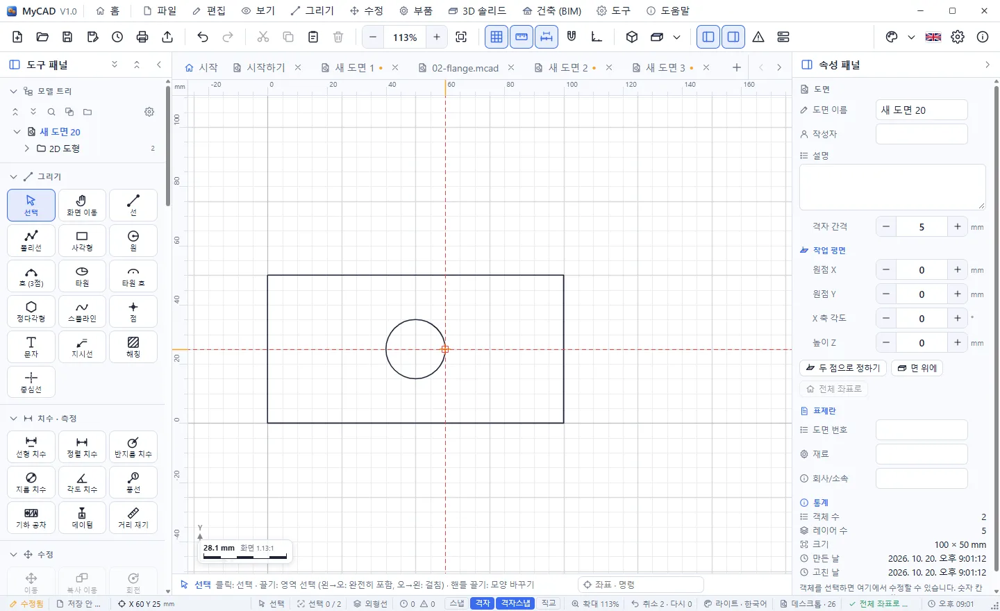

   *제작 도면: 풍선·기하 공차·데이텀 · 준비: 판과 구멍*

2. **풍선** — 풍선 도구로 가리킬 부품 (10,50)을 누르고 풍선 자리 (20,80)를 누릅니다. 번호는 1, 2, 3 … 저절로 붙습니다. 하나 더 (100,40) → (130,75).

   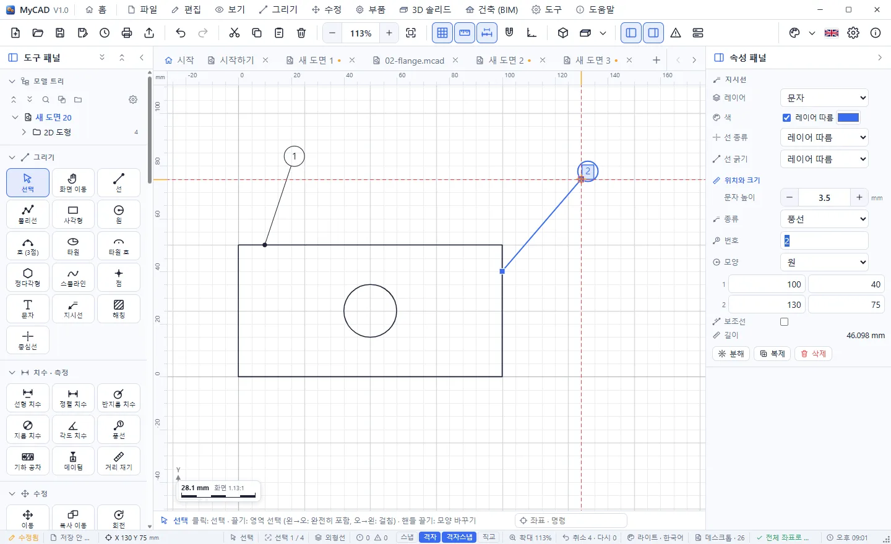

   *제작 도면: 풍선·기하 공차·데이텀 · 풍선*

3. **데이텀** — 데이텀 도구로 데이텀 면 (50,0)을 누르고 문자 상자 자리 (50,-25)를 누릅니다. 글자는 A, B, C … 저절로 붙습니다.

   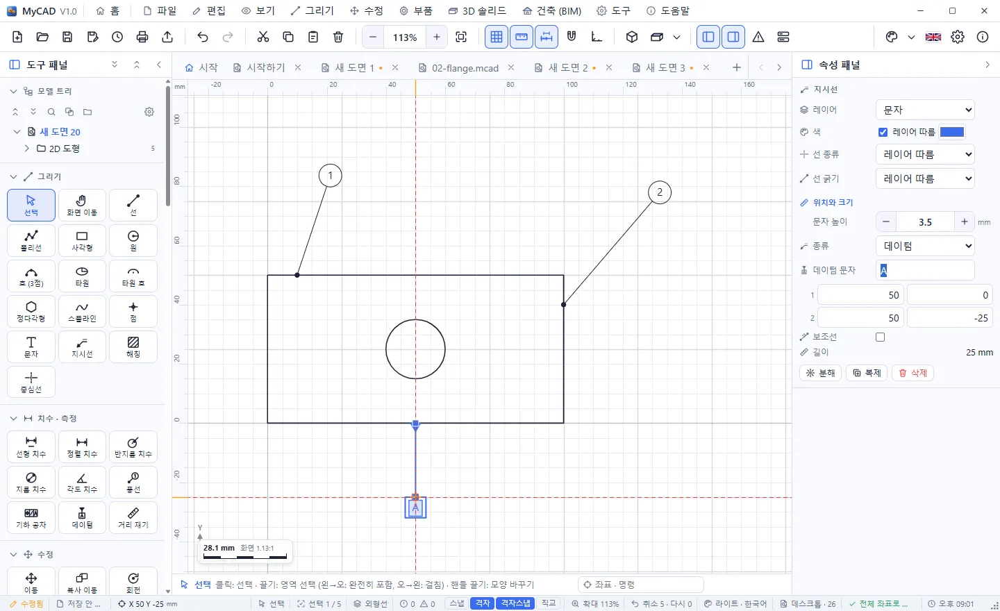

   *제작 도면: 풍선·기하 공차·데이텀 · 데이텀*

4. **기하 공차** — 기하 공차 도구로 공차를 줄 면 (0,30)을 누르고 틀 자리 (-15,75)를 누릅니다. 속성 패널에서 기호 14종 · 공차 값 · ⌀ · Ⓜ/Ⓛ · 데이텀 A|B|C를 정합니다. 기호를 평면도로 바꿉니다.

   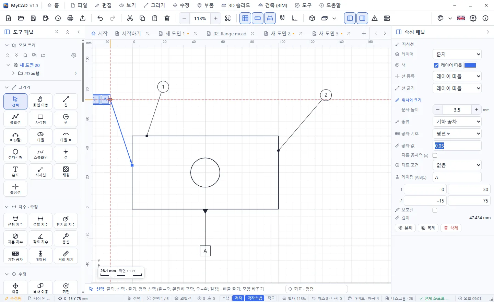

   *제작 도면: 풍선·기하 공차·데이텀 · 기하 공차*

5. **제작 도면 샘플** — 샘플 "축 제작 도면"에는 단면 · 키홈 · 끼워맞춤 공차 · 표면 거칠기 · 주기가 모두 들어 있습니다. DXF · SVG · 인쇄에도 그대로 나옵니다.

   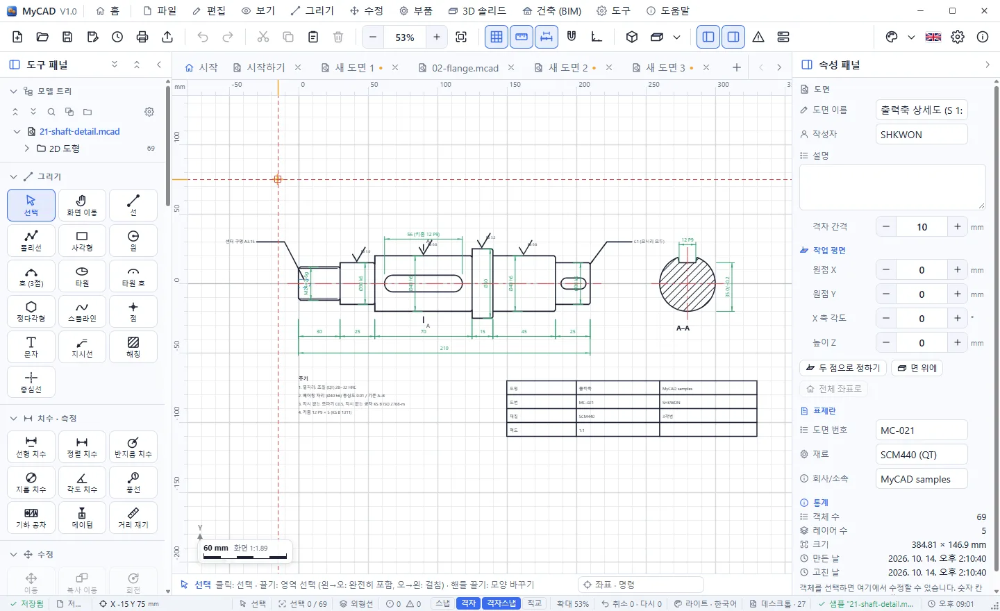

   *제작 도면: 풍선·기하 공차·데이텀 · 제작 도면 샘플*

6. **TechDraw 메뉴** — 그리기 메뉴의 TechDraw 에는 뷰(투상 · 단면 · 상세 · 활성 뷰) · 장식선(중심선 · 나사선) · 치수(연쇄 · 좌표 · 구멍/축 공차) · 페이지(표제란 · 클립 그룹)가 모두 있습니다.

   

   *제작 도면: 풍선·기하 공차·데이텀 · TechDraw 메뉴*

### 직접 해 보기

- 사각형과 원을 그리세요.
- 풍선 도구로 두 점을 누르세요.
- 데이텀 도구로 두 점을 누르세요.
- 기하 공차 도구로 두 점을 누르고 속성에서 기호를 바꾸세요.

### 팁

- 지시선의 속성 "종류"로 메모 · 풍선 · 기하 공차 · 데이텀을 서로 바꿉니다.

### 확인

- [ ] 준비: 판과 구멍
- [ ] 풍선
- [ ] 데이텀
- [ ] 기하 공차
- [ ] 제작 도면 샘플
- [ ] TechDraw 메뉴

---

## 레슨 26. PartDesign: 포켓·구멍·모따기·두께

### 목표

PartDesign 처럼 포켓 · 구멍과 3D 모따기 · 두께 · 오프셋으로 솔리드를 가공합니다.

### 따라 하기

1. **포켓** — 2D 윤곽과 솔리드를 함께 고르고 "포켓"을 누르면 솔리드 윗면에서 깊이만큼(또는 관통) 파냅니다. 100 × 60 × 30 블록에 사각형 (10,10)–(40,30)을 8 mm 깊이로 파냅니다.

   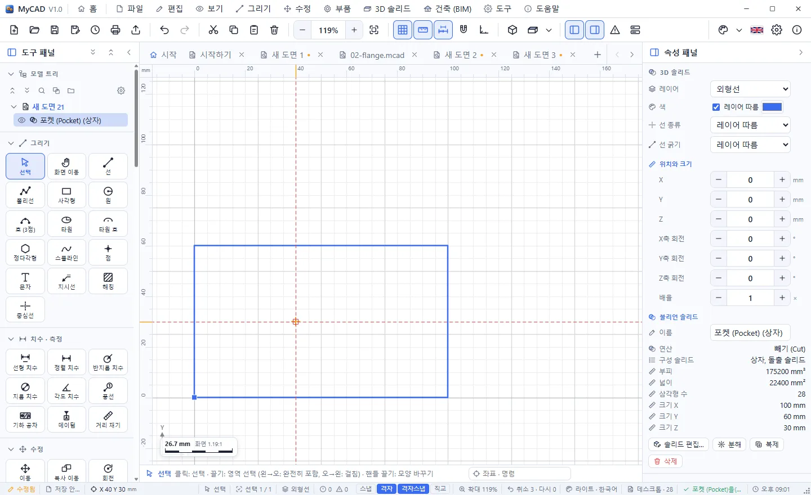

   *PartDesign: 포켓·구멍·모따기·두께 · 포켓*

2. **구멍** — 원과 솔리드를 고르고 "구멍"을 누르면 원마다 구멍이 뚫립니다: 지름은 원에서, 깊이 · 단순/자리파기/접시머리 · 평평/드릴 끝 118°는 창에서. 결과는 빼기 트리라 분해하면 원래대로입니다.

   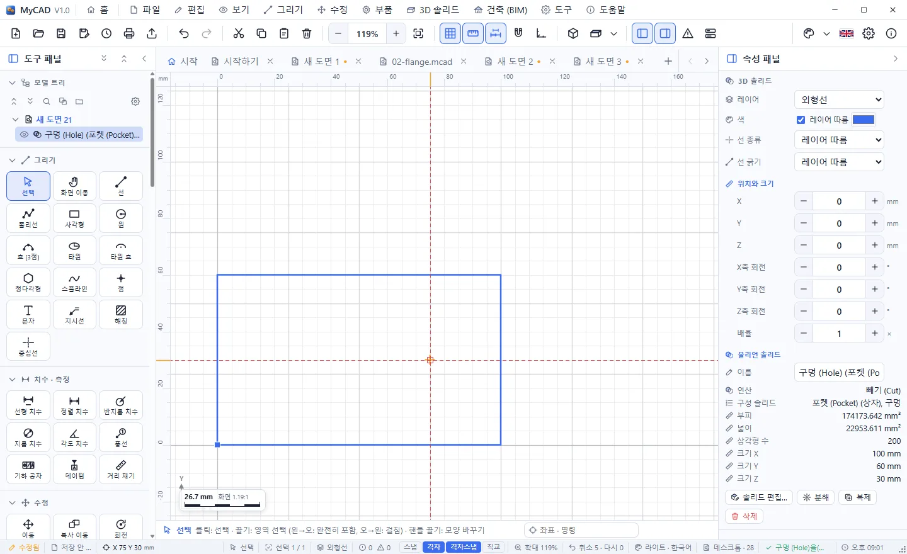

   *PartDesign: 포켓·구멍·모따기·두께 · 구멍*

3. **3D 모따기** — 상자 · 돌출 · 각기둥 · 원기둥 · 튜브를 하나 고르고 "모따기 (3D)"를 누르면 크기와 모서리(모두 · 윗면 둘레 · 세로 …)를 정해 깎습니다. 분해하면 원래 솔리드로 돌아갑니다.

   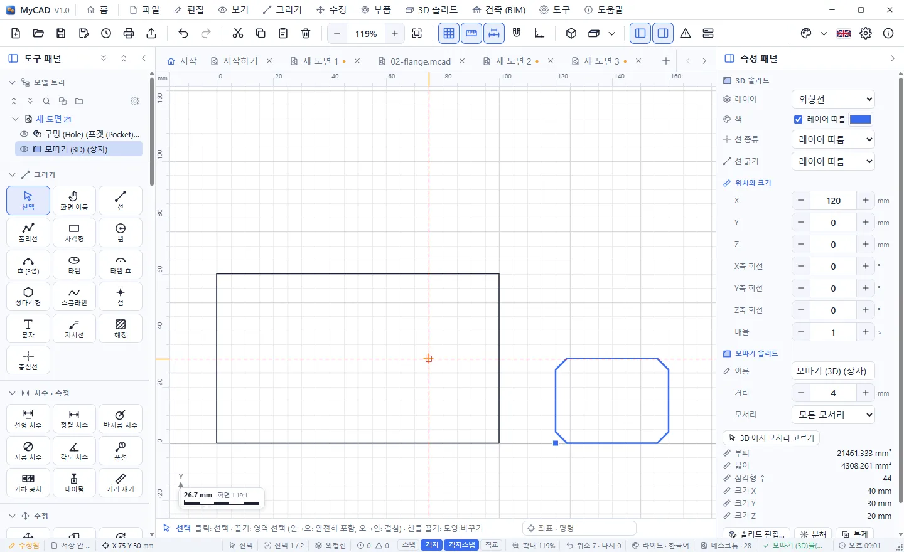

   *PartDesign: 포켓·구멍·모따기·두께 · 3D 모따기*

4. **두께와 3D 오프셋** — "두께"는 속을 비우고 윗면을 엽니다(벽 두께 3). "3D 오프셋"은 솔리드를 고르게 키우거나(+) 줄입니다(−).

   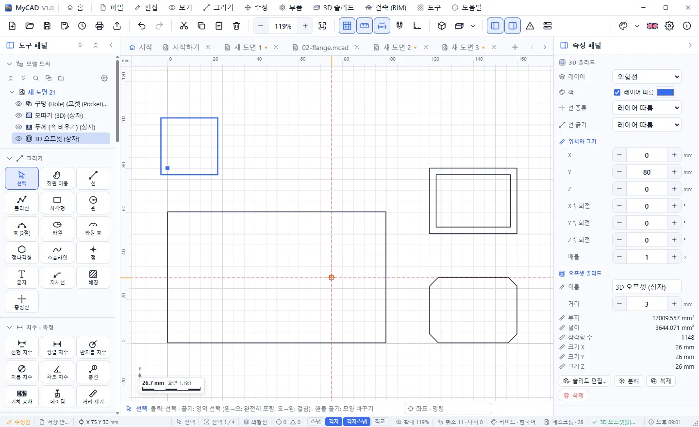

   *PartDesign: 포켓·구멍·모따기·두께 · 두께와 3D 오프셋*

5. **3D로 확인하기** — 3D 보기에서 포켓 · 구멍 · 모따기 · 속 빈 상자를 확인합니다.

   

   *PartDesign: 포켓·구멍·모따기·두께 · 3D로 확인하기*

6. **바디 · 패턴 메뉴** — 3D 솔리드 메뉴에는 FreeCAD PartDesign 처럼 바디 · 팁, 선형 · 원형 패턴 · 대칭 · 다중 변환, 빼는 나선 · 로프트 · 파이프, 바인더 명령이 있습니다.

   

   *PartDesign: 포켓·구멍·모따기·두께 · 바디 · 패턴 메뉴*

### 직접 해 보기

- 윤곽과 솔리드를 함께 고르고 "포켓"을 누르세요.
- 원과 솔리드를 고르고 "구멍"을 누르세요.
- 솔리드를 고르고 "모따기 (3D)"를 누르세요.
- 솔리드를 고르고 "두께"나 "3D 오프셋"을 누르세요.
- 3D 보기 버튼을 누르세요.

### 팁

- 결과는 트리라서 분해하면 원래 솔리드로 돌아갑니다.

### 자주 하는 실수

- 포켓 · 구멍은 2D 윤곽과 솔리드를 함께 골라야 켜집니다.

### 확인

- [ ] 포켓
- [ ] 구멍
- [ ] 3D 모따기
- [ ] 두께와 3D 오프셋
- [ ] 3D로 확인하기
- [ ] 바디 · 패턴 메뉴

---

## 레슨 27. 형상 검사·메시·역설계

### 목표

형상 검사로 솔리드의 문제를 찾고, 메시를 단순화 · 수리하며, 메시 · 역설계 명령을 살펴봅니다.

### 따라 하기

1. **형상 검사** — 3D 솔리드 › 형상 검사는 솔리드마다 닫혔는지, 열린 · 비다양체 모서리, 방향이 어긋난 곳, 뒤집힌 껍질, 자기 교차, 퇴화 · 중복 삼각형을 보여 줍니다. 윗면이 없고 면 하나가 뒤집힌 메시 상자가 문제로 나옵니다.

   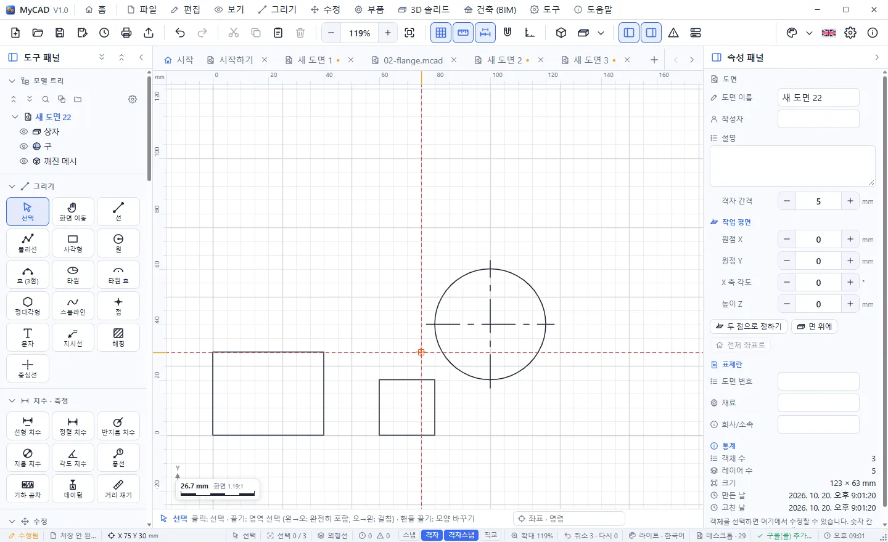

   *형상 검사·메시·역설계 · 형상 검사*

2. **메시 단순화** — 솔리드를 고르고 "메시 단순화"를 누르면 모양은 거의 그대로, 삼각형은 절반쯤으로 줄어든 메시가 됩니다(닫힌 메시 유지).

   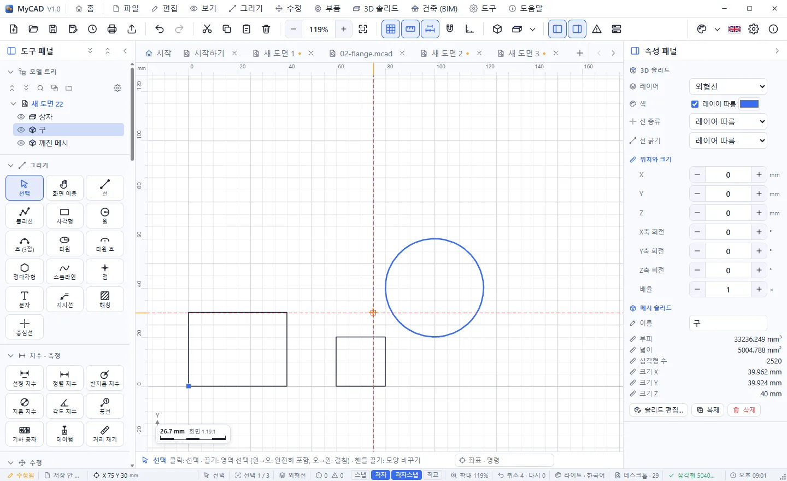

   *형상 검사·메시·역설계 · 메시 단순화*

3. **메시 수리** — "메시 수리"는 틈(T 접점)을 잇고, 구멍을 메우고, 면 방향을 맞춘 닫힌 메시 솔리드를 만듭니다. 깨진 메시 상자를 고르고 수리합니다. 형상 검사 창에서 체크하고 수리해도 됩니다.

   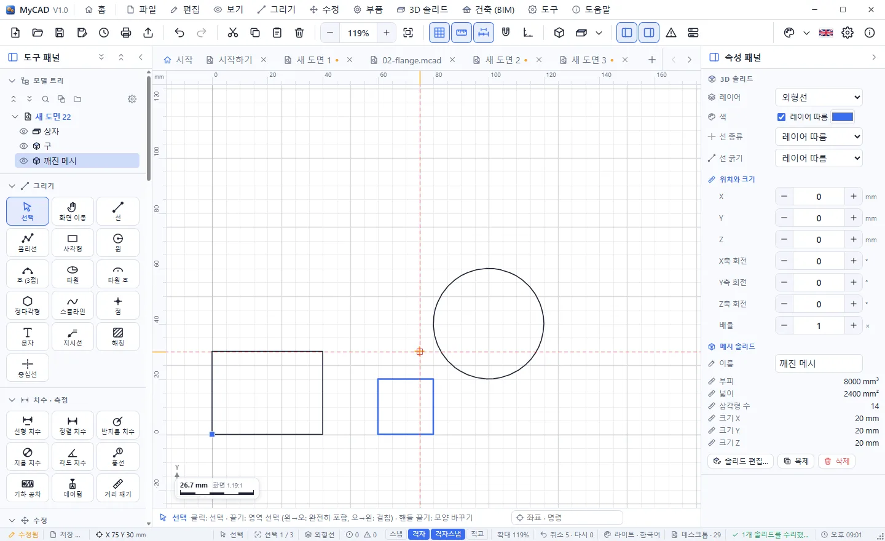

   *형상 검사·메시·역설계 · 메시 수리*

4. **메시 도구 메뉴** — 3D 솔리드 › 검사 · FEM 해석 › 메시 도구에는 FreeCAD Mesh 워크벤치의 정규 도형 · 곡률 색 · 다각형 자르기 · 평활화 · 구멍 메우기 · 육안 검사 같은 명령이 모두 있습니다.

   

   *형상 검사·메시·역설계 · 메시 도구 메뉴*

5. **역설계: 점 구름에서 형상으로** — 점 구름(.xyz · .ply 점)을 가져와 고르면 평면 · 구 · 원기둥 맞춤과 메시 만들기, 곡면 근사 · 단면 · 검사 명령을 씁니다.

   

   *형상 검사·메시·역설계 · 역설계: 점 구름에서 형상으로*

### 직접 해 보기

- 솔리드를 고르고 "메시 단순화"를 누르세요.
- 깨진 메시를 고르고 "메시 수리"를 누르세요.

### 팁

- BIM 객체는 블록마다 따로 검사합니다.

### 확인

- [ ] 형상 검사
- [ ] 메시 단순화
- [ ] 메시 수리
- [ ] 메시 도구 메뉴
- [ ] 역설계: 점 구름에서 형상으로

---

## 레슨 28. 건축 (BIM) 1: 벽·창문·슬래브·지붕·실

### 목표

벽 · 창 · 문 · 슬래브 · 지붕 · 실로 건물을 만들고 3D 로 봅니다(FreeCAD BIM).

### 따라 하기

1. **벽** — 선 · 폴리선 · 사각형을 그려 고르고 건축 › 벽을 누릅니다. 닫힌 윤곽은 모서리가 맞춰진 고리 벽이 됩니다. 두께 200 · 높이 2700으로 6 × 4 m 벽을 세웁니다. 평면은 바닥에서 1 m 높이로 자른 단면입니다.

   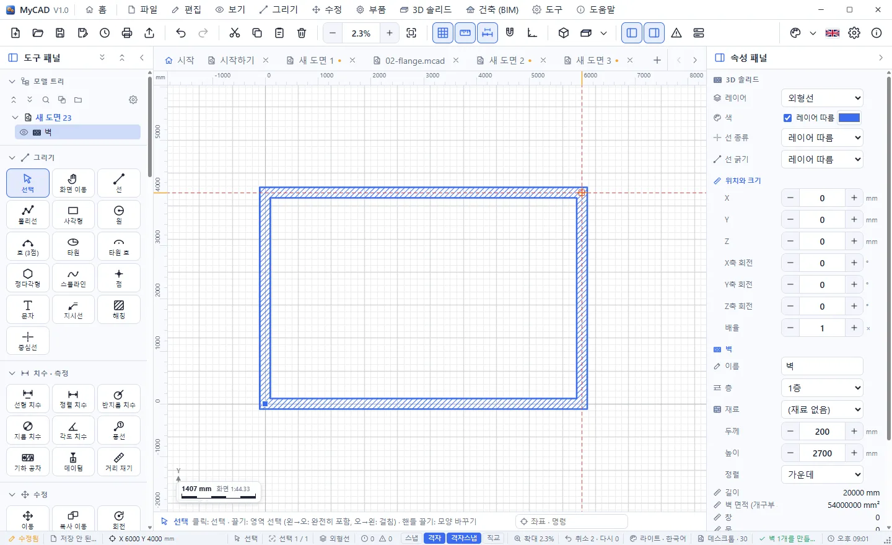

   *건축 (BIM) 1: 벽·창문·슬래브·지붕·실 · 벽*

2. **창과 문** — 벽을 고르고 "창 넣기" / "문 넣기"를 누르면 창 · 문 · 개구부 편집 창이 열립니다. 종류(창 · 문 · 양개문 · 미닫이 · 개구부) · 위치 · 폭 · 창대 높이 · 여는 쪽을 정하면 벽이 뚫리고 창틀 · 유리 · 문짝이 들어갑니다.

   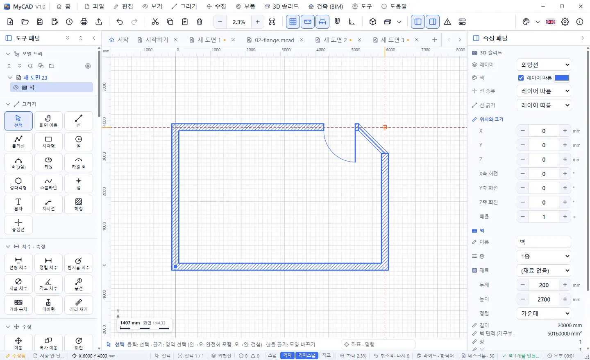

   *건축 (BIM) 1: 벽·창문·슬래브·지붕·실 · 창과 문*

3. **슬래브** — 닫힌 윤곽을 고르고 "슬래브"를 누르면 두께만큼의 바닥판이 됩니다. 벽 바깥으로 100씩 큰 사각형을 그려 두께 200 슬래브를 만듭니다.

   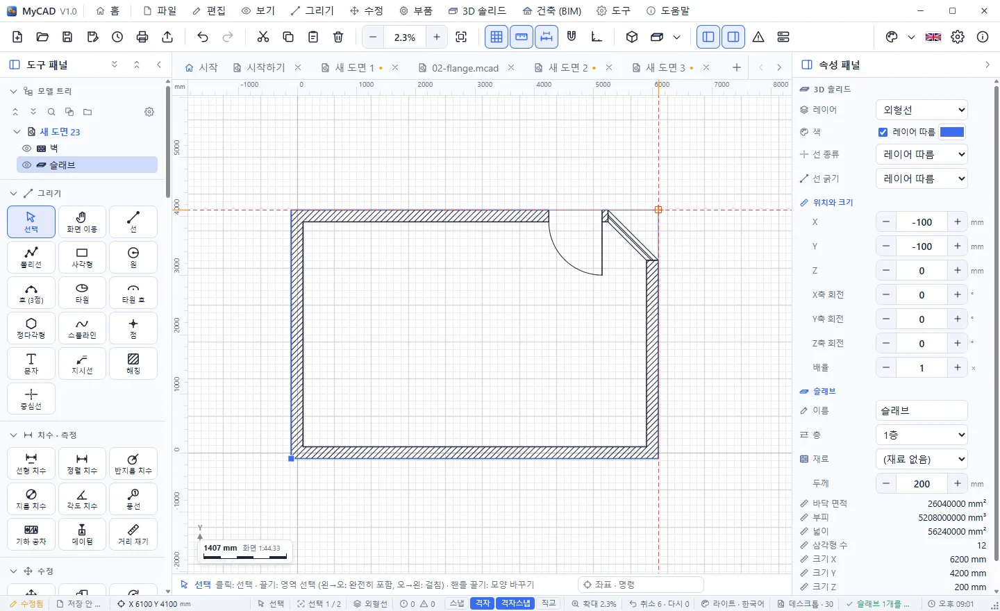

   *건축 (BIM) 1: 벽·창문·슬래브·지붕·실 · 슬래브*

4. **지붕** — 닫힌 윤곽을 고르고 "지붕"을 누릅니다. 박공 · 모임 · 외쪽 · 평지붕과 경사 · 처마 길이 · 두께를 정하고, 지붕 편집 창의 변별 경사 탭에서 변마다 경사를 줍니다(90°면 박공).

   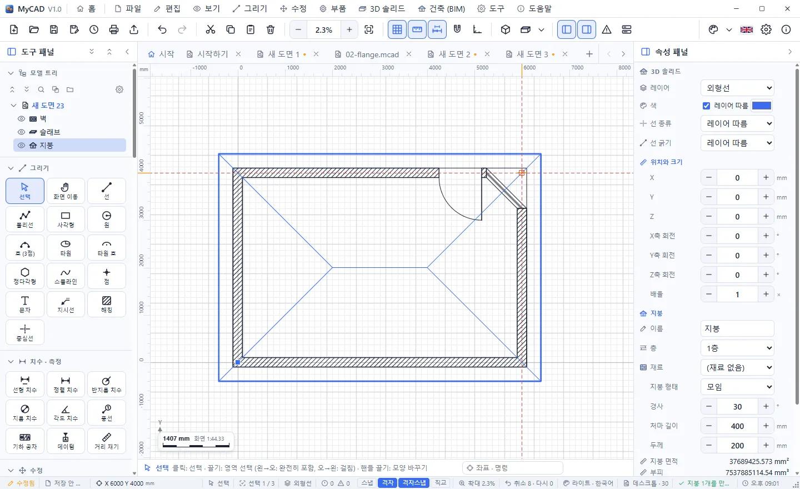

   *건축 (BIM) 1: 벽·창문·슬래브·지붕·실 · 지붕*

5. **실 (공간)** — 닫힌 윤곽을 고르고 "공간"을 누르면 실이 됩니다. 이름(속성 패널)과 바닥 면적이 평면도에 표시되고 물량표에 들어갑니다.

   

   *건축 (BIM) 1: 벽·창문·슬래브·지붕·실 · 실 (공간)*

6. **3D로 보기** — 3D 보기로 바꾸면 같은 모델이 입체로 보입니다. 벽은 색으로, 유리는 반투명으로, 실은 옅은 부피로 보입니다.

   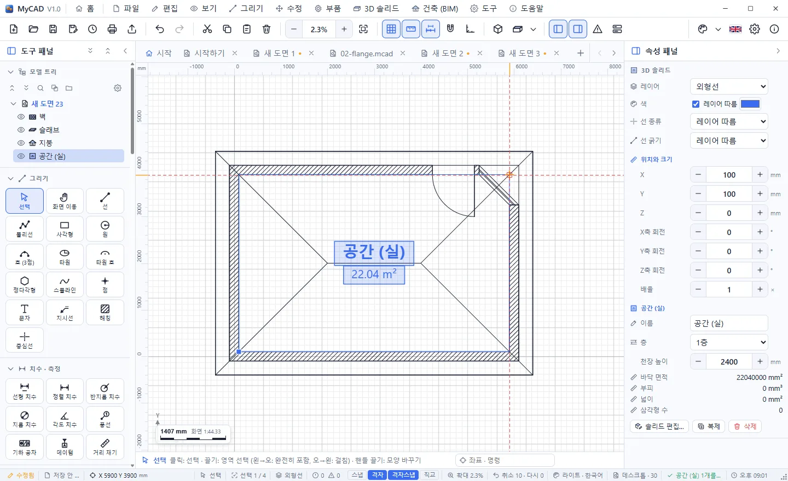

   *건축 (BIM) 1: 벽·창문·슬래브·지붕·실 · 3D로 보기*

### 직접 해 보기

- 사각형을 그려 고르고 건축 묶음의 "벽"을 누르세요.
- 벽을 고르고 "창 넣기"를 누르세요.
- 닫힌 윤곽을 고르고 "슬래브"를 누르세요.
- 닫힌 윤곽을 고르고 "지붕"을 누르세요.
- 닫힌 윤곽을 고르고 "공간"을 누르세요.
- 3D 보기 버튼을 누르세요.

### 팁

- 축척 1:100 도면에서는 점선 · 선 굵기가 종이 기준으로 커집니다(도면 › 축척).

### 자주 하는 실수

- 창 · 문은 벽 하나를 골라야 넣을 수 있습니다.

### 확인

- [ ] 벽
- [ ] 창과 문
- [ ] 슬래브
- [ ] 지붕
- [ ] 실 (공간)
- [ ] 3D로 보기

---

## 레슨 29. 건축 (BIM) 2: 기둥·계단·층·철근·물량표·IFC

### 목표

기둥 · 계단 · 가구 · 통심선 · 층 · 철근 · 물량표 · IFC 로 BIM 모델을 완성합니다.

### 따라 하기

1. **기둥 · 계단 · 가구** — 기둥 · 계단 · 가구·설비 · 통심선은 바로 넣기 창에서 만듭니다. 기둥 단면은 사각 · 원 · H · ㄷ · ㄱ · T · 각관 · 원형관과 규격 단면(IPE · HEA …), 계단은 일자 · ㄱ자 · ㄷ자 · 나선입니다.

   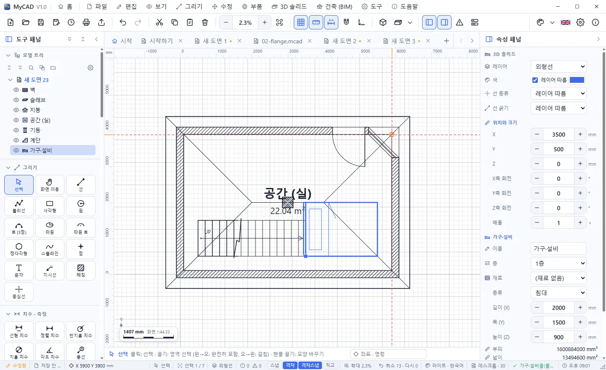

   *건축 (BIM) 2: 기둥·계단·층·철근·물량표·IFC · 기둥 · 계단 · 가구*

2. **통심선** — 통심선은 격자(가로 · 세로 개수와 간격) 또는 방사형으로 놓입니다. 3 × 2 통심선을 3 m · 4 m 간격으로 넣습니다.

   

   *건축 (BIM) 2: 기둥·계단·층·철근·물량표·IFC · 통심선*

3. **층과 건물 창** — 왼쪽 "건물 (BIM)" 묶음에서 층을 추가하고, 새 객체를 놓을 층(✓) · 평면도에 보일 층 · 층 보이기를 정합니다. "건물·층·재료…" 창에서 층 이름 · 표고 · 층고와 재료(색 · 해칭)를 바꿉니다.

   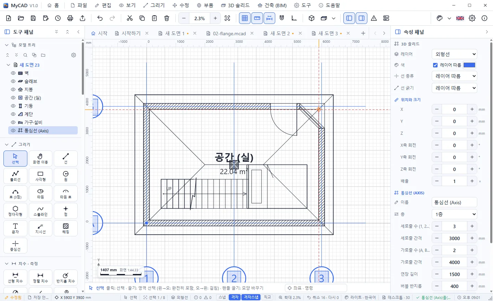

   *건축 (BIM) 2: 기둥·계단·층·철근·물량표·IFC · 층과 건물 창*

4. **철근** — 기둥 · 보 · 슬래브를 고르고 "철근"을 누르면 주근 · 띠철근 · 2방향 배근이 들어가고 무게가 물량표에 잡힙니다. 선을 고르면 그 모양대로 굽힌 철근이 됩니다.

   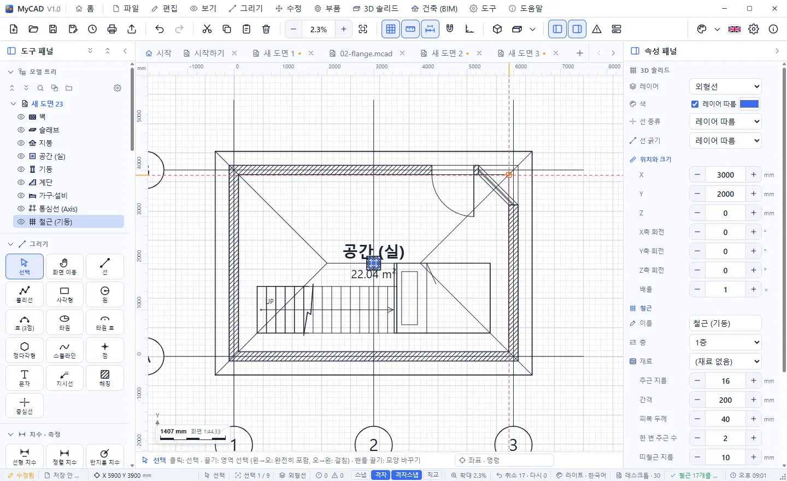

   *건축 (BIM) 2: 기둥·계단·층·철근·물량표·IFC · 철근*

5. **물량표** — "물량표"는 벽 길이 · 면적 · 체적, 창 · 문 개수, 슬래브 · 지붕 면적, 실별 면적을 도면 오른쪽에 표로 넣습니다. "물량표를 CSV 로"는 객체마다 한 줄씩 Excel 용 파일로, "패널 재단"은 패널을 판에 배치합니다.

   

   *건축 (BIM) 2: 기둥·계단·층·철근·물량표·IFC · 물량표*

6. **IFC 와 3D 내보내기** — 3D 내보내기 › IFC 4 로 IfcWall · IfcWindow · IfcDoor · IfcSlab · IfcSpace … 를 개구부 · 물량과 함께 씁니다. MyCAD 가 만든 IFC 는 다시 열면 매개변수 객체 그대로입니다. FCStd · STEP · STL · 3MF 등도 같은 메뉴에 있습니다.

   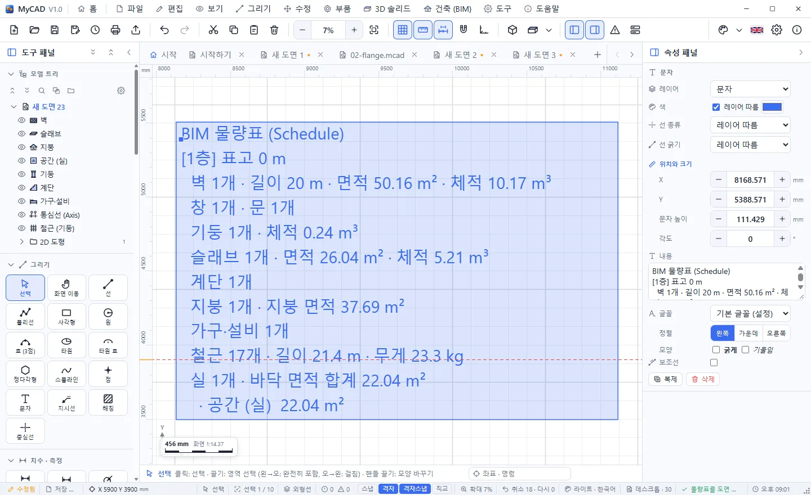

   *건축 (BIM) 2: 기둥·계단·층·철근·물량표·IFC · IFC 와 3D 내보내기*

7. **샘플: 2층 주택** — 샘플 "2층 주택"은 층별 평면도, 다층 벽(벽돌 · 단열 · 콘크리트 · 석고), 변별 경사 L자 지붕, 슬래브 철근, 트러스 · 골판 카포트, 가스관, 스케치로 만든 아치 창을 모두 보여 줍니다.

   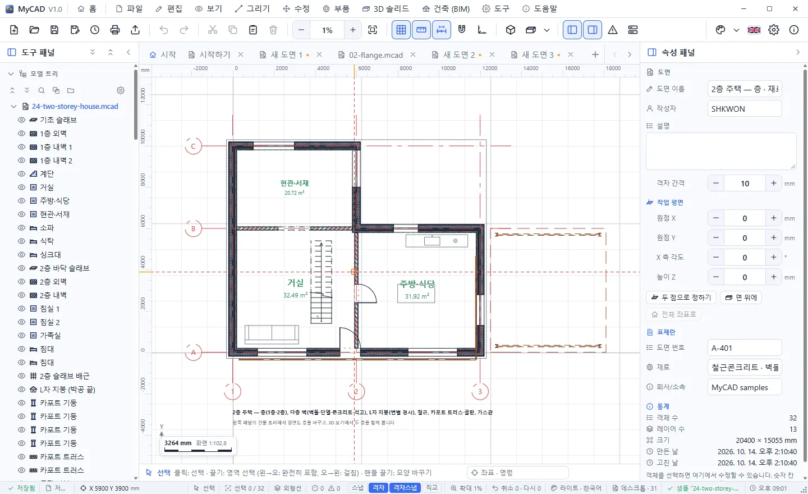

   *건축 (BIM) 2: 기둥·계단·층·철근·물량표·IFC · 샘플: 2층 주택*

### 직접 해 보기

- 건축 묶음의 "기둥"이나 "계단"을 누르세요.
- 건축 묶음의 "통심선"을 누르세요.
- 건물 묶음의 층 추가 버튼을 누르세요.
- 기둥을 고르고 "철근"을 누르세요.
- 건축 묶음의 "물량표"를 누르세요.

### 팁

- 층 표고를 바꾸면 그 층의 객체가 함께 움직입니다.

### 확인

- [ ] 기둥 · 계단 · 가구
- [ ] 통심선
- [ ] 층과 건물 창
- [ ] 철근
- [ ] 물량표
- [ ] IFC 와 3D 내보내기
- [ ] 샘플: 2층 주택

---

## 레슨 30. CAM 2D: 윤곽·포켓·드릴 G 코드

### 목표

2D 윤곽에서 윤곽 · 포켓 · 드릴 · 각인 경로를 만들고 G 코드로 저장합니다.

### 따라 하기

1. **CAM 창** — 2D 윤곽을 고르고(없으면 보이는 것 전부) 파일 › CAM — G 코드 만들기를 엽니다. 가공: 윤곽(바깥/안쪽) · 포켓(지그재그 + 마무리, 섬은 남김) · 드릴(G83 펙 / G81) · 각인. 오른쪽에 경로(파랑)와 빠른 이동(점선), 아래에 절삭 길이와 예상 시간이 나옵니다.

   

   *CAM 2D: 윤곽·포켓·드릴 G 코드 · CAM 창*

2. **G 코드 저장** — 공구 지름 · 깊이 · 한 번 깊이 · 겹침 · 이송 · 주축 회전 · 안전 높이를 정하고 "G 코드 저장"을 누르면 .nc (mm, G21 G90; LinuxCNC · GRBL) 파일이 됩니다. 구멍은 G98 G81 X30 Y25 Z-4 처럼 나옵니다.

   

   *CAM 2D: 윤곽·포켓·드릴 G 코드 · G 코드 저장*

3. **CAM 잡 메뉴** — 파일 › CAM 에는 FreeCAD CAM 처럼 잡 · 적응형 · 면 가공 · 나사 · V 조각 같은 작업, 홀딩 탭 · 도그본 같은 드레스업, 공구 · 시뮬레이션 · 점검 명령이 있습니다.

   

   *CAM 2D: 윤곽·포켓·드릴 G 코드 · CAM 잡 메뉴*

### 팁

- 구멍은 늘 안쪽에서, 섬은 남기고 깎습니다.

### 확인

- [ ] CAM 창
- [ ] G 코드 저장
- [ ] CAM 잡 메뉴

---

## 레슨 31. FEM 골조 해석

### 목표

선으로 그린 골조를 FEM 으로 풀어 변형 · 휨 모멘트 · 응력을 봅니다.

### 따라 하기

1. **골조 그리기** — 골조를 선으로 입면에 그립니다. 끝이 만나는 곳이 절점입니다. 높이 3 m, 폭 5 m 문형 골조: (0,0) → (0,3000) → (5000,3000) → (5000,0).

   

   *FEM 골조 해석 · 골조 그리기*

2. **골조 해석 창** — 3D 솔리드 › FEM — 골조 해석: 재료 · 단면, 보의 등분포 하중(N/mm) · 자중, 절점마다 지지(자유 · 핀 · 고정 · 롤러)와 하중을 정하면 변형(빨간 점선) · 휨 모멘트도(파랑) · 최대 변위 · 응력이 바로 나옵니다. 두 기둥 발을 고정하고 3 N/mm 를 겁니다.

   

   *FEM 골조 해석 · 골조 해석 창*

3. **FEM 해석 도구 메뉴** — 3D 솔리드 › 검사 · FEM 해석 › FEM 해석 도구에는 FreeCAD FEM 의 구속 · 하중, 열 · 전기 · 자기 · 유동 조건, 방정식, 재료, 메시, 풀이, 결과(색 · 필터 · 그래프) 명령이 있습니다.

   

   *FEM 골조 해석 · FEM 해석 도구 메뉴*

### 직접 해 보기

- 선 도구로 네 점을 차례로 누르세요.

### 팁

- "설정 저장"은 지지 · 하중만 도면에 남깁니다.

### 자주 하는 실수

- 지지가 하나도 없으면 풀 수 없습니다.

### 확인

- [ ] 골조 그리기
- [ ] 골조 해석 창
- [ ] FEM 해석 도구 메뉴

---

## 레슨 32. 스프레드시트·스크립트 콘솔·매크로 기록

### 목표

스프레드시트로 치수를 묶고, 스크립트 콘솔과 매크로 기록으로 반복 작업을 자동화합니다.

### 따라 하기

1. **스프레드시트** — 편집 › 스프레드시트 창에서 셀에 값 · 계산식(=width*3)을 쓰고 셀에 별칭(width)을 붙입니다. A1 에 40, 별칭 width.

   

   *스프레드시트·스크립트 콘솔·매크로 기록 · 스프레드시트*

2. **치수를 시트에 묶기** — 속성 패널의 숫자 칸에 =width*2 처럼 쓰면 그 치수가 시트를 따릅니다. 상자의 길이를 =width*2 로 하면 80, 시트에서 width 를 25 로 바꾸면 50 이 됩니다.

   

   *스프레드시트·스크립트 콘솔·매크로 기록 · 치수를 시트에 묶기*

3. **스크립트 콘솔 (JavaScript)** — 보기 › 스크립트 콘솔(Ctrl+Shift+J)에서 cad 객체로 그립니다: cad.rect · cad.circle · cad.line · cad.solid · cad.move … 실행은 Ctrl+Enter, 고친 것마다 실행 취소 한 단계입니다.

   

   *스프레드시트·스크립트 콘솔·매크로 기록 · 스크립트 콘솔 (JavaScript)*

4. **매크로 기록** — "매크로 기록"을 누르고 그리거나 명령을 실행한 뒤 다시 누르면 cad.* 줄이 편집기에 들어옵니다. 이름을 붙여 "매크로로 저장"하면 목록에서 실행 · 불러오기 · 지우기를 합니다.

   

   *스프레드시트·스크립트 콘솔·매크로 기록 · 매크로 기록*

### 직접 해 보기

- 편집 메뉴에서 스프레드시트를 여세요.
- 솔리드를 고르고 길이 칸에 =width*2 를 쓰세요.
- 콘솔에서 cad.circle(0, 0, 10) 을 실행하세요.

### 팁

- 콘솔 기록은 Ctrl+↑ / Ctrl+↓ 로 불러옵니다.

### 확인

- [ ] 스프레드시트
- [ ] 치수를 시트에 묶기
- [ ] 스크립트 콘솔 (JavaScript)
- [ ] 매크로 기록

---

## 레슨 33. 로봇·보기·도구 메뉴

### 목표

로봇 팔을 점과 경로로 움직이고, 보기 · 편집 · 도구 메뉴와 모델 트리를 살펴봅니다.

### 따라 하기

1. **로봇 팔** — 3D 솔리드 › 로봇 › 로봇 추가로 6축 로봇 팔을 놓습니다. 속성 패널에서 관절 A1–A6 각도를 바꿉니다.

   

   *로봇·보기·도구 메뉴 · 로봇 팔*

2. **점으로 움직이기** — 로봇과 점을 함께 고르고 "점으로 이동"을 누르면 역기구학으로 공구 끝이 그 점에 아래를 향해 닿습니다.

   

   *로봇·보기·도구 메뉴 · 점으로 움직이기*

3. **경로 따라가기** — 로봇과 폴리선을 고르고 "경로"를 누르면 20 mm 마다 자세를 구해 3D 에서 재생하고 KRL 프로그램을 만듭니다.

   

   *로봇·보기·도구 메뉴 · 경로 따라가기*

4. **보기 메뉴: 시점 · 카메라** — 보기 메뉴에는 표준 시점(정면 · 평면 · 우측 · 배면 · 저면 · 좌측 · 등각 · 이등각 · 삼등각), 정사영 · 원근 카메라, 저장한 시점, 축 · 절단면 · 회전대 · 입체 보기, 창 나란히 보기가 있습니다.

   

   *로봇·보기·도구 메뉴 · 보기 메뉴: 시점 · 카메라*

5. **편집 메뉴: 보이기 · 링크 · 배치** — 편집 메뉴에는 선택 기록, 보이기 · 숨기기, 색 · 투명도 · 재료, 그룹 · 다시 계산, 링크(다른 도면에서도), 변환 · 점 맞춤 정렬이 있습니다.

   

   *로봇·보기·도구 메뉴 · 편집 메뉴: 보이기 · 링크 · 배치*

6. **도구 메뉴** — 도구 메뉴: 단위 계산기, 의존성 그래프, 문서 정리, 스크립트 콘솔과 매크로 폴더 · 최근 매크로, 애드온 관리자, 매크로 디버거(중단점 · 한 줄씩), 매개변수 편집기, 사용자 정의(툴바 · 단축키), 설정.

   

   *로봇·보기·도구 메뉴 · 도구 메뉴*

7. **모델 트리** — 왼쪽 패널 맨 위의 모델 트리는 솔리드와 2D 폴더, 그룹을 보여 줍니다. 눈 아이콘으로 숨기고, 누르면 선택되며, 접고 펼 수 있습니다.

   

   *로봇·보기·도구 메뉴 · 모델 트리*

### 직접 해 보기

- 3D 솔리드 메뉴에서 로봇을 추가하세요.

### 팁

- 로봇 경로는 KRL 프로그램으로 저장됩니다.

### 확인

- [ ] 로봇 팔
- [ ] 점으로 움직이기
- [ ] 경로 따라가기
- [ ] 보기 메뉴: 시점 · 카메라
- [ ] 편집 메뉴: 보이기 · 링크 · 배치
- [ ] 도구 메뉴
- [ ] 모델 트리

---

## 부록 A. 단축키

| 키 | 기능 |
|---|---|
| `Ctrl+N` | 새 도면 |
| `Ctrl+O` | 열기 |
| `Ctrl+S / Ctrl+Shift+S` | 저장 / 다른 이름으로 |
| `Ctrl+P` | 인쇄 |
| `Ctrl+Z / Ctrl+Y` | 실행 취소 / 다시 실행 |
| `Ctrl+X / C / V` | 잘라내기 / 복사 / 붙여넣기 |
| `Ctrl+D` | 복제 |
| `Delete` | 삭제 |
| `Ctrl+Shift+E` | 분해 |
| `Ctrl+R` | 눈금자 |
| `Ctrl+Shift+B` | 축척 막대 |
| `Ctrl+Shift+3` | 3D 보기 |
| `Ctrl+Shift+G` | 광원 켜기/끄기 |
| `Ctrl+I` | 3D 모델 가져오기 |
| `Ctrl+Shift+P` | 3D 프린팅 (STL) |
| `Ctrl+,` | 설정 |
| `Ctrl+1 / Ctrl+2` | 도구 패널 / 속성 패널 |
| `Ctrl+Tab` | 다음 탭 |
| `Home` | 전체 보기 |
| `F1` | 프로그램 정보 |
| `F3 / F7 / F8 / F9` | 객체 스냅 / 격자 / 직교 / 격자 스냅 |
| `Esc` | 그리기 취소 · 선택 도구로 |
| `Enter` | 그리기 끝내기 |
| `L R C A` | 선 · 사각형 · 원 · 호 (그 밖의 도구 키는 툴팁) |

## 부록 B. 지원 파일 형식

| 형식 | 확장자 | 읽기 | 쓰기 |
|---|---|:---:|:---:|
| MyCAD | `.mcad` `.json` | ✓ | ✓ |
| AutoCAD DXF (R12 – 2018, text · binary) | `.dxf` | ✓ | ✓ |
| SVG | `.svg` | ✓ | ✓ |
| IGES 5.3 | `.igs` `.iges` | ✓ | ✓ |
| HP-GL/2 | `.plt` `.hpgl` `.hgl` `.hp2` `.pen` | ✓ | ✓ |
| Gerber RS-274X | `.gbr` `.ger` `.gtl` `.gbl` `.gto` `.gbo` `.gts` `.gbs` `.gtp` `.gbp` `.gko` `.gm1` `.gml` `.art` `.pho` | ✓ |  |
| Excellon drill | `.drl` `.xln` `.exc` `.drd` | ✓ |  |
| PNG | `.png` |  | ✓ |
| FreeCAD | `.FCStd` | ✓ | ✓ |
| IFC 4 (BIM) | `.ifc` | ✓ | ✓ |
| STEP AP214 | `.step` `.stp` | ✓ | ✓ |
| STL | `.stl` | ✓ | ✓ |
| Wavefront OBJ | `.obj` | ✓ | ✓ |
| Stanford PLY | `.ply` | ✓ | ✓ |
| Object File Format | `.off` | ✓ | ✓ |
| Additive Manufacturing (AMF) | `.amf` | ✓ | ✓ |
| VRML 2.0 (VRML97) | `.wrl` `.vrml` | ✓ | ✓ |
| COLLADA | `.dae` | ✓ | ✓ |
| OpenCASCADE BREP | `.brep` `.brp` | ✓ | ✓ |
| OpenSCAD (CSG) | `.scad` `.csg` | ✓ | ✓ |
| Point cloud (XYZ, ASC, PTS, PCD) | `.xyz` `.asc` `.pts` `.pcd` | ✓ | ✓ |
| G-code (CAM) | `.nc` `.gcode` `.ngc` `.tap` |  | ✓ |
| KUKA KRL (Robot) | `.src` |  | ✓ |
| 3D Manufacturing (3MF) | `.3mf` | ✓ | ✓ |
| Images | `.png` `.jpg` `.jpeg` `.gif` `.webp` `.bmp` `.svg` `.avif` `.ico` | ✓ |  |
| Text | `.txt` `.md` `.csv` | ✓ |  |

## 부록 C. 기능 찾아보기

| 기능 | 레슨 |
|---|---|
| 시작 페이지 | [레슨 1](#레슨-1-둘러보기) |
| 샘플 열기 | [레슨 1](#레슨-1-둘러보기) |
| 전체 보기와 확대 | [레슨 1](#레슨-1-둘러보기) |
| 화면 이동 | [레슨 1](#레슨-1-둘러보기) |
| 패널 접고 펴기 | [레슨 1](#레슨-1-둘러보기) |
| 3D 보기 | [레슨 1](#레슨-1-둘러보기) |
| 새 도면 | [레슨 2](#레슨-2-선과-도형-그리기) |
| 선 (L) | [레슨 2](#레슨-2-선과-도형-그리기) |
| 사각형 (R) | [레슨 2](#레슨-2-선과-도형-그리기) |
| 원 (C) | [레슨 2](#레슨-2-선과-도형-그리기) |
| 호 (3점) | [레슨 2](#레슨-2-선과-도형-그리기) |
| 타원 | [레슨 2](#레슨-2-선과-도형-그리기) |
| 정다각형 | [레슨 2](#레슨-2-선과-도형-그리기) |
| 폴리선 | [레슨 2](#레슨-2-선과-도형-그리기) |
| 스플라인 | [레슨 2](#레슨-2-선과-도형-그리기) |
| 점 | [레슨 2](#레슨-2-선과-도형-그리기) |
| 좌표 입력 | [레슨 3](#레슨-3-정밀-입력스냅단위) |
| 극좌표: 거리<각도 | [레슨 3](#레슨-3-정밀-입력스냅단위) |
| 객체 스냅 (F3) | [레슨 3](#레슨-3-정밀-입력스냅단위) |
| 직교 모드 (F8) | [레슨 3](#레슨-3-정밀-입력스냅단위) |
| 길이 단위 | [레슨 3](#레슨-3-정밀-입력스냅단위) |
| 다른 단위로 입력 | [레슨 3](#레슨-3-정밀-입력스냅단위) |
| 축척 막대 | [레슨 3](#레슨-3-정밀-입력스냅단위) |
| 준비: 사각형과 원 | [레슨 4](#레슨-4-선택과-수정) |
| 선택 | [레슨 4](#레슨-4-선택과-수정) |
| 이동 (M) | [레슨 4](#레슨-4-선택과-수정) |
| 복사 | [레슨 4](#레슨-4-선택과-수정) |
| 회전 | [레슨 4](#레슨-4-선택과-수정) |
| 대칭 | [레슨 4](#레슨-4-선택과-수정) |
| 크기 조정 | [레슨 4](#레슨-4-선택과-수정) |
| 간격 띄우기 | [레슨 4](#레슨-4-선택과-수정) |
| 배열 복사 | [레슨 4](#레슨-4-선택과-수정) |
| 분해 | [레슨 4](#레슨-4-선택과-수정) |
| 실행 취소·다시 실행 | [레슨 4](#레슨-4-선택과-수정) |
| 삭제 | [레슨 4](#레슨-4-선택과-수정) |
| 준비: 판과 구멍 | [레슨 5](#레슨-5-치수와-주석) |
| 선형 치수 | [레슨 5](#레슨-5-치수와-주석) |
| 정렬 치수 | [레슨 5](#레슨-5-치수와-주석) |
| 지름·반지름 치수 | [레슨 5](#레슨-5-치수와-주석) |
| 각도 치수 | [레슨 5](#레슨-5-치수와-주석) |
| 문자 | [레슨 5](#레슨-5-치수와-주석) |
| 지시선 | [레슨 5](#레슨-5-치수와-주석) |
| 해칭 | [레슨 5](#레슨-5-치수와-주석) |
| 중심선 | [레슨 5](#레슨-5-치수와-주석) |
| 거리 재기 | [레슨 5](#레슨-5-치수와-주석) |
| 속성 패널에서 고치기 | [레슨 6](#레슨-6-속성과-레이어) |
| 계산식과 단위 | [레슨 6](#레슨-6-속성과-레이어) |
| 선 종류·굵기·색 | [레슨 6](#레슨-6-속성과-레이어) |
| 레이어 | [레슨 6](#레슨-6-속성과-레이어) |
| 기어 넣기 | [레슨 7](#레슨-7-부품-라이브러리) |
| 볼트와 너트 | [레슨 7](#레슨-7-부품-라이브러리) |
| 부품 치수 바꾸기 | [레슨 7](#레슨-7-부품-라이브러리) |
| 상자 넣기 | [레슨 8](#레슨-8-3d-솔리드) |
| 원기둥 | [레슨 8](#레슨-8-3d-솔리드) |
| 3D로 보기 | [레슨 8](#레슨-8-3d-솔리드) |
| 시점 바꾸기 | [레슨 8](#레슨-8-3d-솔리드) |
| 위치와 회전 | [레슨 8](#레슨-8-3d-솔리드) |
| 2D로 돌아가기 | [레슨 8](#레슨-8-3d-솔리드) |
| 돌출 (Pad) | [레슨 9](#레슨-9-2d에서-3d로-돌출회전로프트스윕) |
| 회전 (Revolve) | [레슨 9](#레슨-9-2d에서-3d로-돌출회전로프트스윕) |
| 로프트 (Loft) | [레슨 9](#레슨-9-2d에서-3d로-돌출회전로프트스윕) |
| 스윕 (Sweep) | [레슨 9](#레슨-9-2d에서-3d로-돌출회전로프트스윕) |
| 빼기 (Cut) | [레슨 10](#레슨-10-불리언-빼기합치기교차) |
| 합치기 (Fuse) | [레슨 10](#레슨-10-불리언-빼기합치기교차) |
| 분해로 되돌리기 | [레슨 10](#레슨-10-불리언-빼기합치기교차) |
| 투영 도면 만들기 | [레슨 11](#레슨-11-도면-뷰와-단면) |
| 단면 | [레슨 11](#레슨-11-도면-뷰와-단면) |
| 보기 스타일과 좌표축 | [레슨 12](#레슨-12-3d-보기-자세히) |
| 광원 (해) | [레슨 12](#레슨-12-3d-보기-자세히) |
| 2D로 | [레슨 12](#레슨-12-3d-보기-자세히) |
| 저장과 열기 | [레슨 13](#레슨-13-파일-저장열기가져오기내보내기) |
| 다른 CAD 도면 열기 | [레슨 13](#레슨-13-파일-저장열기가져오기내보내기) |
| PCB 거버 | [레슨 13](#레슨-13-파일-저장열기가져오기내보내기) |
| 내보내기 | [레슨 13](#레슨-13-파일-저장열기가져오기내보내기) |
| 끌어 놓기 | [레슨 13](#레슨-13-파일-저장열기가져오기내보내기) |
| 인쇄 미리보기 | [레슨 14](#레슨-14-인쇄와-3d-프린팅) |
| 3D 프린팅 (STL) | [레슨 14](#레슨-14-인쇄와-3d-프린팅) |
| 설정 창 | [레슨 15](#레슨-15-설정과-모양) |
| 테마 | [레슨 15](#레슨-15-설정과-모양) |
| 툴바와 패널 묶음 | [레슨 15](#레슨-15-설정과-모양) |
| 기능표 | [레슨 16](#레슨-16-도움말) |
| 프로그램 정보와 지원 형식 | [레슨 16](#레슨-16-도움말) |
| 튜토리얼 다시 보기 | [레슨 16](#레슨-16-도움말) |
| 움직이는 샘플 | [레슨 17](#레슨-17-조립과-움직임) |
| 재생 막대 | [레슨 17](#레슨-17-조립과-움직임) |
| 조인트와 구동 | [레슨 17](#레슨-17-조립과-움직임) |
| 곡면 위 불리언 | [레슨 18](#레슨-18-정확한-솔리드-opencascade) |
| 모깎기와 구배 | [레슨 18](#레슨-18-정확한-솔리드-opencascade) |
| 3D 에서 모서리 고르기 | [레슨 18](#레슨-18-정확한-솔리드-opencascade) |
| 3D 황삭 · 정삭 | [레슨 19](#레슨-19-cam-3d-가공과-시뮬레이션) |
| 시뮬레이션과 가공 결과 | [레슨 19](#레슨-19-cam-3d-가공과-시뮬레이션) |
| 판 응력 (평면 응력) | [레슨 20](#레슨-20-fem-해석-판과-솔리드) |
| 솔리드 (3D) 와 CalculiX | [레슨 20](#레슨-20-fem-해석-판과-솔리드) |
| Python 으로 모델 만들기 | [레슨 21](#레슨-21-python-콘솔과-매크로) |
| 애드온 관리자 | [레슨 21](#레슨-21-python-콘솔과-매크로) |
| 자르기 (X) | [레슨 22](#레슨-22-2d-편집-자르기연장모깎기모따기) |
| 연장 (W) | [레슨 22](#레슨-22-2d-편집-자르기연장모깎기모따기) |
| 모깎기 (J) | [레슨 22](#레슨-22-2d-편집-자르기연장모깎기모따기) |
| 모따기 (K) | [레슨 22](#레슨-22-2d-편집-자르기연장모깎기모따기) |
| 보조선 | [레슨 23](#레슨-23-스케치-구속과-보조선) |
| 기하 구속: 일치·직각 | [레슨 23](#레슨-23-스케치-구속과-보조선) |
| 치수 구속: 수평·거리 | [레슨 23](#레슨-23-스케치-구속과-보조선) |
| 자유도와 구속 상태 | [레슨 23](#레슨-23-스케치-구속과-보조선) |
| 스케치·Draft 도구 메뉴 | [레슨 23](#레슨-23-스케치-구속과-보조선) |
| 클론 | [레슨 24](#레슨-24-클론작업-평면문제-검사) |
| 원본을 고치면 클론도 | [레슨 24](#레슨-24-클론작업-평면문제-검사) |
| 독립시키기 | [레슨 24](#레슨-24-클론작업-평면문제-검사) |
| 작업 평면 | [레슨 24](#레슨-24-클론작업-평면문제-검사) |
| 전체 좌표로 | [레슨 24](#레슨-24-클론작업-평면문제-검사) |
| 문제 패널 (Ctrl+Shift+M) | [레슨 24](#레슨-24-클론작업-평면문제-검사) |
| 눈금자 (Ctrl+R) | [레슨 24](#레슨-24-클론작업-평면문제-검사) |
| 준비: 판과 구멍 | [레슨 25](#레슨-25-제작-도면-풍선기하-공차데이텀) |
| 풍선 | [레슨 25](#레슨-25-제작-도면-풍선기하-공차데이텀) |
| 데이텀 | [레슨 25](#레슨-25-제작-도면-풍선기하-공차데이텀) |
| 기하 공차 | [레슨 25](#레슨-25-제작-도면-풍선기하-공차데이텀) |
| 제작 도면 샘플 | [레슨 25](#레슨-25-제작-도면-풍선기하-공차데이텀) |
| TechDraw 메뉴 | [레슨 25](#레슨-25-제작-도면-풍선기하-공차데이텀) |
| 포켓 | [레슨 26](#레슨-26-partdesign-포켓구멍모따기두께) |
| 구멍 | [레슨 26](#레슨-26-partdesign-포켓구멍모따기두께) |
| 3D 모따기 | [레슨 26](#레슨-26-partdesign-포켓구멍모따기두께) |
| 두께와 3D 오프셋 | [레슨 26](#레슨-26-partdesign-포켓구멍모따기두께) |
| 3D로 확인하기 | [레슨 26](#레슨-26-partdesign-포켓구멍모따기두께) |
| 바디 · 패턴 메뉴 | [레슨 26](#레슨-26-partdesign-포켓구멍모따기두께) |
| 형상 검사 | [레슨 27](#레슨-27-형상-검사메시역설계) |
| 메시 단순화 | [레슨 27](#레슨-27-형상-검사메시역설계) |
| 메시 수리 | [레슨 27](#레슨-27-형상-검사메시역설계) |
| 메시 도구 메뉴 | [레슨 27](#레슨-27-형상-검사메시역설계) |
| 역설계: 점 구름에서 형상으로 | [레슨 27](#레슨-27-형상-검사메시역설계) |
| 벽 | [레슨 28](#레슨-28-건축-bim-1-벽창문슬래브지붕실) |
| 창과 문 | [레슨 28](#레슨-28-건축-bim-1-벽창문슬래브지붕실) |
| 슬래브 | [레슨 28](#레슨-28-건축-bim-1-벽창문슬래브지붕실) |
| 지붕 | [레슨 28](#레슨-28-건축-bim-1-벽창문슬래브지붕실) |
| 실 (공간) | [레슨 28](#레슨-28-건축-bim-1-벽창문슬래브지붕실) |
| 3D로 보기 | [레슨 28](#레슨-28-건축-bim-1-벽창문슬래브지붕실) |
| 기둥 · 계단 · 가구 | [레슨 29](#레슨-29-건축-bim-2-기둥계단층철근물량표ifc) |
| 통심선 | [레슨 29](#레슨-29-건축-bim-2-기둥계단층철근물량표ifc) |
| 층과 건물 창 | [레슨 29](#레슨-29-건축-bim-2-기둥계단층철근물량표ifc) |
| 철근 | [레슨 29](#레슨-29-건축-bim-2-기둥계단층철근물량표ifc) |
| 물량표 | [레슨 29](#레슨-29-건축-bim-2-기둥계단층철근물량표ifc) |
| IFC 와 3D 내보내기 | [레슨 29](#레슨-29-건축-bim-2-기둥계단층철근물량표ifc) |
| 샘플: 2층 주택 | [레슨 29](#레슨-29-건축-bim-2-기둥계단층철근물량표ifc) |
| CAM 창 | [레슨 30](#레슨-30-cam-2d-윤곽포켓드릴-g-코드) |
| G 코드 저장 | [레슨 30](#레슨-30-cam-2d-윤곽포켓드릴-g-코드) |
| CAM 잡 메뉴 | [레슨 30](#레슨-30-cam-2d-윤곽포켓드릴-g-코드) |
| 골조 그리기 | [레슨 31](#레슨-31-fem-골조-해석) |
| 골조 해석 창 | [레슨 31](#레슨-31-fem-골조-해석) |
| FEM 해석 도구 메뉴 | [레슨 31](#레슨-31-fem-골조-해석) |
| 스프레드시트 | [레슨 32](#레슨-32-스프레드시트스크립트-콘솔매크로-기록) |
| 치수를 시트에 묶기 | [레슨 32](#레슨-32-스프레드시트스크립트-콘솔매크로-기록) |
| 스크립트 콘솔 (JavaScript) | [레슨 32](#레슨-32-스프레드시트스크립트-콘솔매크로-기록) |
| 매크로 기록 | [레슨 32](#레슨-32-스프레드시트스크립트-콘솔매크로-기록) |
| 로봇 팔 | [레슨 33](#레슨-33-로봇보기도구-메뉴) |
| 점으로 움직이기 | [레슨 33](#레슨-33-로봇보기도구-메뉴) |
| 경로 따라가기 | [레슨 33](#레슨-33-로봇보기도구-메뉴) |
| 보기 메뉴: 시점 · 카메라 | [레슨 33](#레슨-33-로봇보기도구-메뉴) |
| 편집 메뉴: 보이기 · 링크 · 배치 | [레슨 33](#레슨-33-로봇보기도구-메뉴) |
| 도구 메뉴 | [레슨 33](#레슨-33-로봇보기도구-메뉴) |
| 모델 트리 | [레슨 33](#레슨-33-로봇보기도구-메뉴) |
