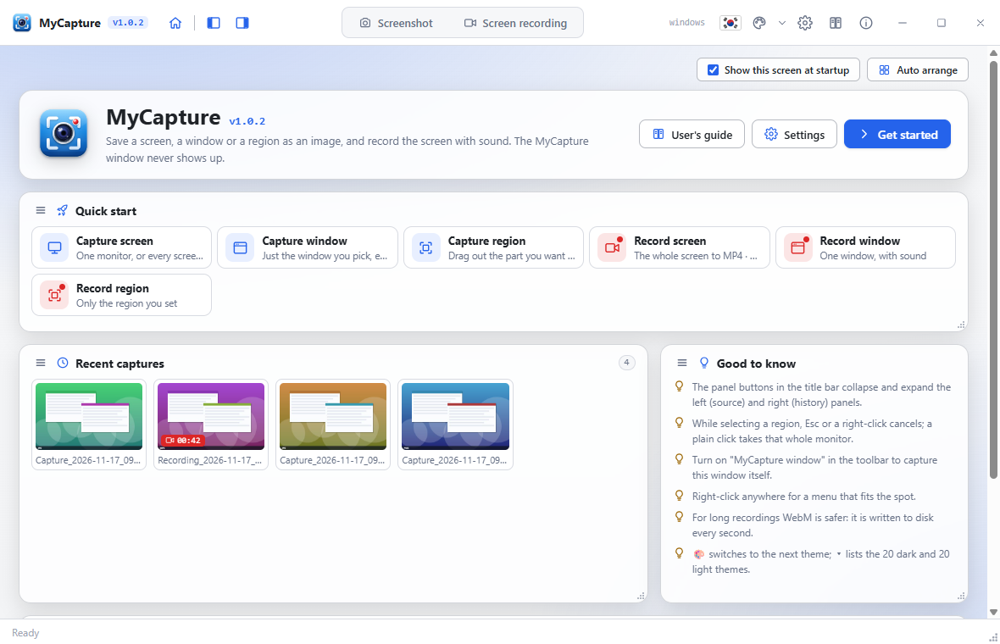
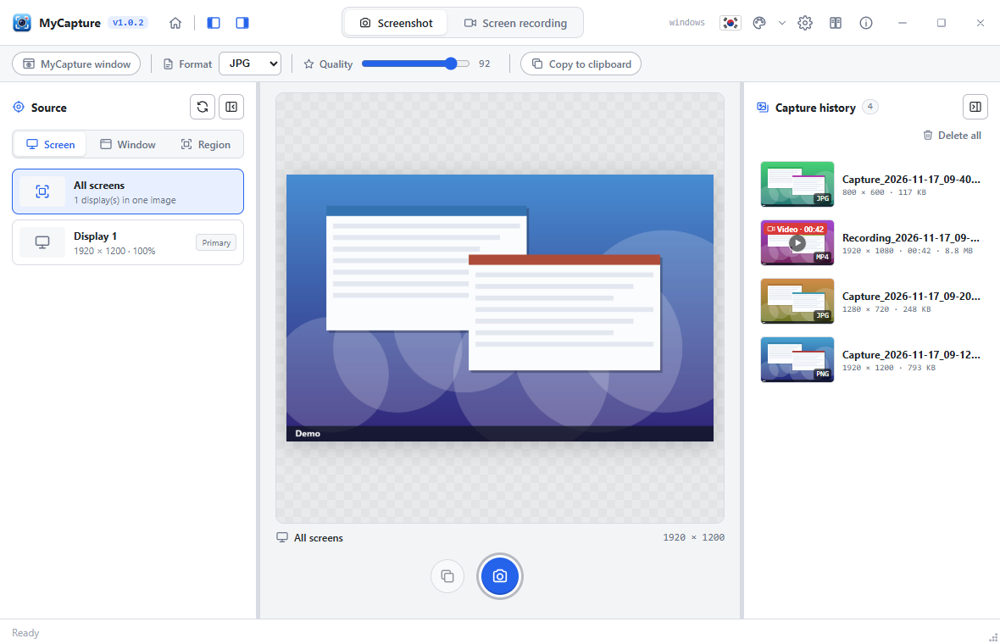
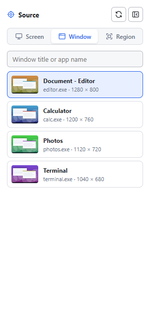
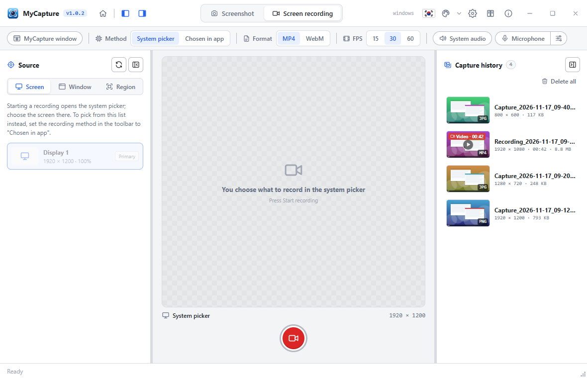
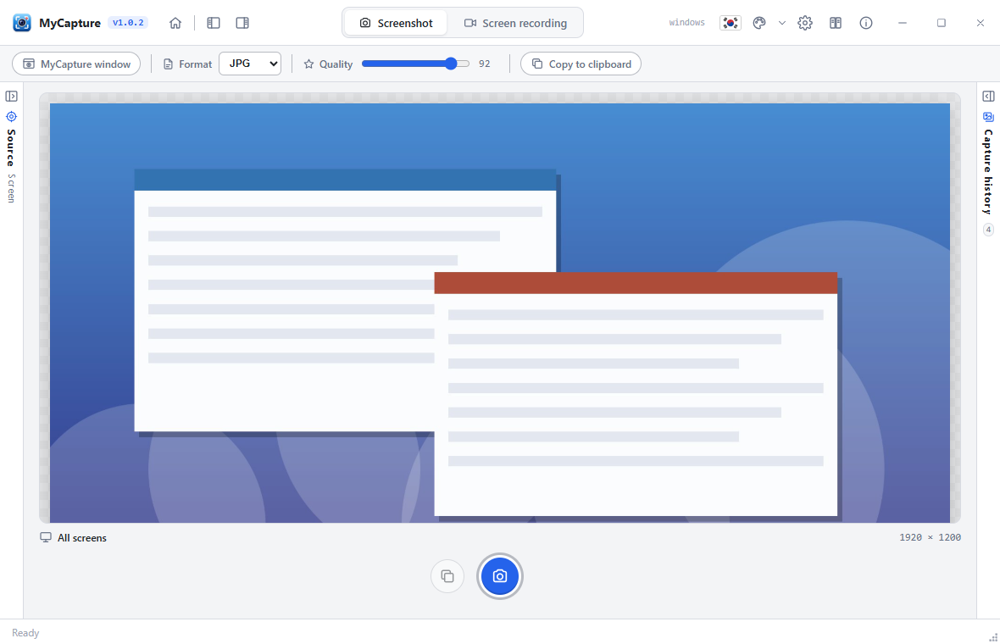
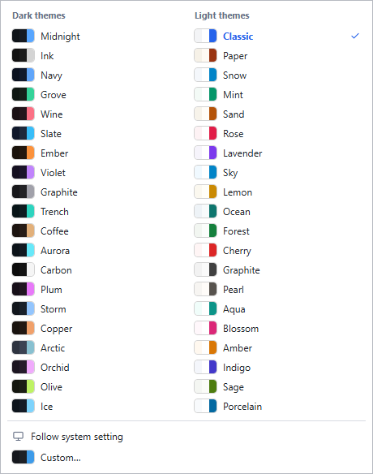
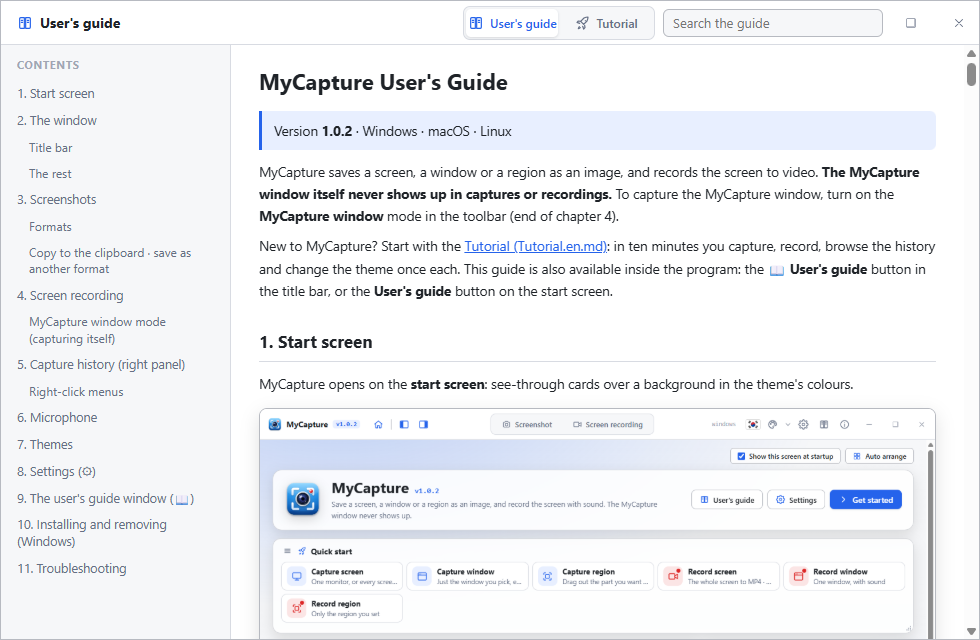

# MyCapture Tutorial

> Version **1.0.2** · about 10 minutes

A hands-on walk-through for first-time users. Step by step you use the start screen, capturing, recording, the capture history, collapsing panels and themes once each.
Every feature is described in detail in the [User's guide (UsersGuide.en.md)](UsersGuide.en.md).

## Before you start

- Start MyCapture. The start screen opens.
- Captures go to your **Pictures** folder and recordings to **Videos** by default. To change that: ⚙ Settings → **Save location**.

## Step 1 · Look around the start screen

1. The top card shows the program name and version **v1.0.2**.
2. The **Quick start** card has three captures (screen · window · region) and three recordings (screen · window · region).
3. Drag the **≡** left of the **Good to know** title somewhere else. The other cards make room.
4. Drag a card's bottom-right corner to resize it, then double-click the corner to fit it again.
5. Press **Auto arrange** in the top right to go back to the original arrangement.

## Step 2 · Capture a screen

1. Under Quick start, press **Capture screen**. The capture screen opens, and the source panel on the left lists **All screens** and your displays.
2. With **All screens** selected, press the round 📷 button in the middle.
3. The status bar says the file was saved, and a thumbnail appears at the bottom of the **Capture history** on the right.

> Tip: choose PNG under **Format** in the toolbar for lossless images. For JPG the **Quality** slider trades size for detail.

## Step 3 · Capture a region

1. Press **⌂** in the title bar to go back to the start screen.
2. Press **Capture region**. Every screen is covered with a frozen picture right away.
3. **Drag** over the part you want; releasing saves it. (`Esc` or a right-click cancels.)
4. To take the same spot again, press **↻ Capture same region again** next to 📷.

## Step 4 · Capture just one window

1. Press the **Window** tab at the top of the source panel. Open windows are listed with thumbnails.
2. Type part of a window's name in the search box to narrow the list, and pick a window.
3. Press 📷. Only that window is taken, even if something covers it.

## Step 5 · Record the screen

1. Press **🎥 Screen recording** in the title bar.
2. In the toolbar, leave the format on **WebM** and FPS on **30**. For sound, turn on **System audio** or **Microphone**.
3. Press 🎥 in the middle; the OS screen-sharing window opens. Choose the screen and press Share.
4. In the small **recording controls** at the top centre of the screen, ❚❚ pauses and pressing it again resumes.
5. ■ stops. MyCapture comes back, and the capture history gets an entry with a red **🎥 Video** label.

## Step 6 · Browse the capture history

1. Click an image in the capture history. It opens large in the middle.
2. Zoom with the mouse wheel, drag to pan, double-click to switch between fit and 100 %.
3. Click the video entry and press ▶. `Space` plays and pauses.
4. Right-click an entry and choose **Show in folder** to open the folder that holds the file.
5. `Esc` closes the viewer.

> Removing an entry from the history never deletes the saved file.

## Step 7 · Collapse panels from the title bar

1. Press the first **panel button** right of ⌂ in the title bar (the icon with the left column filled in). The source panel on the left folds into a slim strip.
2. Press the second panel button (right column filled in) to fold the capture history as well. The preview now fills the window.
3. Press both again to expand them. The collapsed state is remembered.

## Step 8 · Change the theme

1. Press **🎨** in the title bar a few times. Each press switches to the next theme and the status bar names it.
2. Press **▾** next to 🎨. The left column holds the **20 dark themes**, the right one the **20 light themes**. Pick one.
3. Press **Custom…** under the list; the Theme tab of the settings opens. Press **Copy current colours**, then change just the **Accent** colour. It applies at once.
4. The **Themes** card on the start screen offers the same 40 themes and Custom.
5. To go back, choose **Follow system setting**.

## Step 9 · Open the user's guide

1. Press **📖** in the title bar. The user's guide opens in its own window.
2. Click **Themes** in the contents on the left to jump to that chapter.
3. Type `WebM` into the **search** box at the top. Matches are highlighted in yellow.
4. Press **Tutorial** at the top to open this very document.

## Wrapping up

- To start straight in the capture screen next time, turn off **Show this screen at startup** on the start screen. **⌂** opens it again whenever you like.
- The flag button switches the language to 한국어; the screens and the guide switch with it.
