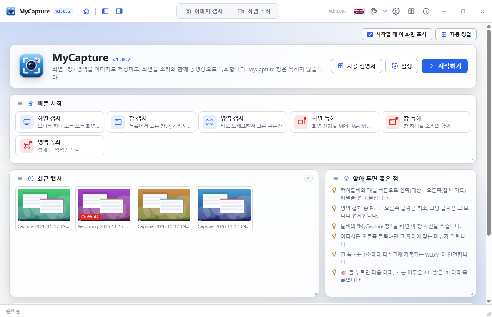
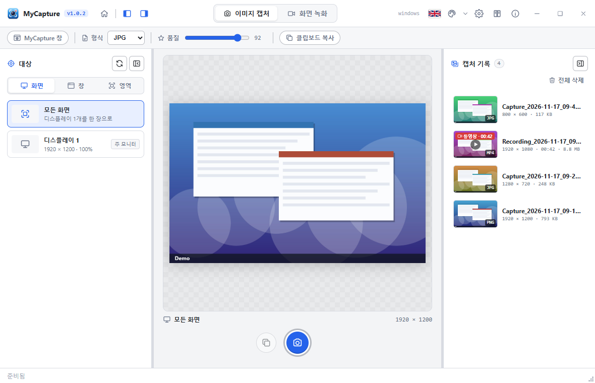
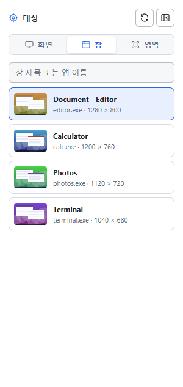
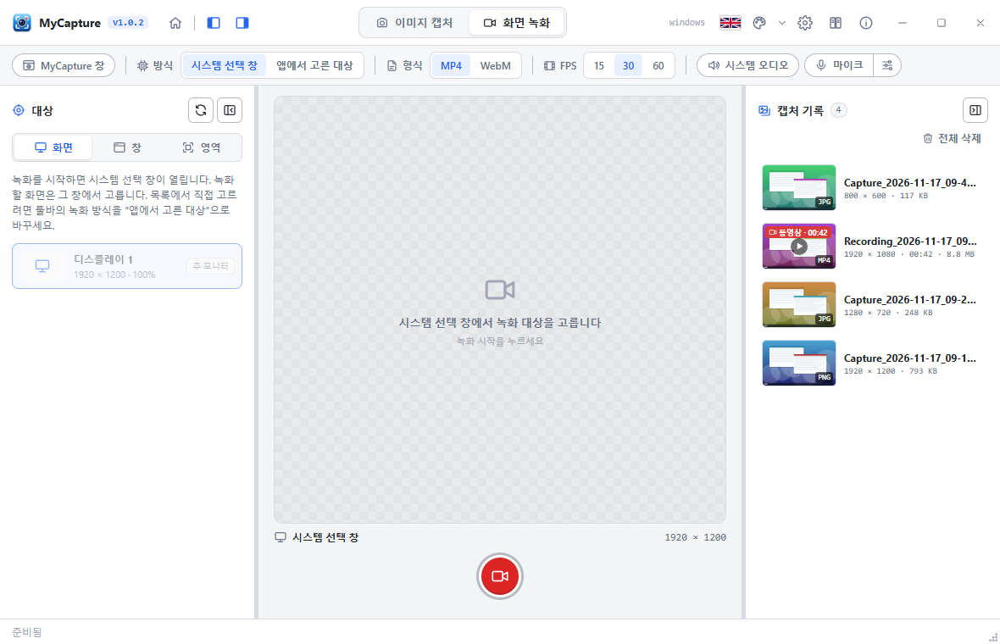
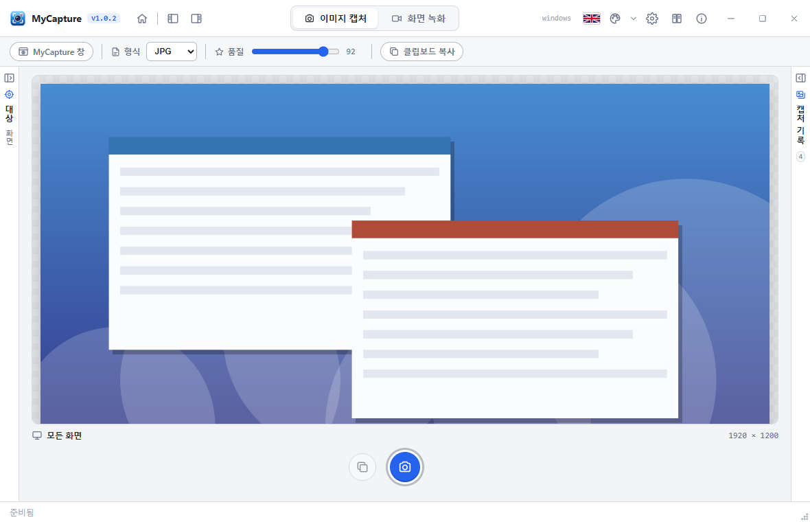
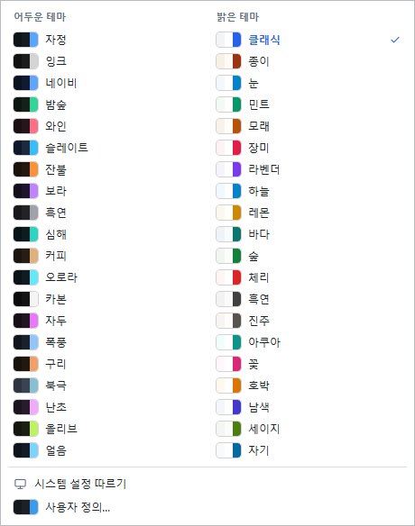
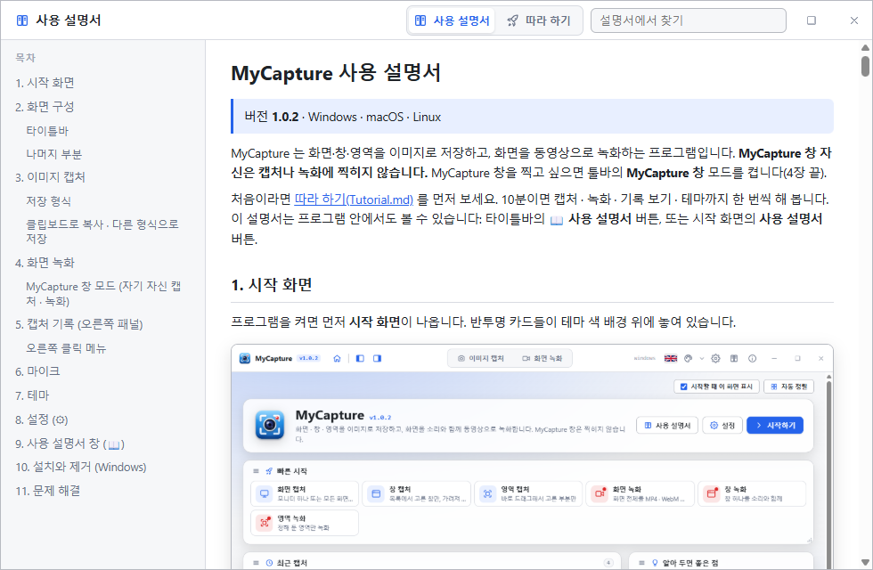

# MyCapture 따라 하기

> 버전 **1.0.2** · 약 10분

처음 쓰는 분을 위한 실습서입니다. 순서대로 따라 하면 시작 화면, 캡처, 녹화, 캡처 기록, 패널 접기, 테마를 한 번씩 써 보게 됩니다.
각 기능의 자세한 설명은 [사용 설명서(UsersGuide.md)](UsersGuide.md) 에 있습니다.

## 준비

- MyCapture 를 실행합니다. 시작 화면이 열립니다.
- 캡처한 파일은 기본적으로 **사진** 폴더, 녹화한 파일은 **동영상** 폴더에 저장됩니다. 바꾸려면 ⚙ 설정 → **저장 위치** 탭.

## 1단계 · 시작 화면 둘러보기

1. 맨 위 카드에서 프로그램 이름과 버전 **v1.0.2** 를 확인합니다.
2. **빠른 시작** 카드에 캡처 3가지(화면 · 창 · 영역)와 녹화 3가지(화면 · 창 · 영역)가 있습니다.
3. **알아 두면 좋은 점** 카드의 제목 왼쪽 **≡** 를 끌어 다른 자리에 놓아 봅니다. 다른 카드들이 비켜 줍니다.
4. 카드 오른쪽 아래 모서리를 끌어 크기를 바꿔 보고, 모서리를 더블클릭해 원래 높이로 돌립니다.
5. 오른쪽 위 **자동 정렬** 을 눌러 처음 배치로 되돌립니다.

## 2단계 · 화면 한 장 캡처하기

1. 빠른 시작에서 **화면 캡처** 를 누릅니다. 캡처 화면으로 넘어가고, 왼쪽 대상 패널에 **모든 화면** 과 디스플레이 목록이 보입니다.
2. **모든 화면** 을 고른 채, 가운데 둥근 📷 버튼을 누릅니다.
3. 상태 바에 "저장했습니다" 와 파일 이름이 나오고, 오른쪽 **캡처 기록** 맨 아래에 썸네일이 생깁니다.

> 팁: 툴바의 **형식** 에서 PNG 를 고르면 무손실로 저장됩니다. JPG 는 **품질** 슬라이더로 크기를 조절합니다.

## 3단계 · 영역 캡처하기

1. 타이틀바의 **⌂** 를 눌러 시작 화면으로 돌아갑니다.
2. **영역 캡처** 를 누릅니다. 곧바로 화면 전체가 얼어붙은 그림으로 덮입니다.
3. 원하는 부분을 **드래그** 합니다. 손을 떼면 바로 저장됩니다. (`Esc` 나 오른쪽 클릭은 취소)
4. 같은 자리를 다시 찍으려면 📷 옆의 **↻ 같은 영역 다시 캡처** 를 누릅니다.

## 4단계 · 창 하나만 캡처하기

1. 대상 패널 위쪽의 **창** 탭을 누릅니다. 열려 있는 창들이 썸네일과 함께 나옵니다.
2. 검색 칸에 창 이름 일부를 넣어 목록을 줄이고, 원하는 창을 고릅니다.
3. 📷 를 누릅니다. 다른 창에 가려져 있어도 그 창만 찍힙니다.

## 5단계 · 화면 녹화하기

1. 타이틀바의 **🎥 화면 녹화** 를 누릅니다.
2. 툴바에서 형식은 **WebM**, FPS 는 **30** 으로 둡니다. 소리를 넣으려면 **시스템 오디오** 나 **마이크** 를 켭니다.
3. 가운데 🎥 를 누르면 운영체제의 화면 공유 창이 열립니다. 녹화할 화면을 고르고 공유를 누릅니다.
4. 화면 위쪽 가운데의 작은 **녹화 제어판** 에서 ❚❚ 로 일시정지, 다시 눌러 재개합니다.
5. ■ 로 정지하면 MyCapture 창이 돌아오고, 캡처 기록에 빨간 **🎥 동영상** 표시가 붙은 항목이 생깁니다.

## 6단계 · 캡처 기록 보기

1. 캡처 기록에서 이미지를 누릅니다. 가운데에 크게 열립니다.
2. 마우스 휠로 확대 · 축소하고, 끌어서 움직이고, 더블클릭으로 맞춤 ↔ 100 % 를 오갑니다.
3. 동영상 항목을 누르고 ▶ 로 재생합니다. `Space` 로 재생 · 일시정지.
4. 항목을 오른쪽 클릭해 **폴더에서 보기** 를 누르면 파일이 있는 폴더가 열립니다.
5. `Esc` 로 보기를 닫습니다.

> 기록에서 **삭제** 해도 저장된 파일은 지워지지 않습니다.

## 7단계 · 타이틀바로 패널 접기

1. 타이틀바의 ⌂ 오른쪽에 있는 첫 번째 **패널 버튼**(왼쪽 칸이 채워진 아이콘)을 누릅니다. 왼쪽 대상 패널이 좁은 띠로 접힙니다.
2. 두 번째 패널 버튼(오른쪽 칸이 채워진 아이콘)으로 오른쪽 캡처 기록 패널도 접습니다. 미리보기가 창 가득 넓어집니다.
3. 두 버튼을 다시 눌러 펼칩니다. 접힘 상태는 다음 실행에도 기억됩니다.

## 8단계 · 테마 바꾸기

1. 타이틀바의 **🎨** 를 몇 번 눌러 봅니다. 누를 때마다 다음 테마로 바뀌고, 상태 바에 테마 이름이 나옵니다.
2. 🎨 옆 **▾** 를 눌러 목록을 엽니다. 왼쪽 열이 **어두운 테마 20개**, 오른쪽 열이 **밝은 테마 20개** 입니다. 하나를 고릅니다.
3. 목록 아래 **사용자 정의…** 를 누르면 설정의 테마 탭이 열립니다. **현재 테마 색 가져오기** 를 누른 뒤 **강조** 색만 바꿔 봅니다. 바로 적용됩니다.
4. 시작 화면의 **테마** 카드에서도 같은 40개 테마와 사용자 정의를 고를 수 있습니다.
5. 원래대로 돌리려면 **시스템 설정 따르기** 를 고릅니다.

## 9단계 · 사용 설명서 열기

1. 타이틀바의 **📖** 를 누릅니다. 사용 설명서 창이 열립니다.
2. 왼쪽 목차에서 **테마** 를 눌러 그 장으로 이동합니다.
3. 위쪽 **찾기** 칸에 `WebM` 을 넣어 봅니다. 맞는 곳이 노랗게 표시됩니다.
4. 위쪽 **따라 하기** 를 누르면 지금 보고 있는 이 문서가 열립니다.

## 마치며

- 다음부터 바로 캡처 화면으로 시작하고 싶으면 시작 화면의 **시작할 때 이 화면 표시** 를 끕니다. 시작 화면은 언제든 **⌂** 로 다시 열 수 있습니다.
- 국기 버튼으로 언어를 English 로 바꾸면 화면과 설명서가 모두 영어로 바뀝니다.
