# MyCapture User's Guide

> Version **1.0.2** · Windows · macOS · Linux

MyCapture saves a screen, a window or a region as an image, and records the screen to video.
**The MyCapture window itself never shows up in MyCapture's own captures or recordings.** Other capture tools (Snipping Tool and the like) can capture MyCapture, the start screen included; only while MyCapture records the screen is it left out of their captures too. To capture the MyCapture window, turn on the **MyCapture window** mode in the toolbar (end of chapter 4).

New to MyCapture? Start with the [Tutorial (Tutorial.en.md)](Tutorial.en.md): in ten minutes you capture, record, browse the history and change the theme once each.
This guide is also available inside the program: the 📖 **User's guide** button in the title bar, or the **User's guide** button on the start screen.

## 1. Start screen

MyCapture opens on the **start screen**: see-through cards over a background in the theme's colours.

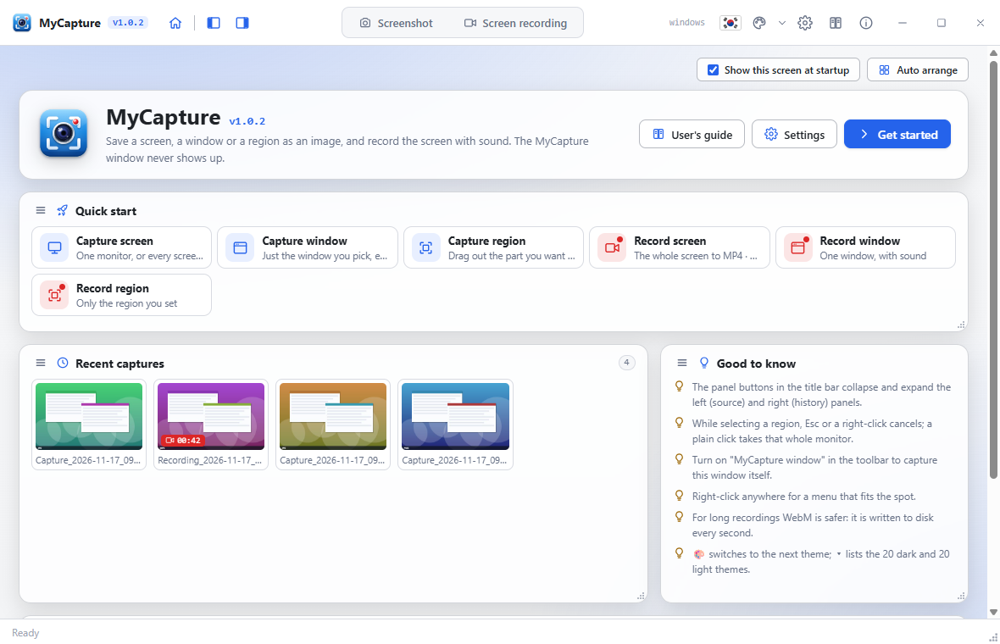

```text
┌ Title bar ────────────────────────────────────────────────────────────────────────────┐
│ ◉ MyCapture v1.0.2  [⌂][▥][▥]  [📷 Screenshot][🎥 Screen recording]  🇰🇷 🎨▾ ⚙ 📖 ⓘ ─ □ ✕ │
├───────────────────────────────────────────────────────────────────────────────────────┤
│                                    [☑ Show this screen at startup] [▦ Auto arrange]   │
│ ┌ ◉ MyCapture v1.0.2 ───────────────────── [📖 User's guide] [⚙ Settings] [› Get started] ┐
│ └──────────────────────────────────────────────────────────────────────────────────┘ │
│ ┌ ≡ 🚀 Quick start ─────────────────────────────────────────────────────────────────┐ │
│ │ [Capture screen] [Capture window] [Capture region] [Record screen] [Record …]    │ │
│ └──────────────────────────────────────────────────────────────────────────────────┘ │
│ ┌ ≡ 🕘 Recent captures ───────────────────────────┐ ┌ ≡ 💡 Good to know ───────────┐ │
│ │ ▢ ▢ ▢ ▢ ▢ ▢ ▢ ▢                                 │ │ · …                          │ │
│ └─────────────────────────────────────────────────┘ └──────────────────────────────┘ │
│ ┌ ≡ 🎨 Themes ──────────────────────────────────────────────────────────────────────┐ │
│ │ Dark themes 20  ▮▮▮ ▮▮▮ …   Light themes 20  ▮▮▮ ▮▮▮ …   [System] [Custom…]      │ │
│ └──────────────────────────────────────────────────────────────────────────────────┘ │
│ ⓘ MyCapture v1.0.2                                                          © shkwon │
└───────────────────────────────────────────────────────────────────────────────────────┘
```

| Card | Contents |
|---|---|
| Program name | Icon · name · version, **User's guide** · **Settings** · **Get started** (closes the start screen) |
| Quick start | **Capture** a screen · window · region, **record** a screen · window · region. A tile switches to that task and target and leaves the start screen. **Capture region** starts selecting the region right away |
| Recent captures | The 8 most recently saved images and videos. A click opens it large in the viewer |
| Good to know | Handy tips |
| Themes | Colour-bar buttons for the 20 dark and 20 light themes, **Follow system setting**, **Custom…** |

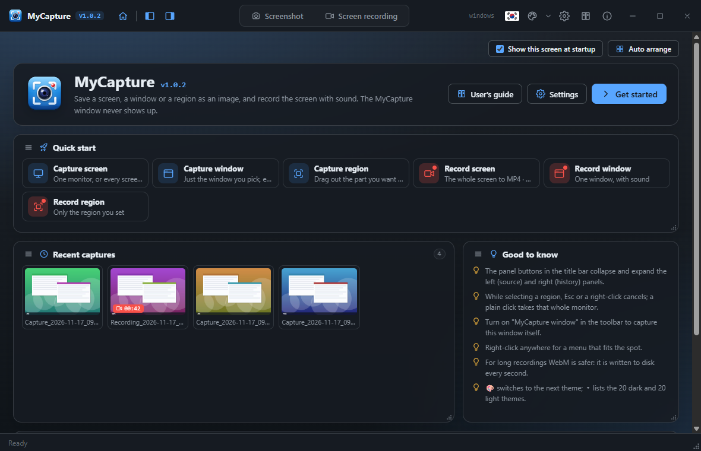

- **Moving a card**: drag the **≡** (three lines) left of a card's title. A see-through copy follows the pointer and the other cards make room. The program-name card stays on top.
- **Resizing**: drag the dotted triangle in a card's bottom-right corner. **Double-click** the corner to fit the card to its content again.
- **Auto arrange** (top right) puts every card back where it started. The arrangement is remembered.
- Turn off **Show this screen at startup** to start straight in the capture screen. The **⌂ Start screen** button in the title bar opens it again at any time.
- The **Screenshot / Screen recording** tabs in the title bar also leave the start screen.
- The start screen cannot be opened while recording (starting a recording closes it).

## 2. The window

```text
┌ Title bar (drag to move · double-click to maximize) ───────────────────────────────────────┐
│ ◉ MyCapture v1.0.2 [⌂][▥][▥]  [📷 Screenshot] [🎥 Screen recording]  windows 🇰🇷 🎨▾ ⚙ 📖 ⓘ ─ □ ✕ │
├ Toolbar (settings of the current task) ────────────────────────────────────────────────────┤
│ [▣ MyCapture window] │ Format [JPG ▾] │ Quality ━━━━●━ 92 │ [⧉ Copy to clipboard]          │
├ Source panel ──────┬┬ Preview ──────────────────────────────┬┬ Capture history ───────────┤
│ ◎ Source    ⟳  ◧  ││                                       ││ ▣ Capture history  3    ◨  │
│ [Screen][Window][Region]                                   ││              🗑 Delete all │
│ ▢ All screens      ││   (preview of the selected target)    ││ ┌───────────────────────┐ │
│ ▢ Display 1        ││ ▭ All screens           1920 × 1200   ││ │🎥 Video · 00:12   ▶   │ │
│ …                  ││                ( 📷 )                 ││ └───────────────────────┘ │
├ Status bar ────────┴┴───────────────────────────────────────┴┴──────────────────────── ◢ ┤
└────────────────────────────────────────────────────────────────────────────────────────────┘
```

### Title bar

MyCapture draws its own title bar. Drag an empty spot to move the window; double-click to maximize.

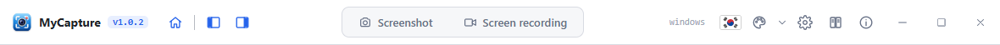

| Button | What it does |
|---|---|
| ◉ **MyCapture v1.0.2** | Program name and version |
| ⌂ **Start screen** | Opens and closes the start screen (highlighted while open) |
| ▥ **Left panel** | Collapses / expands the source panel. While expanded, the icon's left column is filled in |
| ▥ **Right panel** | Collapses / expands the capture history. While expanded, the icon's right column is filled in |
| 📷 / 🎥 | Switch between **Screenshot** and **Screen recording** |
| OS name | Where MyCapture runs (windows · macos · linux) |
| Flag | 🇬🇧 in Korean, 🇰🇷 in English: switches to that language (error messages included) |
| 🎨 / ▾ | 🎨 next theme; ▾ the theme list (20 dark \| 20 light, Follow system setting, Custom…) |
| ⚙ | Settings |
| 📖 | User's guide (this document) |
| ⓘ | About |
| ─ □ ✕ | Minimize · maximize/restore · close |

Settings, About, the user's guide, confirmations and the theme list are **separate windows**: they may sit outside the main window and can be dragged around. Closing the main window closes them and ends the program.

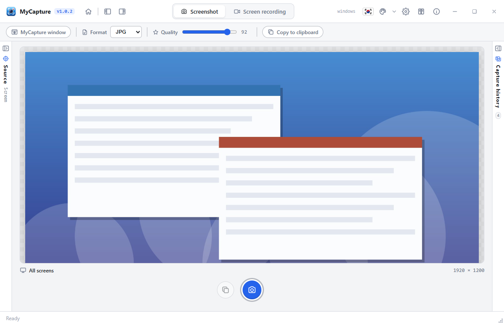

### The rest

- **Toolbar**: only the options the current task (screenshot / screen recording) needs, in one row.
- **Source panel** (left): what to capture. The title bar's left-panel button or the **collapse** button next to the panel title (a panel with a ← arrow) folds it into a slim 28 px strip with an expand arrow, an icon and a vertical title (source · current kind); click the strip to expand it.
- **Capture history** (right): saved images and videos (chapter 5). The right-panel button or its **collapse** button (a panel with a → arrow) folds it into the same slim strip (expand arrow, icon, vertical title and count).
- **Panel width**: drag the bars between the panels and the preview. The source panel never gets narrower than its tab labels (Screen · Window · Region) on one line. Widths and collapsed states are remembered.
- **Round button in the middle**: 📷 for screenshots, 🎥 for recording. Hover for the action and format.
- **Status bar**: progress and results. Drag the **dotted triangle** in the bottom-right corner to resize the window.
- At the minimum window size (860 × 600) every button stays visible and clickable.
- The window's **position, size and maximized state** are restored at the next start (centred if that monitor is gone).
- **Where files go** is set under ⚙ Settings → Save location.

## 3. Screenshots

1. Choose **Screenshot** in the title bar (or a quick-start tile).
2. Pick a kind of target in the source panel.

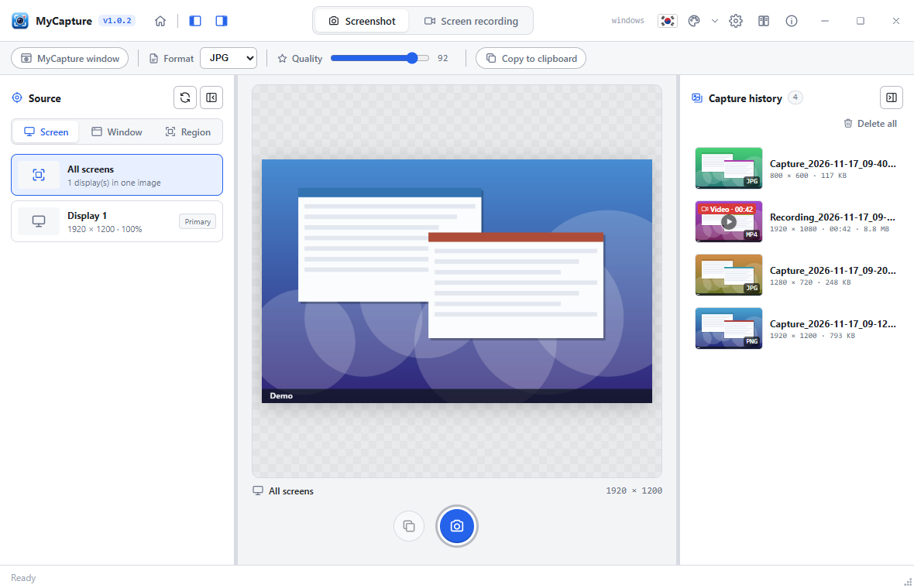

| Target | How to pick | Result |
|---|---|---|
| Screen | **All screens** (every monitor in one image) or one display | The monitor's real pixel resolution |
| Window | Pick from the list with thumbnails (searchable; minimized windows are not listed) | Just that window, even when covered |
| Region | 📷 covers every monitor with a frozen picture. **Drag** out a region and it is captured at once. A plain **click** takes that whole monitor; `Esc` or a right-click cancels | Exactly the dragged size (real pixels, whatever the display scaling) |

3. Press 📷 in the middle.

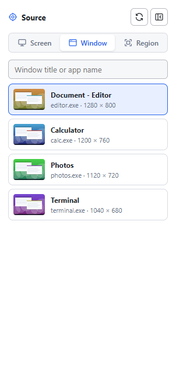

4. Saving: the capture is saved **automatically** in the save folder as `Capture_2026-11-17_14-03-09.jpg` (with `(2)` if the name exists) and added to the capture history. To choose a place every time, turn on **Ask where to save every time** under Settings → Save location.

Once a region is set, **Capture same region again** (↻) takes the same spot again.

### Formats

| Format | Notes |
|---|---|
| JPG | Default. Quality 40–100 (toolbar slider) |
| PNG | Lossless |
| GIF | 256-colour palette |
| AVIF | The smallest files for the same quality. Quality 40–100 (the same slider as JPG) |
| TIFF | Lossless |
| BMP | Uncompressed |
| WEBP | Lossless |

With **Copy to clipboard** on, the capture also goes to the clipboard.
Cancelling the save dialog does not lose the capture: the "Unsaved capture" card under the button has **Save** / **Copy**.

### Copy to the clipboard · save as another format

A captured image can go to the clipboard at any time, to paste with `Ctrl+V` into a chat, a document or a paint program, and it can be saved again in another format.

| Where | Copy to the clipboard | Save as another format |
|---|---|---|
| Automatically | Turn on **Copy to clipboard** in the toolbar: every capture is copied as well as saved | — |
| ⧉ left of 📷 | The **last capture** | — |
| History entry | The ⧉ button that appears on hover, or right-click → **Copy image to clipboard** | Right-click → **Save as another format…** |
| Viewer (images) | ⧉ in the top bar, or right-click | 💾 in the top bar, or right-click |

- **Save as another format…** takes the format from the save dialog's **file type** (JPG · PNG · GIF · AVIF · WEBP · TIFF · BMP). The original stays as it is; the new file is added to the capture history too.
- JPG and AVIF use the **Quality** value from the toolbar (or the settings).
- The clipboard gets a picture (bitmap). For the file path, right-click → **Copy file path**.

## 4. Screen recording

1. Choose **Screen recording** in the title bar.
2. In the toolbar, choose the recording method, format (MP4 / WebM), frame rate (15 / 30 / 60) and audio.

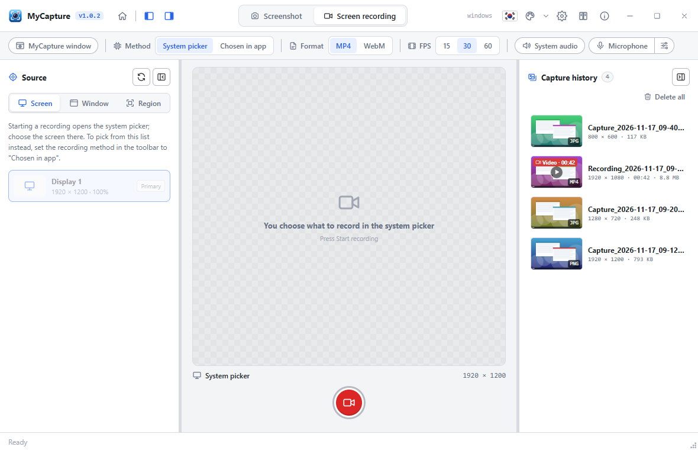

| Method | Where the target is chosen | Mouse pointer | System audio |
|---|---|---|---|
| **System picker** (default) | The OS screen-sharing window that 🎥 opens | Included | Yes (turn on "Share system audio" in that window) |
| **Chosen in app** | Screen · window · region in the source panel | Not included | No |

- **Region recording**: set a region in the source panel first. With the system picker, choose the **entire screen** that holds the region. The size is rounded to even pixels (321×241 → 320×240).
- While recording, the preview shows the live recording and ● the elapsed time; the round button becomes ■ Stop. The button on its left **pauses / resumes**; paused time is not in the video.
- **Full-screen recording controls**: when a whole screen is recorded, MyCapture minimizes and a small panel appears at the top centre of the recorded screen.

  ```text
  ┌──────────────────────────────────────┐
  │ ●  Recording 00:42     ❚❚    ■    □  │
  └──────────────────────────────────────┘
  ```

  Pause/resume, stop and show MyCapture. It can be dragged and never shows up in the recording. Stopping closes it and brings MyCapture back.
- Closing the window while recording asks whether to save (Save · Don't save · Cancel).
- WebM is written to disk every second. MP4 is written in one go when you stop, so use **WebM** for very long recordings.
- For a few seconds after start-up the video encoder warms up; an MP4 started then shows "Preparing…" briefly.
- Button colours while recording: pause **orange**, resume **green**, stop **red**.

### MyCapture window mode (capturing itself)

**▣ MyCapture window** at the front of the toolbar is an on/off mode, shared by both tasks and remembered.

- **On**: 📷 / 🎥 take **the MyCapture window itself** instead of the selected target. The source panel dims and the preview says "MyCapture window".
  - A capture takes the window as it looks right now, without hiding it.
  - Only the window's content is taken, not what is around or over it.
  - Recording starts at once whatever the method, and the window is not minimized.
- **Off**: the selected target as usual.
- The mode cannot change while recording. A quick-start tile turns it off.

## 5. Capture history (right panel)

Captured images and recorded videos **pile up downward** (newest at the bottom) and stay after restarting (latest 300). The 8 newest also appear on the start screen under **Recent captures**.

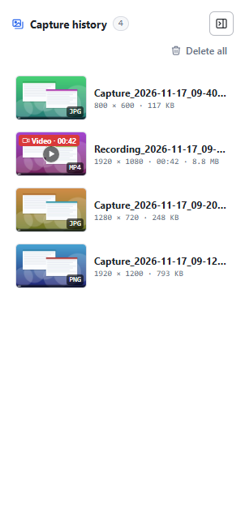

- **Videos** have a red **🎥 Video · length** label and ▶. The file format (PNG, MP4 …) is in the bottom-right corner.
- Click an entry to **show it large** in the preview area.
  - **Images**: 🔍− / 🔍+ zoom (5 % – 1600 %), ⛶ fit, 1:1 actual size. The mouse wheel zooms around the pointer, drag to pan, double-click toggles fit ↔ 100 %. Keys `+` `-` `0`.
  - **Videos**: ▶ play / ❚❚ pause, ■ stop (back to the start), position bar, time. Key `Space`.
  - ⧉ copy to the clipboard · 💾 save as another format (images), ↗ open in the default program, 📁 show in folder, ✕ close (`Esc`).
- Hover an entry for ⧉ **Copy to clipboard** (images), 📁 **Show in folder** and 🗑 **Delete**.
- **Delete** removes the entry from the history only. **The saved file is kept.**
- **Delete all** asks first, then empties the list (files are kept).
- Entries whose file was moved or deleted elsewhere turn pale and show "Missing".

### Right-click menus

Right-click anywhere for MyCapture's own menu with icons. It depends on where you click.

| Where | Menu |
|---|---|
| History entry | View · Open in default program · Show in folder · Copy image to clipboard · Save as another format… · Copy file path · Remove from history |
| Viewer | Zoom in · out · fit · 100 % · copy to clipboard · save as another format (images) / play · pause · stop (videos), open · folder · close |
| Screen or window in the target list | Capture this · Preview this |
| Recent captures on the start screen | The same as a history entry (View closes the start screen and shows it large) |
| Preview · source panel | Capture (or start / stop recording) · select region · capture the same region again · **copy the last capture to the clipboard** · refresh |
| Anywhere else (title bar, start screen …) | Screenshot · Screen recording · Start screen · Left panel · Right panel · Next theme · Settings · User's guide · About |

## 6. Microphone

The **Microphone** chip in the toolbar turns recording the microphone on and off; the slider button next to it opens **Settings → Microphone**.

- **Input device**: which microphone (default or a specific one).
- **Input volume**: 0–200 %, applied to what is recorded.
- **Level meter**: moves when you speak. Yellow is about right; if red stays lit, turn the volume down.
- **Record 3 s and play back**: records three seconds and plays them back.

System audio and microphone together are mixed into one audio track.
If Windows **Settings → Privacy → Microphone** blocks desktop apps, nothing is recorded.

## 7. Themes

MyCapture has **20 dark themes**, **20 light themes**, and a **custom theme** with colours you choose.

| Dark themes (20) | Light themes (20) |
|---|---|
| Midnight · Ink · Navy · Grove · Wine · Slate · Ember · Violet · Graphite · Trench · Coffee · Aurora · Carbon · Plum · Storm · Copper · Arctic · Orchid · Olive · Ice | Classic · Paper · Snow · Mint · Sand · Rose · Lavender · Sky · Lemon · Ocean · Forest · Cherry · Graphite · Pearl · Aqua · Blossom · Amber · Indigo · Sage · Porcelain |

There are four places to change the theme:

1. **🎨 Next theme** in the title bar: each press moves to the next theme (the 40, then custom, then around).
2. **▾** next to 🎨: two columns, dark 20 | light 20, **Follow system setting** and **Custom…**.
3. The **Themes** card on the start screen: 40 colour-bar buttons plus System and Custom.
4. **⚙ Settings → Theme**.

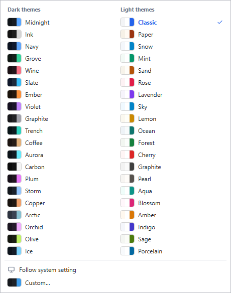

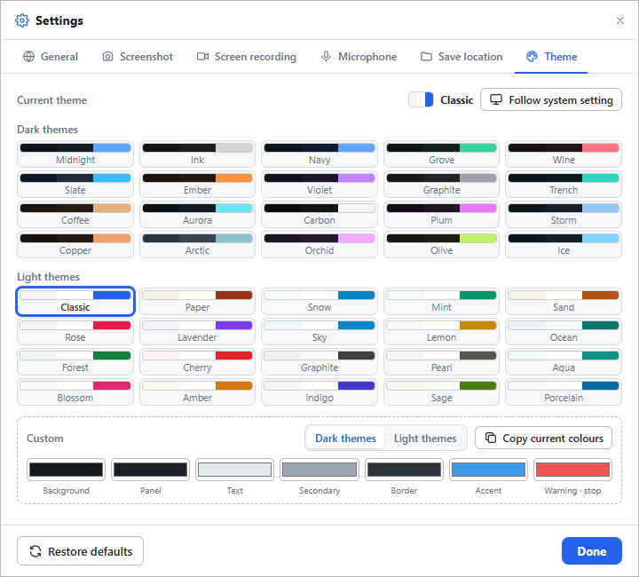

- **Follow system setting** (default): "Midnight" when Windows is in dark mode, "Classic" in light mode, and it follows when Windows changes.
- **Custom**: choose dark or light, then 7 colours: Background, Panel, Text, Secondary, Border, Accent and Warning · stop. Each change applies at once. **Copy current colours** starts from what you see.
- The theme applies to the main window, start screen, settings, user's guide, menus and recording controls alike.

## 8. Settings (⚙)

A separate window with a fixed size; every tab fits without scrolling. Changes apply to the main window at once.

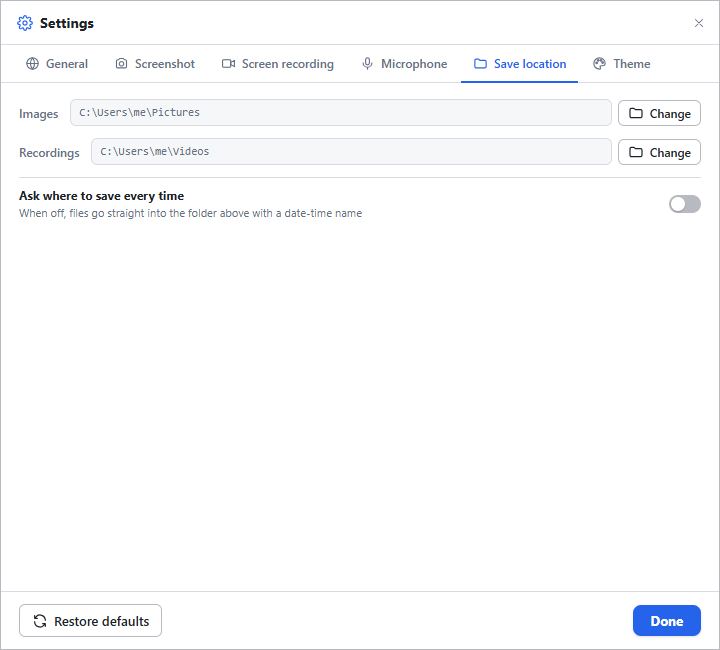

| Tab | Items |
|---|---|
| General | Language (한국어 / English), source panel and capture history expanded/collapsed |
| Screenshot | Format (JPG · PNG · GIF · AVIF · WEBP · TIFF · BMP), quality (JPG · AVIF), copy to clipboard |
| Screen recording | Method, format, FPS, system audio, microphone |
| Microphone | Input device, input volume, level meter, test recording |
| Save location | Image folder, video folder, ask every time |
| Theme | Current theme, follow system setting, 20 dark · 20 light, custom |

**Restore defaults** keeps the save folders, language and theme and resets the rest. Settings are saved as soon as they change.

## 9. The user's guide window (📖)

- Click an entry in the **Contents** on the left to jump there; the entry for the section you are reading is highlighted.
- **User's guide / Tutorial** at the top switches between the two documents.
- Type in **Search the guide** to highlight matches in yellow and jump to the first. `Esc` clears the search; pressing it again closes the window.
- The window can be resized (drag an edge or the bottom-right corner, □ maximize, or double-click the title bar).
- Switching the language switches the guide too.

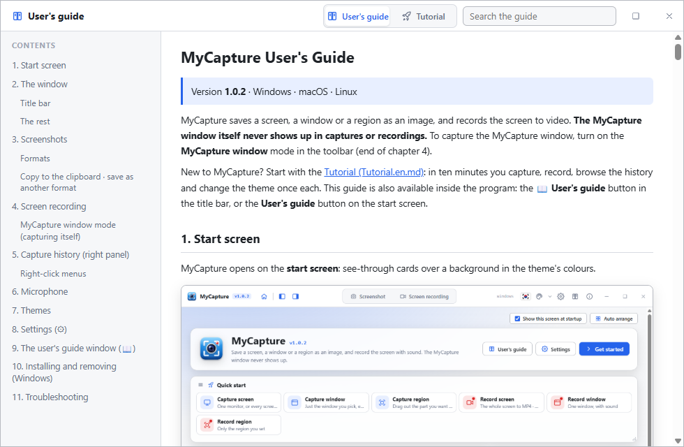

## 10. Installing and removing (Windows)

- Run `MyCapture-Setup-1.0.2.exe` and pick **한국어 / English** first.
- It installs per user (`%LOCALAPPDATA%\MyCapture`) without administrator rights; the folder can be changed. Start-menu and desktop shortcuts are offered on the last page.
- If MyCapture is already installed, a page asks whether to remove it and install.
- Settings left by an earlier installation can be **deleted** (yes / no).
- Choosing "Delete app data" when uninstalling removes the settings too.

## 11. Troubleshooting

| Problem | Fix |
|---|---|
| Captures are black | macOS: System Settings → Privacy & Security → **Screen Recording**, allow MyCapture. Linux Wayland: approve the portal prompt |
| The window you want is not listed | Minimized windows cannot be captured. Restore it, then ⟳ refresh |
| No system audio | Use the "System picker" method and turn on "Share system audio" in the sharing window |
| The microphone meter does not move | Check the input device, the OS microphone privacy setting, and whether another app holds the microphone |
| ✕ next to a recording format | The web view has no encoder for it. Use the other format |
| Start-screen cards are a mess | **Auto arrange** in the top right of the start screen |
| The start screen every time is too much | Turn off **Show this screen at startup** |
| A panel is missing | Expand it with the left / right panel buttons in the title bar |
