# MyCapture 사용 설명서

> 버전 **1.0.2** · Windows · macOS · Linux

MyCapture 는 화면·창·영역을 이미지로 저장하고, 화면을 동영상으로 녹화하는 프로그램입니다.
**MyCapture 창 자신은 캡처나 녹화에 찍히지 않습니다.** MyCapture 창을 찍고 싶으면 툴바의 **MyCapture 창** 모드를 켭니다(4장 끝).

처음이라면 [따라 하기(Tutorial.md)](Tutorial.md) 를 먼저 보세요. 10분이면 캡처 · 녹화 · 기록 보기 · 테마까지 한 번씩 해 봅니다.
이 설명서는 프로그램 안에서도 볼 수 있습니다: 타이틀바의 📖 **사용 설명서** 버튼, 또는 시작 화면의 **사용 설명서** 버튼.

## 1. 시작 화면

프로그램을 켜면 먼저 **시작 화면**이 나옵니다. 반투명 카드들이 테마 색 배경 위에 놓여 있습니다.

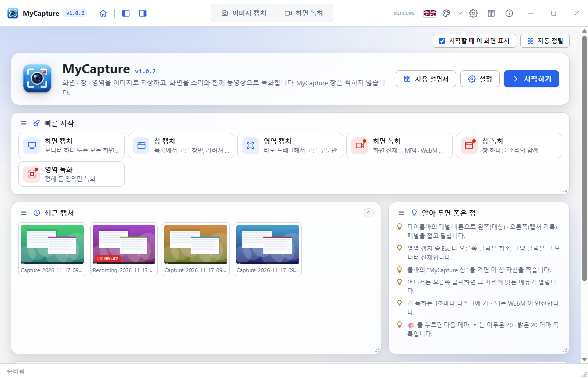

```text
┌ 타이틀바 ─────────────────────────────────────────────────────────────────────────────┐
│ ◉ MyCapture v1.0.2  [⌂][▥][▥]   [📷 이미지 캡처][🎥 화면 녹화]   🇬🇧 🎨▾ ⚙ 📖 ⓘ ─ □ ✕ │
├───────────────────────────────────────────────────────────────────────────────────────┤
│                                           [☑ 시작할 때 이 화면 표시] [▦ 자동 정렬]    │
│ ┌ ◉ MyCapture v1.0.2 ─────────────────────── [📖 사용 설명서] [⚙ 설정] [› 시작하기] ┐ │
│ └──────────────────────────────────────────────────────────────────────────────────┘ │
│ ┌ ≡ 🚀 빠른 시작 ───────────────────────────────────────────────────────────────────┐ │
│ │ [화면 캡처] [창 캡처] [영역 캡처] [화면 녹화] [창 녹화] [영역 녹화]               │ │
│ └──────────────────────────────────────────────────────────────────────────────────┘ │
│ ┌ ≡ 🕘 최근 캡처 ─────────────────────────────────┐ ┌ ≡ 💡 알아 두면 좋은 점 ──────┐ │
│ │ ▢ ▢ ▢ ▢ ▢ ▢ ▢ ▢                                 │ │ · …                          │ │
│ └─────────────────────────────────────────────────┘ └──────────────────────────────┘ │
│ ┌ ≡ 🎨 테마 ────────────────────────────────────────────────────────────────────────┐ │
│ │ 어두운 테마 20  ▮▮▮ ▮▮▮ …      밝은 테마 20  ▮▮▮ ▮▮▮ …   [시스템] [사용자 정의…]│ │
│ └──────────────────────────────────────────────────────────────────────────────────┘ │
│ ⓘ MyCapture v1.0.2                                                          © shkwon │
└───────────────────────────────────────────────────────────────────────────────────────┘
```

| 카드 | 내용 |
|---|---|
| 프로그램 이름 | 아이콘 · 이름 · 버전, **사용 설명서** · **설정** · **시작하기**(시작 화면을 닫고 캡처 화면으로) |
| 빠른 시작 | 화면 · 창 · 영역 **캡처**, 화면 · 창 · 영역 **녹화**. 누르면 그 작업과 대상이 골라진 채 캡처 화면으로 넘어갑니다. **영역 캡처**는 곧바로 영역 고르기가 시작됩니다 |
| 최근 캡처 | 가장 최근에 저장한 이미지 · 동영상 8개. 누르면 캡처 화면의 보기로 크게 열립니다 |
| 알아 두면 좋은 점 | 자주 쓰는 요령 |
| 테마 | 어두운 테마 20개 · 밝은 테마 20개의 색 막대 버튼, **시스템 설정 따르기**, **사용자 정의…** |

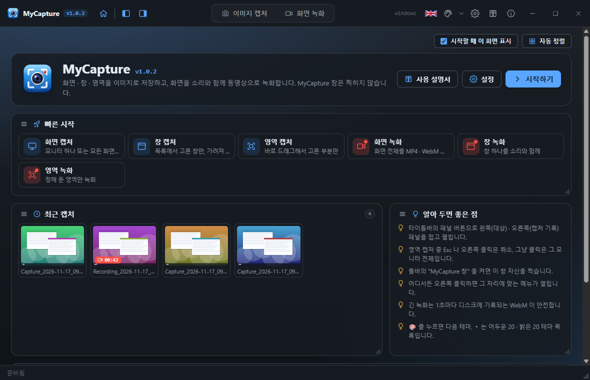

- **카드 옮기기**: 카드 제목 왼쪽의 **≡**(가로선 3개)를 끌면 반투명한 카드가 포인터를 따라오고, 다른 카드들은 자리를 비켜 줍니다. 프로그램 이름 카드는 맨 위에 고정입니다.
- **크기 조절**: 카드 오른쪽 아래 모서리의 점 삼각형을 끕니다. 모서리를 **더블클릭**하면 내용에 꼭 맞는 높이로 돌아갑니다.
- **자동 정렬**: 오른쪽 위의 **▦ 자동 정렬** 은 모든 카드를 처음 배치로 되돌립니다. 배치는 다음 실행에도 기억됩니다.
- **시작할 때 이 화면 표시** 를 끄면 다음부터는 바로 캡처 화면으로 시작합니다. 언제든 타이틀바의 **⌂ 시작 화면** 버튼으로 다시 열 수 있습니다.
- 시작 화면에서 상단의 **이미지 캡처 / 화면 녹화** 탭을 눌러도 그 작업으로 넘어갑니다.
- 녹화 중에는 시작 화면을 열 수 없습니다(녹화를 시작하면 시작 화면은 자동으로 닫힙니다).

## 2. 화면 구성

```text
┌ 타이틀바 (끌어서 창 이동 · 더블클릭 최대화) ──────────────────────────────────────────────┐
│ ◉ MyCapture v1.0.2 [⌂][▥][▥]   [📷 이미지 캡처] [🎥 화면 녹화]    windows 🇬🇧 🎨▾ ⚙ 📖 ⓘ ─ □ ✕ │
├ 툴바 (현재 작업의 설정) ──────────────────────────────────────────────────────────────────┤
│ [▣ MyCapture 창] │ 형식 [JPG ▾] │ 품질 ━━━━●━ 92 │ [⧉ 클립보드 복사]                        │
├ 대상 패널 ─────────┬┬ 미리보기 ─────────────────────────────┬┬ 캡처 기록 ────────────────┤
│ ◎ 대상      ⟳  ◧  ││                                       ││ ▣ 캡처 기록  3          ◨  │
│ [화면][창][영역]   ││   (선택한 화면 · 창 · 영역의 미리보기) ││              🗑 전체 삭제  │
│ ▢ 모든 화면        ││                                       ││ ┌───────────────────────┐ │
│ ▢ 디스플레이 1     ││ ▭ 모든 화면             1920 × 1200   ││ │🎥 동영상 · 00:12  ▶   │ │
│ …                  ││                ( 📷 )                 ││ └───────────────────────┘ │
├ 상태 바 ───────────┴┴───────────────────────────────────────┴┴──────────────────────── ◢ ┤
└──────────────────────────────────────────────────────────────────────────────────────────┘
```

### 타이틀바

운영체제 제목 표시줄 대신 쓰는 막대입니다. 빈 곳을 끌면 창이 움직이고, 더블클릭하면 최대화됩니다.

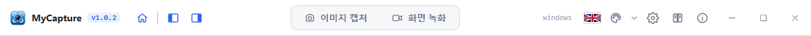

| 버튼 | 하는 일 |
|---|---|
| ◉ **MyCapture v1.0.2** | 프로그램 이름과 버전 |
| ⌂ **시작 화면** | 시작 화면을 열고 닫습니다(열려 있으면 강조 표시) |
| ▥ **왼쪽 패널** | 대상 패널을 접고 펼칩니다. 펼쳐져 있으면 왼쪽 칸이 채워진 아이콘으로 강조됩니다 |
| ▥ **오른쪽 패널** | 캡처 기록 패널을 접고 펼칩니다. 펼쳐져 있으면 오른쪽 칸이 채워진 아이콘으로 강조됩니다 |
| 📷 / 🎥 | **이미지 캡처** · **화면 녹화** 작업 전환 |
| 운영체제 이름 | 지금 실행 중인 환경(windows · macos · linux) |
| 국기 | 한국어일 때 🇬🇧, 영어일 때 🇰🇷. 누르면 그 언어로 바뀝니다(오류 메시지까지) |
| 🎨 / ▾ | 🎨 는 다음 테마, ▾ 는 테마 목록(어두운 20 \| 밝은 20, 시스템 설정 따르기, 사용자 정의…) |
| ⚙ | 설정 |
| 📖 | 사용 설명서(이 문서) |
| ⓘ | 프로그램 정보 |
| ─ □ ✕ | 최소화 · 최대화/이전 크기 · 닫기 |

설정 · 프로그램 정보 · 사용 설명서 · 확인 창 · 테마 목록은 **별도의 창**입니다. 메인 창 밖으로 나와도 되고 끌어서 옮길 수 있습니다. 메인 창을 닫으면 함께 닫히고 프로그램이 끝납니다.

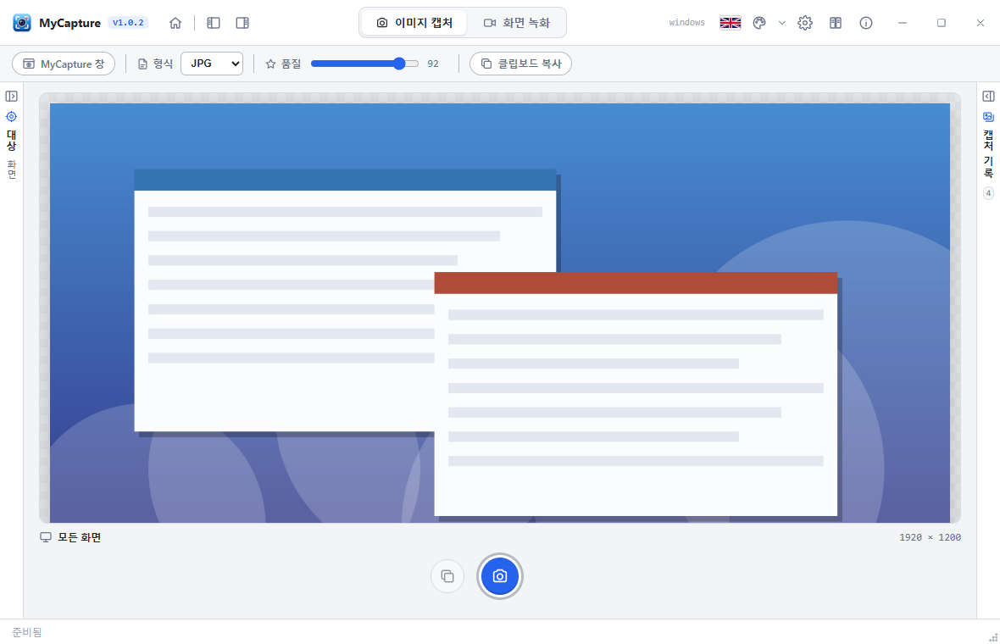

### 나머지 부분

- **툴바**: 지금 작업(이미지 캡처 / 화면 녹화)에 필요한 설정만 한 줄로 보여 줍니다.
- **대상 패널**(왼쪽): 무엇을 캡처할지 고릅니다. 타이틀바의 왼쪽 패널 버튼이나 제목 옆의 **접기** 버튼(패널 모양에 ← 화살표)으로 접으면 폭 28px 의 얇은 띠가 됩니다. 띠에는 펼치기 화살표 · 아이콘 · 세로 제목(대상 · 현재 종류)이 남고, 띠를 누르면 다시 펼쳐집니다.
- **캡처 기록 패널**(오른쪽): 저장한 이미지와 동영상이 쌓입니다(5장). 타이틀바의 오른쪽 패널 버튼이나 제목 옆의 **접기** 버튼(패널 모양에 → 화살표)으로 접으면 같은 얇은 띠(펼치기 화살표 · 아이콘 · 세로 제목 · 개수)가 됩니다.
- **패널 폭**: 패널과 미리보기 사이의 세로 막대를 끌어 폭을 바꿉니다. 대상 패널은 탭 버튼(화면 · 창 · 영역)의 글자가 한 줄로 다 보이는 폭보다 좁아지지 않습니다. 폭과 접힘 상태는 기억됩니다.
- **가운데 둥근 버튼**: 이미지 캡처는 📷 카메라, 녹화는 🎥 비디오 카메라 모양입니다. 마우스를 올리면 동작 이름과 형식이 표시됩니다.
- **상태 바**: 진행 상황과 결과 알림. 오른쪽 아래 모서리의 **점으로 된 삼각형** 마커를 끌면 창 크기가 바뀝니다.
- 창의 최소 크기(860 × 600)에서도 모든 버튼이 보이고 눌리도록 배치되어 있습니다.
- 창의 **위치 · 크기 · 최대화 상태**는 기억했다가 다음에 실행할 때 그대로 엽니다. 그 위치의 모니터가 연결되어 있지 않으면 화면 가운데에 엽니다.
- **저장 위치**는 ⚙ 설정 → 저장 위치 탭에서 정합니다.

## 3. 이미지 캡처

1. 타이틀바에서 **이미지 캡처** 를 고릅니다(또는 시작 화면의 빠른 시작).
2. 대상 패널에서 종류를 고릅니다.

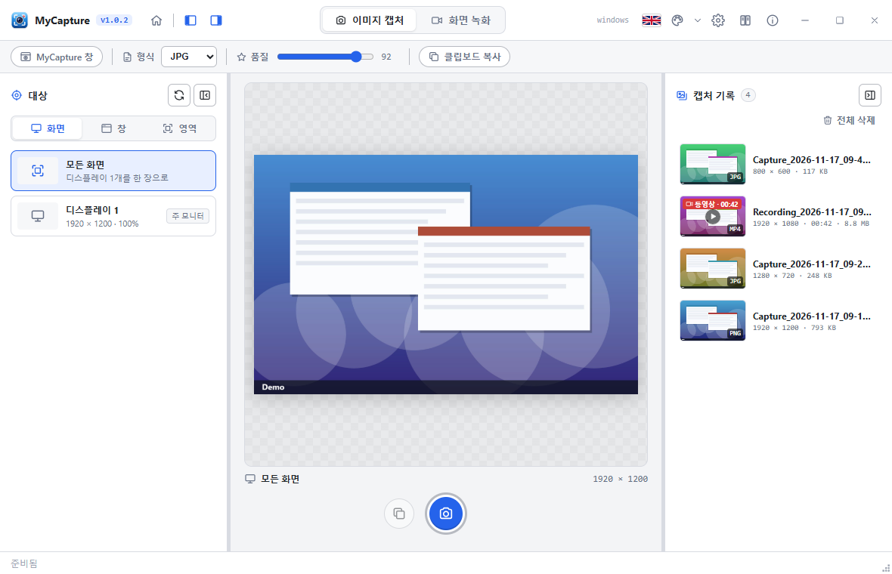

| 대상 | 고르는 법 | 결과 |
|---|---|---|
| 화면 | **모든 화면**(모니터 전체를 한 장으로) 또는 디스플레이 하나 | 모니터의 실제 픽셀 해상도 |
| 창 | 썸네일이 있는 창 목록에서 선택 (검색 가능, 최소화된 창은 목록에 없음) | 그 창만, 다른 창에 가려져 있어도 |
| 영역 | 📷 를 누르면 모든 모니터가 얼어붙은 화면으로 덮입니다. **드래그**해서 영역을 고르면 바로 캡처됩니다. 그냥 **클릭**하면 그 모니터 전체, `Esc` 나 오른쪽 클릭은 취소 | 드래그한 크기 그대로 (화면 배율과 무관하게 실제 픽셀) |

3. 가운데 📷 를 누릅니다.

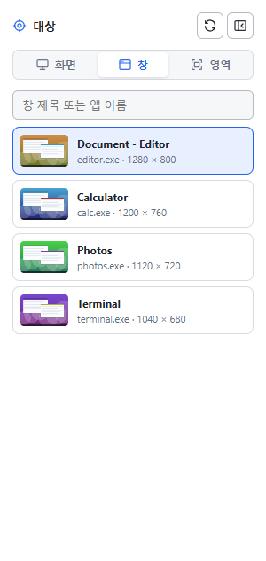

4. 저장: 캡처하면 **자동으로** 저장 폴더에 `Capture_2026-11-17_14-03-09.jpg` 같은 이름으로 저장되고(같은 이름이 있으면 `(2)`), 캡처 기록에 추가됩니다. 매번 위치를 고르고 싶으면 설정 → 저장 위치에서 **저장할 때마다 위치 묻기** 를 켭니다.

영역을 한 번 정하면 **같은 영역 다시 캡처**(↻) 버튼으로 같은 자리를 다시 찍을 수 있습니다.

### 저장 형식

| 형식 | 특징 |
|---|---|
| JPG | 기본값. 품질 40–100 조절 (툴바 슬라이더) |
| PNG | 무손실 |
| GIF | 256색 팔레트 |
| AVIF | 같은 화질에서 가장 작은 파일. 품질 40–100 조절 (JPG 와 같은 슬라이더) |
| TIFF | 무손실 |
| BMP | 비압축 |
| WEBP | 무손실 |

**클립보드 복사** 를 켜면 저장과 함께 클립보드에도 들어가 바로 붙여 넣을 수 있습니다.
저장 대화상자를 취소해도 캡처는 사라지지 않습니다. 캡처 버튼 아래에 나타나는 "저장하지 않은 캡처" 카드의 **저장** / **복사** 버튼으로 다시 저장하거나 복사할 수 있습니다.

### 클립보드로 복사 · 다른 형식으로 저장

캡처한 이미지는 언제든 클립보드로 보내 다른 프로그램(메신저 · 문서 · 그림판 등)에 `Ctrl+V` 로 붙여 넣을 수 있고, 다른 형식으로 다시 저장할 수 있습니다.

| 어디서 | 클립보드로 복사 | 다른 형식으로 저장 |
|---|---|---|
| 캡처할 때 자동 | 툴바의 **클립보드 복사** 를 켜 두면 캡처마다 저장과 함께 | — |
| 📷 왼쪽의 ⧉ 버튼 | **방금 캡처한 이미지**를 클립보드로 | — |
| 캡처 기록 항목 | 마우스를 올리면 나오는 ⧉ 버튼, 또는 오른쪽 클릭 → **이미지를 클립보드로 복사** | 오른쪽 클릭 → **다른 형식으로 저장…** |
| 보기 화면(이미지) | 위쪽 막대의 ⧉ 버튼, 또는 오른쪽 클릭 | 위쪽 막대의 💾 버튼, 또는 오른쪽 클릭 |

- **다른 형식으로 저장…** 은 저장 창의 **파일 형식**(JPG · PNG · GIF · AVIF · WEBP · TIFF · BMP)으로 형식을 고릅니다. 원래 파일은 그대로 두고 새 파일을 만들며, 새 파일도 캡처 기록에 추가됩니다.
- JPG · AVIF 로 저장할 때는 툴바(또는 설정)의 **품질** 값이 쓰입니다.
- 클립보드에는 그림(비트맵)으로 들어갑니다. 파일 경로가 필요하면 오른쪽 클릭 → **파일 경로 복사**.

## 4. 화면 녹화

1. 타이틀바에서 **화면 녹화** 를 고릅니다.
2. 툴바에서 녹화 방식, 형식(MP4 / WebM), 프레임(15 / 30 / 60), 오디오를 정합니다.

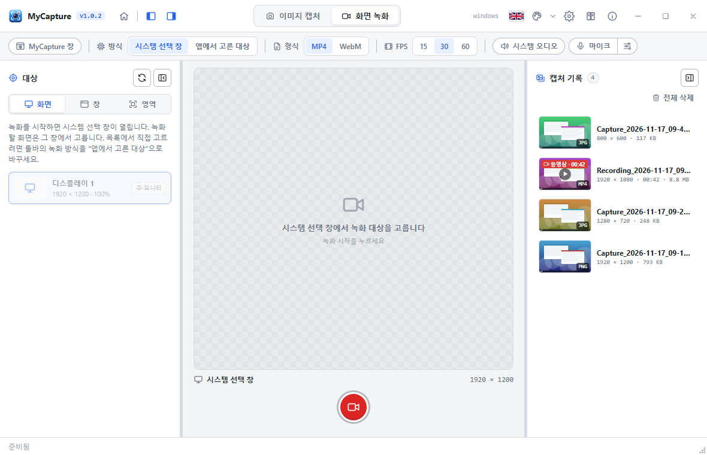

| 녹화 방식 | 녹화 대상을 고르는 곳 | 마우스 포인터 | 시스템 오디오 |
|---|---|---|---|
| **시스템 선택 창** (기본) | 🎥 를 누르면 열리는 운영체제의 화면 공유 창 | 포함 | 가능 (공유 창에서 "시스템 오디오 공유" 를 켜야 함) |
| **앱에서 고른 대상** | 대상 패널의 화면 · 창 · 영역 | 미포함 | 불가 |

- **영역 녹화**: 대상 패널에서 영역을 정한 뒤 녹화합니다. "시스템 선택 창" 방식이면 공유 창에서 그 영역이 있는 **전체 화면** 을 고르세요. 녹화 크기는 짝수 픽셀로 맞춰집니다(예: 321×241 → 320×240).
- 녹화 중에는 미리보기에 실제 녹화 화면과 ● 경과 시간이 보이고, 둥근 버튼이 ■ 정지로 바뀝니다. 왼쪽 버튼으로 **일시정지 / 재개** 합니다. 일시정지한 시간은 동영상에 들어가지 않습니다.
- **전체 화면 녹화 제어판**: 화면 전체를 녹화하면 MyCapture 창은 최소화되고, 녹화 중인 화면 위쪽 가운데에 작은 제어판이 뜹니다.

  ```text
  ┌──────────────────────────────────────┐
  │ ●  녹화 중   00:42     ❚❚    ■    □  │
  └──────────────────────────────────────┘
  ```

  일시정지/재개, 정지, MyCapture 창 보기 버튼이 있으며 끌어서 옮길 수 있습니다. 제어판도 녹화에 찍히지 않습니다. 정지하면 제어판이 닫히고 MyCapture 창이 돌아옵니다.
- 녹화 중에 창을 닫으면 저장할지 묻습니다(저장 · 저장 안 함 · 취소).
- WebM 녹화는 1초마다 디스크에 기록됩니다. MP4 는 인코더 특성상 정지할 때 한 번에 기록되므로, 아주 긴 녹화에는 **WebM** 을 권장합니다.
- 프로그램을 켠 직후 몇 초 동안은 동영상 인코더를 준비합니다. 그동안 MP4 녹화를 시작하면 "녹화 준비 중…" 이 잠깐 보인 뒤 시작됩니다.
- 녹화 중 버튼 색: 일시정지 **주황**, 재개 **초록**, 정지 **빨강**.

### MyCapture 창 모드 (자기 자신 캡처 · 녹화)

툴바 맨 앞의 **▣ MyCapture 창** 버튼은 켜고 끄는 모드 버튼입니다. 이미지 캡처와 화면 녹화 양쪽 툴바에 있고 상태는 하나로 공유되며, 다음에 실행해도 기억됩니다.

- **켜면**: 가운데 📷 / 🎥 버튼이 대상 패널에서 고른 화면 · 창 · 영역 대신 **MyCapture 창 자신**을 찍습니다. 대상 패널은 흐려지고 미리보기에는 "MyCapture 창" 이 표시됩니다.
  - 캡처는 창이 숨지 않고 지금 보이는 모습 그대로 찍힙니다.
  - 창의 내용만 찍힙니다. 창 테두리 바깥이나 창을 가린 다른 창은 들어가지 않습니다.
  - 녹화는 녹화 방식과 상관없이 시스템 선택 창 없이 바로 시작되며, 창은 최소화되지 않습니다.
- **끄면**: 원래대로 고른 대상을 찍습니다.
- 녹화 중에는 모드를 바꿀 수 없습니다. 시작 화면의 빠른 시작을 누르면 이 모드는 꺼집니다.

## 5. 캡처 기록 (오른쪽 패널)

캡처한 이미지와 녹화한 동영상이 목록에 **아래로 계속 쌓입니다**(가장 새것이 맨 아래). 프로그램을 다시 열어도 유지됩니다(최근 300개). 가장 최근 8개는 시작 화면의 **최근 캡처** 카드에도 보입니다.

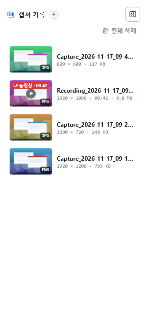

- **동영상**은 썸네일 위에 빨간 **🎥 동영상 · 길이** 표시와 ▶ 가 붙습니다. 오른쪽 아래에는 파일 형식(PNG, MP4 …)이 보입니다.
- 항목을 누르면 가운데 미리보기 자리에 **크게 보여 줍니다**.
  - **이미지**: 🔍− / 🔍+ 로 축소 · 확대(5 % – 1600 %), ⛶ 창에 맞춤, 1:1 실제 크기. 마우스 휠로 커서 위치를 중심으로 확대 · 축소, 끌어서 이동, 더블클릭으로 맞춤 ↔ 100 %. 키보드 `+` `-` `0`.
  - **동영상**: ▶ 재생 / ❚❚ 일시정지, ■ 정지(멈추고 처음으로), 재생 위치 막대, 시간 표시. 키보드 `Space`.
  - 위쪽 막대의 ⧉ 클립보드로 복사 · 💾 다른 형식으로 저장(이미지), ↗ 기본 프로그램으로 열기, 📁 폴더에서 보기, ✕ 닫기(`Esc`).
- 마우스를 올리면 ⧉ **클립보드로 복사**(이미지), 📁 **폴더에서 보기**, 🗑 **삭제** 버튼이 나타납니다.
- **삭제**는 캡처 기록 목록에서만 지웁니다. **저장된 파일은 지우지 않습니다.**
- **전체 삭제**는 확인 창을 띄운 뒤 목록을 모두 비웁니다(파일은 그대로).
- 다른 곳에서 파일을 옮기거나 지우면 썸네일이 흐려지고 "없음" 으로 표시됩니다.

### 오른쪽 클릭 메뉴

어디서든 오른쪽 클릭하면 아이콘이 있는 MyCapture 메뉴가 열립니다. 클릭한 곳에 따라 내용이 다릅니다.

| 위치 | 메뉴 |
|---|---|
| 캡처 기록 항목 | 보기 · 기본 프로그램으로 열기 · 폴더에서 보기 · 이미지를 클립보드로 복사 · 다른 형식으로 저장… · 파일 경로 복사 · 기록에서 삭제 |
| 보기 화면 | 확대 · 축소 · 맞춤 · 100% · 클립보드로 복사 · 다른 형식으로 저장 (이미지) / 재생 · 일시정지 · 정지 (동영상), 열기 · 폴더 · 닫기 |
| 대상 목록의 화면 · 창 | 이 대상 캡처 · 이 대상 미리보기 |
| 시작 화면의 최근 캡처 | 캡처 기록 항목과 같음 (보기를 고르면 시작 화면이 닫히고 크게 보기) |
| 미리보기 · 대상 패널 | 캡처 (또는 녹화 시작 / 정지) · 영역 선택 · 같은 영역 다시 캡처 · **방금 캡처한 이미지를 클립보드로 복사** · 목록 새로 고침 |
| 그 밖 (타이틀바 · 시작 화면 등) | 이미지 캡처 · 화면 녹화 · 시작 화면 · 왼쪽 패널 · 오른쪽 패널 · 다음 테마 · 설정 · 사용 설명서 · 프로그램 정보 |

## 6. 마이크

툴바의 **마이크** 칩으로 녹음 여부를 켜고 끄며, 옆의 슬라이더 버튼은 **설정 → 마이크** 탭을 엽니다.

- **입력 장치**: 사용할 마이크 (기본 장치 또는 특정 장치).
- **입력 크기**: 0–200 %. 녹음되는 소리에 그대로 적용됩니다.
- **입력 레벨 미터**: 말을 하면 막대가 움직입니다. 노란색까지 오르면 적당하고, 빨간색이 계속 켜지면 입력 크기를 줄이세요.
- **3초 녹음 후 재생**: 3초 동안 녹음한 뒤 바로 들려줍니다.

시스템 오디오와 마이크를 함께 켜면 하나의 오디오 트랙으로 섞여 녹음됩니다.
Windows 의 **설정 → 개인 정보 → 마이크** 에서 데스크톱 앱의 마이크 사용이 꺼져 있으면 녹음되지 않습니다.

## 7. 테마

MyCapture 에는 **어두운 테마 20개**와 **밝은 테마 20개**, 그리고 직접 색을 고르는 **사용자 정의 테마**가 있습니다.

| 어두운 테마 (20) | 밝은 테마 (20) |
|---|---|
| 자정 · 잉크 · 네이비 · 밤숲 · 와인 · 슬레이트 · 잔불 · 보라 · 흑연 · 심해 · 커피 · 오로라 · 카본 · 자두 · 폭풍 · 구리 · 북극 · 난초 · 올리브 · 얼음 | 클래식 · 종이 · 눈 · 민트 · 모래 · 장미 · 라벤더 · 하늘 · 레몬 · 바다 · 숲 · 체리 · 흑연 · 진주 · 아쿠아 · 꽃 · 호박 · 남색 · 세이지 · 자기 |

테마를 바꾸는 곳은 네 군데입니다.

1. 타이틀바의 **🎨 다음 테마** 버튼: 누를 때마다 다음 테마로(40개 → 사용자 정의 → 처음).
2. 🎨 옆의 **▾** 버튼: 어두운 20 | 밝은 20 두 열의 목록, **시스템 설정 따르기**, **사용자 정의…**.
3. 시작 화면의 **테마** 카드: 색 막대 버튼 40개와 시스템 · 사용자 정의 버튼.
4. **⚙ 설정 → 테마** 탭.

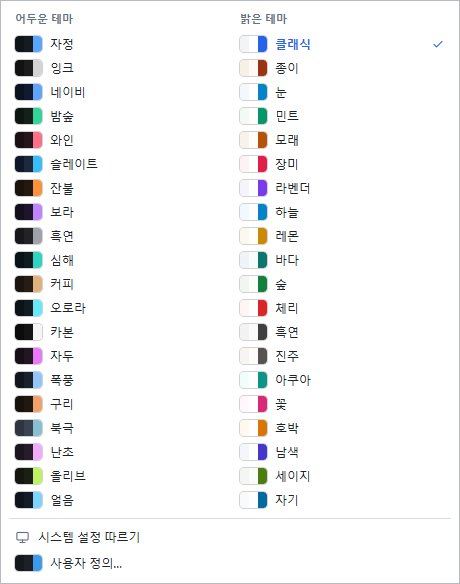

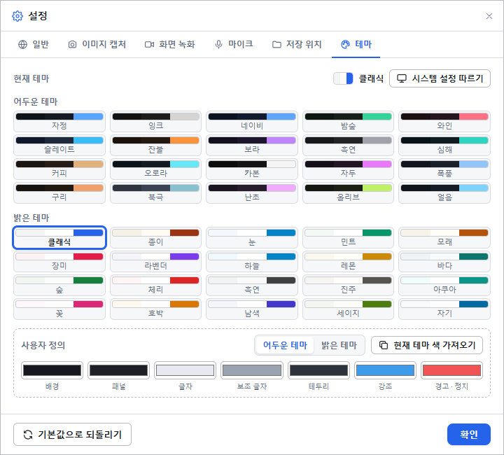

- **시스템 설정 따르기**(기본): Windows 가 어두운 모드면 "자정", 밝은 모드면 "클래식" 테마를 쓰고, Windows 설정을 바꾸면 따라 바뀝니다.
- **사용자 정의**: 종류(어두운 / 밝은)와 배경 · 패널 · 글자 · 보조 글자 · 테두리 · 강조 · 경고·정지 7가지 색을 고릅니다. 색을 바꾸는 즉시 사용자 정의 테마가 적용됩니다. **현재 테마 색 가져오기** 로 지금 보이는 테마에서 시작할 수 있습니다.
- 테마는 메인 창 · 시작 화면 · 설정 · 사용 설명서 · 메뉴 · 녹화 제어판 모두에 함께 적용됩니다.

## 8. 설정 (⚙)

설정 창은 크기가 고정된 별도의 창이고, 분류별 탭이 모두 스크롤 없이 한 화면에 보입니다. 바꾼 설정은 메인 창에 바로 반영됩니다.

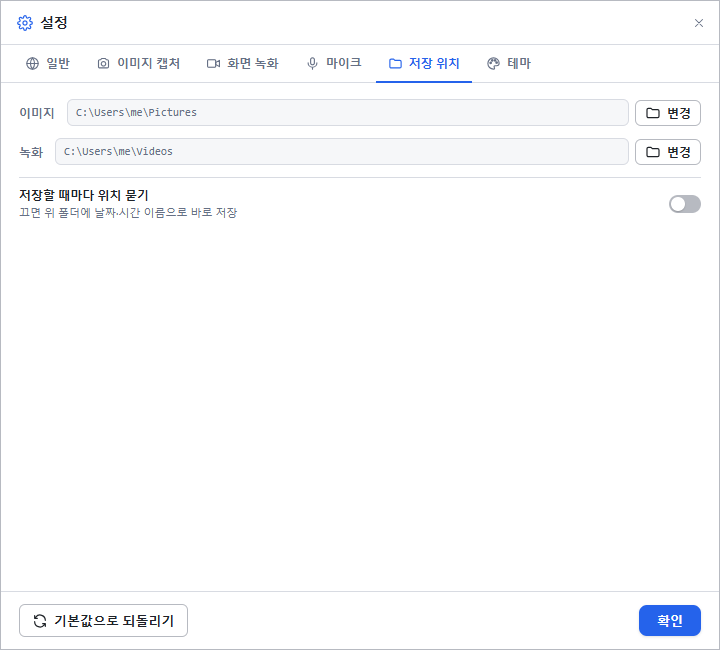

| 탭 | 항목 |
|---|---|
| 일반 | 언어(한국어 / English), 대상 패널 · 캡처 기록 패널 펼침/접음 |
| 이미지 캡처 | 형식(JPG · PNG · GIF · AVIF · WEBP · TIFF · BMP), 품질(JPG · AVIF), 클립보드 복사 |
| 화면 녹화 | 녹화 방식, 형식, FPS, 시스템 오디오, 마이크 |
| 마이크 | 입력 장치, 입력 크기, 레벨 미터, 테스트 녹음 |
| 저장 위치 | 이미지 폴더, 녹화 폴더, 저장할 때마다 위치 묻기 |
| 테마 | 현재 테마, 시스템 설정 따르기, 어두운 테마 20 · 밝은 테마 20, 사용자 정의 |

**기본값으로 되돌리기** 는 저장 폴더 · 언어 · 테마는 그대로 두고 나머지를 처음 상태로 돌립니다. 설정은 바뀌는 즉시 저장됩니다.

## 9. 사용 설명서 창 (📖)

- 왼쪽 **목차**를 누르면 그 장으로 이동하고, 읽는 위치에 맞춰 목차가 강조됩니다.
- 위쪽의 **사용 설명서 / 따라 하기** 로 두 문서를 오갑니다.
- **설명서에서 찾기** 칸에 글자를 넣으면 맞는 곳이 노랗게 표시되고 첫 번째 위치로 이동합니다. `Esc` 는 찾기를 지우고, 한 번 더 누르면 창을 닫습니다.
- 창은 크기를 바꿀 수 있습니다(가장자리 또는 오른쪽 아래 모서리를 끌기, □ 최대화, 제목 막대 더블클릭).
- 언어를 바꾸면 설명서도 그 언어로 바뀝니다.

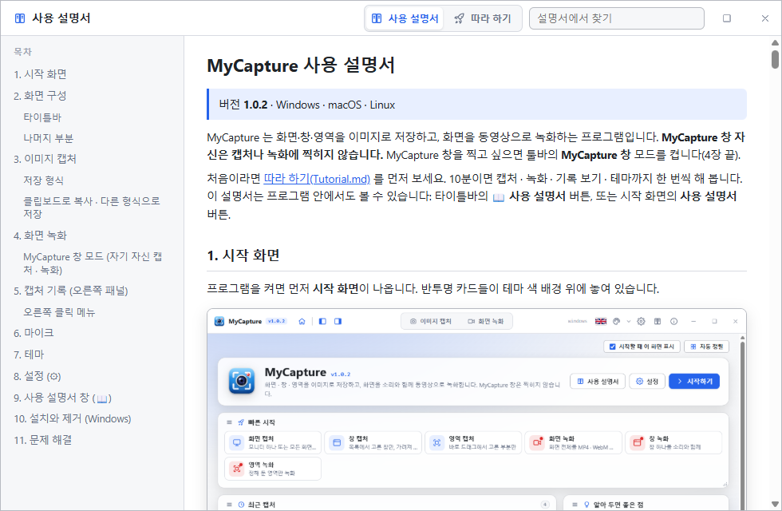

## 10. 설치와 제거 (Windows)

- `MyCapture-Setup-1.0.2.exe` 를 실행하면 먼저 **한국어 / English** 를 고릅니다.
- 관리자 권한 없이 사용자 폴더(`%LOCALAPPDATA%\MyCapture`)에 설치되며, 설치 경로를 바꿀 수 있습니다. 시작 메뉴와 바탕화면 바로 가기를 만듭니다(마지막 페이지에서 선택).
- 이미 설치되어 있으면 기존 프로그램을 제거하고 설치할지 묻는 페이지가 나옵니다.
- 이전 설치가 남긴 설정 데이터가 있으면 **삭제할지** 따로 묻습니다(예 / 아니요).
- 제거할 때 "앱 데이터 삭제" 를 선택하면 설정도 함께 지워집니다.

## 11. 문제 해결

| 증상 | 해결 |
|---|---|
| 캡처 결과가 검은색 | macOS: 시스템 설정 → 개인정보 보호 및 보안 → **화면 기록** 에서 MyCapture 허용. Linux Wayland: 포털 승인 필요 |
| 창 목록에 원하는 창이 없음 | 최소화된 창은 캡처할 수 없어 목록에서 빠집니다. 창을 복원한 뒤 ⟳ 새로 고침 |
| 시스템 오디오가 녹음되지 않음 | 녹화 방식이 "시스템 선택 창" 인지, 공유 창에서 "시스템 오디오 공유" 를 켰는지 확인 |
| 마이크 레벨이 움직이지 않음 | 입력 장치 선택, OS 마이크 개인 정보 설정, 다른 프로그램이 마이크를 독점하는지 확인 |
| 녹화 형식에 ✕ 표시 | 그 형식의 인코더가 웹뷰에 없습니다. 다른 형식을 쓰세요 |
| 시작 화면 카드 배치가 엉망 | 시작 화면 오른쪽 위의 **자동 정렬** |
| 시작 화면이 매번 뜨는 게 싫음 | 시작 화면의 **시작할 때 이 화면 표시** 를 끕니다 |
| 패널이 보이지 않음 | 타이틀바의 왼쪽 · 오른쪽 패널 버튼으로 펼칩니다 |
