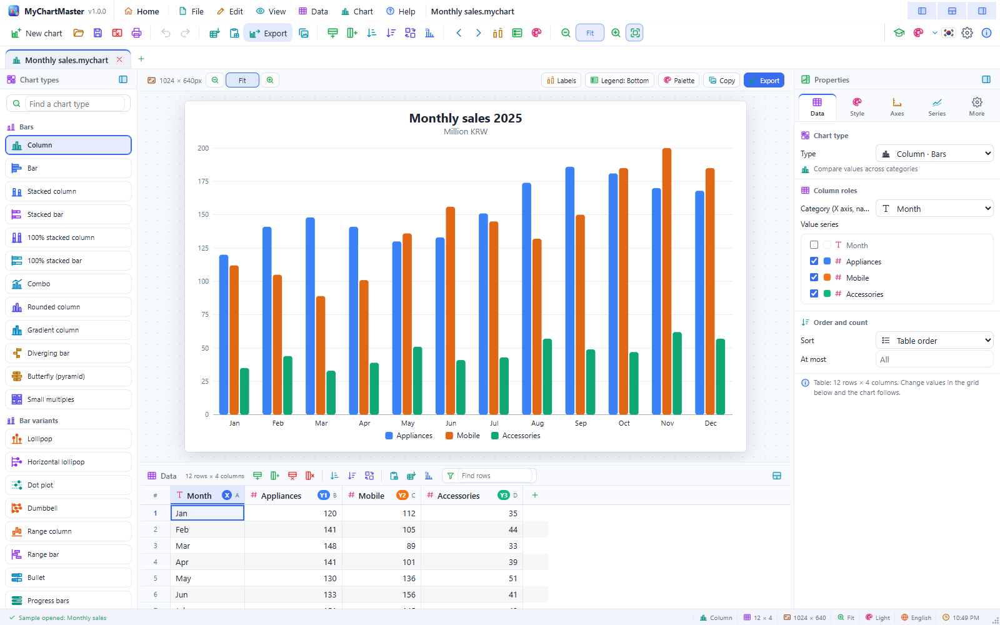

# MyChartMaster

> **한국어 요약** — MyChartMaster는 다양한 차트를 만드는 프로그램입니다. 표에 데이터를 입력하거나 CSV · TSV ·
> Excel(xlsx) · OpenDocument(ods) · JSON · XML · HTML · Markdown 파일에서 가져와 108가지 차트(막대 · 꺾은선 ·
> 영역 · 원형 · 도넛 · 분산형 · 거품형 · 방사형 · 히스토그램 · 상자 수염 · 히트맵 · 트리맵 · 선버스트 · 깔때기 ·
> 폭포 · 게이지 · 캔들스틱 · 생키 · 간트 · 바이올린 · 코드 다이어그램 · 숫자 카드 …)로 그리고, 차트마다 고르는
> 차트 테마(21가지, 프로그램 테마와 별개)와 제목 · 축 · 범례 · 레이블 · 색 구성을 다듬어 PNG · JPEG · WebP ·
> GIF · AVIF · SVG 그림, PDF · HTML · Word · Markdown 문서, CSV · Excel 데이터로 내보내고 인쇄합니다. 웹 브라우저와
> Windows · macOS · Linux 데스크톱(Tauri)에서 실행됩니다. 창 · 메뉴 · 팝업 스타일은 MyNetManager와 같습니다.
> 사용법은 [사용 설명서](doc/UserGuide.md)와 [튜토리얼](doc/Tutorial.md)을 보세요.

MyChartMaster makes charts of every kind. Type data into a spreadsheet-like grid or import it from CSV, TSV, Excel,
OpenDocument, JSON, XML, HTML and Markdown files; pick one of 108 chart types; give each chart its own chart theme; refine titles,
axes, legends, labels and palettes; and export pictures (PNG, JPEG, WebP, GIF, AVIF, SVG), documents (PDF, HTML, Word, Markdown) or data (CSV,
TSV, JSON, Markdown, HTML, Excel), or print. It runs in a web browser and as a desktop program for Windows, macOS and
Linux (Tauri 2). Its window, menus, toolbar, start page and popup windows follow MyNetManager's style.



## Features

- **108 chart types in nine groups of twelve**, each with its own icon — Bars (column, bar, stacked column, stacked
  bar, 100% stacked column, 100% stacked bar, combo, rounded column, gradient column, diverging bar, butterfly
  (pyramid), small multiples); Bar variants (lollipop, horizontal lollipop, dot plot, dumbbell, range column, range
  bar, bullet, progress bars, radial bar, radial column, mean with error bars, pareto); Lines & time (line, smooth
  line, step line, dashed line, points only, stacked line, slope chart, bump chart, sparklines, cumulative line,
  moving average, timeline); Areas (area, smooth area, step area, overlapping areas, stacked area, smooth stacked
  area, stacked step area, 100% stacked area, smooth 100% area, cumulative area, streamgraph, range area); Part of
  whole (pie, donut, half donut, half pie, exploded pie, nested donut, polar area, funnel, pyramid, waffle, dot
  array, parliament); Hierarchies & flows (treemap, sunburst, icicle, packed circles, tree, sankey, chord diagram,
  arc diagram, network graph, marimekko, word cloud, waterfall); Distribution (histogram, cumulative histogram,
  frequency polygon, dot histogram, box plot, violin, ridgeline, strip plot, beeswarm, rug plot, density, cumulative
  distribution); Correlation & comparison (scatter, connected scatter, regression scatter, quadrant, bubble,
  heatmap, punch card, calendar heatmap, correlation matrix, scatter matrix, radar, radar lines); Finance, plans &
  KPIs (candlestick, ohlc bars, heikin-ashi, price band, bollinger bands, gantt, gauge, solid gauge, gauge grid,
  linear gauge, kpi cards, activity rings). Every type opens with data of the shape it needs; switching the type
  keeps the data and the column roles that still fit.
- **Chart themes** — 21 themes per chart (classic, office, paper, newspaper, pastel, ocean, forest, sunset,
  corporate, monochrome, colour-blind safe, Solarized, Nordic, dark, midnight, slate, vampire, neon, blueprint,
  chalkboard …) set the palette, fonts, grid and their own paper, apart from the program's theme. The chart's
  background follows the program's theme by default (light or dark), and series colours are adjusted to stay readable
  on it (at least 3:1 contrast); the chart theme's paper, white, transparent or any colour can be chosen instead.
- **Data grid**: a virtualised spreadsheet (100 000 rows scroll smoothly) with keyboard editing, range selection,
  copy and paste of Excel ranges, add / delete / rename / sort / transpose, column types (number, text, date), find
  rows, data statistics (count, sum, mean, median, min, max, standard deviation), and 200 undo steps per chart.
- **Input files**: CSV and text (delimiter found by itself, quotes, `sep=` hint), TSV, Excel `.xlsx` (sheets, shared
  strings, dates), OpenDocument `.ods`, JSON (records, arrays, `{columns, rows}`, Chart.js datasets, column objects,
  GeoJSON), XML records, HTML tables, Markdown tables, UTF-8 / UTF-16 / EUC-KR text, decimal commas — with a preview
  window (header, delimiter, encoding, decimal mark, sheet), drag and drop, paste as a new chart, and replace data.
- **Inspector**: column roles, sort and top-N; titles, subtitle, note, legend position, 20 palettes, per-series
  colours, chart theme, background (program theme, chart theme paper, white, transparent, any colour), fonts; axis titles, range, log scale, grid lines,
  label angle, number formats (compact, percent, scientific, decimals, prefix, suffix); lines, markers, smooth curves,
  area opacity, bar radius and gap, data labels; donut hole, start angle, histogram bins, heat-map ramps, gauge range,
  waterfall totals, chart size.
- **On the chart**: value tips, legend clicks hide series, click a mark to select its series and row, double-click
  titles to edit, Ctrl + wheel zoom, context menus, a short grow-in animation.
- **Output**: pictures at any size and 1×–4× scale with a chosen background — a transparent one for the formats that keep it (PNG, WebP, GIF, AVIF, SVG, HTML;
  JPEG, PDF, Word and Markdown are filled white) — (AVIF encoded in Rust on the desktop),
  SVG with hover titles, PDF (the chart page plus data pages), an interactive HTML page, Word and Markdown documents
  with the picture and the table, data exports, copy the picture to the clipboard, and a print window with paper,
  orientation, margins, header and footer, data pages and a preview that prints at once (Windows: chosen printer, no
  dialog).
- **Start page**: a fixed program card over a board of movable, resizable cards — the new-chart card across the whole
  row (all 108 types as one-line buttons, icon and name side by side, 12 per group in 6 / 4 / 3 / 2 columns so
  every row is full), recent files and folders right under it,
  shortcuts, 31 sample charts, themes — in front of **20 moving chart backgrounds** (bars, lines, pies,
  scatter, flowing areas, candle ticker, radar, heat map, bubbles, gauges, treemap, Sankey flow, histogram, box plots,
  spreadsheet, sparklines, funnels, waterfall, polar roses, dashboard).
- **Shell**: frameless window with the menus in the title row, a coloured icon toolbar that is never clipped, tabs,
  a status bar, light and dark themes plus your own, Korean and English, a welcome window, an interactive tutorial, the user's guide and tutorial documents in their own windows, settings for the workspace, new charts and
  data import.
- **`.mychart` files** (JSON: the data and the chart together), registered with the desktop installers.

## Platforms

| Platform | How it runs |
| --- | --- |
| Web | any modern browser (`npm run build:webapp`, then serve `dist/`) |
| Windows 10 / 11 | NSIS installer (`npm run build:win`) |
| macOS | `.dmg` (`npm run build:mac`) |
| Linux | `.deb`, `.rpm`, `.AppImage` (`npm run build:linux`) |

## Commands

Requires Node.js 22+; the desktop builds also need Rust and the [Tauri 2 prerequisites](https://tauri.app/start/prerequisites/).

| Command | What it does |
| --- | --- |
| `npm install` | install the dependencies |
| `npm start` | run the desktop program in development (`tauri dev`; frees the dev server port 1476 first) |
| `npm run dev` | run the web version on the Vite dev server (`http://localhost:1476`) |
| `npm test` | every test by category (unit · i18n · rust · web · tutorial · desktop), in the same look as the other projects: a live line per test with its time, then per category a table (failures first, slowest first, time bars), a summary table and the failed list; `test-results/results.json` and `report.txt`. `MYCHARTMASTER_E2E_ONLY=<regex>` runs only matching E2E cases, `MYCHARTMASTER_E2E_EXE` points the desktop suite at a build of its own |
| `npm test -- --quick` | the fast part only (unit, i18n, rust; no browser) |
| `npm test -- --only web,tutorial` | just those categories (`--skip`, `--no-build` reuse the last web build) |
| `npm run build:web` | the web app in `dist/` |
| `npm run build:win` | Windows installer (`MyChartMaster-Setup-<version>.exe`) |
| `npm run build:mac` | macOS `.dmg` |
| `npm run build:linux` | Linux `.deb`, `.rpm` and `.AppImage` |
| `npm run build:all` | every installer this OS can build |
| `npm run build:docs` | turn `doc/*.md` into the HTML pages in `docs/` (and `public/docs/`) |
| `npm run doc:images` | take the pictures of the documents from the real app (`doc/images/{ko,en}/`) |
| `npm run samples` | write the sample charts to `samples/*.mychart` and the data files to `samples/data/` |
| `npm run i18n:check` | list translation keys missing in Korean or English |
| `npm run clean` | remove build output (`dist/`, `docs/`, `public/docs/`, `release/`, installers, `test-results/`) |
| `npm run clean:all` | the above plus `node_modules/` and `src-tauri/target/` |

Installers are built natively (Windows on Windows, macOS on macOS, Linux on Linux); they are collected in `release/`
and copied to the project root. Every installer build runs `build:docs` first. One installation at a time: the
Windows installer removes an earlier one and asks whether to delete the old user data; several copies of the program
can run at once.

## Project layout

```text
src/
  main.js app.js popup.js viewer.js     the app shell, popup windows, document viewer
  popups-chart.js                       export, import, print, palette, data statistics popups; chart settings tabs
  views/                                chart view (gallery, stage), data grid, inspector
  ui/                                   start page (card board), tooltips, dropdowns, moving chart backgrounds, tutorial
  platform/                             Tauri / web boundary, popup windows
  domain/
    data/                               table model, importers (CSV … XLSX, ODS), exporters, ZIP, XML reader
    chart/                              chart types, SVG renderer, palettes, document model (undo), samples
    export/                             chart exports (pictures, PDF, HTML, Word, Markdown), documents, image encoders
  i18n/                                 Korean and English strings
src-tauri/                              Rust: windows, popups, files, printing, AVIF encoder, fonts, instances
test/                                   unit (node:test), e2e (headless browser / WebView2 over CDP)
doc/                                    user's guide and tutorial (Korean, English) with pictures
samples/                                sample charts (.mychart) and data files in every import format
scripts/                                start, test, build, docs, doc pictures, samples, icons, clean
```

The module contracts are described in [ARCHITECTURE.md](ARCHITECTURE.md).

## Documents

- [UsersGuide.md](UsersGuide.md) — the user's guide in both languages in one file (written by `npm run build:docs`)
- [User's Guide](doc/UserGuide.en.md) · [사용 설명서](doc/UserGuide.md)
- [Tutorial](doc/Tutorial.en.md) · [튜토리얼](doc/Tutorial.md)
- [Document index](doc/README.md)

In the program: **Help › User's Guide**, **Help › Tutorial Document**, and **Help › Tutorial** (F11) for the
guided tour.

© SHKWON (knix008@naver.com)
