# MyChartMaster 사용 설명서 / User's Guide

<!-- Generated by npm run build:docs from doc/UserGuide.md and doc/UserGuide.en.md. Edit those files, not this one. -->

- [한국어](#한국어) · [English](#english)

<!-- lang:ko -->

## 한국어

### MyChartMaster 사용 설명서

MyChartMaster는 표 형태의 데이터를 108가지 차트로 그리는 프로그램입니다. 데이터를 표에 직접 입력하거나
CSV · TSV · Excel(xlsx) · OpenDocument(ods) · JSON · XML · HTML · Markdown 파일에서 가져오고, 차트 종류와
제목 · 축 · 범례 · 레이블 · 색 구성을 다듬은 뒤 PNG · JPEG · WebP · GIF · AVIF · SVG 그림이나 PDF · HTML ·
Word · Markdown 문서, CSV · Excel 데이터로 내보내고 인쇄합니다. 웹 브라우저에서도, Windows · macOS · Linux
데스크톱 프로그램으로도 실행됩니다.

이 설명서는 프로그램의 모든 부분을 설명합니다. 같은 기능을 직접 따라 해 보려면 [튜토리얼](doc/Tutorial.md)을
보세요. The English guide is [UserGuide.en.md](doc/UserGuide.en.md).

> 이 설명서의 그림은 모두 프로그램 자체(웹 버전, 1600 × 1000 창, *라이트* 테마)에서 함께 들어 있는 샘플
> 차트로 찍은 것입니다. 데스크톱 프로그램도 모양이 같고, 제목 줄 오른쪽 끝에 창 단추가 더 있습니다.

#### 한눈에 보기

| 부분 | 내용 |
| --- | --- |
| [시작 화면](#시작-화면) | 새 차트, 최근 항목, 바로 가기, 샘플, 테마, 움직이는 배경 |
| [주 창](#주-창) | 제목 줄, 메뉴, 툴바, 탭, 상태 표시줄 |
| [차트 화면](#차트-화면) | 차트 종류 패널, 차트, 데이터 표, 속성 패널 |
| [차트 종류](#차트-종류) | 108가지 차트와 각각이 쓰는 열, 차트 테마 |
| [데이터 표](#데이터-표) | 편집, 붙여넣기, 행·열, 정렬, 통계 |
| [속성 패널](#속성-패널) | 데이터 · 스타일 · 축 · 계열 · 기타 탭 |
| [가져오기](#데이터-가져오기) | 파일 형식, 미리 보기, 시트, 인코딩 |
| [저장과 내보내기](#저장과-내보내기) | .mychart, 그림, 문서, 데이터 |
| [인쇄](#인쇄) | 용지, 미리 보기, 바로 인쇄 |
| [설정](#설정) | 설정 탭, 테마, 언어 |
| [참고](#바로-가기-키) | 바로 가기 키, 파일 형식, 문제 해결, 빌드 |

#### 시작 화면

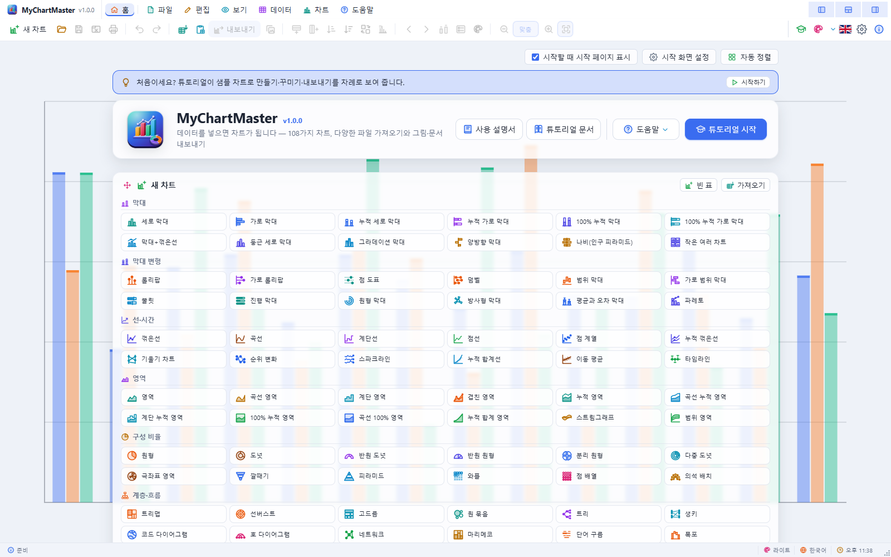

프로그램을 열면 시작 화면이 나옵니다. 뒤에서는 차트로 된 움직이는 배경(막대 · 꺾은선 · 원형 · 분산형 ·
캔들 · 히트맵 · 생키 · 대시보드 등 20가지)이 흐르고, 그 위에 반투명 카드가 놓입니다.

- **프로그램 카드**(맨 위, 고정): 이름과 버전, 사용 설명서 · 튜토리얼 문서 단추, 도움말 메뉴, **튜토리얼 시작**.
  이 카드는 옮기거나 크기를 바꿀 수 없습니다.
- **새 차트**: 가로 한 줄을 다 쓰는 카드. 아홉 묶음(막대 · 막대 변형 · 선·시간 · 영역 · 구성 비율 · 계층·흐름 · 분포 · 상관·비교 · 재무·일정·지표)에 묶음마다 12가지씩, 108개 차트 단추가 아이콘과 이름을 한 줄에 왼쪽 정렬로 보여 줍니다. 단추는 카드 폭에 따라 한 줄에 6 · 4 · 3 · 2개씩 놓여 어느 줄도 비지 않습니다. 종류마다 아이콘이 다릅니다. 바로 아래에 **최근 항목** 카드가 있습니다.
  타일을 누르면 그 종류에 맞는 예시 데이터가 든 새 차트가 열립니다. 카드 제목 줄의 **빈 표**는 비어 있는
  표로, **가져오기**는 데이터 파일로 시작합니다.
- **최근 항목**: 최근에 연 파일과 폴더. ×로 목록에서 빼고, 오른쪽 클릭으로 경로를 복사합니다.
- **바로 가기**: 열기, 새 차트, 데이터 가져오기, 붙여넣어 새 차트, 튜토리얼, 테마, 언어, 설정, 정보, 끝내기.
- **샘플 차트**: 비즈니스 · 금융 · 과학 · 사회 분야의 샘플 31개. 나머지 종류는 새 차트로 열면 그 종류에 맞는 예제 데이터가 들어 있습니다.
- **테마**: 밝은 테마와 어두운 테마를 바로 고릅니다.
- **움직이는 배경**: 20가지 배경, 무작위 바꾸기, 배경 그림, 속도, 카드 불투명도, 자동으로 바꾸는 간격.

카드는 왼쪽 위 손잡이로 끌어 옮기고 오른쪽 아래 모서리로 크기를 바꿉니다. **자동 정렬**은 처음 배치로
되돌립니다. 제목 줄의 **홈** 단추(Ctrl+Shift+H)는 언제든 시작 화면을 열고, 다시 누르면 차트로 돌아갑니다.

#### 주 창

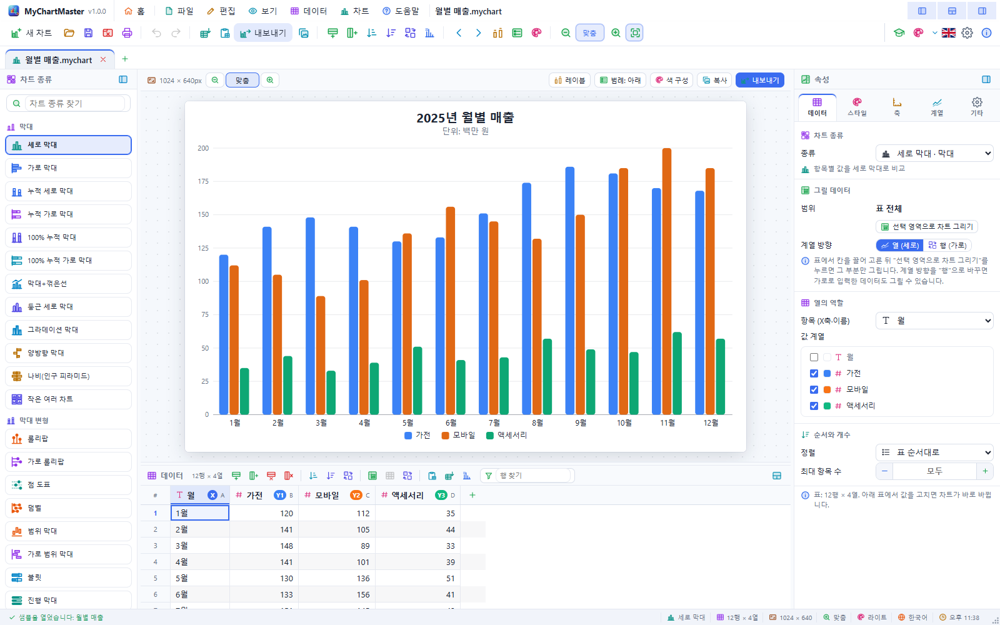

- **제목 줄**: 프로그램 아이콘과 이름, 홈, 메뉴(파일 · 편집 · 보기 · 데이터 · 차트 · 도움말), 열린 차트 이름
  (저장하지 않았으면 ●), 패널 단추 세 개(차트 종류 · 데이터 표 · 속성), 데스크톱에서는 창 단추.
  빈 곳을 끌면 창이 움직이고, 두 번 누르면 최대화합니다.
- **툴바**: 새 차트 · 열기 · 저장 · 닫기 · 인쇄 / 실행 취소 · 다시 실행 / 가져오기 · 붙여넣기 · **내보내기** ·
  그림 복사 / 행·열 추가 · 정렬 · 행과 열 바꾸기 · 통계 / 이전·다음 차트 종류 · 데이터 레이블 · 범례 · 색 구성 /
  축소 · 배율 · 확대 · 맞춤. 오른쪽에 튜토리얼 · 테마 · 언어 · 설정 · 정보. 창을 줄여도 단추가 잘리지 않도록
  창의 최소 너비가 툴바에 맞춰집니다.
- **탭**: 열린 차트마다 하나. 아이콘은 차트 종류, ●는 저장하지 않은 변경. 오른쪽 클릭으로 다른 탭 닫기 ·
  저장 · 복제 · 내보내기 · 인쇄. Ctrl+Tab으로 다음 탭.
- **상태 표시줄**: 알림, 차트 종류, 표 크기(행 × 열), 차트 크기(픽셀), 배율, 수정됨, 테마, 언어, 시계.

#### 차트 화면

차트 탭은 네 부분입니다.

| 부분 | 하는 일 |
| --- | --- |
| 차트 종류 패널(왼쪽) | 108가지 종류를 묶음별로 보여 줍니다. 누르면 같은 데이터가 그 종류로 그려집니다. 위의 칸으로 이름을 찾습니다. |
| 차트(가운데) | 차트 그림. 위 줄에 크기, 배율, 레이블 · 범례 · 색 구성 · 복사 · 내보내기 단추. |
| 데이터 표(아래 또는 오른쪽) | 차트의 데이터. 고치면 차트가 바로 따라 바뀝니다. |
| 속성 패널(오른쪽) | 차트의 모든 설정(데이터 · 스타일 · 축 · 계열 · 기타). |

차트에서 할 수 있는 일:

- 막대 · 점 · 조각에 마우스를 올리면 **값 풍선**이 보입니다(설정에서 끌 수 있음).
- 막대나 점을 누르면 그 **계열이 선택**되고(굵은 테두리) 표에서 그 행으로 갑니다. 빈 곳을 누르면 선택이 풀립니다.
- **범례**를 누르면 그 계열(원형 차트는 조각)을 숨기거나 다시 보입니다.
- **제목을 두 번 누르면** 제목을, 부제목을 두 번 누르면 부제목을 고칩니다. 축 제목을 두 번 누르면 축 탭이 열립니다.
- **Ctrl + 마우스 휠**로 확대 · 축소, **맞춤**(Ctrl+0)으로 창에 맞춥니다.
- 오른쪽 클릭: 제목 편집, 레이블, 범례, 눈금선, 추세선, 색 구성, 배경, 서식 초기화, 복사, 내보내기, 인쇄,
  계열 위에서는 계열 숨기기 · 계열 색.

패널은 경계선을 끌어 크기를 바꾸고, 패널 제목 줄의 단추나 Ctrl+Shift+1(차트 종류) · Ctrl+J(데이터 표) ·
Ctrl+Shift+2(속성)로 접고 펼칩니다. **보기 › 패널**에서 표를 차트 아래에 둘지 오른쪽에 둘지(또는 차트만
보일지) 고릅니다.

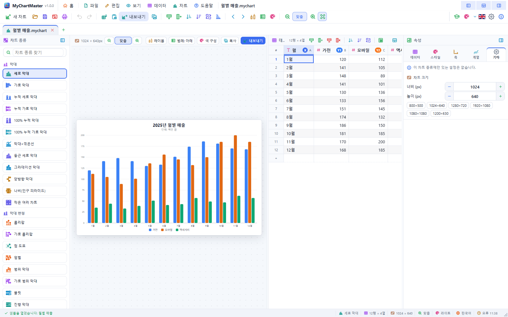

#### 차트 종류

| 묶음 | 종류 | 설명 | 쓰는 열 |
| --- | --- | --- | --- |
| 막대 | 세로 막대 | 항목별 값을 세로 막대로 비교 | 항목 + 값 계열 여러 개 |
| 막대 | 가로 막대 | 긴 이름의 항목을 가로 막대로 비교 | 항목 + 값 계열 여러 개 |
| 막대 | 누적 세로 막대 | 항목별 합계와 구성 | 항목 + 값 계열 여러 개 |
| 막대 | 누적 가로 막대 | 가로로 쌓은 구성 | 항목 + 값 계열 여러 개 |
| 막대 | 100% 누적 막대 | 항목마다 구성 비율 | 항목 + 값 계열 여러 개 |
| 막대 | 100% 누적 가로 막대 | 가로로 본 구성 비율 | 항목 + 값 계열 여러 개 |
| 막대 | 막대+꺾은선 | 첫 계열은 막대, 나머지는 선 | 항목 + 값 계열 여러 개 |
| 막대 | 둥근 세로 막대 | 모서리를 둥글린 막대 | 항목 + 값 계열 여러 개 |
| 막대 | 그라데이션 막대 | 위로 갈수록 진해지는 막대 | 항목 + 값 계열 여러 개 |
| 막대 | 양방향 막대 | 양수와 음수를 다른 색으로 | 항목 + 값 1개 |
| 막대 | 나비(인구 피라미드) | 두 계열을 좌우로 맞대어 | 항목 + 값 계열 여러 개 |
| 막대 | 작은 여러 차트 | 계열마다 작은 막대 차트 | 항목 + 값 계열 여러 개 |
| 막대 변형 | 롤리팝 | 점과 선으로 그린 막대 | 항목 + 값 계열 여러 개 |
| 막대 변형 | 가로 롤리팝 | 가로로 누운 롤리팝 | 항목 + 값 계열 여러 개 |
| 막대 변형 | 점 도표 | 막대 대신 점만 | 항목 + 값 계열 여러 개 |
| 막대 변형 | 덤벨 | 두 값 사이의 차이를 선으로 | 항목 + 값 계열 여러 개 |
| 막대 변형 | 범위 막대 | 최솟값에서 최댓값까지 | 항목 + 최솟값 · 최댓값 |
| 막대 변형 | 가로 범위 막대 | 가로로 그린 범위 | 항목 + 최솟값 · 최댓값 |
| 막대 변형 | 불릿 | 실적과 목표, 구간 | 항목 + 실적 (+ 목표) |
| 막대 변형 | 진행 막대 | 최댓값 대비 진행률 | 항목 + 값 1개 |
| 막대 변형 | 원형 막대 | 동심원 고리로 그린 막대 | 항목 + 값 1개 |
| 막대 변형 | 방사형 막대 | 원 둘레에 선 막대 | 항목 + 값 계열 여러 개 |
| 막대 변형 | 평균과 오차 막대 | 열마다 평균 ± 표준편차 | 숫자 열 여러 개(열마다 분포) |
| 막대 변형 | 파레토 | 큰 순서 막대와 누적 비율선 | 항목 + 값 1개 |
| 선·시간 | 꺾은선 | 시간에 따른 변화 | 항목 + 값 계열 여러 개 |
| 선·시간 | 곡선 | 부드럽게 이은 선 | 항목 + 값 계열 여러 개 |
| 선·시간 | 계단선 | 값이 바뀌는 시점을 계단으로 | 항목 + 값 계열 여러 개 |
| 선·시간 | 점선 | 점선으로 그린 추세 | 항목 + 값 계열 여러 개 |
| 선·시간 | 점 계열 | 선 없이 점만 | 항목 + 값 계열 여러 개 |
| 선·시간 | 누적 꺾은선 | 쌓아 올린 선 | 항목 + 값 계열 여러 개 |
| 선·시간 | 기울기 차트 | 두 시점 사이의 변화 | 항목 + 값 계열 여러 개 |
| 선·시간 | 순위 변화 | 시간에 따른 순위 | 항목 + 값 계열 여러 개 |
| 선·시간 | 스파크라인 | 계열마다 한 줄 미니 차트 | 항목 + 값 계열 여러 개 |
| 선·시간 | 누적 합계선 | 처음부터 쌓인 합계 | 항목 + 값 계열 여러 개 |
| 선·시간 | 이동 평균 | 값과 이동 평균선 | 항목 + 값 계열 여러 개 |
| 선·시간 | 타임라인 | 시간 순서의 사건 | 날짜(항목) + 사건 |
| 영역 | 영역 | 변화와 양을 함께 | 항목 + 값 계열 여러 개 |
| 영역 | 곡선 영역 | 부드러운 영역 | 항목 + 값 계열 여러 개 |
| 영역 | 계단 영역 | 계단 모양 영역 | 항목 + 값 계열 여러 개 |
| 영역 | 겹친 영역 | 옅게 겹쳐 그린 영역과 점 | 항목 + 값 계열 여러 개 |
| 영역 | 누적 영역 | 쌓아 올린 영역 | 항목 + 값 계열 여러 개 |
| 영역 | 곡선 누적 영역 | 부드럽게 쌓은 영역 | 항목 + 값 계열 여러 개 |
| 영역 | 계단 누적 영역 | 계단 모양으로 쌓은 영역 | 항목 + 값 계열 여러 개 |
| 영역 | 100% 누적 영역 | 시간에 따른 구성 비율 | 항목 + 값 계열 여러 개 |
| 영역 | 곡선 100% 영역 | 부드럽게 그린 구성 비율 영역 | 항목 + 값 계열 여러 개 |
| 영역 | 누적 합계 영역 | 처음부터 더해 간 값의 영역 | 항목 + 값 계열 여러 개 |
| 영역 | 스트림그래프 | 가운데를 중심으로 흐르는 누적 영역 | 항목 + 값 계열 여러 개 |
| 영역 | 범위 영역 | 최솟값과 최댓값 사이의 띠 | 항목 + 최솟값 · 최댓값 |
| 구성 비율 | 원형 | 전체에서 차지하는 비율 | 항목 + 값 1개 |
| 구성 비율 | 도넛 | 가운데에 합계를 둔 원형 | 항목 + 값 1개 |
| 구성 비율 | 반원 도넛 | 반원으로 그린 구성 비율 | 항목 + 값 1개 |
| 구성 비율 | 반원 원형 | 반원으로 그린 원형 | 항목 + 값 1개 |
| 구성 비율 | 분리 원형 | 조각을 떼어 놓은 원형 | 항목 + 값 1개 |
| 구성 비율 | 다중 도넛 | 계열마다 고리 하나 | 항목 + 값 계열 여러 개 |
| 구성 비율 | 극좌표 영역 | 각도는 같고 반지름이 값 | 항목 + 값 1개 |
| 구성 비율 | 깔때기 | 단계마다 줄어드는 양 | 항목 + 값 1개 |
| 구성 비율 | 피라미드 | 아래가 넓은 삼각형 단계 | 항목 + 값 1개 |
| 구성 비율 | 와플 | 100칸으로 나타낸 비율 | 항목 + 값 1개 |
| 구성 비율 | 점 배열 | 100개의 점으로 나타낸 비율 | 항목 + 값 1개 |
| 구성 비율 | 의석 배치 | 반원에 늘어선 의석 | 항목 + 값 1개 |
| 계층·흐름 | 트리맵 | 면적으로 나타낸 비율과 묶음 | (묶음) + 항목 + 값 1개 |
| 계층·흐름 | 선버스트 | 계층을 고리로 | (묶음) + 항목 + 값 1개 |
| 계층·흐름 | 고드름 | 계층을 층층이 쌓은 막대 | (묶음) + 항목 + 값 1개 |
| 계층·흐름 | 원 묶음 | 크기대로 모은 원 | (묶음) + 항목 + 값 1개 |
| 계층·흐름 | 트리 | 묶음에서 항목으로 뻗는 가지 | (묶음) + 항목 + 값 1개 |
| 계층·흐름 | 생키 | 어디서 어디로 흐르는 양 | 출발 · 도착 · 양 |
| 계층·흐름 | 코드 다이어그램 | 원 둘레를 잇는 흐름 | 출발 · 도착 · 양 |
| 계층·흐름 | 호 다이어그램 | 한 줄의 점을 잇는 호 | 출발 · 도착 · 양 |
| 계층·흐름 | 네트워크 | 점과 연결선 | 출발 · 도착 · 양 |
| 계층·흐름 | 마리메코 | 폭은 합계, 높이는 비율 | 항목 + 값 계열 여러 개 |
| 계층·흐름 | 단어 구름 | 값이 클수록 큰 글자 | 항목 + 값 1개 |
| 계층·흐름 | 폭포 | 증감이 누적되는 과정 | 항목 + 값 1개 |
| 분포 | 히스토그램 | 값의 분포 구간 | 숫자 열 여러 개(열마다 분포) |
| 분포 | 누적 히스토그램 | 구간 끝까지의 값 개수 | 숫자 열 여러 개(열마다 분포) |
| 분포 | 도수 다각형 | 구간 개수를 선으로 | 숫자 열 여러 개(열마다 분포) |
| 분포 | 점 히스토그램 | 구간마다 값을 점으로 쌓음 | 숫자 열 여러 개(열마다 분포) |
| 분포 | 상자 수염 | 중앙값·사분위·이상값 | 숫자 열 여러 개(열마다 분포) |
| 분포 | 바이올린 | 분포 모양을 좌우 대칭으로 | 숫자 열 여러 개(열마다 분포) |
| 분포 | 능선 그림 | 계열마다 분포 곡선을 겹쳐 쌓음 | 숫자 열 여러 개(열마다 분포) |
| 분포 | 띠 점 도표 | 값마다 점 하나 | 숫자 열 여러 개(열마다 분포) |
| 분포 | 벌떼 도표 | 겹치지 않게 퍼진 점 | 숫자 열 여러 개(열마다 분포) |
| 분포 | 러그 도표 | 값마다 짧은 선 | 숫자 열 여러 개(열마다 분포) |
| 분포 | 밀도 | 부드러운 분포 곡선 | 숫자 열 여러 개(열마다 분포) |
| 분포 | 누적 분포 | 값 이하인 비율 | 숫자 열 여러 개(열마다 분포) |
| 상관·비교 | 분산형 | 두 값의 관계 | X 값 + Y 값 계열(+ 이름표) |
| 상관·비교 | 연결 분산형 | 순서대로 이은 점 | X 값 + Y 값 계열(+ 이름표) |
| 상관·비교 | 회귀 분산형 | 점과 회귀선 | X 값 + Y 값 계열(+ 이름표) |
| 상관·비교 | 사분면 | 평균선으로 나눈 네 영역 | X 값 + Y 값 계열(+ 이름표) |
| 상관·비교 | 거품형 | 세 번째 값을 크기로 | X · Y · 크기 (+ 이름표, 묶음) |
| 상관·비교 | 히트맵 | 색의 진하기로 보는 표 | 항목 + 값 계열 여러 개 |
| 상관·비교 | 펀치 카드 | 크기로 보는 표 | 항목 + 값 계열 여러 개 |
| 상관·비교 | 달력 히트맵 | 날짜별 값을 달력 칸에 | 항목 + 값 1개 |
| 상관·비교 | 상관 행렬 | 숫자 열끼리의 상관 계수 | 숫자 열 여러 개(열마다 분포) |
| 상관·비교 | 산점도 행렬 | 숫자 열 두 개씩 짝지은 점 | 숫자 열 여러 개(열마다 분포) |
| 상관·비교 | 방사형 | 여러 지표를 한눈에 | 항목 + 값 계열 여러 개 |
| 상관·비교 | 방사형 선 | 채우지 않은 방사형 | 항목 + 값 계열 여러 개 |
| 재무·일정·지표 | 캔들스틱 | 시가·고가·저가·종가 | 날짜 + 시가 · 고가 · 저가 · 종가 |
| 재무·일정·지표 | OHLC 막대 | 좌우 눈금으로 그린 시세 | 날짜 + 시가 · 고가 · 저가 · 종가 |
| 재무·일정·지표 | 하이킨아시 | 평균으로 다듬은 캔들 | 날짜 + 시가 · 고가 · 저가 · 종가 |
| 재무·일정·지표 | 가격 띠 | 고가·저가 띠와 종가선 | 날짜 + 시가 · 고가 · 저가 · 종가 |
| 재무·일정·지표 | 볼린저 밴드 | 이동 평균 ± 2 표준편차 | 항목 + 값 1개 |
| 재무·일정·지표 | 간트 | 작업의 시작과 끝 | 작업 + 시작 · 끝 (날짜 또는 숫자) (+ 담당) |
| 재무·일정·지표 | 게이지 | 목표 대비 현재 값 | 항목 + 값 1개 |
| 재무·일정·지표 | 고리 게이지 | 바늘 없이 채워진 고리 | 항목 + 값 1개 |
| 재무·일정·지표 | 게이지 여러 개 | 행마다 게이지 하나 | 항목 + 값 1개 |
| 재무·일정·지표 | 막대 게이지 | 온도계처럼 채워지는 막대 | 항목 + 값 1개 |
| 재무·일정·지표 | 숫자 카드 | 행마다 큰 숫자와 증감 | 항목 + 값 1개 |
| 재무·일정·지표 | 활동 고리 | 목표 대비 달성 고리 | 항목 + 값 1개 |

종류를 바꾸면 열의 역할이 새 종류에 맞게 다시 정해지고, 맞는 것(항목 열, 값 계열)은 그대로 남습니다.
**차트 › 이전/다음 차트 종류**(Ctrl+[ · Ctrl+])로 차례로 넘겨 볼 수 있습니다.

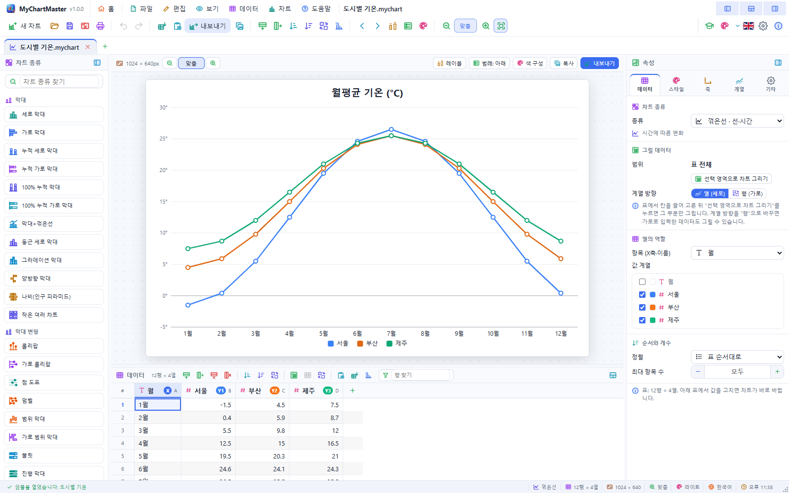

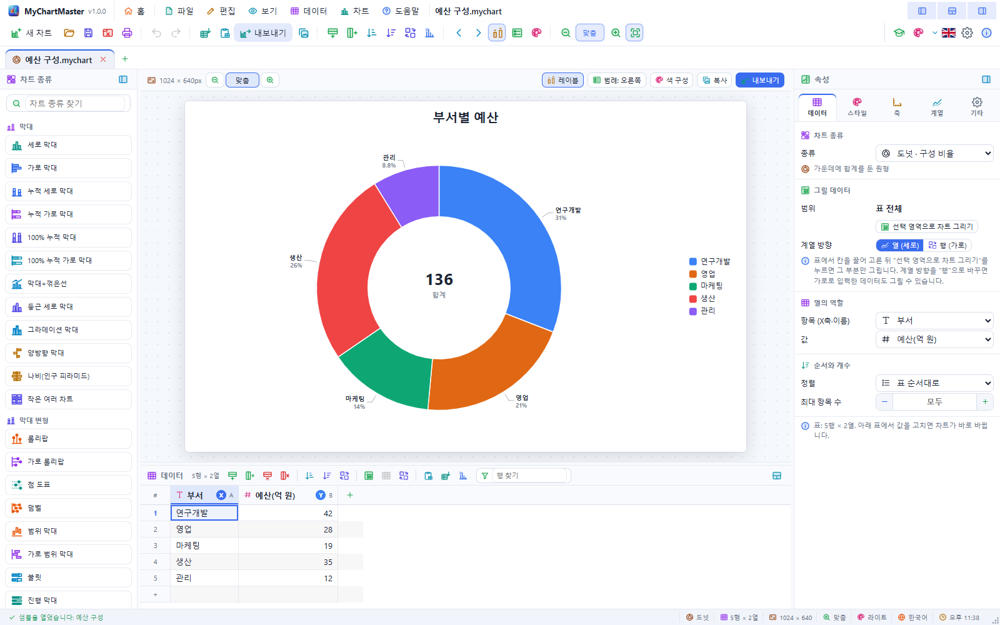

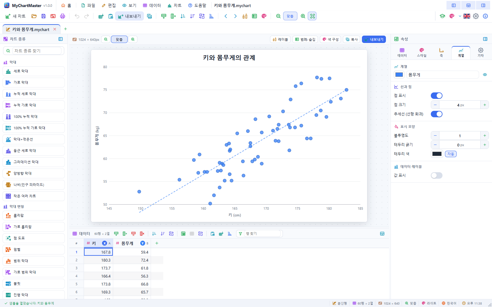

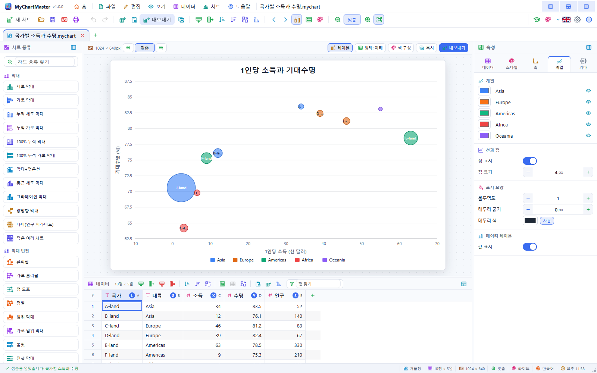

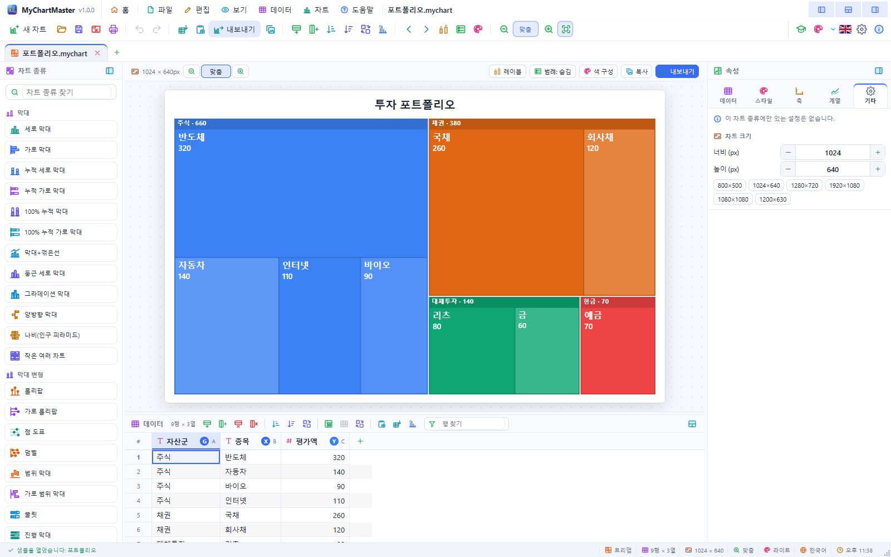

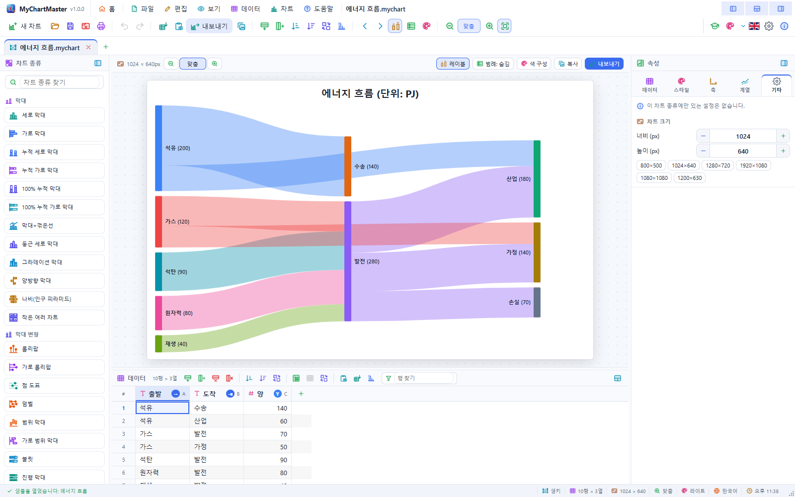

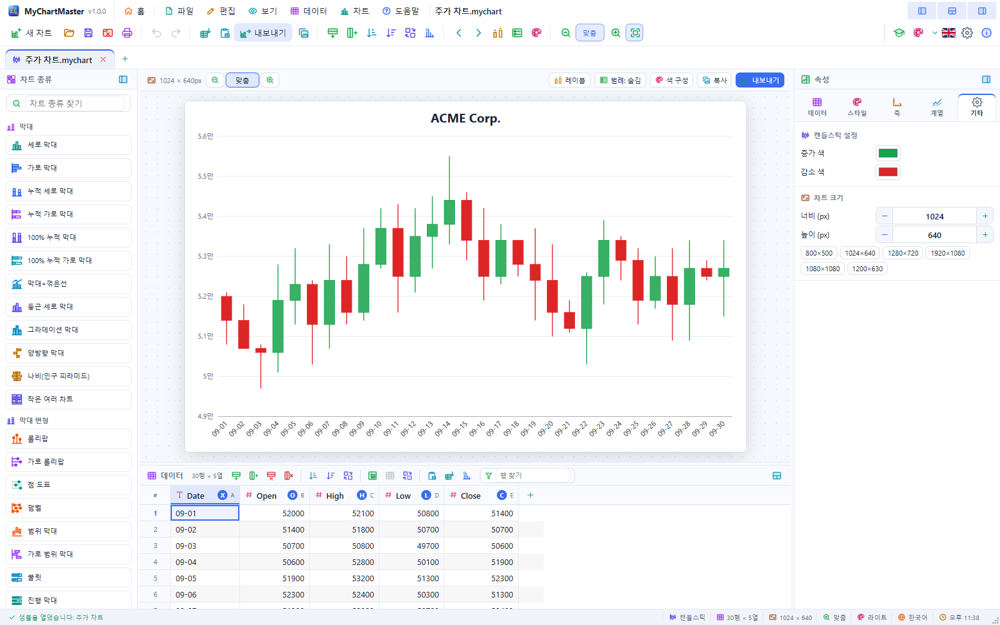

##### 차트 테마

차트마다 **차트 테마**를 고릅니다(속성 › 스타일 › 차트 테마, **차트 › 차트 테마**, 차트의 오른쪽 클릭 메뉴). 차트 테마는
프로그램 테마(라이트 · 다크 …)와 따로 정하며, 색 구성 · 글꼴 · 격자 모양 · 자기 바탕색을 함께 바꿉니다. 21가지:
클래식 · 오피스 · 종이 · 신문 · 파스텔 · 바다 · 숲 · 노을 · 비즈니스 · 흑백 · 색각 친화 · 솔라라이즈드 밝게 · 북유럽 · 어둡게 · 한밤 · 슬레이트 · 솔라라이즈드 어둡게 · 뱀파이어 · 네온 · 청사진 · 칠판.

차트의 **배경은 기본으로 프로그램 테마를 따릅니다**. 다크 테마로 바꾸면 차트 바탕도 어두워지고, 글자 · 축 · 격자는
밝은 색이 되며, 계열 색은 바탕과의 명암비가 3:1 이상이 되도록 자동으로 밝기를 조절합니다. 배경은 **차트 테마 바탕**,
**흰색**, **투명**, **직접 고른 색**으로 바꿀 수도 있습니다. 새 차트의 차트 테마는 설정 › 차트에서 정합니다.

#### 데이터 표

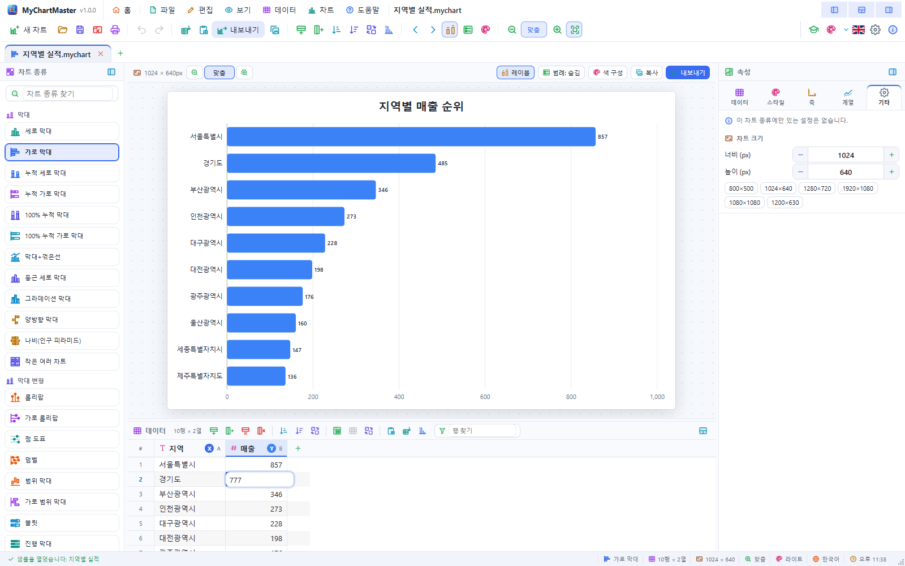

표는 스프레드시트처럼 다룹니다. 화면에 보이는 행만 그리므로 10만 행도 부드럽게 스크롤됩니다.

- **셀 고르기**: 클릭, 화살표, Tab, Enter, Page Up/Down, Home/End(Ctrl과 함께면 맨 끝). Shift를 누른 채
  움직이거나 끌면 범위를 고릅니다. 행 번호를 누르면 행 전체, 머리글을 누르면 열 전체, 왼쪽 위 모서리는 전체.
- **편집**: 셀을 고르고 바로 입력하거나 F2 · 두 번 클릭 · Enter. Enter는 아래로, Tab은 오른쪽으로 옮기며
  저장하고, Esc는 취소합니다. 맨 아래 **+** 행에 입력하면 새 행이 생깁니다.
- **지우기**: Delete 또는 Backspace는 고른 셀을 비웁니다.
- **복사 · 붙여넣기**: Ctrl+C는 고른 범위를 탭으로 구분한 글로 복사(엑셀에 그대로 붙음), Ctrl+V는 엑셀이나
  웹에서 복사한 범위를 고른 셀부터 붙여 넣습니다(모자라면 행과 열이 늘어남).
- **열 이름 바꾸기**: 머리글을 두 번 누르거나 **데이터 › 열 이름 바꾸기**.
- **머리글 표시**: 각 열의 형식 아이콘(# 숫자 · T 글자 · 달력 날짜)과, 차트에서 맡은 역할 표시(X 항목,
  Y1 · Y2… 계열 색, S 크기, G 묶음, O/H/L/C 캔들 …).
- **열 형식**: 숫자 · 글자 · 날짜는 값을 보고 저절로 정해집니다. 오른쪽 클릭 › 열 형식으로 바꿀 수 있습니다
  (예: 숫자로 된 코드를 글자로). 숫자 열에 숫자가 아닌 값은 빨간 기울임꼴로 보입니다.
- **표 도구**(표 제목 줄): 행 추가 · 열 추가 · 선택한 행/열 삭제 · 오름/내림차순 정렬(고른 열 기준) · 행과
  열 바꾸기 · 붙여넣어 새 차트 · 가져오기 · 데이터 통계 · **행 찾기**(그 글자가 든 행만 표에 보임; 차트는 그대로).
- **오른쪽 클릭**: 이 열을 항목(X축)으로, 계열로 추가/빼기, 복사 · 붙여넣기 · 지우기, 행/열 추가·삭제,
  이름 바꾸기, 열 형식, 정렬, 행과 열 바꾸기, 통계.

숫자는 사람이 쓰는 모양 그대로 읽습니다: `1,234.5`, `1.234,5`, `12%`(0.12), `$3.20`, `₩1,000`, `1,000원`,
`(42)`(−42), `1.2k`. 날짜는 `2024-03-01`, `2024/3`, `2024년 3월 1일`을 알아봅니다.

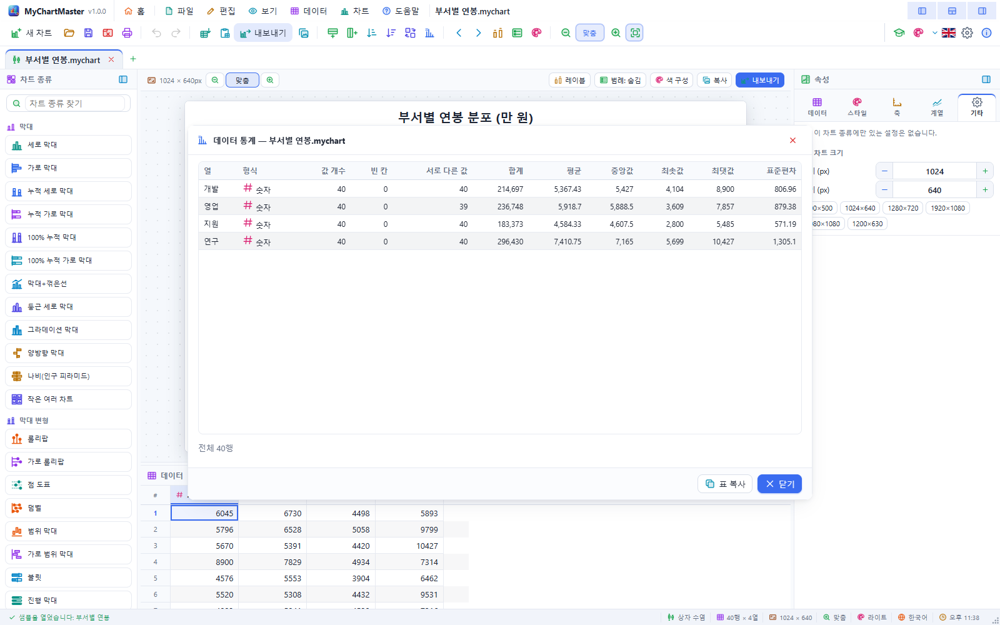

**데이터 › 데이터 통계**(Ctrl+Shift+I)는 열마다 형식, 값 개수, 빈 칸, 서로 다른 값, 합계, 평균, 중앙값,
최솟값, 최댓값, 표준편차를 보여 줍니다. 머리글을 누르면 정렬하고, **표 복사**로 엑셀에 붙일 수 있습니다.

모든 편집은 **실행 취소**(Ctrl+Z) · **다시 실행**(Ctrl+Y)할 수 있습니다(차트마다 200단계).

#### 속성 패널

##### 데이터 탭

- **차트 종류**: 드롭다운으로도 바꿉니다. 아래에 그 종류의 설명이 나옵니다.
- **열의 역할**: 종류마다 필요한 역할이 나옵니다. 항목(X축 · 이름) 열, 값 계열(체크한 숫자 열마다 계열 하나,
  옆의 색 점이 계열 색), 분산형의 X, 거품형의 X · Y · 크기 · 이름표 · 묶음, 캔들의 시가 · 고가 · 저가 · 종가,
  트리맵 · 선버스트의 묶음, 생키의 출발 · 도착.
- **정렬**: 표 순서대로 · 값이 큰 순서 · 값이 작은 순서 · 이름 순서(첫 계열 기준; 표는 그대로).
- **최대 항목 수**: 앞에서부터 몇 개만 그립니다(정렬과 함께 "상위 10개").

##### 그릴 데이터 (데이터 탭)

- **선택 영역으로 차트 그리기**(Ctrl+Shift+R): 아래 표에서 마우스로 칸들을 끌어 고른 뒤 누르면 그 부분만 그립니다. 범위는
  "A4:C8"처럼 보이고, 표에서 범위 밖 칸은 흐려집니다. **표 전체로 차트 그리기**로 돌아갑니다.
- **선택 영역으로 새 차트**: 고른 칸만 복사한 새 차트를 엽니다.
- **계열 방향**: **열 (세로)** 은 열마다 한 계열(세로 입력), **행 (가로)** 은 행마다 한 계열(가로 입력)입니다. 가로로 적은
  표(첫 열이 이름, 머리글이 항목)도 그대로 그릴 수 있습니다.
- 표의 칸은 언제든 고칠 수 있고, 고치면 차트가 바로 바뀝니다.

##### 스타일 탭

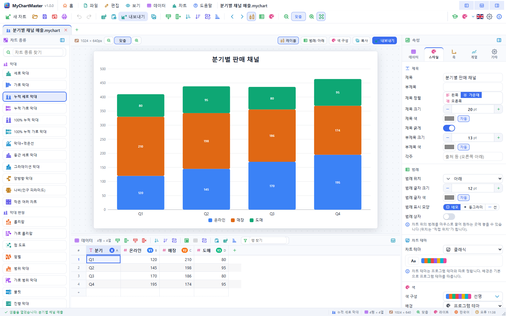

- **제목**: 제목, 부제목, 정렬(왼쪽 · 가운데 · 오른쪽), 각주(출처 등, 오른쪽 아래).
- **범례**: 위 · 아래 · 왼쪽 · 오른쪽 · 숨김. 툴바의 범례 단추(Ctrl+Shift+G)는 차례로 바꿉니다.
- **색**: 색 구성(20가지: 선명 · 오피스 · 태블로 · 기본 10색 · 파스텔 · 대지 · 바다 · 노을 · 숲 · 베리 · 네온 ·
  단색 파랑 · 회색조 · 따뜻한 · 차가운 · 색각 친화 · 레트로 · 비즈니스 · 사탕 · 밤하늘), 배경(흰색 · 테마 색 ·
  투명 · 직접 고른 색), 테두리.
- **글자**: 글자 크기 배율(0.6×–2×), 글꼴(비우면 기본 글꼴).

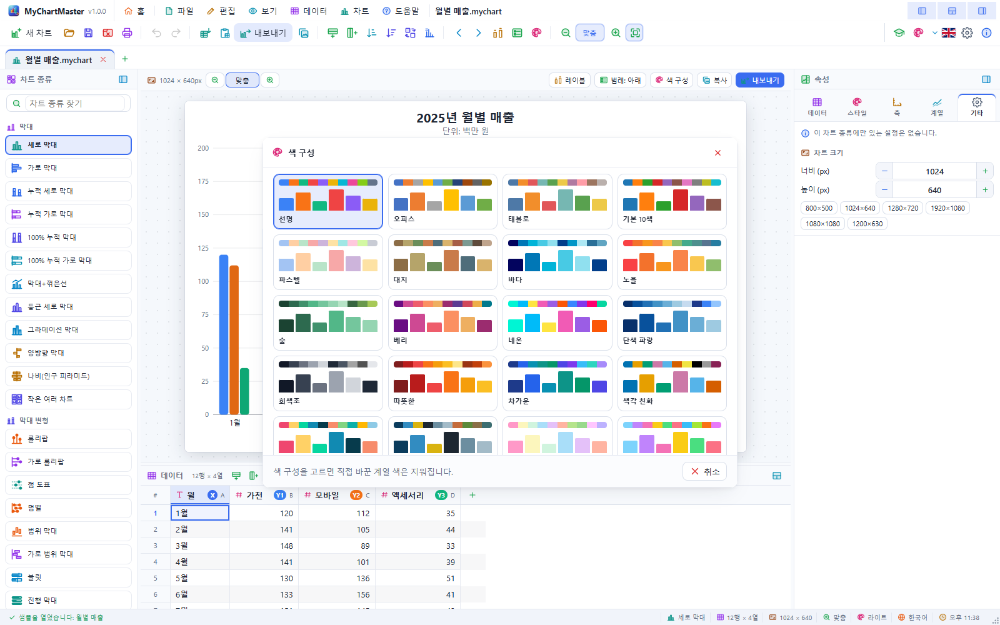

###### 세밀한 모양 (스타일 탭)

- **제목**: 제목·부제목의 크기, 색, 굵게.
- **범례**: 위치(위·아래·왼쪽·오른쪽·**직접 위치**·숨김), 직접 위치의 가로·세로(%), 글자 크기·색, 표시 모양(네모·동그라미·선),
  범례 상자. 차트 위의 범례를 **마우스로 끌면** 그 자리로 옮겨집니다(직접 위치).
- **그림 영역**: 배경 색, 테두리, 바깥 여백. **글자**: 차트 안 글자 크기와 색.
- 색 칸 옆의 **자동**을 누르면 차트 테마·프로그램 테마를 따르는 색으로 돌아갑니다.
- 모든 수치는 **[−] 값 단위 [+]** 입력칸입니다. 단추를 누르고 있으면 계속 바뀌고, 값을 직접 쳐도 됩니다. 비워 두면 "자동"인
  칸(최솟값·최댓값·눈금 간격 등)도 있습니다.

##### 축 탭

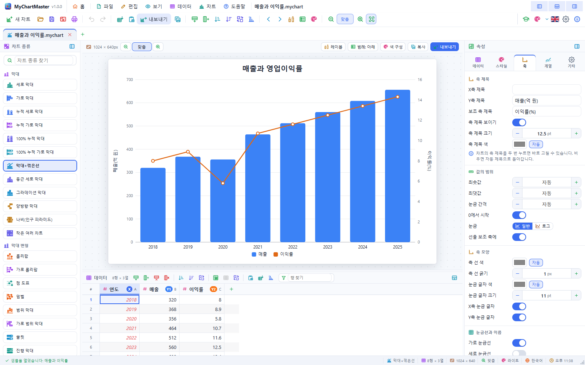

- **축 제목**: X축 · Y축 제목, 막대+꺾은선의 보조 축 제목. 분산형 · 거품형은 X축 제목이 비어 있으면 X 열 이름을 씁니다.
- **값의 범위**: 최솟값 · 최댓값(비우면 자동), 0에서 시작, 눈금(일반 · 로그), 선을 보조 축에(막대+꺾은선).
- **눈금선과 이름**: 가로 · 세로 눈금선, 항목 이름 각도(자동이면 겹칠 때 45° · 90°로 눕히고 그래도 많으면 건너뜀).
- **숫자 형식**: 자동 · 일반 숫자 · 간단히(1.2만) · 백분율 · 지수 표기, 소수 자릿수, 앞에 붙일 글자(₩, $),
  뒤에 붙일 글자(%, °C, kg). 레이블 · 눈금 · 값 풍선 모두에 쓰입니다.

축이 없는 차트(원형 · 트리맵 · 생키 등)에서는 숫자 형식만 나옵니다.

###### 축 모양 (축 탭)

- **축 제목**: X·Y(보조 축) 제목, 보이기, 크기, 색. 차트의 축 제목을 **두 번 누르면** 바로 고칠 수 있습니다(비우면 자동 제목).
- **값의 범위**: 최솟값, 최댓값, **눈금 간격**, 0에서 시작, 일반·로그 눈금.
- **축 모양**: 축 선 색·굵기, 눈금 글자 색·크기, X축·Y축 눈금 글자 보이기.
- **눈금선**: 가로·세로 눈금선, 격자 색·굵기·선 모양(차트 테마대로·실선·파선·점선), 항목 이름 각도.

##### 계열 탭

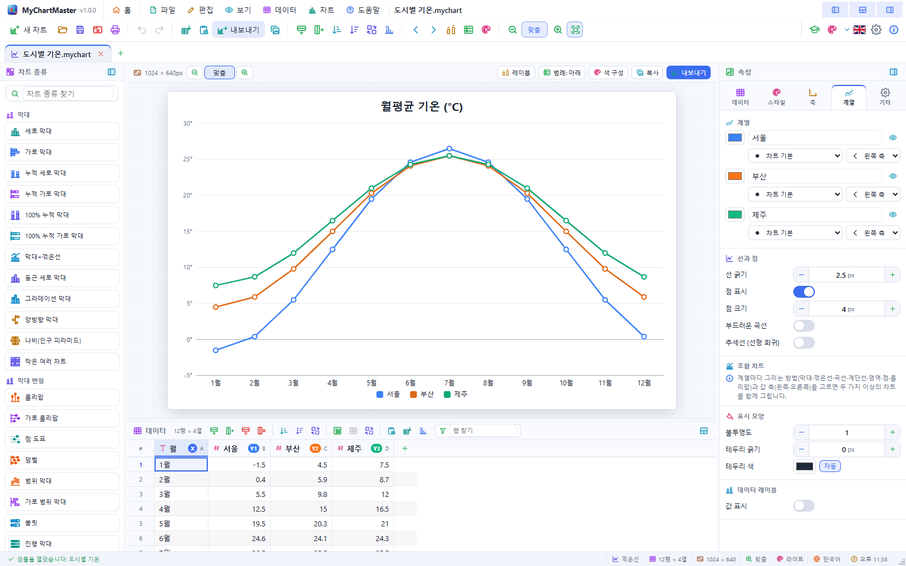

- **계열**(원형 계열은 **조각**): 색 고르기, 이름(= 열 이름) 바꾸기, 보이기/숨기기, 팔레트 색으로 되돌리기.
- **선과 점**: 선 굵기, 점 표시, 점 크기, 부드러운 곡선, 영역 불투명도, **추세선**(선형 회귀; 마우스를 올리면
  식과 R²).
- **막대**: 모서리 둥글기, 막대 사이 간격.
- **데이터 레이블**: 값 표시, 원형의 레이블 위치(바깥: 이름과 비율 / 안쪽: 비율).

###### 조합 차트 (계열 탭)

계열마다 **그리는 방법**(차트 기본·세로 막대·꺾은선·곡선·계단선·영역·점·롤리팝)과 **값 축**(왼쪽·오른쪽)을 고르면 두 가지
이상의 차트를 한 차트에 함께 그립니다(예: 막대 + 꺾은선 + 영역, 오른쪽 보조 축). 세로 막대·꺾은선·곡선·계단선·영역·막대+꺾은선·
롤리팝 차트에서 조합할 수 있고, 원형·누적·가로 막대처럼 조합할 수 없는 차트에서 고르면 그 이유를 알려 주는 창이 뜹니다.
**조합 지우기**로 원래대로 돌아갑니다. **표시 모양**에서는 모든 표시의 불투명도, 테두리 굵기·색을 정합니다.

###### 오른쪽 클릭 메뉴

누른 곳에 맞는 메뉴가 뜹니다. 범례(계열 숨기기·색·범례 위치·범례 상자), 축 제목(제목 고치기·보이기·축 설정), 축·눈금(축 설정·
눈금선·눈금 글자), 제목(제목 고치기·제목 모양), 표시(계열 숨기기·색·그리는 방법·레이블·추세선), 빈 곳(차트 전체). 차트·표·탭의
메뉴에는 언제나 **복사 · 내보내기 · 인쇄**가 들어 있습니다.

##### 기타 탭

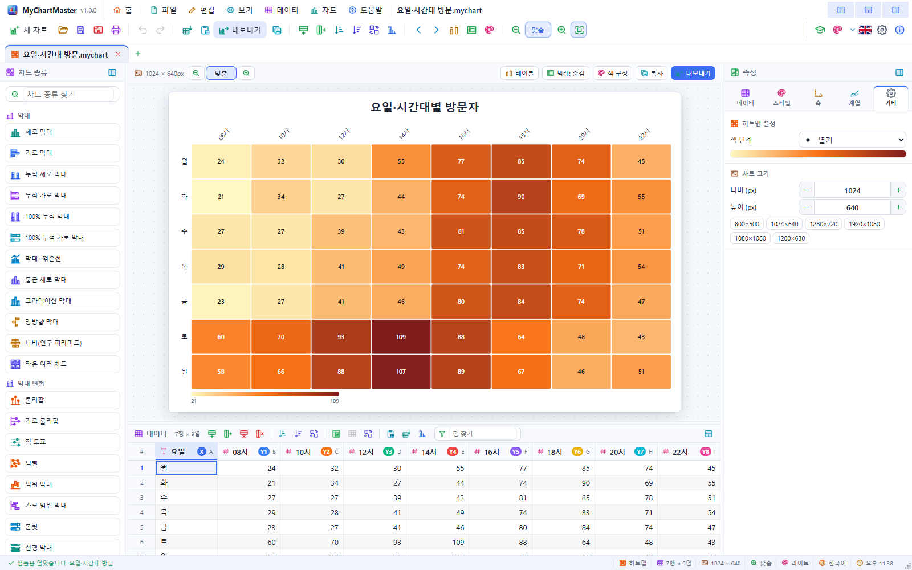

종류에만 있는 설정: 도넛의 구멍 크기, 원형 · 극좌표 · 선버스트의 시작 각도, 조각 사이 간격, 히스토그램의
구간 수, 히트맵의 색 단계(파랑 · 초록 · 빨강 · 보라 · 주황 · 비리디스 · 발산 · 열기), 게이지의 최솟값 · 최댓값,
폭포의 합계 막대, 증가 · 감소 색. 그리고 **차트 크기**(너비 · 높이 픽셀, 자주 쓰는 크기 단추). 차트 크기는
내보내기의 기본 크기가 됩니다.

#### 데이터 가져오기

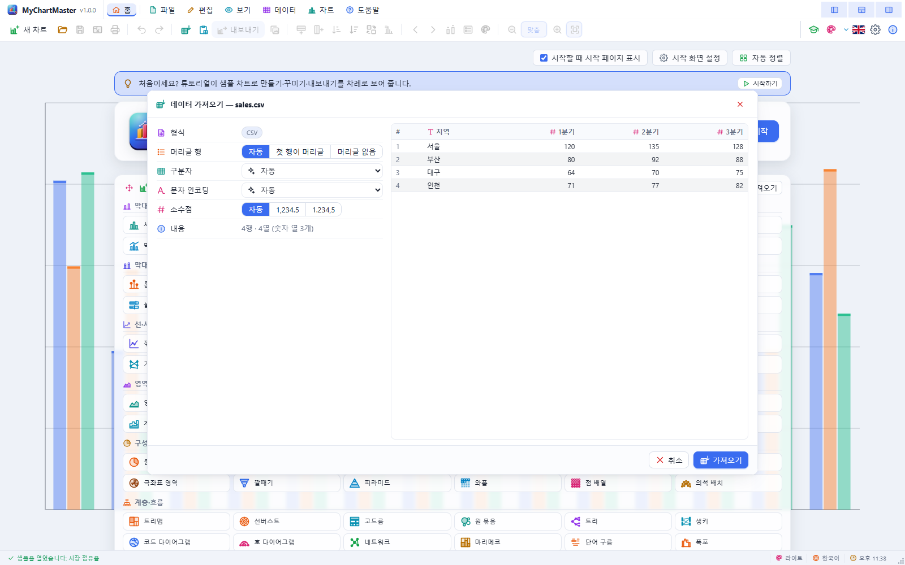

**데이터 › 데이터 가져오기**(Ctrl+I)로 파일을 고르면 미리 보기 창이 열립니다.

| 형식 | 확장자 | 메모 |
| --- | --- | --- |
| CSV · 텍스트 | .csv .txt .dat .prn | 구분자 자동(쉼표 · 세미콜론 · 탭 · 세로 막대 · 공백), 따옴표 안의 쉼표와 줄 바꿈, 첫 줄 `sep=;` |
| TSV | .tsv .tab | 탭 구분 |
| Excel | .xlsx .xlsm | 시트 선택, 공유 문자열, 날짜 서식, A1이 아닌 곳에서 시작하는 표 |
| OpenDocument | .ods | 시트 선택, 반복된 행 · 칸 |
| JSON | .json .geojson | 객체 배열, 배열의 배열, `{columns, rows}`, Chart.js `{labels, datasets}`, 열 객체 `{A:[…]}`, `{이름: 값}`, `data`/`values`/`records` 감싸기, GeoJSON 속성, 중첩 객체(a.b) |
| XML | .xml | 가장 많이 반복되는 요소를 행으로, 속성과 자식 요소를 열로 |
| HTML | .html .htm | 페이지 안의 표마다 하나(시트처럼 고름), colspan |
| Markdown | .md | 파이프 표, 위의 제목이 표 이름 |
| MyChartMaster | .mychart | 차트 그대로 열림 |

미리 보기 창의 선택(바꾸면 미리 보기가 바로 바뀜):

- **시트 / 표**: 여러 시트(또는 표)가 있을 때.
- **머리글 행**: 자동(첫 행이 모두 글자이고 아래에 숫자가 있으면 머리글) · 첫 행이 머리글 · 머리글 없음(A, B, C…).
- **구분자**, **문자 인코딩**(자동: UTF-8, 아니면 EUC-KR(CP949), 그다음 Windows-1252; BOM이 있으면 UTF-16도),
  **소수점**(자동 · `1,234.5` · `1.234,5`).
- **가져올 곳**: 새 차트, 또는 지금 차트의 데이터 바꾸기(차트 설정은 그대로).

가져온 데이터에 맞춰 차트 종류를 짐작합니다: 글자 열 없이 숫자 열만 둘 이상이면 분산형, 행이 많으면 꺾은선,
값이 하나뿐이고 행이 적으면 원형, 그 밖은 세로 막대.

그 밖의 방법:

- **열기**(Ctrl+O)로 데이터 파일을 열면 미리 보기 없이 기본 설정(설정 › 데이터 가져오기)으로 새 차트가 됩니다.
- 파일을 창에 **끌어다 놓기**.
- **붙여넣어 새 차트**(Ctrl+Shift+V): 클립보드의 표(엑셀 범위, CSV, Markdown 표, HTML 표, JSON)로 새 차트.
- 데스크톱에서는 파일 탐색기의 **연결 프로그램**으로 열 수도 있습니다(.mychart는 설치 때 연결됨).

#### 저장과 내보내기

- **저장**(Ctrl+S) · **다른 이름으로 저장**(Ctrl+Shift+S): `.mychart` 파일(JSON)에 데이터와 차트 설정을 함께
  저장합니다. 데이터 파일에서 만든 차트는 처음 저장할 때 위치를 묻습니다.

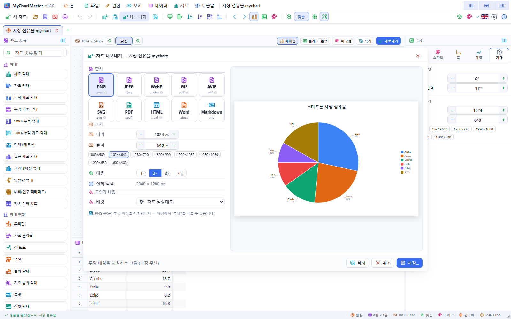

**파일 › 내보내기**(Ctrl+E)는 미리 보기가 있는 창을 엽니다.

| 형식 | 내용 | 투명 배경 |
| --- | --- | --- |
| PNG | 가장 무난한 그림 | 가능 |
| JPEG | 사진용 압축 그림 · 품질 | 없음(흰색) |
| WebP | 작은 웹 그림 · 품질 | 가능 |
| GIF | 256색 그림 | 가능(가장자리는 계단 모양) |
| AVIF | 가장 작은 최신 그림(데스크톱은 프로그램이 직접 인코딩) · 품질 | 가능 |
| SVG | 벡터 그림(확대해도 선명; 마우스를 올리면 값) | 가능 |
| PDF | 1쪽은 차트, 다음 쪽은 데이터 표 · 용지 · 방향 | 없음(흰색) |
| HTML | 차트(값 풍선이 뜨는 웹 페이지) + 데이터 표 | 가능 |
| Word (.docx) | 차트 그림 + 데이터 표 | 없음(흰색) |
| Markdown | 그림이 든 Markdown + 데이터 표 | 없음(흰색) |

크기(너비 · 높이, 자주 쓰는 크기), 배율(1×–4×; 실제 픽셀이 표시됨), 배경(차트 설정대로 · 프로그램 테마 · 흰색, 그리고 투명 배경을 지원하는 형식에서는 **투명**; 형식 단추의 작은
체크무늬 표시가 투명 배경 가능을 뜻하고, 투명을 고른 채 JPEG 등으로 바꾸면 흰색이 되었다가 다시 돌아오면 투명으로 돌아갑니다), 데이터 표 함께 넣기를 고릅니다. **복사**는 그 설정으로 그림을 클립보드에 넣습니다.
곧바로 쓰려면 **파일 › 형식 지정 내보내기**에서 형식을 고르세요.

- **그림 복사**(Ctrl+Shift+C): 차트를 PNG로 클립보드에 복사합니다(그림을 받을 수 없는 환경이면 SVG 코드).
- **편집 › 복사**: SVG 코드 복사, 표 전체 복사(탭 구분), 선택한 셀 복사.
- **파일 › 데이터 내보내기**: CSV(쉼표, 엑셀용 BOM), TSV, JSON(객체 배열), Markdown 표, HTML 표, Excel(xlsx).

#### 인쇄

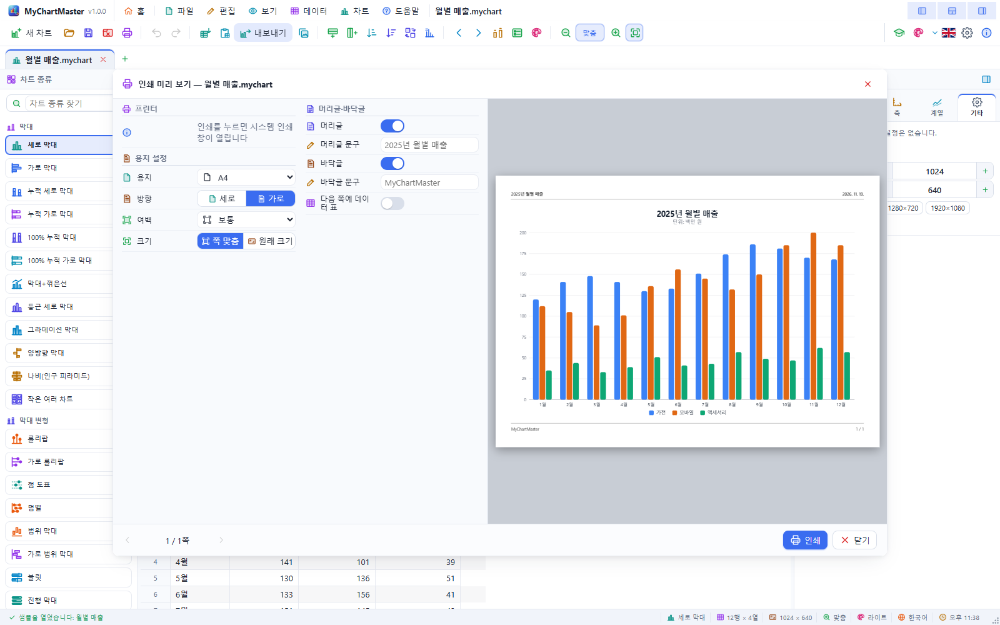

**파일 › 인쇄**(Ctrl+P)는 자체 창을 엽니다: 프린터와 매수(Windows), 용지(A3 · A4 · A5 · B4 · B5 · Letter · Legal ·
Tabloid), 방향, 여백, 크기(쪽에 맞춤 · 원래 크기), 머리글 · 바닥글과 그 글, 다음 쪽에 데이터 표.
오른쪽은 쪽 미리 보기이고, **인쇄**를 누르면 시스템 창 없이 고른 프린터로 바로 인쇄합니다(프린터 목록이 없는
환경에서는 시스템 인쇄 창). 웹에서는 브라우저의 인쇄 창이 열립니다.

#### 설정

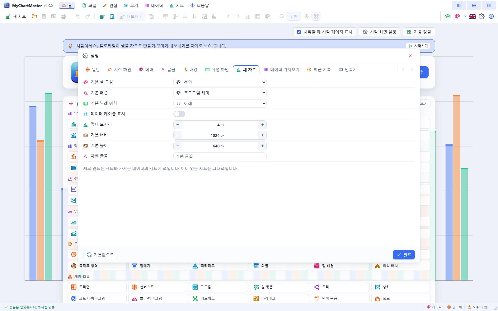

**편집 › 설정**(Ctrl+Shift+P)의 탭:

- **일반**: 언어, 시작할 때 지난번 파일 다시 열기, 행·열 지우기 전에 묻기, 상태 표시줄 시계, 상태 표시줄, 튜토리얼.
- **시작 화면**: 시작할 때 시작 화면 · 환영 창, 최근 파일 · 폴더 · 샘플 · 배경 카드, 튜토리얼 안내.
- **테마**: 밝은 · 어두운 테마, 직접 만드는 테마(색 고르기, 대비 확인).
- **글꼴**: 화면 글꼴, 크기, 굵기, 기울임, 화면 배율.
- **배경**: 움직이는 배경 · 그림 · 없음, 종류, 속도, 불투명도, 그림 맞추기.
- **작업 화면**: 표 위치, 세 패널 보이기, 표 행 높이, 차트 값 풍선, 차트가 나타날 때 움직임.
- **새 차트**: 기본 색 구성, 배경, 범례 위치, 데이터 레이블, 막대 모서리, 너비 · 높이, 차트 글꼴.
- **데이터 가져오기**: 머리글 행, 구분자, 인코딩, 소수점, 가져올 최대 행 수.
- **최근 기록**: 최근 파일 · 폴더 목록 관리.
- **단축키**: 모든 바로 가기 키 목록.

**테마**는 툴바의 팔레트 단추(무작위) · 옆 화살표(고르기) · 상태 표시줄에서, **언어**는 툴바의 국기 단추나
Ctrl+Shift+L로 바꿉니다(한국어 ↔ English). 차트 배경을 "테마 색"으로 하면 차트도 테마를 따릅니다.

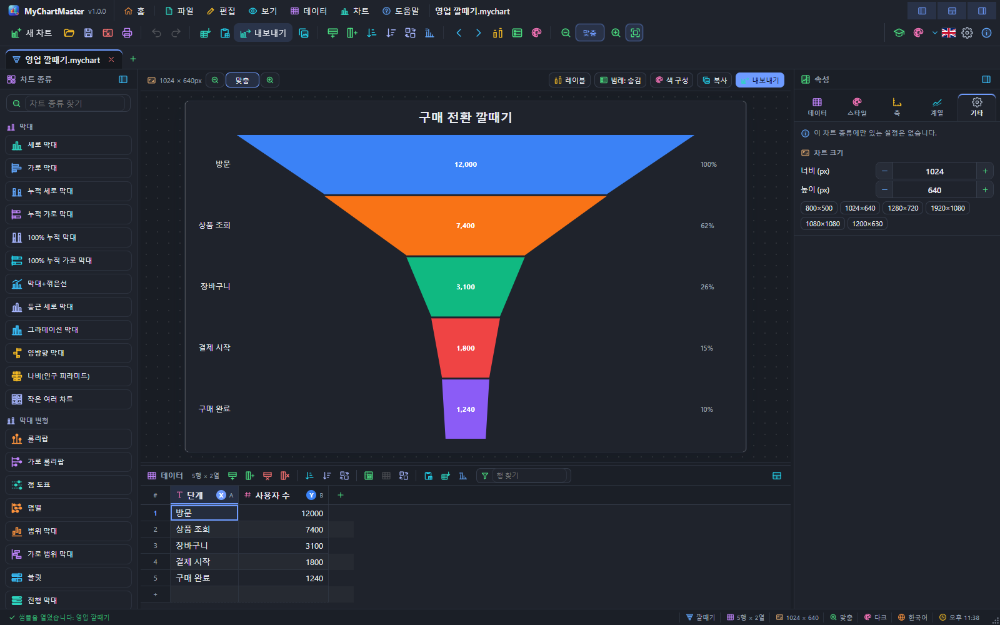

#### 바로 가기 키

| 키 | 하는 일 |
| --- | --- |
| Ctrl+N | 새 차트 |
| Ctrl+O | 열기 |
| Ctrl+S / Ctrl+Shift+S | 저장 / 다른 이름으로 저장 |
| Ctrl+W | 차트 닫기 |
| Ctrl+P | 인쇄 |
| Ctrl+I | 데이터 가져오기 |
| Ctrl+E | 내보내기 |
| Ctrl+Shift+C | 차트 그림 복사 |
| Ctrl+Shift+V | 붙여넣어 새 차트 |
| Ctrl+Z / Ctrl+Y (Ctrl+Shift+Z) | 실행 취소 / 다시 실행 |
| Ctrl+Enter / Ctrl+Shift+Enter | 행 추가 / 열 추가 |
| Ctrl+Shift+T | 행과 열 바꾸기 |
| Ctrl+Shift+R | 선택 영역으로 차트 그리기 |
| Ctrl+Shift+I | 데이터 통계 |
| Ctrl+L | 데이터 레이블 |
| Ctrl+Shift+G | 범례 위치 바꾸기 |
| Ctrl+K | 색 구성 |
| Ctrl+[ / Ctrl+] | 이전 / 다음 차트 종류 |
| Ctrl+= / Ctrl+- / Ctrl+0 | 확대 / 축소 / 창에 맞춤 |
| Ctrl+Shift+1 / Ctrl+J / Ctrl+Shift+2 | 차트 종류 / 데이터 표 / 속성 패널 |
| Ctrl+Tab | 다음 차트 |
| Ctrl+Shift+L | 언어 전환 |
| Ctrl+Shift+H | 시작 화면 |
| Ctrl+Shift+P | 설정 |
| F11 | 튜토리얼 |
| F1 | 프로그램 정보 |
| 화살표 · Tab · Enter · F2 · Delete · Ctrl+C · Ctrl+V | 데이터 표에서 이동 · 편집 · 지우기 · 복사 · 붙여넣기 |

#### 파일 형식

`.mychart`는 UTF-8 JSON입니다:

```json
{
  "format": "mychart", "version": 1, "app": "MyChartMaster",
  "created": "…", "modified": "…",
  "chart": { "type": "column", "title": "…", "subtitle": "…",
             "mapping": { "category": 0, "values": [1, 2] },
             "options": { "palette": "vivid", "legend": "bottom", "width": 1024, "height": 640, "…": "…" } },
  "data": { "columns": [{ "name": "월", "type": "text" }, { "name": "가전", "type": "number" }],
            "rows": [["1월", 120], ["2월", 141]] }
}
```

`mapping`의 숫자는 `data.columns`의 위치(0부터)입니다. 설치 폴더(웹 버전은 저장소)의 `samples/`에 샘플 31개가
`.mychart`로, `samples/data/`에 같은 표를 CSV · TSV · JSON · Excel · Markdown · HTML · XML로 담은 파일이 있습니다.

#### 문제 해결

| 증상 | 해결 |
| --- | --- |
| 한글이 깨져 보입니다 | 가져오기 창에서 문자 인코딩을 EUC-KR(CP949) 또는 UTF-8로 바꿔 보세요. |
| 숫자가 글자로 들어옵니다 | 소수점(쉼표/마침표)을 맞추거나, 열 머리글 오른쪽 클릭 › 열 형식 › 숫자. |
| 머리글이 데이터로 들어옵니다 | 가져오기 창의 머리글 행을 "첫 행이 머리글"로. |
| 차트에 "숫자 열을 고르세요"가 보입니다 | 속성 › 데이터 탭에서 값 계열(숫자 열)을 하나 이상 체크하세요. |
| 내보낸 JPEG · PDF의 배경이 흰색입니다 | 그 형식에는 투명이 없습니다. 투명이 필요하면 PNG · WebP · AVIF · SVG. |
| 웹에서 AVIF가 안 됩니다 | 브라우저에 AVIF 인코더가 없으면 데스크톱 프로그램을 쓰세요. |
| 그림 복사가 SVG 글로 들어갑니다 | 클립보드가 그림을 받지 못하는 환경입니다. 내보내기의 PNG를 쓰세요. |

#### 설치와 빌드

- 웹: `npm install` 뒤 `npm run dev`(개발 서버 `http://localhost:1476`) 또는 `npm run build:webapp`.
- 데스크톱 개발 실행: `npm start`.
- Windows 설치: 설치 프로그램은 맨 먼저 **설치 언어** 창(제목 "MyChartMaster 1.0.0", 제목 표시줄에 프로그램 아이콘)을 띄웁니다.
  한국어나 영어를 고르고 확인을 누르면 설치가 그 언어로 진행되고, 설치한 뒤 처음 실행할 때 프로그램도 그 언어로 열립니다(나중에
  설정에서 바꾼 언어는 그대로 유지). 취소를 누르면 아무것도 바꾸지 않고 끝납니다.
- 설치 파일: `npm run build:win`(NSIS .exe) · `npm run build:mac`(.dmg) · `npm run build:linux`(.deb · .rpm · .AppImage) ·
  `npm run build:all`(이 OS가 만들 수 있는 전부). 만든 설치 파일은 `release/`와 프로젝트 루트에 복사됩니다.
- 테스트: `npm test`(단위 · 텍스트 · Rust · 웹 E2E · 튜토리얼 · 데스크톱 E2E + 설치 언어 창), 빠르게는 `npm run test:quick`. 결과는
  열을 맞춘 색 표(분류별 통과 · 실패 · 건너뜀 · 합계 · 통과율 막대 · 시간)로 요약됩니다.
- 설치는 한 번에 하나만: 새로 설치하면 이전 설치를 지우고, 이전 사용자 데이터를 지울지 묻습니다.
  프로그램은 여러 개를 동시에 띄울 수 있습니다.

---

<!-- lang:en -->

## English

### MyChartMaster User's Guide

MyChartMaster draws tables of data as 108 kinds of chart. Type data into the grid or import it from CSV, TSV, Excel
(xlsx), OpenDocument (ods), JSON, XML, HTML and Markdown files; choose the chart type and refine titles, axes, legends,
labels and palettes; then export PNG, JPEG, WebP, GIF, AVIF or SVG pictures, PDF, HTML, Word or Markdown documents,
or CSV and Excel data, and print. It runs in a web browser and as a desktop program on Windows, macOS and Linux.

This guide covers every part of the program. To try the features hands-on, follow the [tutorial](doc/Tutorial.en.md).
한국어 설명서는 [UserGuide.md](doc/UserGuide.md)입니다.

> Every picture in this guide was taken from the program itself (web version, 1600 × 1000 window, *Light* theme)
> with the bundled sample charts. The desktop program looks the same, with window buttons at the right of the title row.

#### At a glance

| Part | Contents |
| --- | --- |
| [Start page](#start-page) | New chart, recent items, shortcuts, samples, theme, moving background |
| [Main window](#main-window) | Title row, menus, toolbar, tabs, status bar |
| [The chart view](#the-chart-view) | Chart types panel, chart, data grid, properties panel |
| [Chart types](#chart-types) | The 108 charts, the columns each uses, chart themes |
| [The data grid](#the-data-grid) | Editing, pasting, rows and columns, sorting, statistics |
| [Properties panel](#properties-panel) | Data, Style, Axes, Series and More tabs |
| [Importing](#importing-data) | File formats, preview, sheets, encodings |
| [Saving and exporting](#saving-and-exporting) | .mychart, pictures, documents, data |
| [Printing](#printing) | Paper, preview, printing at once |
| [Settings](#settings) | Settings tabs, themes, language |
| [Reference](#keyboard-shortcuts) | Shortcuts, file format, troubleshooting, building |

#### Start page

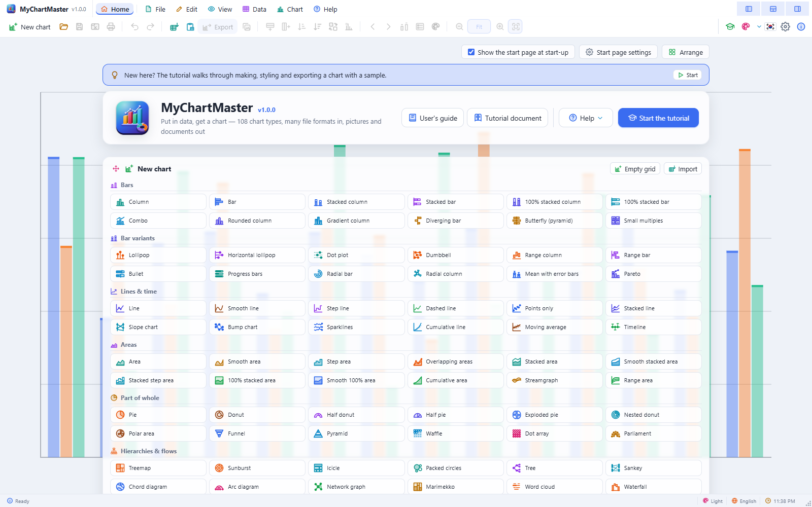

The program opens on the start page. Behind it runs a moving background made of charts (bars, lines, pies, scatter,
candles, heat map, Sankey, dashboard … twenty in all), and translucent cards sit on top.

- **Program card** (top, fixed): name and version, the user's guide and tutorial document, the Help menu and
  **Start tutorial**. This card cannot be moved or resized.
- **New chart**: a card across the whole row with the 108 chart types in nine groups of twelve (Bars, Bar variants, Lines & time, Areas, Part of whole, Hierarchies & flows, Distribution, Correlation & comparison, Finance, plans & KPIs) as one-line buttons: icon and name side by side, left-aligned, a different icon for every type. The buttons sit 6, 4, 3 or 2 to a row by the card's width, so no row is left half empty. The **Recent** card sits right under it.
  A tile opens a new chart of that type with example data. **Empty grid** in the card's title starts from an empty
  table, **Import** from a data file.
- **Recent items**: recently opened files and folders. × removes one; right-click copies the path.
- **Shortcuts**: open, new chart, import data, paste as new chart, tutorial, theme, language, settings, about, exit.
- **Sample charts**: 31 samples from business, finance, science and society. Every other type opens with example data of its own shape as a new chart.
- **Theme**: pick a light or a dark theme at once.
- **Moving background**: 20 backgrounds, shuffle, a background picture, speed, card opacity, automatic change.

Drag a card by its handle (top left) and resize it by its corner (bottom right); **Arrange** puts them back.
The **Home** button in the title row (Ctrl+Shift+H) opens the start page at any time; press it again to go back.

#### Main window

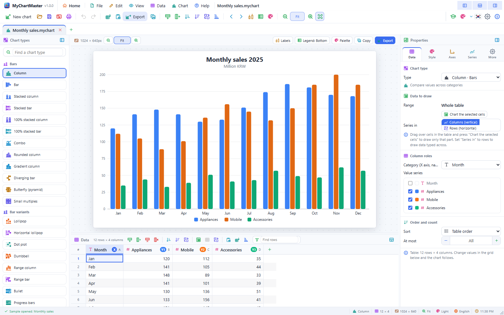

- **Title row**: the program icon and name, Home, the menus (File, Edit, View, Data, Chart, Help), the open chart's
  name (● when unsaved), three panel buttons (chart types, data grid, properties), and on the desktop the window
  buttons. Drag an empty part to move the window; double-click to maximize.
- **Toolbar**: new chart, open, save, close, print / undo, redo / import, paste, **Export**, copy picture / add row
  and column, sort, swap rows and columns, statistics / previous and next chart type, data labels, legend, palette /
  zoom out, zoom, zoom in, fit. On the right: tutorial, theme, language, settings, about. The window's minimum width
  follows the toolbar, so no button is ever cut off.
- **Tabs**: one per open chart; the icon shows the chart type, ● unsaved changes. Right-click to close others,
  save, duplicate, export or print. Ctrl+Tab goes to the next tab.
- **Status bar**: notices, chart type, table size (rows × columns), chart size (pixels), zoom, modified, theme,
  language, clock.

#### The chart view

A chart tab has four parts.

| Part | What it does |
| --- | --- |
| Chart types panel (left) | The 108 types by group. Click one and the same data is drawn as that type. The box at the top finds a type by name. |
| Chart (centre) | The picture. The bar above shows the size and zoom, and buttons for labels, legend, palette, copy and export. |
| Data grid (below or right) | The chart's data. Change it and the chart follows at once. |
| Properties panel (right) | Every setting of the chart (Data, Style, Axes, Series, More). |

On the chart you can:

- point at a bar, point or slice to see a **value tip** (can be turned off in Settings);
- click a bar or point to **select its series** (thick outline) and go to its row in the grid; click empty space to clear it;
- click a **legend entry** to hide or show that series (or that slice of a pie);
- **double-click the title** (or the subtitle) to edit it; double-click an axis title to open the Axes tab;
- zoom with **Ctrl + mouse wheel**, and **Fit** (Ctrl+0) to fit the window;
- right-click for title, labels, legend, grid lines, trend line, palette, background, reset formatting, copy, export,
  print, and on a series: hide series, series colour.

Drag the borders to resize the panels; fold and unfold them with the buttons in their title rows or with Ctrl+Shift+1
(chart types), Ctrl+J (data grid) and Ctrl+Shift+2 (properties). **View › Panels** puts the grid below the chart, on
its right, or hides it (chart only).

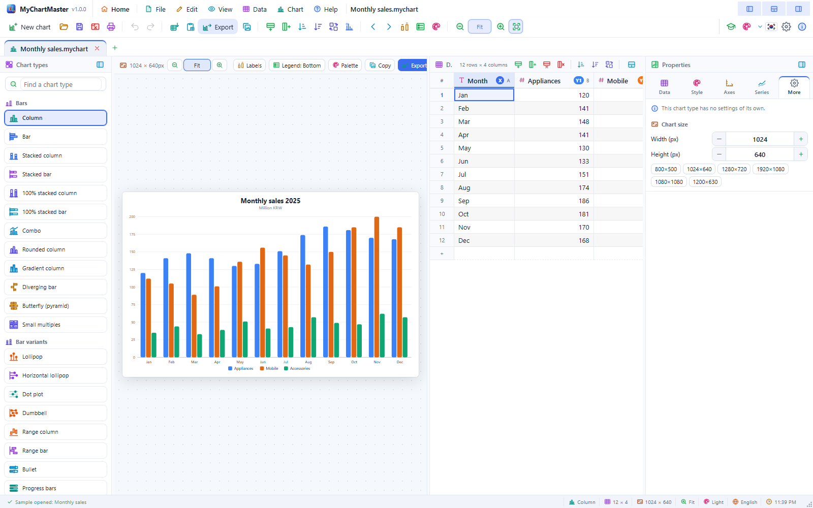

#### Chart types

| Group | Type | What it shows | Columns |
| --- | --- | --- | --- |
| Bars | Column | Compare values across categories | category + several value series |
| Bars | Bar | Compare categories with long names | category + several value series |
| Bars | Stacked column | Totals and their parts | category + several value series |
| Bars | Stacked bar | Parts stacked sideways | category + several value series |
| Bars | 100% stacked column | Share within each category | category + several value series |
| Bars | 100% stacked bar | Shares, sideways | category + several value series |
| Bars | Combo | First series as bars, the rest as lines | category + several value series |
| Bars | Rounded column | Columns with round tops | category + several value series |
| Bars | Gradient column | Columns shaded top to bottom | category + several value series |
| Bars | Diverging bar | Positive and negative in two colours | category + one value |
| Bars | Butterfly (pyramid) | Two series back to back | category + several value series |
| Bars | Small multiples | One small chart per series | category + several value series |
| Bar variants | Lollipop | Bars drawn as dots on sticks | category + several value series |
| Bar variants | Horizontal lollipop | Lollipops lying down | category + several value series |
| Bar variants | Dot plot | Only the dots, no bars | category + several value series |
| Bar variants | Dumbbell | The gap between two values | category + several value series |
| Bar variants | Range column | From a low to a high value | category + low · high |
| Bar variants | Range bar | Ranges sideways | category + low · high |
| Bar variants | Bullet | Actual against a target, with bands | category + actual (+ target) |
| Bar variants | Progress bars | Progress toward a maximum | category + one value |
| Bar variants | Radial bar | Bars bent into rings | category + one value |
| Bar variants | Radial column | Columns around a circle | category + several value series |
| Bar variants | Mean with error bars | Mean ± standard deviation per column | several number columns (one distribution each) |
| Bar variants | Pareto | Sorted bars and a cumulative share | category + one value |
| Lines & time | Line | Change over time | category + several value series |
| Lines & time | Smooth line | A smoothed line | category + several value series |
| Lines & time | Step line | Changes as steps | category + several value series |
| Lines & time | Dashed line | Trends in dashes | category + several value series |
| Lines & time | Points only | Points without lines | category + several value series |
| Lines & time | Stacked line | Lines stacked up | category + several value series |
| Lines & time | Slope chart | Change between two points in time | category + several value series |
| Lines & time | Bump chart | Rankings over time | category + several value series |
| Lines & time | Sparklines | One mini line per series | category + several value series |
| Lines & time | Cumulative line | Running totals | category + several value series |
| Lines & time | Moving average | Values with a moving average | category + several value series |
| Lines & time | Timeline | Events in time order | date (category) + event |
| Areas | Area | Change and volume together | category + several value series |
| Areas | Smooth area | A smoothed area | category + several value series |
| Areas | Step area | An area in steps | category + several value series |
| Areas | Overlapping areas | Light areas drawn over each other, with points | category + several value series |
| Areas | Stacked area | Areas stacked up | category + several value series |
| Areas | Smooth stacked area | Smoothed areas stacked up | category + several value series |
| Areas | Stacked step area | Areas stacked in steps | category + several value series |
| Areas | 100% stacked area | Shares over time | category + several value series |
| Areas | Smooth 100% area | Smoothed shares of the whole | category + several value series |
| Areas | Cumulative area | Running totals as areas | category + several value series |
| Areas | Streamgraph | Stacked areas around a centre | category + several value series |
| Areas | Range area | A band between low and high | category + low · high |
| Part of whole | Pie | Share of a whole | category + one value |
| Part of whole | Donut | Pie with the total in the middle | category + one value |
| Part of whole | Half donut | Shares on a half ring | category + one value |
| Part of whole | Half pie | A pie cut in half | category + one value |
| Part of whole | Exploded pie | Slices pulled apart | category + one value |
| Part of whole | Nested donut | One ring per series | category + several value series |
| Part of whole | Polar area | Equal angles, radius by value | category + one value |
| Part of whole | Funnel | Stages that narrow | category + one value |
| Part of whole | Pyramid | Stages widening downwards | category + one value |
| Part of whole | Waffle | Shares in a 10 × 10 grid | category + one value |
| Part of whole | Dot array | Shares as 100 dots | category + one value |
| Part of whole | Parliament | Seats on a half circle | category + one value |
| Hierarchies & flows | Treemap | Areas by size, grouped | (group) + category + one value |
| Hierarchies & flows | Sunburst | A hierarchy as rings | (group) + category + one value |
| Hierarchies & flows | Icicle | A hierarchy as stacked layers | (group) + category + one value |
| Hierarchies & flows | Packed circles | Circles sized by value, packed | (group) + category + one value |
| Hierarchies & flows | Tree | Branches from groups to items | (group) + category + one value |
| Hierarchies & flows | Sankey | Flows from sources to targets | source · target · amount |
| Hierarchies & flows | Chord diagram | Flows across a circle | source · target · amount |
| Hierarchies & flows | Arc diagram | Arcs between points on a line | source · target · amount |
| Hierarchies & flows | Network graph | Nodes and links | source · target · amount |
| Hierarchies & flows | Marimekko | Width by total, height by share | category + several value series |
| Hierarchies & flows | Word cloud | Bigger words for bigger values | category + one value |
| Hierarchies & flows | Waterfall | How increases and decreases add up | category + one value |
| Distribution | Histogram | How values spread | several number columns (one distribution each) |
| Distribution | Cumulative histogram | Counts up to the end of each bin | several number columns (one distribution each) |
| Distribution | Frequency polygon | Bin counts as a line | several number columns (one distribution each) |
| Distribution | Dot histogram | One dot per value, stacked in bins | several number columns (one distribution each) |
| Distribution | Box plot | Median, quartiles and outliers | several number columns (one distribution each) |
| Distribution | Violin | The shape of each distribution | several number columns (one distribution each) |
| Distribution | Ridgeline | Distribution curves stacked like ridges | several number columns (one distribution each) |
| Distribution | Strip plot | One dot per value | several number columns (one distribution each) |
| Distribution | Beeswarm | Dots spread so they do not overlap | several number columns (one distribution each) |
| Distribution | Rug plot | A short tick per value | several number columns (one distribution each) |
| Distribution | Density | Smooth distribution curves | several number columns (one distribution each) |
| Distribution | Cumulative distribution | Share of values at or below | several number columns (one distribution each) |
| Correlation & comparison | Scatter | Relation of two values | X values + Y series (+ label) |
| Correlation & comparison | Connected scatter | Points joined in order | X values + Y series (+ label) |
| Correlation & comparison | Regression scatter | Points with a regression line | X values + Y series (+ label) |
| Correlation & comparison | Quadrant | Four areas split at the means | X values + Y series (+ label) |
| Correlation & comparison | Bubble | A third value as size | X · Y · size (+ label, group) |
| Correlation & comparison | Heatmap | A table shaded by value | category + several value series |
| Correlation & comparison | Punch card | A table of sized dots | category + several value series |
| Correlation & comparison | Calendar heatmap | Daily values on a calendar | category + one value |
| Correlation & comparison | Correlation matrix | Correlation between number columns | several number columns (one distribution each) |
| Correlation & comparison | Scatter matrix | Every pair of number columns | several number columns (one distribution each) |
| Correlation & comparison | Radar | Several measures at a glance | category + several value series |
| Correlation & comparison | Radar lines | Radar without fill | category + several value series |
| Finance, plans & KPIs | Candlestick | Open, high, low, close | date + open · high · low · close |
| Finance, plans & KPIs | OHLC bars | Prices with open and close ticks | date + open · high · low · close |
| Finance, plans & KPIs | Heikin-Ashi | Averaged candles | date + open · high · low · close |
| Finance, plans & KPIs | Price band | High-low band with the close | date + open · high · low · close |
| Finance, plans & KPIs | Bollinger bands | Moving average ± 2 standard deviations | category + one value |
| Finance, plans & KPIs | Gantt | Tasks from start to end | task + start · end (dates or numbers) (+ team) |
| Finance, plans & KPIs | Gauge | One value against its range | category + one value |
| Finance, plans & KPIs | Solid gauge | A filled ring without a needle | category + one value |
| Finance, plans & KPIs | Gauge grid | One gauge per row | category + one value |
| Finance, plans & KPIs | Linear gauge | A bar that fills like a thermometer | category + one value |
| Finance, plans & KPIs | KPI cards | A big number per row, with change | category + one value |
| Finance, plans & KPIs | Activity rings | Rings filled toward a goal | category + one value |

Changing the type maps the columns again for the new type, keeping what still fits (the category column, the value
series). **Chart › Previous / Next chart type** (Ctrl+[ and Ctrl+]) steps through the types.

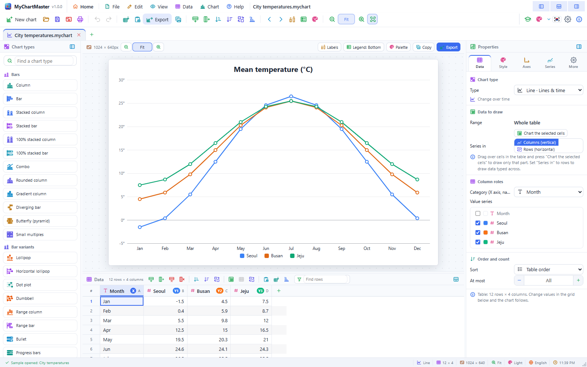

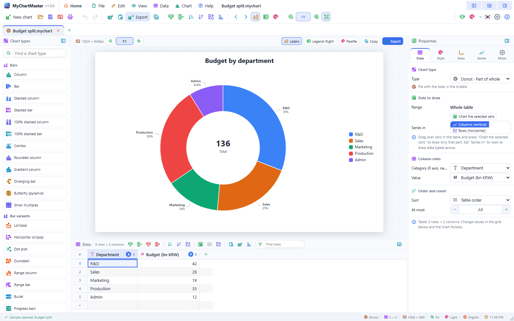

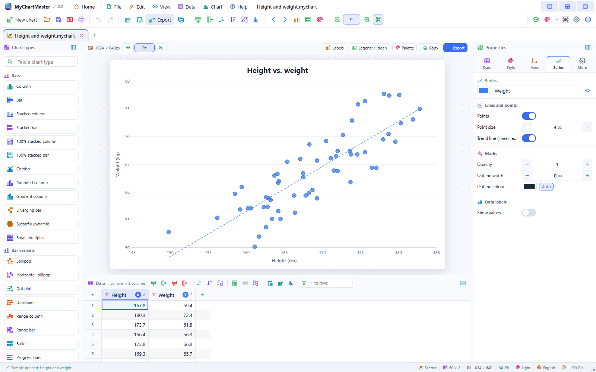

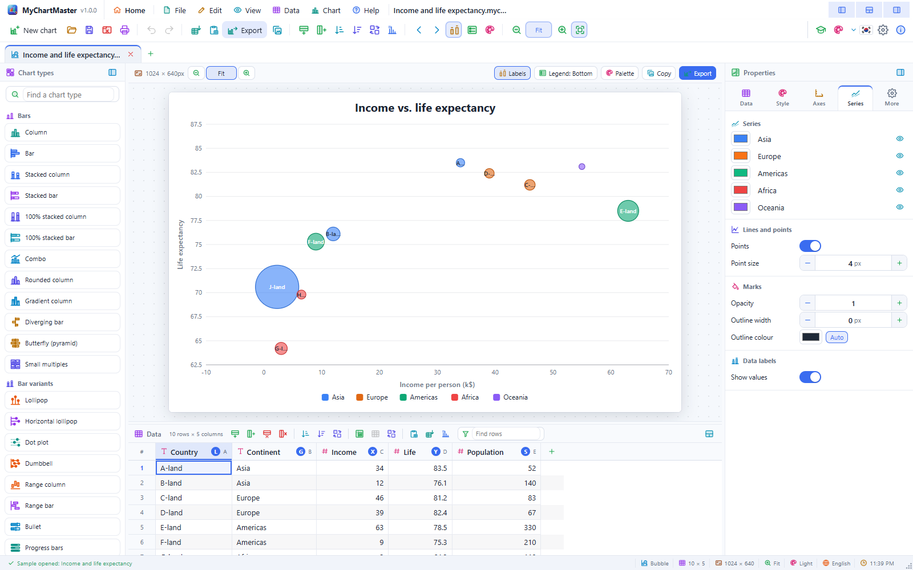


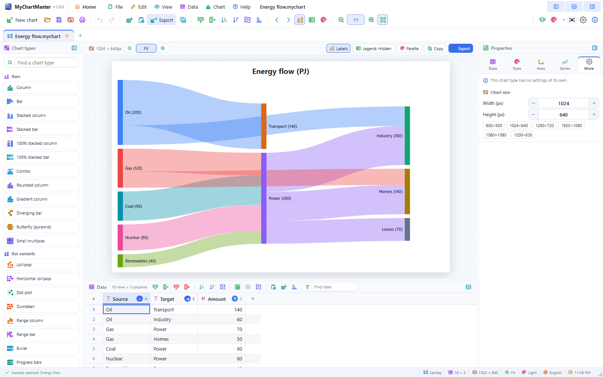

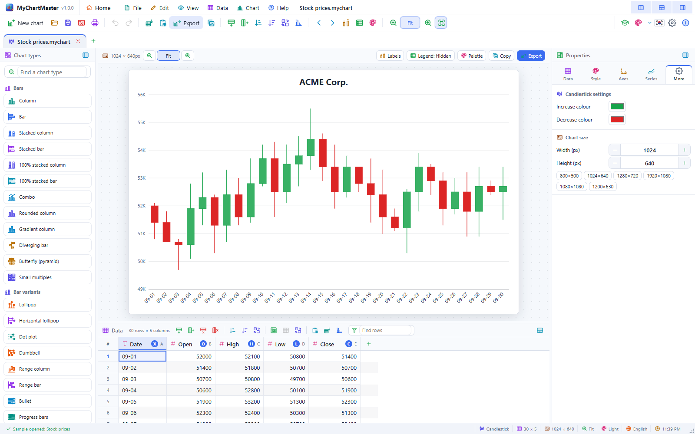

##### Chart themes

Each chart has its own **chart theme** (Inspector › Style › Chart theme, **Chart › Chart theme**, or the chart's
right-click menu). It is set apart from the program's theme (light, dark …) and changes the palette, the font, the
grid and its own paper together. 21 of them: Classic · Office · Paper · Newspaper · Pastel · Ocean · Forest · Sunset · Corporate · Monochrome · Colour-blind safe · Solarized light · Nordic · Dark · Midnight · Slate · Solarized dark · Vampire · Neon · Blueprint · Chalkboard.

The chart's **background follows the program's theme by default**: in a dark theme the chart paper turns dark, text,
axes and grid lines turn light, and series colours are lightened or darkened as needed to keep at least 3:1 contrast
with the paper. The background can also be the **chart theme paper**, **white**, **transparent** or **any colour**.
Settings › Charts sets the chart theme of new charts.

#### The data grid

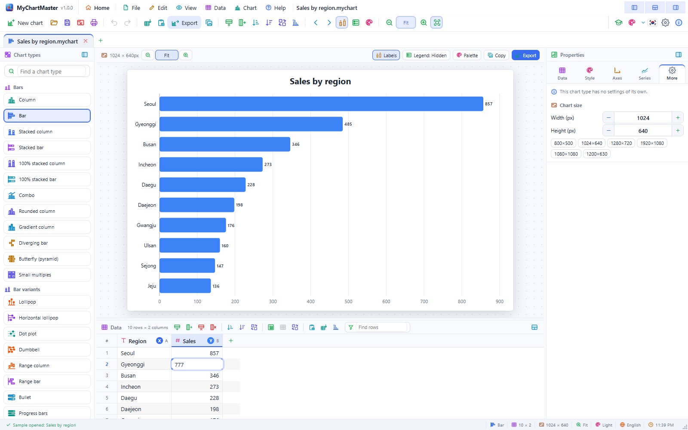

The grid works like a spreadsheet. Only the rows on screen are drawn, so 100 000 rows scroll smoothly.

- **Selecting**: click, the arrows, Tab, Enter, Page Up/Down, Home/End (with Ctrl: to the very end). Hold Shift while
  moving or drag to select a range. A row number selects the row, a header the column, the top-left corner everything.
- **Editing**: select a cell and type, or press F2, double-click or Enter. Enter moves down and Tab right, saving the
  value; Esc cancels. Typing in the **+** row at the bottom adds a row.
- **Clearing**: Delete or Backspace empties the selected cells.
- **Copy and paste**: Ctrl+C copies the range as tab-separated text (it pastes straight into Excel); Ctrl+V pastes a
  range copied from Excel or a web page from the selected cell (rows and columns are added as needed).
- **Renaming a column**: double-click its header, or **Data › Rename column**.
- **Header badges**: each column's type icon (# number, T text, calendar date) and its role in the chart (X category,
  Y1, Y2 … in the series colours, S size, G group, O/H/L/C candles …).
- **Column type**: number, text and date are found from the values. Right-click › Column type changes it (for example
  numeric codes as text). Values that are not numbers in a number column show in red italics.
- **Grid tools** (the grid's title row): add row, add column, delete selected rows/columns, sort ascending/descending
  (by the selected column), swap rows and columns, paste as new chart, import, data statistics, **Find rows** (only rows
  with that text show in the grid; the chart stays as it is).
- **Right-click**: use this column as the category (X), add/remove it as a series, copy, paste, clear, add/delete
  rows and columns, rename, column type, sort, swap rows and columns, statistics.

Numbers are read the way people write them: `1,234.5`, `1.234,5`, `12%` (0.12), `$3.20`, `₩1,000`, `(42)` (−42),
`1.2k`. Dates are recognised as `2024-03-01`, `2024/3` and `2024년 3월 1일`.

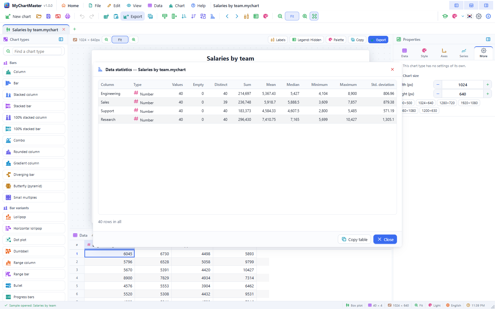

**Data › Data statistics** (Ctrl+Shift+I) shows each column's type, values, empty cells, distinct values, sum, mean,
median, minimum, maximum and standard deviation. Click a header to sort; **Copy table** pastes into Excel.

Every edit can be **undone** (Ctrl+Z) and **redone** (Ctrl+Y) — 200 steps per chart.

#### Properties panel

##### Data tab

- **Chart type**: also a dropdown; the type's description shows below it.
- **Column roles**: the roles the type needs — the category (X axis, names) column, the value series (one series per
  ticked number column; the dot shows its colour), X for scatter, X / Y / size / label / group for bubbles, open /
  high / low / close for candles, the group of treemaps and sunbursts, source and target for Sankey.
- **Sort**: table order, largest first, smallest first, by name (by the first series; the table keeps its order).
- **At most**: draws only that many items from the start (with sorting: "top 10").

##### Data to draw (Data tab)

- **Chart the selected cells** (Ctrl+Shift+R): drag over cells in the table below and press it to draw only that part. The
  range shows as "A4:C8" and the cells outside it fade. **Chart the whole table** goes back.
- **New chart from the selection** opens a new chart with a copy of the chosen cells.
- **Series in**: **Columns (vertical)** makes each column a series (data typed down), **Rows (horizontal)** each row (data typed
  across: names in the first column, categories in the header).
- The cells can be edited at any time; the chart changes at once.

##### Style tab

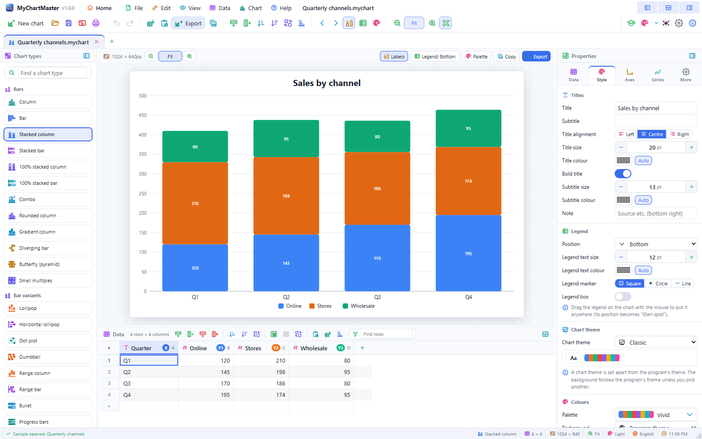

- **Titles**: title, subtitle, alignment (left, centre, right), note (source etc., bottom right).
- **Legend**: top, bottom, left, right, hidden. The legend button on the chart bar (Ctrl+Shift+G) steps through them.
- **Colours**: palette (20: Vivid, Office, Tableau 10, Category 10, Pastel, Earth, Ocean, Sunset, Forest, Berry, Neon,
  Mono blue, Grayscale, Warm, Cool, Colour-blind safe, Retro, Corporate, Candy, Night sky), background (white, theme
  colour, transparent, own colour), border.
- **Text**: text size (0.6×–2×) and font (empty: the default font).

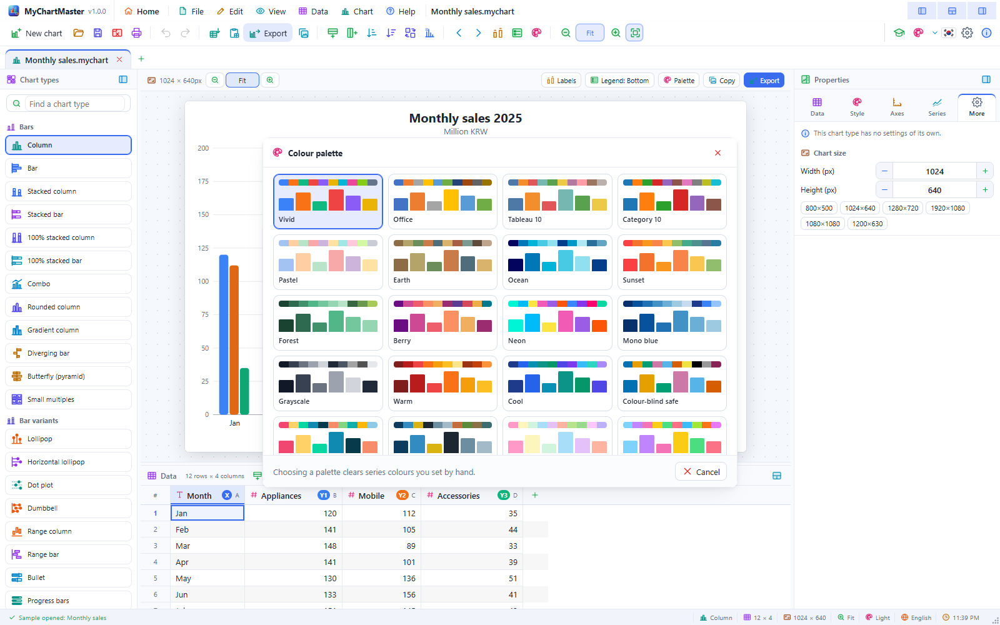

###### Fine look (Style tab)

- **Titles**: size, colour and weight of the title and subtitle.
- **Legend**: position (top, bottom, left, right, **own spot**, hidden), across / down of the own spot (%), text size and colour,
  marker (square, circle, line), a box. **Drag the legend** on the chart with the mouse to put it anywhere (own spot).
- **Plot area**: background, border, outer margin. **Text**: size and colour of the text in the chart.
- **Auto** next to a colour brings back the colour of the chart theme and the program theme.
- Every number is a **[−] value unit [+]** field: hold a button to keep stepping, or type the value. Some may be left empty
  for "automatic" (minimum, maximum, tick step …).

##### Axes tab

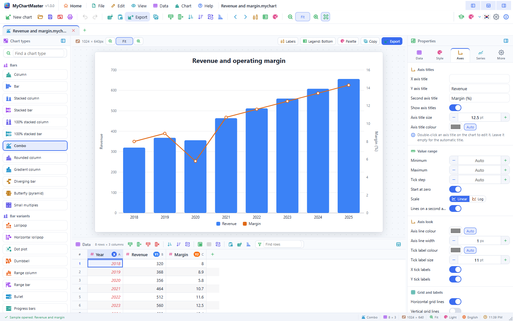

- **Axis titles**: X and Y axis titles, the second axis title of combo charts. Scatter and bubble charts use the X
  column's name when the X title is empty.
- **Value range**: minimum and maximum (empty: automatic), start at zero, scale (linear or log), lines on a second
  axis (combo).
- **Grid and labels**: horizontal and vertical grid lines, category label angle (Auto tilts labels 45° or 90° when
  they would overlap, and skips some when there are still too many).
- **Number format**: auto, plain, compact (12K), percent, scientific; decimals; prefix (₩, $) and suffix (%, °C, kg).
  Labels, ticks and value tips all use it.

Charts without axes (pie, treemap, Sankey …) show only the number format.

###### Axis look (Axes tab)

- **Axis titles**: X, Y (and second axis) titles, shown or not, size, colour. **Double-click** an axis title on the chart to
  edit it (empty brings back the automatic title).
- **Range**: minimum, maximum, **tick step**, begin at zero, linear or log scale.
- **Axis look**: axis line colour and width, tick label colour and size, X and Y tick labels shown or not.
- **Grid**: horizontal and vertical grid lines, grid colour, width and style (as the chart theme, solid, dashed, dotted), label angle.

##### Series tab

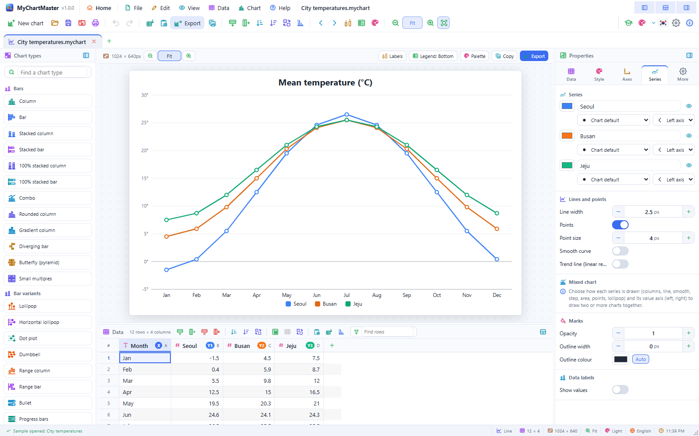

- **Series** (**Slices** for pies): pick a colour, rename (= the column name), show or hide, back to the palette colour.
- **Lines and points**: line width, points, point size, smooth curve, area opacity, **trend line** (linear
  regression; point at it for the equation and R²).
- **Bars**: corner radius, gap between bars.
- **Data labels**: show values; label position for pies (outside: name and share / inside: share).

###### Mixed charts (Series tab)

Choose for each series how it is drawn (chart default, columns, line, smooth line, step line, area, points, lollipops) and its
**value axis** (left, right) to draw two or more charts in one (for example columns + line + area with a right axis). Column, line,
smooth, step, area, combo and lollipop charts can be mixed; choosing a mix on a chart that cannot (pie, stacked or sideways
charts) opens a window that says why. **Clear the mix** goes back. **Marks** sets the opacity and outline of every mark.

###### Right-click menus

The menu fits what was clicked: the legend (hide a series, its colour, legend position, box), an axis title (edit, show, axis
settings), an axis or its labels (axis settings, grid lines, tick labels), the title (edit, title look), a mark (hide its series,
colour, how it is drawn, labels, trend line) or an empty spot (the whole chart). Chart, table and tab menus always offer
**Copy · Export · Print**.

##### More tab

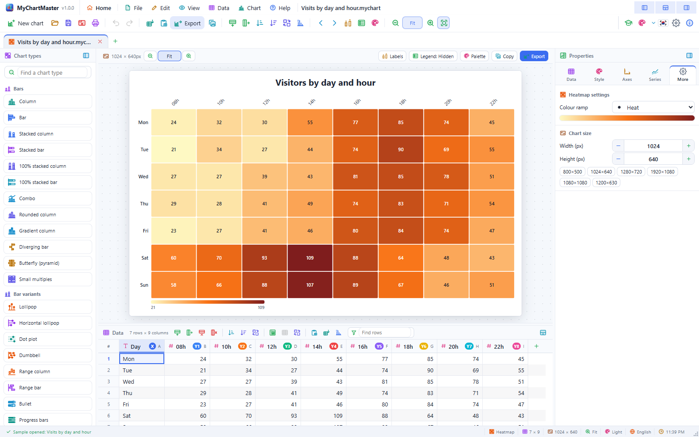

Settings of particular types: the donut's hole size; the start angle of pies, polar areas and sunbursts; the gap
between slices; the histogram's bins; the heat map's colour ramp (blues, greens, reds, purples, oranges, viridis,
diverging, heat); the gauge's minimum and maximum; the waterfall's total bar; increase and decrease colours. And the
**chart size** (width and height in pixels, with common sizes). The chart size is the export's default size.

#### Importing data

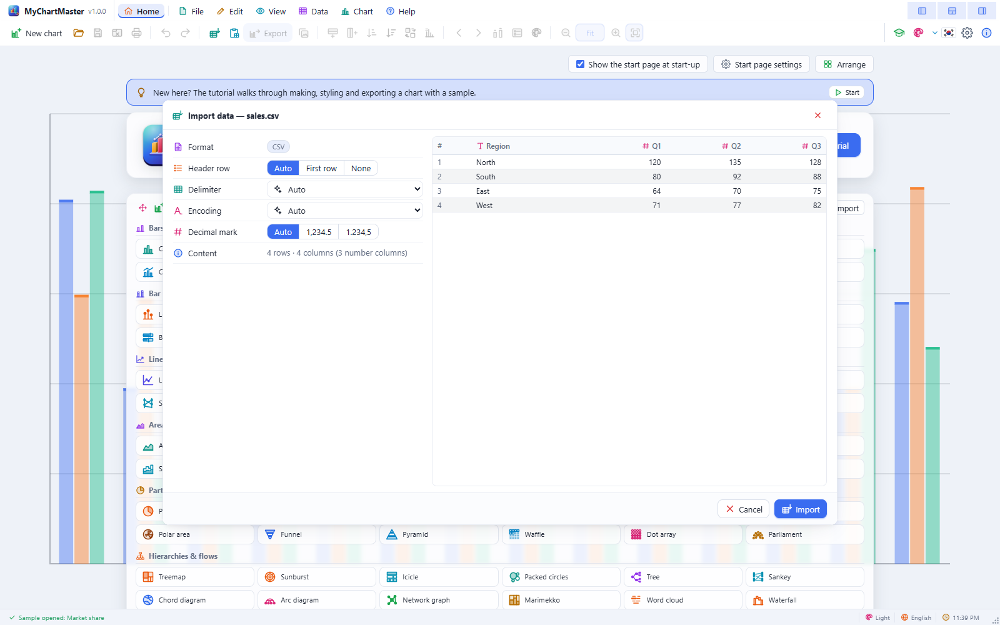

**Data › Import data** (Ctrl+I) picks a file and opens a preview window.

| Format | Extensions | Notes |
| --- | --- | --- |
| CSV · text | .csv .txt .dat .prn | Delimiter found by itself (comma, semicolon, tab, pipe, spaces), commas and line breaks inside quotes, `sep=;` first line |
| TSV | .tsv .tab | Tab-separated |
| Excel | .xlsx .xlsm | Sheet choice, shared strings, date formats, tables that do not start at A1 |
| OpenDocument | .ods | Sheet choice, repeated rows and cells |
| JSON | .json .geojson | Arrays of objects, arrays of arrays, `{columns, rows}`, Chart.js `{labels, datasets}`, column objects `{A:[…]}`, `{name: value}`, `data` / `values` / `records` wrappers, GeoJSON properties, nested objects (a.b) |
| XML | .xml | The most repeated element as rows, its attributes and child elements as columns |
| HTML | .html .htm | One per table on the page (chosen like sheets), colspan |
| Markdown | .md | Pipe tables, the heading above names the table |
| MyChartMaster | .mychart | Opens the chart as it is |

The preview window's choices (the preview follows at once):

- **Sheet / table**, when there are several.
- **Header row**: auto (the first row is a header when it is all text and numbers follow), first row, none (A, B, C …).
- **Delimiter**, **encoding** (auto: UTF-8, else EUC-KR (CP949), then Windows-1252; UTF-16 with a BOM), **decimal
  mark** (auto, `1,234.5`, `1.234,5`).
- **Import into**: a new chart, or this chart (its data is replaced; its settings stay).

The chart type is guessed from the data: scatter for two or more number columns and no text, line for many rows, pie
for one value and a few rows, column otherwise.

Other ways in:

- **Open** (Ctrl+O) a data file: a new chart with the default import settings (Settings › Data import), no preview.
- **Drop** files on the window.
- **Paste as new chart** (Ctrl+Shift+V): a new chart from the table on the clipboard (Excel range, CSV, Markdown or
  HTML table, JSON).
- On the desktop, **Open with** from the file manager (.mychart is registered by the installer).

#### Saving and exporting

- **Save** (Ctrl+S) and **Save as** (Ctrl+Shift+S) write a `.mychart` file (JSON) with the data and the chart
  settings. A chart made from a data file asks where to save the first time.

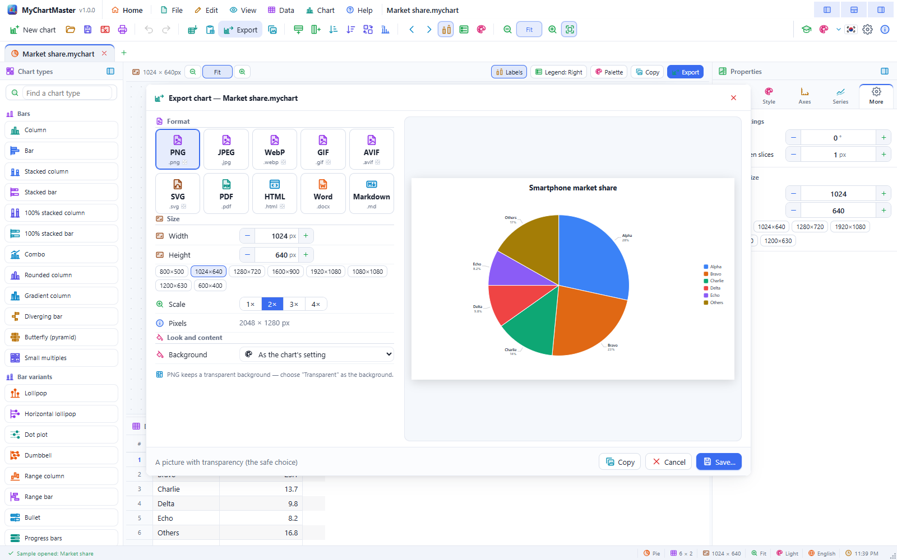

**File › Export** (Ctrl+E) opens a window with a preview.

| Format | Content | Transparent background |
| --- | --- | --- |
| PNG | The safe choice | yes |
| JPEG | Compressed photo picture, quality | no (white) |
| WebP | Small web picture, quality | yes |
| GIF | 256-colour picture | yes (hard edges) |
| AVIF | The smallest modern picture (the desktop program encodes it itself), quality | yes |
| SVG | Vector picture (sharp at any size; values on hover) | yes |
| PDF | The chart on page 1, the data table after it; paper and orientation | no (white) |
| HTML | The chart (a page with value tips) and the data table | yes |
| Word (.docx) | The chart picture and the data table | no (white) |
| Markdown | Markdown with the picture inside, and the data table | no (white) |

Choose the size (width and height, common sizes), scale (1×–4×; the real pixels are shown), background (as the
chart's setting, program theme, white, and **transparent** for the formats that keep it — a small checkerboard on a
format button marks them; with transparent chosen, switching to JPEG and the like makes it white and switching back
makes it transparent again) and whether to include the data table. **Copy** puts the picture
with these settings on the clipboard. To skip the window, pick the format in **File › Export as**.

- **Copy chart picture** (Ctrl+Shift+C) copies the chart as PNG (as SVG code where the clipboard takes no pictures).
- **Edit › Copy**: SVG code, the whole table (tab-separated), the selected cells.
- **File › Export data**: CSV (comma, with a BOM for Excel), TSV, JSON (array of objects), Markdown table, HTML table,
  Excel (xlsx).

#### Printing

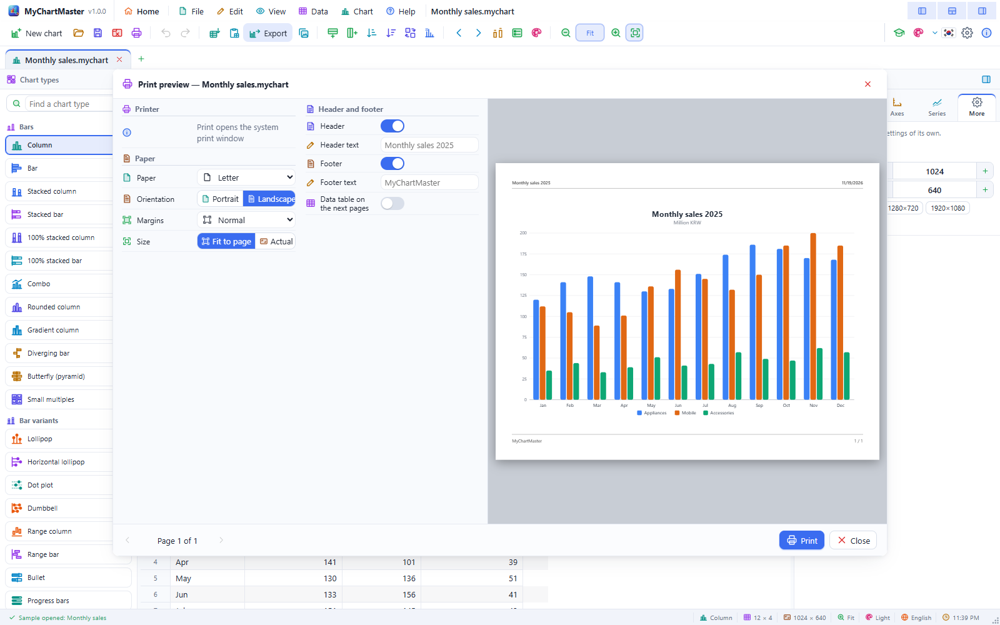

**File › Print** (Ctrl+P) opens its own window: printer and copies (Windows), paper (A3, A4, A5, B4, B5, Letter, Legal,
Tabloid), orientation, margins, size (fit to page or actual size), header and footer and their text, the data table on
the next pages. The page preview is on the right; **Print** prints at once on the chosen printer, without a system
dialog (where no printer list is available, the system dialog opens). In the browser, the browser's print dialog opens.

#### Settings

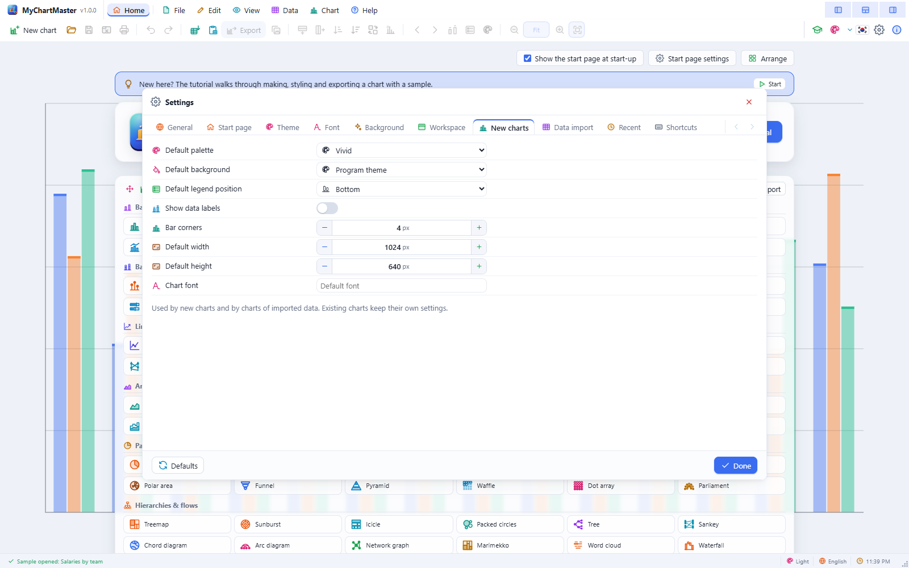

The tabs of **Edit › Settings** (Ctrl+Shift+P):

- **General**: language, reopen last files at start, ask before deleting rows and columns, status bar clock, status bar, tutorial.
- **Start page**: show the start page and the welcome window at start; recent files, folders, samples and background
  cards; the tutorial banner.
- **Theme**: light and dark themes, your own theme (colours, contrast check).
- **Font**: interface font, size, weight, italic, interface zoom.
- **Background**: moving, picture or none; kind, speed, opacity, picture fit.
- **Workspace**: grid position, the three panels, grid row height, value tips on charts, chart animation.
- **New charts**: default palette, background, legend position, data labels, bar corners, width and height, chart font.
- **Data import**: header row, delimiter, encoding, decimal mark, rows to import at most.
- **Recent**: manage the recent files and folders.
- **Shortcuts**: every keyboard shortcut.

Change the **theme** with the palette button on the toolbar (random), the arrow next to it (choose) or the status
bar, and the **language** with the flag button or Ctrl+Shift+L (한국어 ↔ English). With the chart background set to
"Theme colour" the chart follows the theme.

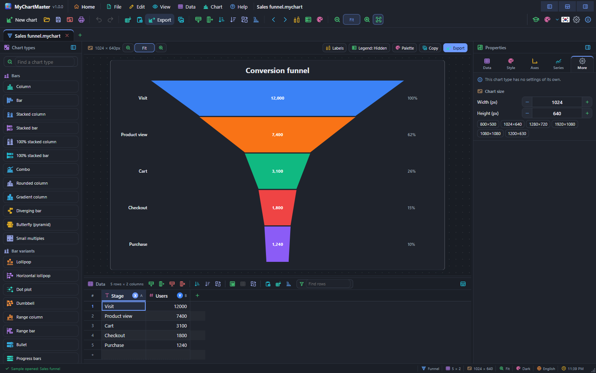

#### Keyboard shortcuts

| Keys | Action |
| --- | --- |
| Ctrl+N | New chart |
| Ctrl+O | Open |
| Ctrl+S / Ctrl+Shift+S | Save / Save as |
| Ctrl+W | Close chart |
| Ctrl+P | Print |
| Ctrl+I | Import data |
| Ctrl+E | Export |
| Ctrl+Shift+C | Copy chart picture |
| Ctrl+Shift+V | Paste as new chart |
| Ctrl+Z / Ctrl+Y (Ctrl+Shift+Z) | Undo / Redo |
| Ctrl+Enter / Ctrl+Shift+Enter | Add row / Add column |
| Ctrl+Shift+T | Swap rows and columns |
| Ctrl+Shift+R | Chart the selected cells |
| Ctrl+Shift+I | Data statistics |
| Ctrl+L | Data labels |
| Ctrl+Shift+G | Move legend |
| Ctrl+K | Colour palette |
| Ctrl+[ / Ctrl+] | Previous / next chart type |
| Ctrl+= / Ctrl+- / Ctrl+0 | Zoom in / out / fit |
| Ctrl+Shift+1 / Ctrl+J / Ctrl+Shift+2 | Chart types / data grid / properties panel |
| Ctrl+Tab | Next chart |
| Ctrl+Shift+L | Switch language |
| Ctrl+Shift+H | Start page |
| Ctrl+Shift+P | Settings |
| F11 | Tutorial |
| F1 | About |
| Arrows · Tab · Enter · F2 · Delete · Ctrl+C · Ctrl+V | Move, edit, clear, copy and paste in the data grid |

#### File format

`.mychart` is UTF-8 JSON:

```json
{
  "format": "mychart", "version": 1, "app": "MyChartMaster",
  "created": "…", "modified": "…",
  "chart": { "type": "column", "title": "…", "subtitle": "…",
             "mapping": { "category": 0, "values": [1, 2] },
             "options": { "palette": "vivid", "legend": "bottom", "width": 1024, "height": 640, "…": "…" } },
  "data": { "columns": [{ "name": "Month", "type": "text" }, { "name": "Sales", "type": "number" }],
            "rows": [["Jan", 120], ["Feb", 141]] }
}
```

The numbers in `mapping` are positions in `data.columns` (from 0). The installation folder (for the web version, the
repository) has the 31 samples as `.mychart` in `samples/`, and in `samples/data/` the same table as CSV, TSV, JSON,
Excel, Markdown, HTML and XML.

#### Troubleshooting

| Problem | What to do |
| --- | --- |
| Korean text looks garbled | In the import window, set the encoding to EUC-KR (CP949) or UTF-8. |
| Numbers come in as text | Set the decimal mark, or right-click the header › Column type › Number. |
| The header row comes in as data | Set the header row to "First row" in the import window. |
| The chart says "Choose at least one number column" | Tick one or more value series on the Data tab. |
| Exported JPEG or PDF has a white background | Those formats have no transparency. Use PNG, WebP, AVIF or SVG. |
| AVIF fails in the browser | The browser has no AVIF encoder: use the desktop program. |
| Copying the picture pastes SVG text | The clipboard takes no pictures there. Export a PNG instead. |

#### Installing and building

- Web: `npm install`, then `npm run dev` (development server at `http://localhost:1476`) or `npm run build:webapp`.
- Windows setup: the installer first opens an **installation language** window (titled "MyChartMaster 1.0.0", the program
  icon in its title bar). Choose Korean or English and press OK: the installation runs in that language and the program opens
  in it at its first start afterwards (a language chosen later in Settings is kept). Cancel ends without changing anything.
- Installers: `npm run build:win` (NSIS .exe), `npm run build:mac` (.dmg), `npm run build:linux` (.deb, .rpm,
  .AppImage), `npm run build:all` (everything this OS can build). They are copied to `release/` and the project root.
- Tests: `npm test` (unit, texts, Rust, web E2E, tutorial, desktop E2E + the installation language window); quickly:
  `npm run test:quick`. The results end in an aligned colour table (pass, fail, skip, total, pass-rate bar, time per category).
- One installation at a time: installing removes an earlier one and asks whether to delete the old user data.
  Several copies of the program can run at once.
