# MyChartMaster Tutorial

This tutorial teaches you, hands-on, how to make, style and export charts with MyChartMaster. Each step takes one to
three minutes. Every feature is explained in detail in the [user's guide](UserGuide.en.md).
한국어판은 [Tutorial.md](Tutorial.md)입니다.

> The program has an **interactive tutorial** along the same lines: press the graduation-cap button at the right of
> the toolbar, or F11, and it runs the real program through 35 steps.

## 1. The start page

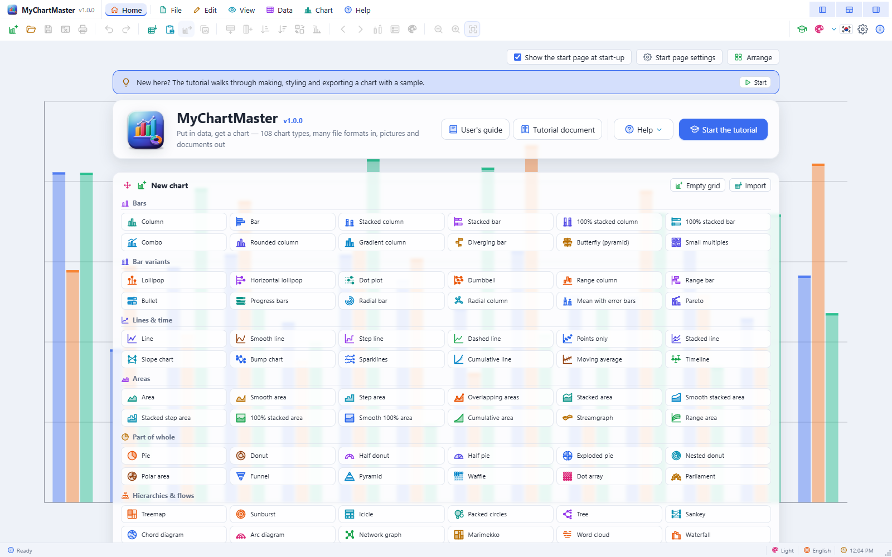

1. Open the program. The start page appears, with moving charts behind it.
2. Press **Change moving background** on the background card a few times to see the 20 chart backgrounds.
3. Drag the **Recent items** card by its handle (✥) somewhere else, then press **Arrange** to put it back.
4. The program card at the top is fixed: it does not move.

## 2. Open a sample chart

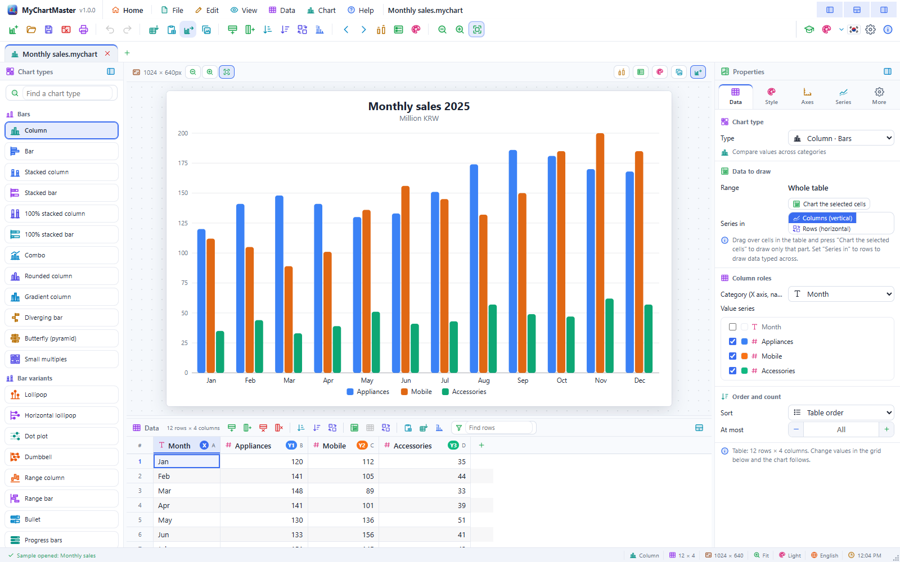

1. On the **Sample charts** card, click **Monthly sales**.
2. The view has four parts: **chart types** on the left, the **chart** in the middle, the **data grid** below and the
   **properties** on the right.
3. Point at a bar to see its value tip.
4. Click **Mobile** in the legend to hide that series; click again to show it.
5. Double-click the title **Monthly sales 2025** and change it to "Our sales".

## 3. Change the chart type

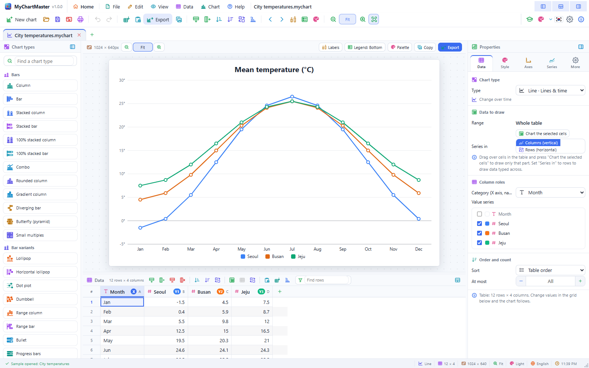

1. Click **Line** in the left panel. The same data is drawn as lines.
2. Try **Stacked column**, **Area** and **Radar** too.
3. Step through all 108 types with the **‹ ›** buttons on the toolbar (Ctrl+[ and Ctrl+]).
4. Type "donut" in the search box above the panel.
5. Go back to **Column**.

## 4. Change the data

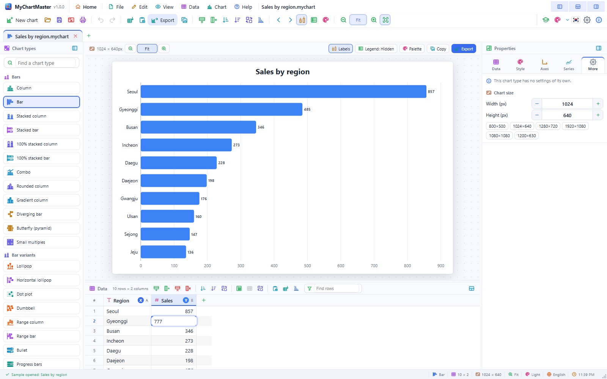

1. In the grid, click the **Jan / Appliances** cell, type `200` and press Enter. January's bar grows at once.
2. Undo with Ctrl+Z and redo with Ctrl+Y.
3. Press **Add column** above the grid. Double-click the new header, rename it "Services" and type a few numbers.
4. On Properties › **Data**, check that "Services" is ticked as a value series (a ticked column becomes a series).
5. Click the **Appliances** header and press **Sort descending** among the grid tools. Undo with Ctrl+Z.
6. Type "1" in **Find rows**: only rows containing 1 stay in the grid (the chart stays as it is). Clear the box.

## 5. Paste from Excel

1. Copy this table from Excel (or a text editor; tabs or commas):

   ```text
   Fruit,Sold
   Apple,120
   Pear,80
   Grape,150
   ```

2. Press **Paste as new chart** (Ctrl+Shift+V) on the toolbar. A new tab with a chart opens.
3. One value column and a few rows: the program guessed a pie. Switch it to **Donut**.

## 6. The data editor — edit in a window of its own, like Excel

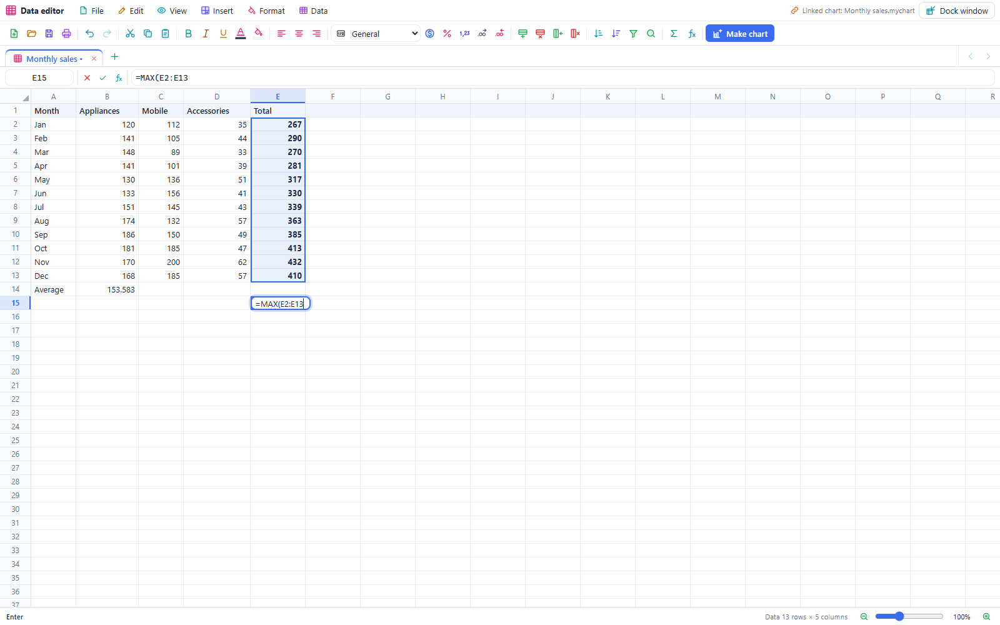

1. Press the **detach** icon at the right of the data grid's title bar (or the same icon on the toolbar, Ctrl+Shift+D).
   The table moves into an Excel-like **window of its own**, carrying on with the chart and cells you were on (a new
   chart is made when none is open). The grid panel in the main window says the data is being edited elsewhere.
2. Select B2 in the editor, type `180` and press Enter: the chart in the main window changes at once. Try Ctrl+Z.
3. Type `Total` in E1 and `=SUM(B2:D2)` in E2. While you type, the cells the formula reads are outlined in colour;
   clicking cells puts their address in.
4. With E2 selected, drag the small square at the selection's corner (the fill handle) down to E13 (or select E2:E13
   and press Ctrl+D). The formula fills down with its references moved; the status bar shows average, count and sum.
5. Select B2:E13 and press **Comma style**; select row 1 and press **Bold** and **Center**. Ctrl+1 (Custom format)
   takes Excel format codes such as `#,##0;[Red]-#,##0`.
6. Select a cell in column E and **Sort descending**; turn on the **Filter** and choose values with ▼ in row 1.
7. Copy a range with Ctrl+C and paste it elsewhere with Ctrl+V — Excel works both ways. Try Ctrl+H to replace.
8. The **File** menu opens Excel and CSV files (as a new sheet tab) and saves them. × on a tab at the top closes that
   chart; with many tabs, **<** **>** at the right end move through them.
9. **Print** (Ctrl+P) shows the cells on pages in the program's print window (gridlines and row and column headings).
10. Select A1:C7 and press the blue **Make chart** button: a new chart tab is made from those cells.
11. **Dock window** (or closing the editor) puts the data back into the main window's data grid.

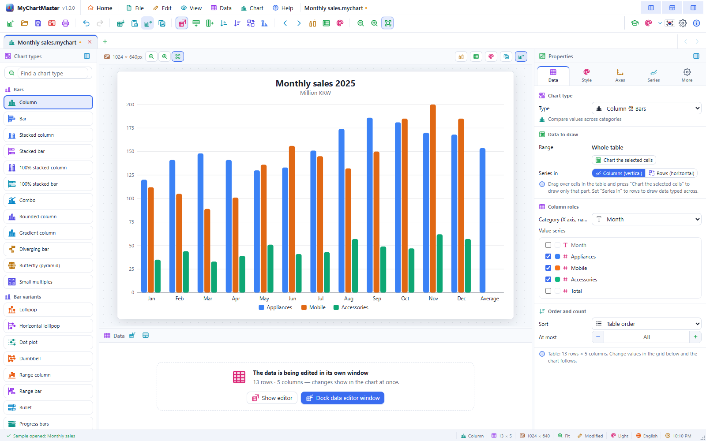

## 7. Style it

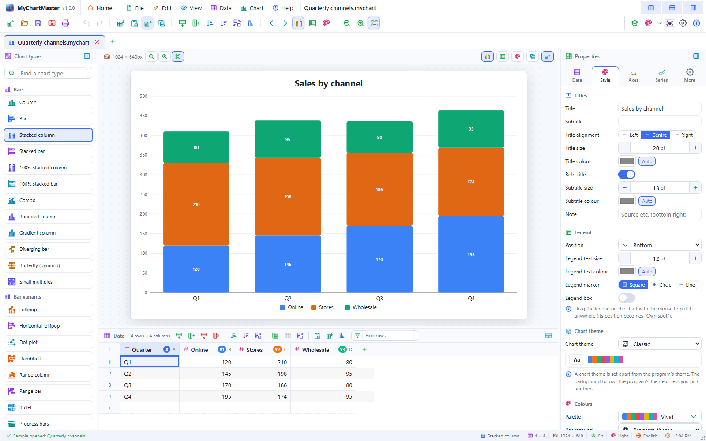

1. Go back to the **Monthly sales** tab.
2. Properties › **Style**: subtitle "Million KRW", note "Source: sales team".
3. Set the legend position to **Right**.
4. Press the **Palette** button and choose **Sunset**.

   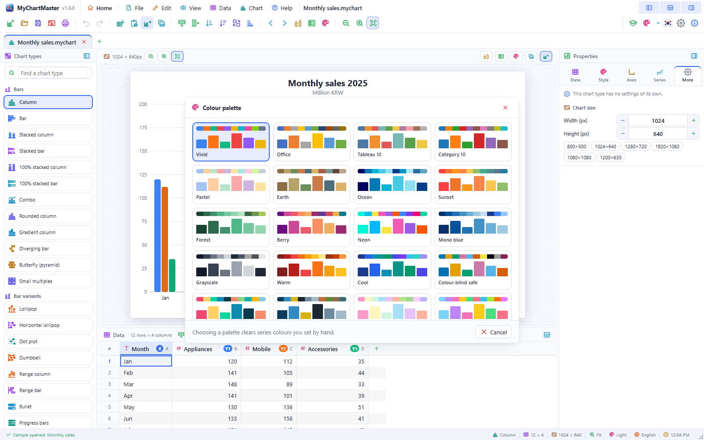

5. Press **Data labels** (Ctrl+L) to show values on the bars.
6. On the **Series** tab, give "Appliances" a colour you like and raise **Corner radius** to 10.

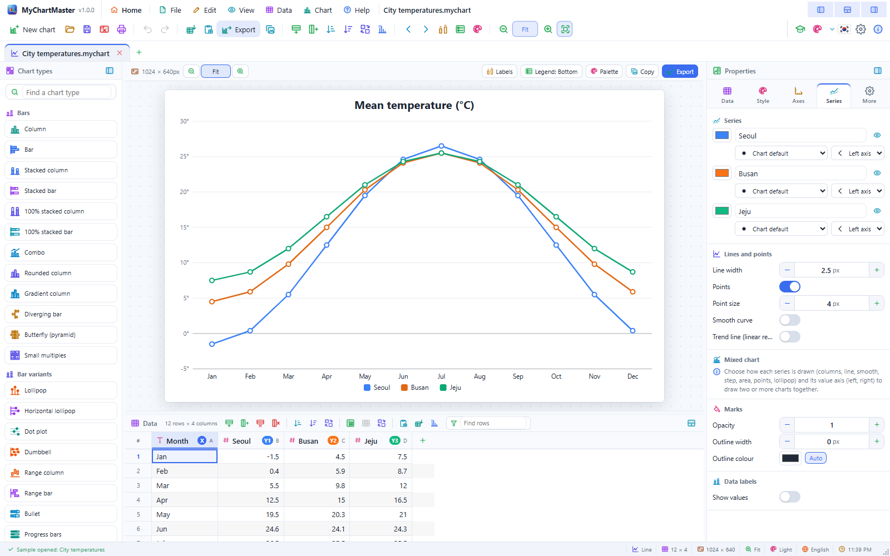

> **Style one element**: click one bar (or a point, slice, the title, legend, an axis, the grid or the background) and its
> own properties appear at the top of the properties panel. Make one bar red with its fill colour. The chart theme swatches
> at the top of the Style tab (25 light, 25 dark, custom) apply at once.

## 8. Axes and number format

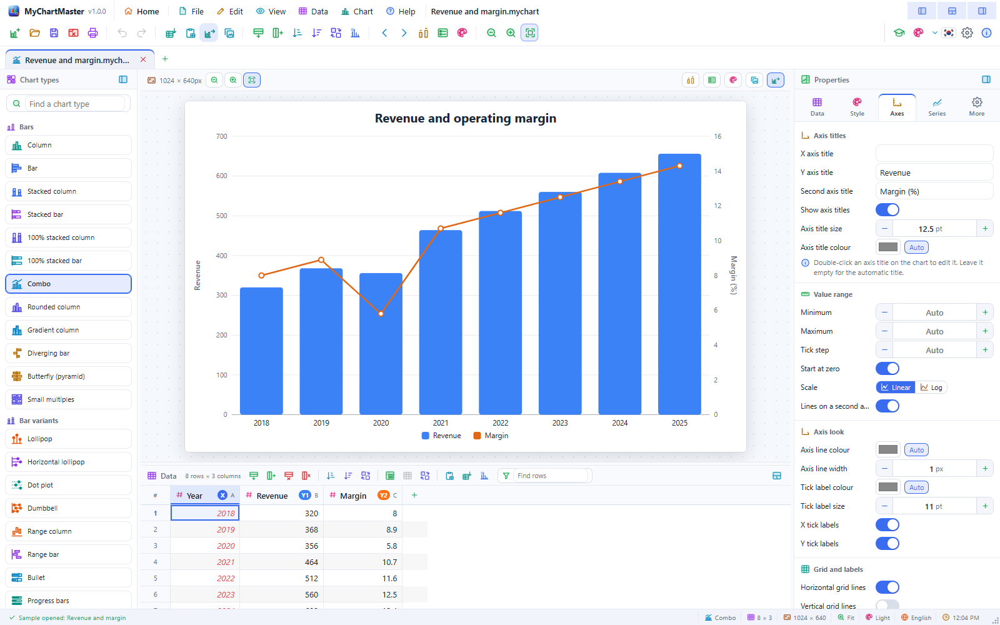

1. **Axes** tab: Y axis title "Sales", suffix "M".
2. Put 250 in **Maximum** to fix the scale; empty it again for automatic.
3. Open the sample **Revenue and margin** (combo) and note that **Lines on a second axis** is on.

## 9. Explore other chart types

Open these samples one after the other. The Data tab shows the columns each chart uses.

| Sample | Type | Look at |
| --- | --- | --- |
| Height and weight | Scatter | The trend line on the Series tab (point at it for the equation and R²) |
| Income and life expectancy | Bubble | X, Y, size, label and group (colour per continent) |
| Visits by day and hour | Heat map | The colour ramp on the More tab |
| Portfolio | Treemap | Asset classes (group) and holdings |
| Energy flow | Sankey | Source, target, amount |
| Stock prices | Candlestick | Open, high, low, close |
| Salaries by team | Box plot | Median, quartiles, outliers |
| Profit bridge | Waterfall | Increase, decrease, total |
| Goal progress | Gauge | Minimum and maximum on the More tab |

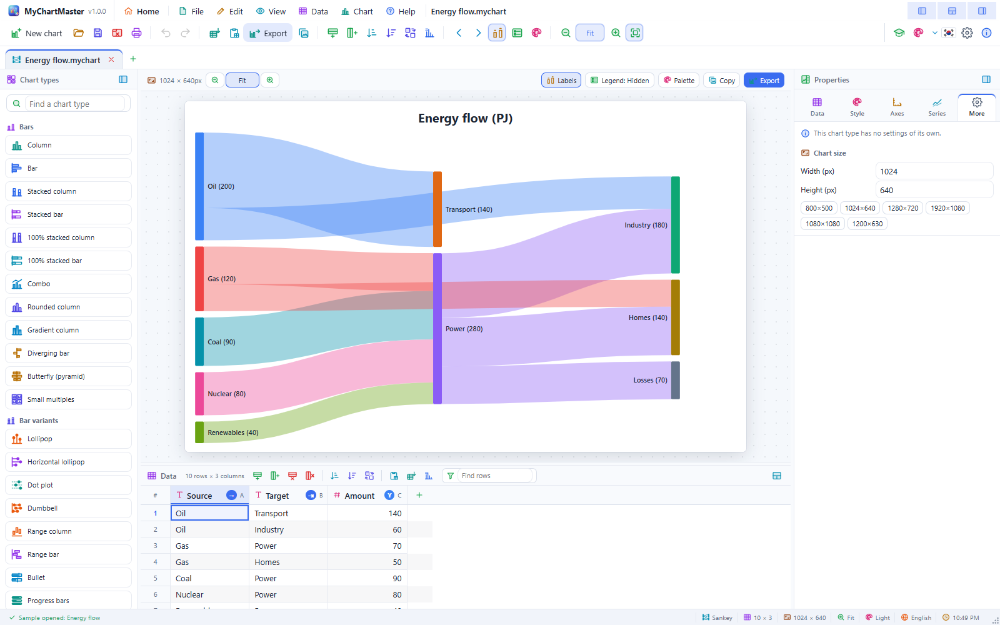

## 10. Import a file

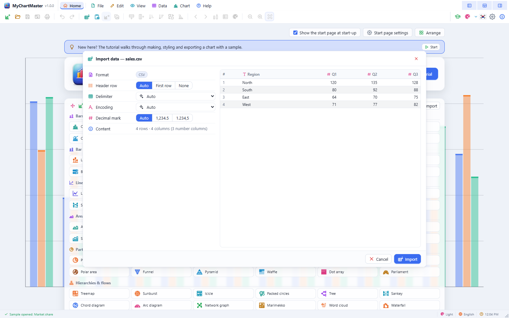

1. Press **Data › Import data** (Ctrl+I) and pick `samples/data/monthly-sales.xlsx` in the installation folder (the
   repository for the web version).
2. Check the header and the number columns in the preview, then press **Import**.
3. Import the `.csv`, `.json`, `.md`, `.html` and `.xml` files of the same folder too.
4. For a CSV whose Korean text looks garbled, set **Encoding** to EUC-KR.
5. With a chart open, set **Import into** to "This chart" to replace only its data.

## 11. Data statistics

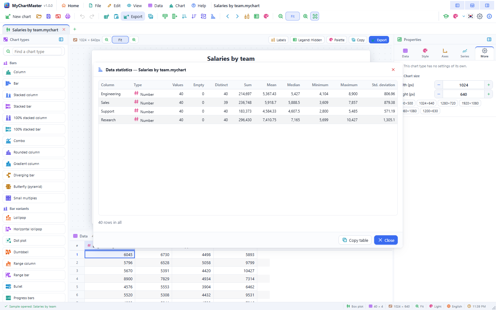

1. Open the sample **Salaries by team**.
2. **Data › Data statistics** (Ctrl+Shift+I) shows each column's mean, median and standard deviation.
3. Press **Copy table** and paste it into Excel.

## 12. Save and export

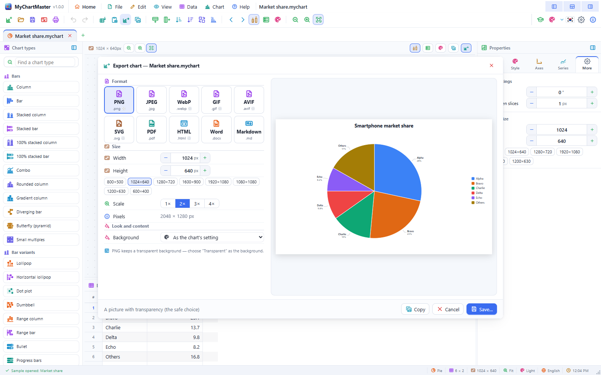

1. In **Monthly sales**, save a `.mychart` file with Ctrl+S. Opened again, it has its data and styling.
2. Open the **Export** window with Ctrl+E.
3. Choose **PNG**, size **1920×1080**, scale **2×** and save (3840 × 2160 real pixels).
4. Save an **SVG** too and zoom into it in a browser (it stays sharp).
5. Save **HTML**, open it in a browser and point at the bars.
6. Save **PDF** and **Word**: the chart and the data table are both inside.
7. **File › Export data › Excel** saves the table as xlsx.
8. Copy the picture with Ctrl+Shift+C and paste it into a document or a chat.

## 13. Print

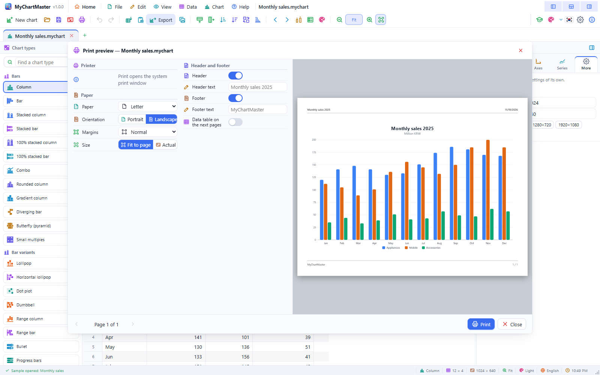

1. Open the print window with Ctrl+P.
2. Paper A4, landscape, turn on **Data table on the next pages**; page through the preview.
3. **Print** prints at once, without a system dialog.

## 14. Make it yours

1. Change the theme with the palette button on the toolbar (choose with the arrow next to it). In a dark theme, set
   the chart background to "Theme colour" and the chart turns dark too.

   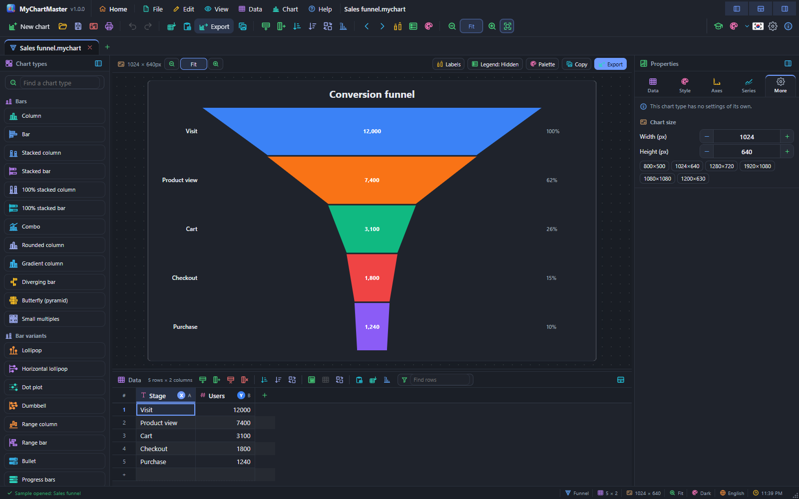

2. **View › Panels › Grid on the right** changes the layout.
3. **Settings › New charts** sets the default palette, legend and size of new charts.
4. Switch to Korean with the flag button (Ctrl+Shift+L) and back.

Well done! Now make a chart of your own data. If you get stuck, see the [user's guide](UserGuide.en.md).
