# MyChartMaster 튜토리얼

이 튜토리얼은 직접 따라 하면서 MyChartMaster로 차트를 만들고, 꾸미고, 내보내는 과정을 익힙니다.
한 단계에 1–3분이면 충분합니다. 각 기능의 자세한 설명은 [사용 설명서](UserGuide.md)에 있습니다.
The English version is [Tutorial.en.md](Tutorial.en.md).

> 프로그램 안에도 같은 흐름의 **대화형 튜토리얼**이 있습니다: 툴바 오른쪽의 학사모 단추나 F11을 누르면
> 실제 화면을 움직이며 35단계를 보여 줍니다.

## 1. 시작 화면 둘러보기

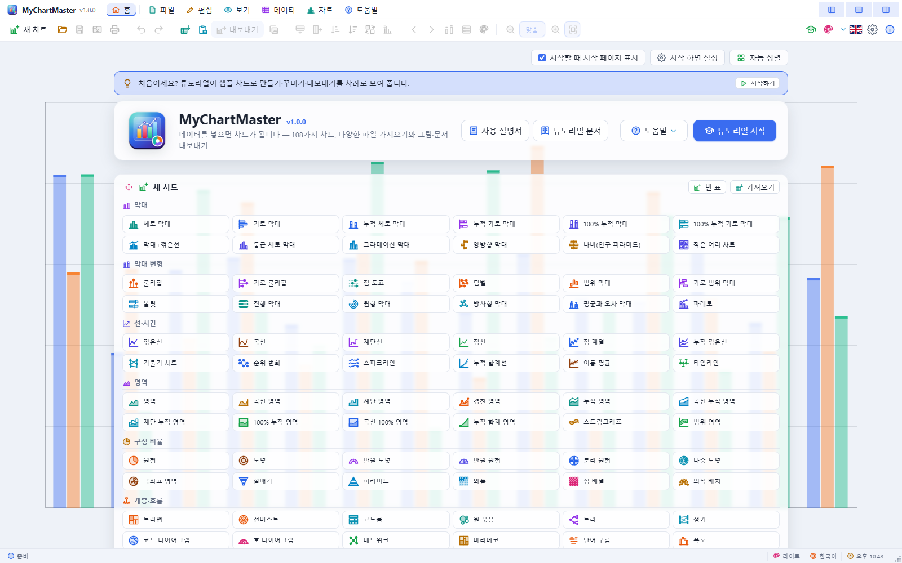

1. 프로그램을 엽니다. 뒤에서 차트 그림이 움직이는 시작 화면이 나옵니다.
2. **움직이는 배경** 카드의 **배경 바꾸기**를 몇 번 눌러 20가지 차트 배경을 구경해 보세요.
3. 카드 왼쪽 위 손잡이(✥)로 **최근 항목** 카드를 다른 자리로 끌어 보고, **자동 정렬**로 되돌립니다.
4. 맨 위 프로그램 카드는 고정되어 있어 움직이지 않습니다.

## 2. 샘플 차트 열기

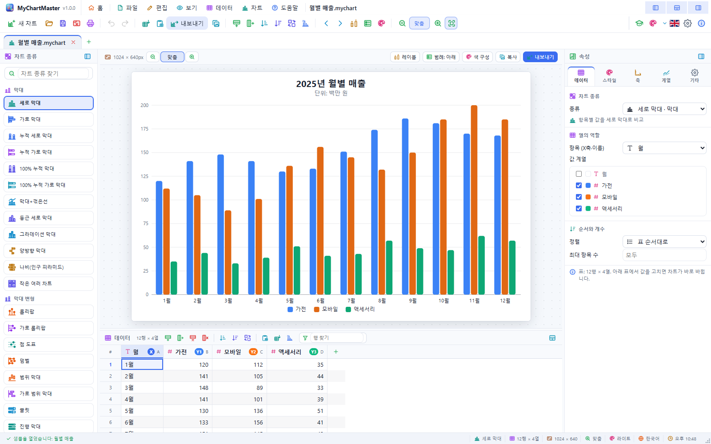

1. **샘플 차트** 카드에서 **월별 매출**을 누릅니다.
2. 화면이 네 부분으로 나뉩니다: 왼쪽 **차트 종류**, 가운데 **차트**, 아래 **데이터 표**, 오른쪽 **속성**.
3. 막대 위에 마우스를 올려 값 풍선을 확인합니다.
4. 범례의 **모바일**을 눌러 그 계열을 숨기고, 다시 눌러 보이게 합니다.
5. 제목 **2025년 월별 매출**을 두 번 눌러 "우리 회사 매출"로 바꿉니다.

## 3. 차트 종류 바꾸기

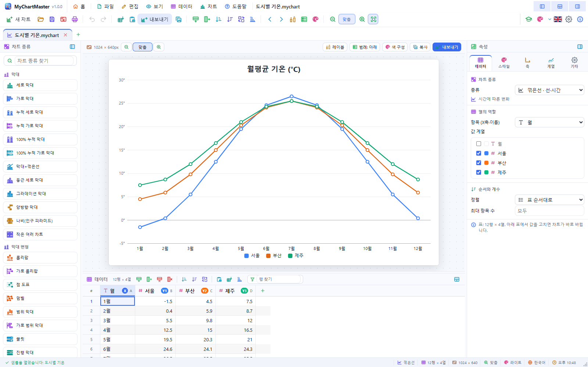

1. 왼쪽 패널에서 **꺾은선**을 누릅니다. 같은 데이터가 꺾은선으로 그려집니다.
2. **누적 세로 막대**, **영역**, **방사형**도 눌러 봅니다.
3. 툴바의 **〈 〉** 단추(Ctrl+[ · Ctrl+])로 108가지 종류를 차례로 넘겨 봅니다.
4. 패널 위 검색 칸에 "도넛"을 입력해 찾아봅니다.
5. 마지막으로 **세로 막대**로 돌아옵니다.

## 4. 데이터 고치기

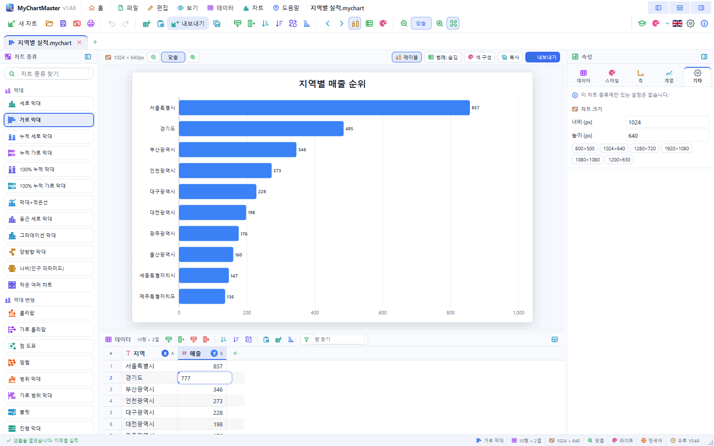

1. 아래 표에서 **1월 · 가전** 셀을 누르고 `200`을 입력한 뒤 Enter를 누릅니다. 1월 막대가 바로 높아집니다.
2. Ctrl+Z로 되돌리고 Ctrl+Y로 다시 실행해 봅니다.
3. 표 위의 **열 추가** 단추를 누릅니다. 새 열의 머리글을 두 번 눌러 이름을 "서비스"로 바꾸고 숫자를 몇 개 넣습니다.
4. 오른쪽 속성 › **데이터** 탭에서 "서비스"가 값 계열로 체크되어 있는지 확인합니다(체크하면 계열이 생깁니다).
5. **가전** 열 머리글을 누르고 표 도구의 **내림차순 정렬**을 눌러 봅니다. Ctrl+Z로 되돌립니다.
6. **행 찾기** 칸에 "1"을 입력하면 1이 든 행만 표에 남습니다(차트는 그대로). 칸을 비웁니다.

## 5. 엑셀에서 붙여넣기

1. 엑셀(또는 메모장)에서 다음 표를 복사합니다(탭이나 쉼표로 구분):

   ```text
   과일,판매량
   사과,120
   배,80
   포도,150
   ```

2. 툴바의 **붙여넣어 새 차트**(Ctrl+Shift+V)를 누릅니다. 새 탭에 차트가 만들어집니다.
3. 값이 한 열뿐이고 행이 적으니 원형 차트로 짐작했습니다. **도넛**으로 바꿔 봅니다.

## 6. 꾸미기

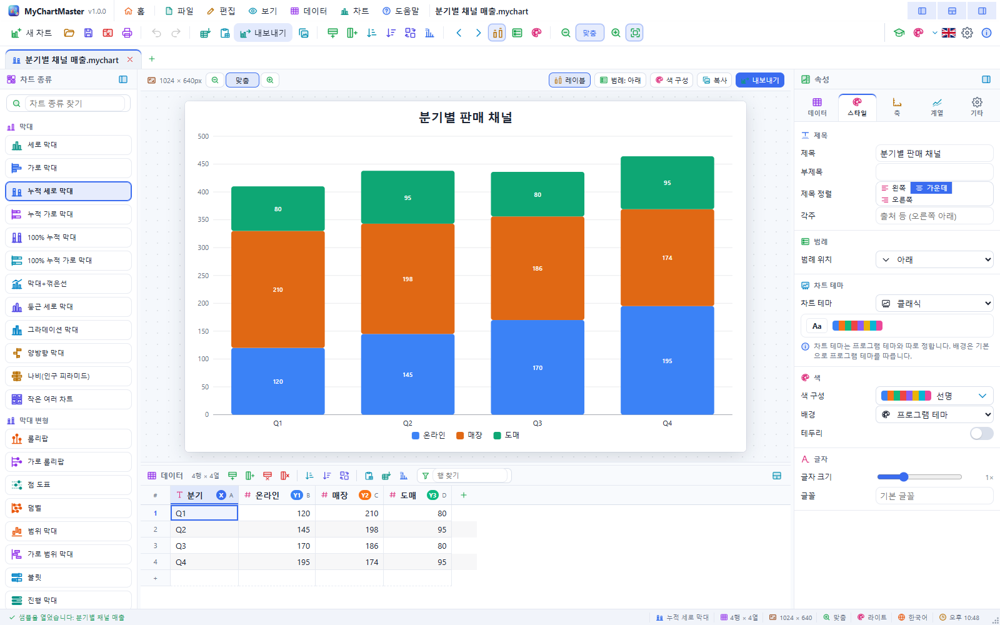

1. **월별 매출** 탭으로 돌아갑니다.
2. 속성 › **스타일** 탭: 부제목에 "단위: 백만 원", 각주에 "자료: 영업팀"을 입력합니다.
3. 범례 위치를 **오른쪽**으로 바꿉니다.
4. **색 구성** 단추를 눌러 **노을**을 고릅니다.

   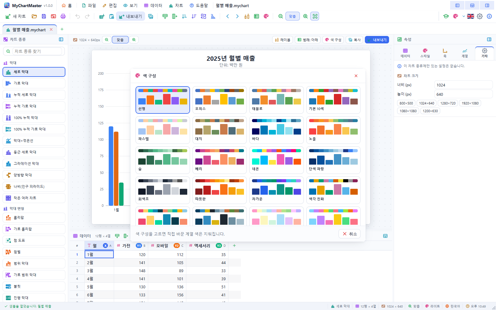

5. 툴바의 **데이터 레이블**(Ctrl+L)을 눌러 막대 위에 값을 표시합니다.
6. **계열** 탭에서 "가전"의 색을 마음에 드는 색으로 바꾸고, 막대 **모서리 둥글기**를 10으로 올립니다.

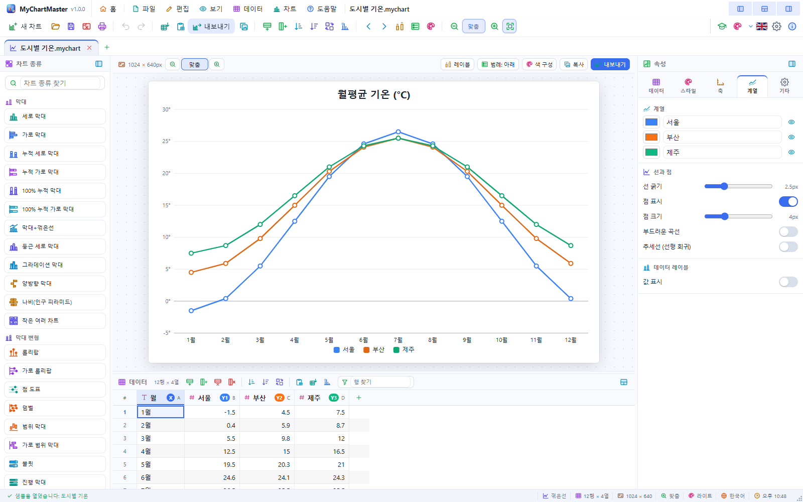

## 7. 축과 숫자 형식

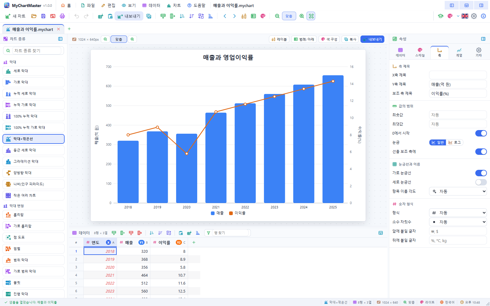

1. **축** 탭: Y축 제목에 "매출", 뒤에 붙일 글자에 "백만"을 입력합니다.
2. **최댓값**에 250을 넣어 눈금을 고정합니다. 다시 비우면 자동으로 돌아갑니다.
3. 샘플 **매출과 이익률**(막대+꺾은선)을 열어 **선을 보조 축에**가 켜져 있는 것을 확인합니다.

## 8. 여러 종류의 차트 살펴보기

다음 샘플을 차례로 열어 보세요. 각 차트가 쓰는 열은 속성 › 데이터 탭에 나옵니다.

| 샘플 | 종류 | 볼 점 |
| --- | --- | --- |
| 키와 몸무게 | 분산형 | 계열 탭의 추세선(마우스를 올리면 식과 R²) |
| 국가별 소득과 수명 | 거품형 | X · Y · 크기 · 이름표 · 묶음(대륙별 색) |
| 요일·시간대 방문 | 히트맵 | 기타 탭의 색 단계 |
| 포트폴리오 | 트리맵 | 자산군(묶음)과 종목 |
| 에너지 흐름 | 생키 | 출발 · 도착 · 양 |
| 주가 차트 | 캔들스틱 | 시가 · 고가 · 저가 · 종가 |
| 부서별 연봉 | 상자 수염 | 중앙값 · 사분위 · 이상값 |
| 손익 브리지 | 폭포 | 증가 · 감소 · 합계 |
| 목표 달성률 | 게이지 | 기타 탭의 최솟값 · 최댓값 |

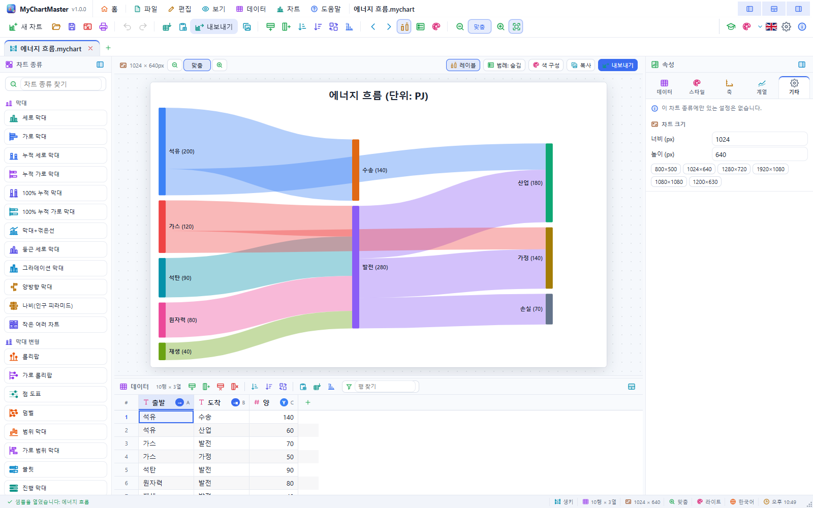

## 9. 파일에서 가져오기

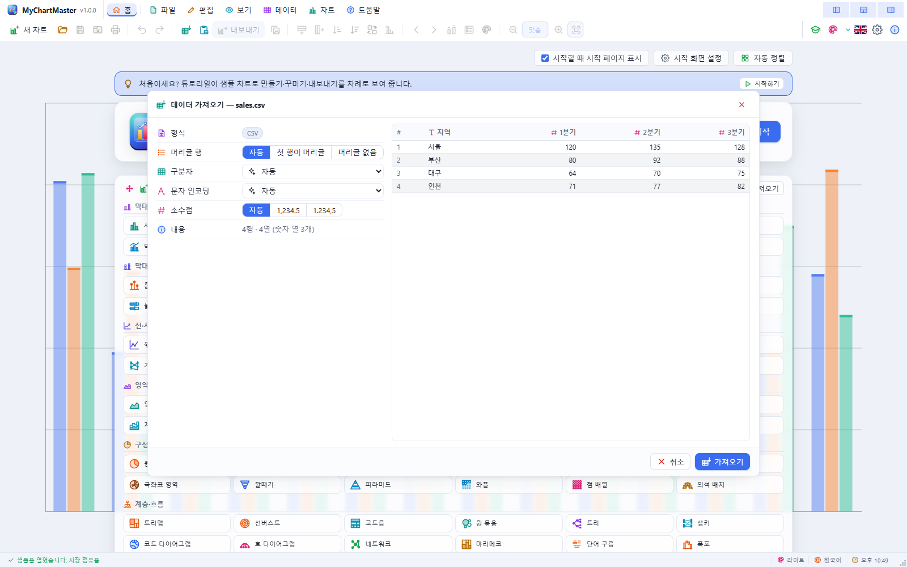

1. **데이터 › 데이터 가져오기**(Ctrl+I)를 누르고, 설치 폴더(웹은 저장소)의 `samples/data/monthly-sales.xlsx`를 고릅니다.
2. 미리 보기에서 머리글 · 숫자 열을 확인하고 **가져오기**를 누릅니다.
3. 같은 폴더의 `.csv`, `.json`, `.md`, `.html`, `.xml` 파일도 가져와 봅니다.
4. 한글이 깨지는 CSV라면 **문자 인코딩**을 EUC-KR로 바꿔 봅니다.
5. 차트를 하나 연 상태에서 가져오기 창의 **가져올 곳**을 "이 차트에"로 하면 데이터만 바뀝니다.

## 10. 데이터 통계

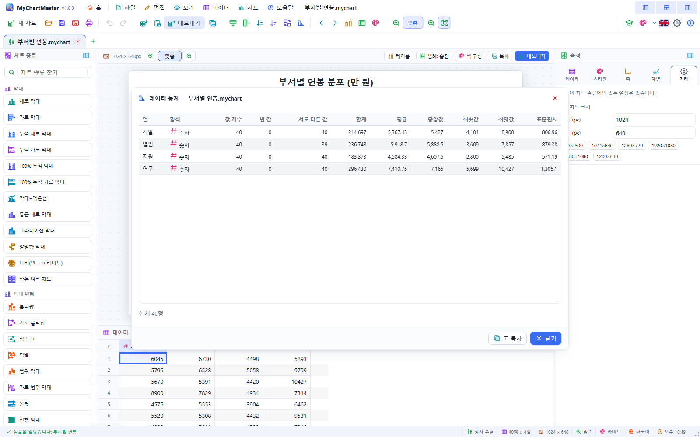

1. 샘플 **부서별 연봉**을 엽니다.
2. **데이터 › 데이터 통계**(Ctrl+Shift+I)로 열마다 평균 · 중앙값 · 표준편차를 봅니다.
3. **표 복사**를 눌러 엑셀에 붙여 봅니다.

## 11. 저장하고 내보내기

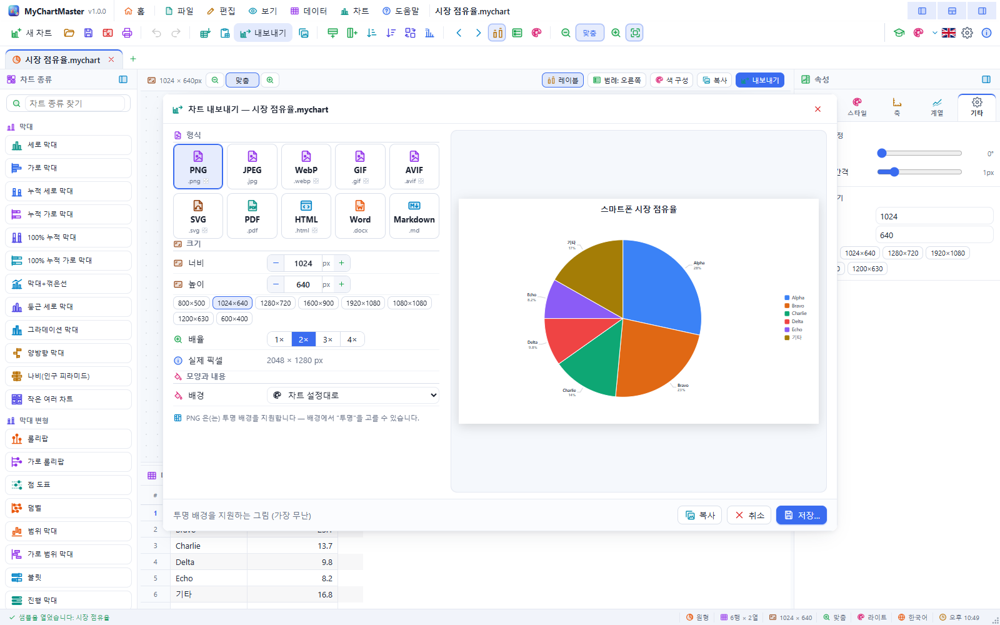

1. **월별 매출**에서 Ctrl+S로 `.mychart` 파일을 저장합니다. 다시 열면 데이터와 꾸밈이 그대로입니다.
2. Ctrl+E로 **내보내기** 창을 엽니다.
3. **PNG**, 크기 **1920×1080**, 배율 **2×**를 고르고 저장합니다(실제 3840 × 2160 픽셀).
4. **SVG**로도 저장해 브라우저에서 확대해 봅니다(선명합니다).
5. **HTML**로 저장해 브라우저에서 열고 막대에 마우스를 올려 봅니다.
6. **PDF**와 **Word**로 저장해 차트와 데이터 표가 함께 들어간 것을 확인합니다.
7. **파일 › 데이터 내보내기 › Excel**로 표를 xlsx로 저장합니다.
8. Ctrl+Shift+C로 그림을 복사해 문서나 메신저에 붙여 넣습니다.

## 12. 인쇄

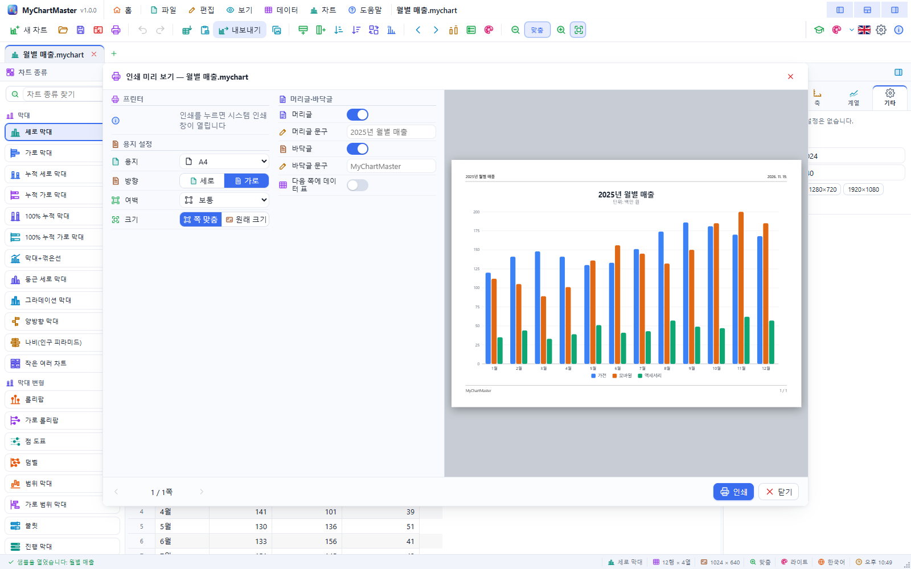

1. Ctrl+P로 인쇄 창을 엽니다.
2. 용지 A4, 방향 가로, **다음 쪽에 데이터 표**를 켭니다. 미리 보기에서 쪽을 넘겨 봅니다.
3. **인쇄**를 누르면 시스템 창 없이 바로 인쇄됩니다.

## 13. 내 환경 만들기

1. 툴바의 팔레트 단추로 테마를 바꿔 봅니다(옆 화살표로 고르기). 어두운 테마에서 차트 배경을 "테마 색"으로 하면
   차트도 어두워집니다.

   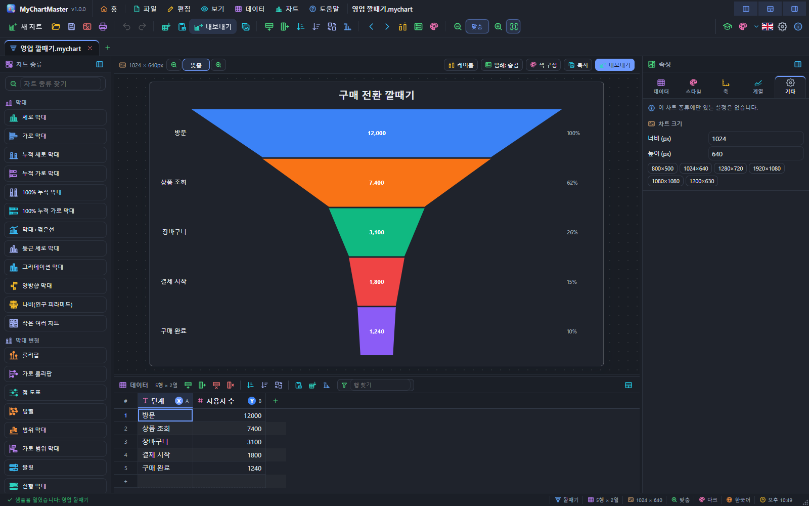

2. **보기 › 패널 › 표를 오른쪽에**로 배치를 바꿉니다.
3. **설정 › 새 차트**에서 기본 색 구성 · 범례 · 크기를 정하면 새로 만드는 차트에 쓰입니다.
4. 국기 단추(Ctrl+Shift+L)로 영어 화면으로 바꿨다가 돌아옵니다.

축하합니다! 이제 내 데이터로 차트를 만들어 보세요. 막히면 [사용 설명서](UserGuide.md)를 보세요.
