# MyChartMaster User's Guide

MyChartMaster draws tables of data as 108 kinds of chart. Type data into the grid or import it from CSV, TSV, Excel
(xlsx), OpenDocument (ods), JSON, XML, HTML and Markdown files; choose the chart type and refine titles, axes, legends,
labels and palettes; then export PNG, JPEG, WebP, GIF, AVIF or SVG pictures, PDF, HTML, Word or Markdown documents,
or CSV and Excel data, and print. It runs in a web browser and as a desktop program on Windows, macOS and Linux.

This guide covers every part of the program. To try the features hands-on, follow the [tutorial](Tutorial.en.md).
한국어 설명서는 [UserGuide.md](UserGuide.md)입니다.

> Every picture in this guide was taken from the program itself (web version, 1600 × 1000 window, *Light* theme)
> with the bundled sample charts. The desktop program looks the same, with window buttons at the right of the title row.

## At a glance

| Part | Contents |
| --- | --- |
| [Start page](#start-page) | New chart, recent items, shortcuts, samples, theme, moving background |
| [Main window](#main-window) | Title row, menus, toolbar, tabs, status bar |
| [The chart view](#the-chart-view) | Chart types panel, chart, data grid, properties panel |
| [Chart types](#chart-types) | The 108 charts, the columns each uses, chart themes |
| [The data grid](#the-data-grid) | Editing, pasting, rows and columns, sorting, statistics |
| [Properties panel](#properties-panel) | Data, Style, Axes, Series and More tabs |
| [Importing](#importing-data) | File formats, preview, sheets, encodings |
| [Saving and exporting](#saving-and-exporting) | .mychart, pictures, documents, data |
| [Printing](#printing) | Paper, preview, printing at once |
| [Settings](#settings) | Settings tabs, themes, language |
| [Reference](#keyboard-shortcuts) | Shortcuts, file format, troubleshooting, building |

## Start page

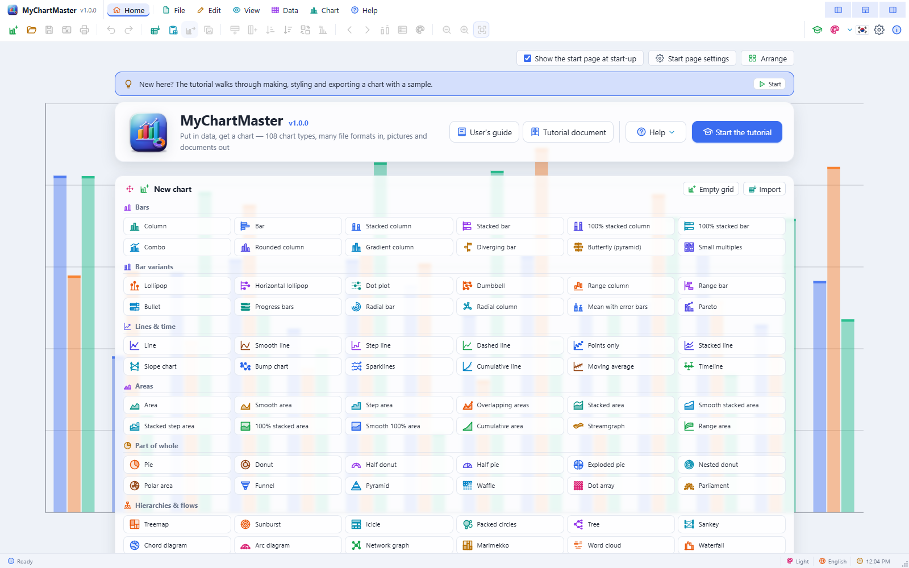

The program opens on the start page. Behind it runs a moving background made of charts (bars, lines, pies, scatter,
candles, heat map, Sankey, dashboard … twenty in all), and translucent cards sit on top.

- **Program card** (top, fixed): name and version, the user's guide and tutorial document, the Help menu and
  **Start tutorial**. This card cannot be moved or resized.
- **New chart**: a card across the whole row with the 108 chart types in nine groups of twelve (Bars, Bar variants, Lines & time, Areas, Part of whole, Hierarchies & flows, Distribution, Correlation & comparison, Finance, plans & KPIs) as one-line buttons: icon and name side by side, left-aligned, a different icon for every type. The buttons sit 6, 4, 3 or 2 to a row by the card's width, so no row is left half empty. The **Recent** card sits right under it.
  A tile opens a new chart of that type with example data. **Empty grid** in the card's title starts from an empty
  table, **Import** from a data file.
- **Recent items**: recently opened files and folders. × removes one; right-click copies the path.
- **Shortcuts**: open, new chart, import data, paste as new chart, tutorial, theme, language, settings, about, exit.
- **Sample charts**: 31 samples from business, finance, science and society. Every other type opens with example data of its own shape as a new chart.
- **Moving background**: 20 backgrounds, shuffle, a background picture, speed, card opacity, automatic change.

Drag a card by its handle (top left) and resize it by its corner (bottom right); **Arrange** puts them back.
The **Home** button in the title row (Ctrl+Shift+H) opens the start page at any time; press it again to go back.

## Main window

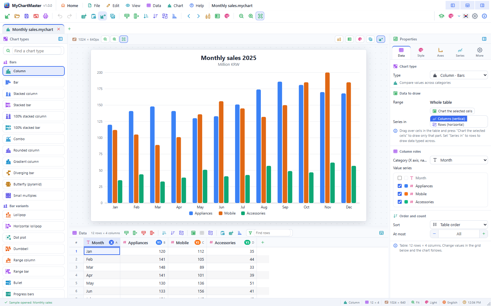

- **Title row**: the program icon and name, Home, the menus (File, Edit, View, Data, Chart, Help), the open chart's
  name (● when unsaved), three panel buttons (chart types, data grid, properties), and on the desktop the window
  buttons. Drag an empty part to move the window; double-click to maximize.
- **Toolbar** (icons only; hover for the name): new chart, open, save, close, print / undo, redo / import, paste, **Export**, copy picture / add row
  and column, sort, swap rows and columns, statistics / previous and next chart type, data labels, legend, palette /
  zoom out, zoom in, fit to window (the zoom level is in the status bar). On the right: tutorial, theme, language, settings, about. The window's minimum width
  follows the toolbar, so no button is ever cut off.
- **Tabs**: one per open chart; the icon shows the chart type, ● unsaved changes. Right-click to close others,
  save, duplicate, export or print. Ctrl+Tab goes to the next tab.
- **Status bar**: notices, chart type, table size (rows × columns), chart size (pixels), zoom, modified, theme,
  language, clock.

## The chart view

A chart tab has four parts.

| Part | What it does |
| --- | --- |
| Chart types panel (left) | The 108 types by group. Click one and the same data is drawn as that type. The box at the top finds a type by name. |
| Chart (centre) | The picture. The bar above shows the size and zoom, and buttons for labels, legend, palette, copy and export. |
| Data grid (below or right) | The chart's data. Change it and the chart follows at once. |
| Properties panel (right) | Every setting of the chart (Data, Style, Axes, Series, More). |

On the chart you can:

- point at a bar, point or slice to see a **value tip** (can be turned off in Settings);
- click a bar or point to **select its series** (thick outline) and go to its row in the grid; click empty space to clear it;
- click a **legend entry** to hide or show that series (or that slice of a pie);
- **double-click the title** (or the subtitle) to edit it; double-click an axis title to open the Axes tab;
- zoom with **Ctrl + mouse wheel**, and **Fit** (Ctrl+0) to fit the window;
- right-click for title, labels, legend, grid lines, trend line, palette, background, reset formatting, copy, export,
  print, and on a series: hide series, series colour.

Drag the borders to resize the panels; fold and unfold them with the buttons in their title rows or with Ctrl+Shift+1
(chart types), Ctrl+J (data grid) and Ctrl+Shift+2 (properties). **View › Panels** puts the grid below the chart, on
its right, or hides it (chart only).

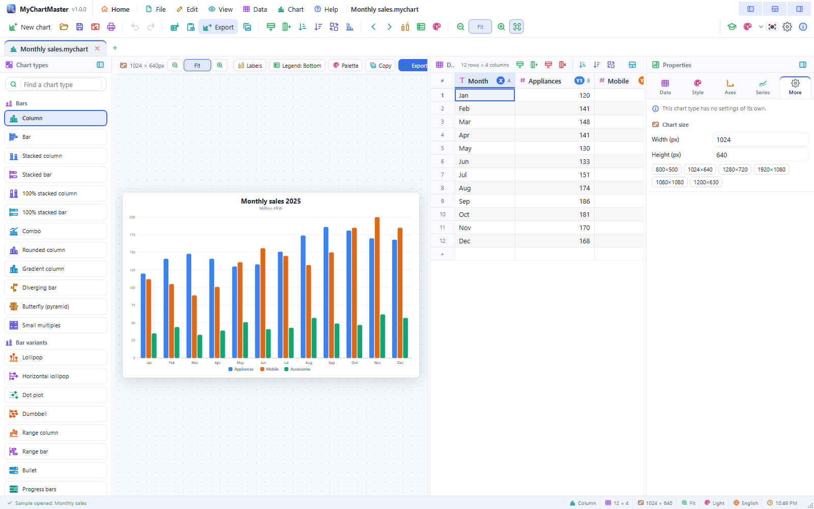

## Chart types

| Group | Type | What it shows | Columns |
| --- | --- | --- | --- |
| Bars | Column | Compare values across categories | category + several value series |
| Bars | Bar | Compare categories with long names | category + several value series |
| Bars | Stacked column | Totals and their parts | category + several value series |
| Bars | Stacked bar | Parts stacked sideways | category + several value series |
| Bars | 100% stacked column | Share within each category | category + several value series |
| Bars | 100% stacked bar | Shares, sideways | category + several value series |
| Bars | Combo | First series as bars, the rest as lines | category + several value series |
| Bars | Rounded column | Columns with round tops | category + several value series |
| Bars | Gradient column | Columns shaded top to bottom | category + several value series |
| Bars | Diverging bar | Positive and negative in two colours | category + one value |
| Bars | Butterfly (pyramid) | Two series back to back | category + several value series |
| Bars | Small multiples | One small chart per series | category + several value series |
| Bar variants | Lollipop | Bars drawn as dots on sticks | category + several value series |
| Bar variants | Horizontal lollipop | Lollipops lying down | category + several value series |
| Bar variants | Dot plot | Only the dots, no bars | category + several value series |
| Bar variants | Dumbbell | The gap between two values | category + several value series |
| Bar variants | Range column | From a low to a high value | category + low · high |
| Bar variants | Range bar | Ranges sideways | category + low · high |
| Bar variants | Bullet | Actual against a target, with bands | category + actual (+ target) |
| Bar variants | Progress bars | Progress toward a maximum | category + one value |
| Bar variants | Radial bar | Bars bent into rings | category + one value |
| Bar variants | Radial column | Columns around a circle | category + several value series |
| Bar variants | Mean with error bars | Mean ± standard deviation per column | several number columns (one distribution each) |
| Bar variants | Pareto | Sorted bars and a cumulative share | category + one value |
| Lines & time | Line | Change over time | category + several value series |
| Lines & time | Smooth line | A smoothed line | category + several value series |
| Lines & time | Step line | Changes as steps | category + several value series |
| Lines & time | Dashed line | Trends in dashes | category + several value series |
| Lines & time | Points only | Points without lines | category + several value series |
| Lines & time | Stacked line | Lines stacked up | category + several value series |
| Lines & time | Slope chart | Change between two points in time | category + several value series |
| Lines & time | Bump chart | Rankings over time | category + several value series |
| Lines & time | Sparklines | One mini line per series | category + several value series |
| Lines & time | Cumulative line | Running totals | category + several value series |
| Lines & time | Moving average | Values with a moving average | category + several value series |
| Lines & time | Timeline | Events in time order | date (category) + event |
| Areas | Area | Change and volume together | category + several value series |
| Areas | Smooth area | A smoothed area | category + several value series |
| Areas | Step area | An area in steps | category + several value series |
| Areas | Overlapping areas | Light areas drawn over each other, with points | category + several value series |
| Areas | Stacked area | Areas stacked up | category + several value series |
| Areas | Smooth stacked area | Smoothed areas stacked up | category + several value series |
| Areas | Stacked step area | Areas stacked in steps | category + several value series |
| Areas | 100% stacked area | Shares over time | category + several value series |
| Areas | Smooth 100% area | Smoothed shares of the whole | category + several value series |
| Areas | Cumulative area | Running totals as areas | category + several value series |
| Areas | Streamgraph | Stacked areas around a centre | category + several value series |
| Areas | Range area | A band between low and high | category + low · high |
| Part of whole | Pie | Share of a whole | category + one value |
| Part of whole | Donut | Pie with the total in the middle | category + one value |
| Part of whole | Half donut | Shares on a half ring | category + one value |
| Part of whole | Half pie | A pie cut in half | category + one value |
| Part of whole | Exploded pie | Slices pulled apart | category + one value |
| Part of whole | Nested donut | One ring per series | category + several value series |
| Part of whole | Polar area | Equal angles, radius by value | category + one value |
| Part of whole | Funnel | Stages that narrow | category + one value |
| Part of whole | Pyramid | Stages widening downwards | category + one value |
| Part of whole | Waffle | Shares in a 10 × 10 grid | category + one value |
| Part of whole | Dot array | Shares as 100 dots | category + one value |
| Part of whole | Parliament | Seats on a half circle | category + one value |
| Hierarchies & flows | Treemap | Areas by size, grouped | (group) + category + one value |
| Hierarchies & flows | Sunburst | A hierarchy as rings | (group) + category + one value |
| Hierarchies & flows | Icicle | A hierarchy as stacked layers | (group) + category + one value |
| Hierarchies & flows | Packed circles | Circles sized by value, packed | (group) + category + one value |
| Hierarchies & flows | Tree | Branches from groups to items | (group) + category + one value |
| Hierarchies & flows | Sankey | Flows from sources to targets | source · target · amount |
| Hierarchies & flows | Chord diagram | Flows across a circle | source · target · amount |
| Hierarchies & flows | Arc diagram | Arcs between points on a line | source · target · amount |
| Hierarchies & flows | Network graph | Nodes and links | source · target · amount |
| Hierarchies & flows | Marimekko | Width by total, height by share | category + several value series |
| Hierarchies & flows | Word cloud | Bigger words for bigger values | category + one value |
| Hierarchies & flows | Waterfall | How increases and decreases add up | category + one value |
| Distribution | Histogram | How values spread | several number columns (one distribution each) |
| Distribution | Cumulative histogram | Counts up to the end of each bin | several number columns (one distribution each) |
| Distribution | Frequency polygon | Bin counts as a line | several number columns (one distribution each) |
| Distribution | Dot histogram | One dot per value, stacked in bins | several number columns (one distribution each) |
| Distribution | Box plot | Median, quartiles and outliers | several number columns (one distribution each) |
| Distribution | Violin | The shape of each distribution | several number columns (one distribution each) |
| Distribution | Ridgeline | Distribution curves stacked like ridges | several number columns (one distribution each) |
| Distribution | Strip plot | One dot per value | several number columns (one distribution each) |
| Distribution | Beeswarm | Dots spread so they do not overlap | several number columns (one distribution each) |
| Distribution | Rug plot | A short tick per value | several number columns (one distribution each) |
| Distribution | Density | Smooth distribution curves | several number columns (one distribution each) |
| Distribution | Cumulative distribution | Share of values at or below | several number columns (one distribution each) |
| Correlation & comparison | Scatter | Relation of two values | X values + Y series (+ label) |
| Correlation & comparison | Connected scatter | Points joined in order | X values + Y series (+ label) |
| Correlation & comparison | Regression scatter | Points with a regression line | X values + Y series (+ label) |
| Correlation & comparison | Quadrant | Four areas split at the means | X values + Y series (+ label) |
| Correlation & comparison | Bubble | A third value as size | X · Y · size (+ label, group) |
| Correlation & comparison | Heatmap | A table shaded by value | category + several value series |
| Correlation & comparison | Punch card | A table of sized dots | category + several value series |
| Correlation & comparison | Calendar heatmap | Daily values on a calendar | category + one value |
| Correlation & comparison | Correlation matrix | Correlation between number columns | several number columns (one distribution each) |
| Correlation & comparison | Scatter matrix | Every pair of number columns | several number columns (one distribution each) |
| Correlation & comparison | Radar | Several measures at a glance | category + several value series |
| Correlation & comparison | Radar lines | Radar without fill | category + several value series |
| Finance, plans & KPIs | Candlestick | Open, high, low, close | date + open · high · low · close |
| Finance, plans & KPIs | OHLC bars | Prices with open and close ticks | date + open · high · low · close |
| Finance, plans & KPIs | Heikin-Ashi | Averaged candles | date + open · high · low · close |
| Finance, plans & KPIs | Price band | High-low band with the close | date + open · high · low · close |
| Finance, plans & KPIs | Bollinger bands | Moving average ± 2 standard deviations | category + one value |
| Finance, plans & KPIs | Gantt | Tasks from start to end | task + start · end (dates or numbers) (+ team) |
| Finance, plans & KPIs | Gauge | One value against its range | category + one value |
| Finance, plans & KPIs | Solid gauge | A filled ring without a needle | category + one value |
| Finance, plans & KPIs | Gauge grid | One gauge per row | category + one value |
| Finance, plans & KPIs | Linear gauge | A bar that fills like a thermometer | category + one value |
| Finance, plans & KPIs | KPI cards | A big number per row, with change | category + one value |
| Finance, plans & KPIs | Activity rings | Rings filled toward a goal | category + one value |

Changing the type maps the columns again for the new type, keeping what still fits (the category column, the value
series). **Chart › Previous / Next chart type** (Ctrl+[ and Ctrl+]) steps through the types.

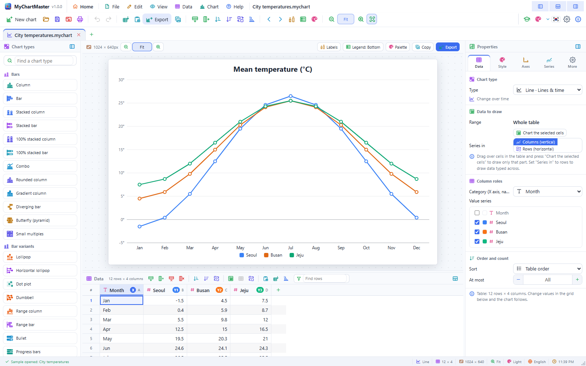

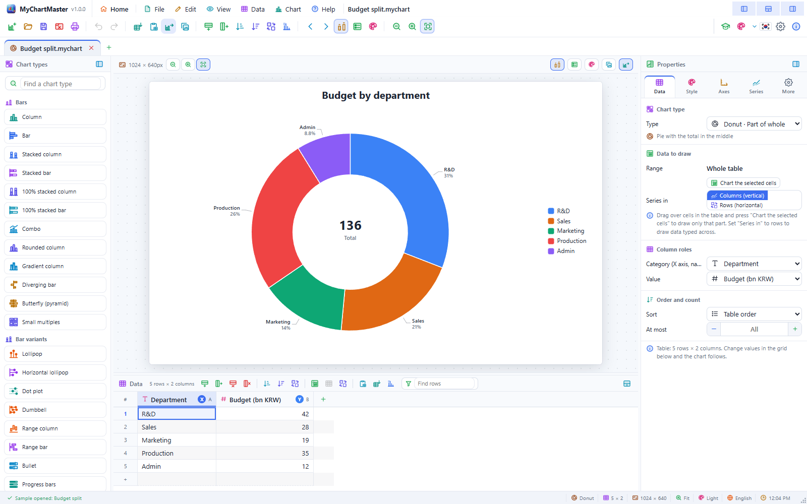

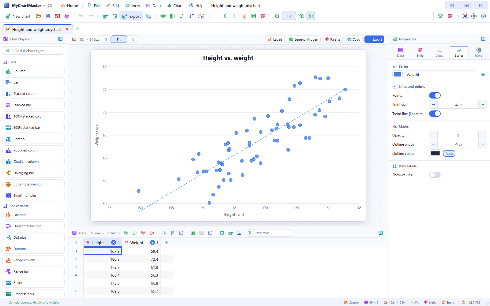

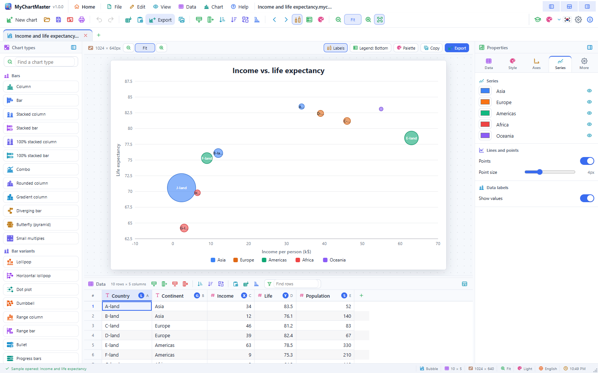

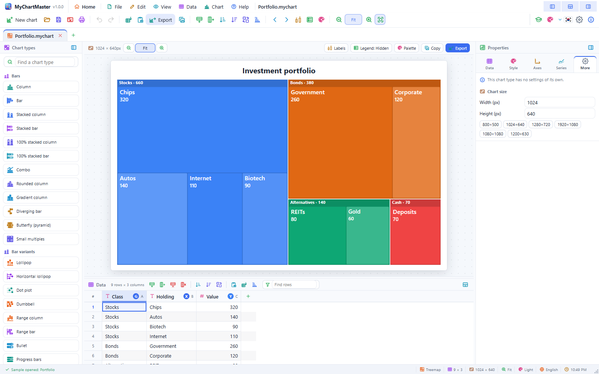

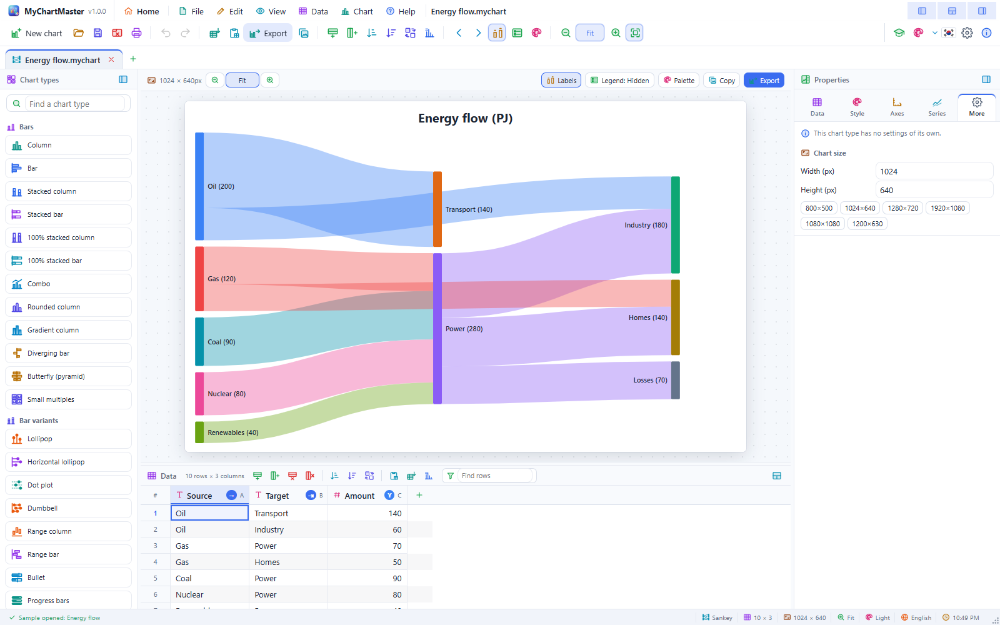

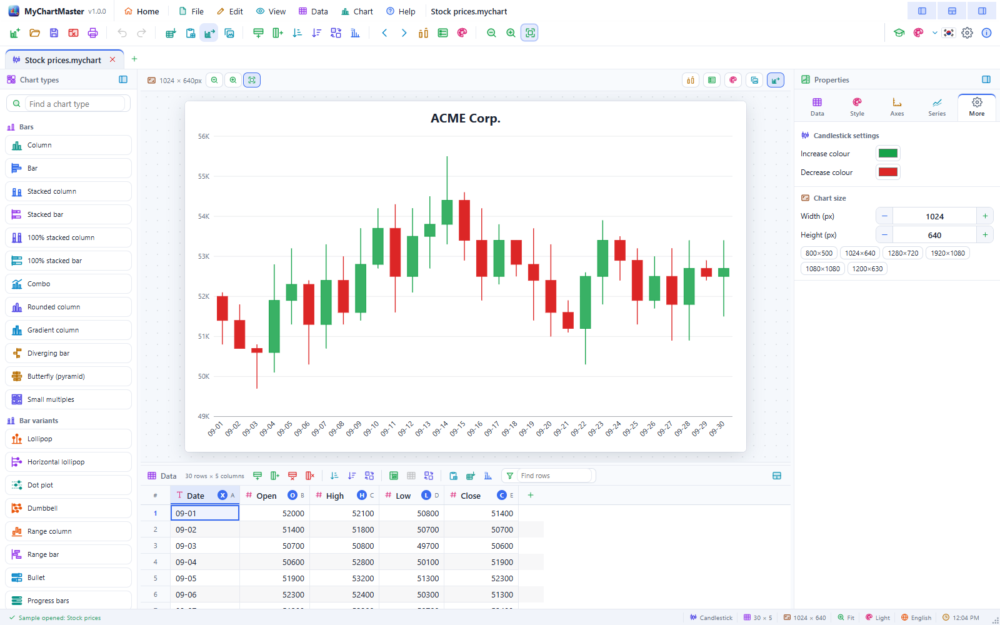

### Chart themes

Each chart has its own **chart theme** (top of Inspector › Style, **Chart › Chart theme**, or the chart's right-click
menu). It is set apart from the program's theme (light, dark …) and changes the palette, the font, the grid and its
own paper together. The Style tab shows **25 light** and **25 dark** themes, grouped, as small swatches (the name on
hover); a click applies one at once. The **Custom** swatch at the end is a theme of your own: paper, text, muted text,
grid and axis colours, palette and font (saved with the chart).

The chart's **background follows the program's theme by default**: in a dark theme the chart paper turns dark, text,
axes and grid lines turn light, and series colours are lightened or darkened as needed to keep at least 3:1 contrast
with the paper. The background can also be the **chart theme paper**, **white**, **transparent** or **any colour**.
Settings › Charts sets the chart theme of new charts.

## The data grid

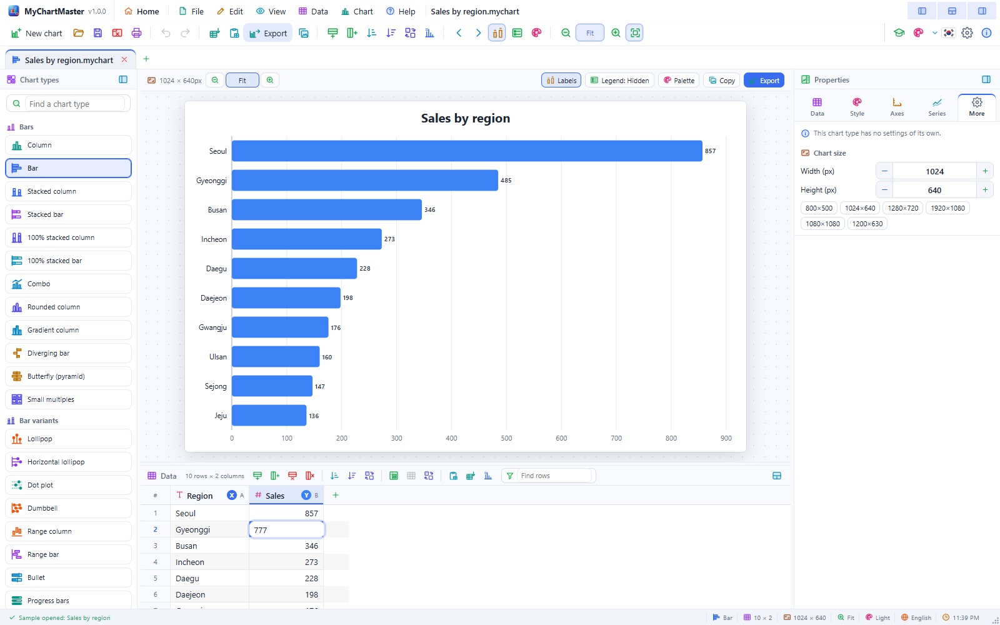

The grid works like a spreadsheet. Only the rows on screen are drawn, so 100 000 rows scroll smoothly.

- **Selecting**: click, the arrows, Tab, Enter, Page Up/Down, Home/End (with Ctrl: to the very end). Hold Shift while
  moving or drag to select a range. A row number selects the row, a header the column, the top-left corner everything.
- **Editing**: select a cell and type, or press F2, double-click or Enter. Enter moves down and Tab right, saving the
  value; Esc cancels. Typing in the **+** row at the bottom adds a row.
- **Clearing**: Delete or Backspace empties the selected cells.
- **Copy and paste**: Ctrl+C copies the range as tab-separated text (it pastes straight into Excel); Ctrl+V pastes a
  range copied from Excel or a web page from the selected cell (rows and columns are added as needed).
- **Renaming a column**: double-click its header, or **Data › Rename column**.
- **Header badges**: each column's type icon (# number, T text, calendar date) and its role in the chart (X category,
  Y1, Y2 … in the series colours, S size, G group, O/H/L/C candles …).
- **Column type**: number, text and date are found from the values. Right-click › Column type changes it (for example
  numeric codes as text). Values that are not numbers in a number column show in red italics.
- **Grid tools** (the grid's title row): add row, add column, delete selected rows/columns, sort ascending/descending
  (by the selected column), swap rows and columns, paste as new chart, import, data statistics, **Find rows** (only rows
  with that text show in the grid; the chart stays as it is).
- **Right-click**: use this column as the category (X), add/remove it as a series, copy, paste, clear, add/delete
  rows and columns, rename, column type, sort, swap rows and columns, statistics.

Numbers are read the way people write them: `1,234.5`, `1.234,5`, `12%` (0.12), `$3.20`, `₩1,000`, `(42)` (−42),
`1.2k`. Dates are recognised as `2024-03-01`, `2024/3` and `2024년 3월 1일`.

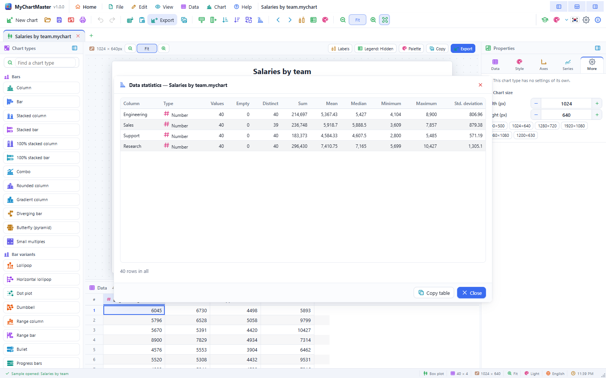

**Data › Data statistics** (Ctrl+Shift+I) shows each column's type, values, empty cells, distinct values, sum, mean,
median, minimum, maximum and standard deviation. Click a header to sort; **Copy table** pastes into Excel.

Every edit can be **undone** (Ctrl+Z) and **redone** (Ctrl+Y) — 200 steps per chart.

### The data editor window (detached)

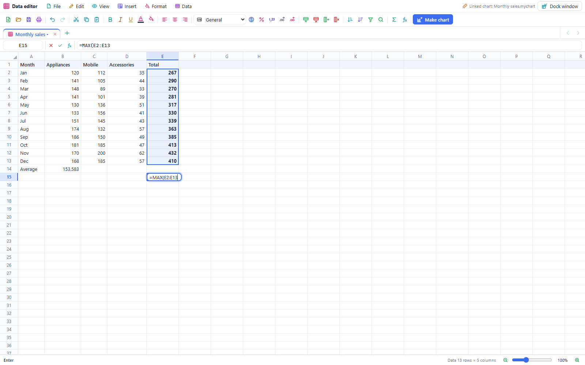

The **detach** icon at the right of the grid's title bar, the same icon on the toolbar, or **Data › Detach data
editor window** (Ctrl+Shift+D) takes the data grid out into a **window of its own** that works like Excel. On the
desktop it has its own taskbar button, so it can sit on another monitor; on the web it is a second browser
window. What you change there is drawn in the chart at once, and undo (Ctrl+Z) shares the main window's history.

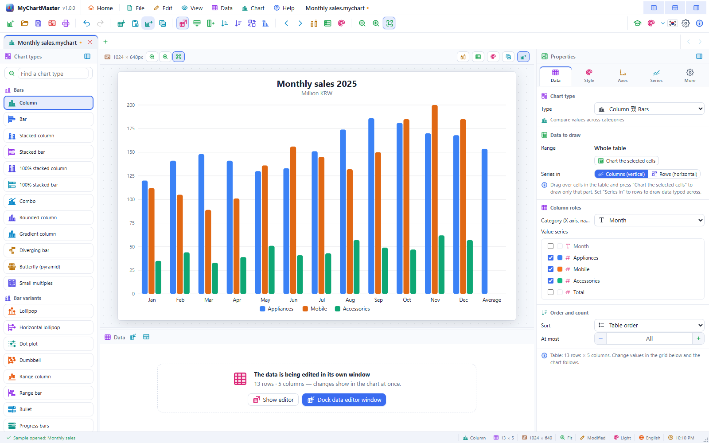

While it is detached the grid panel says so: **Show editor** brings the window to the front, **Dock data editor
window** (or **Dock window** in the editor, or closing it) puts the grid back into the main window.

The editor is laid out like Excel:

- **Menus**: File · Edit · View · Insert · Format · Data. The **toolbar**: new, open, save, print; undo, redo; cut,
  copy, paste; bold, italic, underline, font and fill colour; alignment; number format (General, Number, Comma,
  Currency, Percent, Scientific, Date, Text) and decimals; insert and delete rows and columns; sort, filter, find;
  AutoSum and Insert function; and the **Make chart** button.
- **Name box and formula bar**: the cell's address on the left (type B5 or A1:C9 to go there), its value or
  formula on the right, editable.
- **Row 1 holds the column names** (the chart's series and category names). The data starts at row 2; typing to
  the right or below the data makes the table larger.
- **Formulas** start with `=`: `=SUM(B2:B13)`, `=AVERAGE(B:B)`, `=IF(C2>100,"high","low")`, `=VLOOKUP(...)`,
  absolute references such as `$B$2`, formulas reading other formulas — more than a hundred functions. While a
  formula is typed, clicking or dragging over cells puts their address in, and typing a function name lists the
  functions (Tab picks one). Errors show as `#DIV/0!`, `#REF!`, `#NAME?`; a formula that reads itself is `#CIRC!`.
  The main window's grid takes `=` formulas too, and changing a value recalculates them and the chart.
- **Fill handle**: drag the small square at the selection's corner — formulas move their references, numbers keep
  their step, text such as `Q1` counts on. Ctrl+D (down) and Ctrl+R (right) do the same.
- **Keyboard**: arrows, Tab, Enter, Ctrl+arrows (to the edge of the data), Ctrl+Home/End, F2 (edit), Delete
  (clear), Esc (cancel), Alt+Enter (line break in a cell), Ctrl+B/I/U, Ctrl+F (find), Ctrl+H (replace), Ctrl+G
  (go to), Alt+= (AutoSum), Ctrl+Shift+L (filter). Korean input starts right away in the selected cell.
- **Copy and paste**: Ctrl+C/X/V use tab-separated text, as Excel does. Cells copied inside the program keep their
  formulas and formats; **Paste values** (Ctrl+Shift+V) and **Paste formats** are there too.
- **Column widths**: drag a column letter's border, or double-click it to fit the contents. A column letter selects
  the column, a row number the row; the right-click menus insert, delete, sort and more.
- **Sort and filter**: sorting with one cell selected sorts the whole table by its column (formulas and formats move
  with their rows). **Filter** puts ▼ buttons in row 1 to choose the values to show, or to sort.
- **Status bar**: Ready / Enter / Edit / Point, the selection's average, count, sum, min and max, the data size, and
  zoom (Ctrl+wheel).
- **Sheet tabs**: the tabs at the top (under the toolbar) are the charts open in the main window; a tab switches the
  main window to that chart, its × closes that chart (asking to save), **+** makes a new blank chart. With many tabs, **<**
  **>** at the right end of the tab row move through them; the main window's chart tabs work the same way.
- **Number formats (Excel format codes)**: **Custom…** in the number format list, or Ctrl+1, takes Excel format codes —
  `0.00`, `#,##0`, `#,##0;[Red]-#,##0`, `0.0%`, `0.00E+00`, `"$"#,##0.00`, `#,##0,"K"`, `# ?/?`, `000000`, `yyyy-mm-dd`,
  `h:mm AM/PM`, `[h]:mm`, `@` and so on, with a list of common codes and a preview. Excel files keep them both ways.
- **Carries on with your work**: the editor opens on the chart and cells you were on in the main window (a cell being
  typed in is kept); with no chart open it makes a new one. Closing the editor (Dock window, or closing it) puts the data
  back in the main window's data grid (unfolding it if it was folded), carrying on from the editor's selection.
- **No count limits**: rows, columns and imported rows have no limit (a 150 000-row file is read whole).
- **Make chart**: with a range selected it makes a new chart tab from those cells (the first row names them); with
  one cell selected it uses the whole sheet (F11). **Chart only the selection** makes the current chart draw just
  the selected range.
- **Open and save**: **Open** (Ctrl+O) opens Excel (xlsx), CSV, TSV, ODS, JSON, XML, HTML, Markdown files and
  .mychart as a new sheet (a new chart tab); a workbook with several sheets asks which one. **Import a file into
  this sheet** replaces this sheet's data. **Save** (Ctrl+S) and **Save as** write Excel, CSV, TSV, JSON, Markdown
  or HTML. Excel files keep the formulas, formats and column widths, and formulas made in Excel are read back.
  **Save chart** saves the chart and its data as .mychart (formulas and formats included).
- **Print**: **Print** (Ctrl+P) and **Print selection** show the cells on pages in the program's print window, with
  paper, orientation, margins, fit to page, **Gridlines** and **Row and column headings**.

### Picking an element of the chart to style it on its own

Anything drawn on the chart can be clicked: one bar, point or slice, the title, subtitle, legend, an axis title, the
axis and its labels, the grid lines, the plot area, the data labels, the chart's background. The picked element is
outlined on the chart and **its own properties** appear at the top of the properties panel — always with a **colour**
box, and size, weight, text, outline or opacity as the element has them. One bar (point, slice) gets its own fill
colour, outline colour, outline width and opacity (**Clear this item's own settings** takes them back), and the whole
series' colour is right there too. All of it is saved with the chart and shows in exported pictures and prints. × or a
click on an empty spot lets the element go.

## Properties panel

The right panel never gets narrower than its controls need (340 px in Korean, 390 px in English): no control is cut
or pushed onto a second line. A label longer than its column ends in "…"; hovering shows all of it.

### Data tab

- **Chart type**: also a dropdown; the type's description shows below it.
- **Column roles**: the roles the type needs — the category (X axis, names) column, the value series (one series per
  ticked number column; the dot shows its colour), X for scatter, X / Y / size / label / group for bubbles, open /
  high / low / close for candles, the group of treemaps and sunbursts, source and target for Sankey.
- **Sort**: table order, largest first, smallest first, by name (by the first series; the table keeps its order).
- **At most**: draws only that many items from the start (with sorting: "top 10").

### Data to draw (Data tab)

- **Chart the selected cells** (Ctrl+Shift+R): drag over cells in the table below and press it to draw only that part. The
  range shows as "A4:C8" and the cells outside it fade. **Chart the whole table** goes back.
- **New chart from the selection** opens a new chart with a copy of the chosen cells.
- **Series in**: **Columns (vertical)** makes each column a series (data typed down), **Rows (horizontal)** each row (data typed
  across: names in the first column, categories in the header).
- The cells can be edited at any time; the chart changes at once.

### Style tab

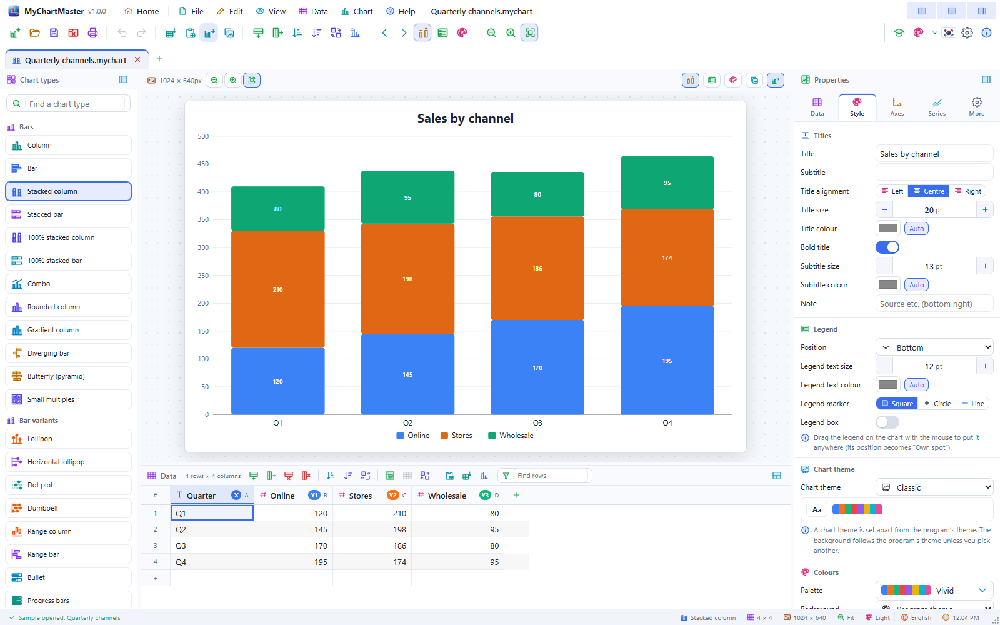

- **Titles**: title, subtitle, alignment (left, centre, right), note (source etc., bottom right).
- **Legend**: top, bottom, left, right, hidden. The legend button on the chart bar (Ctrl+Shift+G) steps through them.
- **Colours**: palette (20: Vivid, Office, Tableau 10, Category 10, Pastel, Earth, Ocean, Sunset, Forest, Berry, Neon,
  Mono blue, Grayscale, Warm, Cool, Colour-blind safe, Retro, Corporate, Candy, Night sky), background (white, theme
  colour, transparent, own colour), border.
- **Text**: text size (0.6×–2×) and font (empty: the default font).

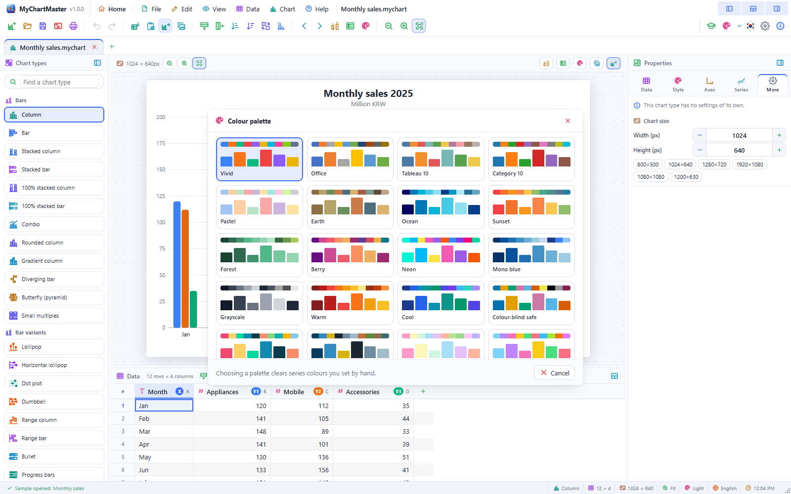

#### Fine look (Style tab)

- **Titles**: size, colour and weight of the title and subtitle.
- **Legend**: position (top, bottom, left, right, **own spot**, hidden), across / down of the own spot (%), text size and colour,
  marker (square, circle, line), a box. **Drag the legend** on the chart with the mouse to put it anywhere (own spot).
- **Plot area**: background, border, outer margin. **Text**: size and colour of the text in the chart.
- **Auto** next to a colour brings back the colour of the chart theme and the program theme.
- Every number is a **[−] value unit [+]** field: hold a button to keep stepping, or type the value. Some may be left empty
  for "automatic" (minimum, maximum, tick step …).

### Axes tab

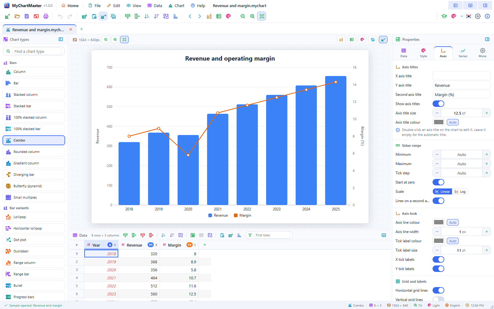

- **Axis titles**: X and Y axis titles, the second axis title of combo charts. Scatter and bubble charts use the X
  column's name when the X title is empty.
- **Value range**: minimum and maximum (empty: automatic), start at zero, scale (linear or log), lines on a second
  axis (combo).
- **Grid and labels**: horizontal and vertical grid lines, category label angle (Auto tilts labels 45° or 90° when
  they would overlap, and skips some when there are still too many).
- **Number format**: auto, plain, compact (12K), percent, scientific; decimals; prefix (₩, $) and suffix (%, °C, kg).
  Labels, ticks and value tips all use it.

Charts without axes (pie, treemap, Sankey …) show only the number format.

#### Axis look (Axes tab)

- **Axis titles**: X, Y (and second axis) titles, shown or not, size, colour. **Double-click** an axis title on the chart to
  edit it (empty brings back the automatic title).
- **Range**: minimum, maximum, **tick step**, begin at zero, linear or log scale.
- **Axis look**: axis line colour and width, tick label colour and size, X and Y tick labels shown or not.
- **Grid**: horizontal and vertical grid lines, grid colour, width and style (as the chart theme, solid, dashed, dotted), label angle.

### Series tab

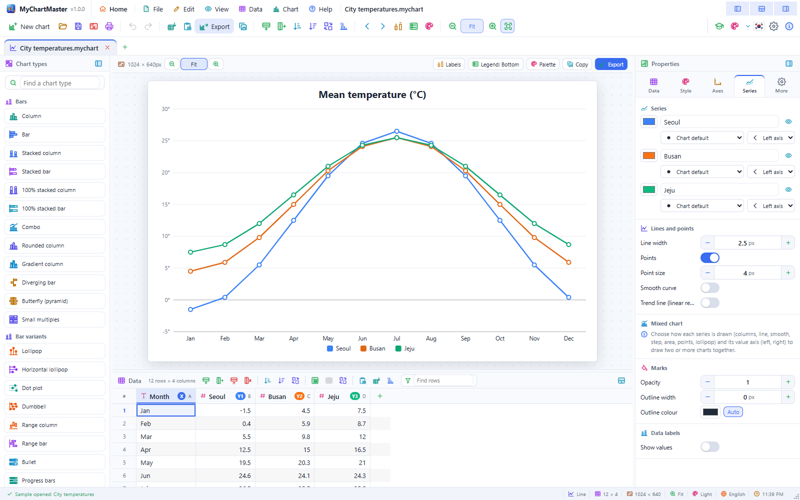

- **Series** (**Slices** for pies): pick a colour, rename (= the column name), show or hide, back to the palette colour.
- **Lines and points**: line width, points, point size, smooth curve, area opacity, **trend line** (linear
  regression; point at it for the equation and R²).
- **Bars**: corner radius, gap between bars.
- **Data labels**: show values; label position for pies (outside: name and share / inside: share).

#### Mixed charts (Series tab)

Choose for each series how it is drawn (chart default, columns, line, smooth line, step line, area, points, lollipops) and its
**value axis** (left, right) to draw two or more charts in one (for example columns + line + area with a right axis). Column, line,
smooth, step, area, combo and lollipop charts can be mixed; choosing a mix on a chart that cannot (pie, stacked or sideways
charts) opens a window that says why. **Clear the mix** goes back. **Marks** sets the opacity and outline of every mark.

#### Right-click menus

The menu fits what was clicked: the legend (hide a series, its colour, legend position, box), an axis title (edit, show, axis
settings), an axis or its labels (axis settings, grid lines, tick labels), the title (edit, title look), a mark (hide its series,
colour, how it is drawn, labels, trend line) or an empty spot (the whole chart). Chart, table and tab menus always offer
**Copy · Export · Print**.

### More tab

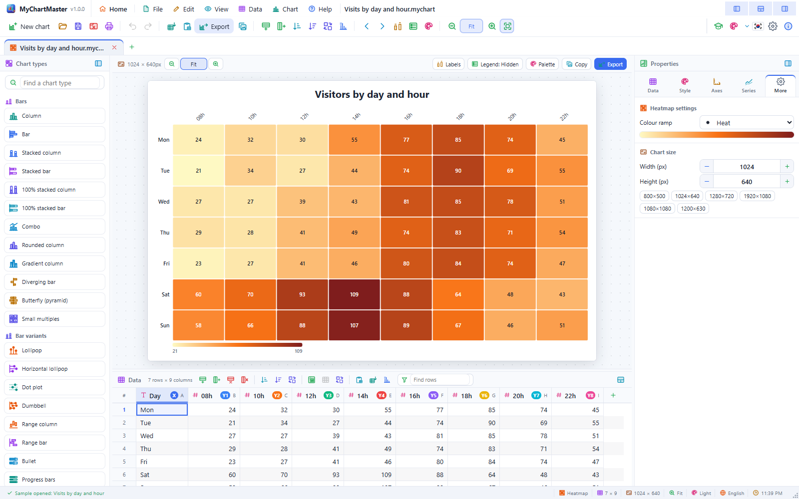

Settings of particular types: the donut's hole size; the start angle of pies, polar areas and sunbursts; the gap
between slices; the histogram's bins; the heat map's colour ramp (blues, greens, reds, purples, oranges, viridis,
diverging, heat); the gauge's minimum and maximum; the waterfall's total bar; increase and decrease colours. And the
**chart size** (width and height in pixels, with common sizes). The chart size is the export's default size.

## Importing data

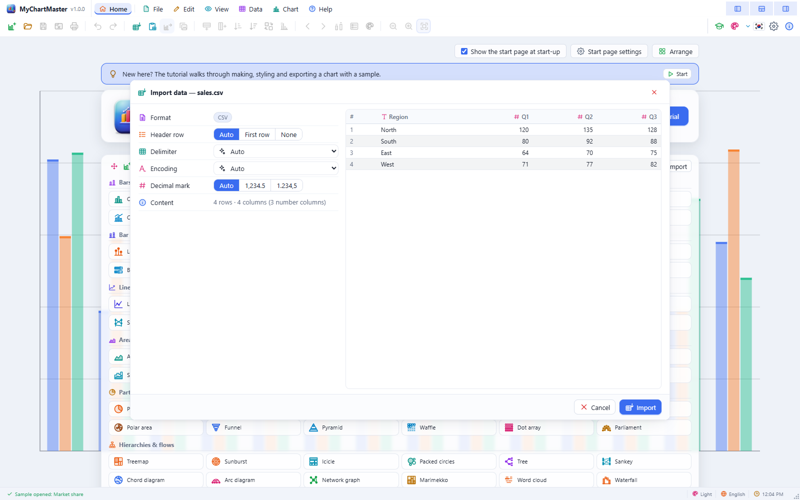

**Data › Import data** (Ctrl+I) picks a file and opens a preview window.

| Format | Extensions | Notes |
| --- | --- | --- |
| CSV · text | .csv .txt .dat .prn | Delimiter found by itself (comma, semicolon, tab, pipe, spaces), commas and line breaks inside quotes, `sep=;` first line |
| TSV | .tsv .tab | Tab-separated |
| Excel | .xlsx .xlsm | Sheet choice, shared strings, date formats, tables that do not start at A1 |
| OpenDocument | .ods | Sheet choice, repeated rows and cells |
| JSON | .json .geojson | Arrays of objects, arrays of arrays, `{columns, rows}`, Chart.js `{labels, datasets}`, column objects `{A:[…]}`, `{name: value}`, `data` / `values` / `records` wrappers, GeoJSON properties, nested objects (a.b) |
| XML | .xml | The most repeated element as rows, its attributes and child elements as columns |
| HTML | .html .htm | One per table on the page (chosen like sheets), colspan |
| Markdown | .md | Pipe tables, the heading above names the table |
| MyChartMaster | .mychart | Opens the chart as it is |

The preview window's choices (the preview follows at once):

- **Sheet / table**, when there are several.
- **Header row**: auto (the first row is a header when it is all text and numbers follow), first row, none (A, B, C …).
- **Delimiter**, **encoding** (auto: UTF-8, else EUC-KR (CP949), then Windows-1252; UTF-16 with a BOM), **decimal
  mark** (auto, `1,234.5`, `1.234,5`).
- **Import into**: a new chart, or this chart (its data is replaced; its settings stay).

The chart type is guessed from the data: scatter for two or more number columns and no text, line for many rows, pie
for one value and a few rows, column otherwise.

Other ways in:

- **Open** (Ctrl+O) a data file: a new chart with the default import settings (Settings › Data import), no preview.
- **Drop** files on the window.
- **Paste as new chart** (Ctrl+Shift+V): a new chart from the table on the clipboard (Excel range, CSV, Markdown or
  HTML table, JSON).
- On the desktop, **Open with** from the file manager (.mychart is registered by the installer).

## Saving and exporting

- **Save** (Ctrl+S) and **Save as** (Ctrl+Shift+S) write a `.mychart` file (JSON) with the data and the chart
  settings. A chart made from a data file asks where to save the first time.

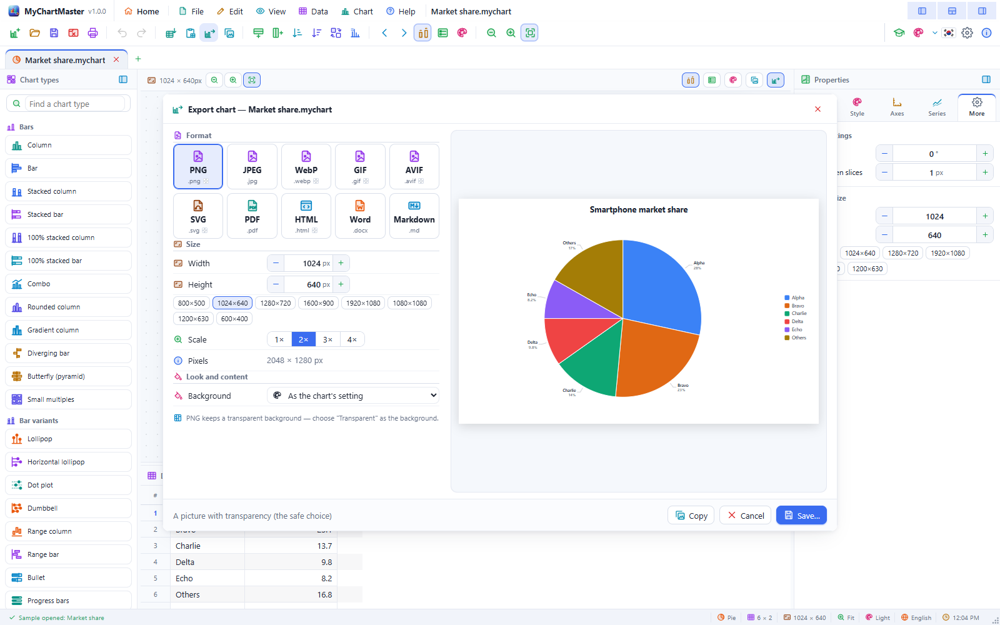

**File › Export** (Ctrl+E) opens a window with a preview.

| Format | Content | Transparent background |
| --- | --- | --- |
| PNG | The safe choice | yes |
| JPEG | Compressed photo picture, quality | no (white) |
| WebP | Small web picture, quality | yes |
| GIF | 256-colour picture | yes (hard edges) |
| AVIF | The smallest modern picture (the desktop program encodes it itself), quality | yes |
| SVG | Vector picture (sharp at any size; values on hover) | yes |
| PDF | The chart on page 1, the data table after it; paper and orientation | no (white) |
| HTML | The chart (a page with value tips) and the data table | yes |
| Word (.docx) | The chart picture and the data table | no (white) |
| Markdown | Markdown with the picture inside, and the data table | no (white) |

Choose the size (width and height, common sizes), scale (1×–4×; the real pixels are shown), background (as the
chart's setting, program theme, white, and **transparent** for the formats that keep it — a small checkerboard on a
format button marks them; with transparent chosen, switching to JPEG and the like makes it white and switching back
makes it transparent again) and whether to include the data table. **Copy** puts the picture
with these settings on the clipboard. To skip the window, pick the format in **File › Export as**.

- **Copy chart picture** (Ctrl+Shift+C) copies the chart as PNG (as SVG code where the clipboard takes no pictures).
- **Edit › Copy**: SVG code, the whole table (tab-separated), the selected cells.
- **File › Export data**: CSV (comma, with a BOM for Excel), TSV, JSON (array of objects), Markdown table, HTML table,
  Excel (xlsx).

## Printing

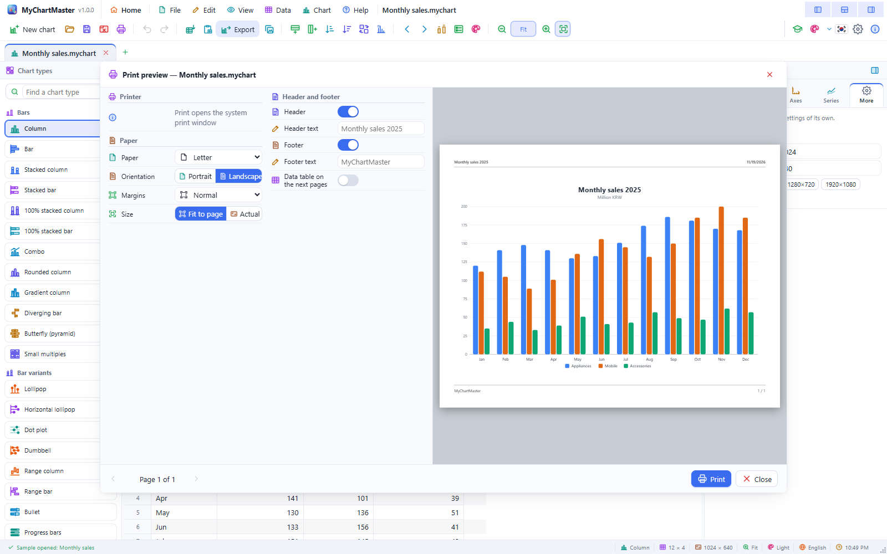

**File › Print** (Ctrl+P) opens its own window, every setting in one column on the left: printer and copies (Windows), paper (A3, A4, A5, B4, B5, Letter, Legal,
Tabloid), orientation, margins, size (fit to page or actual size), header and footer and their text, the data table on
the next pages. The page preview is right beside them; **Print** prints at once on the chosen printer, without a system
dialog (where no printer list is available, the system dialog opens). In the browser, the browser's print dialog opens.

Wherever Print is pressed, the same separate print window opens: the toolbar, the File menu, Ctrl+P, the right-click menus of
the chart, the table and the tabs, and **Print in the user's guide and tutorial document windows** (Ctrl+P). A document is laid
out on pages of the chosen paper, orientation and margins (a heading stays with what follows, long tables split with their
head repeated); the chart-only choices (size, data table) are not shown.

## Settings

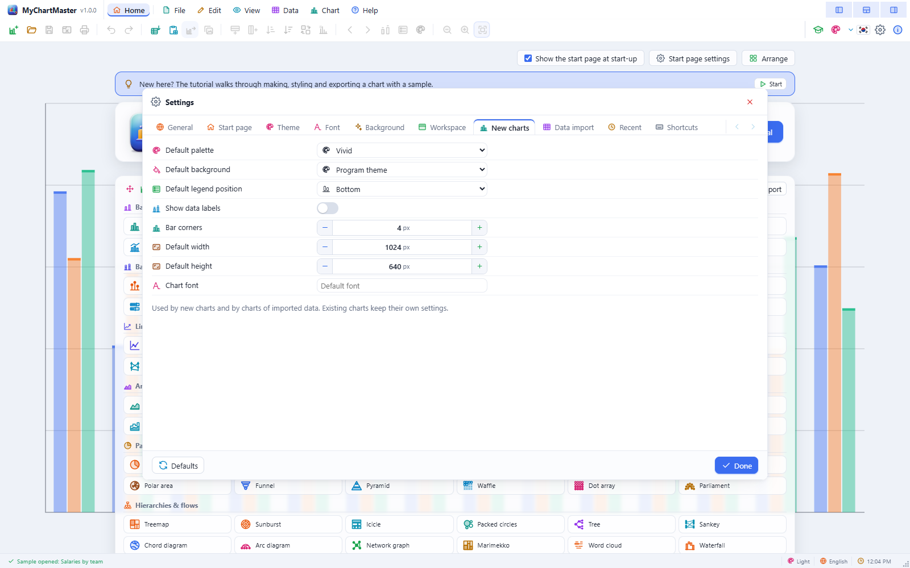

The tabs of **Edit › Settings** (Ctrl+Shift+P):

- **General**: language, reopen last files at start, ask before deleting rows and columns, status bar clock, status bar, tutorial.
- **Start page**: show the start page and the welcome window at start; recent files, folders, samples and background
  cards; the tutorial banner.
- **Theme**: light and dark themes, your own theme (colours, contrast check).
- **Font**: interface font, size, weight, italic, interface zoom.
- **Background**: moving, picture or none; kind, speed, opacity, picture fit.
- **Workspace**: grid position, the three panels, grid row height, value tips on charts, chart animation.
- **New charts**: default palette, background, legend position, data labels, bar corners, width and height, chart font.
- **Data import**: header row, delimiter, encoding, decimal mark (every row is read, with no limit).
- **Recent**: manage the recent files and folders.
- **Shortcuts**: every keyboard shortcut.

Change the **theme** with the palette button on the toolbar (random), the arrow next to it (choose) or the status
bar, and the **language** with the flag button or Ctrl+Shift+L (한국어 ↔ English). With the chart background set to
"Theme colour" the chart follows the theme.

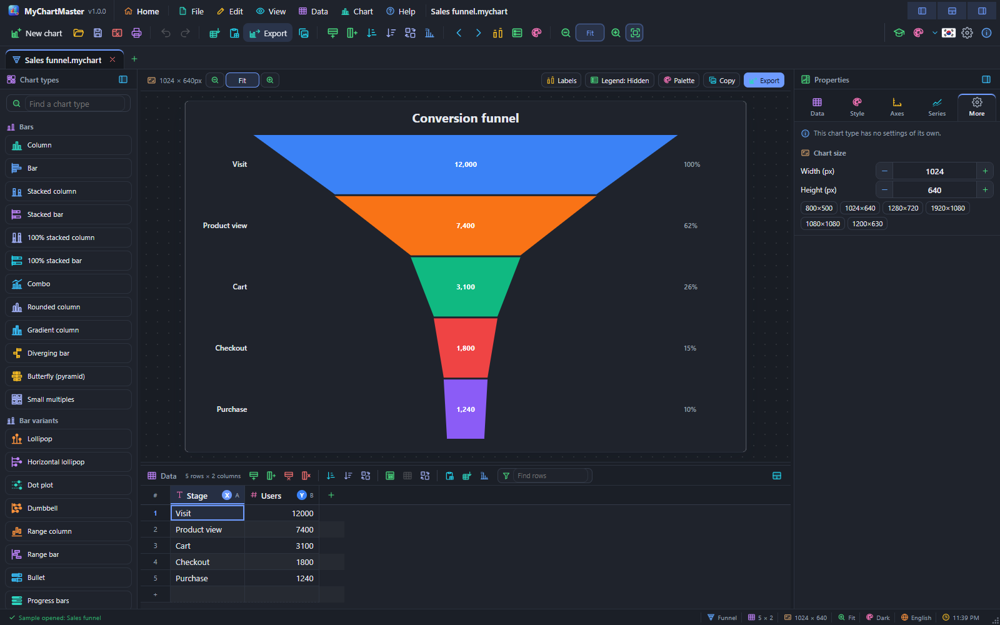

## Keyboard shortcuts

| Keys | Action |
| --- | --- |
| Ctrl+N | New chart |
| Ctrl+O | Open |
| Ctrl+S / Ctrl+Shift+S | Save / Save as |
| Ctrl+W | Close chart |
| Ctrl+P | Print |
| Ctrl+I | Import data |
| Ctrl+E | Export |
| Ctrl+Shift+C | Copy chart picture |
| Ctrl+Shift+V | Paste as new chart |
| Ctrl+Z / Ctrl+Y (Ctrl+Shift+Z) | Undo / Redo |
| Ctrl+Enter / Ctrl+Shift+Enter | Add row / Add column |
| Ctrl+Shift+T | Swap rows and columns |
| Ctrl+Shift+R | Chart the selected cells |
| Ctrl+Shift+I | Data statistics |
| Ctrl+Shift+D | Detach the data editor window |
| Ctrl+L | Data labels |
| Ctrl+Shift+G | Move legend |
| Ctrl+K | Colour palette |
| Ctrl+[ / Ctrl+] | Previous / next chart type |
| Ctrl+= / Ctrl+- / Ctrl+0 | Zoom in / out / fit |
| Ctrl+Shift+1 / Ctrl+J / Ctrl+Shift+2 | Chart types / data grid / properties panel |
| Ctrl+Tab | Next chart |
| Ctrl+Shift+L | Switch language |
| Ctrl+Shift+H | Start page |
| Ctrl+Shift+P | Settings |
| F11 | Tutorial |
| F1 | About |
| Arrows · Tab · Enter · F2 · Delete · Ctrl+C · Ctrl+V | Move, edit, clear, copy and paste in the data grid |

## File format

`.mychart` is UTF-8 JSON:

```json
{
  "format": "mychart", "version": 1, "app": "MyChartMaster",
  "created": "…", "modified": "…",
  "chart": { "type": "column", "title": "…", "subtitle": "…",
             "mapping": { "category": 0, "values": [1, 2] },
             "options": { "palette": "vivid", "legend": "bottom", "width": 1024, "height": 640, "…": "…" } },
  "data": { "columns": [{ "name": "Month", "type": "text" }, { "name": "Sales", "type": "number" }],
            "rows": [["Jan", 120], ["Feb", 141]] }
}
```

The numbers in `mapping` are positions in `data.columns` (from 0). The installation folder (for the web version, the
repository) has the 31 samples as `.mychart` in `samples/`, and in `samples/data/` the same table as CSV, TSV, JSON,
Excel, Markdown, HTML and XML.

## Troubleshooting

| Problem | What to do |
| --- | --- |
| Korean text looks garbled | In the import window, set the encoding to EUC-KR (CP949) or UTF-8. |
| Numbers come in as text | Set the decimal mark, or right-click the header › Column type › Number. |
| The header row comes in as data | Set the header row to "First row" in the import window. |
| The chart says "Choose at least one number column" | Tick one or more value series on the Data tab. |
| Exported JPEG or PDF has a white background | Those formats have no transparency. Use PNG, WebP, AVIF or SVG. |
| AVIF fails in the browser | The browser has no AVIF encoder: use the desktop program. |
| Copying the picture pastes SVG text | The clipboard takes no pictures there. Export a PNG instead. |

## Installing and building

- Web: `npm install`, then `npm run dev` (development server at `http://localhost:1476`) or `npm run build:webapp`.
- Windows setup: the installer first opens an **installation language** window (titled "MyChartMaster 1.0.0", the program
  icon in its title bar). Choose Korean or English and press OK: the installation runs in that language and the program opens
  in it at its first start afterwards (a language chosen later in Settings is kept). Cancel ends without changing anything.
- Installers: `npm run build:win` (NSIS .exe), `npm run build:mac` (.dmg), `npm run build:linux` (.deb, .rpm,
  .AppImage), `npm run build:all` (everything this OS can build). They are copied to `release/` and the project root.
- Tests: `npm test` (unit, texts, Rust, web E2E, tutorial, desktop E2E + the installation language window); quickly:
  `npm run test:quick`. The results end in an aligned colour table (pass, fail, skip, total, pass-rate bar, time per category).
- One installation at a time: installing removes an earlier one and asks whether to delete the old user data.
  Several copies of the program can run at once.
