# MyCodeChecker 튜토리얼

이 튜토리얼은 시작 화면부터 프로젝트 분석, 이슈 처리, AI 코드 수정, 정밀 결함 분석, 규정 보고서, 관리와 설정까지 MyCodeChecker 를 실제 화면으로 따라갑니다. 같은 단계가 프로그램 안에서도 실행됩니다 — **도움말 › 튜토리얼 시작** (또는 시작 화면의 **튜토리얼 시작**) 을 누르면 오른쪽 아래 카드의 이전 / 다음, 자동 재생, 장 목록으로 화면이 직접 움직입니다.

## 차례

1. 시작 화면
2. 프로젝트와 분석
3. 화면 구성
4. 개요와 품질 게이트
5. 이슈 처리
6. AI 코드 수정
7. 코드 살펴보기
8. 정밀 결함 분석
9. 보안·규정 준수
10. 의존성·웹 스캔·풀 리퀘스트
11. 보고서
12. 규칙·프로파일·게이트
13. 관리
14. 설정
15. 도움말과 CI

## 1. 시작 화면

### 1. MyCodeChecker에 오신 것을 환영합니다

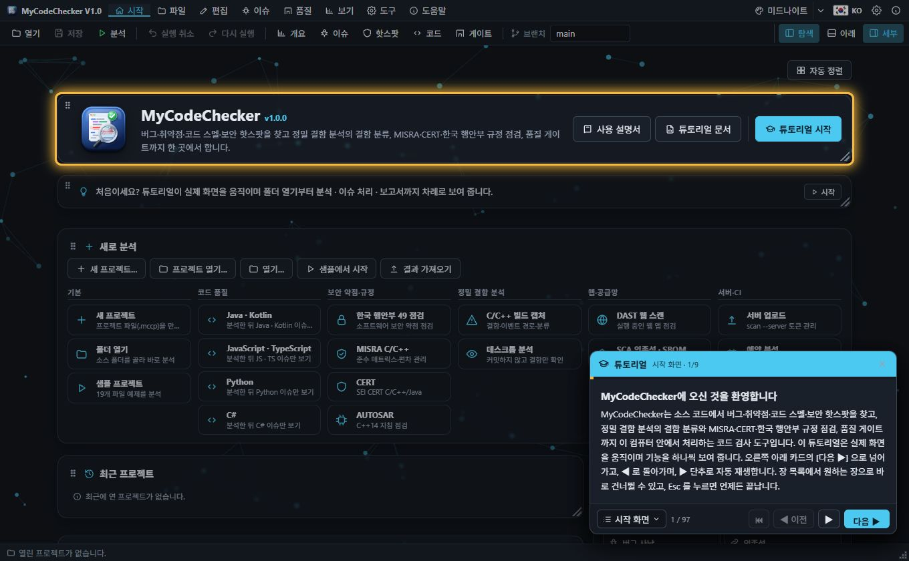

MyCodeChecker는 소스 코드에서 버그·취약점·코드 스멜·보안 핫스팟을 찾고, 정밀 결함 분석의 결함 분류와 MISRA·CERT·한국 행안부 규정 점검, 품질 게이트까지 이 컴퓨터 안에서 처리하는 코드 검사 도구입니다. 이 튜토리얼은 실제 화면을 움직이며 기능을 하나씩 보여 줍니다. 오른쪽 아래 카드의 [다음 ▶] 으로 넘어가고, ◀ 로 돌아가며, ▶ 단추로 자동 재생합니다. 장 목록에서 원하는 장으로 바로 건너뛸 수 있고, Esc 를 누르면 언제든 끝납니다.

### 2. 문서와 튜토리얼 단추

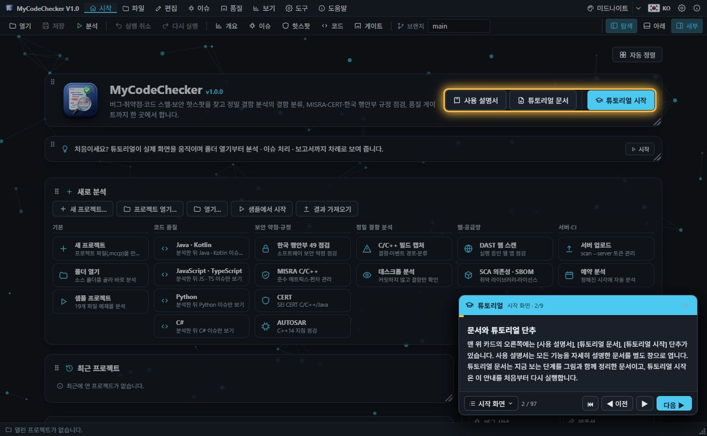

맨 위 카드의 오른쪽에는 [사용 설명서], [튜토리얼 문서], [튜토리얼 시작] 단추가 있습니다. 사용 설명서는 모든 기능을 자세히 설명한 문서를 별도 창으로 엽니다. 튜토리얼 문서는 지금 보는 단계를 그림과 함께 정리한 문서이고, 튜토리얼 시작은 이 안내를 처음부터 다시 실행합니다.

### 3. 새로 분석

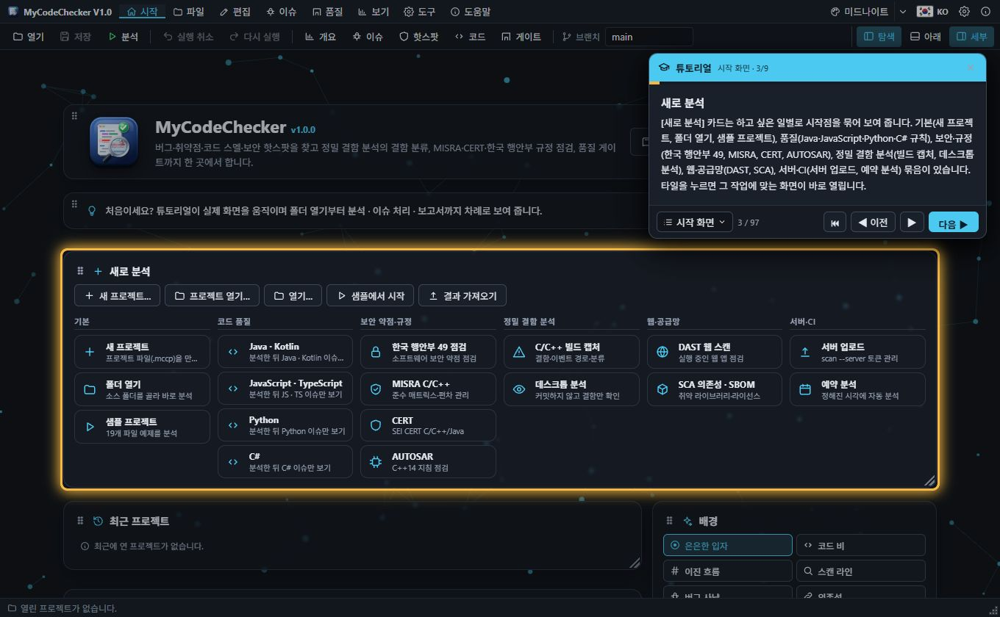

[새로 분석] 카드는 하고 싶은 일별로 시작점을 묶어 보여 줍니다. 기본(새 프로젝트, 폴더 열기, 샘플 프로젝트), 품질(Java·JavaScript·Python·C# 규칙), 보안·규정(한국 행안부 49, MISRA, CERT, AUTOSAR), 정밀 결함 분석(빌드 캡처, 데스크톱 분석), 웹·공급망(DAST, SCA), 서버·CI(서버 업로드, 예약 분석) 묶음이 있습니다. 타일을 누르면 그 작업에 맞는 화면이 바로 열립니다.

### 4. 최근 프로젝트

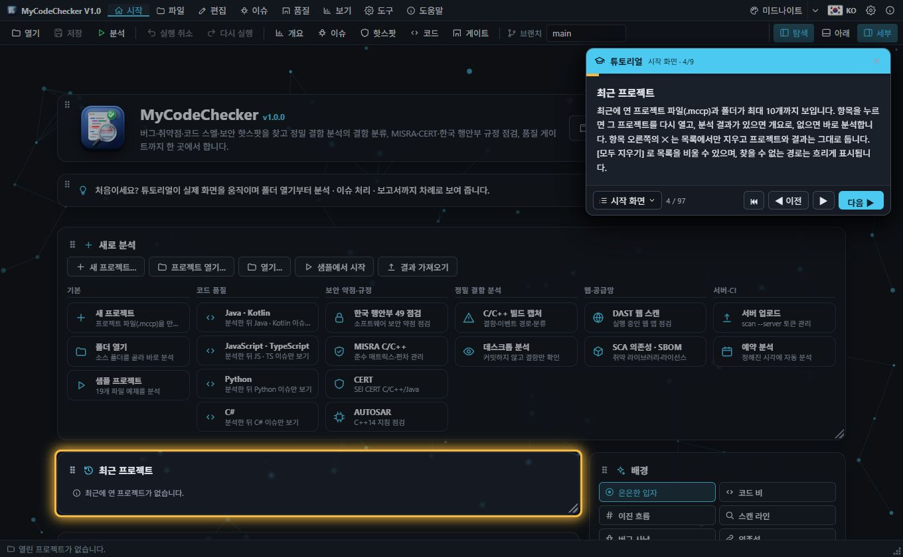

최근에 연 프로젝트 파일(.mccp)과 폴더가 최대 10개까지 보입니다. 항목을 누르면 그 프로젝트를 다시 열고, 분석 결과가 있으면 개요로, 없으면 바로 분석합니다. 항목 오른쪽의 ✕ 는 목록에서만 지우고 프로젝트와 결과는 그대로 둡니다. [모두 지우기] 로 목록을 비울 수 있으며, 찾을 수 없는 경로는 흐리게 표시됩니다.

### 5. 도움말 카드

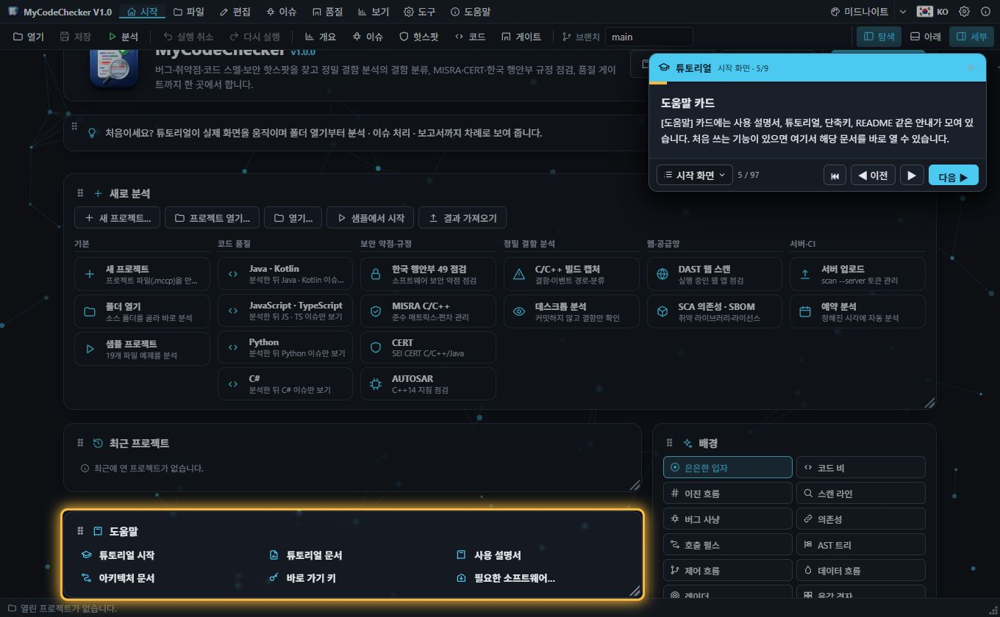

[도움말] 카드에는 사용 설명서, 튜토리얼, 단축키, README 같은 안내가 모여 있습니다. 처음 쓰는 기능이 있으면 여기서 해당 문서를 바로 열 수 있습니다.

### 6. 움직이는 배경

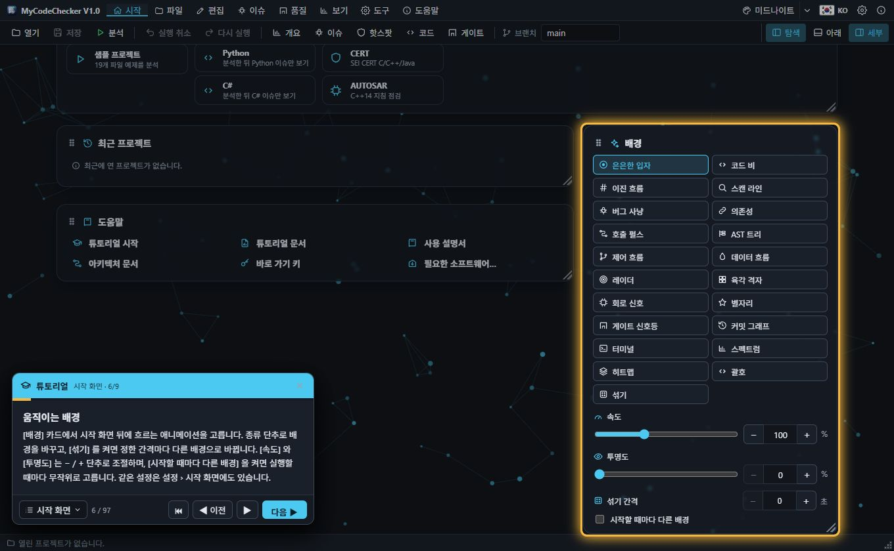

[배경] 카드에서 시작 화면 뒤에 흐르는 애니메이션을 고릅니다. 종류 단추로 배경을 바꾸고, [섞기] 를 켜면 정한 간격마다 다른 배경으로 바뀝니다. [속도] 와 [투명도] 는 − / + 단추로 조절하며, [시작할 때마다 다른 배경] 을 켜면 실행할 때마다 무작위로 고릅니다. 같은 설정은 설정 › 시작 화면에도 있습니다.

### 7. 샘플·예제

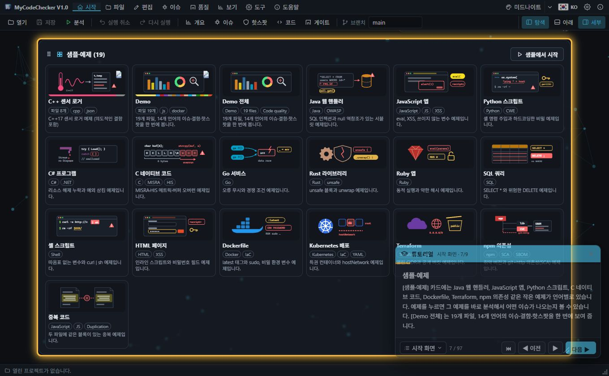

[샘플·예제] 카드에는 Java 웹 핸들러, JavaScript 앱, Python 스크립트, C 네이티브 코드, Dockerfile, Terraform, npm 의존성 같은 작은 예제가 언어별로 있습니다. 예제를 누르면 그 예제를 바로 분석해서 어떤 이슈가 나오는지 볼 수 있습니다. [Demo 전체] 는 19개 파일, 14개 언어의 이슈·결함·핫스팟을 한 번에 보여 줍니다.

### 8. 카드 옮기기와 크기 바꾸기

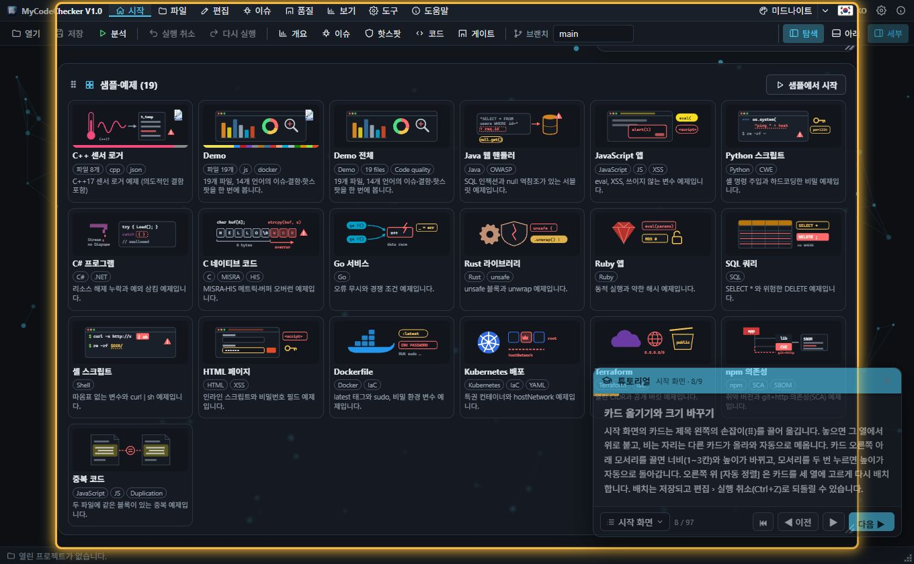

시작 화면의 카드는 제목 왼쪽의 손잡이(⠿)를 끌어 옮깁니다. 놓으면 그 열에서 위로 붙고, 비는 자리는 다른 카드가 올라와 자동으로 메웁니다. 카드 오른쪽 아래 모서리를 끌면 너비(1~3칸)와 높이가 바뀌고, 모서리를 두 번 누르면 높이가 자동으로 돌아갑니다. 오른쪽 위 [자동 정렬] 은 카드를 세 열에 고르게 다시 배치합니다. 배치는 저장되고 편집 › 실행 취소(Ctrl+Z)로 되돌릴 수 있습니다.

### 9. 시작할 때 이 화면 보기

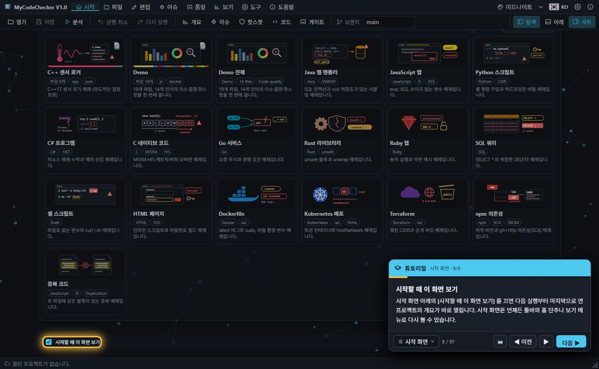

시작 화면 아래의 [시작할 때 이 화면 보기] 를 끄면 다음 실행부터 마지막으로 연 프로젝트의 개요가 바로 열립니다. 시작 화면은 언제든 툴바의 홈 단추나 보기 메뉴로 다시 볼 수 있습니다.

## 2. 프로젝트와 분석

### 10. 새 프로젝트 만들기

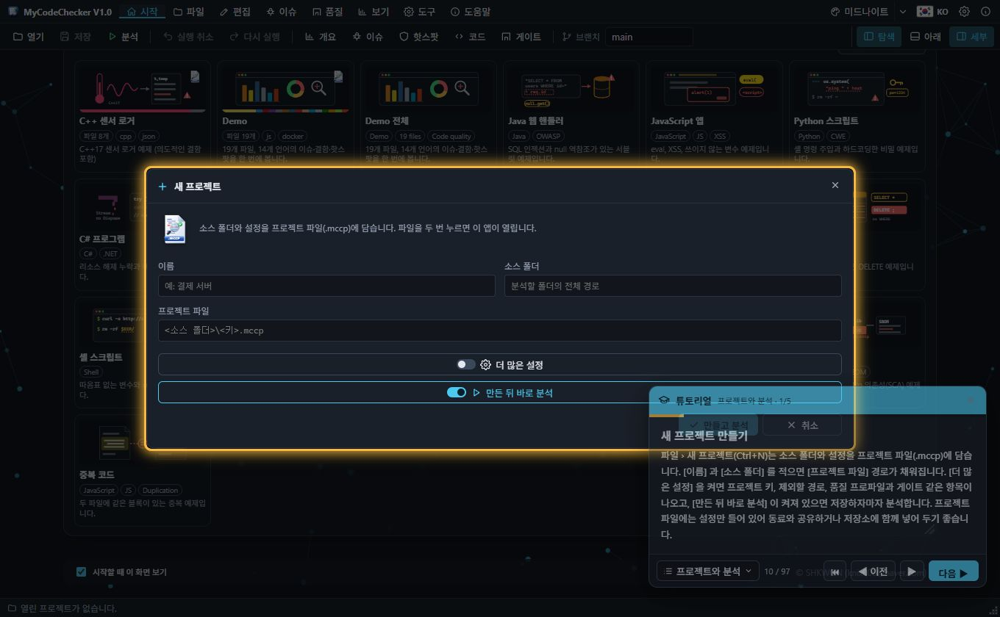

파일 › 새 프로젝트(Ctrl+N)는 소스 폴더와 설정을 프로젝트 파일(.mccp)에 담습니다. [이름] 과 [소스 폴더] 를 적으면 [프로젝트 파일] 경로가 채워집니다. [더 많은 설정] 을 켜면 프로젝트 키, 제외할 경로, 품질 프로파일과 게이트 같은 항목이 나오고, [만든 뒤 바로 분석] 이 켜져 있으면 저장하자마자 분석합니다. 프로젝트 파일에는 설정만 들어 있어 동료와 공유하거나 저장소에 함께 넣어 두기 좋습니다.

### 11. 프로젝트 열기와 저장

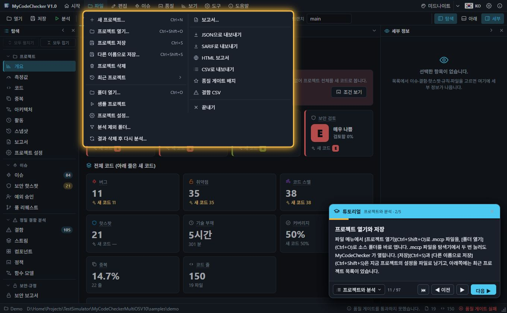

파일 메뉴에서 [프로젝트 열기](Ctrl+Shift+O)로 .mccp 파일을, [폴더 열기](Ctrl+O)로 소스 폴더를 바로 엽니다. .mccp 파일을 탐색기에서 두 번 눌러도 MyCodeChecker 가 열립니다. [저장](Ctrl+S)과 [다른 이름으로 저장](Ctrl+Shift+S)은 지금 프로젝트의 설정을 파일로 남기고, 아래쪽에는 최근 프로젝트 목록이 있습니다.

### 12. 분석 실행

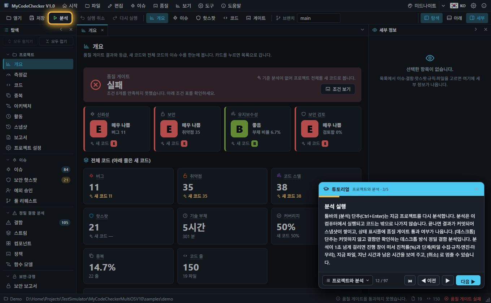

툴바의 [분석] 단추(Ctrl+Enter)는 지금 프로젝트를 다시 분석합니다. 분석은 이 컴퓨터에서 실행되고 코드는 밖으로 나가지 않습니다. 끝나면 결과가 커밋되어 스냅샷이 쌓이고, 상태 표시줄에 품질 게이트 통과 여부가 나옵니다. [데스크톱] 단추는 커밋하지 않고 결함만 확인하는 데스크톱 방식 정밀 결함 분석입니다. 분석이 1초 넘게 걸리면 진행 창이 떠서 진척률(%)과 단계(파일 수집·규칙·엔진·마무리), 지금 파일, 지난 시간과 남은 시간을 보여 주고, [취소] 로 멈출 수 있습니다.

### 13. 브랜치

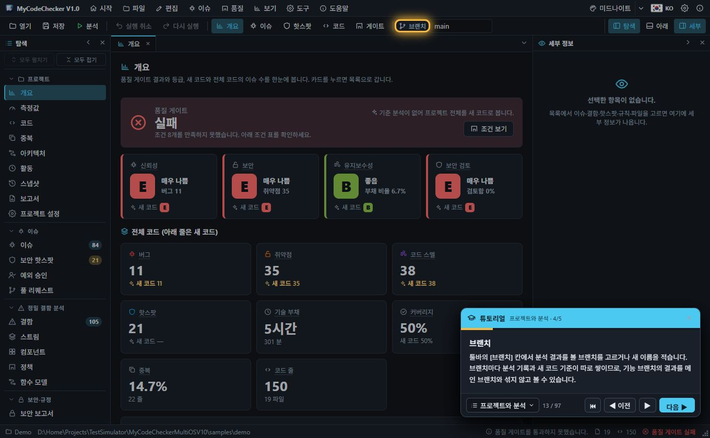

툴바의 [브랜치] 칸에서 분석 결과를 볼 브랜치를 고르거나 새 이름을 적습니다. 브랜치마다 분석 기록과 새 코드 기준이 따로 쌓이므로, 기능 브랜치의 결과를 메인 브랜치와 섞지 않고 볼 수 있습니다.

### 14. 분석 로그

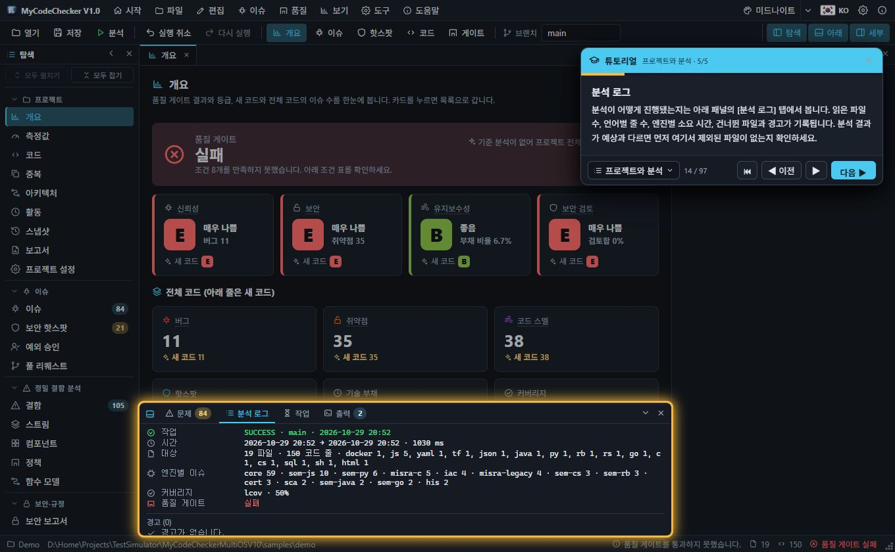

분석이 어떻게 진행됐는지는 아래 패널의 [분석 로그] 탭에서 봅니다. 읽은 파일 수, 언어별 줄 수, 엔진별 소요 시간, 건너뛴 파일과 경고가 기록됩니다. 분석 결과가 예상과 다르면 먼저 여기서 제외된 파일이 없는지 확인하세요.

## 3. 화면 구성

### 15. 메뉴 표시줄

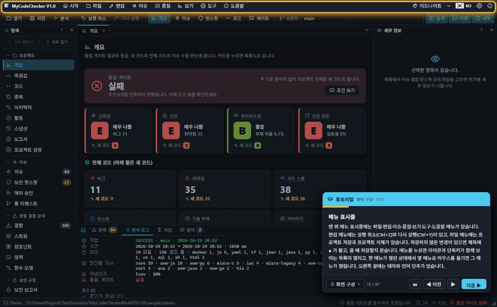

맨 위 메뉴 표시줄에는 파일·편집·이슈·품질·보기·도구·도움말 메뉴가 있습니다. 편집 메뉴에는 실행 취소(Ctrl+Z)와 다시 실행(Ctrl+Y)이 있고, 파일 메뉴에는 프로젝트 저장과 프로젝트 삭제가 있습니다. 저장하지 않은 변경이 있으면 제목에 ● 가 붙고, 끌 때 저장할지 묻습니다. 메뉴를 누르면 아이콘과 단축키가 함께 보이는 목록이 열리고, 한 메뉴가 열린 상태에서 옆 메뉴로 마우스를 옮기면 그 메뉴가 열립니다. 오른쪽 끝에는 테마와 언어 단추가 있습니다.

### 16. 툴바

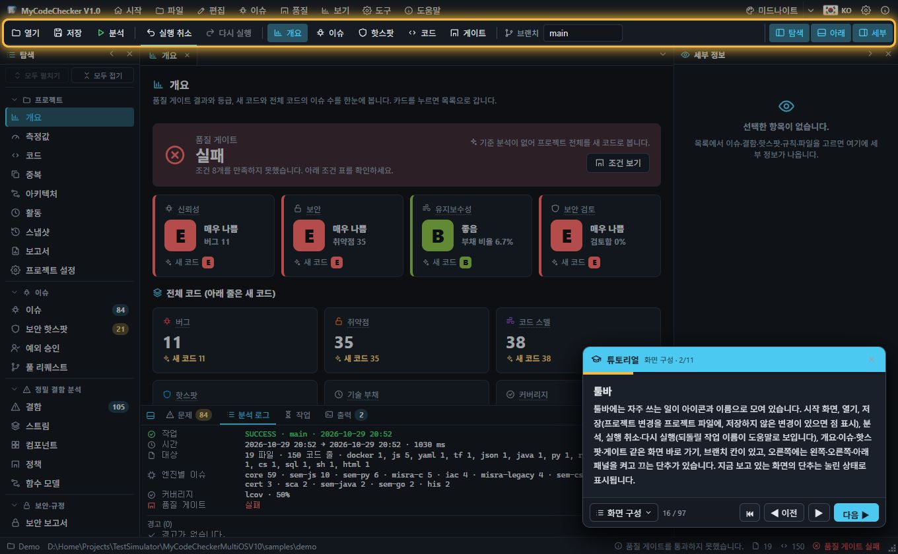

툴바에는 자주 쓰는 일이 아이콘과 이름으로 모여 있습니다. 시작 화면, 열기, 저장(프로젝트 변경을 프로젝트 파일에, 저장하지 않은 변경이 있으면 점 표시), 분석, 실행 취소·다시 실행(되돌릴 작업 이름이 도움말로 보입니다), 개요·이슈·핫스팟·게이트 같은 화면 바로 가기, 브랜치 칸이 있고, 오른쪽에는 왼쪽·오른쪽·아래 패널을 켜고 끄는 단추가 있습니다. 지금 보고 있는 화면의 단추는 눌린 상태로 표시됩니다.

### 17. 왼쪽 탐색 패널

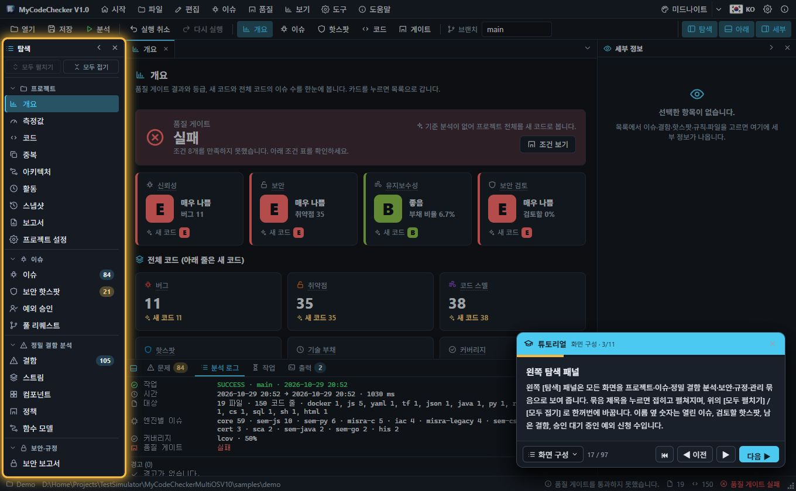

왼쪽 [탐색] 패널은 모든 화면을 프로젝트·이슈·정밀 결함 분석·보안·규정·관리 묶음으로 보여 줍니다. 묶음 제목을 누르면 접히고 펼쳐지며, 위의 [모두 펼치기] / [모두 접기] 로 한꺼번에 바꿉니다. 이름 옆 숫자는 열린 이슈, 검토할 핫스팟, 남은 결함, 승인 대기 중인 예외 신청 수입니다.

### 18. 묶음 접기

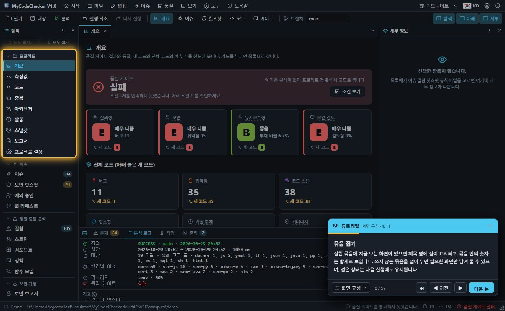

접힌 묶음에 지금 보는 화면이 있으면 제목 옆에 점이 표시되고, 묶음 안의 숫자는 합계로 보입니다. 쓰지 않는 묶음을 접어 두면 필요한 화면만 남겨 둘 수 있으며, 접은 상태는 다음 실행에도 유지됩니다.

### 19. 가운데 탭

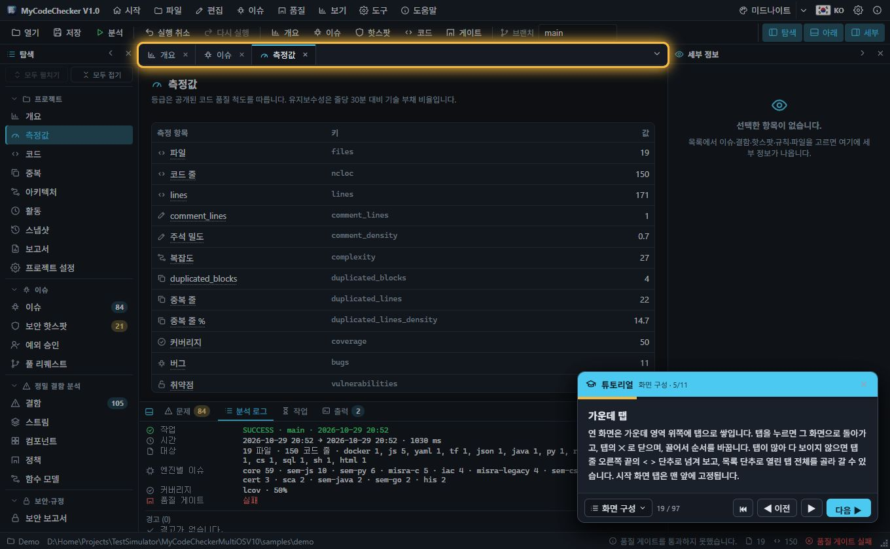

연 화면은 가운데 영역 위쪽에 탭으로 쌓입니다. 탭을 누르면 그 화면으로 돌아가고, 탭의 ✕ 로 닫으며, 끌어서 순서를 바꿉니다. 탭이 많아 다 보이지 않으면 탭 줄 오른쪽 끝의 < > 단추로 넘겨 보고, 목록 단추로 열린 탭 전체를 골라 갈 수 있습니다. 시작 화면 탭은 맨 앞에 고정됩니다.

### 20. 탭 넘기기 단추

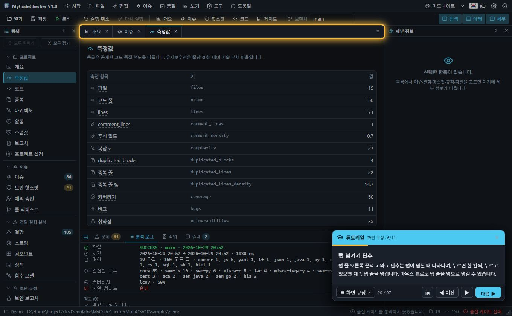

탭 줄 오른쪽 끝의 < 와 > 단추는 탭이 넘칠 때 나타나며, 누르면 한 칸씩, 누르고 있으면 계속 탭 줄을 넘깁니다. 마우스 휠로도 탭 줄을 옆으로 넘길 수 있습니다.

### 21. 오른쪽 세부 정보 패널

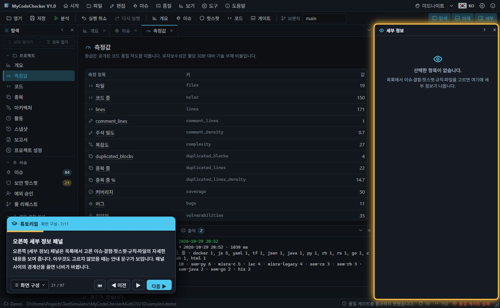

오른쪽 [세부 정보] 패널은 목록에서 고른 이슈·결함·핫스팟·규칙·파일의 자세한 내용을 보여 줍니다. 아무것도 고르지 않았을 때는 안내 문구가 보입니다. 패널 사이의 경계선을 끌면 너비가 바뀝니다.

### 22. 아래 패널

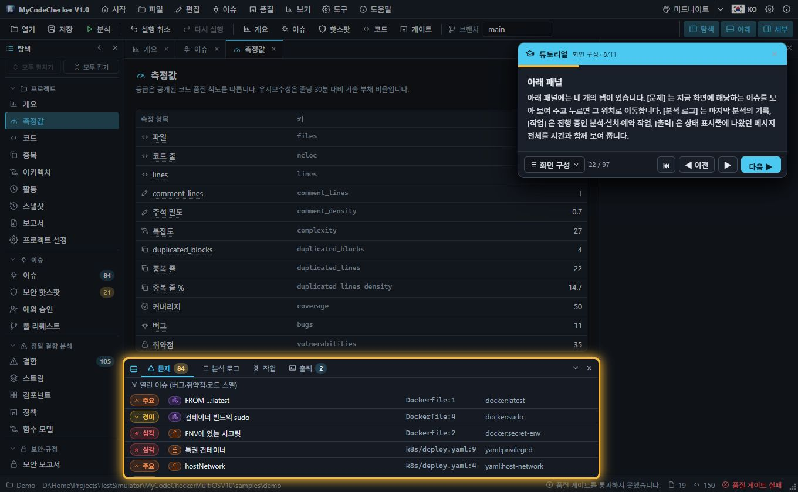

아래 패널에는 네 개의 탭이 있습니다. [문제] 는 지금 화면에 해당하는 이슈를 모아 보여 주고 누르면 그 위치로 이동합니다. [분석 로그] 는 마지막 분석의 기록, [작업] 은 진행 중인 분석·설치·예약 작업, [출력] 은 상태 표시줄에 나왔던 메시지 전체를 시간과 함께 보여 줍니다.

### 23. 작업과 출력 탭

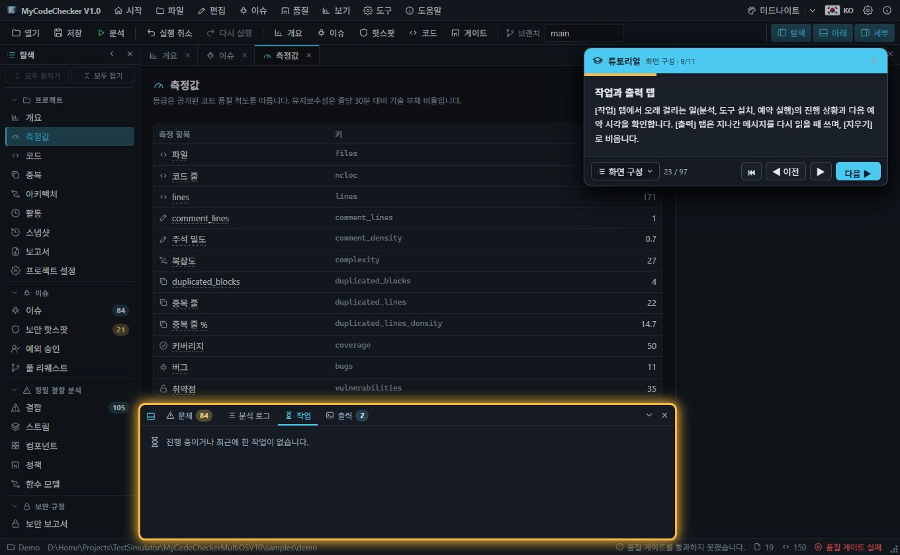

[작업] 탭에서 오래 걸리는 일(분석, 도구 설치, 예약 실행)의 진행 상황과 다음 예약 시각을 확인합니다. [출력] 탭은 지나간 메시지를 다시 읽을 때 쓰며, [지우기] 로 비웁니다.

### 24. 패널 켜기·끄기와 접기

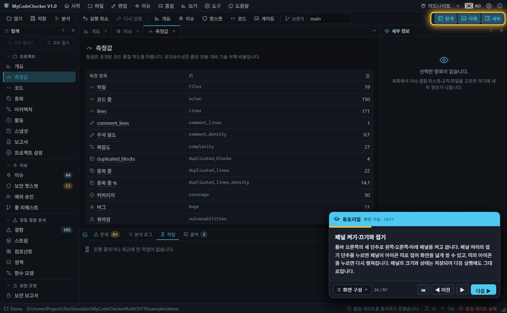

툴바 오른쪽의 세 단추로 왼쪽·오른쪽·아래 패널을 켜고 끕니다. 패널 머리의 접기 단추를 누르면 패널이 아이콘 띠로 접혀 화면을 넓게 쓸 수 있고, 띠의 아이콘을 누르면 다시 펼쳐집니다. 패널의 크기와 상태는 저장되어 다음 실행에도 그대로입니다.

### 25. 상태 표시줄

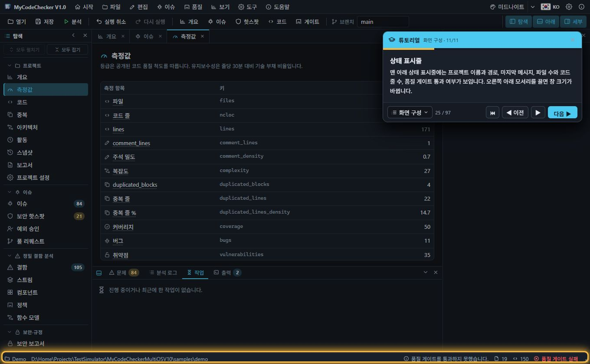

맨 아래 상태 표시줄에는 프로젝트 이름과 경로, 마지막 메시지, 파일 수와 코드 줄 수, 품질 게이트 통과 여부가 보입니다. 오른쪽 아래 모서리를 끌면 창 크기가 바뀝니다.

## 4. 개요와 품질 게이트

### 26. 개요 화면

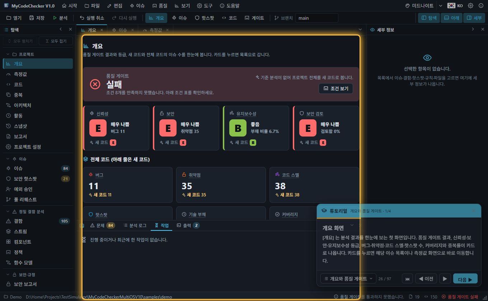

[개요] 는 분석 결과를 한눈에 보는 첫 화면입니다. 품질 게이트 결과, 신뢰성·보안·유지보수성 등급, 버그·취약점·코드 스멜·핫스팟 수, 커버리지와 중복률이 카드로 나옵니다. 카드를 누르면 해당 이슈 목록이나 측정값 화면으로 바로 이동합니다.

### 27. 품질 게이트

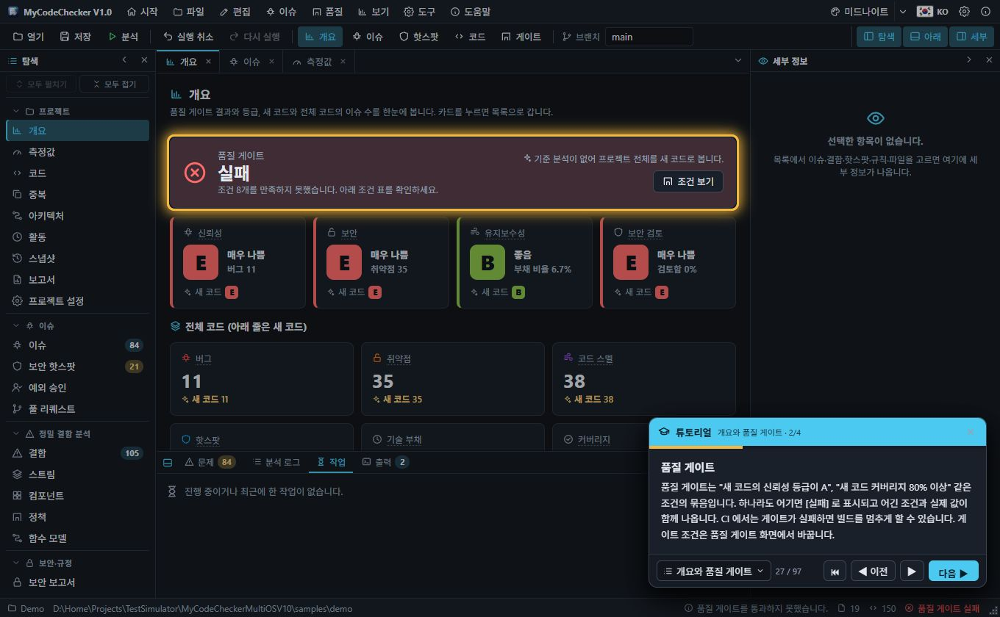

품질 게이트는 "새 코드의 신뢰성 등급이 A", "새 코드 커버리지 80% 이상" 같은 조건의 묶음입니다. 하나라도 어기면 [실패] 로 표시되고 어긴 조건과 실제 값이 함께 나옵니다. CI 에서는 게이트가 실패하면 빌드를 멈추게 할 수 있습니다. 게이트 조건은 품질 게이트 화면에서 바꿉니다.

### 28. 등급

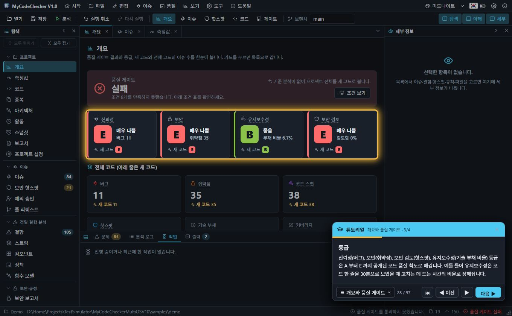

신뢰성(버그), 보안(취약점), 보안 검토(핫스팟), 유지보수성(기술 부채 비율) 등급은 A 부터 E 까지 공개된 코드 품질 척도로 매깁니다. 예를 들어 유지보수성은 코드 한 줄을 30분으로 보았을 때 고치는 데 드는 시간의 비율로 정해집니다.

### 29. 새 코드와 전체 코드

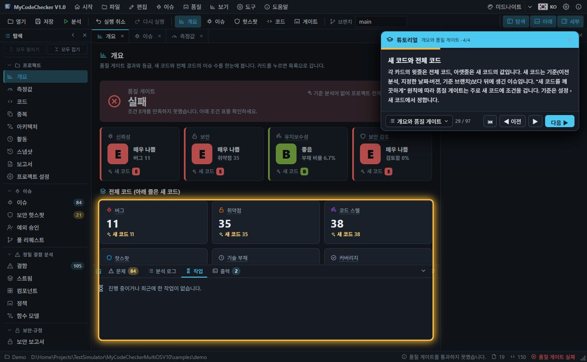

각 카드의 윗줄은 전체 코드, 아랫줄은 새 코드의 값입니다. 새 코드는 기준(이전 분석, 지정한 날짜·버전, 기준 브랜치)보다 뒤에 생긴 이슈입니다. "새 코드를 깨끗하게" 원칙에 따라 품질 게이트는 주로 새 코드에 조건을 겁니다. 기준은 설정 › 새 코드에서 정합니다.

## 5. 이슈 처리

### 30. 이슈 목록

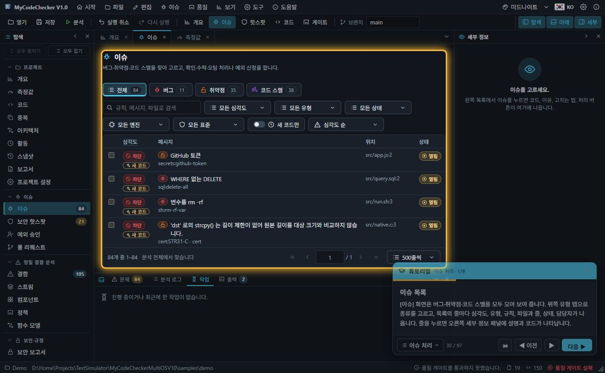

[이슈] 화면은 버그·취약점·코드 스멜을 모두 모아 보여 줍니다. 위쪽 유형 탭으로 종류를 고르고, 목록의 줄마다 심각도, 유형, 규칙, 파일과 줄, 상태, 담당자가 나옵니다. 줄을 누르면 오른쪽 세부 정보 패널에 설명과 코드가 나타납니다.

### 31. 검색과 필터

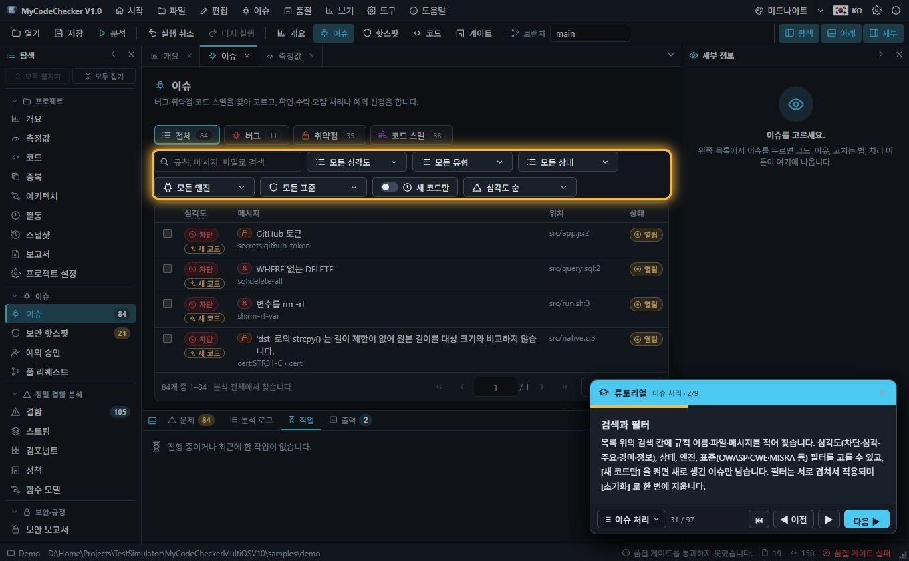

목록 위의 검색 칸에 규칙 이름·파일·메시지를 적어 찾습니다. 심각도(차단·심각·주요·경미·정보), 상태, 엔진, 표준(OWASP·CWE·MISRA 등) 필터를 고를 수 있고, [새 코드만] 을 켜면 새로 생긴 이슈만 남습니다. 필터는 서로 겹쳐서 적용되며 [초기화] 로 한 번에 지웁니다.

### 32. 이슈 세부 정보

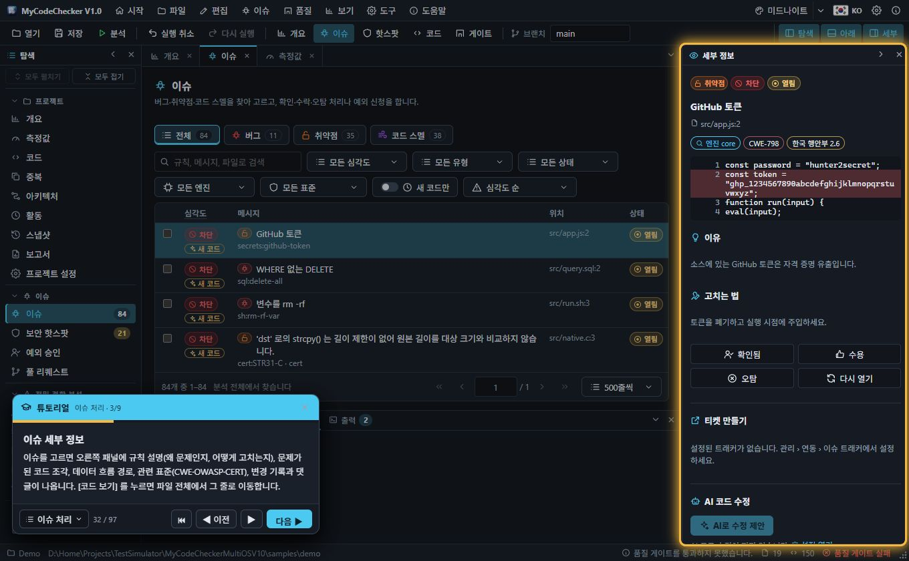

이슈를 고르면 오른쪽 패널에 규칙 설명(왜 문제인지, 어떻게 고치는지), 문제가 된 코드 조각, 데이터 흐름 경로, 관련 표준(CWE·OWASP·CERT), 변경 기록과 댓글이 나옵니다. [코드 보기] 를 누르면 파일 전체에서 그 줄로 이동합니다.

### 33. 확인·수락·오탐 처리

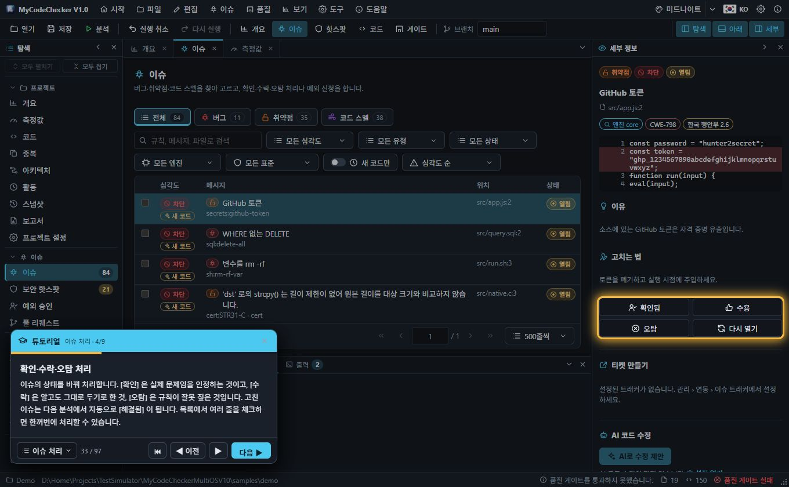

이슈의 상태를 바꿔 처리합니다. [확인] 은 실제 문제임을 인정하는 것이고, [수락] 은 알고도 그대로 두기로 한 것, [오탐] 은 규칙이 잘못 짚은 것입니다. 고친 이슈는 다음 분석에서 자동으로 [해결됨] 이 됩니다. 목록에서 여러 줄을 체크하면 한꺼번에 처리할 수 있습니다.

### 34. 담당자·태그·댓글

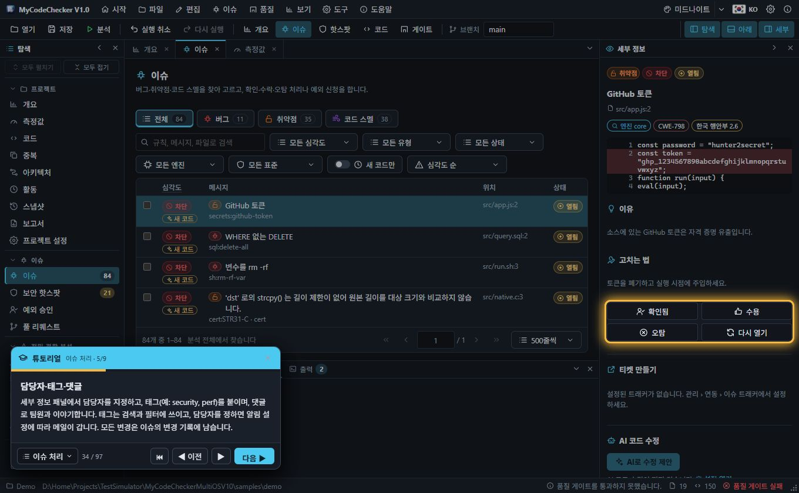

세부 정보 패널에서 담당자를 지정하고, 태그(예: security, perf)를 붙이며, 댓글로 팀원과 이야기합니다. 태그는 검색과 필터에 쓰이고, 담당자를 정하면 알림 설정에 따라 메일이 갑니다. 모든 변경은 이슈의 변경 기록에 남습니다.

### 35. 예외 신청

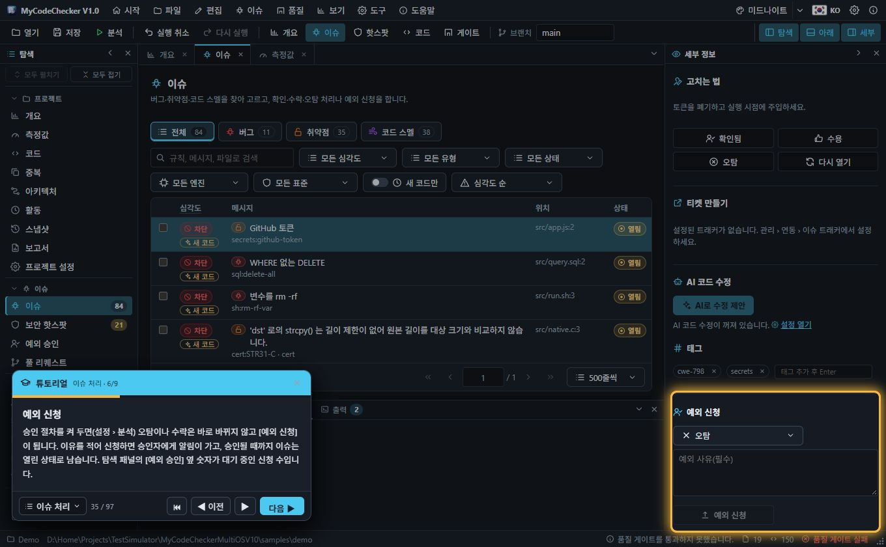

승인 절차를 켜 두면(설정 › 분석) 오탐이나 수락은 바로 바뀌지 않고 [예외 신청] 이 됩니다. 이유를 적어 신청하면 승인자에게 알림이 가고, 승인될 때까지 이슈는 열린 상태로 남습니다. 탐색 패널의 [예외 승인] 옆 숫자가 대기 중인 신청 수입니다.

### 36. 예외 승인

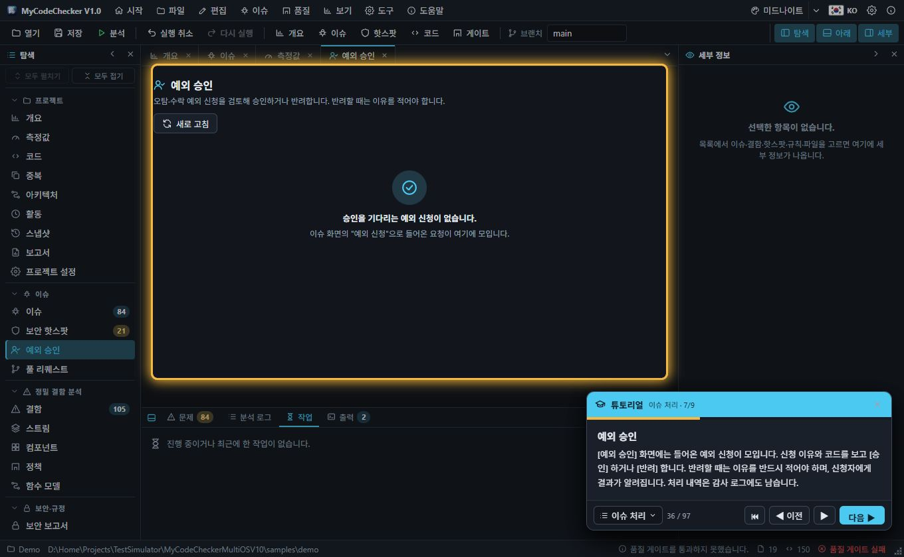

[예외 승인] 화면에는 들어온 예외 신청이 모입니다. 신청 이유와 코드를 보고 [승인] 하거나 [반려] 합니다. 반려할 때는 이유를 반드시 적어야 하며, 신청자에게 결과가 알려집니다. 처리 내역은 감사 로그에도 남습니다.

### 37. 티켓 만들기

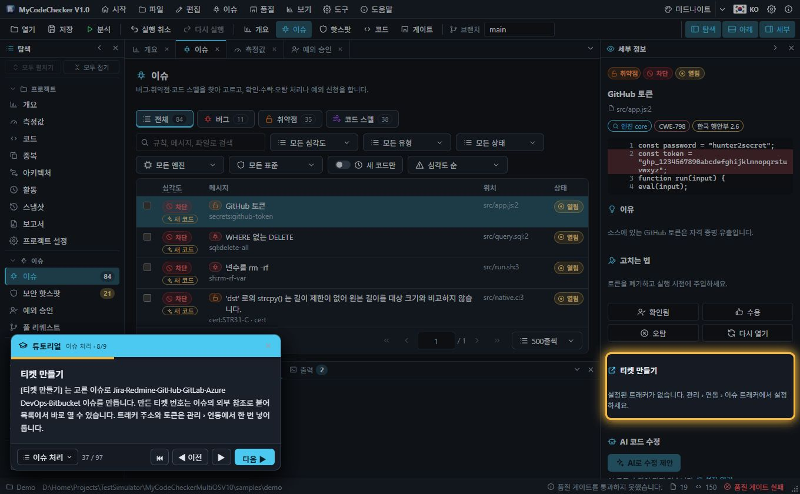

[티켓 만들기] 는 고른 이슈로 Jira·Redmine·GitHub·GitLab·Azure DevOps·Bitbucket 이슈를 만듭니다. 만든 티켓 번호는 이슈의 외부 참조로 붙어 목록에서 바로 열 수 있습니다. 트래커 주소와 토큰은 관리 › 연동에서 한 번 넣어 둡니다.

### 38. 문제 탭으로 이동

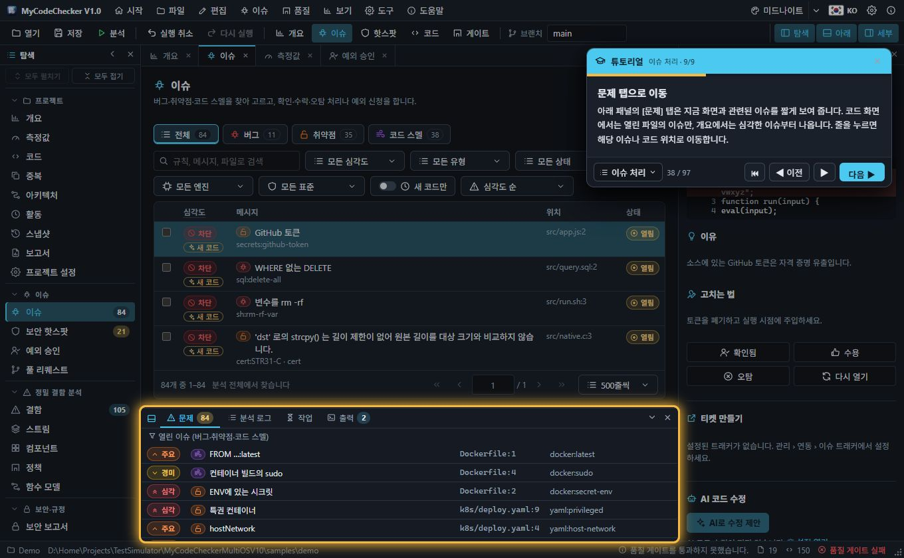

아래 패널의 [문제] 탭은 지금 화면과 관련된 이슈를 짧게 보여 줍니다. 코드 화면에서는 열린 파일의 이슈만, 개요에서는 심각한 이슈부터 나옵니다. 줄을 누르면 해당 이슈나 코드 위치로 이동합니다.

## 6. AI 코드 수정

### 39. AI로 수정 제안

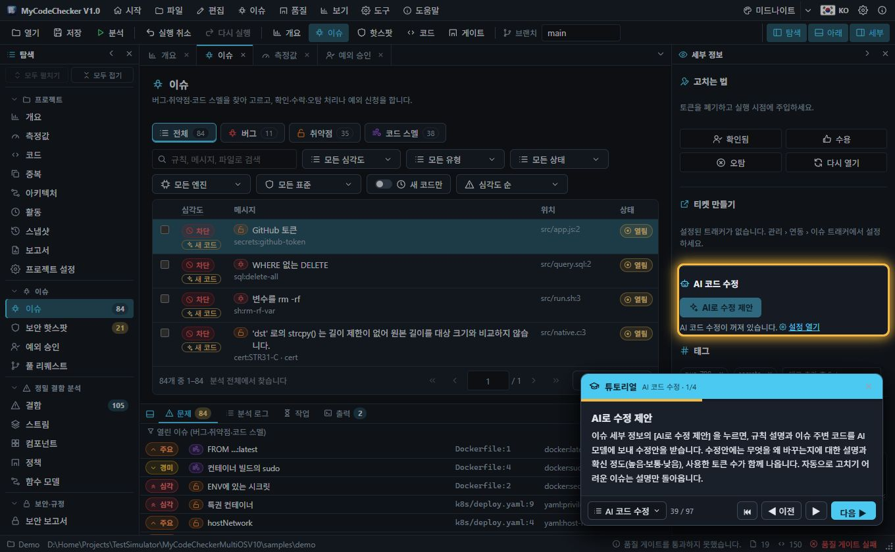

이슈 세부 정보의 [AI로 수정 제안] 을 누르면, 규칙 설명과 이슈 주변 코드를 AI 모델에 보내 수정안을 받습니다. 수정안에는 무엇을 왜 바꾸는지에 대한 설명과 확신 정도(높음·보통·낮음), 사용한 토큰 수가 함께 나옵니다. 자동으로 고치기 어려운 이슈는 설명만 돌아옵니다.

### 40. 변경 내용 확인과 적용

수정안은 지울 줄(−)과 넣을 줄(+)로 나눈 변경 내용(diff)으로 보입니다. 내용을 확인한 뒤 [적용] 을 누르면 소스 파일에 씁니다. 그사이 파일이 바뀌었으면 적용을 멈추고 다시 요청하라고 알려 줍니다. 적용한 뒤 [다시 분석] 으로 이슈가 사라졌는지 확인하세요.

### 41. AI 제공자와 모델

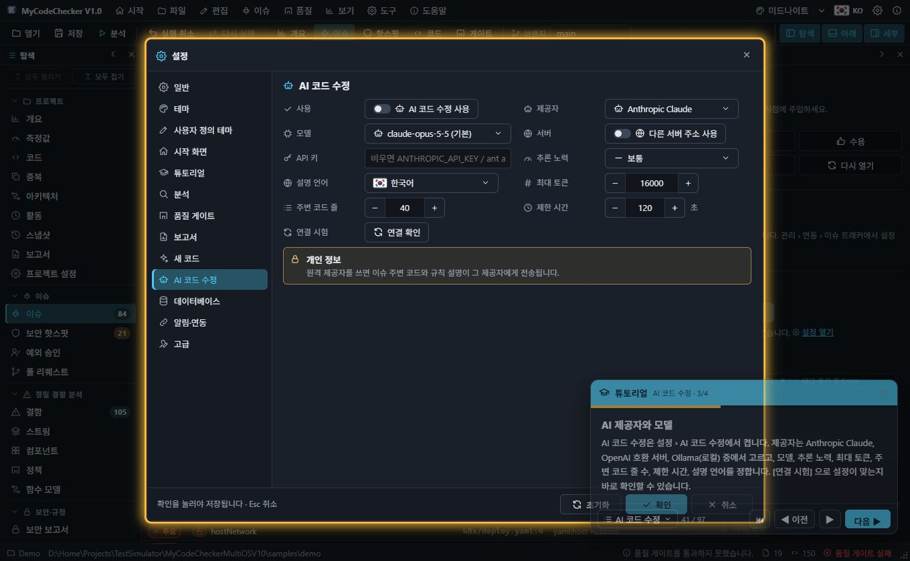

AI 코드 수정은 설정 › AI 코드 수정에서 켭니다. 제공자는 Anthropic Claude, OpenAI 호환 서버, Ollama(로컬) 중에서 고르고, 모델, 추론 노력, 최대 토큰, 주변 코드 줄 수, 제한 시간, 설명 언어를 정합니다. [연결 시험] 으로 설정이 맞는지 바로 확인할 수 있습니다.

### 42. 개인 정보

원격 제공자를 쓰면 이슈 주변 코드와 규칙 설명이 그 제공자에게 전송됩니다. 코드가 회사 밖으로 나가면 안 되는 경우 Ollama 를 고르면 이 컴퓨터(또는 지정한 사내 서버)에서만 실행됩니다. API 키를 비워 두면 ANTHROPIC_API_KEY 환경 변수나 로그인 프로필을 씁니다.

## 7. 코드 살펴보기

### 43. 보안 핫스팟

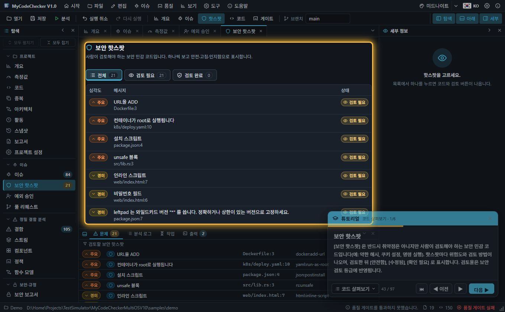

[보안 핫스팟] 은 반드시 취약점은 아니지만 사람이 검토해야 하는 보안 민감 코드입니다(예: 약한 해시, 쿠키 설정, 명령 실행). 핫스팟마다 위험도와 검토 방법이 나오며, 검토한 뒤 [안전함], [수정됨], [확인 필요] 로 표시합니다. 검토율은 보안 검토 등급에 반영됩니다.

### 44. 측정값

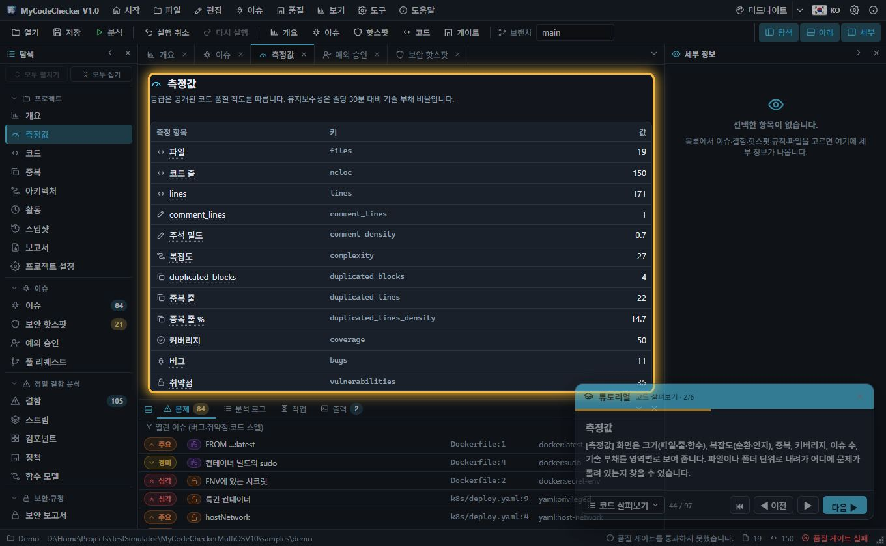

[측정값] 화면은 크기(파일·줄·함수), 복잡도(순환·인지), 중복, 커버리지, 이슈 수, 기술 부채를 영역별로 보여 줍니다. 파일이나 폴더 단위로 내려가 어디에 문제가 몰려 있는지 찾을 수 있습니다.

### 45. 코드 보기

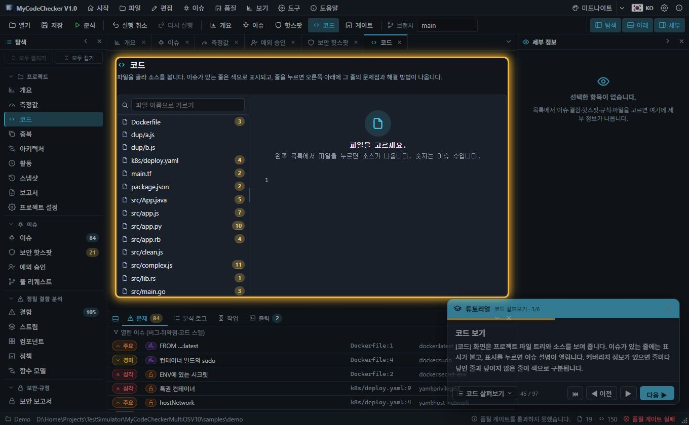

[코드] 화면은 프로젝트 파일 트리와 소스를 보여 줍니다. 이슈가 있는 줄에는 표시가 붙고, 표시를 누르면 이슈 설명이 열립니다. 커버리지 정보가 있으면 줄마다 덮인 줄과 덮이지 않은 줄이 색으로 구분됩니다.

### 46. 중복

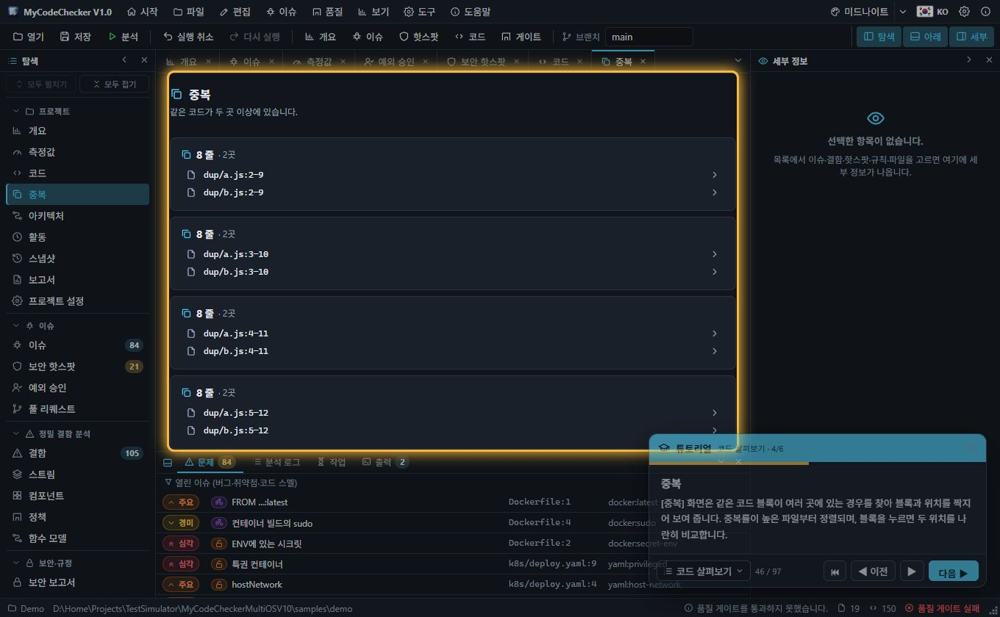

[중복] 화면은 같은 코드 블록이 여러 곳에 있는 경우를 찾아 블록과 위치를 짝지어 보여 줍니다. 중복률이 높은 파일부터 정렬되며, 블록을 누르면 두 위치를 나란히 비교합니다.

### 47. 활동

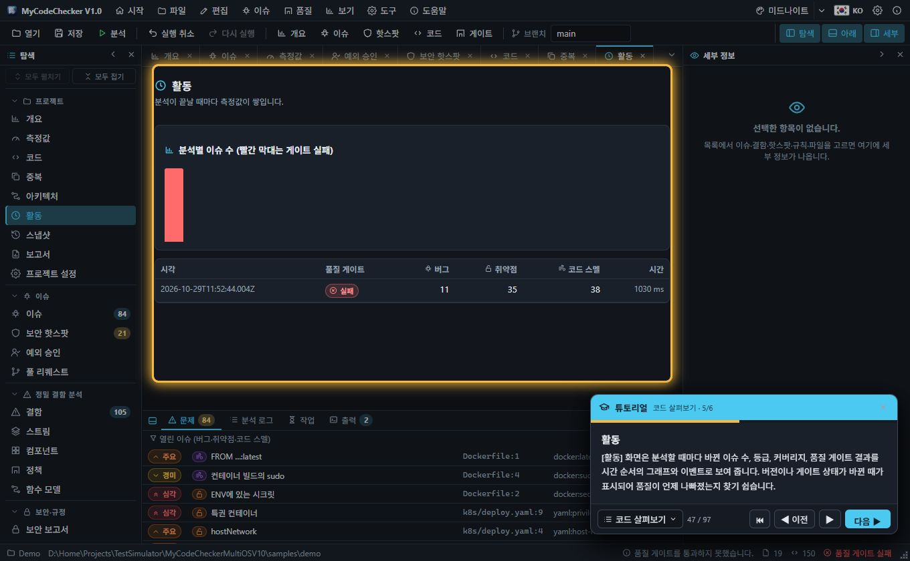

[활동] 화면은 분석할 때마다 바뀐 이슈 수, 등급, 커버리지, 품질 게이트 결과를 시간 순서의 그래프와 이벤트로 보여 줍니다. 버전이나 게이트 상태가 바뀐 때가 표시되어 품질이 언제 나빠졌는지 찾기 쉽습니다.

### 48. 스냅샷

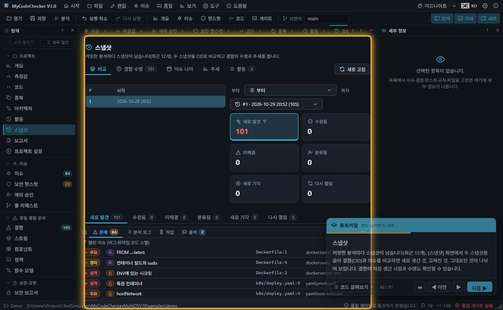

커밋한 분석마다 스냅샷이 남습니다(최근 12개). [스냅샷] 화면에서 두 스냅샷을 골라 결함(CID)과 이슈를 비교하면 새로 생긴 것, 고쳐진 것, 그대로인 것이 나뉘어 보입니다. 결함이 처음 생긴 시점과 수명도 확인할 수 있습니다.

## 8. 정밀 결함 분석

### 49. 결함 목록

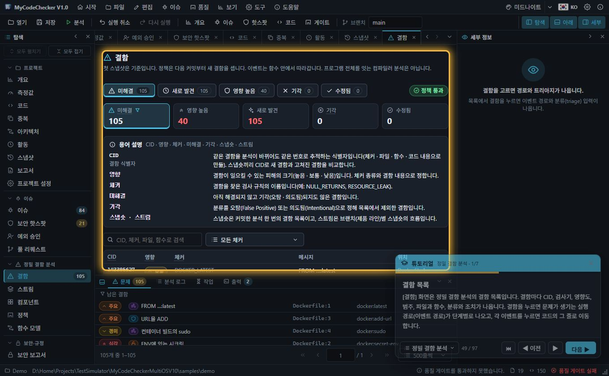

[결함] 화면은 정밀 결함 분석의 결함 목록입니다. 결함마다 CID, 검사기, 영향도, 범주, 파일과 함수, 분류와 조치가 나옵니다. 결함을 누르면 문제가 생기는 실행 경로(이벤트 경로)가 단계별로 나오고, 각 이벤트를 누르면 코드의 그 줄로 이동합니다.

### 50. 분류(triage)

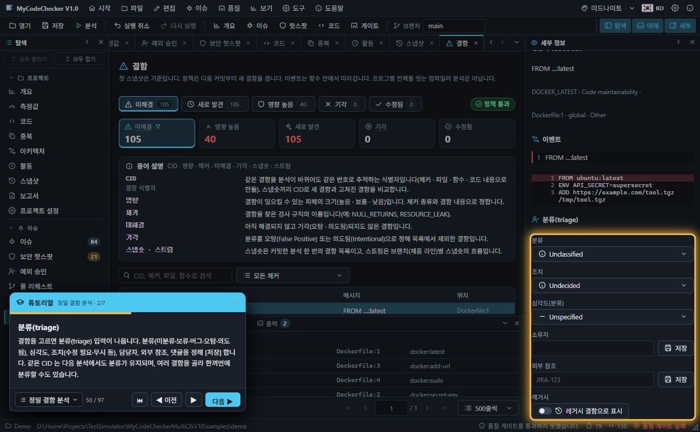

결함을 고르면 분류(triage) 입력이 나옵니다. 분류(미분류·보류·버그·오탐·의도됨), 심각도, 조치(수정 필요·무시 등), 담당자, 외부 참조, 댓글을 정해 [저장] 합니다. 같은 CID 는 다음 분석에서도 분류가 유지되며, 여러 결함을 골라 한꺼번에 분류할 수도 있습니다.

### 51. 스트림

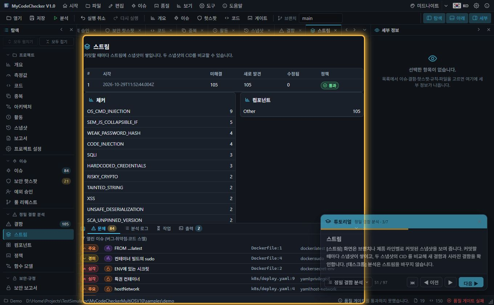

[스트림] 화면은 브랜치나 제품 라인별로 커밋된 스냅샷을 보여 줍니다. 커밋할 때마다 스냅샷이 쌓이고, 두 스냅샷의 CID 를 비교해 새 결함과 사라진 결함을 확인합니다. [데스크톱] 분석은 스트림을 바꾸지 않습니다.

### 52. 컴포넌트

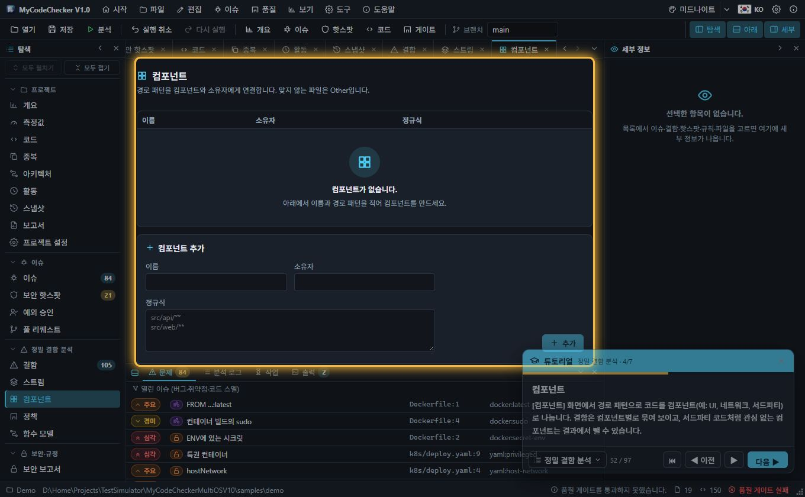

[컴포넌트] 화면에서 경로 패턴으로 코드를 컴포넌트(예: UI, 네트워크, 서드파티)로 나눕니다. 결함은 컴포넌트별로 묶여 보이고, 서드파티 코드처럼 관심 없는 컴포넌트는 결과에서 뺄 수 있습니다.

### 53. 정책

[정책] 은 정밀 결함 분석의 품질 게이트입니다. "영향도 높음 결함 0개", "미분류 결함 10개 이하" 같은 조건을 정하고 프로젝트에 지정하면, 분석할 때마다 정책 통과 여부가 상태 표시줄과 보고서에 나옵니다.

### 54. 함수 모델

[함수 모델] 은 분석기가 소스를 볼 수 없는 라이브러리 함수의 동작을 알려 줍니다. 예를 들어 "이 함수는 메모리를 해제한다", "이 함수는 null 을 돌려줄 수 있다", "이 값은 오염된 입력이다" 를 등록하면 누수·null 역참조·주입 결함을 더 정확히 찾습니다.

### 55. cov 명령줄

C/C++ 프로젝트는 node scripts/defect-cli.mjs 로 빌드를 캡처합니다. cov build -- make 로 컴파일 명령을 가로채 분석 대상을 모으고, cov analyze 로 분석, cov commit 으로 스트림에 커밋합니다. 결과는 이 결함 화면에서 그대로 봅니다.

## 9. 보안·규정 준수

### 56. 보안 보고서

[보안 보고서] 화면은 이슈를 보안 표준의 항목별로 다시 묶어 보여 줍니다. OWASP Top 10(2017·2021), CWE Top 25, PCI DSS, 한국 행정안전부 소프트웨어 보안 약점 49개 항목, 주요정보통신기반시설 기술적 취약점 점검 항목을 고를 수 있습니다. 항목마다 이슈 수와 등급이 나오고, 누르면 해당 이슈 목록으로 내려갑니다.

### 57. 한국 행안부 49 와 주요정보통신기반시설

한국 행안부 49 점검은 입력 데이터 검증, 보안 기능, 시간 및 상태, 에러 처리, 코드 오류, 캡슐화, API 오용의 일곱 분류로 나뉩니다. 공공 사업의 보안 약점 진단에서 이 화면의 결과를 그대로 증적으로 쓸 수 있고, 보고서 화면에서 문서로 내보낼 수 있습니다.

### 58. MISRA·CERT·AUTOSAR 준수

[MISRA 준수] 화면은 MISRA C:2012/2023, MISRA C++:2023, AUTOSAR C++14, SEI CERT C/C++/Java 지침별 준수 매트릭스를 보여 줍니다. MISRA Compliance:2020 방식으로 지침 준수 요약(GCS), 재분류 계획(GRP), 편차(deviation) 기록을 관리하고, 준수·위반·편차·미적용을 지침마다 확인합니다.

### 59. 편차와 재분류

지키기 어려운 지침은 편차를 등록합니다. 근거, 위험 평가, 승인자를 적으면 해당 위반은 [편차] 로 집계됩니다. 재분류 계획에서는 지침의 범주를 더 엄격하게만(권고 → 요구 → 필수) 바꿀 수 있습니다. 결과는 준수 보고서로 내보냅니다.

### 60. HIS 메트릭

[HIS 메트릭] 화면은 자동차 업계의 HIS 소스 코드 메트릭(주석 비율, 경로 수, goto 수, 순환 복잡도, 호출 수, 매개변수 수, 반환 지점 수, 중첩 깊이 등)을 함수마다 계산하고, 권장 한계를 넘는 함수를 빨갛게 표시합니다. 함수를 누르면 코드로 이동합니다.

### 61. 아키텍처

[아키텍처] 화면은 모듈과 파일 사이의 의존 관계를 그래프로 그립니다. 순환 의존, 계층 규칙 위반(예: UI → DB 직접 호출)을 찾아 표시하고, 허용할 의존 방향을 규칙으로 정해 두면 분석할 때마다 위반을 이슈로 올립니다.

## 10. 의존성·웹 스캔·풀 리퀘스트

### 62. 의존성(SCA)

[의존성] 화면은 package.json, pom.xml, requirements.txt, go.mod 같은 매니페스트와 잠금 파일에서 라이브러리를 읽어 알려진 취약점(오프라인 OSV 권고)과 라이선스를 맞춰 봅니다. 취약한 버전, 고친 버전, 실제로 호출되는지(도달성)가 함께 나옵니다.

### 63. SBOM 내보내기

[SBOM 내보내기] 는 소프트웨어 구성 명세(SBOM)를 CycloneDX 또는 SPDX 형식으로 저장합니다. 고객이나 감사에 납품물의 구성 요소 목록을 제출할 때 씁니다. 라이선스 정책을 정해 두면 금지 라이선스도 이슈로 표시됩니다.

### 64. 웹 스캔(DAST)

[웹 스캔] 은 실행 중인 웹 애플리케이션을 바깥에서 점검합니다. 대상 주소와 범위, 로그인 방법(폼·토큰·쿠키)을 정하고 스캔하면 페이지를 돌아다니며 XSS, SQL 주입, 보안 헤더 누락, 쿠키 설정 같은 문제를 찾습니다. 허락받은 대상에만 사용하세요.

### 65. 풀 리퀘스트 분석

[풀 리퀘스트] 화면은 기준 브랜치와 비교해 PR 에서 바뀐 코드의 이슈만 보여 줍니다. PR 전용 품질 게이트 결과가 나오고, 연동을 설정해 두면 GitHub·GitLab·Azure DevOps·Bitbucket 의 PR 에 요약 댓글과 줄별 댓글(데코레이션)을 게시합니다.

## 11. 보고서

### 66. 보고서

[보고서] 화면에서 경영 요약, 보안, 무결성, 규칙 세트, SBOM, 준수 보고서 등을 고르고 미리 봅니다. 대상 브랜치와 표준(예: OWASP Top 10 2021)을 정할 수 있으며, 미리 보기는 저장될 문서와 같은 모양입니다.

### 67. 형식과 규제 보고서

보고서는 HTML·CSV·Word(.docx)·Excel(.xlsx)·PDF 로 저장하거나 바로 인쇄합니다. [규제 보고서 (ZIP)] 는 경영·보안·무결성·규칙 세트·SBOM 보고서 PDF 와 이슈 목록 Excel 을 ZIP 하나로 묶어 감사 제출용 묶음을 한 번에 만듭니다. 파일 › 내보내기에는 SARIF 와 품질 게이트 배지도 있습니다.

## 12. 규칙·프로파일·게이트

### 68. 규칙

[규칙] 화면에는 4,000개가 넘는 규칙이 언어·유형·심각도·태그·표준별로 정리되어 있습니다. 규칙을 누르면 설명, 잘못된 예와 고친 예, 관련 CWE·OWASP·CERT·MISRA 항목이 나옵니다. 정규식으로 나만의 규칙을 만들 수도 있습니다(도구 › 사용자 규칙).

### 69. 품질 프로파일

[품질 프로파일] 은 언어별로 어떤 규칙을 켤지 정한 묶음입니다. 기본 프로파일을 상속해 필요한 규칙만 켜고 끄면 기본이 바뀔 때 자동으로 따라갑니다. 프로젝트마다 언어별 프로파일을 지정하며, 변경 기록이 남습니다.

### 70. 프로파일 비교와 백업

[비교] 는 두 프로파일에서 한쪽에만 켜진 규칙과 심각도가 다른 규칙을 보여 줍니다. [백업] 은 프로파일을 XML 로 저장하고 [복원] 은 다시 불러옵니다. 다른 컴퓨터나 코드 품질 서버의 프로파일을 옮길 때 씁니다.

### 71. 품질 게이트 편집

[품질 게이트] 화면에서 게이트를 만들고 조건(측정값, 비교, 기준값, 새 코드 여부)을 더하거나 뺍니다. 하나를 기본 게이트로 정하고 프로젝트마다 다른 게이트를 지정할 수 있습니다. 바꾼 조건은 다음 분석부터 적용됩니다.

### 72. 포트폴리오

[포트폴리오] 는 여러 프로젝트를 묶어 품질 게이트 상태와 등급을 함께 봅니다. 제품군이나 팀 단위로 묶어 두면 어느 프로젝트가 기준을 못 넘었는지 한 화면에서 확인할 수 있습니다.

### 73. 백그라운드 작업

[백그라운드 작업] 화면에는 지금까지의 스캔이 작업으로 기록됩니다. 시작·끝 시각, 걸린 시간, 품질 게이트 결과, 실패한 경우 오류 메시지가 남아 CI 에서 올라온 분석까지 추적할 수 있습니다.

## 13. 관리

### 74. 사용자와 권한

관리 › [사용자 · 권한] 탭에서 사용자와 그룹을 만들고 권한을 줍니다. 전역 권한(관리, 게이트 관리, 프로파일 관리, 스캔)과 프로젝트 권한(보기, 코드 보기, 이슈 관리, 핫스팟 관리)을 나눠 정합니다. 권한을 켜면 시작할 때 로그인 화면이 나오고, CI 업로드용 토큰도 여기서 발급합니다.

### 75. 웹훅

[웹훅] 은 분석이 끝날 때마다 결과(품질 게이트 상태, 이슈 수)를 지정한 주소로 JSON 으로 보냅니다. 비밀 값으로 서명을 붙일 수 있고, 최근 전송 내역과 응답 코드를 확인하며 [시험 전송] 으로 연결을 점검합니다.

### 76. 외부 이슈 가져오기

[외부 이슈] 탭은 SARIF, 호환 일반 이슈 JSON, 결함 JSON, cppcheck, clang-tidy, ESLint, Pylint, Checkstyle, SpotBugs, PMD, gosec, Bandit, Semgrep 결과 파일을 읽어 이슈로 합칩니다. 다른 도구의 결과도 같은 목록과 품질 게이트에서 함께 관리할 수 있습니다.

### 77. 테스트 보고서와 커버리지

[테스트 보고서] 탭은 JUnit XML 이나 호환 일반 테스트 실행 XML 을 가져와 다음 분석부터 테스트 지표를 측정값에 넣습니다. 커버리지는 [분석 설정] 탭에서 LCOV·Cobertura·JaCoCo·Clover·OpenCover·Go cover 파일 경로를 적어 둡니다. 커버리지는 개요의 커버리지 카드, 코드 화면의 줄 색, 품질 게이트의 커버리지 조건에 쓰입니다.

### 78. 예약 분석

[예약 분석] 은 정해진 시각(매일·매주·간격)에 코드 분석이나 웹 스캔을 자동으로 실행합니다. 대상 프로젝트와 브랜치, 시각을 정해 [새 예약] 으로 만들고, 다음 실행 시각은 아래 패널의 작업 탭에서도 볼 수 있습니다.

### 79. 감사 로그

[감사 로그] 는 누가 언제 무엇을 바꿨는지(로그인, 권한 변경, 이슈 상태, 예외 승인, 설정 변경)를 기록합니다. 기간과 사용자로 걸러 보고 CSV 로 내보낼 수 있으며, 보관 기간은 설정 › 고급에서 정합니다.

### 80. 연동

[연동] 에서 메일(SMTP), LDAP 로그인과 그룹 대응, 이슈 트래커(Jira·Redmine), 코드 호스팅(GitHub·GitLab·Azure DevOps·Bitbucket)의 주소와 토큰을 넣습니다. 각 항목의 [연결 시험] 으로 바로 확인하며, 비워 둔 항목은 쓰이지 않습니다.

### 81. 필요한 소프트웨어

[도구] 탭은 분석에 도움이 되는 외부 소프트웨어(컴파일러, 언어 런타임, 정적 분석기)가 설치되어 있는지 보여 주고, 없는 것은 설치를 제안합니다. 설치는 항상 사용자에게 묻고 진행하며, 진행 상황은 작업 탭에 나옵니다.

## 14. 설정

### 82. 설정 창 — 일반

도구 › 설정(Ctrl+,)은 탭으로 나뉜 설정 창을 엽니다. [일반] 탭에서 언어, 기본 담당자, 시작할 때 시작 화면 보기, 튜토리얼 안내 보기 같은 기본 동작을 정합니다. 바꾼 내용은 [저장] 을 눌러야 적용되고, [취소] 하면 원래대로 돌아갑니다.

### 83. 테마

[테마] 탭에는 어두운 테마 20개와 밝은 테마 20개가 견본과 함께 있습니다. 견본을 누르면 저장하기 전에 메인 창에 바로 미리 보입니다. 메뉴 표시줄의 테마 단추로도 언제든 바꿀 수 있고, 사용 설명서 창도 같은 테마를 따릅니다.

### 84. 사용자 정의 테마

[사용자 정의 테마] 탭에서 기존 테마를 바탕으로 배경, 패널, 글자, 강조색, 테두리 같은 기본 색을 골라 나만의 테마를 만듭니다. 만든 테마는 테마 목록 끝에 추가되고 내보내기·가져오기로 다른 컴퓨터에 옮길 수 있습니다.

### 85. 시작 화면 설정

[시작 화면] 탭에서 배경 애니메이션의 종류, 섞기 간격, 속도, 투명도, 시작할 때마다 무작위로 고르기를 정하고 카드 배치를 초기화합니다. 시작 화면의 배경 카드와 같은 설정입니다.

### 86. 분석 설정

[분석] 탭에서 제외할 경로(예: **/node_modules/**, **/*.min.js), 파일 크기 한도, 사용할 엔진, 예외 승인 절차 사용 여부와 승인자를 정합니다. 프로젝트별 설정은 관리 › 분석 설정에서 따로 덮어쓸 수 있습니다.

### 87. 새 코드 기준

[새 코드] 탭에서 무엇을 새 코드로 볼지 정합니다. 이전 분석, 지정한 날짜 이후, 특정 버전 이후, 최근 N일, 기준 브랜치와의 차이 중에서 고릅니다. 이 기준은 품질 게이트의 새 코드 조건과 이슈 목록의 [새 코드만] 필터에 쓰입니다.

### 88. AI 코드 수정 설정

[AI 코드 수정] 탭은 앞에서 본 것처럼 제공자(Anthropic·OpenAI 호환·Ollama), 모델, 서버 주소, API 키, 추론 노력, 최대 토큰, 주변 코드 줄, 제한 시간, 설명 언어를 정하고 개인 정보 안내를 보여 줍니다.

### 89. 데이터베이스

[데이터베이스] 탭에서 분석 결과를 SQLite, PostgreSQL, MySQL, SQL Server 로 내보내도록 설정합니다. 주소, 데이터베이스, 사용자, 스키마를 넣고 [연결 시험] 을 한 뒤, 분석할 때마다 자동으로 내보낼지와 이슈까지 넣을지를 정합니다. BI 도구로 대시보드를 만들 때 유용합니다.

### 90. 알림·연동

[알림·연동] 탭에서 어떤 일(품질 게이트 상태 변경, 새 이슈 배정, 예외 신청·승인·반려)이 생길 때 메일이나 웹훅으로 알릴지 고릅니다. SMTP·LDAP·트래커·PR 게시의 자세한 연결 정보는 관리 › 연동에 있습니다.

### 91. 고급

[고급] 탭에는 데이터 폴더 위치, 스냅샷과 감사 로그 보관 기간, 분석 동시 실행 수, 로그 수준, 설정 초기화 같은 항목이 있습니다. 잘 모르는 항목은 기본값으로 두는 것이 안전합니다.

### 92. 테마 단추

메뉴 표시줄 오른쪽의 테마 단추를 누르면 어두운 테마와 밝은 테마가 견본으로 나뉘어 나옵니다. 하나를 고르면 곧바로 바뀌고 저장됩니다.

### 93. 언어

언어 단추는 지금 언어의 국기와 코드(KO / EN)를 보여 줍니다. 누를 때마다 한국어와 English가 번갈아 바뀌고 곧바로 저장됩니다. 언어를 바꾸면 메뉴, 화면, 규칙 설명, 보고서, 사용 설명서와 이 튜토리얼까지 모두 그 언어로 바뀝니다.

## 15. 도움말과 CI

### 94. 도움말 메뉴

도움말 메뉴는 한 줄로 [튜토리얼 시작], [튜토리얼 처음부터 시작], [사용 설명서], [튜토리얼 문서], README, 아키텍처 문서, 바로 가기 키, 정보를 보여 줍니다. 튜토리얼은 언제든 이 메뉴에서 다시 시작할 수 있고, 마지막으로 본 단계를 기억해 이어서 볼 수도 있습니다.

### 95. 사용 설명서 창

[사용 설명서] 창은 설명서를 읽는 창입니다. 데스크톱 앱에서는 메인 창과 따로 떨어진 창으로 열려, 어디로든 옮겨 두고 보면서 작업할 수 있습니다. 위쪽에서 문서(사용 설명서·튜토리얼 문서·README)와 언어(한국어·English)를 고르고, ◀ ▶ 로 앞뒤로 이동하며, [새 창에서 열기] 로 브라우저에서 엽니다. 설명서는 메인 창과 같은 테마로 보입니다.

### 96. CI 에서 분석하기

CI 에서는 node scripts/scan.mjs 로 같은 엔진을 실행합니다. 저장소 루트의 mcc-project.properties(프로젝트 키, 소스 경로, 제외 경로)를 그대로 읽고, --server 주소와 토큰을 주면 결과를 이 서버로 올려 개요·활동·작업 화면에 나타나게 합니다. 품질 게이트가 실패하면 종료 코드 1 로 빌드를 멈춥니다.

### 97. 튜토리얼을 마쳤습니다

수고하셨습니다. 이제 [폴더 열기] 로 여러분의 소스 폴더를 분석해 보세요. 튜토리얼은 도움말 › 튜토리얼 시작에서 언제든 다시 볼 수 있고, 더 자세한 내용은 사용 설명서에 있습니다. [완료] 를 누르면 튜토리얼이 닫히고 원래 화면으로 돌아갑니다.

---

모든 기능의 자세한 설명은 [사용 설명서](UsersGuide.md) 에 있습니다.

© SHKWON (knix008@naver.com)
