# My Compare Master V1.0 — User's Guide

My Compare Master brings **file and directory comparison** and **3-way merging** together
in one tool. It can be registered as git's `difftool` / `mergetool`, or used entirely on its
own. The Windows, macOS and Linux desktop app and the web app are the same program.

This guide is also inside the program: **Help › User's Guide** (`F1`). That window has the
contents on the left (click to jump to a section), a search box at the top, and `−` `+` to
change the text size. 한국어판: [UsersGuide.md](UsersGuide.md).

---

## Contents

1. [Getting started](#start)
2. [The window](#screen)
3. [Menus](#menus)
4. [The toolbar](#toolbar)
5. [Sessions](#sessions)
6. [File comparison](#file-compare)
7. [What you can do in a comparison](#compare-tools)
8. [Folder comparison](#folder-compare)
9. [Folder synchronisation](#folder-sync)
10. [Binary and picture comparison](#binary-image)
11. [Table, audio, version, registry and FTP comparison](#formats)
12. [3-way merge and conflicts](#merge)
13. [Git](#git)
14. [Command line, git difftool and mergetool](#cli)
15. [Tabs, session files and recent items](#tabs)
16. [The bottom panel: log and terminal](#terminal)
17. [Printing](#print)
18. [Settings](#settings)
19. [Themes, language, font and zoom](#themes)
20. [Keyboard shortcuts](#shortcuts)
21. [The tutorial and this guide](#help)
22. [Installing and uninstalling](#install)
23. [Troubleshooting](#troubleshooting)

---

<a id="start"></a>
## Getting started

<a id="start-run"></a>
### Running it

| How | Command |
|-----|---------|
| Desktop (development) | `npm start` |
| Web (development) | `npm run dev:web`, then open the address it prints (by default `http://127.0.0.1:5176`) |
| Installed | **My Compare Master** in the Start menu or on the desktop |

<a id="start-first"></a>
### The first run

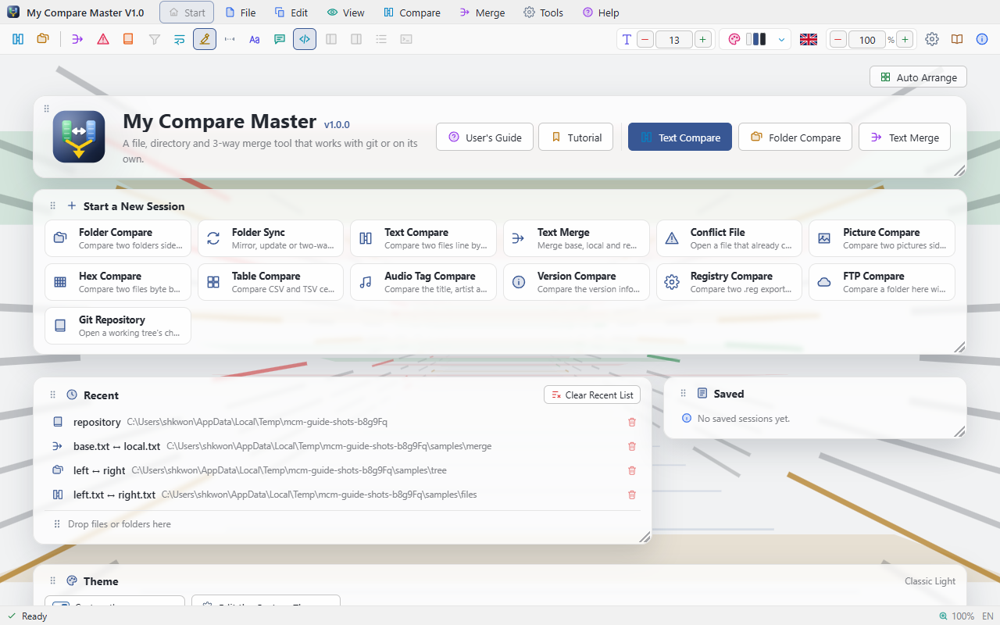

The first time the program starts, a **welcome card** appears at the bottom right of the
window.

- **Start tutorial** — a guided tour that highlights each part of the real window in turn.
- **Later** — closes the card for now; it comes back next time.
- **Don't show again** — the card is not shown at startup any more.

Both this card and the tour's card have a **Show at startup** checkbox. That checkbox alone
decides whether the card appears next time; it is saved the moment you click it and the same
option in the settings follows. Finishing or skipping the tour does not change it.
**Help › Tutorial** starts the tour at any time.

<a id="start-drop"></a>
### Drag and drop

Drop files or folders anywhere on the window to open them. Two items open a comparison,
four open a 3-way merge, and one opens a conflicted file (or, for a folder, a git
repository).

For opening things from the command line see
[Command line, git difftool and mergetool](#cli).

---

<a id="screen"></a>
## The window

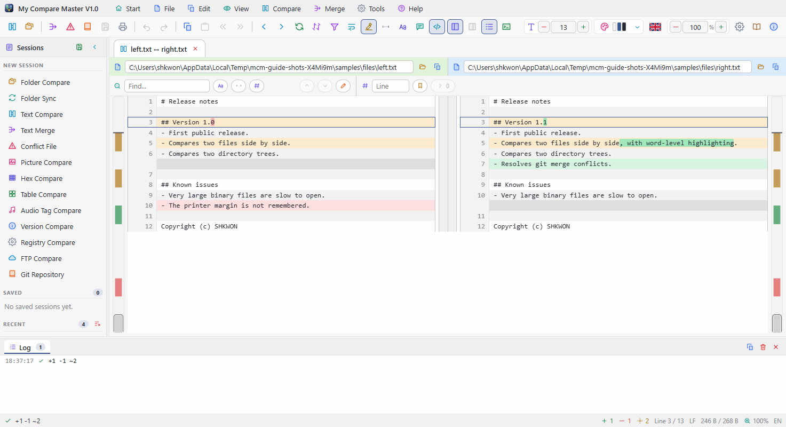

```
┌──────────────────────────────────────────────────────────────────────────┐
│ ▣ My Compare Master  File Edit View Compare Merge Tools Help    ─  □  ×  │ ← title bar and menu bar
├──────────────────────────────────────────────────────────────────────────┤
│ [Open][Merge][Save][Undo][Navigate][View options][Panels] [Font][Theme▾]  │ ← toolbar
├──────────┬╌┬──────────────────────────────────────────┬╌┬───────────────┤
│ Sessions │ │ [left.txt ↔ right.txt ×] [src ↔ src ×]   │ │  Merge info   │ ← tabs
│          │ │                                          │ │ (merge only)  │
│ New      │ │   Start screen / comparison / merge       │ │               │
│ Saved    │ │   ▮ difference scroll bar           ▮    │ │               │
│ Recent   │ │                                          │ │               │
├──────────┴╌┴──────────────────────────────────────────┴╌┴───────────────┤
│ [Log 12] [Command Prompt ×]                                     [⧉][×] │ ← bottom panel
├──────────────────────────────────────────────────────────────────────────┤
│ Ready                          +3 −1 ~2  Ln 12/480  LF  100%  EN         │ ← status bar
└──────────────────────────────────────────────────────────────────────────┘
```

| Area | What it is |
|------|------------|
| **Title bar and menu bar** | The program icon and name, the menus, and **minimise · maximise · close** at the right. Drag an empty spot to move the window, double-click it to maximise. Every menu row has **an icon and a label**, and menus open as one column even outside the window. |
| **Toolbar** | Actions on the left, view settings on the right — see [The toolbar](#toolbar). Every button has a **tooltip**. |
| **Start screen** | Shown in the middle when no tab is open: tiles for each kind of session, recent items, and a drag-and-drop hint. |
| **Tabs** | Each comparison opens in a new tab. Tabs sit **between the side panels**, right above the comparison. When they overflow, **`‹ ›` buttons** appear at the right end. |
| **Left panel** | Normally the **sessions**: new session kinds, saved sessions, recent items. **On a merge tab it becomes the conflict list**, each conflict showing its Base, Local and Remote text; click one to select it. |
| **Right panel** | **Only on a merge**: the input files, progress (conflicts / resolved / unresolved), totals per resolution, and details of the selected conflict. Read-only. |
| **Collapsing panels** | Both panels fold away with the arrow in their title, leaving a **narrow rail** at the edge; click the rail to open the panel again. |
| **Splitters** | **Drag** the splitter between a panel and the comparison to change its width; **double-click** to restore the default. The one above the bottom panel changes its height. |
| **Difference scroll bar** | The thick vertical strip beside the comparison: the whole document in miniature, with added, removed and changed lines **in colour**. Click or drag to go there. |
| **Bottom panel** | A strip of tabs **across the whole window**: the **Log**, and one tab per **terminal**, named after its shell. See [The bottom panel](#terminal). |
| **Status bar** | The result of the last action and the current state (difference count, cursor position, line endings, zoom, language). "The files are identical" also appears here. |
| **Resize grip** | The hatching at the bottom-right corner; drag it to resize the window. |

However narrow the window gets, no toolbar button is ever hidden: the minimum width
follows the toolbar and the two panels.

---

<a id="menus"></a>
## Menus

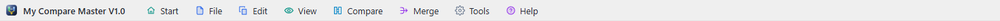

Click a title on the menu bar to open its menu; with a menu open, moving the pointer to
another title switches to that menu. Items that cannot be used right now are greyed out.

<a id="menu-file"></a>
### File

| Item | Shortcut | What it does |
|------|----------|--------------|
| Compare Files... | `Ctrl+O` | Pick a left and a right file and open a text comparison |
| Compare Directories... | `Ctrl+Shift+O` | Pick two folders and open a folder comparison |
| Open 3-Way Merge... | | Pick Base, Local, Remote and the result file |
| Open Conflicted File... | | Open a file with `<<<<<<<` markers |
| Open Git Repository... | | Pick a repository folder to see its changes and history |
| Open Session... / Save Session As... | | Save and restore the open tabs as a `.dmrg` session file |
| Save Merge Result / Save Merge Result As... | `Ctrl+S` / `Ctrl+Shift+S` | Write the merge result |
| Recent Files | | The last ten, then **Manage Recent Items...** and **Clear Recent List** |
| Print... / Print Preview... | `Ctrl+P` | Open the [print](#print) window |
| Close Tab | `Ctrl+W` | Close the current tab |
| Exit | `Alt+F4` | Asks first if a merge is unsaved |

<a id="menu-edit"></a>
### Edit

Undo (`Ctrl+Z`), Redo (`Ctrl+Y`), Cut (`Ctrl+X`), Copy (`Ctrl+C`), Paste (`Ctrl+V`),
Select All (`Ctrl+A`), Find (`Ctrl+F`). Undo and Redo show what they would undo or redo.

<a id="menu-view"></a>
### View

| Item | What it does |
|------|--------------|
| Zoom In · Zoom Out · Reset Zoom | `Ctrl++` · `Ctrl+-` · `Ctrl+0`, or `Ctrl` + mouse wheel |
| Word Wrap | Folds long lines at the window width |
| Highlight Changed Words | Picks out only the changed words of a modified line |
| Differences Only | `Ctrl+D`. Folds the unchanged stretches, keeping three lines of context |
| Ignore Comments · Ignore Quote Style · Ignore Number Format | Grammar rules that ignore trivial differences |
| Syntax Highlighting | Colours the code by its language |
| Left Panel · Right Panel · Log Panel · Terminal Panel · Status Bar | Show or hide each area. The terminal is `` Ctrl+` `` |

<a id="menu-compare"></a>
### Compare

First Difference (`Ctrl+Home`), Previous Difference (`F7`), Next Difference (`F8`), Last
Difference (`Ctrl+End`), Ignore Whitespace, Ignore Case, Differences Only, Swap Sides,
Refresh (`F5`).

<a id="menu-merge"></a>
### Merge

Take Base (`Ctrl+1`), Take Local (`Ctrl+2`), Take Remote (`Ctrl+3`), Take Both (`Ctrl+4`),
Unresolve (`Ctrl+Shift+0`), Resolve All as Local, Resolve All as Remote, Previous Conflict
(`Shift+F7`), Next Conflict (`Shift+F8`). Available on a merge tab.

<a id="menu-tools"></a>
### Tools

**Settings...** (`Ctrl+,`), **Register as git difftool**, **Register as git mergetool**. The
two register items open the Git tab of the settings window.

<a id="menu-help"></a>
### Help

| Item | Shortcut | What it does |
|------|----------|--------------|
| User's Guide | `F1` | Opens this guide in a window of its own |
| Tutorial | | Starts the guided tour of the window |
| About | | Version, build information and copyright |

<a id="menu-context"></a>
### Right-click menus

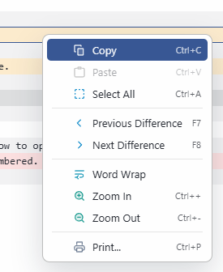

The **right mouse button** opens a menu that fits what is under the pointer: copy, paste,
difference navigation, word wrap and zoom in a text comparison; copy, delete and swap in a
folder comparison; conflict resolution in a merge; difftool and mergetool in the git view;
close, refresh and save on a tab; new sessions on the start screen and in the session panel;
and the log and terminal switches in the bottom panel.

---

<a id="toolbar"></a>
## The toolbar

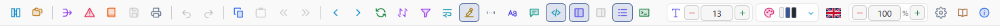

A group whose every button is unavailable is hidden: the merge buttons appear only on a
merge tab, the folder buttons only in a folder comparison.

| Group | Buttons |
|-------|---------|
| **Open** | Compare files, compare directories, 3-way merge, conflicted file, git repository |
| **Save and edit** | Save merge result, print, undo, redo, copy, paste |
| **Navigate** | Back, forward (`Alt+←` / `Alt+→`), previous difference, next difference |
| **Resolve** | Take Local, take Remote, take both |
| **Folder operations** | Copy to right, copy to left, move, rename, delete left, delete right |
| **Refresh** | Refresh, swap sides |
| **View options** | Differences only, word wrap, word highlight, ignore whitespace, ignore case, ignore comments, syntax highlighting |
| **Panels** | Left panel, right panel, log, terminal |
| **Font size** | The comparison's font size, `−` `+` |
| **Theme** | Click to swap light ↔ dark; `▾` picks a theme |
| **Language** | Click the flag to switch Korean ↔ English |
| **Zoom** | The window's zoom, `−` `+` |
| **Settings and help** | Settings, User's Guide, About |

---

<a id="sessions"></a>
## Sessions

Work starts as a **session** of a particular kind. The start screen and the session panel
on the left list every kind.

| Session | What it does |
|---------|--------------|
| **Folder Compare** | Two folder trees side by side |
| **Folder Sync** | Mirror, update or two-way synchronise two folders |
| **Text Compare** | Two files, line by line and word by word |
| **Text Merge** | Base, Local and Remote, 3-way |
| **Conflict File** | Untangle a file with `<<<<<<<` markers |
| **Picture Compare** | Two pictures side by side, blended, or as a difference map |
| **Hex Compare** | Two files byte by byte |
| **Table Compare** | CSV and TSV cell by cell |
| **Audio Tag Compare** | MP3 ID3 tags and bit rate |
| **Version Compare** | Version information of executables, package.json and Info.plist |
| **Registry Compare** | `.reg` exports, normalised |
| **FTP Compare** | A local folder against one on an FTP or FTPS server |
| **Git Repository** | A working tree's changes and history, with a branch and merge graph |

The **save button** in the session panel's title keeps the current tab under **Saved
sessions**, to reopen with one click later. Items can be removed one by one. Recently opened
items are listed below.

---

<a id="file-compare"></a>
## File comparison

**File › Compare Files...** (`Ctrl+O`) or the first toolbar button.

- The two files are **aligned line by line**, side by side.
- Colours: added (green), removed (red), changed (yellow). In a changed line **only the
  changed words** are emphasised.
- The **path bar** above each side changes that side's file: type or paste a path and press
  `Enter`, or browse with the folder icon.
- The **difference scroll bar** shows where the differences are in the whole file. Click to
  go there.

<a id="file-nav"></a>
### Moving between differences

| Action | Shortcut |
|--------|----------|
| Next difference | `F8` |
| Previous difference | `F7` |
| First / last difference | `Ctrl+Home` / `Ctrl+End` |

<a id="file-copy"></a>
### Copying a difference across

Hover over a changed line and **`›` `‹` buttons** appear in the middle column.

- `›` writes **the whole difference block** to the right-hand file.
- `‹` writes it to the left-hand file.

The file is saved straight away. Being per block, a change of many lines goes across in one
click.

<a id="file-edit"></a>
### Editing a line in place

**Double-click** a line on either side to edit it where it is. `Enter` writes it to the file,
`Esc` cancels. Comparisons that show what a file means rather than what it says (table,
audio, version, registry) cannot be edited.

<a id="file-only"></a>
### Differences only and ignore options

- **Differences only** (`Ctrl+D`, the funnel icon) folds the unchanged stretches and keeps
  three lines of context around each difference.
- **Ignore whitespace** and **ignore case** treat those differences as equal. The text on
  screen does not change, only what counts as a difference.

---

<a id="compare-tools"></a>
## What you can do in a comparison

- **Find and replace** (`Ctrl+F` · `Ctrl+H`) searches **the whole file**, not just the lines
  on screen, with case, whole-word and regular-expression switches; replace works on one
  side at a time.
- **Go to line** (`Ctrl+G`) and **bookmarks** (`Ctrl+F2` to set, `F2` for the next one).
- **Syntax highlighting** works out the language from the file extension and colours
  comments, strings, numbers and keywords.
- **Grammar rules that ignore trivial differences** — on the toolbar, in the View menu and
  on the *Compare* tab of the settings.
  - **Ignore comments**: `i++; // fixed` and `i++;` are the same line.
  - **Ignore quote style**: `'a'` and `"a"` are the same.
  - **Ignore number format**: `0x10` and `16` are the same.
- `//` or `#` inside a string is not a comment, and **the text shown never changes** — the
  rules only change what counts as a difference.
- **Back and forward** (`Alt+←` · `Alt+→`) return to what you were looking at, across tabs
  and between a repository's change list and its commits.
- **Swap sides** exchanges left and right; **Refresh** (`F5`) reads the files again.

---

<a id="folder-compare"></a>
## Folder comparison

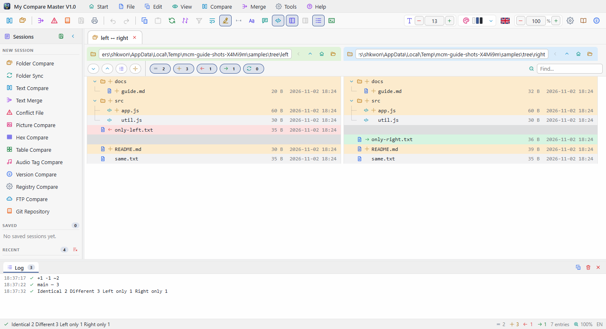

**File › Compare Directories...** (`Ctrl+Shift+O`)

The two folders are shown as **two trees** side by side.

- The **path bar** at the top of each tree changes that side's folder; `↑` goes up one level.
- Folders **fold and unfold**, and a folder's own state sums up what is inside it (the same
  if everything inside is the same, different if anything is).
- An item on one side only leaves a gap on the other, so **the rows of the two trees always
  line up**.
- **Guide lines** join parents and children. The icon before a name is the **kind of file**;
  the small mark beside it is the **comparison result**.
- **Double-click a file** to open its two versions as a text comparison in a new tab.

<a id="folder-toolbar"></a>
### Tree toolbar and folder operations

| Button | What it does |
|--------|--------------|
| Expand all / collapse all | The whole tree |
| Expand changed | Only folders with differences (the state a comparison opens in) |
| Copy to right / copy to left | Copy the selected file or **whole folder** to the other side |
| Move / rename | Move or rename the selected item |
| Delete left / delete right | Delete the selected item on that side — **asks first** |
| Find | Filter by text in the path |

<a id="folder-filter"></a>
### Filters, file masks and more

- The **filters** above the tree show or hide identical, different, left-only and
  right-only items, with a count for each.
- **File masks** (`*.ts, *.md`) compare only matching files; **exclude masks** (`*.log`) skip
  files you never want to see. They are also on **Settings › Compare**.
- **Excluded folders** (by default `.git`, `node_modules`, `dist`, ...) are never entered.
- **Renamed files are paired up**: a file gone from one side that turns up under another
  name on the other with the same content is shown as **renamed**.
- **Inside archives**: files inside zip, jar, docx and similar archives are compared too.
  Nothing is decompressed — the CRCs in the archive's index are enough.
- **Flat list**: one list of full paths instead of a tree.

---

<a id="folder-sync"></a>
## Folder synchronisation

Open a **Folder Sync** session and a sync bar appears above the trees.

1. Choose a **mode**: mirror (right / left), update (right / left) or two-way.
2. **Preview** works out what would be copied and deleted and shows the counts. **Nothing
   changes** at this stage.
3. **Synchronise** asks you to confirm the number of copies and deletions, then runs them.
   Copies run first, deletions last.

- **Mirror** makes one side identical to the other — files missing on the source side are
  **deleted**.
- **Update** only overwrites with newer files. **It never deletes anything.**
- **Two-way** lets the newer side win for each file. Different content with the same time
  is a decision for a person, so such files are **left alone**.
- With **treat a one-hour difference as daylight saving** on, differences within two
  seconds (FAT file systems) and of exactly one or two hours count as the same time.

---

<a id="binary-image"></a>
## Binary and picture comparison

<a id="binary"></a>
### Binary (hex)

A file that is not text is compared as a **hex dump**: sixteen bytes a row, both sides side
by side, **only the differing bytes in red**, with the ASCII at the right. A text file opened
as a **Hex Compare** session is shown byte by byte too.

<a id="image"></a>
### Pictures

When both sides are pictures (`png`, `jpg`, `gif`, `webp`, `bmp`, `avif`, `ico`, `svg`,
`tiff`) the picture comparison opens.

| Mode | What it shows |
|------|---------------|
| **Side by side** | Both pictures at the same scale |
| **Blend** | The two overlaid, mixed with a slider |
| **Difference** | Changed pixels in red, the rest dimmed |

**Mark differences** draws **red boxes** round the changed areas on both pictures. The
toolbar shows the picture sizes and the **number and share of changed pixels**.

| Action | What it does |
|--------|--------------|
| **Zoom in / out** buttons, `Alt` + wheel | One step at a time from 10% to 1600%, keeping the centre |
| **Fit** / **Actual size** | Fit the window or show at 100% |
| **Drag** the picture, double-click | Pan / switch between fit and actual size |

Side by side, **both sides show the same place at the same scale**. From 200% the pixels are
drawn sharp rather than smoothed.

---

<a id="formats"></a>
## Table, audio, version, registry and FTP comparison

| Session | What it does |
|---------|--------------|
| **Table Compare** | Reads CSV and TSV as cells: detects the delimiter, pads columns to the same width on both sides, and orders rows by a key column so an inserted record is one added line. |
| **Audio Tag Compare** | Compares two MP3s by their ID3 tags and stream description, so two rips of the same track come out equal. |
| **Version Compare** | The version information of a Windows executable, a `package.json` or an `Info.plist`. |
| **Registry Compare** | Two `.reg` exports, normalised (hives shortened, wrapped binaries rejoined, keys sorted), so only the settings that differ show. |
| **FTP Compare** | A local folder against one on an FTP or FTPS server. A window asks for the address and password; the listing is read, nothing is downloaded. |

These comparisons show **what a file means**, not what it says, so they cannot be edited.

---

<a id="merge"></a>
## 3-way merge and conflicts

<a id="merge-open"></a>
### Opening a merge

| How | When |
|-----|------|
| **File › Open 3-Way Merge...** | You have separate Base, Local and Remote files |
| **File › Open Conflicted File...** | A file left with `<<<<<<<` markers after `git merge` |
| **Double-click a conflicted file in a git repository** | The most accurate: all three stages are read from git's index, so **the common ancestor** is there too |
| `git mergetool` | See [Command line, git difftool and mergetool](#cli) |

<a id="merge-screen"></a>
### The merge screen

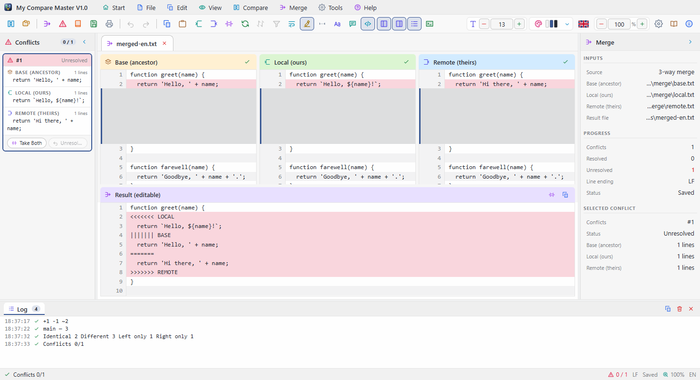

At the top, three panes: **Base (common ancestor) · Local (ours) · Remote (theirs)**; below
them, the editable **Result**. All four are **aligned line by line** and scroll together. A
conflicted file without a common ancestor shows only Local and Remote.

- Changes that do not overlap are **merged automatically**; only real conflicts are marked.
- Conflicts are light red, resolved ones light green.
- The left panel is the **conflict list**, the right panel the **merge information**
  (progress and totals per resolution).

<a id="merge-resolve"></a>
### Resolving

Select a conflict in the list on the left (or click it on screen), then:

| Choice | Shortcut | Result |
|--------|----------|--------|
| Take Base | `Ctrl+1` | The common ancestor's text |
| Take Local | `Ctrl+2` | Our side |
| Take Remote | `Ctrl+3` | Their side |
| Take Both | `Ctrl+4` | Ours followed by theirs |
| Unresolve | `Ctrl+Shift+0` | Back to unresolved |

**Resolve All as Local / Remote** are in the Merge menu; **previous / next conflict** are
`Shift+F7` / `Shift+F8`. **Double-click** a line of the result to **edit it**; a conflict
edited by hand is marked as modified in the list. **Everything can be undone** (`Ctrl+Z`) and
redone (`Ctrl+Y`).

<a id="merge-save"></a>
### Saving

**File › Save Merge Result** (`Ctrl+S`).

- With conflicts still unresolved you are **asked first**; going ahead writes the
  `<<<<<<<` markers into the file.
- Saving a fully resolved conflicted file in a git repository also runs **`git add`** for you.
- Unsaved changes are **offered for saving** when you exit.

---

<a id="git"></a>
## Git

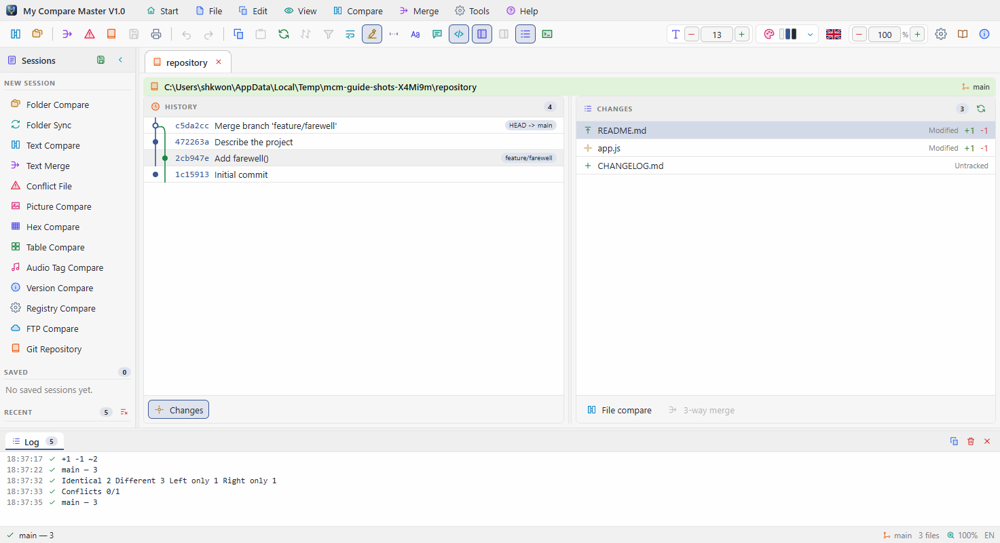

**File › Open Git Repository...** lists the working tree's changes, staged changes,
untracked files and conflicted files together, beside the commit history drawn as a **graph
of branches and merges**. Drag the splitter between them to change the split.

- **Double-click** a change to compare its two versions.
- Double-click a **conflicted file** to open it as a 3-way merge.
- Click a commit to list the files it touched; **Back** (`Alt+←`) returns.

---

<a id="cli"></a>
## Command line, git difftool and mergetool

<a id="cli-args"></a>
### Opening from the command line

```
MyCompareMaster                                    nothing open
MyCompareMaster A B                                compare two files or two folders
MyCompareMaster BASE LOCAL REMOTE MERGED           a 3-way merge
MyCompareMaster conflicted.txt                     a file with <<<<<<< markers
MyCompareMaster session.dmrg                       a saved session
MyCompareMaster /path/to/repo                      a git repository
```

The paths are **positional, with no switches**: two mean a comparison, four a merge. If the
program is already running, they open **in the running window** rather than a new one.

<a id="cli-git"></a>
### Registering as difftool / mergetool

**Settings › Git** (or **Tools › Register as git difftool / mergetool**) registers and
unregisters both with one click, and shows the current state and the exact command line. By
hand:

```bash
git config --global difftool.mycomparemaster.cmd '"<path to the exe>" "$LOCAL" "$REMOTE"'
git config --global diff.tool mycomparemaster
git config --global difftool.prompt false

git config --global mergetool.mycomparemaster.cmd '"<path to the exe>" "$BASE" "$LOCAL" "$REMOTE" "$MERGED"'
git config --global mergetool.mycomparemaster.trustExitCode true
git config --global merge.tool mycomparemaster
git config --global mergetool.prompt false
```

Then:

```bash
git difftool      # compare the changed files one by one
git mergetool     # resolve the conflicted files one by one
```

The program exits with `0` once a fully resolved merge has been saved and non-zero
otherwise, which is what `trustExitCode` reads to decide whether the file is resolved.

---

<a id="tabs"></a>
## Tabs, session files and recent items

<a id="tabs-tabs"></a>
### Tabs

Each comparison opens in a new tab. When the tabs are wider than the window, **`‹ ›`
buttons** appear at the right end instead of a scroll bar. Close a tab with `×`, a middle
click or `Ctrl+W`. With **Settings › General › Restore the last session at startup** on, the
tabs that were open come back next time.

<a id="tabs-dmrg"></a>
### Session files (`.dmrg`)

**File › Save Session As...** saves the open tabs; **Open Session...** brings them back.
The installer registers `.dmrg` with the system, so **double-clicking one in the file
manager** opens it too.

<a id="tabs-recent"></a>
### Recent items

The last **ten** are remembered, at the bottom of the **File menu**, on the start screen and
in the session panel.

- Remove one: the bin button on the start screen, or **File › Manage Recent Items...**.
- Remove all: **File › Clear Recent List**.

The **folders** they came from are remembered too, so the file pickers start there.

---

<a id="terminal"></a>
## The bottom panel: log and terminal

<a id="terminal-log"></a>
### Log

The first tab of the bottom panel: everything that has happened, with the time, and **copy**
and **clear** buttons at the right. Toggle it with the toolbar's log button or **View › Log
Panel**.

<a id="terminal-shell"></a>
### Terminal and shells

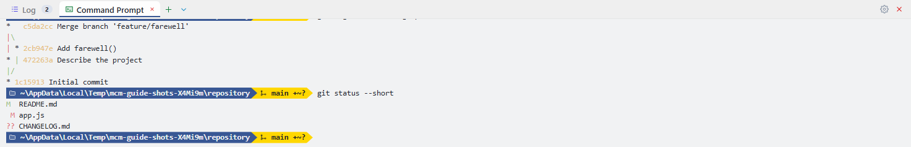

Open and close it with the toolbar's terminal button, **View › Terminal Panel** or
`` Ctrl+` ``. It starts **in the folder being compared** (the left root of a folder
comparison, the folder of a compared file, a repository). To always start in the same
place, enter a path in *Settings › Terminal › Start directory*.

Turning the terminal on opens one straight away, and **its shell's name becomes a tab** of
the bottom panel. `+` opens another; `▾` beside it lists **every shell installed on this
computer** — on Windows: Command Prompt, Windows PowerShell, PowerShell, Git Bash, MSYS2,
Cygwin, WSL distributions and shells registered with Windows Terminal; elsewhere: `$SHELL`
and `/etc/shells`. The default shell is set in *Settings › Terminal*.

Closing a tab ends its shell; closing the last one turns the terminal off. **Closing the
panel does not end the shells**, so reopening it finds them as they were.

<a id="terminal-keys"></a>
### Using it

| Key | What it does |
|-----|--------------|
| `Enter` | Run the command; while a command runs, the line becomes its **input** |
| `Tab` | Completion — the first word from shell built-ins and PATH, the rest from the folder's files |
| `↑` `↓` | Command history |
| `Ctrl+C` | Stop the running command (with an empty input line) |
| `Ctrl+L` | Clear the screen (`clear` and `cls` too) |
| `Esc` | Clear the input line |

Pasting several lines runs every complete line and leaves the last fragment in the input.
The output keeps the programs' own **ANSI colours**, and plain lines get error (red),
warning (yellow) and success (green) colours, links and `file:line` picked out. Prefer black
and white? Turn colour off in *Settings › Terminal*.

> The shell runs **line by line**, without a pseudo-terminal. Full-screen programs such as
> `vim` or `top` do not work in this panel. Output that redraws one line, such as a progress
> bar, is handled as set in *Settings › Terminal › Carriage return*: overwrite, new line or
> strip.

<a id="terminal-prompt"></a>
### The prompt and prompt themes

**The program draws the prompt itself.** By default it shows the folder name and, inside a
repository, the branch, **coloured by the repository's state** — green (clean, pushed), red
(modified, needs add), yellow (added, needs commit), orange (committed, needs push), crimson
for conflicts, blue when a pull is needed. The symbols `↑ ↓ + ~ ? !` sum up the counts. Each
command stays in the transcript **with the prompt it was typed at**.

Change its look in *Settings › Prompt* and *Settings › Custom Prompts*. Click one of the
**nineteen presets** (Powerline, Agnoster, Paradox, Pure, Rainbow, Nord …) to apply it, then
choose the segments (OS, user@host, shell, path, git, execution time, exit code, time), the
style (powerline, plain, rounded), how the path is shortened, two lines or one, and the
colour per state. On the Custom Prompts tab, add, move and delete segments one by one, set
their colours and Go templates (`{{ .Branch }}`), and save the result under a name; it stays
beside the presets as a ★ card.

---

<a id="print"></a>
## Printing

The toolbar's print button or `Ctrl+P` opens the **print preview**.

- **Range**: all, the current document, or custom (`1-3, 7`).
- **Page setup**: paper (A4, A3, Letter, Legal), orientation, margins (mm), line numbers,
  coloured backgrounds, header and footer.
- The preview is **exactly what will print**; changing a setting repaginates at once. Turn
  pages with `‹ ›` and print with **Print**.

---

<a id="settings"></a>
## Settings

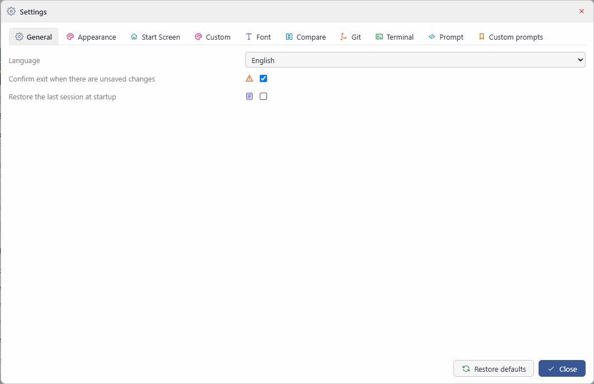

The gear button on the toolbar, **Tools › Settings...** or `Ctrl+,`. The window has a **fixed
size and never scrolls**; settings are **one per line**, on ten tabs. Number fields have
`−` `+` buttons. Changes are **saved immediately** and the main window follows them live.

| Tab | Contents |
|-----|----------|
| **General** | Language, confirm exit, restore the last session at startup |
| **Appearance** | Forty themes and the custom theme, zoom, panel widths, merge pane header colours |
| **Start screen** | Card layout and auto-arrange, card opacity, the 3D background and its speed, **show the tutorial at startup**, reset the start screen |
| **Custom** | Your theme's four colours (background, panel, text, accent) and light or dark |
| **Font** | Every installed font (monospaced / proportional), size, weight, style, preview |
| **Compare** | Word wrap, word highlight, ignore whitespace and case, grammar rules, differences only, excluded folders, file masks, rename detection, archives, flat list |
| **Git** | difftool / mergetool registration state, register and unregister |
| **Terminal** | Start directory, default shell, the line ending `Enter` sends, carriage-return handling, output colour |
| **Prompt** | Nineteen presets, segments, style, path style, two lines, colour per repository state |
| **Custom Prompts** | Save, rename and delete your own prompts; edit each segment's colours and template |

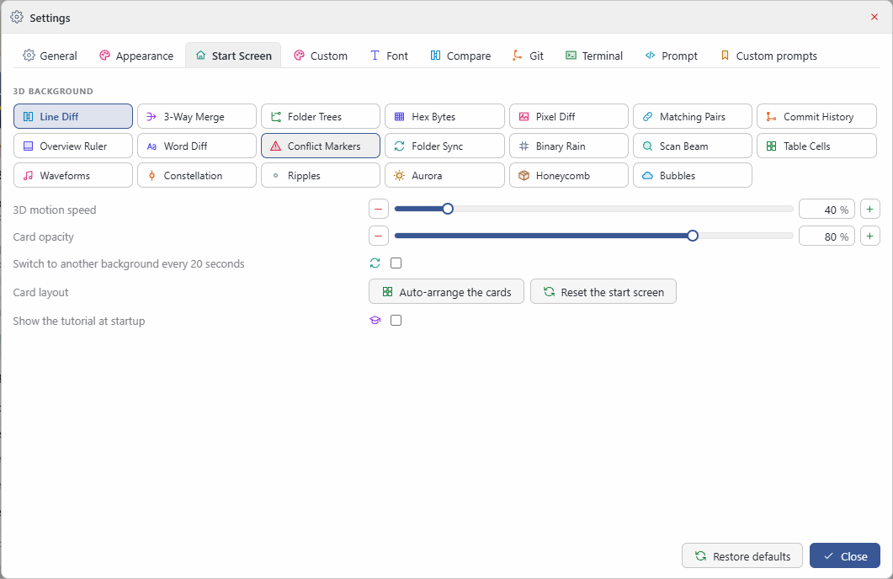

Everything is restored at the next start, including the window's position and size.

---

<a id="themes"></a>
## Themes, language, font and zoom

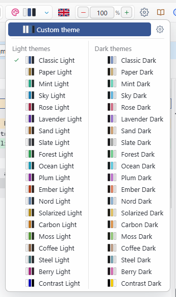

- **Themes**: twenty light themes paired with twenty dark ones. The toolbar's theme button
  or `Ctrl+T` switches to the **light ↔ dark partner** of the current theme; `▾` beside it
  lists every theme in two columns, light and dark, each row with its colour swatches.
- **Custom theme**: pick four colours in *Settings › Custom* and the rest are worked out.
- **Language**: click the flag on the toolbar to switch Korean ↔ English. Menus, dialogs and
  this guide all follow.
- **Font size**: the toolbar's `−` `+` set the comparison's font size; the font itself is in
  *Settings › Font*.
- **Zoom**: the toolbar's `−` `+`, `Ctrl++` / `Ctrl+-` / `Ctrl+0`, or `Ctrl` + mouse wheel,
  from 50% to 300%.

---

<a id="shortcuts"></a>
## Keyboard shortcuts

| Action | Shortcut |
|--------|----------|
| User's Guide | `F1` |
| Compare files | `Ctrl+O` |
| Compare directories | `Ctrl+Shift+O` |
| Save merge result / save as | `Ctrl+S` / `Ctrl+Shift+S` |
| Undo / redo | `Ctrl+Z` / `Ctrl+Y` |
| Copy / paste / cut / select all | `Ctrl+C` / `Ctrl+V` / `Ctrl+X` / `Ctrl+A` |
| Find / replace / go to line | `Ctrl+F` / `Ctrl+H` / `Ctrl+G` |
| Set bookmark / next bookmark | `Ctrl+F2` / `F2` |
| Previous / next difference | `F7` / `F8` |
| First / last difference | `Ctrl+Home` / `Ctrl+End` |
| Back / forward | `Alt+←` / `Alt+→` |
| Previous / next conflict | `Shift+F7` / `Shift+F8` |
| Take Base / Local / Remote / Both | `Ctrl+1` to `Ctrl+4` |
| Unresolve | `Ctrl+Shift+0` |
| Zoom in / out / reset | `Ctrl++` / `Ctrl+-` / `Ctrl+0`, `Ctrl` + mouse wheel |
| Differences only | `Ctrl+D` |
| Toggle light and dark | `Ctrl+T` |
| Refresh | `F5` |
| Print preview | `Ctrl+P` |
| Terminal panel | `` Ctrl+` `` |
| Settings | `Ctrl+,` |
| Close tab | `Ctrl+W` |
| Exit | `Alt+F4` |

While the tutorial is running, `→` is next, `←` is back and `Esc` closes it.

---

<a id="help"></a>
## The tutorial and this guide

<a id="help-tour"></a>
### The tutorial

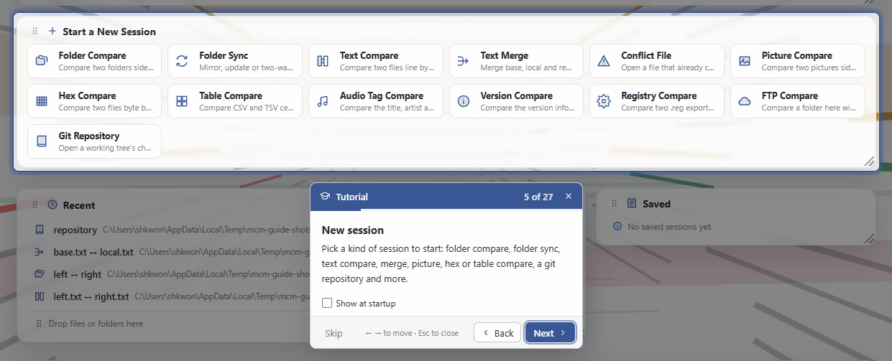

**Help › Tutorial** dims the window, lights up one part at a time and explains it on a card
beside it: the menu bar, the toolbar, the start screen, opening a comparison, the comparison
itself, merging, the panels, the log and terminal, themes, settings and this guide.

- **Next** / **Back** buttons, or `→` / `←`.
- **Skip** or `Esc` closes it at any point.
- Untick **Show at startup** on the card to stop the welcome card appearing at startup.
- A part that is not on screen right now (the merge screen when no merge is open, say) is
  explained on a card in the middle of the window.

<a id="help-guide"></a>
### The guide window

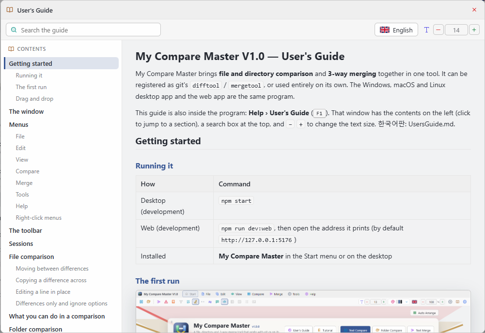

**Help › User's Guide** (`F1`) opens this guide in a resizable window of its own.

- Click an entry in the **contents** on the left to jump to it; the highlight follows as you
  read.
- Type in the **search** box to keep only the sections containing the words and highlight
  them in the text. `Enter` goes to the next match, `Esc` clears the search.
- `−` `+` change the text size. The theme follows the program's settings.
- The **flag button** at the top switches the guide alone between 한국어 and English. It starts in
  the program's language and remembers your choice; switching keeps you on the same section.

---

<a id="install"></a>
## Installing and uninstalling

<a id="install-setup"></a>
### Installing

The installer **asks for Korean or English on its first page**.

- A previous installation is **upgraded in place**; your settings and sessions stay.
- A Start menu shortcut is created.
- The `.dmrg` session file type is **registered with its own icon**.
- Everything the program needs to run is installed with it: there is no Node.js or other runtime to install separately.

<a id="install-remove"></a>
### Uninstalling

When uninstalling, you are **asked whether to delete your settings and sessions** as well.
Answer no and they stay, to be picked up by the next installation.

<a id="install-files"></a>
### Where the settings are

| System | Location |
|--------|----------|
| Windows | `%AppData%\MyCompareMaster\settings.json` |
| macOS | `~/Library/Application Support/MyCompareMaster/settings.json` |
| Linux | `~/.config/MyCompareMaster/settings.json` |

---

<a id="troubleshooting"></a>
## Troubleshooting

<a id="trouble-error"></a>
### When something goes wrong

Errors open in a **popup window** with the full details. **Copy error details** puts all of
it on the clipboard, ready to paste into a report.

<a id="trouble-slow"></a>
### A folder comparison is very slow

- Put big folders such as `node_modules` and `dist` in **Settings › Compare › Excluded
  folders** (they are there by default).
- Narrow the comparison with **file masks** to the files you care about.

<a id="trouble-wrap"></a>
### Word wrap will not turn on for a very large file

Wrapping means measuring every line's height, so files over twenty thousand lines are shown
unwrapped. Differences only usually solves the problem.

<a id="trouble-mergetool"></a>
### A file is still conflicted after `git mergetool`

- Make sure you saved before closing the window.
- Check that `mergetool.mycomparemaster.trustExitCode` is `true` (registering from
  Settings › Git sets it).

<a id="trouble-font"></a>
### A font is missing from the font list

The system font folders are read directly. If you have just installed the font, restart the
program.

---

My Compare Master V1.0 — Copyright (c) SHKWON(knix008@naver.com)
