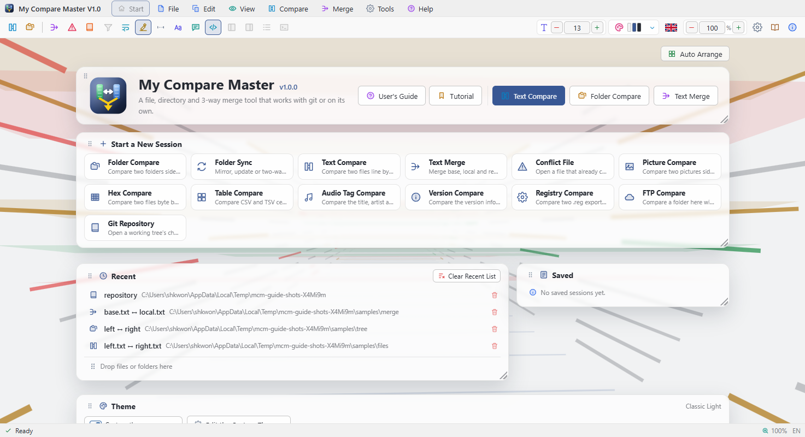
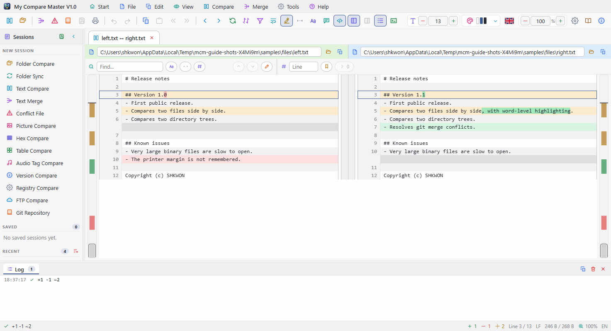
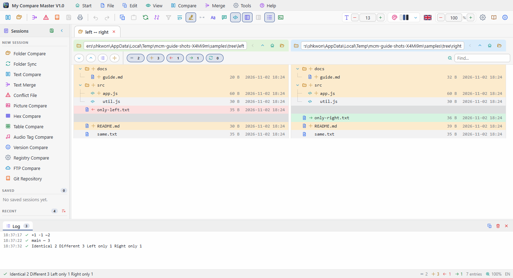
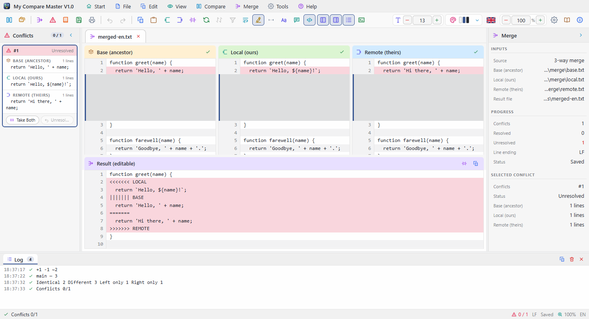

# My Compare Master V1.0 — Tutorial

A hands-on walk through the main features of My Compare Master, using a few small practice files
you make yourself. It takes about thirty minutes from start to finish. Every feature is described
in full in the [user's guide](UsersGuide.en.md). 한국어판: [Tutorial.md](Tutorial.md).

| Step | What you learn |
|------|----------------|
| [0. Practice files](#t0) | The folders and files used in the steps |
| [1. A look around](#t1) | The window's parts, with the built-in tour |
| [2. Comparing two files](#t2) | What the colours mean, moving between differences, differences only |
| [3. Editing and copying across](#t3) | Copying a block to the other side, editing a line |
| [4. Compared again when files change](#t4) | Edits made in another program show up at once |
| [5. Comparing two folders](#t5) | Trees, filters, opening a file pair, copying |
| [6. Folder sync](#t6) | Previewing a sync before running it |
| [7. The 3-way merge](#t7) | Resolving conflicts and saving the result |
| [8. Tabs and sessions](#t8) | Moving between comparisons and keeping them |
| [9. Using it with git](#t9) | Registering it as difftool and mergetool |

---

<a id="t0"></a>
## 0. Practice files

Make a `practice` folder anywhere and create these folders and files in it. Pasting the
contents into a text editor such as Notepad and saving is enough.

```
practice/
├─ a/
│  ├─ greeting.txt
│  ├─ same.txt
│  └─ only-a.txt
├─ b/
│  ├─ greeting.txt
│  ├─ same.txt
│  └─ only-b.txt
└─ merge/
   ├─ base.txt
   ├─ mine.txt
   └─ theirs.txt
```

**a/greeting.txt**

```
Hello
This line is the same on both sides.
The colour is red.
This line will be removed.
Last line
```

**b/greeting.txt**

```
Hello
This line is the same on both sides.
The colour is blue.
Last line
A brand new line
```

Put the same single line `same content` in both **a/same.txt** and **b/same.txt**, `only in a`
in **a/only-a.txt** and `only in b` in **b/only-b.txt**.

**merge/base.txt** (the common ancestor)

```
title = Report
owner = Kim
status = draft
pages = 10
```

**merge/mine.txt** (your edit)

```
title = Report
owner = Lee
status = draft
pages = 12
```

**merge/theirs.txt** (their edit)

```
title = Annual Report
owner = Park
status = draft
pages = 10
```

---

<a id="t1"></a>
## 1. A look around



1. Start My Compare Master. On the first run a welcome card appears at the bottom right.
2. Click **Start tutorial**. If there is no card, choose **Help › Tutorial**.
3. The window dims and only the part being explained stays lit. `→` goes on, `←` goes back and
   `Esc` closes the tour.

The point of this step is to see once where the menu bar, toolbar, start screen, tabs, panels
and status bar are. Press `Esc` when you have seen them.

> The **flag button** at the top right switches between Korean and English, and the **theme
> button** (`Ctrl+T`) between the light and dark theme.

---

<a id="t2"></a>
## 2. Comparing two files



1. Choose **File › Compare Files...** (`Ctrl+O`).
2. Pick `practice/a/greeting.txt` for the left side and `practice/b/greeting.txt` for the right.
   Selecting both in the file manager and **dropping** them onto the window works too.
3. A new tab opens with the two files aligned line by line.

Read the colours:

| Line | Colour | Meaning |
|------|--------|---------|
| `The colour is red.` ↔ `blue.` | Yellow | **Changed** — only the changed word (`red` / `blue`) is bold |
| `This line will be removed.` | Red | **Removed** — only on the left |
| `A brand new line` | Green | **Added** — only on the right |

Now move around:

- `F8` goes to the next difference, `F7` to the previous one.
- The **difference bar** at the right edge shows the whole file's differences in colour. Click
  it to jump there.
- `Ctrl+D` (**Differences only**) folds away the matching lines, keeping each difference and
  three lines either side. Press it again to bring them back.
- The status bar shows the added, removed and changed counts, such as `+1 −1 ~1`.

---

<a id="t3"></a>
## 3. Editing and copying across

**Copying a block across**

1. Hover over the `The colour is ...` line: `›` and `‹` buttons appear between the two panes.
2. Click `›` and the left side's text (`red`) is written to the right file. The line now matches.
3. The file is saved at once. Open `b/greeting.txt` in an editor and it says `red`.

**Editing a line**

1. **Double-click** the `Last line` line on the right.
2. Change it to `Last line!` and press `Enter`: it is written to the file and the comparison is
   worked out again. `Esc` cancels.

---

<a id="t4"></a>
## 4. Compared again when files change

When a file being compared is changed by another program, My Compare Master compares it again
by itself.

1. Leave the comparison from step 2 open.
2. Open `practice/a/greeting.txt` in Notepad, change `Hello` to `Hello, world` and save.
3. Look back at My Compare Master: within a second the first line is shown as **changed** (yellow).

Worth knowing:

- When the files of a tab behind the current one change, that tab is compared again when you
  **bring it forward**.
- Moving between tabs alone never re-runs a comparison: the scroll position, open folders and
  bookmarks stay as they were.
- **Refresh** (`F5`) compares again whenever you like.

---

<a id="t5"></a>
## 5. Comparing two folders



1. Choose **File › Compare Directories...** (`Ctrl+Shift+O`) and pick `practice/a` for the left
   and `practice/b` for the right.
2. The two trees appear side by side. A file on one side only (`only-a.txt`, `only-b.txt`) leaves
   its place on the other side empty, so the rows of the two trees always line up.
3. Try the **filter** buttons above the trees: identical, different, left only and right only,
   each with its count. Turn **identical** off and `same.txt` disappears.
4. **Double-click** `greeting.txt` to open the two files' contents in a new tab.
5. Back on the folder tab, select `only-a.txt` and click **Copy to right** in the tree
   toolbar. It now exists on the right as well, and its status becomes **identical**.

> Typing in the find box keeps only the entries whose path contains the text. Only the rows on
> screen are drawn, so even folders with tens of thousands of files scroll smoothly.

---

<a id="t6"></a>
## 6. Folder sync

A sync really copies and deletes files, so always check it with **Preview** before running it.
Try it on the practice folders only.

1. Choose **File › Open Folder Sync...** and pick `practice/a` on the left and `practice/b` on the
   right.
2. A sync bar appears above the trees. Choose **Update right from left** as the **Mode**. Update only
   overwrites with newer files and **never deletes anything**.
3. Click **Preview**. It shows how many files would be copied and deleted, and changes nothing.
4. If that is what you expected, click **Run the sync**, check the counts once more in the
   confirmation and go ahead.

| Mode | What it does |
|------|--------------|
| Mirror | Makes one side exactly like the other — files missing on the other side are **deleted** |
| Update | Overwrites with newer files only; deletes nothing |
| Two way | The newer side wins, file by file |

---

<a id="t7"></a>
## 7. The 3-way merge



Two people edited the same original (`base.txt`). You changed `owner` and `pages`; they changed
`title` and `owner`.

1. Choose **File › Open 3-Way Merge...**. In the dialogs that follow pick **Base**
   `merge/base.txt`, **Local** `merge/mine.txt` and **Remote** `merge/theirs.txt`, and for the
   **Result** type `merge/result.txt` as the place to save.
2. Base, Local and Remote appear at the top, with the editable **result** below.
3. Changes that do not overlap are already merged: `title = Annual Report` (only they changed it)
   and `pages = 12` (only you did) are in the result.
4. Both of you changed `owner`, so it stays a **conflict** (light red). Select it in the conflict
   list in the left panel.
5. Choose how to resolve it:

   | Shortcut | Result |
   |----------|--------|
   | `Ctrl+2` | Local — `owner = Lee` |
   | `Ctrl+3` | Remote — `owner = Park` |
   | `Ctrl+4` | Both — both lines |
   | `Ctrl+1` | Base — `owner = Kim` |

   Changed your mind? `Ctrl+Z` undoes it. You can also double-click a result line and edit it.
6. Save with **File › Save Merge Result** (`Ctrl+S`). If a conflict is still unresolved you are
   asked first.

> A file left with `<<<<<<<` markers after a `git merge` opens directly with
> **File › Open Conflicted File...**.

---

<a id="t8"></a>
## 8. Tabs and sessions

Every comparison you opened is still there as a tab.

- Click between the tabs. Each one remembers where you were in it.
- `Alt+←` and `Alt+→` (**Back** and **Forward**) retrace the order you moved between them.
- Close a tab with `×`, a middle click or `Ctrl+W`.
- **File › Save Session As...** keeps the open tabs in a `.dmrg` file; **Open Session...**, or a
  double-click on the file, brings them all back later.
- Recently opened comparisons stay in the **Recent** list on the start screen and in the left
  **Sessions** panel.

---

<a id="t9"></a>
## 9. Using it with git

If you use git, register My Compare Master as its comparison and merge tool.

1. Open **Tools › Settings...** (`Ctrl+,`) and go to the **Git** tab.
2. Click **Register as git difftool** and **Register as git mergetool**. The registered command
   lines are shown on the same page.
3. Now, in a repository:

   ```bash
   git difftool      # compare the changed files one by one
   git mergetool     # resolve the conflicted files one by one
   ```

**File › Open Git Repository...** shows the changed files together with the commit graph; a
double-click on an entry opens its comparison or merge.

---

## Where next

- Every menu, shortcut and setting is in the [user's guide](UsersGuide.en.md). Inside the program,
  `F1` opens it.
- The guide also covers picture, hex, table and audio tag comparisons, the terminal and printing.
- When you are done, the `practice` folder can be deleted.

---

My Compare Master V1.0 — Copyright (c) SHKWON(knix008@naver.com)
