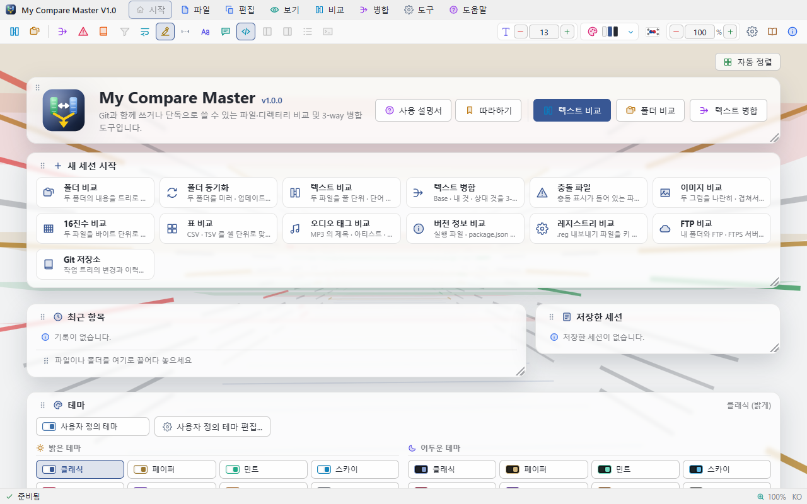
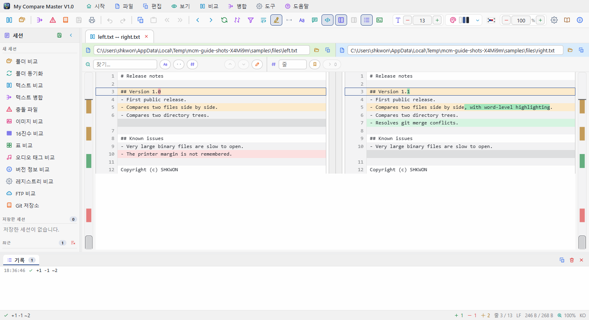
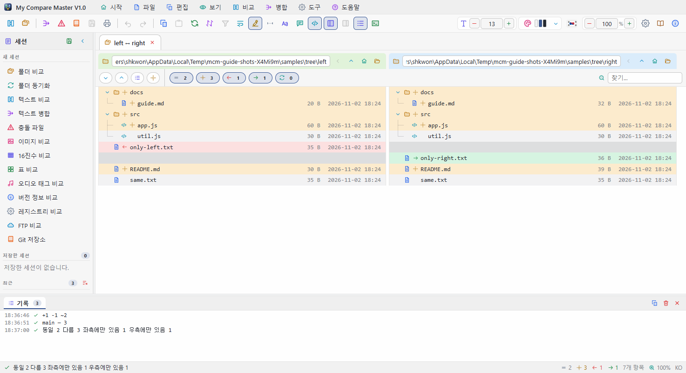
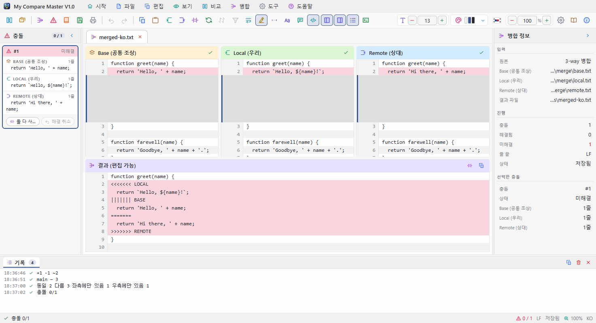

# My Compare Master V1.0 — 튜토리얼

이 문서는 작은 연습 파일을 직접 만들어 가며 My Compare Master의 주요 기능을 차례로 익히는
실습서입니다. 처음부터 끝까지 30분 정도 걸립니다. 기능 하나하나의 자세한 설명은
[사용자 가이드](UsersGuide.md)에 있습니다. English version: [Tutorial.en.md](Tutorial.en.md).

| 단계 | 배우는 것 |
|------|-----------|
| [0. 연습 파일 준비](#t0) | 실습에 쓸 폴더와 파일 만들기 |
| [1. 화면 둘러보기](#t1) | 프로그램 안의 튜토리얼로 화면 구성 익히기 |
| [2. 두 파일 비교](#t2) | 색의 뜻, 차이 사이 이동, 차이만 보기 |
| [3. 고치고 반영하기](#t3) | 차이 블록 반영, 줄 직접 고치기 |
| [4. 바뀌면 다시 비교](#t4) | 다른 프로그램에서 고친 내용이 곧바로 반영되는 것 확인 |
| [5. 두 폴더 비교](#t5) | 트리, 필터, 폴더 안 파일 열기, 복사 |
| [6. 폴더 동기화](#t6) | 미리보기로 확인한 뒤 실행하기 |
| [7. 3-way 병합](#t7) | 충돌 해결과 결과 저장 |
| [8. 탭과 세션](#t8) | 여러 비교를 오가고 저장해 두기 |
| [9. Git과 함께 쓰기](#t9) | difftool · mergetool 등록 |

---

<a id="t0"></a>
## 0. 연습 파일 준비

아무 곳에나 `practice` 폴더를 만들고, 그 안에 아래 구조대로 폴더와 파일을 만듭니다.
메모장 같은 편집기로 내용을 붙여 넣어 저장하면 됩니다.

```
practice/
├─ a/
│  ├─ greeting.txt
│  ├─ same.txt
│  └─ only-a.txt
├─ b/
│  ├─ greeting.txt
│  ├─ same.txt
│  └─ only-b.txt
└─ merge/
   ├─ base.txt
   ├─ mine.txt
   └─ theirs.txt
```

**a/greeting.txt**

```
Hello
This line is the same on both sides.
The colour is red.
This line will be removed.
Last line
```

**b/greeting.txt**

```
Hello
This line is the same on both sides.
The colour is blue.
Last line
A brand new line
```

**a/same.txt**와 **b/same.txt**에는 똑같이 `same content` 한 줄을, **a/only-a.txt**에는
`only in a`, **b/only-b.txt**에는 `only in b`를 적습니다.

**merge/base.txt** (공통 조상)

```
title = Report
owner = Kim
status = draft
pages = 10
```

**merge/mine.txt** (내가 고친 것)

```
title = Report
owner = Lee
status = draft
pages = 12
```

**merge/theirs.txt** (상대가 고친 것)

```
title = Annual Report
owner = Park
status = draft
pages = 10
```

---

<a id="t1"></a>
## 1. 화면 둘러보기



1. My Compare Master를 실행합니다. 처음 실행하면 오른쪽 아래에 시작 안내 카드가 나옵니다.
2. **튜토리얼 시작**을 누릅니다. 카드가 없으면 **도움말 › 튜토리얼**을 고릅니다.
3. 화면이 어두워지고 설명하는 부분만 밝게 강조됩니다. `→`로 다음, `←`로 이전, `Esc`로 닫습니다.

메뉴 막대, 도구 모음, 시작 화면, 탭, 패널, 상태 표시줄이 각각 어디에 있는지 한 번 훑어보는
것이 이 단계의 목표입니다. 다 보았으면 `Esc`로 닫습니다.

> 화면 오른쪽 위의 **국기 단추**로 한국어 ↔ English를, **테마 단추**(`Ctrl+T`)로 밝은 ↔ 어두운
> 테마를 바꿀 수 있습니다.

---

<a id="t2"></a>
## 2. 두 파일 비교



1. **파일 › 파일 비교 열기...**(`Ctrl+O`)를 고릅니다.
2. 왼쪽 파일로 `practice/a/greeting.txt`, 오른쪽 파일로 `practice/b/greeting.txt`를 고릅니다.
   두 파일을 탐색기에서 함께 골라 창에 **끌어다 놓아도** 됩니다.
3. 새 탭이 열리고 두 파일이 줄 단위로 맞춰져 나란히 나옵니다.

색을 읽어 봅니다.

| 줄 | 색 | 뜻 |
|----|----|----|
| `The colour is red.` ↔ `blue.` | 노랑 | **변경** — 바뀐 낱말(`red` / `blue`)만 진하게 표시됩니다 |
| `This line will be removed.` | 빨강 | **삭제** — 왼쪽에만 있습니다 |
| `A brand new line` | 초록 | **추가** — 오른쪽에만 있습니다 |

이제 움직여 봅니다.

- `F8`을 눌러 다음 차이로, `F7`로 이전 차이로 이동합니다.
- 오른쪽 가장자리의 **차이 스크롤 막대**는 파일 전체의 차이를 색으로 보여 줍니다. 막대를 누르면
  그 위치로 갑니다.
- `Ctrl+D`(**차이만 보기**)를 누르면 같은 줄이 접히고 차이와 앞뒤 세 줄만 남습니다. 다시 누르면
  돌아옵니다.
- 상태 표시줄에 `+1 −1 ~1`처럼 추가 · 삭제 · 변경 개수가 나옵니다.

---

<a id="t3"></a>
## 3. 고치고 반영하기

**차이 블록 반영**

1. `The colour is ...` 줄에 마우스를 올리면 두 패널 사이에 `›` `‹` 단추가 나타납니다.
2. `›`를 누르면 왼쪽 내용(`red`)이 오른쪽 파일에 기록됩니다. 그 줄은 이제 같은 줄이 됩니다.
3. 파일은 바로 저장됩니다. 탐색기에서 `b/greeting.txt`를 열어 보면 `red`로 바뀌어 있습니다.

**줄 직접 고치기**

1. 오른쪽 `Last line` 줄을 **더블클릭**합니다.
2. `Last line!`로 고치고 `Enter`를 누르면 파일에 기록되고 비교가 다시 계산됩니다.
   `Esc`를 누르면 취소됩니다.

---

<a id="t4"></a>
## 4. 바뀌면 다시 비교

My Compare Master는 비교 중인 파일이 다른 프로그램에서 바뀌면 스스로 다시 비교합니다.

1. 2단계에서 연 비교 탭을 그대로 둡니다.
2. 메모장으로 `practice/a/greeting.txt`를 열어 `Hello`를 `Hello, world`로 고치고 저장합니다.
3. My Compare Master 창을 보면 1초 안에 첫 줄이 **변경**(노랑)으로 바뀌어 있습니다.

알아 둘 점:

- 뒤에 있던 탭의 파일이 바뀌면 그 탭을 **앞으로 가져올 때** 다시 비교합니다.
- 탭을 옮겨 다니는 것만으로는 다시 비교하지 않습니다. 스크롤 위치, 펼친 폴더, 책갈피가 그대로
  남아 있습니다.
- 언제든 **새로 고침**(`F5`)으로 직접 다시 비교할 수 있습니다.

---

<a id="t5"></a>
## 5. 두 폴더 비교



1. **파일 › 디렉터리 비교 열기...**(`Ctrl+Shift+O`)를 고르고, 왼쪽에 `practice/a`, 오른쪽에
   `practice/b`를 고릅니다.
2. 두 트리가 나란히 나옵니다. 한쪽에만 있는 파일(`only-a.txt`, `only-b.txt`)은 반대쪽 자리가
   비어 있어 두 트리의 줄이 항상 맞습니다.
3. 트리 위의 **필터** 단추로 같은 항목 · 다른 항목 · 좌측에만 · 우측에만을 켜고 꺼 봅니다.
   단추마다 개수가 함께 나옵니다. **같은 항목**을 끄면 `same.txt`가 사라집니다.
4. `greeting.txt`를 **더블클릭**하면 두 파일의 내용 비교가 새 탭으로 열립니다.
5. 폴더 탭으로 돌아와 `only-a.txt`를 고른 뒤 트리 도구 모음의 **우측으로 복사**를 누릅니다.
   오른쪽에도 생기고 상태가 **같은 항목**으로 바뀝니다.

> 찾기 칸에 글자를 넣으면 경로에 그 글자가 든 항목만 남습니다. 수만 개 파일이 든 폴더도
> 화면에 보이는 줄만 그리므로 스크롤이 느려지지 않습니다.

---

<a id="t6"></a>
## 6. 폴더 동기화

동기화는 실제로 파일을 복사하고 지우므로, 반드시 **미리보기**로 확인한 뒤 실행합니다.
연습 폴더로만 해 보세요.

1. **파일 › 폴더 동기화 열기...**를 고르고 왼쪽 `practice/a`, 오른쪽 `practice/b`를 고릅니다.
2. 트리 위에 동기화 줄이 생깁니다. **방식**에서 **오른쪽을 최신으로 (업데이트)**를 고릅니다. 업데이트는
   새 파일만 덮어쓰고 **아무것도 지우지 않습니다**.
3. **미리보기**를 누릅니다. 복사할 개수와 지울 개수가 나오지만 이 단계에서는 아무것도 바뀌지
   않습니다.
4. 결과가 예상과 같으면 **동기화 실행**을 누르고, 확인 창에서 개수를 한 번 더 본 뒤 실행합니다.

| 방식 | 하는 일 |
|------|---------|
| 미러 | 한쪽을 다른 쪽과 똑같이 만듭니다. 상대편에 없는 파일은 **지웁니다** |
| 업데이트 | 새 파일만 덮어씁니다. 지우지 않습니다 |
| 양방향 | 파일마다 최신 쪽이 이깁니다 |

---

<a id="t7"></a>
## 7. 3-way 병합



두 사람이 같은 원본(`base.txt`)을 각자 고친 상황입니다. 나는 `owner`와 `pages`를, 상대는
`title`과 `owner`를 고쳤습니다.

1. **파일 › 3-way 병합 열기...**를 고릅니다. 차례로 묻는 창에서
   **Base** `merge/base.txt`, **Local** `merge/mine.txt`, **Remote** `merge/theirs.txt`를 고르고,
   마지막 **결과** 저장 위치에는 `merge/result.txt`를 입력합니다.
2. 위쪽에 Base · Local · Remote, 아래쪽에 편집할 수 있는 **결과**가 나옵니다.
3. 겹치지 않는 변경은 이미 합쳐져 있습니다. `title = Annual Report`(상대만 고침)와
   `pages = 12`(나만 고침)는 결과에 그대로 들어가 있습니다.
4. `owner`는 둘 다 고쳤으므로 **충돌**(연한 빨강)로 남습니다. 왼쪽 패널의 충돌 목록에서 그 충돌을
   고릅니다.
5. 해결 방법을 고릅니다.

   | 단축키 | 결과 |
   |--------|------|
   | `Ctrl+2` | Local — `owner = Lee` |
   | `Ctrl+3` | Remote — `owner = Park` |
   | `Ctrl+4` | 둘 다 — 두 줄 모두 |
   | `Ctrl+1` | Base — `owner = Kim` |

   마음이 바뀌면 `Ctrl+Z`로 되돌립니다. 결과 줄을 더블클릭해 직접 고칠 수도 있습니다.
6. **파일 › 병합 결과 저장**(`Ctrl+S`)으로 저장합니다. 해결하지 않은 충돌이 있으면 먼저
   확인을 묻습니다.

> `git merge` 뒤 `<<<<<<<` 표식이 남은 파일은 **파일 › 충돌 파일 열기...**로 바로 열 수 있습니다.

---

<a id="t8"></a>
## 8. 탭과 세션

지금까지 연 비교가 모두 탭으로 남아 있습니다.

- 탭을 눌러 오가 봅니다. 각 탭은 보던 위치를 그대로 기억합니다.
- `Alt+←` · `Alt+→`(**뒤로 · 앞으로**)는 탭을 오간 순서를 따라 되돌아갑니다.
- 탭은 `×`, 가운데 단추 클릭, `Ctrl+W`로 닫습니다.
- **파일 › 세션 다른 이름으로 저장...**으로 지금 열린 탭 구성을 `.dmrg` 파일로 남기고,
  나중에 **세션 열기...**나 탐색기에서 더블클릭으로 그대로 되살립니다.
- 최근에 연 비교는 시작 화면과 왼쪽 **세션** 패널의 **최근** 목록에 남습니다.

---

<a id="t9"></a>
## 9. Git과 함께 쓰기

Git을 쓴다면 My Compare Master를 비교 · 병합 도구로 등록해 둘 수 있습니다.

1. **도구 › 설정...**(`Ctrl+,`)을 열고 **Git** 탭으로 갑니다.
2. **git difftool로 등록**과 **git mergetool로 등록**을 누릅니다. 등록된 명령줄이 같은 화면에
   나옵니다.
3. 이제 저장소에서 다음처럼 씁니다.

   ```bash
   git difftool      # 바뀐 파일을 하나씩 비교
   git mergetool     # 충돌 파일을 하나씩 해결
   ```

**파일 › Git 저장소 열기...**로 저장소를 열면 바뀐 파일 목록과 커밋 그래프가 함께 나오고,
항목을 더블클릭하면 비교나 병합이 열립니다.

---

## 다음으로

- 모든 메뉴, 단축키, 설정은 [사용자 가이드](UsersGuide.md)에 있습니다. 프로그램 안에서는 `F1`로
  엽니다.
- 이미지 · 16진수 · 표 · 오디오 태그 비교, 터미널, 인쇄도 가이드에서 찾아보세요.
- 연습이 끝났으면 `practice` 폴더는 지워도 됩니다.

---

My Compare Master V1.0 — Copyright (c) SHKWON(knix008@naver.com)
