# My Compare Master V1.0 — 사용자 가이드

My Compare Master는 **파일 · 디렉터리 비교**와 **3-way 병합**을 하나로 묶은 도구입니다.
Git의 `difftool` / `mergetool`로 등록해서 쓸 수도 있고, Git 없이 단독으로도 쓸 수
있습니다. Windows · macOS · Linux 데스크톱 앱과 웹 앱이 모두 같은 프로그램입니다.

이 문서는 프로그램 안에서도 **도움말 › 사용자 가이드**(`F1`)로 열 수 있습니다. 그 창에는
왼쪽에 목차가 있어 누르면 바로 그 절로 이동하고, 위쪽의 검색 칸으로 낱말을 찾고, `−` `+`
로 글자 크기를 바꿀 수 있습니다. English version: [UsersGuide.en.md](UsersGuide.en.md).

---

## 목차

1. [시작하기](#start)
2. [화면 구성](#screen)
3. [메뉴](#menus)
4. [도구 모음](#toolbar)
5. [세션](#sessions)
6. [파일 비교](#file-compare)
7. [비교 창에서 할 수 있는 일](#compare-tools)
8. [디렉터리 비교](#folder-compare)
9. [폴더 동기화](#folder-sync)
10. [바이너리 · 이미지 비교](#binary-image)
11. [표 · 오디오 · 버전 · 레지스트리 · FTP 비교](#formats)
12. [3-way 병합과 충돌 해결](#merge)
13. [Git 연동](#git)
14. [명령줄과 git difftool · mergetool](#cli)
15. [탭 · 세션 파일 · 최근 항목](#tabs)
16. [하단 패널: 기록과 터미널](#terminal)
17. [인쇄](#print)
18. [설정](#settings)
19. [테마 · 언어 · 글꼴 · 확대](#themes)
20. [키보드 단축키](#shortcuts)
21. [튜토리얼과 사용자 가이드](#help)
22. [설치와 제거](#install)
23. [문제 해결](#troubleshooting)

---

<a id="start"></a>
## 시작하기

<a id="start-run"></a>
### 실행

| 방법 | 명령 |
|------|------|
| 데스크톱(개발) | `npm start` |
| 웹(개발) | `npm run dev:web` → 브라우저에서 표시된 주소(기본 `http://127.0.0.1:5176`) |
| 설치본 | 시작 메뉴 또는 바탕화면의 **My Compare Master** |

<a id="start-first"></a>
### 처음 실행할 때

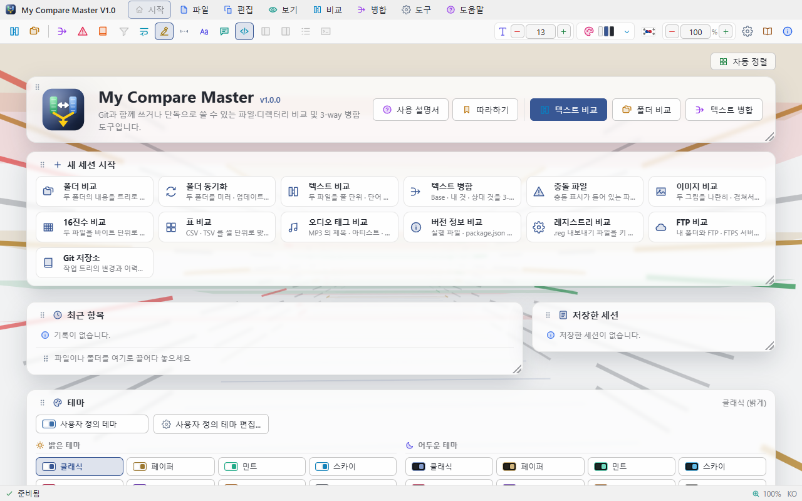

처음 실행하면 창 오른쪽 아래에 **시작 안내 카드**가 나타납니다.

- **튜토리얼 시작** — 실제 화면의 각 부분을 차례로 강조하면서 설명하는 둘러보기를 시작합니다.
- **나중에** — 이번에는 닫고, 다음 실행 때 다시 보여 줍니다.
- **다시 보지 않기** — 앞으로 시작할 때 보여 주지 않습니다.

카드와 튜토리얼 설명 카드에는 **시작 시 보여주기** 확인란이 있습니다. 이 확인란만이 다음 실행 때
안내를 보여 줄지 정하며, 누르는 즉시 저장되고 설정 창의 같은 항목에도 바로 반영됩니다.
튜토리얼을 끝까지 보거나 건너뛰는 것으로는 바뀌지 않습니다. 언제든 **도움말 › 튜토리얼**로 바로
시작할 수 있습니다.

<a id="start-drop"></a>
### 끌어다 놓기

창 어디에나 파일이나 폴더를 끌어다 놓으면 바로 열립니다. 두 개를 놓으면 비교,
네 개를 놓으면 3-way 병합, 하나를 놓으면 충돌 파일(폴더면 Git 저장소)로 엽니다.

명령줄에서 여는 방법은 [명령줄과 git difftool · mergetool](#cli)을 보세요.

---

<a id="screen"></a>
## 화면 구성

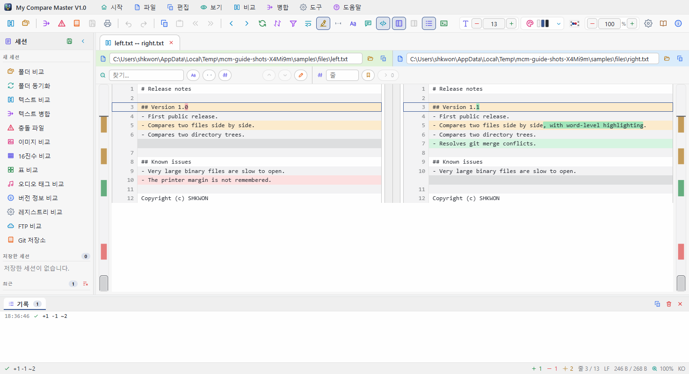

```
┌──────────────────────────────────────────────────────────────────────────┐
│ ▣ My Compare Master  파일 편집 보기 비교 병합 도구 도움말        ─  □  ×  │ ← 제목 줄 겸 메뉴 막대
├──────────────────────────────────────────────────────────────────────────┤
│ [열기][병합][저장][실행취소][이동][보기 옵션][패널]  [글꼴][테마▾][🇰🇷][확대] │ ← 도구 모음
├──────────┬╌┬──────────────────────────────────────────┬╌┬───────────────┤
│  세션    │ │ [left.txt ↔ right.txt ×] [src ↔ src ×]   │ │  병합 정보    │ ← 탭
│          │ │                                          │ │ (병합할 때만) │
│ 새 세션  │ │        시작 화면 / 비교 / 병합 화면       │ │               │
│ 저장한   │ │   ▮ 차이 스크롤 막대                ▮    │ │               │
│ 최근     │ │                                          │ │               │
├──────────┴╌┴──────────────────────────────────────────┴╌┴───────────────┤
│ [기록 12] [Command Prompt ×]                                    [⧉][×] │ ← 하단 패널
├──────────────────────────────────────────────────────────────────────────┤
│ 준비됨                         +3 −1 ~2  줄 12/480  LF  100%  KO         │ ← 상태 표시줄
└──────────────────────────────────────────────────────────────────────────┘
```

| 영역 | 내용 |
|------|------|
| **제목 줄 겸 메뉴 막대** | 맨 앞에 프로그램 아이콘과 이름, 가운데에 메뉴, 오른쪽 끝에 **최소화 · 최대화 · 닫기**. 빈 곳을 끌면 창이 움직이고 더블클릭하면 최대화됩니다. 메뉴의 모든 항목에는 **아이콘과 레이블**이 함께 있고, 메뉴는 창 밖으로도 **한 줄로** 펼쳐집니다. |
| **도구 모음** | 왼쪽은 실행 단추, 오른쪽은 보기 설정입니다. 자세한 내용은 [도구 모음](#toolbar). 모든 단추에 **툴 팁**이 있습니다. |
| **시작 화면** | 탭이 하나도 없을 때 가운데에 나옵니다. 새 세션을 고르는 타일, 최근 항목, 끌어다 놓기 안내가 있습니다. |
| **탭** | 비교할 때마다 새 탭이 열립니다. 탭은 **좌우 패널 사이**, 비교 화면 바로 위에 있습니다. 탭이 넘치면 오른쪽 끝에 **`‹ ›` 단추**가 생깁니다. |
| **좌측 패널** | 평소에는 **세션** — 새 세션 종류, 저장한 세션, 최근 항목. **병합 탭에서는 충돌 목록**으로 바뀌어, 충돌마다 Base · Local · Remote의 내용을 펼쳐 보여 주고 눌러서 바로 선택합니다. |
| **우측 패널** | **병합할 때만** 나옵니다 — 입력 파일, 진행(충돌 / 해결 / 미해결), 해결 방법별 집계, 선택한 충돌의 정보. 읽기 전용입니다. |
| **패널 접기** | 두 패널 모두 제목 줄의 화살표로 접히고, 가장자리에 남는 **좁은 띠**를 누르면 다시 펼쳐집니다. |
| **구분자** | 패널과 비교 화면 사이의 구분자를 **끌면** 폭이 바뀌고, **더블클릭하면** 기본 폭으로 돌아갑니다. 하단 패널 위의 구분자는 높이를 바꿉니다. |
| **차이 스크롤 막대** | 비교 화면 가장자리의 두꺼운 세로 막대. 문서 전체를 줄여 담아 추가 · 삭제 · 변경을 **색으로** 보여 주고, 끌거나 누르면 그 위치로 이동합니다. |
| **하단 패널** | **창 전체 폭**을 쓰는 탭 줄입니다. **기록** 탭과, 켜 둔 **터미널**마다 그 셸 이름의 탭이 있습니다. [하단 패널: 기록과 터미널](#terminal) 참고. |
| **상태 표시줄** | 마지막 작업 결과와 현재 상태(차이 개수, 커서 위치, 줄 끝, 확대 비율, 언어). 두 파일이 같다는 안내도 여기에 나옵니다. |
| **크기 변경 마커** | 창 오른쪽 아래 모서리의 빗금. 끌어서 창 크기를 바꿉니다. |

창을 아무리 좁혀도 도구 모음 단추가 가려지지 않습니다. 최소 폭이 도구 모음 폭과
두 패널 폭에 맞춰 자동으로 정해집니다.

---

<a id="menus"></a>
## 메뉴

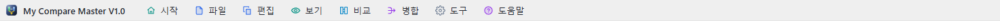

메뉴 막대의 제목을 누르면 메뉴가 열리고, 메뉴가 열린 채로 다른 제목 위로 마우스를
옮기면 그 메뉴로 바뀝니다. 할 수 없는 항목은 흐리게 표시됩니다.

<a id="menu-file"></a>
### 파일

| 항목 | 단축키 | 하는 일 |
|------|--------|---------|
| 파일 비교 열기... | `Ctrl+O` | 왼쪽 · 오른쪽 파일을 차례로 골라 텍스트 비교를 엽니다 |
| 디렉터리 비교 열기... | `Ctrl+Shift+O` | 두 폴더를 골라 폴더 비교를 엽니다 |
| 3-way 병합 열기... | | Base · Local · Remote와 결과 파일을 골라 병합을 엽니다 |
| 충돌 파일 열기... | | `<<<<<<<` 표식이 남은 파일을 엽니다 |
| Git 저장소 열기... | | 저장소 폴더를 골라 변경과 이력을 봅니다 |
| 세션 열기... / 세션 다른 이름으로 저장... | | `.dmrg` 세션 파일로 탭 구성을 저장하고 되돌립니다 |
| 병합 결과 저장 / 다른 이름으로 저장... | `Ctrl+S` / `Ctrl+Shift+S` | 병합 결과를 씁니다 |
| 최근 사용한 파일 | | 최근 10개. 아래의 **최근 항목 관리...**, **최근 목록 모두 지우기** |
| 인쇄... / 인쇄 미리보기... | `Ctrl+P` | [인쇄](#print) 창을 엽니다 |
| 탭 닫기 | `Ctrl+W` | 지금 탭을 닫습니다 |
| 종료 | `Alt+F4` | 저장하지 않은 병합이 있으면 먼저 묻습니다 |

<a id="menu-edit"></a>
### 편집

실행 취소(`Ctrl+Z`), 다시 실행(`Ctrl+Y`), 잘라내기(`Ctrl+X`), 복사(`Ctrl+C`),
붙여넣기(`Ctrl+V`), 모두 선택(`Ctrl+A`), 찾기(`Ctrl+F`). 실행 취소 항목 옆에는 무엇을
되돌릴지가 함께 표시됩니다.

<a id="menu-view"></a>
### 보기

| 항목 | 하는 일 |
|------|---------|
| 확대 · 축소 · 확대/축소 초기화 | `Ctrl++` · `Ctrl+-` · `Ctrl+0`, 또는 `Ctrl`+마우스 휠 |
| 자동 줄 바꿈 | 긴 줄을 창 폭에서 접습니다 |
| 단어 단위 강조 | 변경된 줄에서 바뀐 낱말만 진하게 |
| 차이만 보기 | `Ctrl+D`. 같은 부분을 접고 차이와 앞뒤 세 줄만 남깁니다 |
| 주석 무시 · 따옴표 종류 무시 · 숫자 표기 무시 | 문법 규칙으로 사소한 차이를 무시합니다 |
| 구문 강조 | 언어에 따라 색을 입힙니다 |
| 좌측 패널 · 우측 패널 · 기록 패널 · 터미널 패널 · 상태 표시줄 | 각 영역을 켜고 끕니다. 터미널은 `` Ctrl+` `` |

<a id="menu-compare"></a>
### 비교

첫 차이(`Ctrl+Home`), 이전 차이(`F7`), 다음 차이(`F8`), 마지막 차이(`Ctrl+End`),
공백 무시, 대소문자 무시, 차이만 보기, 좌우 바꾸기, 새로 고침(`F5`).

<a id="menu-merge"></a>
### 병합

Base 사용(`Ctrl+1`), Local 사용(`Ctrl+2`), Remote 사용(`Ctrl+3`), 둘 다 사용(`Ctrl+4`),
해결 취소(`Ctrl+Shift+0`), 모두 Local로 해결, 모두 Remote로 해결,
이전 충돌(`Shift+F7`), 다음 충돌(`Shift+F8`). 병합 탭에서만 쓸 수 있습니다.

<a id="menu-tools"></a>
### 도구

**설정...**(`Ctrl+,`), **git difftool로 등록**, **git mergetool로 등록**. 두 등록 항목은
설정 창의 Git 탭을 엽니다.

<a id="menu-help"></a>
### 도움말

| 항목 | 단축키 | 하는 일 |
|------|--------|---------|
| 사용자 가이드 | `F1` | 이 문서를 별도 창으로 엽니다 |
| 튜토리얼 | | 화면을 차례로 짚어 주는 둘러보기를 시작합니다 |
| 프로그램 정보 | | 버전 · 빌드 정보 · 저작권 |

<a id="menu-context"></a>
### 우클릭 메뉴

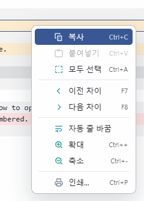

마우스 **오른쪽 단추**를 누르면 그 자리에 맞는 메뉴가 열립니다 — 텍스트 비교에서는 복사 ·
붙여넣기 · 차이 이동 · 줄 바꿈 · 확대, 폴더 비교에서는 복사 · 삭제 · 좌우 바꾸기, 병합에서는
충돌 해결, Git 화면에서는 difftool · mergetool, 탭에서는 닫기 · 새로 고침 · 저장, 시작 화면과
세션 패널에서는 새 세션 열기, 하단 패널에서는 기록 · 터미널 켜고 끄기.

---

<a id="toolbar"></a>
## 도구 모음

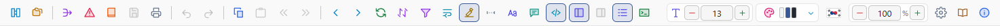

할 수 없는 단추만 모인 묶음은 아예 숨깁니다 — 병합 단추는 병합 탭에서만, 폴더 단추는 폴더
비교에서만 나옵니다.

| 묶음 | 단추 |
|------|------|
| **열기** | 파일 비교, 디렉터리 비교, 3-way 병합, 충돌 파일, Git 저장소 |
| **저장 · 편집** | 병합 결과 저장, 인쇄, 실행 취소, 다시 실행, 복사, 붙여넣기 |
| **이동** | 뒤로, 앞으로(`Alt+←` / `Alt+→`), 이전 차이, 다음 차이 |
| **충돌 해결** | Local 사용, Remote 사용, 둘 다 사용 |
| **폴더 작업** | 우측으로 복사, 좌측으로 복사, 이동, 이름 바꾸기, 좌측 삭제, 우측 삭제 |
| **새로 고침** | 새로 고침, 좌우 바꾸기 |
| **보기 옵션** | 차이만 보기, 자동 줄 바꿈, 단어 강조, 공백 무시, 대소문자 무시, 주석 무시, 구문 강조 |
| **패널** | 좌측 패널, 우측 패널, 기록, 터미널 |
| **글꼴 크기** | 비교 화면 글꼴 크기 `−` `+` |
| **테마** | 누르면 밝게 ↔ 어둡게, `▾`로 테마 직접 고르기 |
| **언어** | 국기를 누르면 한국어 ↔ English |
| **확대** | 화면 배율 `−` `+` |
| **설정 · 도움말** | 설정, 사용자 가이드, 프로그램 정보 |

---

<a id="sessions"></a>
## 세션

일은 **세션** 단위로 시작합니다. 시작 화면과 좌측 세션 패널에 모든 세션 종류가 나옵니다.

| 세션 | 하는 일 |
|------|---------|
| **폴더 비교** | 두 폴더를 트리로 나란히 |
| **폴더 동기화** | 미러 · 업데이트 · 양방향으로 두 폴더를 맞춤 |
| **텍스트 비교** | 두 파일을 줄 · 단어 단위로 |
| **텍스트 병합** | Base · Local · Remote를 3-way로 |
| **충돌 파일** | `<<<<<<<` 표식이 든 파일을 풀어서 |
| **이미지 비교** | 두 그림을 나란히 · 겹쳐서 · 차이만 |
| **16진수 비교** | 두 파일을 바이트 단위로 |
| **표 비교** | CSV · TSV를 셀 단위로 |
| **오디오 태그 비교** | MP3의 ID3 태그와 비트레이트 |
| **버전 정보 비교** | 실행 파일 · package.json · Info.plist의 버전 정보 |
| **레지스트리 비교** | `.reg` 내보내기 파일을 정규화해서 |
| **FTP 비교** | 내 폴더와 FTP · FTPS 서버 폴더 |
| **Git 저장소** | 작업 트리의 변경과 이력(분기 · 병합 그래프 포함) |

세션 패널 제목 줄의 **저장 단추**를 누르면 지금 탭이 **저장한 세션**에 남고, 다음에 눌러서
그대로 다시 엽니다. 목록의 항목은 하나씩 지울 수 있습니다. 그 아래에는 최근에 연 항목이
나옵니다.

---

<a id="file-compare"></a>
## 파일 비교

**파일 › 파일 비교 열기...**(`Ctrl+O`) 또는 도구 모음의 첫 번째 단추.

- 두 파일이 **줄 단위로 정렬**되어 나란히 표시됩니다.
- 색: 추가(초록) · 삭제(빨강) · 변경(노랑). 변경된 줄에서는 **바뀐 단어만** 진하게
  표시합니다.
- 각 패널 위의 **경로 막대**에서 그쪽 파일을 바꿀 수 있습니다. 직접 입력하거나
  붙여 넣고 `Enter`, 또는 폴더 아이콘으로 찾아보기.
- 가장자리의 **차이 스크롤 막대**는 파일 전체의 차이 분포입니다. 누르면 그 위치로
  이동합니다.

<a id="file-nav"></a>
### 차이 사이 이동

| 동작 | 단축키 |
|------|--------|
| 다음 차이 | `F8` |
| 이전 차이 | `F7` |
| 첫 차이 / 마지막 차이 | `Ctrl+Home` / `Ctrl+End` |

<a id="file-copy"></a>
### 한쪽을 다른 쪽에 반영하기

차이가 있는 줄에 마우스를 올리면 가운데 열에 **`›` `‹` 단추**가 나타납니다.

- `›` — 그 **차이 블록 전체**를 오른쪽 파일에 씁니다.
- `‹` — 왼쪽 파일에 씁니다.

파일은 바로 저장됩니다. 블록 단위라 여러 줄짜리 변경도 한 번에 반영됩니다.

<a id="file-edit"></a>
### 줄 직접 고치기

좌우 어느 창이든 줄을 **클릭**하면 클릭한 자리에 커서가 놓이고 바로 편집할 수 있습니다.

| 키 | 동작 |
|---|---|
| `Enter` | 확정하고 아래 줄로 |
| `↑` / `↓` | 확정하고 위 · 아래 줄로 (같은 열) |
| `Esc` | 취소 |
| 빈 줄에서 `Backspace` | 그 줄을 지웁니다 |

반대편에만 있는 줄의 **빈 칸에 입력하면** 그 자리에 줄이 끼워집니다. 확정할 때마다
파일에 바로 기록되며, 편집 중에는 **고친 줄만 다시 비교**하므로 나머지 줄의 정렬이
움직이지 않습니다(전체를 다시 맞추려면 **새로 고침**, `F5`). 줄 편집과 `‹` · `›` 반영은
모두 **실행 취소 · 다시 실행**(`Ctrl+Z` / `Ctrl+Y`, 도구 모음 단추)할 수 있습니다.

표 · 오디오 · 버전 · 레지스트리 비교처럼 파일의 해석을 보여 주는 비교와, **git
difftool**이 연 비교(두 버전을 보는 용도)는 편집할 수 없습니다.

긴 줄은 각 창 아래의 **가로 스크롤 막대**나 `Shift`+휠로 옆으로 넘겨 봅니다. 좌우
창은 항상 함께 움직이고 줄 번호는 제자리에 있습니다.

<a id="file-only"></a>
### 차이만 보기와 무시 옵션

- **차이만 보기**(`Ctrl+D`, 깔때기 아이콘)는 같은 부분을 접고 차이와 앞뒤 세 줄만
  남깁니다.
- **공백 무시** · **대소문자 무시**를 켜면 그 차이는 같은 것으로 봅니다. 화면의 글자는
  그대로이고 비교 기준만 달라집니다.

---

<a id="compare-tools"></a>
## 비교 창에서 할 수 있는 일

- **찾기 / 바꾸기**(`Ctrl+F` · `Ctrl+H`): 화면에 불러온 줄이 아니라 **파일 전체**를
  찾습니다. 대소문자 구분 · 단어 단위 · 정규식 단추가 있고, 바꾸기는 왼쪽 · 오른쪽 중
  한쪽만 골라서 할 수 있습니다.
- **줄로 이동**(`Ctrl+G`), **책갈피**(`Ctrl+F2`로 표시, `F2`로 다음 책갈피).
- **구문 강조**: 파일 확장자로 언어를 알아내 주석 · 문자열 · 숫자 · 예약어에 색을
  입힙니다.
- **문법 규칙으로 사소한 차이 무시** — 도구 모음, 보기 메뉴, 설정의 *비교* 탭에 있습니다.
  - **주석 무시**: `i++; // 고침` 과 `i++;` 는 같은 줄로 봅니다.
  - **따옴표 종류 무시**: `'a'` 와 `"a"` 를 같게 봅니다.
  - **숫자 표기 무시**: `0x10` 과 `16` 을 같게 봅니다.
- 문자열 안의 `//` 나 `#` 는 주석으로 보지 않으며, **보이는 내용은 그대로입니다** —
  규칙은 무엇을 차이로 볼지만 바꿉니다.
- **뒤로 / 앞으로**(`Alt+←` · `Alt+→`): 보던 내용으로 되돌아갑니다. 탭을 옮겨
  다닌 것도, 저장소 안에서 변경 목록 ↔ 커밋을 오간 것도 모두 기억합니다.
- **좌우 바꾸기**: 왼쪽과 오른쪽을 맞바꿉니다. **새로 고침**(`F5`)은 파일을 다시 읽어 비교합니다.
- **바뀌면 자동으로 다시 비교**: 다른 프로그램에서 비교 중인 파일이나 폴더를 고치면 보고 있던
  탭은 곧바로(1초 안에) 다시 비교됩니다. 뒤에 있던 탭은 앞으로 가져올 때 다시 비교합니다.
  탭을 옮겨 다니는 것만으로는 다시 비교하지 않으며, 스크롤 위치와 펼친 폴더도 그대로 남습니다.

---

<a id="folder-compare"></a>
## 디렉터리 비교

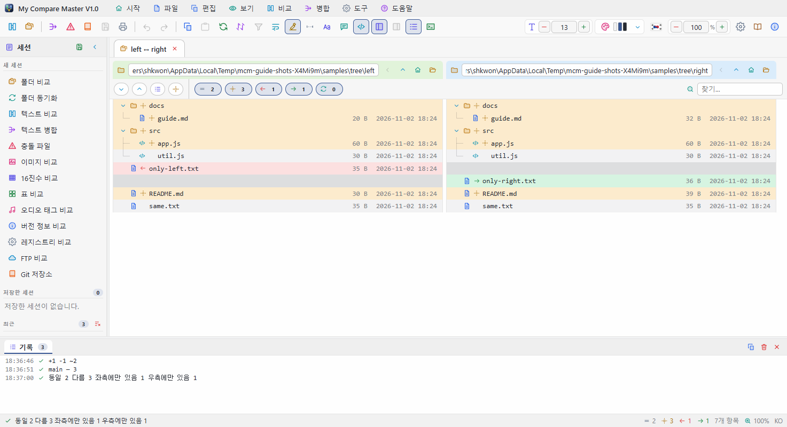

**파일 › 디렉터리 비교 열기...**(`Ctrl+Shift+O`)

두 폴더가 **좌우 트리**로 나란히 표시됩니다.

- 각 트리 맨 위의 **경로 막대**에서 그쪽 폴더를 바꿀 수 있습니다. `↑` 단추는 상위
  폴더로 올라갑니다.
- 폴더는 **접고 펼칠** 수 있고, 폴더 자체의 상태는 그 안의 내용을 모아서 정해집니다
  (안이 전부 같으면 같음, 하나라도 다르면 다름).
- 한쪽에만 있는 항목은 반대쪽 자리가 비어 있어서 **두 트리의 줄이 항상 맞습니다**.
- 부모와 자식은 **연결선**으로 이어집니다. 이름 앞 아이콘은 **파일의 종류**, 그 옆의 작은
  표시는 **비교 결과**입니다.
- **파일을 더블클릭하면** 두 파일의 내용 비교가 새 탭으로 열립니다.

<a id="folder-toolbar"></a>
### 트리 도구 모음과 폴더 작업

| 단추 | 하는 일 |
|------|---------|
| 모두 펼치기 / 모두 접기 | 트리 전체 |
| 변경된 항목만 펼치기 | 차이가 있는 폴더만 펼칩니다(비교를 열면 이 상태로 시작) |
| 우측으로 복사 / 좌측으로 복사 | 선택한 파일이나 **폴더 전체**를 반대쪽에 복사 |
| 이동 / 이름 바꾸기 | 선택한 항목을 옮기거나 이름을 바꿉니다 |
| 좌측 / 우측 삭제 | 선택한 항목을 그쪽에서 삭제 — **먼저 확인을 묻습니다** |
| 찾기 | 경로에 포함된 글자로 걸러내기 |

<a id="folder-filter"></a>
### 필터 · 파일 마스크 · 그 밖의 기능

- 트리 위의 **필터**로 같은 항목 · 다른 항목 · 왼쪽에만 · 오른쪽에만을 각각 켜고 끌
  수 있습니다. 개수도 함께 표시됩니다.
- **파일 마스크**(`*.ts, *.md`)를 지정하면 그 파일만 비교하고, **제외 마스크**(`*.log`)에
  해당하는 파일은 보지 않습니다. **설정 › 비교**에서도 정합니다.
- **제외할 폴더**(기본값: `.git`, `node_modules`, `dist`, ...)는 아예 들어가지 않습니다.
- **이름 바뀐 파일 찾기**: 한쪽에서 사라지고 다른 쪽에 나타난 파일이 내용이 같으면
  **이름 바뀜**으로 묶어서 보여 줍니다.
- **압축 파일 안까지**: zip · jar · docx 같은 압축 파일 안의 파일까지 비교합니다.
  압축을 풀지 않고 색인의 CRC만 읽으므로 느려지지 않습니다.
- **평면 목록**: 트리 대신 전체 경로가 붙은 한 줄짜리 목록으로 볼 수 있습니다.

---

<a id="folder-sync"></a>
## 폴더 동기화

**폴더 동기화** 세션을 열면 트리 위에 동기화 줄이 생깁니다.

1. **방식**을 고릅니다 — 미러(오른쪽 / 왼쪽), 업데이트(오른쪽 / 왼쪽), 양방향.
2. **미리보기**를 누르면 무엇을 복사하고 무엇을 지울지 계산해서 개수로 보여 줍니다.
   이 단계에서는 **아무것도 바뀌지 않습니다**.
3. **동기화 실행**을 누르면 복사 수와 삭제 수를 확인한 뒤 실행합니다. 복사가 먼저,
   삭제가 나중에 실행됩니다.

- **미러**는 한쪽을 다른 쪽과 똑같이 만듭니다 — 상대편에 없는 파일은 **지웁니다**.
- **업데이트**는 새 파일만 덮어씁니다. **아무것도 지우지 않습니다**.
- **양방향**은 파일마다 최신 쪽이 이깁니다. 내용은 다른데 시각이 같으면 사람이
  판단할 일이므로 **건드리지 않습니다**.
- **1시간 차이는 서머타임으로 봅니다**를 켜 두면, 2초 이내 차이(FAT 파일 시스템)와
  정확히 1~2시간 차이(서머타임)는 같은 시각으로 봅니다.

---

<a id="binary-image"></a>
## 바이너리 · 이미지 비교

<a id="binary"></a>
### 바이너리(16진수)

텍스트가 아닌 파일을 열면 자동으로 **16진수 덤프**로 비교합니다. 한 줄에 16바이트씩,
양쪽을 나란히 놓고 **다른 바이트만 빨갛게** 표시하며 오른쪽 끝에 ASCII가 함께 나옵니다.
텍스트 파일도 **16진수 비교** 세션으로 열면 바이트 단위로 볼 수 있습니다.

<a id="image"></a>
### 이미지

양쪽이 모두 그림 파일(`png`, `jpg`, `gif`, `webp`, `bmp`, `avif`, `ico`, `svg`, `tiff`)이면
그림 비교 화면이 열립니다.

| 모드 | 내용 |
|------|------|
| **나란히 보기** | 두 그림을 좌우로, 같은 배율로 |
| **겹쳐 보기** | 두 그림을 겹치고 슬라이더로 섞는 비율 조절 |
| **차이만 보기** | 달라진 픽셀만 빨갛게, 나머지는 어둡게 |

**다른 부분 표시**를 켜면 달라진 영역이 양쪽 그림 위에 **빨간 상자**로 표시됩니다.
도구 모음 오른쪽에는 그림 크기와 **달라진 픽셀 수 · 비율**이 나옵니다.

| 조작 | 하는 일 |
|------|---------|
| **확대 / 축소** 단추, `Alt`+휠 | 10%에서 1600%까지 한 단계씩(보던 위치를 가운데 두고) |
| **창에 맞추기** / **실제 크기** | 창 크기에 맞추거나 100%로 |
| 그림 **끌기**, 더블클릭 | 이동 / 맞추기 ↔ 실제 크기 전환 |

나란히 보기에서 **양쪽은 같은 배율로 같은 곳을** 보여 줍니다. 200%부터는 픽셀을 뭉개지
않고 그대로 보여 줍니다.

---

<a id="formats"></a>
## 표 · 오디오 · 버전 · 레지스트리 · FTP 비교

| 세션 | 내용 |
|------|------|
| **표 비교** | CSV · TSV를 셀 단위로 읽습니다. 구분자를 알아내고 양쪽 열 너비를 맞추며, 키 열로 행 순서를 맞춰 끼워 넣은 행이 한 줄 추가로 보입니다. |
| **오디오 태그 비교** | 두 MP3를 ID3 태그와 스트림 정보로 비교합니다. 같은 곡을 두 번 뜬 파일은 같게 나옵니다. |
| **버전 정보 비교** | Windows 실행 파일, `package.json`, `Info.plist`의 버전 정보. |
| **레지스트리 비교** | 두 `.reg` 파일을 정규화(하이브 줄임, 줄 나눈 이진값 합침, 키 정렬)해서 다른 설정만 보여 줍니다. |
| **FTP 비교** | 내 폴더와 FTP · FTPS 서버의 폴더. 서버 주소와 암호를 묻는 창이 열리고, 목록만 읽으며 내려받지 않습니다. |

이 비교들은 파일 내용이 아니라 **해석**을 보여 주므로 편집할 수 없습니다.

---

<a id="merge"></a>
## 3-way 병합과 충돌 해결

<a id="merge-open"></a>
### 여는 방법

| 방법 | 쓰는 때 |
|------|---------|
| **파일 › 3-way 병합 열기...** | Base / Local / Remote 세 파일이 따로 있을 때 |
| **파일 › 충돌 파일 열기...** | `git merge` 뒤 `<<<<<<<` 표식이 남은 파일 |
| **Git 저장소에서 충돌 파일 더블클릭** | 가장 정확합니다 — Git 인덱스의 세 단계를 모두 읽어 **공통 조상까지** 복원합니다 |
| `git mergetool` | [명령줄과 git difftool · mergetool](#cli) 참고 |

<a id="merge-screen"></a>
### 화면

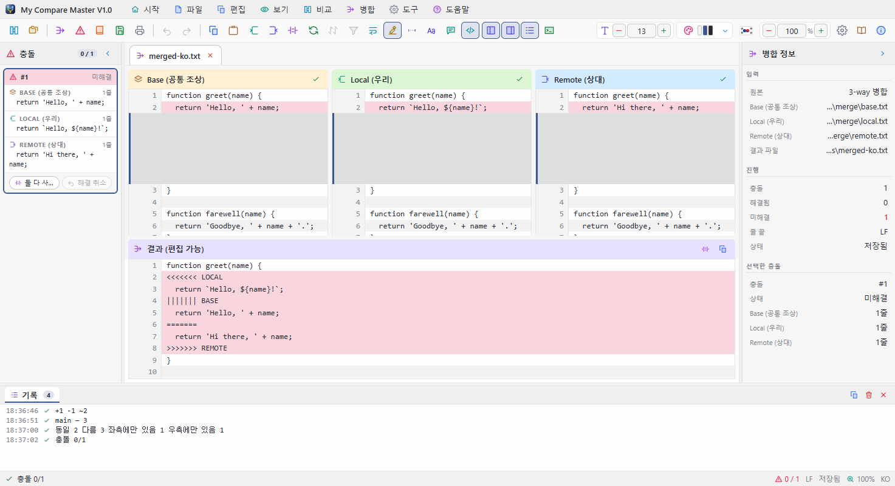

위쪽에 **Base(공통 조상) · Local(우리) · Remote(상대)** 세 패널, 아래쪽에
**결과(편집 가능)** 패널이 있습니다. 네 패널은 **줄 단위로 정렬**되어 같이 스크롤됩니다.
공통 조상이 없는 충돌 파일이면 Local · Remote 두 패널만 나옵니다.

- 겹치지 않는 변경은 **자동으로 병합**되고, 정말로 충돌하는 부분만 표시됩니다.
- 충돌 구간은 연한 빨강, 해결한 구간은 연한 초록입니다.
- 좌측 패널은 **충돌 목록**, 우측 패널은 **병합 정보**(진행률 · 해결 방법별 집계)입니다.

<a id="merge-resolve"></a>
### 해결하기

좌측 패널의 충돌 목록에서 충돌을 고른 뒤(또는 화면에서 누른 뒤):

| 선택 | 단축키 | 결과 |
|------|--------|------|
| Base 사용 | `Ctrl+1` | 공통 조상 내용으로 |
| Local 사용 | `Ctrl+2` | 우리 쪽 내용으로 |
| Remote 사용 | `Ctrl+3` | 상대 쪽 내용으로 |
| 둘 다 사용 | `Ctrl+4` | 우리 쪽 다음에 상대 쪽을 이어서 |
| 해결 취소 | `Ctrl+Shift+0` | 다시 미해결로 |

**모두 Local로 해결 / 모두 Remote로 해결**은 병합 메뉴에 있고, **이전 충돌 / 다음 충돌**은
`Shift+F7` / `Shift+F8`입니다. 결과 패널의 줄을 **더블클릭하면 직접 고칠** 수 있고, 손으로
고친 충돌은 목록에 수정됨으로 표시됩니다. **모든 동작은 실행 취소(`Ctrl+Z`) · 다시
실행(`Ctrl+Y`)** 할 수 있습니다.

<a id="merge-save"></a>
### 저장

**파일 › 병합 결과 저장**(`Ctrl+S`).

- 아직 해결하지 않은 충돌이 있으면 **먼저 확인을 묻고**, 계속하면 `<<<<<<<` 표식이
  그대로 들어간 채 저장됩니다.
- Git 저장소의 충돌 파일을 전부 해결하고 저장하면 **`git add`까지 자동으로** 합니다.
- 저장하지 않은 변경이 있으면 종료할 때 **저장 여부를 묻습니다**.

---

<a id="git"></a>
## Git 연동

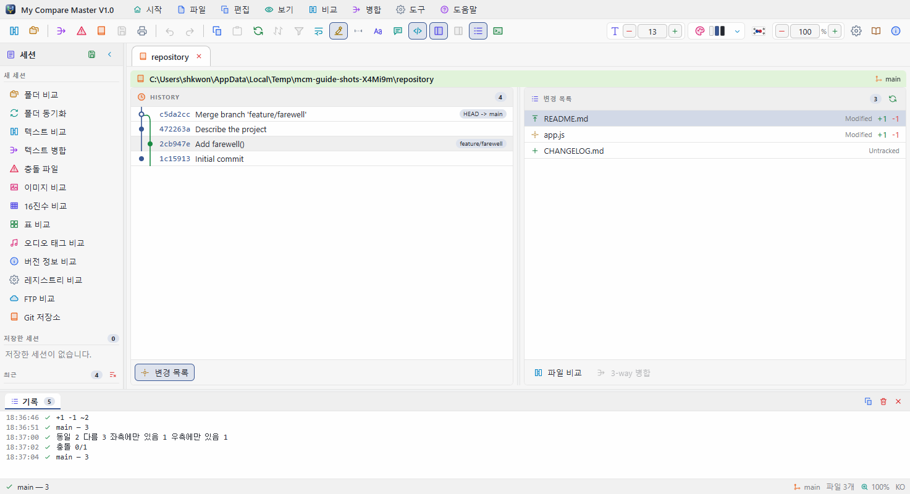

**파일 › Git 저장소 열기...** — 작업 트리의 변경, 스테이지된 변경, 추적되지 않는
파일, 충돌 파일이 한 목록에 나오고, 옆에는 커밋 기록이 **분기 · 병합 그래프**와 함께
나옵니다. 가운데 구분자를 끌어 두 칸의 비율을 바꿉니다.

- 변경 항목을 **더블클릭**하면 해당 두 버전의 비교가 열립니다.
- **충돌 파일**을 더블클릭하면 3-way 병합으로 열립니다.
- 커밋을 누르면 그 커밋이 건드린 파일 목록으로 바뀝니다. **뒤로**(`Alt+←`)로 돌아옵니다.

---

<a id="cli"></a>
## 명령줄과 git difftool · mergetool

<a id="cli-args"></a>
### 명령줄에서 바로 열기

```
MyCompareMaster                                    빈 화면으로 시작
MyCompareMaster A B                                두 파일(또는 두 폴더) 비교
MyCompareMaster BASE LOCAL REMOTE MERGED           3-way 병합
MyCompareMaster conflicted.txt                     <<<<<<< 표식이 있는 충돌 파일
MyCompareMaster session.dmrg                       저장해 둔 세션
MyCompareMaster C:\path\to\repo                    Git 저장소
```

경로는 **옵션 없이 순서대로** 넘깁니다. 두 개면 비교, 네 개면 병합입니다. 이미 실행 중이면
새 창을 띄우지 않고 **실행 중인 창에서** 엽니다.

<a id="cli-git"></a>
### difftool / mergetool로 등록

**설정 › Git** 탭(또는 **도구 › git difftool로 등록** · **git mergetool로 등록**)에서 단추
한 번으로 등록 · 해제합니다. 등록 상태와 실제 명령줄도 같은 화면에 나옵니다. 손으로 하려면:

```bash
git config --global difftool.mycomparemaster.cmd '"<실행 파일 경로>" "$LOCAL" "$REMOTE"'
git config --global diff.tool mycomparemaster
git config --global difftool.prompt false

git config --global mergetool.mycomparemaster.cmd '"<실행 파일 경로>" "$BASE" "$LOCAL" "$REMOTE" "$MERGED"'
git config --global mergetool.mycomparemaster.trustExitCode true
git config --global merge.tool mycomparemaster
git config --global mergetool.prompt false
```

등록한 뒤에는:

```bash
git difftool      # 변경된 파일을 하나씩 비교
git mergetool     # 충돌 파일을 하나씩 해결
```

병합 결과를 모두 해결해 저장하면 종료 코드 `0`, 저장하지 않고 닫으면 0이 아닌 값을
돌려주므로 Git이 해결 여부를 올바르게 판단합니다.

---

<a id="tabs"></a>
## 탭 · 세션 파일 · 최근 항목

<a id="tabs-tabs"></a>
### 탭

비교할 때마다 새 탭이 열립니다. 탭이 창 폭을 넘으면 **스크롤바 대신 오른쪽 끝에
`‹ ›` 단추**가 나타납니다. 탭은 `×`, 가운데 단추 클릭, `Ctrl+W`로 닫습니다.
**설정 › 일반 › 시작할 때 마지막 세션 복원**을 켜 두면 다음 실행 때 열려 있던 탭이 돌아옵니다.

<a id="tabs-dmrg"></a>
### 세션 파일(`.dmrg`)

**파일 › 세션 다른 이름으로 저장...**으로 지금 열려 있는 탭 구성을 저장하고,
**세션 열기...**로 되돌립니다. `.dmrg` 파일은 설치할 때 시스템에 등록되므로
**탐색기에서 더블클릭해도** 열립니다.

<a id="tabs-recent"></a>
### 최근 항목

최근 **10개**까지 기억합니다. **파일 메뉴** 아래쪽, 시작 화면, 세션 패널에 나옵니다.

- 하나씩 지우기: 시작 화면의 휴지통 단추, 또는 **파일 › 최근 항목 관리...** 창에서.
- 모두 지우기: **파일 › 최근 목록 모두 지우기**.

열었던 **폴더**도 함께 기억해서, 다음에 파일을 찾아볼 때 그 자리에서 시작합니다.

---

<a id="terminal"></a>
## 하단 패널: 기록과 터미널

<a id="terminal-log"></a>
### 기록

하단 패널의 첫 탭입니다. 지금까지 일어난 일이 시각과 함께 쌓이고, 오른쪽 끝에 **복사**와
**지우기** 단추가 있습니다. 도구 모음의 기록 단추나 **보기 › 기록 패널**로 켜고 끕니다.

<a id="terminal-shell"></a>
### 터미널과 셸

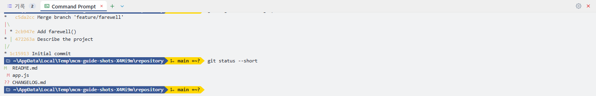

도구 모음의 터미널 단추, **보기 › 터미널 패널**, 또는 `` Ctrl+` ``로 열고 닫습니다. 처음
열릴 때 **지금 보고 있는 비교의 폴더**에서 시작합니다(폴더 비교면 왼쪽 뿌리, 파일 비교면
그 파일이 있는 폴더, Git 탭이면 저장소). 늘 같은 곳에서 시작하려면 *설정 › 터미널 › 시작
디렉터리*에 경로를 적으세요.

터미널을 켜면 곧바로 하나가 열리고 **그 셸 이름이 하단 패널의 탭**이 됩니다. `+`를 누르면
하나 더 열리고, 옆의 `▾`는 **이 컴퓨터에 설치된 셸**을 모두 보여 줍니다 — Windows에서는
명령 프롬프트, Windows PowerShell, PowerShell, Git Bash, MSYS2, Cygwin, WSL 배포판,
Windows Terminal에 등록된 셸, 다른 운영체제에서는 `$SHELL`과 `/etc/shells`에 있는 것들.
기본 셸은 *설정 › 터미널*에서 정합니다.

탭을 닫으면 그 셸도 끝나고, 마지막 하나까지 닫으면 터미널이 꺼집니다. **패널을 닫는
것으로는 셸이 끝나지 않아서**, 다시 열면 하던 자리가 그대로 있습니다.

<a id="terminal-keys"></a>
### 쓰는 법

| 키 | 하는 일 |
|----|---------|
| `Enter` | 명령 실행. 명령이 실행 중이면 그 명령의 **입력**으로 들어갑니다 |
| `Tab` | 자동 완성 — 첫 낱말은 셸 내장 명령과 PATH의 실행 파일에서, 나머지는 그 폴더의 파일에서 |
| `↑` `↓` | 명령 기록 |
| `Ctrl+C` | 실행 중인 명령 중단(입력란이 비어 있을 때) |
| `Ctrl+L` | 화면 지우기(`clear` · `cls`도 같습니다) |
| `Esc` | 입력한 줄 지우기 |

여러 줄을 붙여 넣으면 완성된 줄은 모두 실행되고 마지막 토막만 입력란에 남습니다.
출력은 프로그램이 낸 **ANSI 색을 그대로** 보여 주고, 색이 없는 줄에는 오류(빨강) ·
경고(노랑) · 완료(초록)와 링크 · `파일:줄`을 알아서 입힙니다. 흑백이 좋으면 *설정 ›
터미널*에서 끕니다.

> 셸은 가짜 터미널 없이 **줄 단위**로 돌아갑니다. `vim`이나 `top`처럼 화면 전체를 그리는
> 프로그램은 쓸 수 없습니다. 진행 막대처럼 같은 줄을 다시 그리는 출력은 *설정 › 터미널 ›
> 캐리지 리턴*에서 덮어쓰기 · 줄 바꾸기 · 무시하기 중에 고릅니다.

<a id="terminal-prompt"></a>
### 프롬프트와 프롬프트 테마

프롬프트는 **이 프로그램이 그립니다**. 기본값은 폴더 이름과, 저장소 안이라면 브랜치이고,
브랜치는 **저장소 상태에 따라 색이 바뀝니다** — 초록(변경 없음 · 푸시됨) → 빨강(수정됨,
add 필요) → 노랑(add 됨, 커밋 필요) → 주황(커밋됨, 푸시 필요), 진홍은 충돌, 파랑은 pull
필요. 기호 `↑ ↓ + ~ ? !`가 종류별 개수를 요약합니다. 명령을 친 줄은 **그때의 프롬프트와
함께** 기록에 남습니다.

모양은 *설정 › 프롬프트*와 *설정 › 사용자 정의 프롬프트*에서 바꿉니다. **19가지
프리셋**(파워라인 · Agnoster · Paradox · Pure · 레인보우 · 노르드 …)을 눌러 바로 적용하고,
보일 조각(OS · 사용자@호스트 · 셸 · 경로 · git · 실행 시간 · 종료 코드 · 시각), 모양(파워라인 ·
일반 · 둥근 캡슐), 경로 줄이는 방식, 두 줄 여부, 상태별 색을 고릅니다. 사용자 정의 프롬프트
탭에서는 조각을 하나씩 추가 · 이동 · 삭제하고 색과 Go 템플릿(`{{ .Branch }}`)을 직접 쓴
다음, 이름을 붙여 저장하면 ★ 카드로 프리셋 옆에 남습니다.

---

<a id="print"></a>
## 인쇄

도구 모음의 인쇄 단추 또는 `Ctrl+P` → **인쇄 미리보기** 창이 열립니다.

- **인쇄 범위**: 전체 · 현재 문서 · 사용자 지정(`1-3, 7`).
- **페이지 설정**: 용지(A4 · A3 · Letter · Legal), 방향, 여백(mm), 줄 번호, 색상 배경,
  머리글 / 바닥글.
- 미리보기는 **실제 인쇄될 페이지 그대로**입니다. 설정을 바꾸면 즉시 다시 페이지를
  나눕니다. `‹ ›`로 쪽을 넘기고 **인쇄** 단추로 출력합니다.

---

<a id="settings"></a>
## 설정

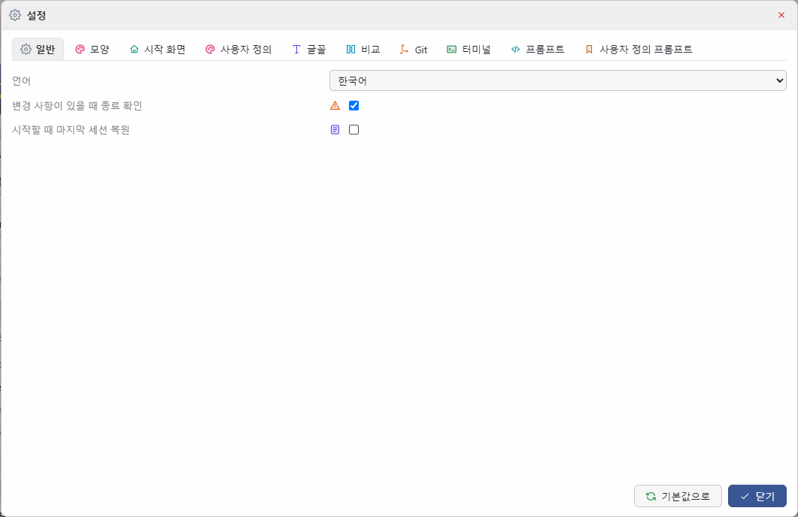

도구 모음의 톱니 단추, **도구 › 설정...**, 또는 `Ctrl+,`. 창은 **고정 크기이고 스크롤이
없으며**, 항목은 **한 줄에 하나씩** 10개 탭에 나뉘어 있습니다. 숫자 칸에는 `−` `+` 단추가
있습니다. 바꾼 내용은 **즉시 저장되고** 뒤의 창에 바로 반영됩니다.

| 탭 | 내용 |
|----|------|
| **일반** | 언어, 종료 확인, 시작할 때 마지막 세션 복원 |
| **모양** | 테마 40종과 사용자 정의 테마, 확대 비율, 패널 폭, 병합 패널 제목 색 |
| **시작 화면** | 카드 배치와 자동 정렬, 카드 불투명도, 3D 배경과 움직임 속도, **시작할 때 튜토리얼 보기**, 시작 화면 설정 초기화 |
| **사용자 정의** | 내 테마의 네 가지 색(바탕 · 패널 · 글자 · 강조)과 밝게 / 어둡게 |
| **글꼴** | 시스템에 설치된 모든 글꼴(고정 폭 / 비례), 크기, 굵기, 스타일, 미리보기 |
| **비교** | 자동 줄 바꿈, 단어 강조, 공백 · 대소문자 무시, 문법 규칙, 차이만 보기, 제외 폴더, 파일 마스크, 이름 바뀜 찾기, 압축 파일, 평면 목록 |
| **Git** | difftool / mergetool 등록 상태와 등록 · 해제 |
| **터미널** | 시작 디렉터리, 기본 셸, `Enter`가 보내는 줄 끝, 캐리지 리턴 처리, 출력 색 |
| **프롬프트** | 프리셋 19종, 보일 조각, 모양, 경로 스타일, 두 줄, 저장소 상태별 색 |
| **사용자 정의 프롬프트** | 내가 만든 프롬프트 저장 · 이름 바꾸기 · 삭제, 조각마다 색 · 템플릿 편집 |

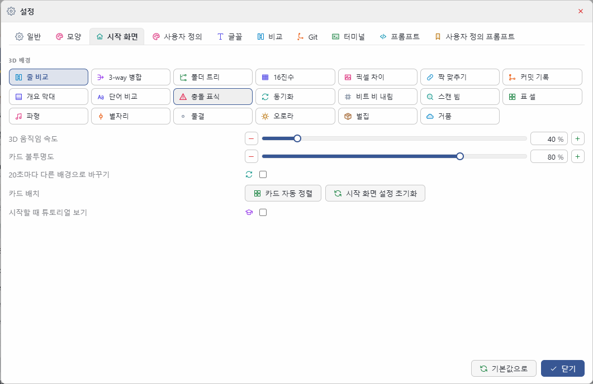

모든 설정은 다음 실행 때 그대로 복원되고, 창 위치와 크기도 기억합니다.

---

<a id="themes"></a>
## 테마 · 언어 · 글꼴 · 확대

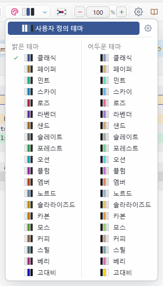

- **테마**: 밝은 테마 20종과 어두운 테마 20종이 짝을 이룹니다. 도구 모음의 테마 단추나
  `Ctrl+T`는 지금 테마의 **밝게 ↔ 어둡게 짝**으로 바꾸고, 옆의 `▾`는 밝게 / 어둡게 두 열로
  모든 테마를 보여 줍니다. 각 줄에는 그 테마의 색 견본이 붙어 있습니다.
- **사용자 정의 테마**: *설정 › 사용자 정의*에서 네 가지 색만 고르면 나머지 색은 자동으로
  만들어집니다.
- **언어**: 도구 모음의 국기를 누르면 한국어 ↔ English가 바뀝니다. 메뉴, 대화 상자,
  이 가이드까지 모두 따라 바뀝니다.
- **글꼴 크기**: 도구 모음의 `−` `+`는 비교 화면 글꼴 크기입니다. 글꼴 자체는 *설정 › 글꼴*.
- **확대**: 도구 모음의 `−` `+`, `Ctrl++` / `Ctrl+-` / `Ctrl+0`, `Ctrl`+마우스 휠. 50%에서
  300%까지.

---

<a id="shortcuts"></a>
## 키보드 단축키

| 기능 | 단축키 |
|------|--------|
| 사용자 가이드 | `F1` |
| 파일 비교 열기 | `Ctrl+O` |
| 디렉터리 비교 열기 | `Ctrl+Shift+O` |
| 병합 결과 저장 / 다른 이름으로 저장 | `Ctrl+S` / `Ctrl+Shift+S` |
| 실행 취소 / 다시 실행 | `Ctrl+Z` / `Ctrl+Y` |
| 복사 / 붙여넣기 / 잘라내기 / 모두 선택 | `Ctrl+C` / `Ctrl+V` / `Ctrl+X` / `Ctrl+A` |
| 찾기 / 바꾸기 / 줄로 이동 | `Ctrl+F` / `Ctrl+H` / `Ctrl+G` |
| 책갈피 표시 / 다음 책갈피 | `Ctrl+F2` / `F2` |
| 이전 / 다음 차이 | `F7` / `F8` |
| 첫 / 마지막 차이 | `Ctrl+Home` / `Ctrl+End` |
| 뒤로 / 앞으로 | `Alt+←` / `Alt+→` |
| 이전 / 다음 충돌 | `Shift+F7` / `Shift+F8` |
| Base / Local / Remote / 둘 다 사용 | `Ctrl+1` ~ `Ctrl+4` |
| 해결 취소 | `Ctrl+Shift+0` |
| 확대 / 축소 / 초기화 | `Ctrl++` / `Ctrl+-` / `Ctrl+0`, `Ctrl`+마우스 휠 |
| 차이만 보기 | `Ctrl+D` |
| 밝게 / 어둡게 전환 | `Ctrl+T` |
| 새로 고침 | `F5` |
| 인쇄 미리보기 | `Ctrl+P` |
| 터미널 패널 | `` Ctrl+` `` |
| 설정 | `Ctrl+,` |
| 탭 닫기 | `Ctrl+W` |
| 종료 | `Alt+F4` |

튜토리얼이 켜져 있는 동안에는 `→` 다음, `←` 이전, `Esc` 닫기입니다.

---

<a id="help"></a>
## 튜토리얼과 사용자 가이드

<a id="help-tour"></a>
### 튜토리얼

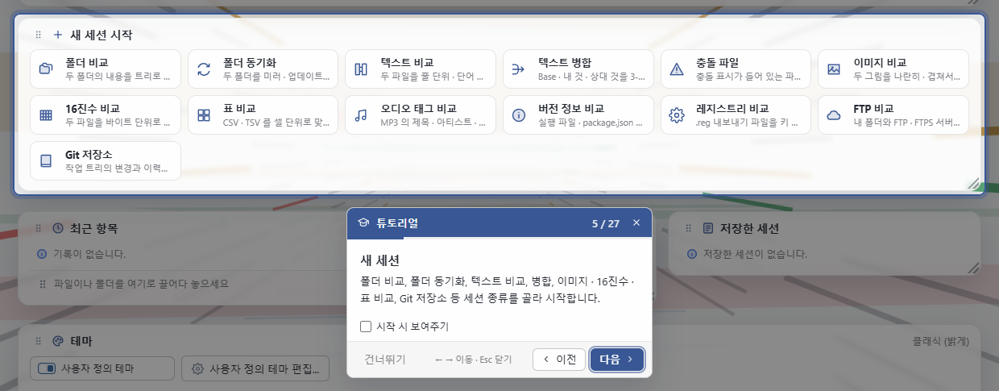

**도움말 › 튜토리얼**을 고르면 화면이 어두워지고, 설명하는 부분만 밝게 강조된 채 옆에 설명
카드가 나옵니다. 메뉴 막대, 도구 모음, 시작 화면, 비교 열기, 비교 화면, 병합, 패널, 하단
기록 · 터미널, 테마, 설정, 이 가이드를 차례로 짚습니다.

- **다음** / **이전** 단추, 또는 `→` / `←`.
- **건너뛰기** 또는 `Esc`로 언제든 닫습니다.
- 카드 아래쪽의 **시작 시 보여주기**를 끄면 다음 실행부터 시작 안내가 나오지 않습니다.
- 지금 화면에 없는 부분(예: 열린 병합이 없을 때의 병합 화면)은 가운데에 설명만 보여 줍니다.

<a id="help-guide"></a>
### 사용자 가이드 창

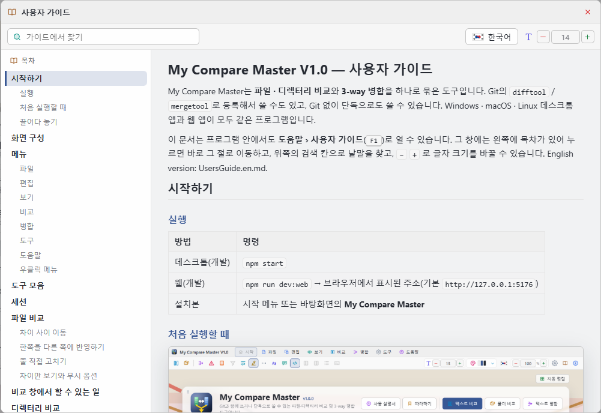

**도움말 › 사용자 가이드**(`F1`)는 이 문서를 별도 창으로 엽니다. 창은 크기를 바꿀 수 있습니다.

- 왼쪽 **목차**를 누르면 그 절로 바로 이동하고, 읽는 위치에 따라 목차의 강조가 따라옵니다.
- 위쪽 **검색** 칸에 낱말을 넣으면 그 낱말이 든 절만 목차에 남고 본문에서 강조됩니다.
  `Enter`는 다음 결과, `Esc`는 검색 지우기입니다.
- `−` `+`로 글자 크기를 바꿉니다. 테마는 프로그램 설정을 따릅니다.
- 위쪽의 **국기 단추**는 가이드만 한국어 ↔ English로 바꿉니다. 처음에는 프로그램 언어를 따르고,
  고른 언어는 기억됩니다. 바꿔도 보던 절에 그대로 머뭅니다.

---

<a id="install"></a>
## 설치와 제거

<a id="install-setup"></a>
### 설치

설치 파일을 실행하면 **첫 화면에서 한국어와 English 중 하나를 고릅니다**.

- 이전 버전이 설치되어 있으면 **그 자리에서 새 버전으로 바꿉니다**. 설정과 세션은 그대로 남습니다.
- 시작 메뉴에 바로 가기가 만들어집니다.
- `.dmrg` 세션 파일 형식이 **전용 아이콘과 함께 시스템에 등록**됩니다.
- 프로그램에 필요한 실행 환경이 함께 설치되므로 Node.js 같은 다른 프로그램을 따로 설치할 필요가 없습니다.

<a id="install-remove"></a>
### 제거

제어판에서 제거할 때, **저장된 설정과 세션이 있으면 함께 지울지 묻습니다**.
아니오를 고르면 설정은 그대로 남아 다음에 설치할 때 복원됩니다.

<a id="install-files"></a>
### 설정 파일 위치

| 운영체제 | 위치 |
|----------|------|
| Windows | `%AppData%\MyCompareMaster\settings.json` |
| macOS | `~/Library/Application Support/MyCompareMaster/settings.json` |
| Linux | `~/.config/MyCompareMaster/settings.json` |

---

<a id="troubleshooting"></a>
## 문제 해결

<a id="trouble-error"></a>
### 오류가 났을 때

오류는 **팝업 창**으로 자세한 내용까지 보여 줍니다. **오류 내용 복사** 단추를
누르면 전체 내용이 클립보드에 들어가므로 그대로 붙여 넣어 알려 주시면 됩니다.

<a id="trouble-slow"></a>
### 디렉터리 비교가 너무 느립니다

- **설정 › 비교**의 **제외할 폴더**에 `node_modules`, `dist` 같은 큰 폴더를 넣어
  주세요(기본으로 들어 있습니다).
- **파일 마스크**로 관심 있는 파일만 보도록 좁히면 훨씬 빨라집니다.
- 크기가 같은 파일은 내용을 읽어 비교하므로 시간이 대부분 여기에 듭니다. 파일은 여러 개를
  동시에 읽고, 화면에는 보이는 줄만 그리므로 수만 개 항목도 스크롤이 느려지지 않습니다.

<a id="trouble-wrap"></a>
### 아주 큰 파일에서 자동 줄 바꿈이 켜지지 않습니다

줄 바꿈을 켜면 모든 줄의 높이를 따로 계산해야 하므로, 2만 줄이 넘는 파일에서는
자동으로 꺼진 상태로 표시합니다. 차이만 보기를 함께 쓰면 대부분 해결됩니다.

<a id="trouble-mergetool"></a>
### `git mergetool`이 끝나도 충돌로 남아 있습니다

- 저장하지 않고 창을 닫지 않았는지 확인하세요.
- `mergetool.mycomparemaster.trustExitCode`가 `true`인지 확인하세요
  (설정 › Git에서 등록하면 자동으로 설정됩니다).

<a id="trouble-font"></a>
### 글꼴 목록에 원하는 글꼴이 없습니다

시스템 글꼴 폴더를 직접 읽습니다. 글꼴을 방금 설치했다면 프로그램을 다시 시작해
주세요.

---

My Compare Master V1.0 — Copyright (c) SHKWON(knix008@naver.com)
