# MyDCMViewer 튜토리얼

모든 기능을 46단계로 하나씩 보여 주는 안내입니다. 프로그램에서는 **도움말 › 튜토리얼** 로 시작하고, 각 단계의 데모가 저절로 실행됩니다. 카드 위의 목록으로 원하는 장(章)부터 시작하고, **▶ 다시 실행** 으로 데모를 다시 봅니다.

전체 과정을 녹화한 동영상: [MyDCMViewer-Tutorial.mp4](../MyDCMViewer-Tutorial.mp4)

## 차례

1. [시작](#1-시작)
2. [화면 구성](#2-화면-구성)
3. [보기 · 윈도우](#3-보기-윈도우)
4. [측정](#4-측정)
5. [시네 · 동영상 · 시리즈](#5-시네-동영상-시리즈)
6. [고급 보기](#6-고급-보기)
7. [DICOM 도구](#7-dicom-도구)
8. [문서](#8-문서)
9. [내보내기](#9-내보내기)
10. [PACS](#10-pacs)
11. [설정 · 도움말](#11-설정-도움말)

## 1. 시작

### 1.1 MyDCMViewer 에 오신 것을 환영합니다

DICOM 의료 영상을 열고, 보고, 재고, 비교하고, 내보내는 모든 기능을 하나씩 보여 드립니다. 단계마다 데모가 저절로 실행됩니다. [다음] 으로 넘어가고, 위의 목록으로 원하는 장(章)으로 건너뛰며, [다시 실행] 으로 데모를 다시 봅니다. Esc 로 언제든 닫습니다.

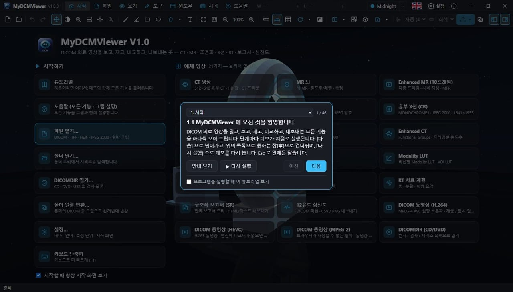

### 1.2 시작 화면

파일 · 폴더 · DICOMDIR 열기, 일괄 변환, 설정, 단축키를 여기서 시작합니다. 메뉴 막대 왼쪽의 [시작] 단추로 언제든 다시 엽니다.

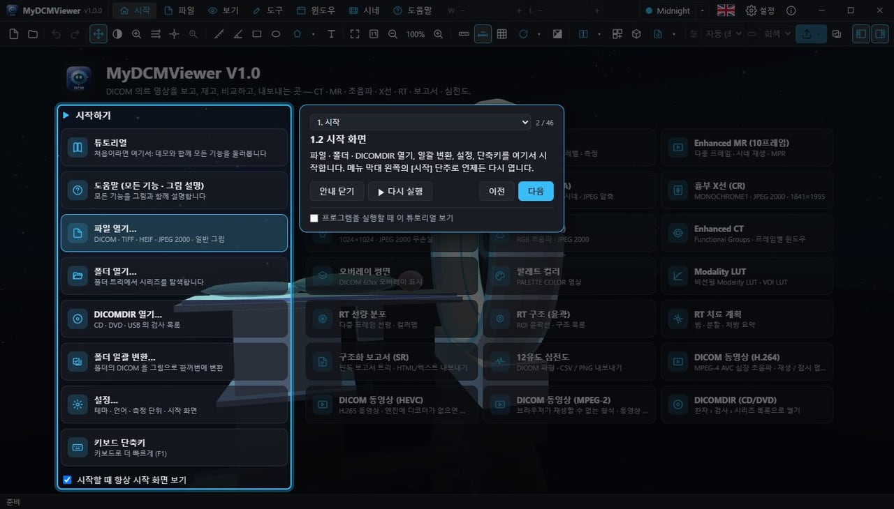

### 1.3 예제 영상

CT, MR, 초음파 시네, 혈관 조영, X선, RT, 보고서, 심전도, DICOM 동영상, DICOMDIR 예제가 들어 있습니다. 카드를 누르면 바로 열립니다.

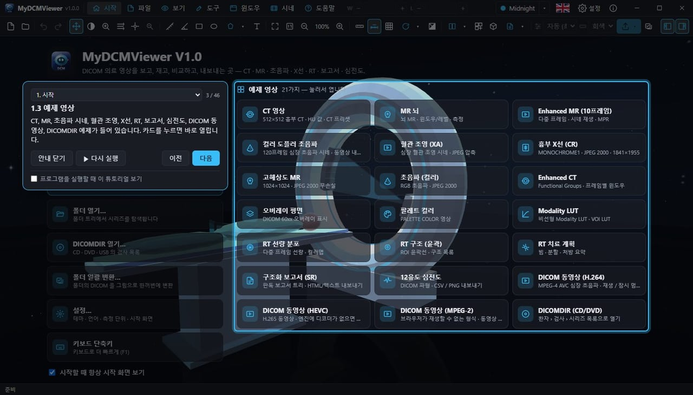

### 1.4 시작 화면 배경

CT 갠트리, MRI, 내시경, PET, 방사선 치료기 등 움직이는 3D 배경 18종 가운데 하나를 고르고, 투명도와 카메라 · 물체 · 하늘의 속도를 조절합니다.

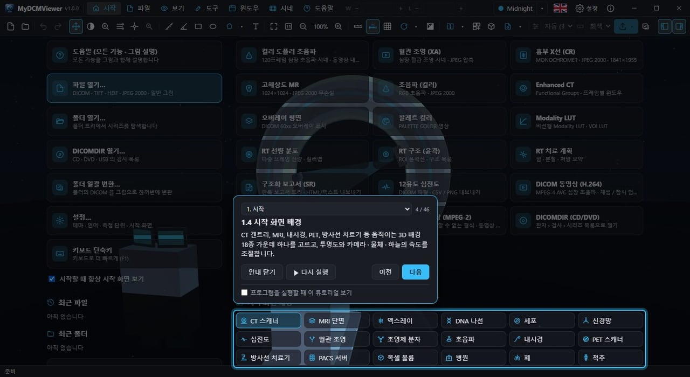

## 2. 화면 구성

### 2.1 메뉴

시작 · 파일 · 보기 · 도구 · 윈도우 · 시네 · 도움말 메뉴에 모든 기능이 아이콘과 함께 있습니다. 지금 CT 를 엽니다.

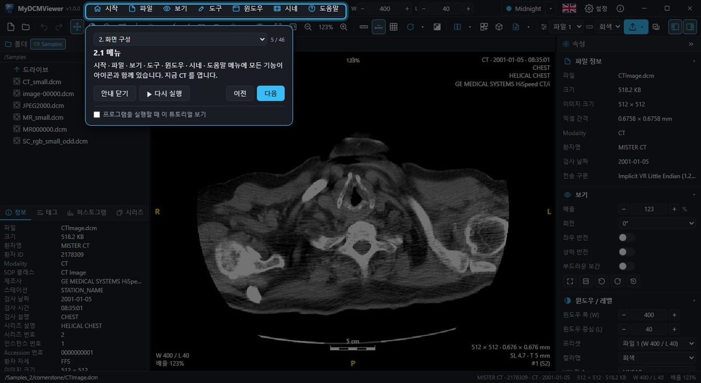

### 2.2 제목 줄 · 창 단추

창에는 따로 제목 표시줄이 없습니다. 메뉴 막대 왼쪽에 아이콘 · 프로그램 이름 · 버전이, 오른쪽 끝에 최소화 · 최대화 · 닫기 단추가 있습니다. 메뉴 막대의 빈 곳(이름 포함)을 끌면 창이 움직이고, 두 번 누르면 최대화 · 복원됩니다. 창 가장자리나 모서리를 끌어 크기를 바꿉니다.

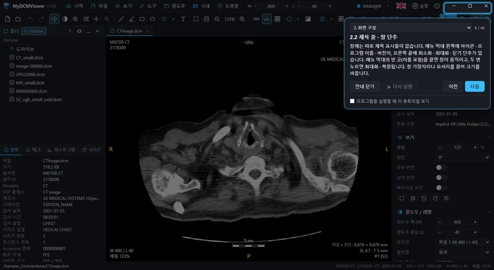

### 2.3 도구 모음

열기, 실행 취소, 마우스 도구, 확대, 눈금자 · 격자, 회전, 반전, 배치, MPR · 3D, 프리셋 · 컬러맵, 내보내기가 아이콘 단추로 있습니다. 단추에 마우스를 올리면 설명이 나옵니다.

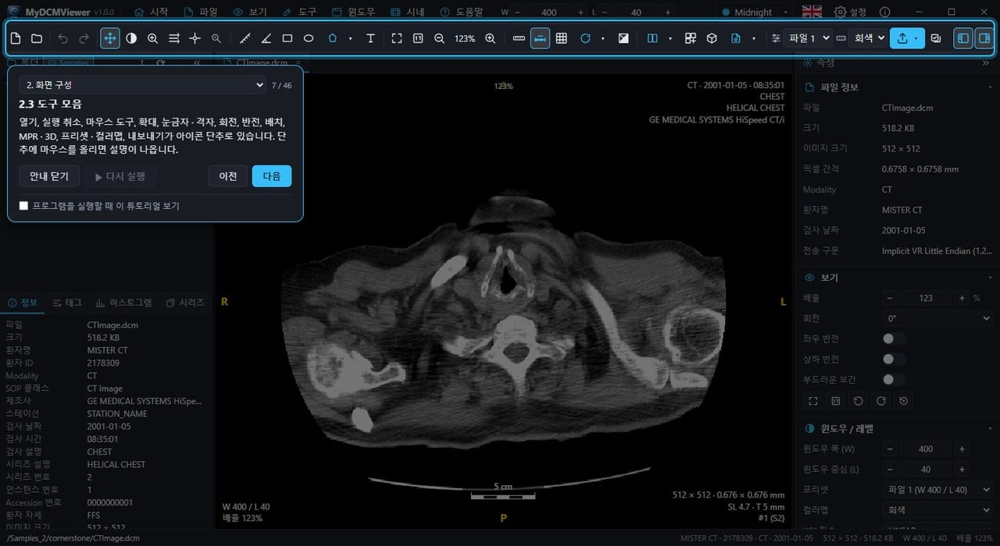

### 2.4 폴더 트리

폴더를 열면 파일이 나무 모양으로 보입니다. 한 번 누르면 열리고, 오른쪽 단추로 복사 · 이동 · 삭제 · 경로 복사를 합니다.

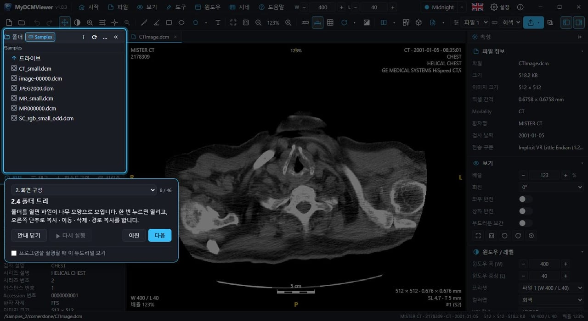

### 2.5 정보 · 태그 · 히스토그램 · 시리즈

환자 · 검사 정보, 모든 DICOM 태그(검색), 히스토그램, 시리즈 목록을 봅니다.

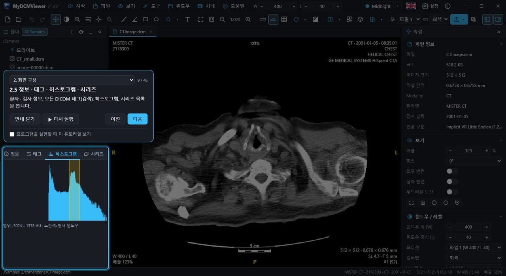

### 2.6 패널 접기 · 펼치기

폴더 머리글 끝의 « 단추(또는 도구 모음 오른쪽 끝의 패널 단추, F9)로 왼쪽 패널을 접습니다. 접으면 좁은 띠에 폴더 · 정보 · 태그 · 히스토그램 · 시리즈 아이콘과 세로 제목이 남고, 하나를 누르면 그 부분으로 다시 펼쳐집니다.

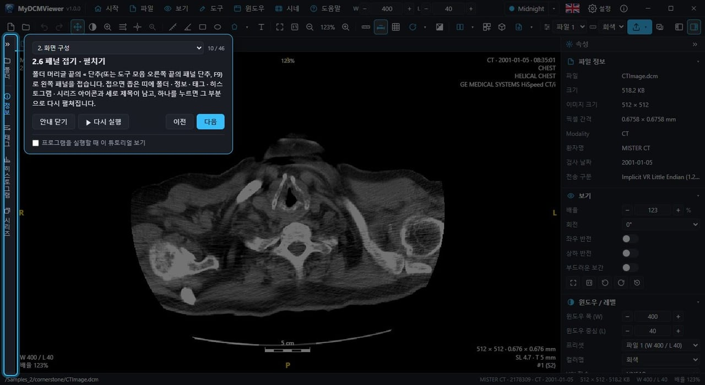

### 2.7 속성 패널

오른쪽 패널은 지금 보는 영상의 정보와 속성입니다: 파일 정보, 보기(배율 · 회전 · 반전), 윈도우 / 레벨, 시네, 표시(눈금자 · 축척 막대 · 격자 …), 측정 목록. 바꿀 수 있는 값은 그 자리에서 바꾸고, 숫자 칸은 양옆의 − / + 단추로 한 단계씩 바꿉니다. 이 패널도 접으면 띠에 구역 아이콘과 제목이 남습니다(F8).

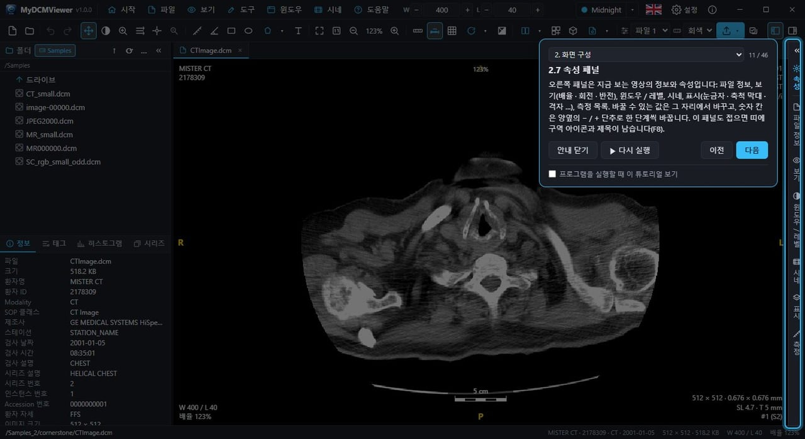

### 2.8 파일 탭

연 파일마다 탭이 생기고, 탭마다 프레임 · 윈도우 · 확대 · 측정이 따로 기억됩니다. 오른쪽 단추로 닫기 · 다른 탭 닫기 · 경로 복사를 합니다. MR 을 하나 더 엽니다.

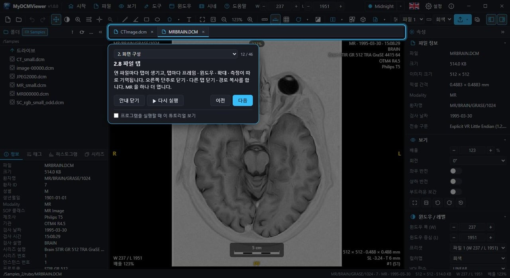

### 2.9 상태 표시줄

파일 경로, 환자 · 검사 요약, 크기, W/L, 마우스 아래의 값, 배율이 보입니다. 오른쪽 아래 모서리를 끌어 창 크기를 바꿉니다.

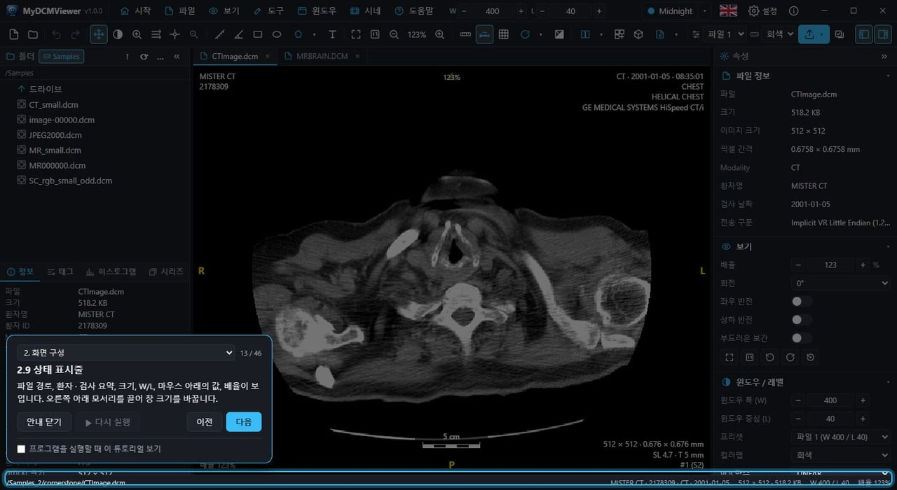

## 3. 보기 · 윈도우

### 3.1 확대 · 이동

휠로 확대/축소, 왼쪽 끌기로 이동, 더블 클릭으로 화면 맞춤입니다. 모서리에 환자 · 검사 정보와 배율, 가장자리에 방향(R/L/A/P)이 보입니다.

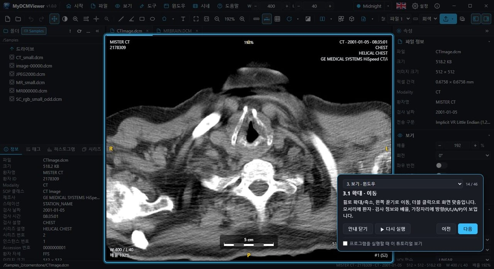

### 3.2 회전 · 반전

90° 회전, 좌우 · 상하 반전, 보기 초기화(R). 실행 취소(Ctrl+Z)로 되돌립니다.

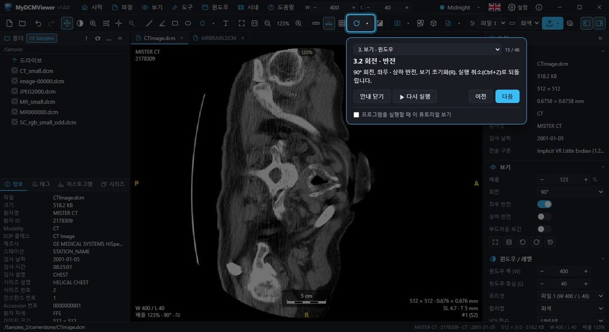

### 3.3 윈도우 / 레벨

오른쪽 끌기 또는 W(폭) · L(중심) 입력으로 밝기와 대비를 바꿉니다. 프리셋 목록에 CT 뇌 · 폐 · 뼈 · 복부 등이 있습니다. 폐, 뼈 순서로 적용합니다.

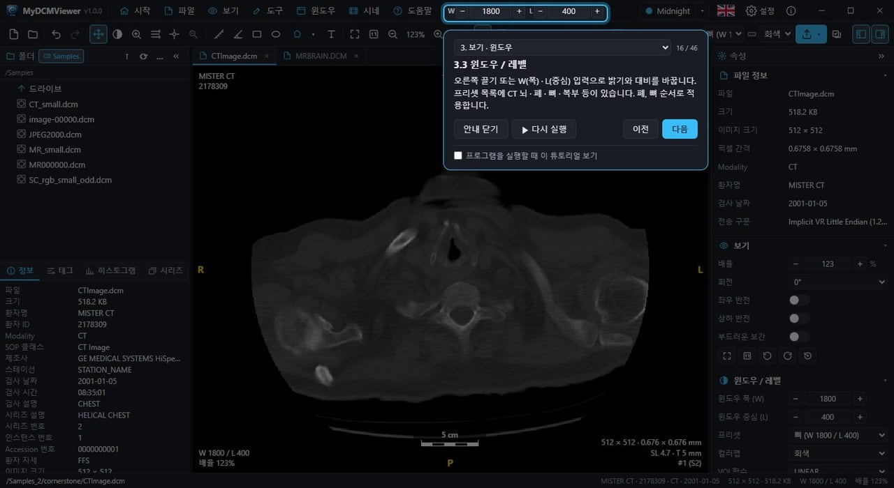

### 3.4 컬러맵 · 반전

회색 대신 핫 아이언, PET, 제트 등 컬러맵으로 보거나 반전(I)합니다.

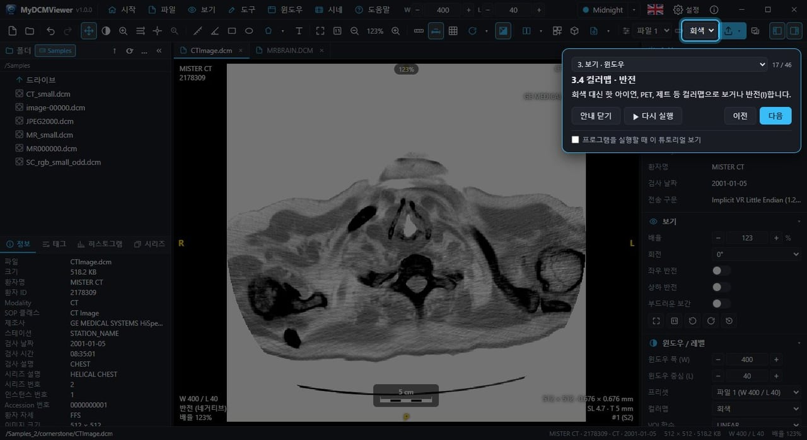

### 3.5 모서리 정보 · 눈금자 · 격자

보기 메뉴에서 모서리 정보, 방향 표시, 오버레이 평면, 눈금자(K), 눈금에 맞춘 5×5 격자(G)를 켜고 끕니다.

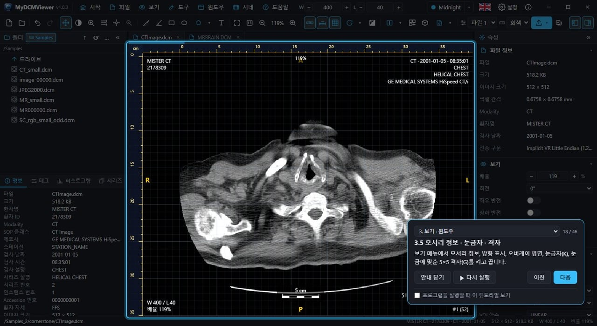

### 3.6 축척 막대

영상 위의 축척 막대가 실제 길이(예: 5 cm)를 보여 주고, 확대하면 길이가 알맞게 바뀝니다. 막대를 마우스로 끌어 원하는 곳에 두면 다음 실행에도 그 자리에 나옵니다. 도구 모음의 축척 단추 · B 로 켜고 끕니다.

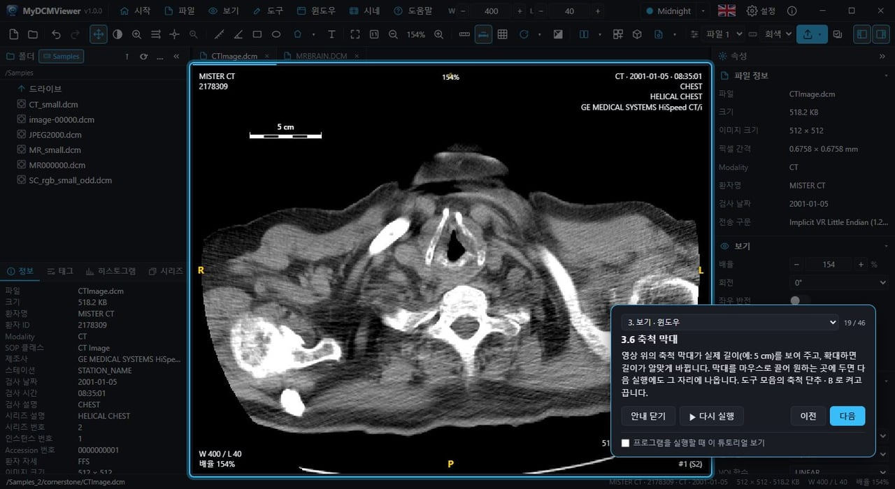

## 4. 측정

### 4.1 길이

길이 도구(6)로 두 점을 잇습니다. Pixel Spacing 이 있으면 mm · cm 로, 없으면 화소로 표시하고 [이 길이를 실측값으로 보정] 할 수 있습니다.

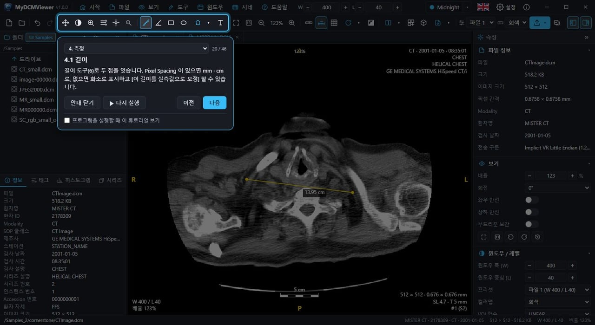

### 4.2 각도 · Cobb 각

각도 도구(7)는 세 점, Cobb 각(Shift+7)은 두 선(척추 끝판) 사이의 각도를 잽니다.

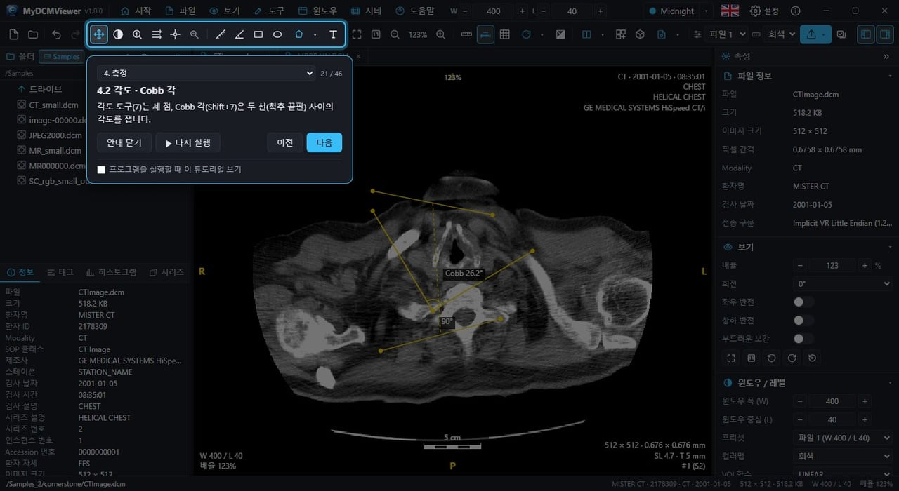

### 4.3 ROI 통계

사각형(8) · 타원(9) · 다각형(Shift+8) · 자유곡선(Shift+9) 영역의 면적, 둘레, 평균, 표준편차, 최소, 최대(CT 는 HU)를 보여 줍니다.

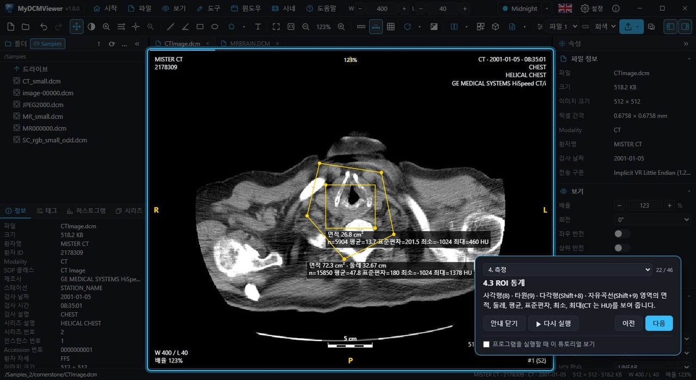

### 4.4 점 · 화살표 · 텍스트 · 돋보기

점(Shift+5)은 그 자리의 값, 화살표(Shift+0)와 텍스트(0)는 주석입니다. 돋보기(Q)는 누르고 있는 동안 3배로 봅니다. 마지막 측정 삭제는 Backspace, 모두 지우기는 Del 입니다.

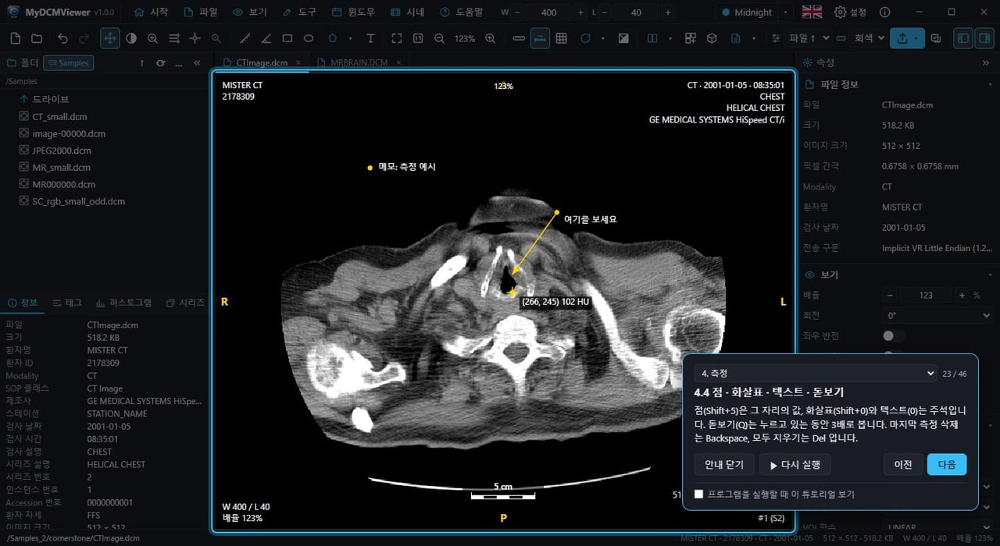

## 5. 시네 · 동영상 · 시리즈

### 5.1 시네 재생

여러 프레임 영상은 아래 막대로 봅니다: ▶ 재생, ⏸ 잠시 멈춤, ⏹ 멈춤(첫 프레임으로), 한 프레임씩, 속도(fps), 반복. Space 는 재생/멈춤, S 는 멈춤입니다. 10프레임 MR 을 재생합니다.

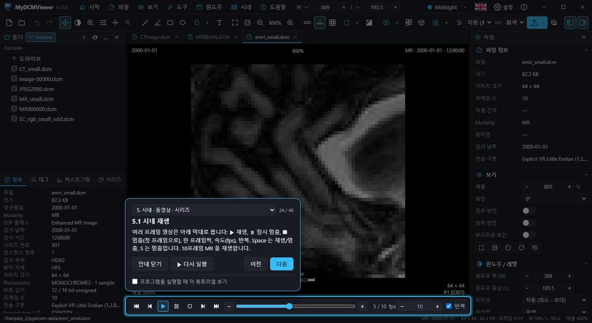

### 5.2 DICOM 동영상

MPEG-4 AVC(H.264) · HEVC 로 저장된 DICOM 동영상은 그대로 재생 · 잠시 멈춤 · 멈춤 하고 한 프레임씩 넘겨 측정할 수 있습니다. MPEG-2 등 브라우저가 못 푸는 형식은 [동영상 추출] 로 저장합니다.

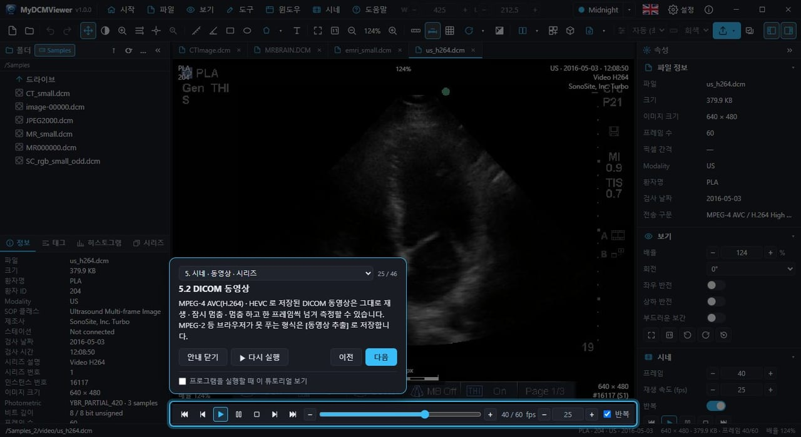

### 5.3 시리즈 넘기기

폴더에 파일이 여럿이면 시리즈 막대 · ← → · PgUp/PgDn 으로 넘깁니다. 시네 › 폴더를 DICOM 시리즈로 정렬 하면 위치 순서로 쌓입니다. DICOMDIR 를 엽니다.

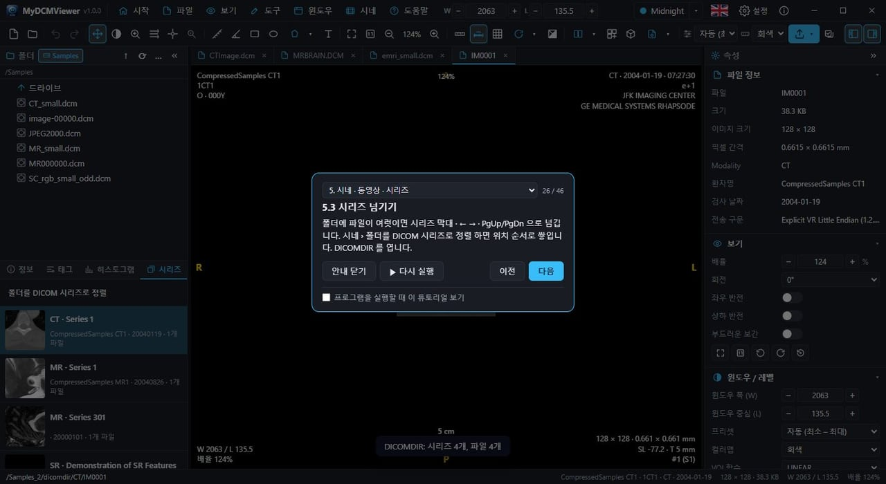

### 5.4 화면 배치 · 동기 스크롤 · 기준선

보기 › 화면 배치로 1×2 · 2×2 · 3×3 칸에 여러 영상을 나란히 비교합니다. 동기 스크롤은 같은 위치의 슬라이스로 따라가고, 기준선은 다른 칸의 단면 위치를 보여 줍니다.

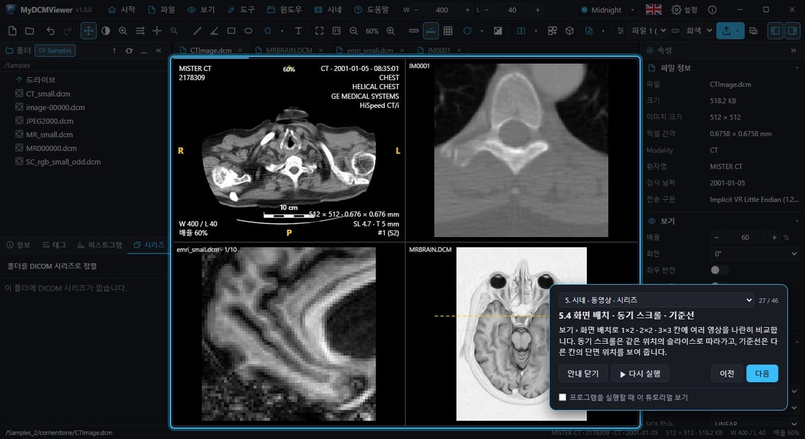

## 6. 고급 보기

### 6.1 MPR / MIP · 곡면 MPR

다중 프레임이나 정렬한 시리즈를 축상 · 관상 · 시상면으로 다시 자르고 MIP / MinIP / 평균 투영으로 봅니다(M). 곡면 MPR 은 축상면에 경로를 찍어 그 곡선을 펼칩니다.

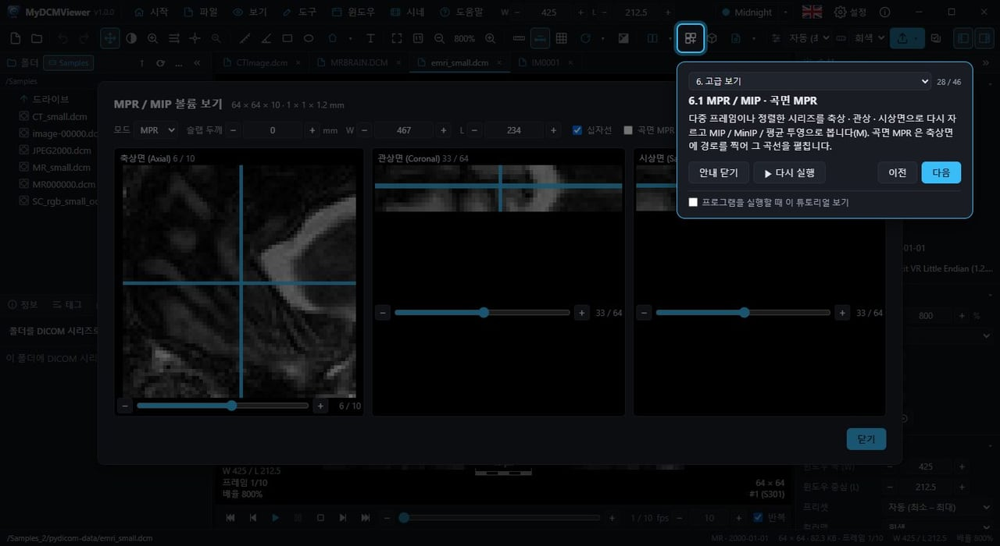

### 6.2 3D 볼륨 렌더링

볼륨 렌더링(뼈 · 연부 조직 · 폐 · 혈관 프리셋), MIP · MinIP · 평균, 등위면, 자르기 상자, 앞 · 뒤 · 좌 · 우 · 위 · 아래 보기. 끌어서 돌리고 휠로 확대합니다(Shift+M).

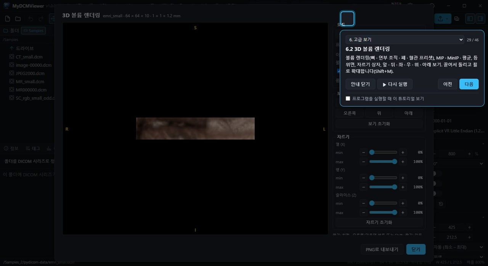

### 6.3 영상 필터

도구 › 영상 필터: 부드럽게 · 선명하게 · 잡음 제거 · 중앙값 · 윤곽선 · 엠보스 · 히스토그램 평활화. 여러 필터를 이을 수 있고 내보내기에도 들어갑니다. 선명하게, 윤곽선 순서로 보여 줍니다.

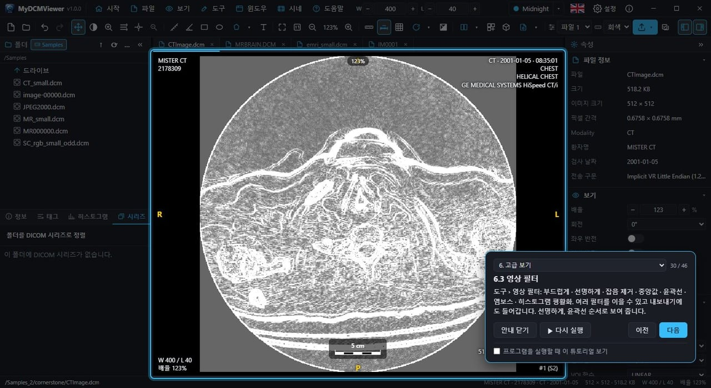

### 6.4 영상 융합 (PET/CT)

도구 › 영상 융합: 두 번째로 연 영상(PET · SPECT · 선량 · MR)을 컬러맵으로 겹칩니다. 위치 정보가 있으면 환자 좌표로 맞춥니다. RT 선량을 CT 위에 겹칩니다.

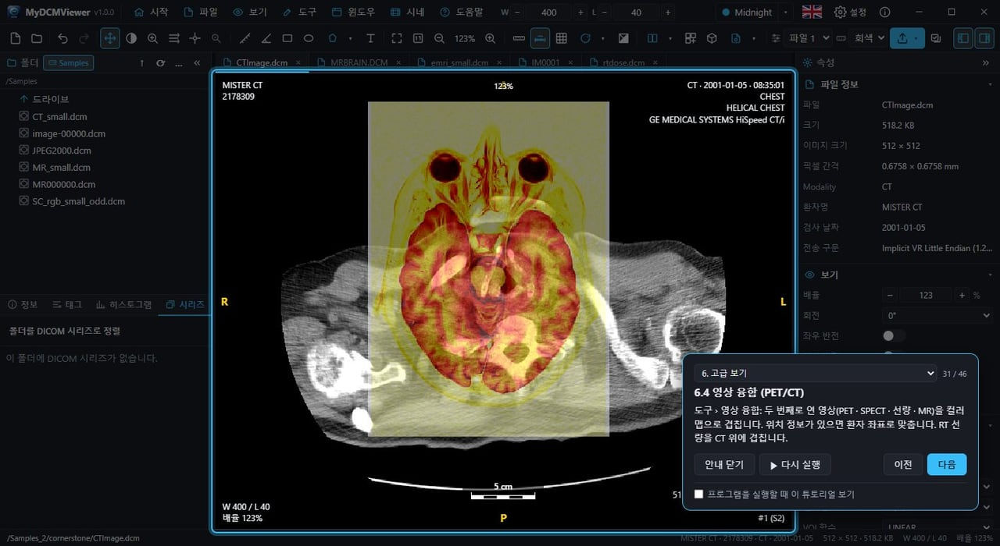

## 7. DICOM 도구

### 7.1 DICOM 태그 편집

도구 › DICOM 태그 편집: 시퀀스 안까지 모든 요소를 보고 값을 바꾸거나 추가 · 삭제해 새 파일로 저장합니다. 원본은 그대로입니다.

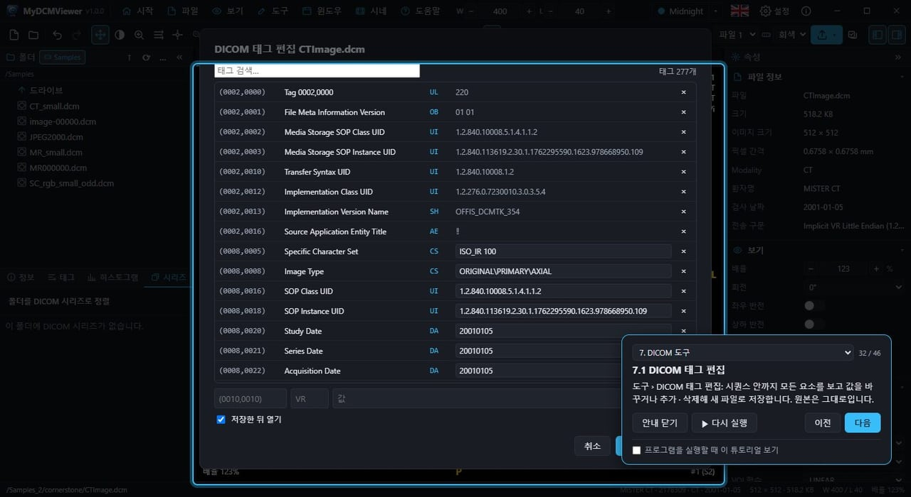

### 7.2 익명화 사본

개인 식별 정보를 바꾸거나 비우고(시퀀스 안까지), 비공개 태그를 지우고, 검사 · 시리즈 · 영상 UID 를 새로 만들어 _anon.dcm 으로 저장합니다.

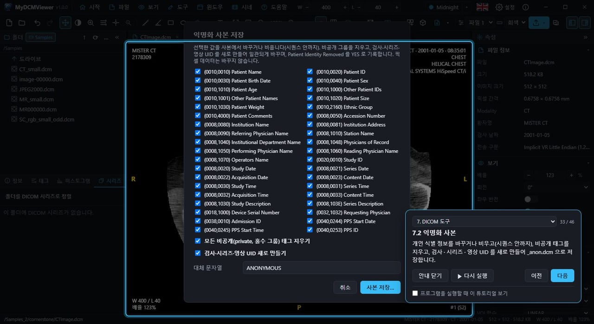

### 7.3 압축 변환 · Secondary Capture

도구 메뉴의 [비압축 DICOM 으로 저장] 은 JPEG · JPEG 2000 · JPEG-LS · RLE 를 풀어 저장하고, [영상을 DICOM 으로 저장] 은 보이는 그림을 Secondary Capture 로 만듭니다.

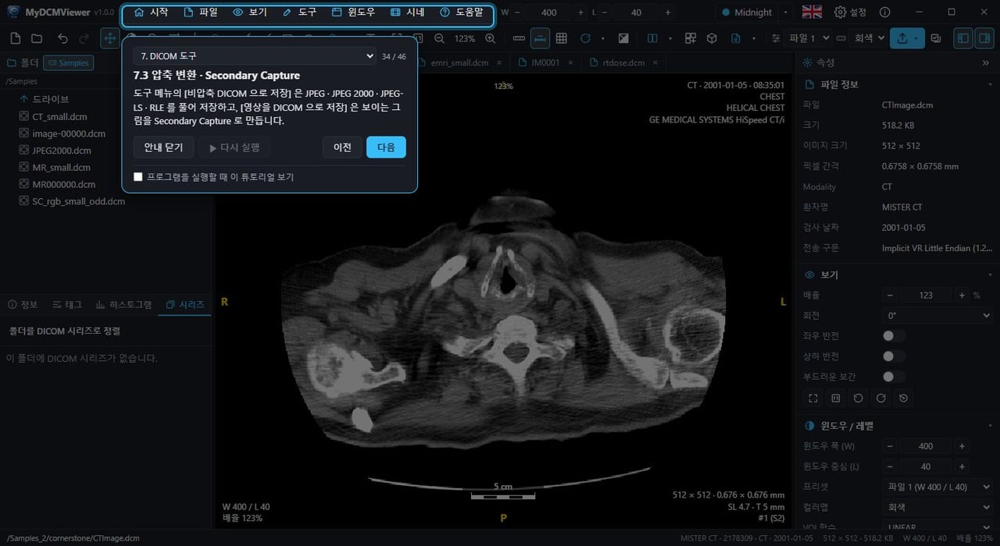

## 8. 문서

### 8.1 구조화 보고서 (SR)

판독 보고서를 트리로 보고 HTML · 텍스트로 저장합니다.

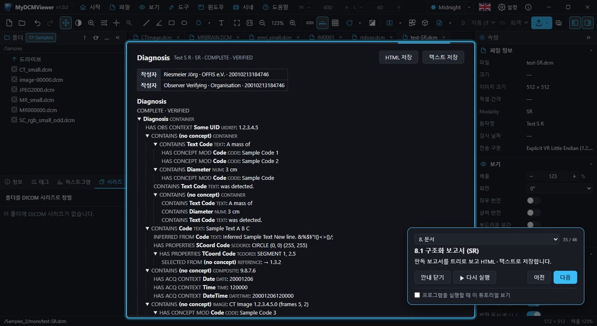

### 8.2 심전도 · 파형

12유도 심전도 같은 DICOM 파형을 그래프로 보고(속도 · 이득 · 열 수) CSV · PNG 로 저장합니다.

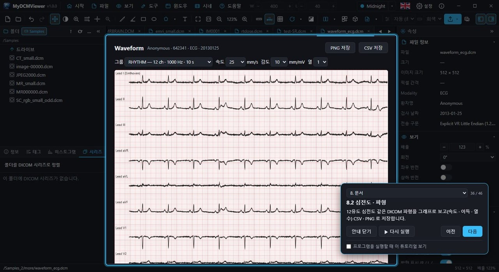

### 8.3 RT 구조 · 계획 · 선량

RT 구조는 ROI 목록과 윤곽, RT 계획은 빔 · 분할 · 처방, RT 선량은 컬러맵 영상으로 봅니다.

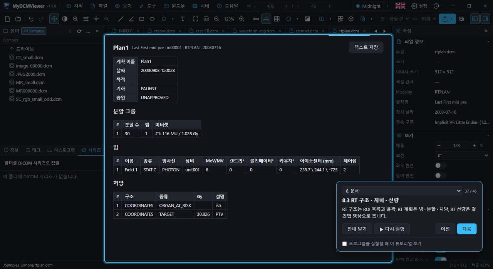

### 8.4 DICOMDIR · ZIP

CD · DVD · USB 의 DICOMDIR 는 환자 › 검사 › 시리즈 목록으로, ZIP 파일은 읽기 전용 폴더로 엽니다.

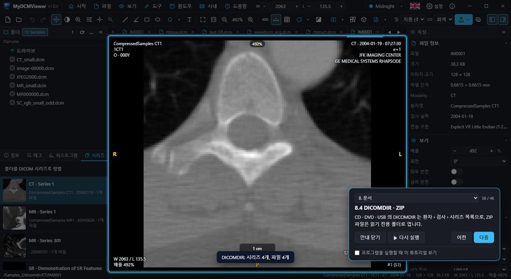

## 9. 내보내기

### 9.1 내보내기 메뉴

PNG · JPEG · WebP · BMP · TIFF · GIF, 16비트 TIFF, 모든 프레임 ZIP, 애니메이션 GIF, 동영상(MP4 · WebM), PDF 보고서, DICOM, DICOMDIR, 측정값 CSV, 태그를 내보냅니다. 저장하는 동안 진행률 창이 뜹니다.

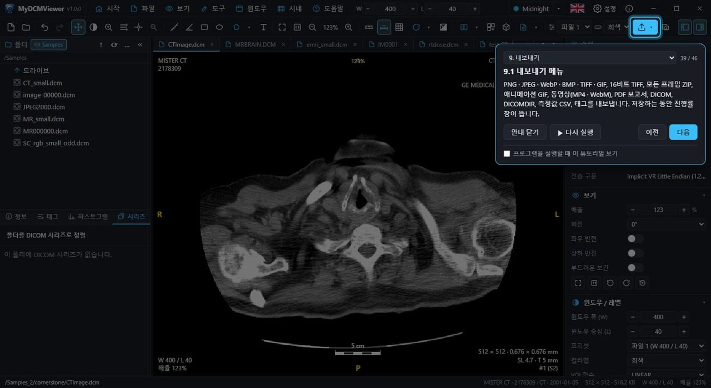

### 9.2 다른 형식으로 내보내기

45가지 형식(AVIF · JPEG XL · JPEG 2000 · JPEG-LS · OpenEXR · NIfTI · NRRD · MetaImage · FITS 등)을 고르고 품질 · 비트 깊이 · 압축을 정합니다. 16비트 · 의료 형식은 원래 화소 값을 담습니다.

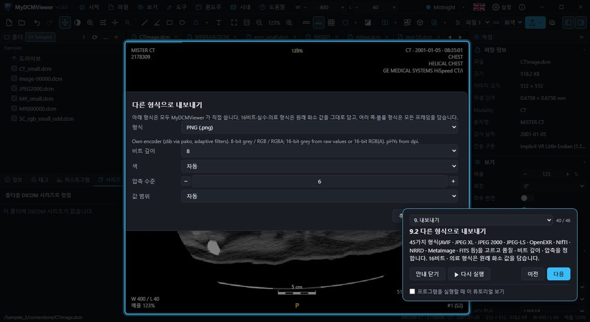

### 9.3 인쇄

인쇄 창에서 제목 · 부제목 · 작성자 · 메모, 넣을 정보(환자 · 검사 · 영상 · 측정값), 용지 · 방향 · 여백 · 영상 크기, 프린터 · 매수 · 양면 · 흑백 · 해상도를 정하고 미리보기 그대로 바로 인쇄합니다(Ctrl+P). PDF 보고서도 같은 창에서 만듭니다.

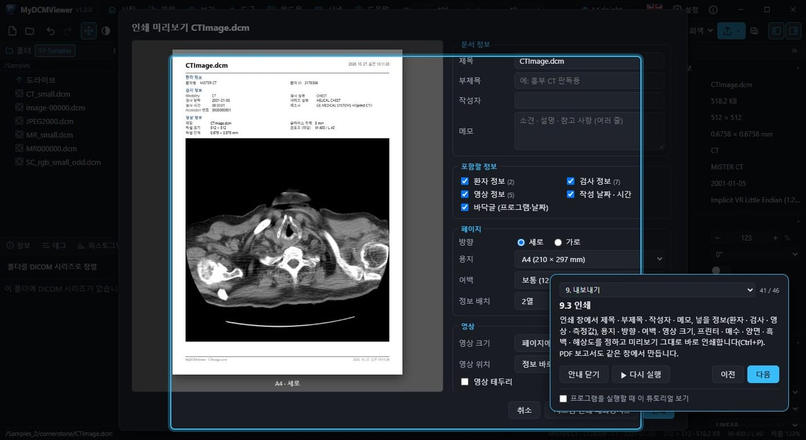

### 9.4 폴더 일괄 변환

폴더(하위 폴더 포함)의 DICOM 을 한 번에 그림 파일로 바꿔 converted_<형식> 폴더에 저장합니다.

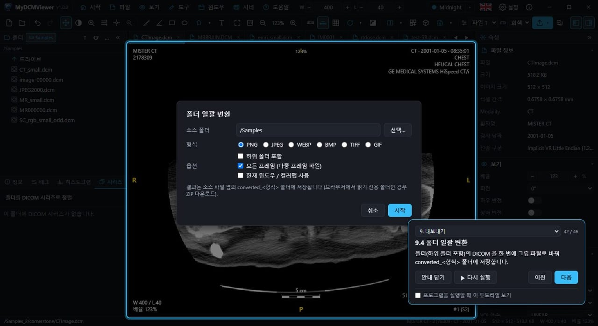

## 10. PACS

### 10.1 PACS 연결

도구 › PACS: 병원 PACS 나 장비를 등록하고 연결 확인(C-ECHO), 검사 검색(C-FIND), 가져오기(C-GET / C-MOVE), 보내기(C-STORE)를 합니다. [수신 시작] 을 누르면 다른 장비가 보낸 영상도 받습니다(데스크톱).

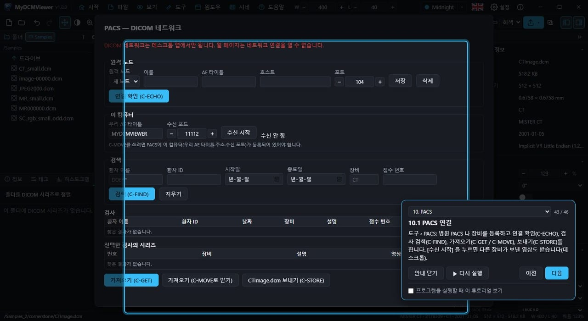

## 11. 설정 · 도움말

### 11.1 테마 · 언어 · 설정

테마 20종, 한국어 / 영어, 프로그램 설정(측정 단위, 휠 동작, 시작 화면 등), 프로그램 정보가 메뉴 막대 오른쪽 끝에 있습니다. 테마를 하나 바꿔 봅니다.

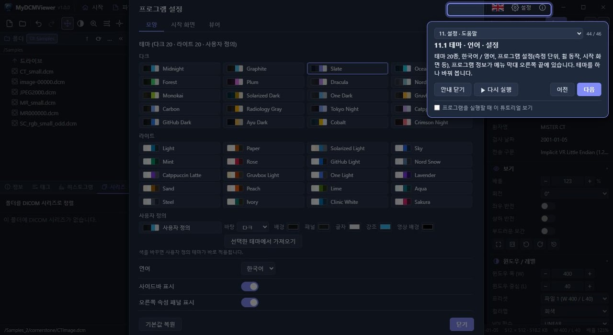

### 11.2 도움말 · 단축키

도움말 › 도움말 창에서 모든 기능의 설명을 그림과 함께 봅니다. F1 은 단축키 목록입니다.

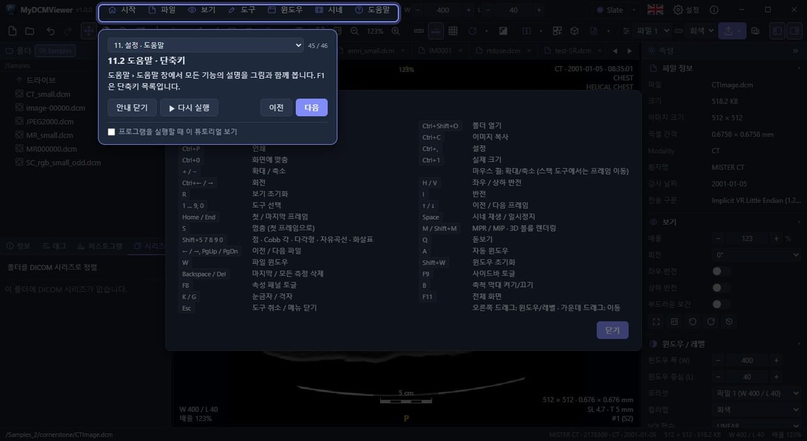

### 11.3 준비 완료

이 안내는 도움말 › 튜토리얼 에서 언제든 다시 볼 수 있고, 위 목록에서 원하는 장부터 시작할 수 있습니다.

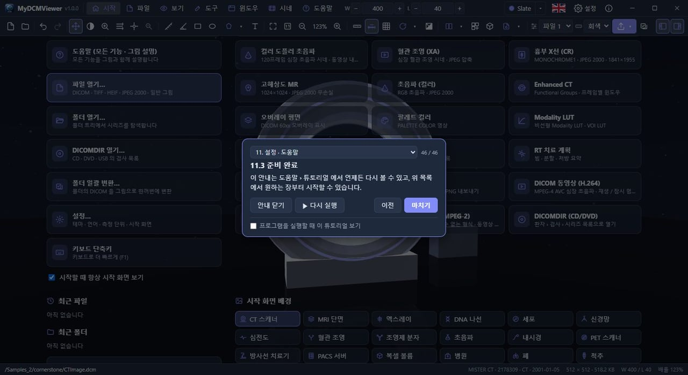
