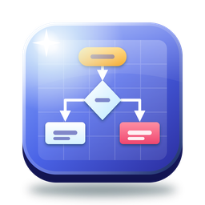

# MyDiagram

Windows · macOS · Linux · 웹에서 쓰는 다이어그램·도면 작성 프로그램입니다. Microsoft Visio처럼 스텐실의 도형을 끌어다 놓고, 연결선으로 잇고, 디자인과 빠른 스타일로 꾸미고, 페이지·배경 페이지·레이어, 도형 데이터와 보고서, 자동 레이아웃, Visio(.vsdx) 열기·저장을 다룹니다. JavaScript(Vite) UI와 Tauri 2(Rust) 백엔드로 만들었습니다.



- 버전: 1.0.0
- 사용법: [UsersGuide.md](UsersGuide.md) (English: [UsersGuide.en.md](UsersGuide.en.md))
- 구조: [ARCHITECTURE.md](ARCHITECTURE.md)
- 튜토리얼 문서: [docs/tutorial/README.md](docs/tutorial/README.md), 동영상 `MyDiagram-Tutorial.mp4`

## 주요 기능

### 그리기

- **스텐실 15종, 도형 마스터 210개** — 기본 도형 · 화살표 · 순서도 · 설명선·텍스트 · 컨테이너·스윔레인 · UML · 데이터베이스(ERD) · BPMN · 네트워크 · 조직도 · 마인드맵 · 평면도 · 블록 다이어그램 · 타임라인 · 전기 회로. 도형 검색, 타일 크기(작게·보통·크게), **내 도형**(선택을 저장해 다시 쓰기)
- **그리기 도구** — 포인터 · 화면 이동 · 연결선 · 텍스트 · 사각형 · 타원 · 선 · 연필(자유형) · 다각선 (`Ctrl+1`~`Ctrl+9`)
- 끌어 놓기, 크기 조절·회전 손잡이, 노란 **조절 핸들**(모서리 둥글기, 화살표 두께 등), 대칭 이동, 도형 위에서 바로 **텍스트 편집**
- **자동 연결** — 도형에 마우스를 올리면 네 방향에 나오는 화살표로 이웃 도형을 만들며 연결
- **눈금·자·안내선·스마트 가이드·페이지 나누기**, 눈금에 맞추기, 다른 도형·안내선에 맞추기
- 그림 삽입, 컨테이너·설명선, 하이퍼링크(웹 주소·다른 페이지), 메모, 필드(`{page}` · `{date}` · `{data:Cost}` …), 배경 페이지의 테두리와 제목
- **실행 취소/다시 실행**(탭마다 200단계), 복사·잘라내기·붙여넣기·복제, 서식 복사, 다른 프로그램의 텍스트 붙여넣기는 도형이 됨
- **템플릿 13종** — 빈 드로잉 · 기본 다이어그램 · 기본 순서도 · 교차 기능 순서도 · 조직도 · 네트워크 · UML 클래스 · 데이터베이스 모델 · BPMN · 마인드맵 · 평면도 · 타임라인 · 블록 다이어그램, 예제 드로잉(한국어/영어)

### 연결선

- 도형의 **연결점**에 붙이기(점 고정) 또는 도형 전체에 붙이기(동적 연결: 마주 보는 점을 스스로 고름), 붙지 않은 끝
- **직각 · 직선 · 곡선** 연결선, 직각 연결선은 가운데 도형을 **돌아가는 경로**(A* 탐색)
- **선 건너뛰기**(교차점의 반원), 꺾임점 끌기·지우기, 방향 바꾸기, 연결선 레이블
- 화살촉 16가지(까마귀 발 ERD 표기 포함), 선 패턴 6가지, 크기 조절

### 서식과 디자인

- **디자인 16가지 × 변형 4가지**(오피스 · 선형 · 패싯 · 이온 · 청사진 · 자정 · 칠판 …) — 디자인을 바꾸면 손대지 않은 도형이 한꺼번에 바뀜
- **빠른 스타일** — 강조색 6가지 × 채우기 · 은은하게 · 윤곽선 · 강하게 · 그라데이션 · 없음
- **도형 서식 창** — 채우기(단색·선형/원형 그라데이션·빗금·격자·점 무늬, 불투명도) · 선 · 텍스트(글꼴·크기·굵게·기울임·밑줄·취소선·정렬·줄 간격·여백) · 효과(그림자) · 크기와 위치 · 보호(이동·크기·회전·삭제·텍스트 금지, 비율 고정)
- 툴바의 채우기·선 색 분할 버튼, 표준 색 + 사용자 색

### 정렬과 배치

- 맞춤(왼쪽·가운데·오른쪽·위·중간·아래), 균등 분배, 같은 크기, 자동 맞춤 및 간격
- 맨 앞으로·맨 뒤로·앞으로·뒤로, 회전(90°)·좌우/상하 대칭, 그룹·그룹 해제
- **자동 레이아웃 7가지** — 순서도(위→아래, 왼쪽→오른쪽) · 계층(위→아래, 왼쪽→오른쪽) · 방사형 · 원형 · 격자, 간격 지정

### 페이지와 레이어

- 페이지 추가·복제·이름 바꾸기·삭제·끌어서 순서 바꾸기, 페이지 탭, **배경 페이지**(여러 페이지에 공통으로 깔림)
- 페이지 크기(A3~Ledger, 화면, 사용자 지정)·방향·단위(mm · cm · in · pt · px)·색, **페이지 자동 크기**
- **레이어** — 보이기 · 인쇄 · 잠금 · 색, 활성 레이어, 도형마다 여러 레이어

### 도형 데이터와 보고서

- **도형 데이터** — 텍스트 · 숫자 · 통화 · 날짜 · 예/아니요 · 목록 필드, 도형에 데이터 표시(데이터 그래픽)
- **데이터 연결**(CSV·붙여넣은 표를 ID·이름·텍스트로 도형에 연결), 도형 데이터 CSV 내보내기
- **데이터로 조직도 만들기**(이름·직함·상사), **목록으로 순서도 만들기**
- **도형 보고서 6가지** — 도형 목록 · 도형 데이터(숫자 합계) · 연결 · 페이지 · 레이어 · 모든 텍스트. HTML · Markdown · Word(.docx) · PDF로 내보내기, **보고서 복사**

### 보기 (5가지)

드로잉 · 페이지 개요(썸네일) · 도형 시트(위치·크기·각도·색·글꼴·레이어·링크를 칸에서 편집) · 도형 데이터(필드마다 열) · 도형 보고서

- 확대/축소(10~800%, `Ctrl+휠`), 페이지 맞춤·너비 맞춤·선택 영역 확대, **이동 및 확대/축소 창**(미니맵)
- 찾기 · 바꾸기(도형 데이터 포함, 모든 페이지) · 페이지로 이동, 같은 마스터 선택
- **프레젠테이션 모드** — 페이지를 전체 화면으로 차례로 보여 줌

### 파일과 연동

- `.mdg` 드로잉, `.mdgt` 템플릿(UTF-8 JSON), 저장은 임시 파일에 쓴 뒤 바꿔치기
- **Microsoft Visio** `.vsdx` · `.vstx` 열기, `.vsdx` 저장(페이지 · 도형 모양 · 텍스트 · 서식 · 회전 · 대칭 · 도형 데이터 · 하이퍼링크 · 레이어 · 그림 · 연결선 붙임)
- 내보내기 — **PDF** · **SVG** · 그림(PNG · JPEG · WebP · BMP · TIFF · SVG, 배율 1~3배, 투명 배경) · **HTML**(모든 페이지) · 도형 데이터 CSV
- **데이터베이스에 저장·열기**(데스크톱) — SQLite · MariaDB · MySQL · PostgreSQL, 연결 시험
- 여러 드로잉을 탭으로, 모두 저장, **최근 파일 10개 · 최근 폴더 10개**(하나씩/전체 지우기, 없어진 파일 표시)
- **끌어다 놓기** — 드로잉·Visio 파일은 열기, 그림은 삽입(시작 페이지에서는 배경), CSV는 데이터 연결, 텍스트는 도형 목록(웹)
- 저장하지 않은 변경은 탭 닫기·끝내기 전에 저장/저장 안 함/취소를 물음, 지난번 파일 다시 열기(선택)

### 인쇄

모든 페이지 · 현재 페이지 · 페이지 범위, 용지·방향·여백, 한 장에 맞추기 · 실제 크기 · 배율(여러 장에 나눠 인쇄), 머리글(제목·페이지 이름·날짜)·바닥글(쪽 번호), 인쇄하지 않는 레이어 제외, 미리 보기에서 쪽 넘기기, 바로 인쇄. 인쇄물은 테마와 상관없이 흰 바탕.

### 화면과 사용 편의

- **테마** — 다크 20 · 라이트 20 · 사용자 정의(12가지 색 편집, 글자 대비 경고) · 시스템 설정. 툴바의 테마 버튼은 누를 때마다 **무작위 테마**, 옆의 ▾는 다크 | 라이트 **두 줄 목록**
- **한국어/영어** — 툴바의 **국기 버튼**(한국어일 때 영국 국기, 영어일 때 태극기), 백엔드 메시지까지 전환
- **시작 페이지** — 템플릿, 열기(Visio 포함), 최근 파일·폴더, 예제, 튜토리얼, **움직이는 배경 20가지**(오로라 · 물결 · 입자 · 별자리 · 거품 · 흐르는 격자 · 떠다니는 순서도 · 별빛 · 비 · 눈 · 반딧불 · 파문 · 코드 비 · 육각 격자 · 궤도 · 라바 램프 · 은하 나선 · 색종이 · 노드 네트워크 · 리본, 무작위 바꾸기, 자동 바꾸기 간격, 속도)
- **튜토리얼** — 예제 드로잉으로 모든 기능을 장별로 보여 줌(자동 재생, 장 고르기, 끝나면 설정 원래대로)
- **설정** — 일반 · 테마 · 글꼴(시스템 글꼴 전체·크기·굵기·기울임) · 배경(움직이는 배경/이미지, 불투명도, 맞춤) · 드로잉 · 새 드로잉(디자인·용지·단위·연결선 종류) · 데이터베이스 · 최근 기록 · 단축키. 모든 설정은 저장되어 다음 실행에 다시 쓰임
- **패널** — 왼쪽 도형 패널(스텐실)과 오른쪽 속성 패널(선택한 도형·연결선·여러 도형·페이지를 바로 편집), 접으면 아이콘 레일, 구분자로 너비 조절
- **상태 표시줄** — 명령 결과, 페이지 번호, 저장 상태, 도형 수·선택 수 또는 크기·각도, 포인터 위치, 현재 도구, 테마, 언어, 확대 슬라이더, 시계
- **메뉴와 팝업은 독립 창** — 메뉴·오른쪽 클릭 메뉴(도형·연결선·여러 도형·캔버스·페이지 탭·스텐실·보고서·탭·입력 칸마다 다름)는 메인 창 밖까지 펼쳐지고, 팝업은 메인 창 밖으로 옮길 수 있으며 메인 창과 함께 닫힘
- **오류 팝업**(내용 복사), 백엔드 심각한 오류는 위치·스레드·백트레이스와 `crash.log`, 오래 걸리는 작업은 **진행 팝업**
- **한 번에 하나만 실행** — 두 번째 실행은 "이미 실행 중" 오류를 보이고 끝남
- 모든 버튼 툴팁, 타이틀 바에 `MyDiagram v1.0.0`, 창 오른쪽 아래 크기 조절 손잡이, 창 위치·크기 기억

## 빠른 시작

필요: Node.js 20+, Rust 1.80+ (stable), 각 OS의 Tauri 준비물(Windows: WebView2·MSVC, Linux: webkit2gtk-4.1, macOS: Xcode CLT).

```bash
npm install
npm start            # 데스크톱 앱 (tauri dev)
npm run dev          # 웹 개발 서버 http://localhost:1450
```

## 빌드

```bash
npm run build:win    # Windows NSIS 설치 파일  → release/MyDiagram-Setup-1.0.0.exe (+ 프로젝트 루트에 사본)
npm run build:mac    # macOS .app + .dmg       → release/MyDiagram-1.0.0-<arch>.dmg
npm run build:linux  # .deb · .rpm · .AppImage → release/
npm run build:all    # 지금 OS에서 만들 수 있는 전부
npm run build:web    # 웹 빌드 → dist/ (아무 정적 웹 서버에 올리면 됨)
npm run build:docs   # UsersGuide*.md · docs/tutorial/README*.md → docs/*.html, public/docs/
npm run build:icons  # 앱·문서 아이콘과 설치 프로그램 그림 다시 만들기
npm run samples      # samples/ 예제 드로잉 다시 만들기
```

Tauri는 교차 빌드를 하지 않으므로 각 OS 설치 파일은 그 OS에서 만듭니다. Windows 설치 파일은 `release/`에 만들어지고 프로젝트 루트에 `MyDiagram-Setup-1.0.0.exe`로 사본이 놓입니다. 설치 파일에는 사용 설명서(HTML·Markdown), 튜토리얼 문서와 그림, 예제 드로잉이 함께 들어갑니다.

### Windows 설치 프로그램

- 설치 시작 시 **한국어/영어**를 고릅니다.
- 이전 설치가 있으면 **완전히 제거한 뒤** 새로 설치합니다(이전 제거 프로그램을 조용히 실행하고 폴더를 지움).
- 이전 설치의 **설정은 기본값으로 되돌리고, 사용자 데이터(최근 파일·폴더, 열린 드로잉 목록, 내 도형, DB 연결, 배경 이미지, 튜토리얼 기록)는 그대로 둡니다** (설치 후 첫 실행 때 한 번).
- `.mdg`(드로잉)와 `.mdgt`(템플릿)를 **각자의 문서 아이콘**으로 등록합니다. 파일을 두 번 클릭하면 MyDiagram에서 열립니다.
- 사용 설명서와 튜토리얼 문서를 설치 폴더의 `docs`에 넣고, 시작 메뉴 `MyDiagram` 폴더에 **MyDiagram User's Guide** 바로 가기를 만듭니다.
- 현재 사용자용 설치(관리자 권한 불필요). macOS는 .dmg, Linux deb/rpm은 MIME 형식과 문서 아이콘을 등록합니다.

## 테스트

```bash
npm test                         # 전체 (설치 파일 빌드 제외)
npm test -- --quick              # JS + 패키징 + Rust 단위 테스트만 (창·브라우저 없이)
npm test -- --only js,rust       # 골라서 (--skip desktop 으로 빼기도 가능)
npm test -- --installer          # 설치 파일 빌드·검사까지
```

분류: **JS 단위 · 패키징/아이콘/문서 · Rust 단위 · DB 통합 · E2E 웹 · E2E 데스크톱 GUI · 튜토리얼 · 설치 프로그램**.

- 실행 중에는 테스트마다 ✔/✖/○와 실행 시간이 색으로 표시되고, 끝나면 분류별 결과 표와 요약표가 나옵니다.
- 결과는 `test-results/results.json`에도 저장됩니다.
- DB 통합 테스트는 `test/db.local.json`(git 제외)의 MariaDB/MySQL 서버를 쓰고(없으면 건너뜀), PostgreSQL은 주소가 없으면 임시 서버를 띄웁니다.
- E2E는 실제 앱(데스크톱: WebView2, 웹: 헤드리스 Edge/Chrome)을 CDP로 조작합니다. 메뉴·툴바·팝업·끌어다 놓기·파일·인쇄·오류 팝업·단일 실행 잠금을 직접 확인하며, 사용자의 설정·창 위치·데이터는 건드리지 않습니다(전용 폴더 사용).
- 문서 검사(`test/static/docs.test.js`)는 HTML 문서와 그 안의 링크·그림, README의 빌드 명령, 단축키 표를 확인합니다.

## 튜토리얼 문서와 동영상

```bash
npm run tutorial:docs    # 튜토리얼 단계마다 화면을 캡처 → docs/tutorial/README.md (+ README.en.md), docs/tutorial/images/
npm run tutorial:video   # 튜토리얼 자동 재생을 녹화 → MyDiagram-Tutorial.mp4 (프로젝트 루트, ffmpeg 필요)
npm run build:docs       # 마크다운 → docs/UsersGuide.html · UsersGuide.en.html · Tutorial.html · Tutorial.en.html
```

그림은 `docs/tutorial/images/NN-<단계 id>.jpg`(NN = 튜토리얼 단계 순서)로 저장되고, 사용 설명서도 이 그림을 씁니다. 앱의 **도움말 › 사용 설명서**는 설치된 `docs/UsersGuide.html`(영어 화면이면 `UsersGuide.en.html`)을 엽니다. 웹 빌드는 `public/docs/`를 `./docs/`로 함께 내보냅니다.

## 파일 형식

| 확장자 | 내용 |
|---|---|
| `.mdg` | 드로잉 (UTF-8 JSON: `format: "mydiagram"`, `version`, `kind: "drawing"`, `document`) |
| `.mdgt` | 템플릿 (같은 형식, `kind: "template"` — 열면 새 드로잉으로 시작, 저장 시 새 이름을 물음) |
| `.vsdx` · `.vstx` | Microsoft Visio 드로잉·템플릿 — 열기 (`.vsdx`는 저장도) |
| `.csv` · `.tsv` · `.txt` | 도형 데이터 — 데이터 연결·조직도 만들기(내보내기는 `.csv`, UTF-8 BOM) |
| `.pdf` · `.svg` · `.png` · `.jpg` · `.webp` · `.bmp` · `.tiff` · `.html` | 내보내기 |

자세한 구조는 [ARCHITECTURE.md](ARCHITECTURE.md), 사용법은 [UsersGuide.md](UsersGuide.md)를 보세요.

## 제작

SHKWON (knix008@naver.com)

---

## English

**MyDiagram** is a diagramming app in the style of Microsoft Visio for Windows, macOS, Linux and the web (JavaScript/Vite UI, Tauri 2/Rust backend).

- **Drawing** — 210 master shapes in 15 stencils (Basic, Arrows, Flowchart, Callouts, Containers & Swimlanes, UML, Database, BPMN, Network, Org Chart, Mind Map, Floor Plan, Block Diagram, Timeline, Electrical), shape search, My Shapes, drawing tools (rectangle, ellipse, line, freehand, polyline, text), control handles, AutoConnect, grid, rulers, guides and smart guides, pictures, hyperlinks, comments, text fields, undo/redo, 13 templates and sample drawings.
- **Connectors** — glued to connection points or to whole shapes (dynamic glue), right-angle connectors routed around shapes (A*), straight and curved connectors, line jumps, editable bends, 16 arrowheads including crow's-foot.
- **Format and design** — 16 designs × 4 variants that restyle untouched shapes, quick styles (6 accents × 6 variants), Format Shape (fill, gradients and patterns, line, text, shadow, size and position, protection).
- **Arrange** — align, distribute, same size, z-order, rotate and flip, group, and 7 automatic layouts (flowchart, tree, radial, circular, grid).
- **Pages and layers** — pages, background pages, page size/units/auto-size, layers (visible, print, lock, colour).
- **Shape data and reports** — typed data fields, data graphics, link data from CSV, org chart from data, flowchart from a list; 6 shape reports exported as HTML, Markdown, Word or PDF.
- **5 views** (Drawing, Pages, Shape Sheet, Shape Data, Reports), zoom 10–800 %, Pan & Zoom, find/replace/go to page, presentation mode.
- **Files** — `.mdg` / `.mdgt`, Visio `.vsdx` / `.vstx` open and `.vsdx` save, PDF / SVG / picture / HTML / CSV export, database storage (SQLite, MariaDB, MySQL, PostgreSQL), recent files and folders, drag and drop, unsaved-change prompts; **printing** with a live preview, fit or tiled.
- **UI** — 20 dark + 20 light + custom themes (random theme button and a two-column dropdown), Korean/English with a flag button, start page with 20 moving backgrounds, a tutorial, persisted settings, collapsible panels, a status bar, separate popup windows, error popups with copyable details, single-instance lock.

```bash
npm install
npm start              # desktop app (tauri dev)
npm run dev            # web dev server at http://localhost:1450
npm run build:win      # Windows installer → release/ and ./MyDiagram-Setup-1.0.0.exe
npm run build:mac      # macOS .dmg
npm run build:linux    # .deb · .rpm · .AppImage
npm run build:all      # everything this OS can build
npm run build:web      # web build → dist/
npm test               # all tests (npm test -- --quick, --only js,rust, --installer)
```

The Windows installer asks for Korean or English, removes a previous installation completely, resets the previous settings while keeping the user's data (recent files, open drawings, My Shapes, database connection, background image), registers `.mdg` / `.mdgt` with their own icons and installs the user's guide with a Start-menu shortcut.

User's guide: [UsersGuide.en.md](UsersGuide.en.md) · Architecture (Korean): [ARCHITECTURE.md](ARCHITECTURE.md)

Author: SHKWON (knix008@naver.com)
