# MyDiagram User's Guide

MyDiagram draws diagrams, flowcharts, org charts, network diagrams, UML and ERD models, floor plans and other drawings, much like Microsoft Visio. It has about 200 stencil shapes, connectors that route themselves, themes and quick styles, several pages with background pages and layers, shape data and reports, automatic layout, org charts from data, Visio (.vsdx) open and save, and PDF / SVG / picture / HTML export and printing. It runs with the same screens as a desktop app on Windows, macOS and Linux and in a web browser.

This guide is organised by task. Menu and command names are written exactly as the program shows them (for example **Insert › Insert container** is the "Insert container" command of the "Insert" menu, and **View › Show › Rulers** is the "Rulers" command in the "Show" submenu of the "View" menu). The pictures are captured from the tutorial.

> 한국어 설명서: [UsersGuide.md](UsersGuide.md)

## Getting started

### First start

On the first start the **Welcome to MyDiagram** window opens.

| Button | What it does |
|---|---|
| **Start the tutorial** | Starts the tutorial, which shows every feature step by step on a sample drawing |
| **Open the sample** | Opens the "Online shop operations" sample drawing |
| **Later** | Closes the window. The tutorial is always at **Help › Tutorial** (F11) |

Only one MyDiagram runs at a time. Starting it again while it is running shows an error and the new copy closes (see [Troubleshooting](#troubleshooting)).

### Start page

The start page shows when no drawing is open (and from the **Home** button at the start of the menu bar, `Ctrl+Shift+H`). Its background keeps moving.

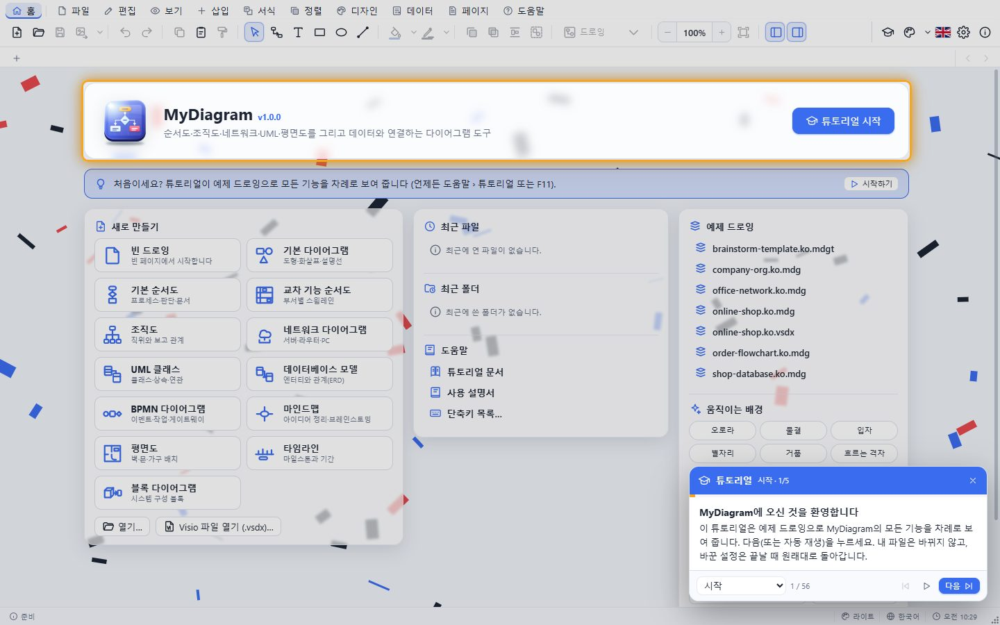

| Area | Contents |
|---|---|
| Top | Program name and version, **Start the tutorial**. Until the tutorial has been finished, a hint banner with a **Start** button shows too |
| **New** | Blank Drawing and 12 templates (see below), **Open…**, **Open Visio file (.vsdx)…** |
| **Recent files** · **Recent folders** | The last 10 files and 10 folders. ✕ removes one entry, **Clear all** · **Clear all folders** remove them all |
| **Help** | **Tutorial document**, **User's guide**, **Keyboard shortcuts…** |
| **Sample drawings** | The installed samples in the current language (online shop, order flowchart, company org chart, office network, shop database, the online shop as a Visio file, a brainstorming template) |
| **Moving background** | Pick one of 20 animations, **Change moving background** (random), **Background image…**, **Motion speed**, **Random at start**, **Auto change** (Off, every 15 s … 5 min) |
| Bottom | **Show the start page when starting** check box |

Right-clicking an empty part of the start page offers New drawing · Open… · Recent files… · Change moving background · Background image… · Tutorial · About….

### Templates

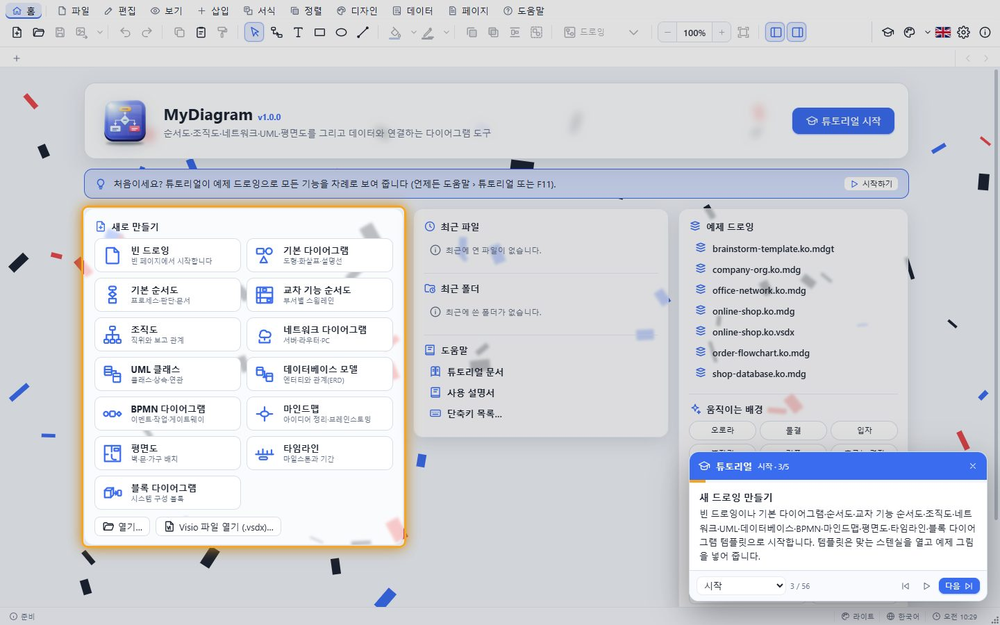

| Template | Starts with |
|---|---|
| **Blank Drawing** | An empty page (Basic Shapes, Arrows and Callouts & Text stencils) |
| **Basic Diagram** | Shapes, arrows, callouts |
| **Basic Flowchart** | Processes, decisions, documents |
| **Cross-Functional Flowchart** | Swimlanes per department |
| **Organization Chart** | Positions and reporting lines |
| **Network Diagram** | Servers, routers, PCs |
| **UML Class** | Classes, inheritance, associations |
| **Database Model** | Entities and relationships (ERD) |
| **BPMN Diagram** | Events, tasks, gateways |
| **Mind Map** | Ideas and brainstorming |
| **Floor Plan** | Walls, doors, furniture |
| **Timeline** | Milestones and intervals |
| **Block Diagram** | System building blocks |

A template opens the stencils that suit it and starts with a small example. A drawing made from a template asks for a new file name the first time it is saved. A blank drawing uses the theme, paper, orientation, units and connector style of **Settings › New drawings**.

### The sample drawing

The "Online shop operations" sample has three pages: an order flowchart in swimlanes with shape data, a comment, a hyperlink and a "Notes" layer; an org chart; and a server diagram with a group. Every page uses a background page with a border and a title block whose fields fill themselves in.

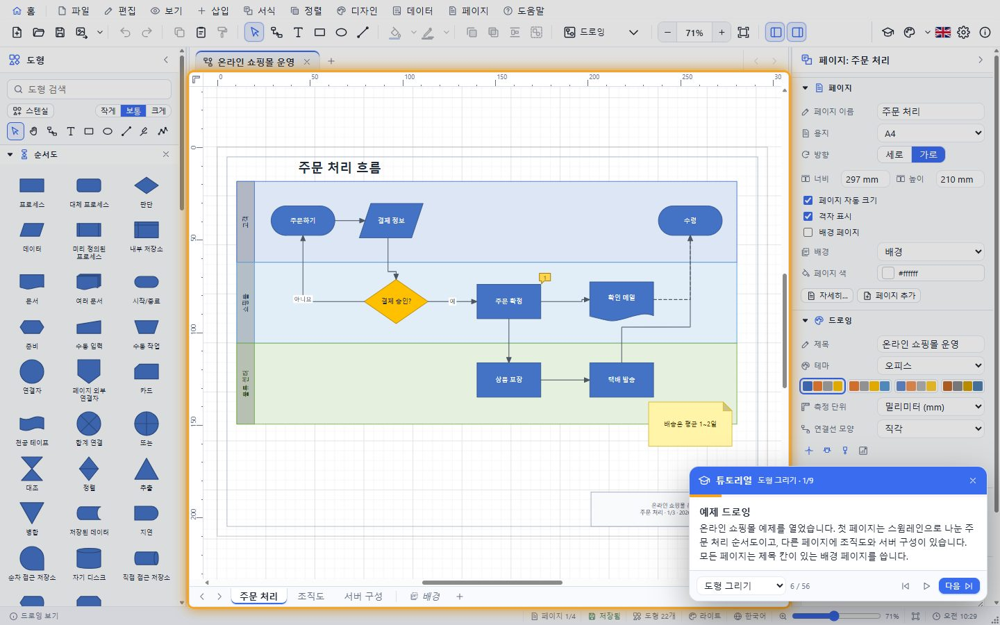

### Tutorial

Start it with **Help › Tutorial** (F11), the graduation-cap toolbar button or **Start the tutorial** on the start page. It opens a sample drawing of its own and shows the features one by one in 56 steps.

- Move with **Next** · **Previous step**, or press **Auto play** (▶).
- **Choose a chapter** jumps to Getting started · Drawing shapes · Connecting · Formatting · Arranging · Pages & layers · Data & reports · Files & printing · Customizing · Help.
- The tour card can be dragged. **Esc** or ✕ ends the tutorial.
- Your drawings are not changed (the tutorial's own tab is closed at the end), and the settings it changes (theme, language, background…) are put back.

**Tutorial document** — a document with every tutorial step and its screen can be read inside the program. Open it from **Help › Tutorial document** on the home screen or in the **Help** menu: it fills the middle of the window, and the bar on top jumps to a chapter (**Go to chapter**), switches 한국어/English, starts the tutorial (**Start tutorial**) or opens the document in a browser (**Open in browser**). **Home** takes you back.

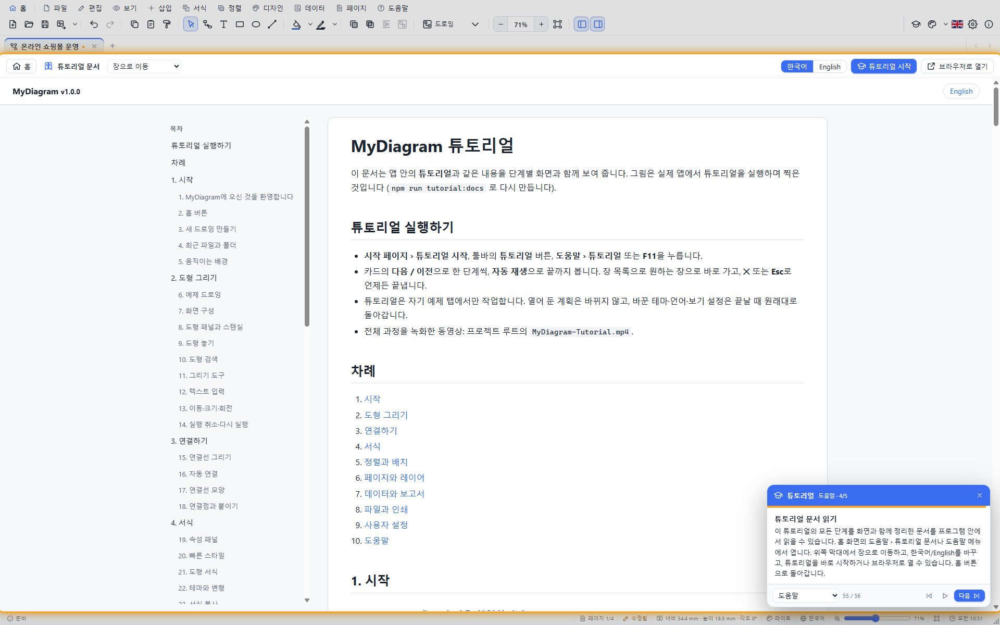

## The window

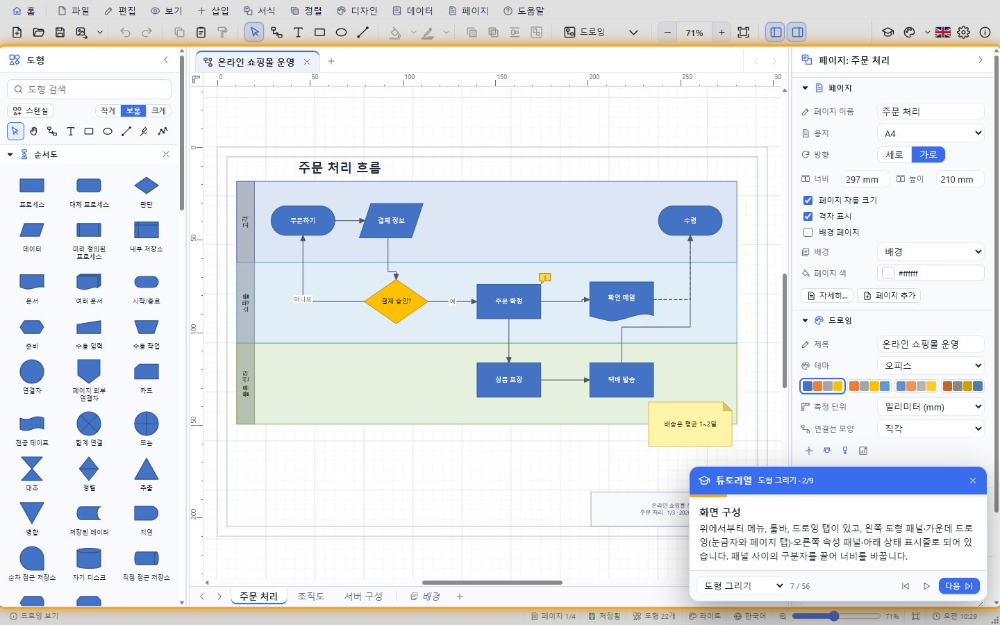

From the top: the **menu bar** and the **toolbar** (one line), then the **drawing tabs**. Under them the **Shapes** panel is on the left, the drawing in the middle (with rulers, the page and the page tabs at the bottom) and the **Properties** panel on the right; the **status bar** is at the bottom. Drag the separators between the panels to resize them, and the bottom-right corner to resize the window. The window never gets narrower than the toolbar and menus need.

### Menu bar

The **Home** button at the start of the menu bar (`Ctrl+Shift+H`) goes back to the start page at any time; open drawings stay in their tabs. Long menus are grouped into submenus (▸).

| Menu | Commands |
|---|---|
| **File** | New drawing · Open… · Start page · Recent files… · Recent folders · Clear all recent files and folders · Save · Save as… · Save all · Save as template… · Open from database… · Save to database (desktop app) · Open Visio file (.vsdx)… · Export ▸ (Save as Visio (.vsdx)… · Export as PDF… · Export as SVG (current page)… · Export as picture (PNG, JPEG, SVG…)… · Export as web page (.html)… · Export shape data to CSV…) · Print… · Document properties… · Close tab · Close all tabs · Exit |
| **Edit** | Undo · Redo · Cut · Copy · Paste · Duplicate · Delete · Select ▸ (Select all · Select shapes · Select connectors · Select same master · Clear selection) · Find… · Replace… · Go to page · Format painter |
| **View** | Switch view ▸ (Drawing · Pages · Shape sheet · Shape data · Shape reports) · Switch view · Zoom ▸ (Zoom in · Zoom out · Zoom 100% · Fit page · Fit width · Zoom to selection) · Show ▸ (Rulers · Grid · Guides · Page breaks · Connection points · Pan & zoom window · Show/hide tool panel · Show/hide properties panel · Status bar) · Snap & glue ▸ (Snap to grid · Smart guides (snap to shapes) · Glue to shapes · AutoConnect arrows) · Presentation mode · Theme, language and background ▸ (Random theme · Choose theme · Switch language · Change moving background · Background image… · Turn background off) |
| **Insert** | Drawing tools ▸ (Pointer · Pan · Connector · Text · Rectangle · Ellipse · Line · Pencil (freeform) · Polyline) · Insert text box · Insert picture… · Insert container · Insert callout · Hyperlink… · Add comment · Insert field · Borders & title (background page) · Save selection to My Shapes… · Manage my shapes… |
| **Format** | Format shape… · Quick styles… · Fill color · Line ▸ (Line color · Line weight · Line pattern · Begin arrow · End arrow) · Text ▸ (Bold · Italic · Underline · Strikethrough · Align text left · Center text · Align text right · Text top · Text middle · Text bottom · Increase font size · Decrease font size · Font color) · Shadow · Connector ▸ (Right-angle connector · Straight connector · Curved connector · Reverse ends · Reset connector · Line jumps · Route connectors around shapes) · Clear formatting (back to the theme) |
| **Arrange** | Order ▸ (Bring to front · Send to back · Bring forward · Send backward) · Align & distribute ▸ (Align left · Align center · Align right · Align top · Align middle · Align bottom · Distribute horizontally · Distribute vertically · Same size) · Rotate & flip ▸ (Rotate right 90° · Rotate left 90° · Flip horizontal · Flip vertical) · Group · Ungroup · Size & position… · Protection… · Re-layout page… · Auto align & space |
| **Design** | Themes & variants… · Next variant · Quick styles… · Line jumps · Route connectors around shapes · Glue to shapes · Borders & title (background page) · Assign background page |
| **Data** | Shape data… · Show data on shape · Data graphics on all shapes · Link data to shapes… · Export shape data to CSV… · Org chart from data… · Flowchart from a list… · Shape data (view) · the six reports (Inventory · Shape data · Connections · Pages · Layers · All text) · Export report ▸ · Copy report |
| **Page** | Insert page · Add background page · Duplicate page · Rename page… · Delete page · Previous page · Next page · Go to page · Page setup… · Layers… · Auto size page · Assign background page · Pages (view) |
| **Help** | Tutorial · Tutorial document · User's guide · Keyboard shortcuts… · Settings… · About… |

Every menu item shows an icon and its shortcut, and menus may extend outside the main window. Commands that cannot be used right now are dimmed; toggles (Rulers, Grid, Snap to grid…) show a check mark when on.

### Toolbar

| Where | Buttons |
|---|---|
| Left | New drawing · Open · Save · Export + ▾ │ Undo · Redo │ Copy · Paste · Format painter │ Pointer · Connector · Text · Rectangle · Ellipse · Line │ Fill color ▾ · Line color ▾ │ Bring to front · Send to back · Align · Group │ Switch view (current view name ▾) │ Zoom `[−] 100% [+]` · Fit page │ Show/hide tool panel · Show/hide properties panel |
| Right | Tutorial (graduation cap) · Random theme + ▾ · Switch language (flag) · Settings · About (ⓘ) |

The **Export** button opens Export as picture (PNG · JPEG · WebP · BMP · TIFF · SVG; a transparent background can be chosen for the formats that support it), and its ▾ lists every export format: Visio, PDF, SVG, picture, HTML and shape data (CSV). Every button has a tooltip with its shortcut. The Undo and Redo tooltips say what will be undone (for example "Undo: Move"). The left half of **Fill color** and **Line color** applies the colour used last (shown by the bar under the icon); the ▾ opens the colour picker.

### Drawing tabs

Each drawing gets a tab. When there are many, scroll them with the arrows at the right; `Ctrl+Tab` goes to the next tab (`Ctrl+Shift+Tab`: previous). The **+** after the tabs creates a new blank drawing. A drawing with unsaved changes shows ● on its tab. Right-click a tab for Save · Save as… · Save as template… · Document properties… · Print… · Close tab · Close all tabs · New drawing.

### Shapes panel (left)

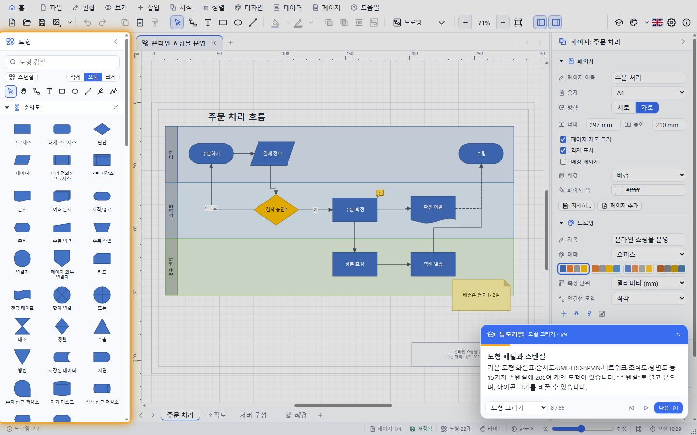

| Part | Contents |
|---|---|
| Search box | **Search shapes** finds shapes in every stencil by name, in Korean or English |
| **Stencils** | Opens or closes each of the 15 stencils and **My shapes**; **Open all stencils** · **Close all stencils** |
| **S** · **M** · **L** | **Shape icon size**: Small (icons only) · Medium · Large |
| Tool strip | The nine drawing tools (see [Drawing tools](#drawing-tools)) |
| Stencils | Each open stencil with its shapes. Click a stencil's name to collapse it, ✕ to close it |

Right-click a shape tile for **Add to page** and **Close stencil**. See [Drawing shapes](#drawing-shapes) for the stencils.

### Properties panel (right)

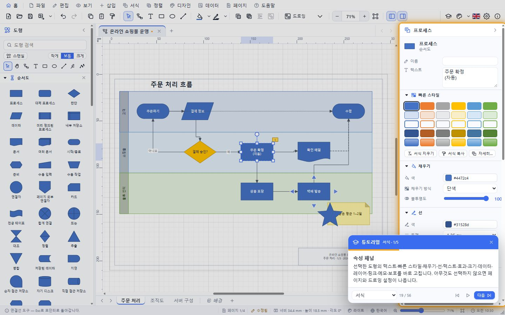

Shows the properties of the selection and lets you change them in place. Changes apply at once; `Ctrl+Z` undoes them. Click a section heading to open or close it.

| Selection | Shown |
|---|---|
| Nothing | **Page**: page name, paper, orientation, width, height, Auto size page, Show grid, Background page, the background page used, page color, **More…** (Page setup) · **New page**. **Drawing**: title, theme and its 4 variants, units, connector style, Line jumps · Route connectors around shapes · Glue to shapes · Data graphics on all shapes, **Themes** · **Properties**. **Layers** with visible / lock buttons. **Comments** on the page. The shape, connector and page counts |
| One shape | Master and stencil, name, text, the shape's own adjustments (corner rounding, arrow head length…), **Quick style**, **Fill**, **Line**, **Text**, **Effects**, **Size & position**, **Shape data**, **Layers**, **Hyperlink**, **Comments**, **Protection**; a picture also has **Change picture…** |
| A connector | From and To (the shape and the point it is glued to, "Whole shape (dynamic)" or "Not glued"), text, **Route** (right-angle · straight · curved, Reverse ends, Reset connector, Line jumps on this connector), **Arrows** (Begin, End, Arrow size), **Line**, **Text**, **Shape data**, **Layers**, **Comments** |
| A group | Name, text, **Ungroup**, size, data, layers, link, comments |
| Several shapes | Selection size, the align · distribute · same size · group · order buttons, **Quick style**, **Fill**, **Line**, **Text** |

### Status bar

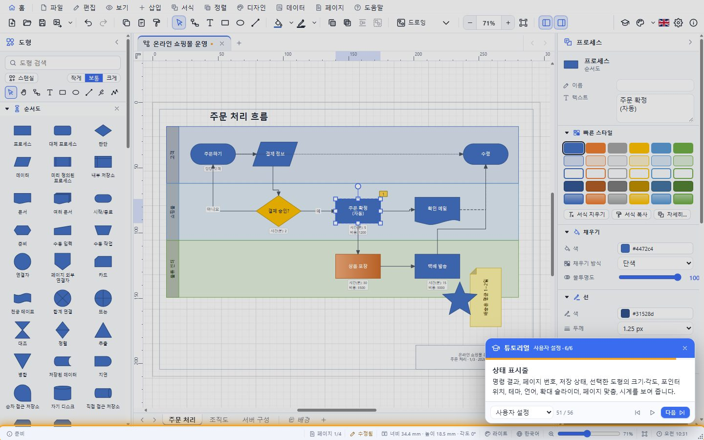

From the left: the result of the last command (e.g. "Moved 3 shapes (20 mm, 0 mm)"), **Page 1 of 3** (click for a list of pages), Saved / Modified, the size and angle of the selected shape (or how many items are selected, or how many shapes the page has), the pointer position from the top left of the page, the current drawing tool when it is not the pointer (click to go back to the pointer), the theme name, the language, the zoom slider and percentage, **Fit page** and a clock. **View › Show › Status bar** hides or shows it. Right-click it for Status bar · Zoom in · Zoom out · Zoom 100% · Fit page · Random theme · Switch language.

### Right-click menus

Each place has its own menu, with a header naming what it is for.

| Where | Menu |
|---|---|
| Shape | Edit text (F2) · Open link (when it has one) · Cut · Copy · Paste · Duplicate · Delete · Format shape… · Quick styles… · Text ▸ · Order ▸ · Rotate & flip ▸ · Ungroup (groups) · Shape data… · Show data on shape · Hyperlink… · Add comment · Save selection to My Shapes… · Size & position… · Protection… |
| Connector | Edit label (F2) · Right-angle / Straight / Curved connector · Begin arrow · End arrow · Line weight · Line pattern · Line color · Reverse ends · Reset connector · Cut · Copy · Delete · Format shape… · Shape data… · Add comment |
| Several shapes | Cut · Copy · Duplicate · Delete · Group · Ungroup · Align & distribute ▸ · Order ▸ · Rotate & flip ▸ · Format shape… · Quick styles… · Re-layout page… · Save selection to My Shapes… |
| Empty page | Paste (at the pointer) · Select all · Drawing tools ▸ · Insert text box · Insert picture… · Insert container · Page setup… · Layers… · Themes & variants… · Zoom in · Zoom out · Fit page · Show ▸ (on a guide: **Delete guide**) |
| Page tab | Insert page · Add background page · Duplicate page · Rename page… · Delete page · Page setup… · Assign background page · Layers… · Move left · Move right |
| Drawing tab | Save · Save as… · Save as template… · Document properties… · Print… · Close tab · Close all tabs · New drawing |
| Report | The six reports · Export report ▸ · Copy report |
| Status bar | Status bar · Zoom in · Zoom out · Zoom 100% · Fit page · Random theme · Switch language |
| Text field | Undo typing · Cut · Copy · Paste · Select all |

### Popup windows

Windows such as Format shape, Settings and Print preview are separate windows in the desktop app. They can be moved outside the main window and close with it. In the web version and during the tutorial they float inside the main window.

## Drawing shapes

### Stencils

The Shapes panel holds about 200 shapes in 15 stencils. Open and close them under **Stencils**; each drawing remembers its own stencils.

| Stencil | Shapes |
|---|---|
| **Basic Shapes** (35) | Rectangle, square, rounded rectangle, ellipse, circle, triangles, diamond, pentagon … decagon, parallelogram, trapezoid, stars, cross, cylinder, cube, cloud, heart, donut, moon, frame, L-shape, plaque, smiley face, lightning bolt, sun, wave, text, line |
| **Arrows** (14) | Right / left / up / down, left-right, up-down, quad, chevron, pentagon, notched, striped, bent, U-turn and circular arrows |
| **Flowchart** (30) | Process, alternate process, decision, data, predefined process, internal storage, document, multiple documents, start/end, preparation, manual input / operation, connector, off-page reference, card, punched tape, summing junction, or, collate, sort, extract, merge, stored data, delay, sequential data, magnetic disk, direct access storage, display, loop limit, annotation |
| **Callouts & Text** (12) | Rectangular, rounded, oval, cloud and line callouts, sticky note, title, braces, bracket, banner, scroll |
| **Containers & Swimlanes** (6) | Container, group frame, horizontal and vertical swimlanes, pool (cross-functional), phase separator |
| **UML** (16) | Class, interface, actor, use case, package, component, node, note, lifeline, activation, states, fork / join, object, decision node |
| **Database (ERD)** (6) | Entity, weak entity, relationship, attribute, key attribute, view |
| **BPMN** (16) | Start / intermediate / end / timer / message events, task, sub-process, call activity, exclusive / parallel / inclusive / event-based gateways, data object, data store, message, group |
| **Network** (18) | Server, desktop PC, laptop, monitor, router, switch, firewall, cloud, database server, printer, mobile phone, tablet, wireless access point, hub, internet, storage (NAS), user, rack |
| **Org Chart** (7) | Executive, manager, position, assistant, consultant, vacancy, photo card |
| **Mind Map & Brainstorming** (6) | Central topic, main topic, subtopic, floating topic, idea, underlined topic |
| **Floor Plan** (15) | Wall, room, door, double door, window, tables, chair, sofa, bed, desk, plant, stairs, toilet, sink |
| **Block Diagram** (9) | Block, 3-D block, stacked layers, pyramid, funnel, target, gear, tag, ring |
| **Timeline** (5) | Timeline bar, milestone marker, interval block, today marker, event pin |
| **Electrical** (11) | Resistor, capacitor, inductor, battery, ground, switch, lamp, diode, DC and AC sources, transistor |

### Placing shapes

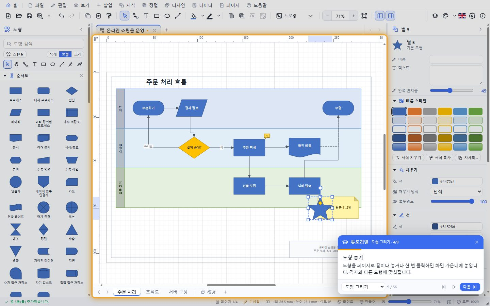

- Drag a shape from the Shapes panel onto the page, or click it to place it in the middle of the view.
- New shapes snap to the grid (**View › Snap & glue › Snap to grid**) and, while you drag, to other shapes.
- A shape dropped onto a container joins it, and moving the container carries the shapes inside it.
- Each new shape goes onto the active layer (see [Layers](#layers)).
- Without an open drawing, placing a shape creates a new one.

### Searching shapes

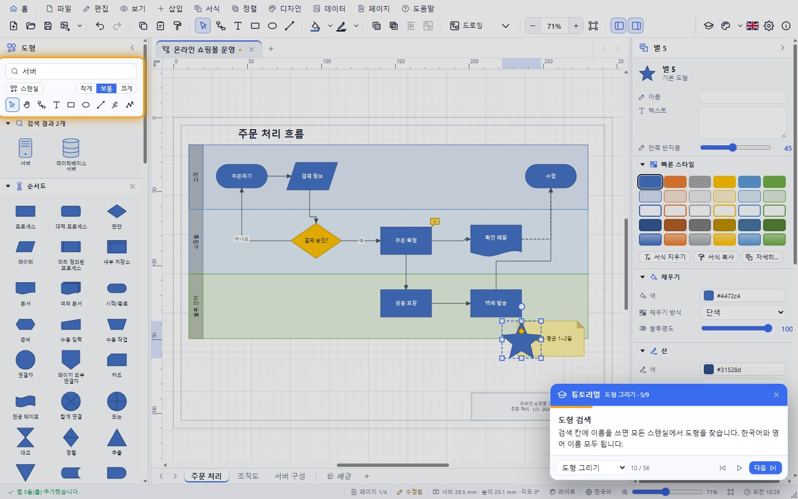

Type part of a name into **Search shapes** at the top of the Shapes panel. The results ("12 results") come from every stencil, open or not, and can be dragged or clicked like any other shape. Names can be typed in Korean or English. Clear the box to see the stencils again.

### Drawing tools

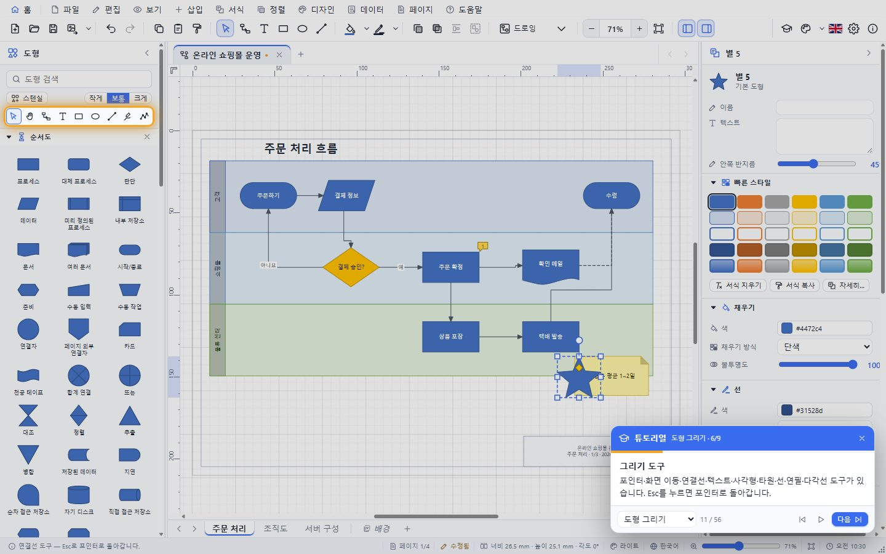

The tools are on the tool strip of the Shapes panel, the toolbar (the first six) and **Insert › Drawing tools**. While a tool other than the pointer is active, the status bar names it; `Esc` returns to the pointer.

| Tool | Shortcut | Use |
|---|---|---|
| **Pointer** | `Ctrl+1` | Select, move, resize, rotate, edit |
| **Pan** | `Ctrl+Shift+Space` | Drag to move the view |
| **Connector** | `Ctrl+3` | Drag from one shape to another (see [Connectors](#connectors)) |
| **Text** | `Ctrl+2` | Drag a box and type |
| **Rectangle** | `Ctrl+8` | Drag a rectangle (`Shift`: a square) |
| **Ellipse** | `Ctrl+9` | Drag an ellipse (`Shift`: a circle) |
| **Line** | `Ctrl+6` | Drag a straight line (`Shift`: horizontal or vertical); its ends glue to shapes like a connector |
| **Pencil (freeform)** | `Ctrl+4` | Draw freehand; the line is smoothed when you let go |
| **Polyline** | `Ctrl+5` | Click point after point; double-click, right-click or `Enter` finishes, clicking the first point closes the shape, `Esc` cancels |

### Moving, sizing and rotating

- Click a shape to select it; `Shift`+click or `Ctrl`+click adds to the selection, and dragging over an empty area selects everything inside the box. **Edit › Select** also selects all shapes, all connectors or all shapes of the same master.
- Drag to move. Pink **smart guides** show when edges or centres line up with other shapes, and the shape snaps to them (**View › Snap & glue › Smart guides (snap to shapes)**).
- The white squares resize, the circle above the shape rotates, and the yellow diamonds change the shape itself (corner rounding, arrow head, slant, ring width…).
- `Shift` while dragging: move straight, resize keeping proportions, rotate in 15° steps. `Alt`: no snapping (and resize from the centre). `Ctrl`+drag on a selected shape drags a copy.
- Arrow keys nudge the selection by one grid step, `Shift`+arrow by 1 pixel.
- Exact numbers: the **Size & position** section of the properties panel or **Arrange › Size & position…** (X, Y, width, height, angle, flip). Lengths can be typed with a unit, e.g. `25 mm`.

### Copy, paste and duplicate

- `Ctrl+C` · `Ctrl+X` · `Ctrl+V` copy and move shapes together with the connectors between them. Each paste lands a little further down and to the right; **Paste** from the page's right-click menu pastes at the pointer.
- **Duplicate** (`Ctrl+D`) makes a copy next to the selection in one step.
- Text copied from another program is pasted as a text box.
- **Delete** (`Delete`) removes the selection. Shapes protected with **Lock deletion** are skipped.

### Undo and redo

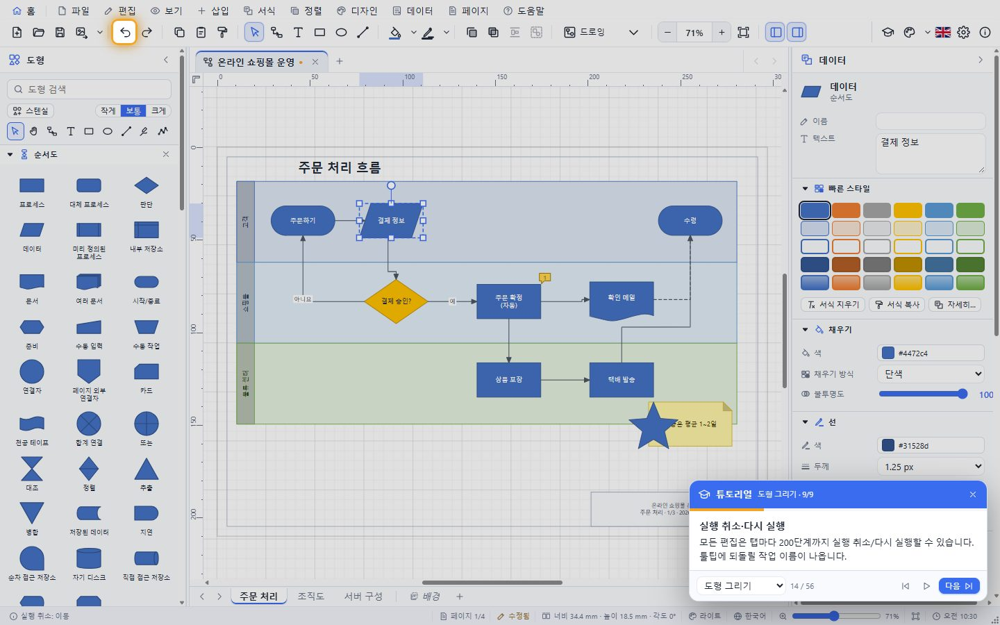

Every edit is undone with `Ctrl+Z` and redone with `Ctrl+Y` (or `Ctrl+Shift+Z`), and the last 200 edits of each tab can be undone. Each tab (drawing) has its own history, and the status bar and the tooltips name the edit ("Undo: Format").

### Pictures, containers, callouts and comments

| Command | What it does |
|---|---|
| **Insert › Insert text box** | A text box in the middle of the view, ready for typing |
| **Insert › Insert picture…** | A picture (png · jpg · gif · webp · bmp · svg …) as a shape, scaled down to fit. **Change picture…** in the properties panel replaces it. Dropping a picture file on a drawing inserts it too |
| **Insert › Insert container** | A container around the selected shapes (or an empty one), placed behind them. Moving it moves what is inside |
| **Insert › Insert callout** | A rounded callout next to the selected shape with its tail pointing at it |
| **Insert › Add comment** | Opens the **Comments** section of the properties panel. Write a comment on the selected shape or, with nothing selected, on the page, then **Add comment** (`Ctrl+Enter`). Comments can be marked resolved, reopened and deleted; a marker on the page shows shapes with comments |
| **Insert › Hyperlink…** (`Ctrl+K`) | Links a shape to a web address or file, or to a page in this drawing. `Ctrl`+click the shape, or click it in presentation mode, to follow the link |

### My shapes

Select shapes and choose **Insert › Save selection to My Shapes…** to keep them under a name. The **My shapes** stencil holds them and they can be used in every drawing. **Insert › Manage my shapes…** inserts, renames or deletes them.

## Connectors

### Drawing connectors

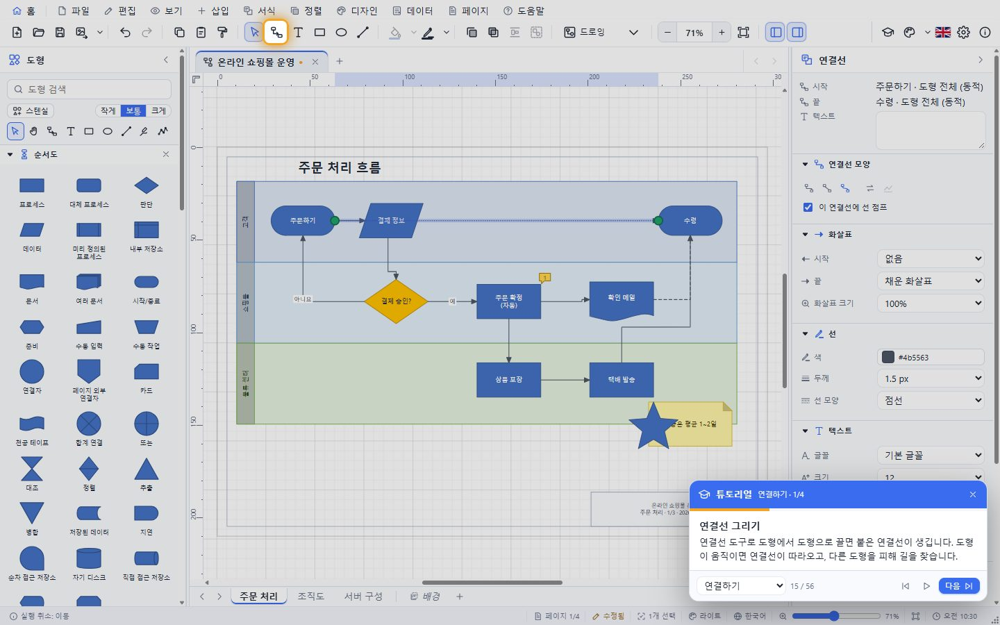

With the **Connector** tool (`Ctrl+3`), drag from one shape to another to make a glued connector. It follows when the shapes move and is routed around other shapes in the way. Releasing over empty space leaves that end free.

### AutoConnect

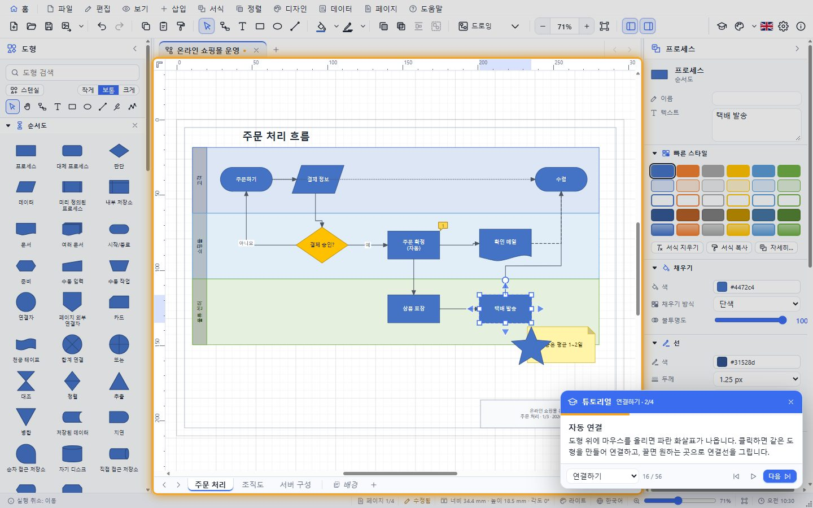

With the pointer, hover over a shape to see four blue arrows. Click one to add a copy of the shape on that side, connected to it (or to connect to the shape already there); drag one to draw a connector anywhere. **View › Snap & glue › AutoConnect arrows** turns them on and off.

### Connection points and glue

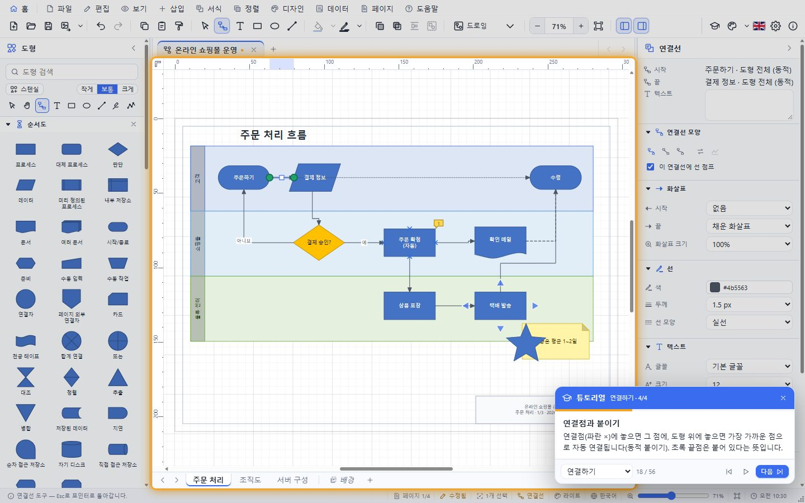

- Drop a connector end on a **connection point** (blue ×) to glue to that point: the connector leaves the shape straight out of that side.
- Drop it anywhere else on the shape for **dynamic glue**: the connector picks the pair of points that face each other and changes them as shapes move.
- A glued end is green, a free end is not. `Alt` while dragging an end does not glue.
- **View › Show › Connection points** shows the points of every shape; **Glue to shapes** (View › Snap & glue, Design menu, page setup) turns gluing off for the drawing.

### Connector styles and bends

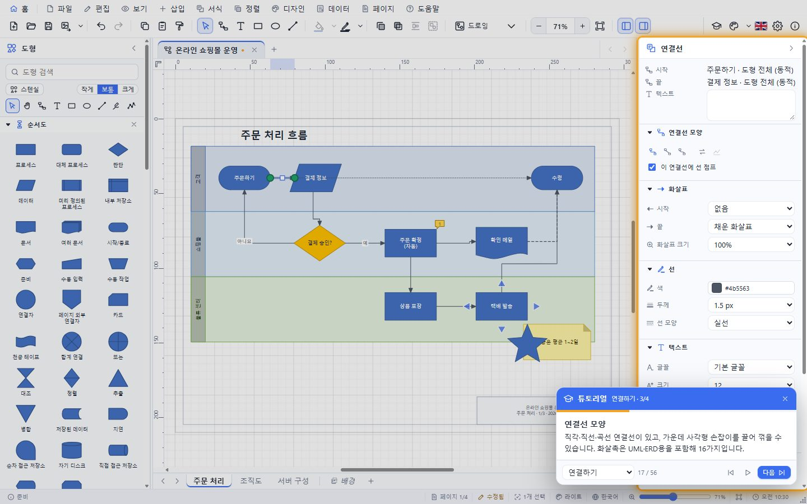

| Style | Drawn as |
|---|---|
| **Right-angle connector** | Horizontal and vertical segments, routed around shapes |
| **Straight connector** | One straight line between the ends |
| **Curved connector** | A smooth curve |

- Change the selected connectors with **Format › Connector**, the right-click menu or the **Route** buttons of the properties panel. With no connector selected, these commands set the style of new connectors in this drawing ("New connectors: Right-angle"); **Settings › New drawings › Connector style** sets it for new drawings.
- Drag the square handles on a connector's segments to bend it; double-click a bend handle to remove it. **Reset connector** removes all manual bends.
- **Reverse ends** swaps the start and the end (and their arrows).
- **Line jumps** draw a small hop where a connector crosses one drawn before it; the jump size is in **Page setup › Layout & routing**, and **Line jumps on this connector** turns them off for one connector.
- **Route connectors around shapes** can be turned off for the drawing; connectors then take the shortest route.
- The connector's label is typed with `F2` or a double-click and can be dragged along the line.

### Arrows and line patterns

Set the **Begin** and **End** arrowheads and **Arrow size** (60–200%) in the properties panel, **Format › Line › Begin arrow / End arrow** or the **Arrows** tab of Format shape. There are 16 arrowheads:

None · Filled arrow · Open arrow · Stealth arrow · Hollow triangle (inheritance) · Filled diamond (composition) · Hollow diamond (aggregation) · Filled circle · Hollow circle · Bar · One (ERD) · Many (crow’s foot) · One or many (ERD) · Zero or many (ERD) · Zero or one (ERD) · One and only one (ERD)

Line patterns: Solid · Dash · Dot · Dash dot · Long dash · Dash dot dot.

## Text and formatting

### Typing text

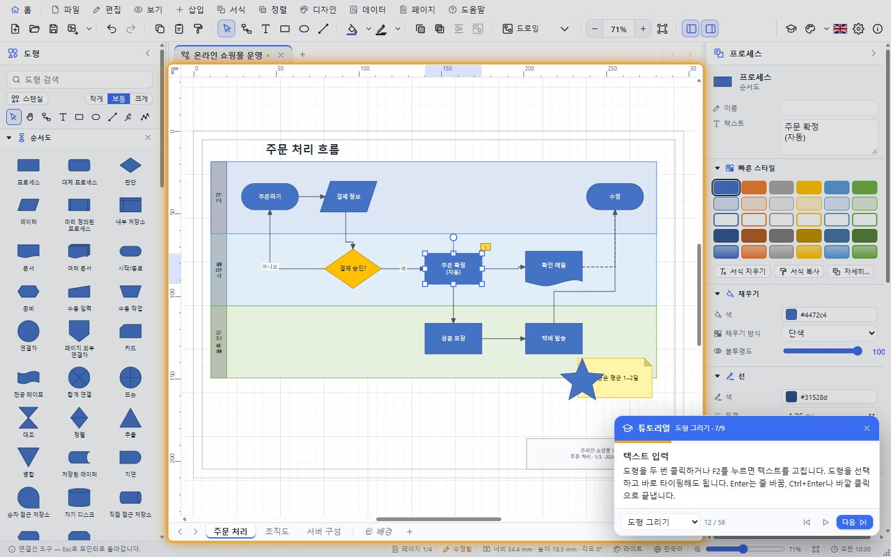

- Double-click a shape or press `F2` to edit its text — or just start typing with the shape selected (the typing replaces its text).
- `Enter` starts a new line; `Ctrl+Enter`, `Tab` or a click outside finishes; `Esc` cancels.
- A group without text of its own edits the member under the pointer.
- Text locked with **Lock text** cannot be edited.

### Fonts and text formatting

| Command | Where |
|---|---|
| Font, size, colour | **Text** section of the properties panel, **Format › Text › Font color**, Format shape › **Text** |
| Bold · Italic · Underline · Strikethrough | `Ctrl+B` · `Ctrl+I` · `Ctrl+U`, **Format › Text** |
| Increase / Decrease font size | `Ctrl+Shift+>` · `Ctrl+Shift+<` |
| Horizontal alignment | Align text left · Center text · Align text right |
| Vertical alignment | Text top · Text middle · Text bottom |
| Text direction | 0° · 90° · 180° · 270° |
| Line spacing, text margin | Format shape › **Text** |

### The properties panel

The sections of the properties panel format the selected shapes at once:

| Section | Fields |
|---|---|
| **Quick style** | The theme's six colours in five styles; **Clear**, **Painter** and **More…** (Format shape) |
| **Fill** | Color, **Fill type** (Solid · Linear gradient · Radial gradient · Hatch · Cross · Dots · No fill), **Second color** for gradients and patterns, **Opacity** |
| **Line** | Color, **Weight** (0.5–8 px), **Pattern**, **Rounding** of corners |
| **Text** | Font, size, colour, bold · italic · underline · strikethrough, horizontal and vertical alignment, **Text direction** |
| **Effects** | **Shadow**, **Opacity (whole shape)** |
| **Protection** | Lock position · Lock size · Lock rotation · Lock deletion · Lock text · Lock aspect ratio |

### Format shape

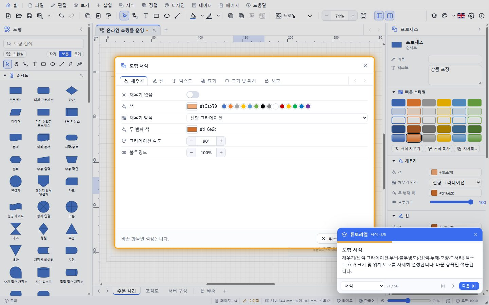

**Format › Format shape…** (or **More…**) fine-tunes the selection in one window. Only what you change is applied, so several different shapes keep their other properties; OK applies it as one undo step.

| Tab | Fields |
|---|---|
| **Fill** | No fill, colour (with swatches), fill type, second colour, **Gradient angle**, opacity |
| **Line** | No line, colour, weight, pattern, rounding, **Line opacity** |
| **Arrows** (connectors) | Begin, end, arrow size |
| **Text** | Font, size, colour, **Font style**, **Horizontal alignment**, **Vertical alignment**, text direction, **Line spacing**, **Text margin** |
| **Effects** | Shadow, opacity |
| **Size & position** | X, Y, width, height, angle, flip horizontal / vertical |
| **Protection** | The six locks |

**Arrange › Size & position…** and **Protection…** open this window on those tabs.

### Colours

The colour picker (toolbar ▾, **Format › Fill color**, the colour buttons of the panel) offers **Theme colors** (the current theme's colours), **Standard colors**, **None** and **More colors…**. Colours can also be typed as `#RRGGBB`.

### Quick styles

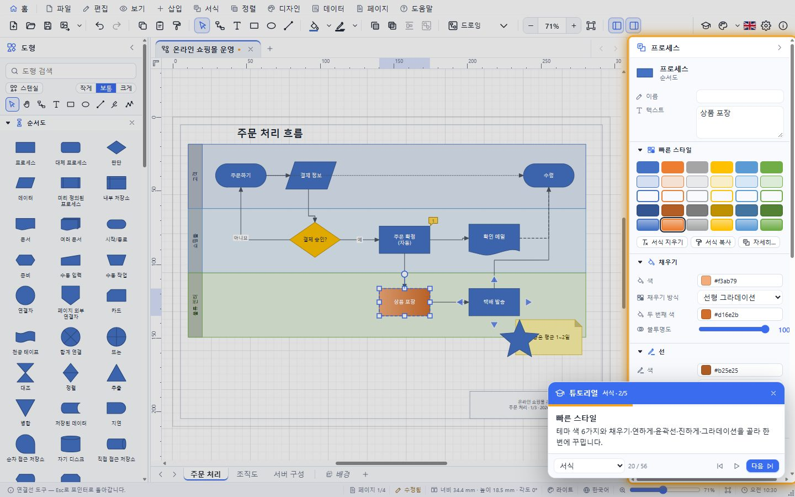

Pick one of the theme's six colours with **Fill**, **Subtle**, **Outline**, **Intense** or **Gradient** in one click — in the **Quick style** section of the properties panel or **Format › Quick styles…** (which also has **Text only**). Quick styles follow the theme: change the theme or variant and the shapes recolour themselves.

### Themes and variants

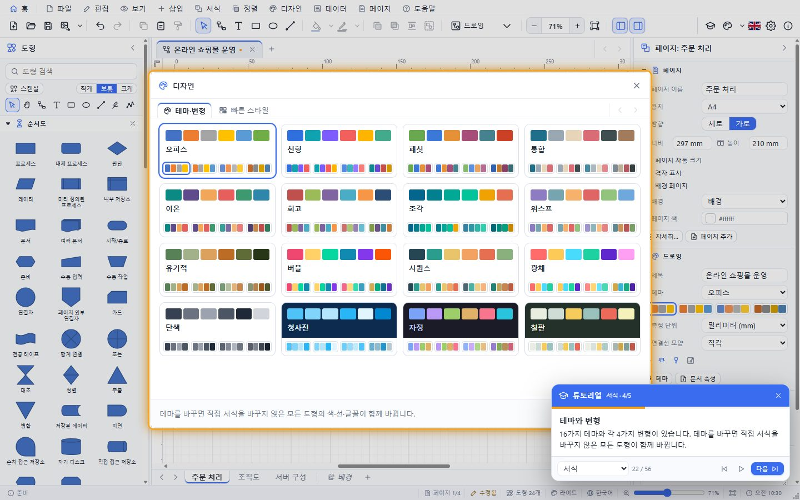

**Design › Themes & variants…** opens the **Design** window. There are 16 themes with 4 variants each:

Office · Linear · Facet · Integral · Ion · Retrospect · Slice · Whisp · Organic · Bubble · Sequence · Radiance · Monochrome · Blueprint · Midnight · Chalkboard

A theme restyles every shape you have not formatted by hand, and sets the page colour. **Design › Next variant** steps through the variants. The theme of a drawing is also in the **Drawing** section of the properties panel, and **Settings › New drawings › Default theme** chooses it for new drawings.

**Clear formatting (back to the theme)** removes the hand formatting from the selected shapes.

### Format painter

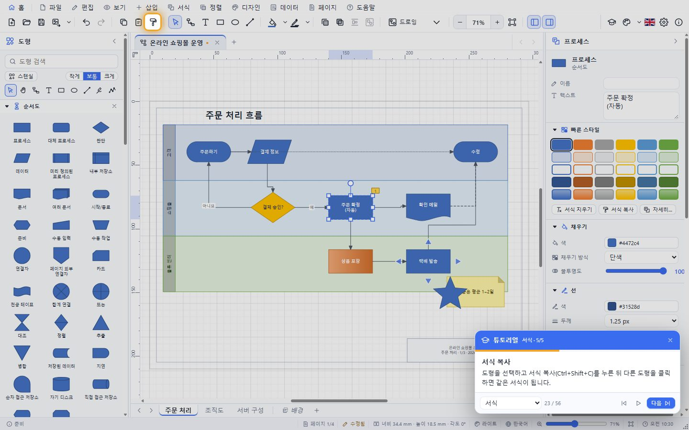

Select a shape, press **Format painter** (`Ctrl+Shift+C`), then click another shape to give it the same formatting. `Esc` (or the button again) cancels.

## Arranging shapes

### Align and distribute

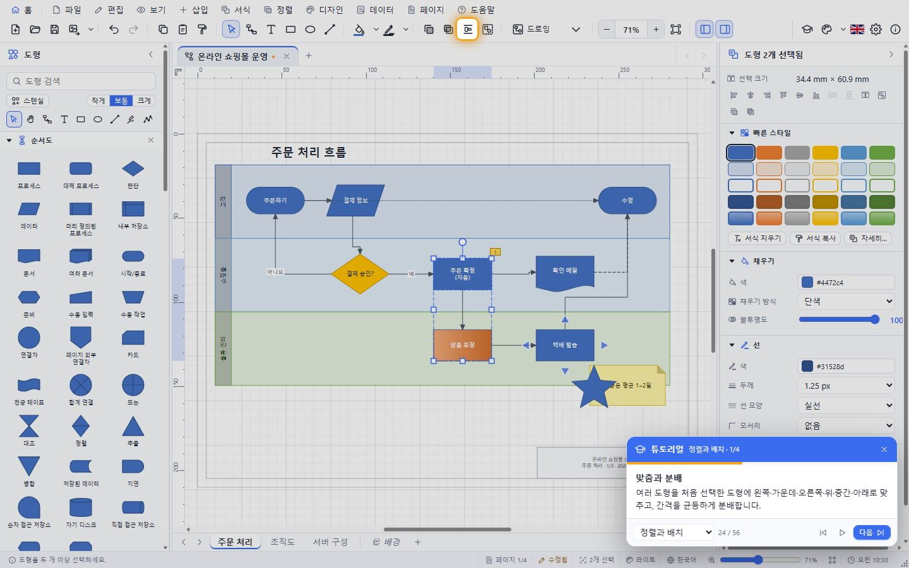

Select two or more shapes and use the toolbar **Align** button, **Arrange › Align & distribute** or the buttons in the properties panel. Shapes are aligned to the first one selected.

| Command | What it does |
|---|---|
| **Align left / center / right** | Lines up the left edges, centres or right edges |
| **Align top / middle / bottom** | Lines up the top edges, middles or bottom edges |
| **Distribute horizontally / vertically** | Spreads three or more shapes evenly |
| **Same size** | Gives every shape the size of the first one |
| **Auto align & space** | Lines up the connected shapes as a top-to-bottom flowchart (the selection, or the whole page) |

### Order

**Bring to front** (`Ctrl+Shift+F`), **Send to back** (`Ctrl+Shift+K`), **Bring forward** and **Send backward** change the stacking order (Arrange › Order, toolbar, right-click menu).

### Rotate and flip

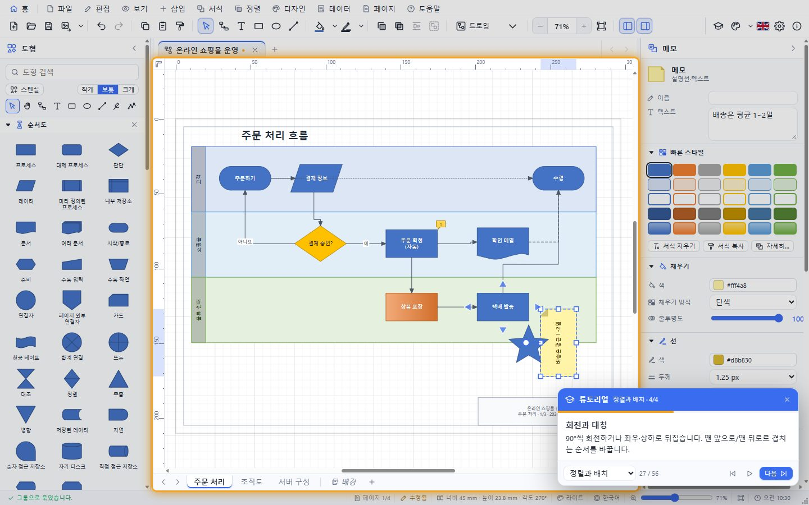

**Rotate right 90°** (`Ctrl+R`), **Rotate left 90°** (`Ctrl+L`), **Flip horizontal** (`Ctrl+J`) and **Flip vertical** (`Ctrl+M`). Any other angle is set with the rotation handle or the **Angle** field of **Size & position**; the status bar shows the current angle.

### Groups

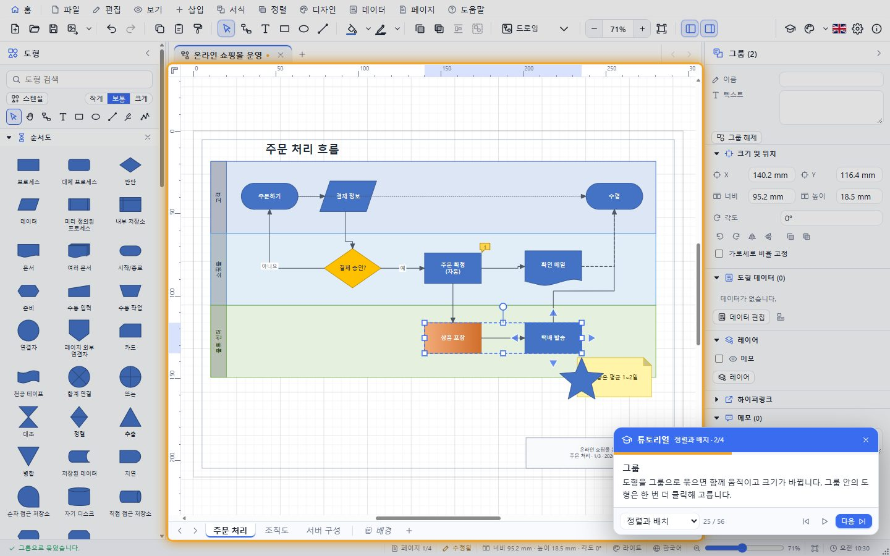

**Group** (`Ctrl+Shift+G`) joins the selected shapes into one group that moves and resizes together; **Ungroup** (`Ctrl+Shift+U`) separates them again. Click a group once to select it and again to pick a shape inside it. A group can have its own name, text, data and link.

### Protection

**Arrange › Protection…** (and the **Protection** section of the panel) locks a shape's position, size, rotation, deletion, text or aspect ratio, so that it cannot be changed by mistake.

### Grid, rulers, guides and snapping

| Command | What it does |
|---|---|
| **View › Show › Rulers** · **Grid** · **Page breaks** | Show the rulers, the grid and where the paper sheets end |
| **View › Show › Guides** | Shows the guides. Drag from a ruler into the page to create a guide; drag it to move it; select it and press `Delete` (or right-click › **Delete guide**) to remove it |
| **View › Snap & glue › Snap to grid** | Shapes snap to the grid |
| **Smart guides (snap to shapes)** | Shapes snap to the edges and centres of other shapes |
| **Settings › Drawing › Grid size** | Fine · Normal · Coarse. **Page setup › Grid spacing** sets a fixed spacing for one page (0 = automatic) |

The ruler corner shows the ruler origin (the top left of the page). Units follow the drawing's **Units** (millimetres, centimetres, inches, points or pixels).

### Zoom and moving around

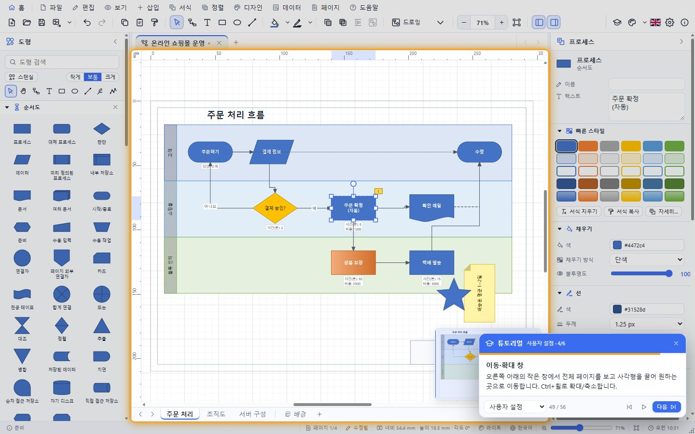

- **Zoom** (10–800%): `Ctrl+mouse wheel`, `Ctrl+=` · `Ctrl+-` · `Ctrl+0`, the toolbar `[−] 100% [+]` (the value can be typed) or the status bar slider. With **Settings › Drawing › Mouse wheel zooms (without Ctrl)** the wheel zooms by itself.
- **Fit page** (`Ctrl+Shift+W`), **Fit width** and **Zoom to selection**.
- Move the view with the scroll bars, the middle mouse button, `Space`+drag or the **Pan** tool.
- **View › Show › Pan & zoom window** shows the whole page in a small window at the bottom right; drag its rectangle to move around.

## Pages, backgrounds and layers

### Several pages

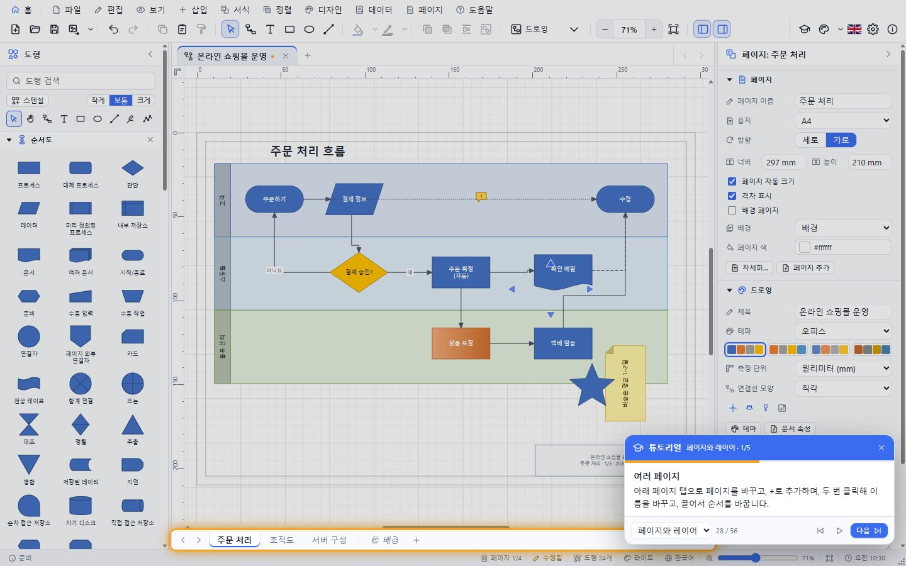

- Switch pages with the tabs under the drawing, the arrows at their left, `Ctrl+PageUp` · `Ctrl+PageDown`, **Page › Go to page** or the page number on the status bar.
- **+** after the tabs or **Page › Insert page** (`Shift+F11`) adds a page; **Duplicate page** copies the current one with its shapes.
- Double-click a tab (or **Rename page…**) to rename it; drag tabs to reorder them, or use **Move left** · **Move right** from the tab's right-click menu.
- **Delete page** removes the current page (asking first when it has shapes). The last page cannot be deleted.

### Background pages

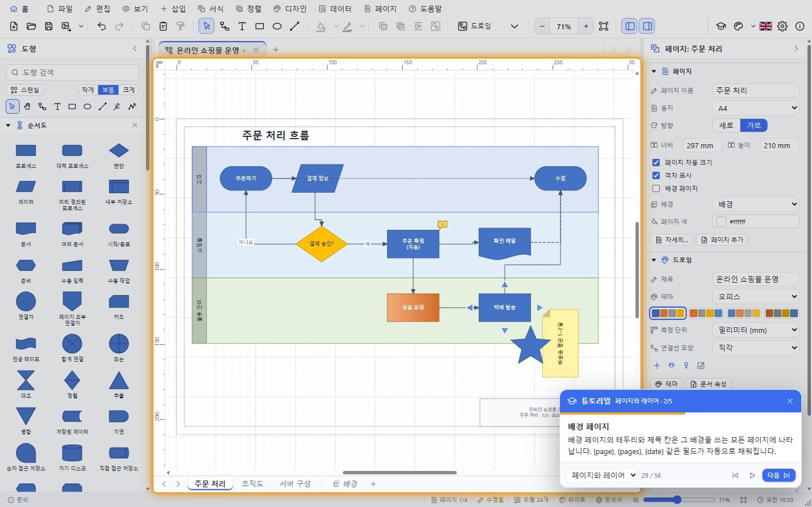

A background page holds what every page using it should show — a border, a title block, a logo. It is drawn behind the page's own shapes and cannot be selected from there.

- **Page › Add background page** creates one; its tab comes after the foreground pages, past a separator. A page becomes a background page with **Background page** in the properties panel or page setup.
- **Page › Assign background page** (or **Background** in the properties panel or page setup) picks the background page of the current page, or None.
- **Insert › Borders & title (background page)** creates a background page with a frame and a title block showing `{title}`, `{pageName} · {page}/{pages} · {date}`, and assigns it to every page that has no background yet.
- Fields such as `{page}`, `{pages}` and `{date}` fill themselves in on each page (see [Fields](#fields)).

### Page setup

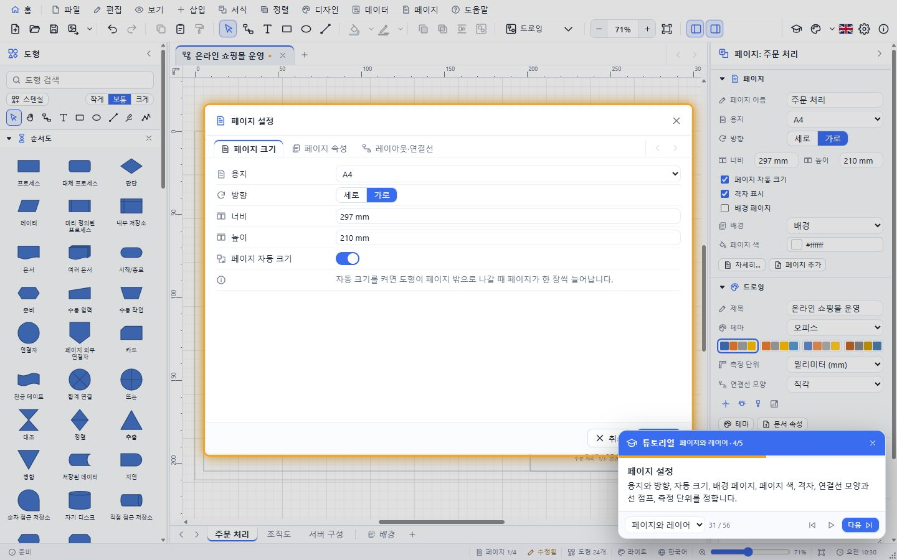

**Page › Page setup…** (or **More…** in the properties panel):

| Tab | Fields |
|---|---|
| **Page size** | **Paper** (A3 · A4 · A5 · B4 · B5 · Letter · Legal · Tabloid · Ledger · Screen · Wide · Custom), **Orientation** (Portrait / Landscape), width and height, **Auto size page** |
| **Page properties** | Page name, **Background page**, **Background** (the background page used), **Page color** and **Theme color** (back to the theme's colour), **Show grid**, **Grid spacing (0 = automatic)** |
| **Layout & routing** | **Connector style**, **Line jumps** and **Line jump size**, **Route connectors around shapes**, **Glue to shapes**, **Snap to grid in this drawing**, **Snap to shapes in this drawing**, **Data graphics on all shapes**, **Units** |

The canvas is endless: the grid runs on in every direction, and scrolling near an edge adds more empty canvas, so you can also draw left of and above the page (negative coordinates). The page shows only as an outline of what prints on one sheet. Exporting to a picture, SVG, PDF or HTML, and printing, save **only the area that holds shapes**.

With **Auto size page** the page grows by whole sheets when shapes go past its edge.

### Layers

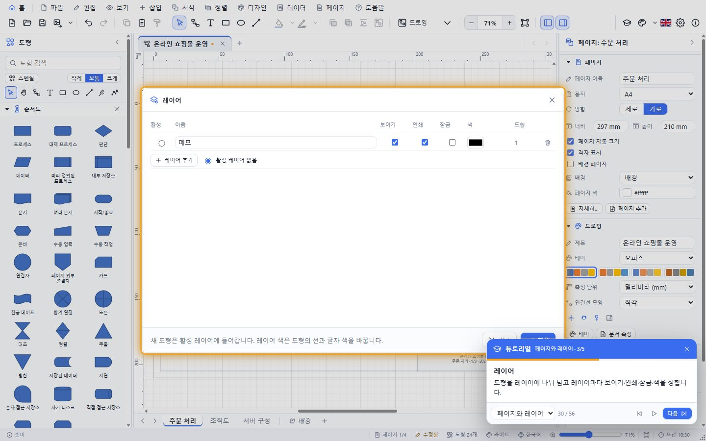

Layers group shapes across the page so that they can be shown, printed, locked or coloured together. Open **Page › Layers…**:

| Column | Meaning |
|---|---|
| **Active** | New shapes go to the active layer (or **No active layer**) |
| **Name** | The layer name |
| **Visible** | Hidden layers are not drawn |
| **Print** | Layers that are not printed are left out of printing and PDF |
| **Lock** | Shapes on a locked layer cannot be selected or changed |
| **Color** | Recolours the lines and text of the layer's shapes; **Clear layer color** removes it |
| **Shapes** | How many shapes are on the layer; the bin deletes the layer |

**New layer** adds one. With shapes selected, the bottom row assigns them to a layer: **Only this layer**, **Add to** or **Remove from**, then **Assign** (applied on OK). A shape can be on several layers; the **Layers** section of the properties panel ticks them, and the page's **Layers** section has quick visible / lock buttons.

### Pages view

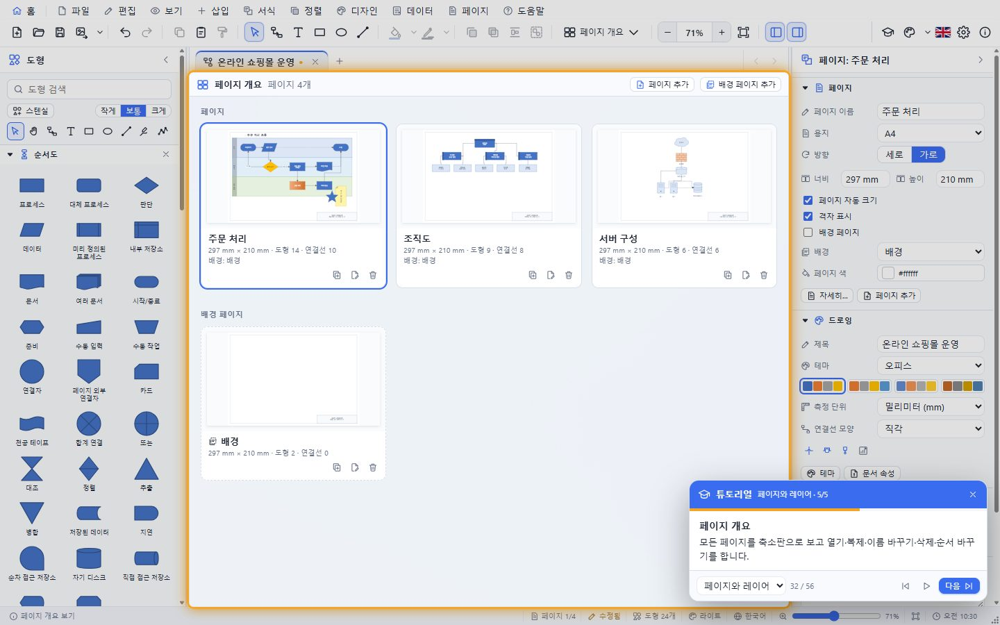

**Page › Pages** (or the **Pages** view) shows every page as a thumbnail with its size and shape and connector counts — foreground pages first, then background pages with the page that uses them. Click to make a page current, double-click to go to the drawing, drag to reorder; the buttons add, duplicate, rename and delete pages.

## Shape data and fields

### Shape data

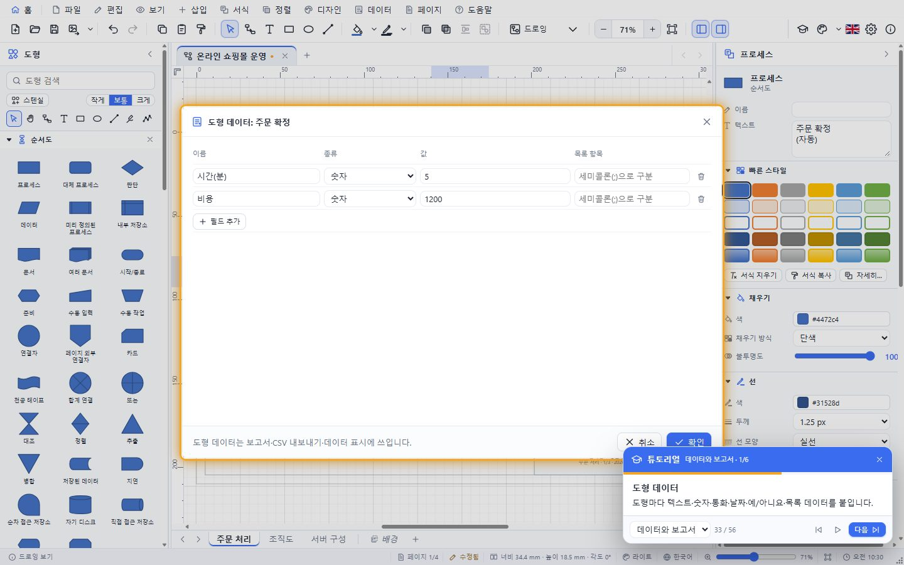

Any shape or connector can hold data fields. Select shapes and open **Data › Shape data…** (`Ctrl+Shift+D`), or **Edit data** in the **Shape data** section of the properties panel.

| Column | Contents |
|---|---|
| **Label** | The field name (e.g. Owner, Cost, IP) |
| **Type** | Text · Number · Currency · Date · Yes / No · List |
| **Value** | The value; a date picker for dates, Yes / No for yes/no, a list for lists |
| **List items** | For a list: the choices, separated by `;` |

**Add field** adds a row, the bin removes one. With several shapes selected the fields are added to all of them, and **Apply the values to every selected shape** copies the values too. Shape data is used by reports, CSV export and data graphics. Values can also be changed directly in the panel's **Shape data** section.

### Data graphics

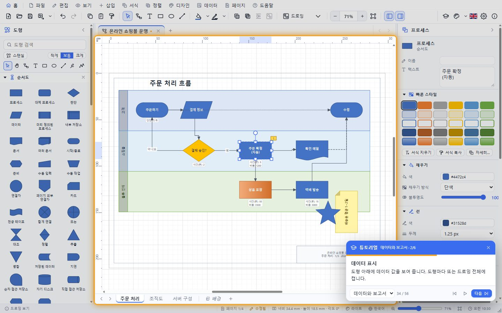

**Data › Show data on shape** shows the data values under the selected shapes; **Data graphics on all shapes** shows them under every shape with data in the drawing.

### Fields

**Insert › Insert field** adds a field to the selected shape's text (or a new text box). A field is written in braces and shows its current value:

| Field | Shows |
|---|---|
| `{page}` · `{pages}` | Page number · Page count |
| `{pageName}` | Page name |
| `{title}` · `{author}` · `{subject}` · `{company}` | Document title, author, subject, company (from Document properties) |
| `{date}` · `{time}` | Date · Time |
| `{name}` · `{master}` | Shape name · Master name |
| `{width}` · `{height}` | Shape width · Shape height |
| `{data:Key}` | The shape's data field "Key" |

Fields can also be typed by hand. On a background page, `{page}` and `{pages}` show the number of the page being drawn.

### Document properties

**File › Document properties…**: the **Summary** tab holds Title, Subject, Author, Manager, Company, Category, Keywords and Description; **Statistics** counts pages, shapes, connectors, groups, shapes with text and data, comments and masters, with the creation time and the file.

## Views and reports

Switch views with the toolbar view button (current view name ▾), **View › Switch view** or the right-click menus. Each tab remembers its view; **Settings › New drawings › View when a drawing opens** chooses the first one.

| View | Contents |
|---|---|
| **Drawing** | The page with the shapes — where you draw |
| **Pages** | Thumbnails of every page (see [Pages view](#pages-view)) |
| **Shape sheet** | Every shape of the page as numbers |
| **Shape data** | The data fields of the shapes, one column per field |
| **Shape reports** | Reports built from the drawing |

### Shape sheet

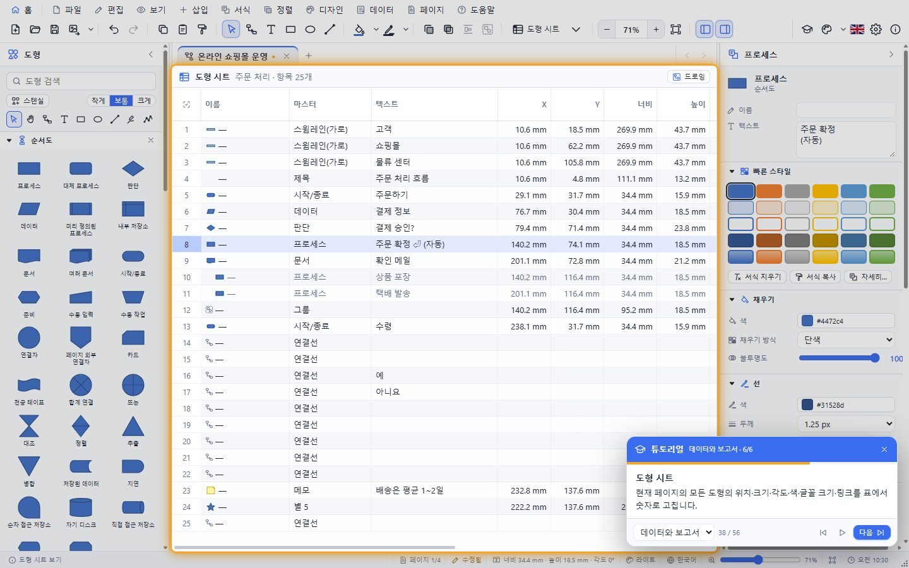

One row per shape (groups with their members after them): Name, Master, Text, X, Y, Width, Height, Angle, Fill, Line, Line weight, Font size, Layer, Hyperlink and the number of data fields. Edit the cells to change shapes exactly — positions and sizes in the drawing's units, colours as `#RRGGBB`. Every edit can be undone.

### Shape data table

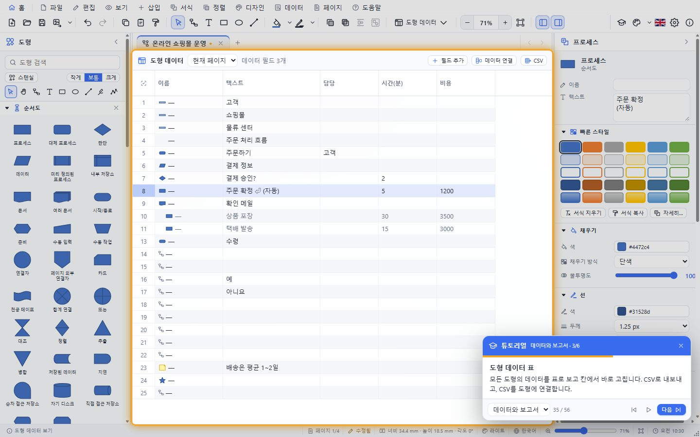

Every shape's data in a table, for the **Current page** or **All pages** (**Scope**). Edit values in the cells, **Add field** to add a column for all shapes, **Link data** to bring in a CSV file and **CSV** to export the data.

### Shape reports

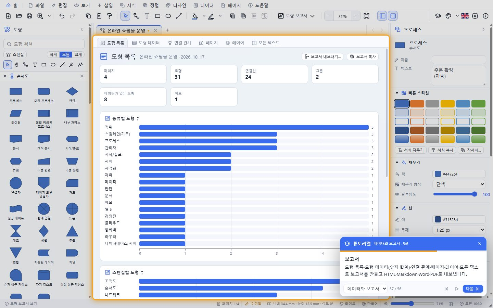

Pick a report from the **Data** menu or the tabs at the top of the Shape reports view.

| Report | Contents |
|---|---|
| **Inventory** | Pages, shapes, connectors, groups, shapes with data, comments; shapes by master and by stencil; the shape inventory table |
| **Shape data** | Shapes with data, data fields, totals of number fields (chart and figures), the full data table |
| **Connections** | Connectors and how many are glued at both ends, the most connected shapes, every connection (from, to, text, route) |
| **Pages** | Shapes per page, the page table (background page, size, shapes, connectors) |
| **Layers** | The layers of each page, how many shapes are on them and whether they are visible, printed and locked |
| **All text** | Every shape with text, by page and master |

**Copy report** puts the report on the clipboard as text, ready to paste into a spreadsheet or document.

**Export report** saves the report you are looking at as a file. Pick the format from the **Data › Export report** submenu, the **Export report…** button in the report header, or the right-click menu on the report.

| Format | What you get |
|---|---|
| **HTML (.html)** | A single-file web page that opens in any browser. Charts are SVG pictures with their numbers. Good for mail attachments and wikis. |
| **Markdown (.md)** | Headings and GitHub tables; charts become tables of their numbers. For Git repositories, issues and note apps. |
| **Word (.docx)** | A Word document with headings, tables and the charts as pictures plus their numbers, in Malgun Gothic. Edit it in Word, Hancom Office or LibreOffice. |
| **PDF (.pdf)** | The report drawn on A4 pages. The pages are stored as pictures so Korean text looks the same everywhere without embedding a font, which also means the text cannot be selected or copied. |

The suggested file name is "drawing title - report name", and the progress popup appears when building the file takes a while.

### Find and replace

The **Find** window has three tabs:

| Tab | Shortcut | Contents |
|---|---|---|
| **Find** | `Ctrl+F` | Find what; options **Match case**, **Whole words**, **Shape data too**; **Search in** Current page / All pages; **Previous** · **Find next** select the shape and go to its page |
| **Replace** | `Ctrl+H` | Replace with, **Replace** and **Replace all** (undone in one step) |
| **Go to page** | | Pick a page and press **Go** |

`Ctrl+G` (**Go to page**) shows the list of pages as a menu. The window can stay open while you keep searching.

### Presentation mode

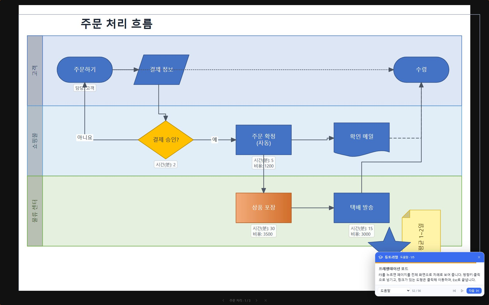

**View › Presentation mode** (`F5`) shows the foreground pages full screen one by one, starting from the current page. Arrow keys, `Space`, `Enter`, `Page Down` or a click move on; `Page Up` or `Backspace` move back; `Home` / `End` go to the first / last page. Shapes with links can be clicked (a link to a page jumps there). `Esc` ends it, leaving you on the page shown last.

## Automatic layout and importing data

### Re-layout page

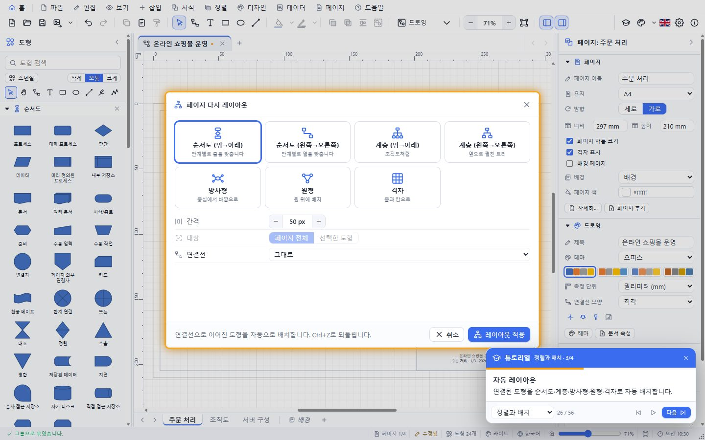

**Arrange › Re-layout page…** places connected shapes automatically. `Ctrl+Z` undoes it.

| Layout | Places the shapes |
|---|---|
| **Flowchart (top to bottom)** | Rows by step |
| **Flowchart (left to right)** | Columns by step |
| **Hierarchy (top to bottom)** | Like an org chart |
| **Hierarchy (left to right)** | A tree spreading sideways |
| **Radial** | From the middle outward |
| **Circular** | On a circle |
| **Grid** | In rows and columns |

**Spacing** sets the gap (10–300 px), **Apply to** the **Whole page** or the **Selection** (two or more shapes selected), and **Connectors** keeps their style or changes them to right-angle, straight or curved. Groups move as one; containers, text and line shapes keep their place, and connectors lose their manual bends so they route again.

### Org chart from data

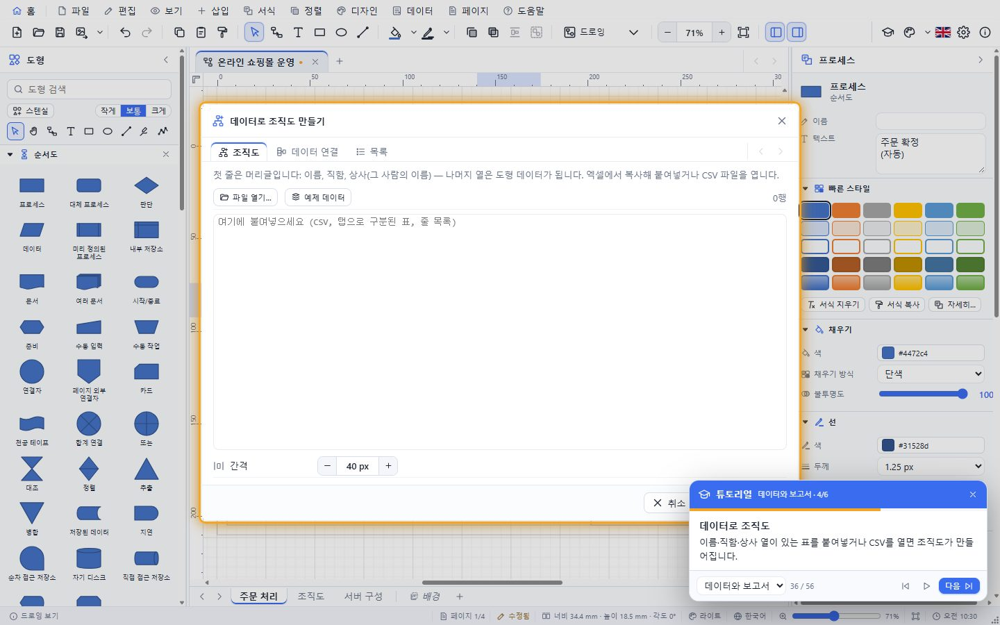

**Data › Org chart from data…** builds an org chart on the current page. Paste a table (from Excel, or CSV / tab-separated text) or press **Open file…**; **Sample data** fills in an example.

- The first line is the header: **Name**, **Title**, **Manager** (that person's name). Korean headers (이름, 직함, 상사 …) work too; other columns become shape data.
- People without a manager are at the top (executive shapes), people with reports become managers, the rest positions.
- **Spacing** sets the gap; **Create org chart** builds it, laid out as a hierarchy with connectors.

### Link data to shapes

**Data › Link data to shapes…** (the **Link data** tab) brings data from a table into existing shapes. The first line is the header; each row is matched to a shape on this page by an **ID**, **Name** or **Text** column, and the other columns become shape data (numbers as Number fields). **Create shapes for rows without a match** adds a shape for every row that matches nothing. The status bar reports "Linked 2 of 2 rows to shapes (0 new shapes)". Opening or dropping a `.csv` file opens this window with the file loaded.

### Flowchart from a list

**Data › Flowchart from a list…** (the **List** tab) turns lines of text into shapes connected in order — one step per line. **Shape** picks Process, Rounded rectangle, Ellipse, Start/End or Topic. Text dropped onto the window (web version) becomes such a list too.

## Files

### Saving

- **Save** (`Ctrl+S`) writes a MyDiagram drawing file (`.mdg`). The first save, and drawings started from a template, a Visio file or the sample, ask for a file name.
- **Save as…** (`Ctrl+Shift+S`), **Save all** (`Ctrl+Alt+S`: every modified tab).
- When a database is set up (see [Database](#database)), Save writes the file and the database together.
- Large files show a progress window.
- With **Settings › General › Reopen last files when starting** on, the files that were open are opened again on the next start.

### Templates

**File › Save as template…** writes a `.mdgt` file with the whole drawing as a starting point. Opening a template creates a new untitled drawing that asks for a new `.mdg` name when saved.

### Opening files

**Open…** (`Ctrl+O`) opens MyDiagram drawings (`.mdg`), templates (`.mdgt`) and Visio files (`.vsdx`, `.vstx`). Opening a file that is already open switches to its tab.

### Working with Visio

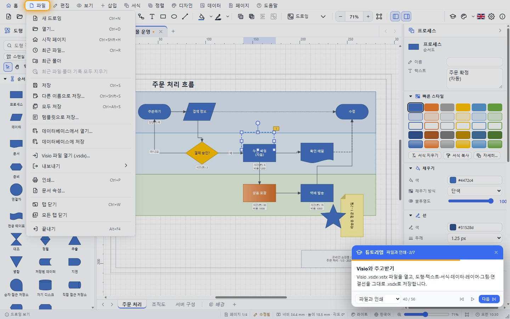

| Command | Notes |
|---|---|
| **Open Visio file (.vsdx)…** | Reads Visio drawings (`.vsdx`) and templates (`.vstx`): pages, shapes with their geometry (including masters, style sheets, groups, arcs and ellipses), text, fills, lines, rotation, flips, shape data, hyperlinks, layers, pictures and connectors with their glue. The result is a new drawing that becomes a `.mdg` when saved |
| **Save as Visio (.vsdx)…** | Writes pages, shapes, text, formatting, data, layers, pictures and connectors with their glue, ready to open in Microsoft Visio |

### Exporting

| Command | Format | Notes |
|---|---|---|
| **Export as PDF…** | `.pdf` | Every foreground page laid out with the current print setup (paper, margins, header and footer), as pictures of the sheets at 150 dpi |
| **Export as SVG (current page)…** | `.svg` | The current page as a vector picture |
| **Export as picture (PNG, JPEG, SVG…)…** | `.png` · `.jpg` · `.webp` · `.bmp` · `.tiff` · `.svg` | See below |
| **Export as web page (.html)…** | `.html` | Every page as SVG in one web page with a page list |
| **Export shape data to CSV…** | `.csv` | Page, ID, Name, Master, Text, then one column per data field, for every shape on every page |

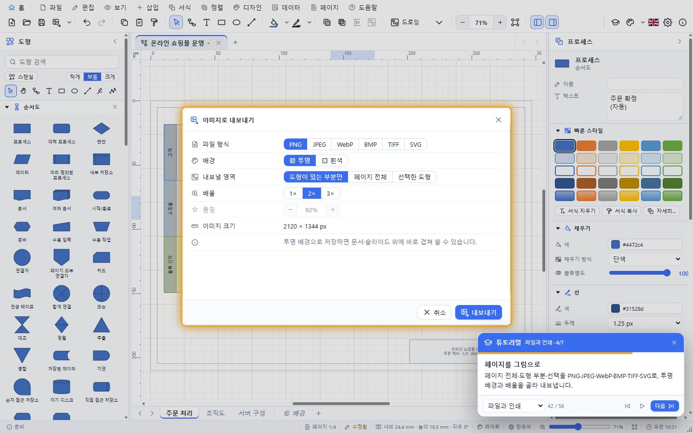

The **Export as image** window:

| Field | Contents |
|---|---|
| **File format** | PNG · JPEG · WebP · BMP · TIFF · SVG |
| **Background** | **Transparent** or **White** (formats without transparency always get white) |
| **Area** | **Shapes only** (default), **Whole page**, or **Selection** when shapes are selected |
| **Scale** | 1× · 2× · 3× (not for SVG, which stays sharp at any size) |
| **Quality** | For JPEG and WebP |
| **Image size** | The size of the picture in pixels |

The window remembers your last choices.

### Recent files and folders

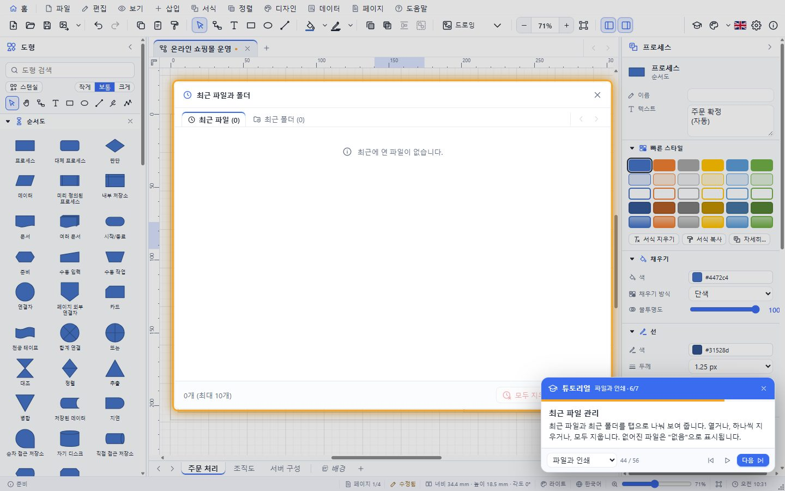

- **File › Recent files…** (`Ctrl+R`) opens a window with **Recent files** and **Recent folders** tabs, up to 10 of each.
- Each entry has **Open** (folders: **Open from this folder**) and **Remove from the list**; **Clear all** · **Clear all folders** remove them all.
- Files that no longer exist are marked **Missing**; opening one asks whether to remove it from the list (**Remove from the list** / **Keep**).
- **File › Recent folders** lists the folders as a menu, and **Clear all recent files and folders** clears both lists.
- The start page and **Settings › Recent** manage the same lists.

### Drag and drop

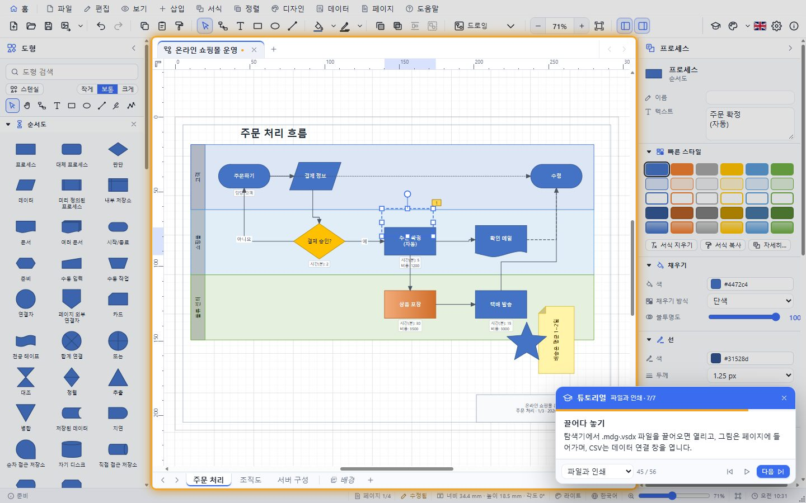

Drag files from the file manager onto the window:

| Dropped | Result |
|---|---|
| `.mdg` · `.mdgt` | Opened as a drawing |
| `.vsdx` · `.vstx` | Imported from Visio |
| Pictures (png · jpg · gif · webp · bmp · svg …) | Inserted where they are dropped (several are fanned out a little); on the start page they become the background image |
| `.csv` · `.tsv` · `.txt` | Open **Link data to shapes** with the file |
| Text (web version) | Shapes, one per line, connected in order |

Inside the app, drag a shape from the **Shapes** panel onto the canvas to place it where you let go (a click puts it in the middle of the view).

Double-clicking a `.mdg` or `.mdgt` file opens it in MyDiagram too (the installer registers the file types).

### Unsaved changes

- Closing a tab (`Ctrl+W`) with unsaved changes asks **Save** · **Don't save** · **Cancel**.
- Exiting (**File › Exit**, closing the window) lists the unsaved drawings and asks the same.

## Database

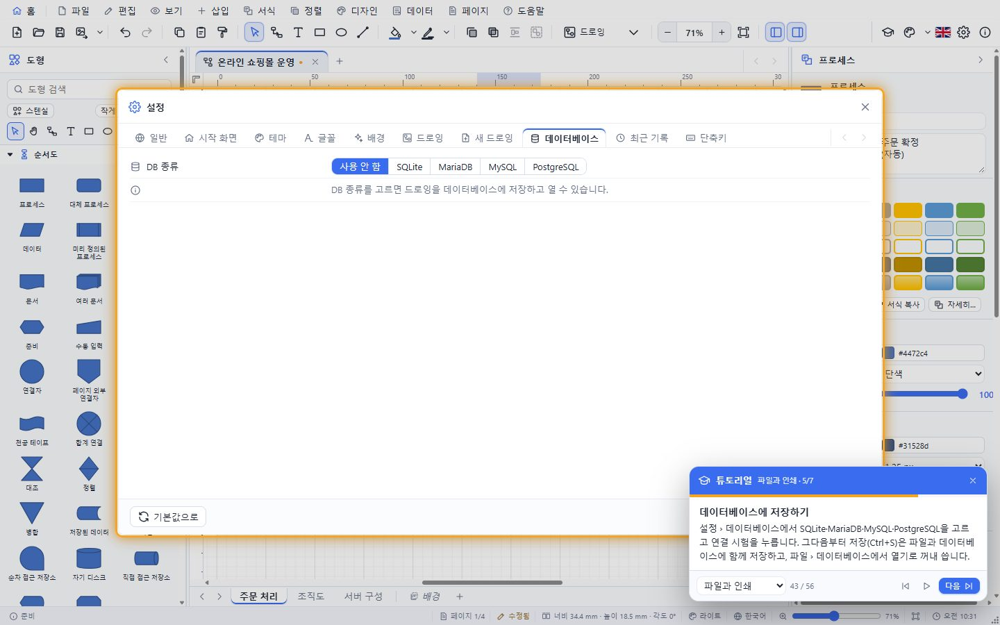

Drawings can be kept in a database as well as in files (desktop app only — a web browser cannot connect to a database server or an SQLite file, so the web version hides these commands).

### Connection settings

Choose in **Settings › Database**.

| Setting | Meaning |
|---|---|
| **Database type** | None · SQLite · MariaDB · MySQL · PostgreSQL |
| **SQLite file** | For SQLite. **Browse…** picks an existing file or names a new one, which is created on the first connection |
| **Server (host)** · **Port** · **Database name** · **User** | For a database server. Without a port of your own MariaDB/MySQL use 3306 and PostgreSQL 5432. The database itself must exist; its name may only use letters, digits, `_`, `$` and `-` |
| **Password** | Not saved by default: remembered until the app closes. Turn on **Save the password in the settings** to store it with the settings |
| **Test connection** | Connects, shows the server version ("Connected — …") and creates the table `mydiagram_drawings` when it is missing. A failure shows the reason (never the password) |

### Saving and opening

- With a database type chosen, **Save** (`Ctrl+S`) writes the file and the database together ("Saved … — to the file and to the database"); the Save tooltip says so too.
- **File › Save to database** stores the active drawing in the database only, with exactly the content of its `.mdg` file. Saving the same drawing again replaces it.
- **File › Open from database…** lists the stored drawings (title · last saved · size). **Open** opens one in a new tab; the bin button deletes it from the database (after asking; this cannot be undone); **Refresh** reads the list again.
- Without a connection set up, both commands open the Database tab of the settings.

## Printing and print preview

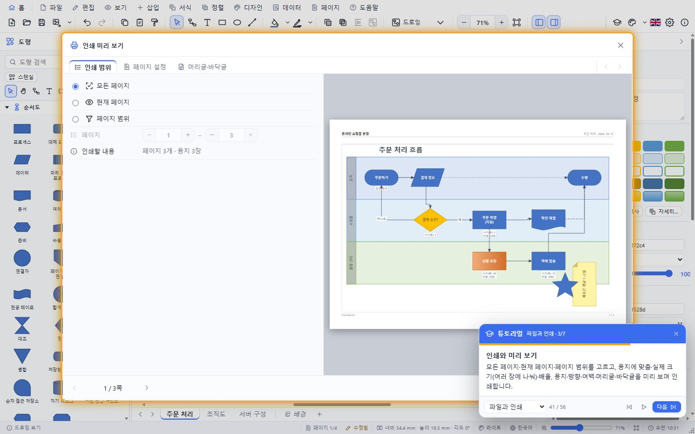

**File › Print…** (`Ctrl+P`) opens the **Print preview** window. The preview on the right follows every change; the arrows at the bottom turn the sheets.

| Tab | Fields |
|---|---|
| **What to print** | **All pages** · **Current page** · **Page range** (From page – To page), and **To print** (pages and sheets) |
| **Page setup** | **Paper**, **Orientation** (Portrait / Landscape), **Margins** (None · Narrow · Normal · Wide), **Size** (**Fit to sheet** · **Actual size** · **Percent**), **Scale** (10–400%, for Percent), **Center on the sheet**, **Print page color and background page** |
| **Header and footer** | **Header** and **Footer** on/off, **Header text** (default: the drawing title, page name and date) and **Footer text** (default: MyDiagram and the sheet number) |

- **Fit to sheet** prints each page on one sheet; **Actual size** and **Percent** tile a large page over as many sheets as it needs.
- Background pages are not printed on their own; with **Print page color and background page** on, they print under the pages that use them.
- Layers whose **Print** box is off are left out.
- Prints are black text on white whatever the program theme.

**Print** opens the system print dialog (Save as PDF lives there too). The page setup is kept for the next time and is also used by **Export as PDF…**.

## Appearance

### Themes

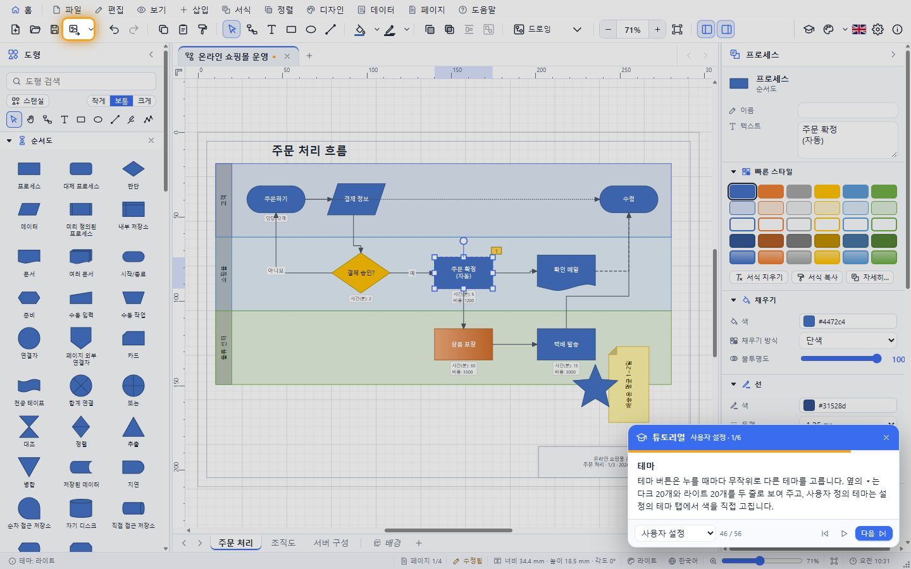

The program's own colours (not the drawing's design) come from a theme.

- The **Random theme** toolbar button picks a different theme at random on every press; its tooltip names the current theme.
- The ▾ next to it (**Choose theme**) opens a window with **Dark (20)** and **Light (20)** in two columns, plus **System setting** (follows the OS) and **Custom** at the top, **Edit custom theme…** and **Random theme**.
- **Settings › Theme** tab: Dark 20 · Light 20 · Custom groups. Custom lets you change Background · Surface · Panel · Text · Dim text · Border · Accent · Text on accent · Striped rows · Chart background · Toolbar · Status bar one by one, with **Use the custom theme**, **Copy the current theme's colors** and a **Dark theme** switch. Low contrast shows the warning "Text may be hard to read".

### Language

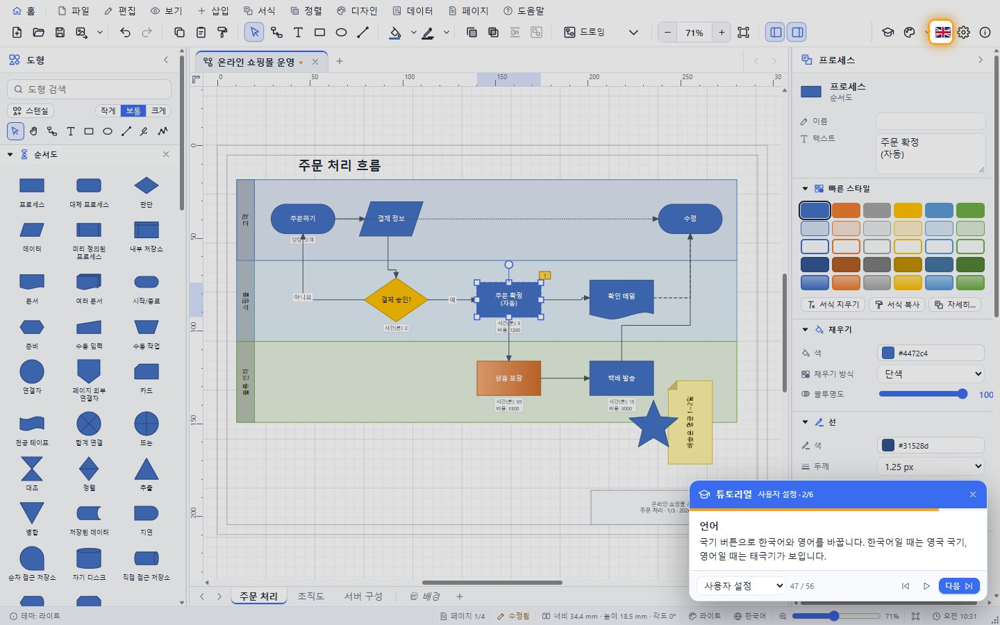

The flag button on the toolbar (**Switch language**, `Ctrl+Shift+L`) switches between Korean and English: the UK flag shows while the UI is Korean, the Korean flag while it is English (press it to switch to that language). **Settings › General › Language** works too. Menus, popups, reports, error messages and backend messages all switch.

### Font

**Settings › Font** picks any font installed on the system for the program's tables and panels, and sets **Size**, **Weight** (Light … Extra bold), **Style** (Normal / Italic), **Row height** and **Zoom** (50–200%). The sample below shows it at once. The fonts of the shapes are set per shape in the **Text** formatting.

### Background and moving background

**Settings › Background** tab:

| Field | Contents |
|---|---|
| **Background** | Moving · Image · None |
| **Moving background** | Aurora · Waves · Particles · Constellation · Bubbles · Flowing grid · Flowchart · Star field · Rain · Snow · Fireflies · Ripples · Code rain · Hexagons · Orbits · Lava lamp · Spiral galaxy · Confetti · Node network · Ribbons, **Change moving background** (`Ctrl+Shift+B`, random) |
| **Motion speed** | 0–300% |
| **Random background at start** | A different animation at every start |
| **Start page background changes** | Off · every 15 s, 30 s, 1 min, 2 min or 5 min while the start page is open |
| **Moving background on the start page only** | When on, nothing moves behind the drawing |
| **Background image** | **Choose…** · **Remove**. Images of any size can be used; dropping an image file on the start page also makes it the background |
| **Background opacity (behind views)** | How strongly the background shows behind the views |
| **Fit** | Fill · Fit · Tile · Center · Stretch |

**View › Theme, language and background › Turn background off** removes the background. Background colours follow the theme.

### Panels

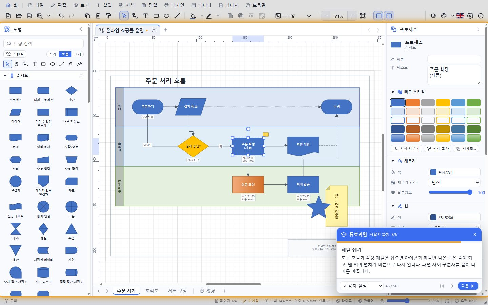

- Collapse and expand the Shapes and Properties panels with the arrow in their header, **View › Show › Show/hide tool panel** (`Ctrl+Shift+1`) · **Show/hide properties panel** (`Ctrl+Shift+2`) or the toolbar buttons.
- Collapsed, a panel leaves a narrow rail with icons and a title; the **Expand** button is at the top. The Shapes rail still switches drawing tools, the Properties rail opens Format, Data, Layers, Page, Themes and Comment.
- Drag the separators to change the panel widths.

### Status bar

Hide or show it with **View › Show › Status bar** or in **Settings › General**. **Settings › General › Clock on the status bar** turns the clock off.

### Start page

**Settings › General › Show the start page when starting** (or the check box at the bottom of the start page) decides whether the program starts on the start page or with a new blank drawing. The moving background of the start page is set on the start page itself and in **Settings › Background** (see above).

### The Settings window

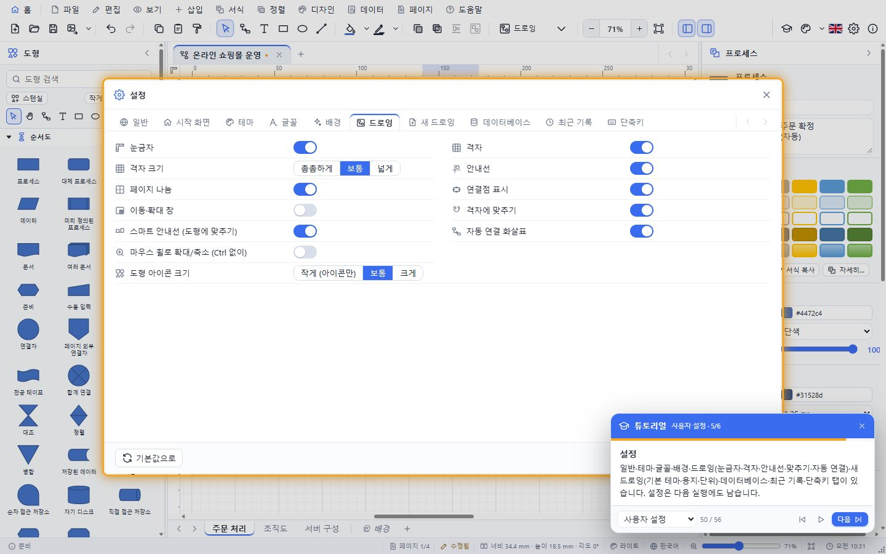

**Help › Settings…** (`Ctrl+,`). Settings apply at once and are kept for the next start. **Defaults** puts every setting back (the language and the background image stay).

| Tab | Fields |
|---|---|
| **General** | Language, Reopen last files when starting, Ask before deleting a page with shapes, Clock on the status bar, Status bar, Last folder used, Tutorial (**Start the tutorial**) |
| **Start page** | Show the start page when starting, Show recent files, Recent files shown (1–10), Show recent folders, Show sample drawings, Show the moving background picker, Show the tutorial banner, Start page **Open now**. Changes show on the start page right away |
| **Theme** | Dark · Light · Custom, System setting |
| **Font** | Font, size, weight, style, row height, zoom |
| **Background** | Background, moving background, motion speed, random background at start, start page background changes, moving background on the start page only, background image, background opacity, fit |
| **Drawing** | Rulers, Grid, Grid size, Guides, Page breaks, Connection points, Pan & zoom window, Snap to grid, Smart guides (snap to shapes), AutoConnect arrows, Mouse wheel zooms (without Ctrl), Shape icon size |
| **New drawings** | Default theme, Default paper, Orientation, Units, Connector style, View when a drawing opens. Used for new blank drawings; change open drawings in Page setup |
| **Database** | Database type and connection (see [Database](#database)) |
| **Recent** | Recent files and folders, clearing them |
| **Shortcuts** | Every keyboard shortcut |

### About

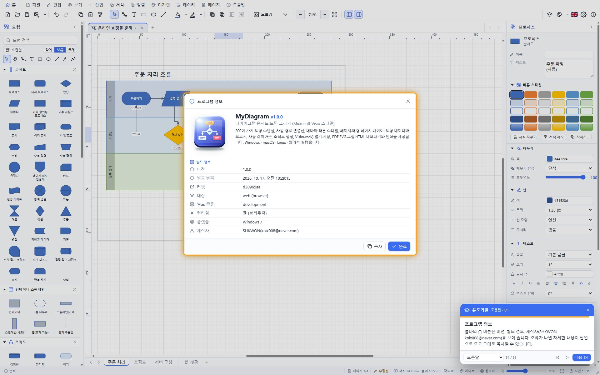

The ⓘ toolbar button (**Help › About…**, `F1`) shows the version, build date, commit, target, profile, runtime and platform, and the author. **Copy** copies it all.

## Keyboard shortcuts

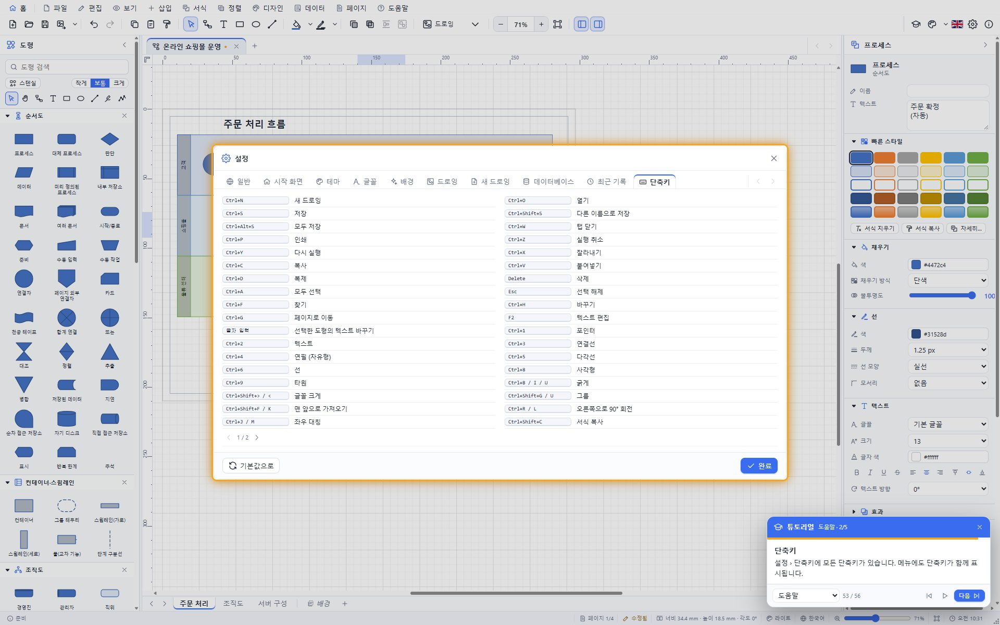

The same list is in **Settings › Shortcuts** (or **Help › Keyboard shortcuts…**), and the menus show the shortcuts next to each command. On macOS use `Cmd` instead of `Ctrl`.

| Shortcut | Command |
|---|---|
| `Ctrl+N` | New drawing |
| `Ctrl+O` | Open |
| `Ctrl+S` | Save |
| `Ctrl+Shift+S` | Save as |
| `Ctrl+Alt+S` | Save all |
| `Ctrl+W` | Close tab |
| `Ctrl+P` | Print |
| `Ctrl+Z` | Undo |
| `Ctrl+Y` | Redo (`Ctrl+Shift+Z` works too) |
| `Ctrl+X` | Cut |
| `Ctrl+C` | Copy |
| `Ctrl+V` | Paste |
| `Ctrl+D` | Duplicate |
| `Delete` | Delete |
| `Ctrl+A` | Select all |
| `Esc` | Clear selection (with a drawing tool active: back to the pointer) |
| `Ctrl+F` | Find |
| `Ctrl+H` | Replace |
| `Ctrl+G` | Go to page |
| `F2` | Edit text |
| `Typing` | Replaces the text of the selected shape |
| `Ctrl+1` | Pointer |
| `Ctrl+2` | Text |
| `Ctrl+3` | Connector |
| `Ctrl+4` | Pencil (freeform) |
| `Ctrl+5` | Polyline |
| `Ctrl+6` | Line |
| `Ctrl+8` | Rectangle |
| `Ctrl+9` | Ellipse |
| `Ctrl+B / I / U` | Bold / Italic / Underline |
| `Ctrl+Shift+> / <` | Increase font size / Decrease font size |
| `Ctrl+Shift+G / U` | Group / Ungroup |
| `Ctrl+Shift+F / K` | Bring to front / Send to back |
| `Ctrl+R / L` | Rotate right 90° / Rotate left 90° |
| `Ctrl+J / M` | Flip horizontal / Flip vertical |
| `Ctrl+Shift+C` | Format painter |
| `Ctrl+Shift+D` | Shape data |
| `Ctrl+K` | Hyperlink |
| `Arrow keys` | Nudge by the grid (Shift: 1 pixel) |
| `Shift+drag` | Move straight, resize keeping proportions, rotate in 15° steps |
| `Ctrl+drag` | Drag a copy |
| `Alt+drag` | Drag without snapping |
| `Ctrl+= / Ctrl+-` | Zoom in / Zoom out |
| `Ctrl+0` | Zoom 100% |
| `Ctrl+Shift+W` | Fit page |
| `Ctrl+wheel` | Zoom in / out |
| `Space+drag / middle button` | Pan |
| `Ctrl+PageUp / PageDown` | Previous page / Next page |
| `Shift+F11` | Insert page |
| `F5` | Presentation mode |
| `Ctrl+Tab` | Next tab (`Ctrl+Shift+Tab`: previous tab) |
| `Ctrl+Shift+L` | Switch language |
| `Ctrl+Shift+B` | Change moving background |
| `Ctrl+Shift+H` | Start page |
| `Ctrl+,` | Settings |
| `F11` | Tutorial |
| `F1` | About |

Shortcuts that work but are not in the Settings list:

| Shortcut | Command |
|---|---|
| `Ctrl+Shift+Space` | Pan tool |
| `Ctrl+Shift+1` · `Ctrl+Shift+2` | Show/hide tool panel · properties panel |
| `Ctrl+Q` (macOS) · `Alt+F4` (Windows) | Exit |
| `Ctrl+click` | Add to the selection; on a shape with a hyperlink, follow the link |
| `Enter` · `Ctrl+Enter` · `Esc` (editing text) | New line · finish · cancel |
| `Enter` (polyline tool) | Finish the polyline |
| `Backspace` | Delete |
| Arrow keys · `Space` · `Page Up` / `Page Down` · `Home` / `End` · `Esc` (presentation) | Next / previous page · first / last page · end |
| `Esc` (during the tutorial) | End the tutorial |

## Troubleshooting

### Error windows

Errors open an **Error** window with the message, **Time**, **Where** (what was being done), App (version and platform) and **Details**. **Copy details** copies everything, ready to report or keep.

| Error title | Common causes |
|---|---|
| The file could not be opened | Not a MyDiagram file (not JSON), made by a newer version of MyDiagram, a damaged or unreadable Visio file |
| Could not save · Could not export | A folder without write permission, another program holds the file |
| Input error | A number or colour in the wrong form ("Enter a number (for example 25 mm).", "Enter a colour as #RRGGBB.") |
| The picture could not be inserted | The picture file cannot be read |
| The data could not be imported | The pasted or opened table cannot be read |
| Could not save to the database · The database operation failed | The connection settings, the server or the password (see [Database](#database)) |
| Could not print | A printer or print dialog problem |
| The user's guide could not be opened | The `docs` folder of the installation was removed |

### Serious errors and crash.log

A serious error inside the program (the backend) opens **Serious error (backend)** with the **Location**, **Thread**, backtrace and the **Log file** path. The same text is appended to `crash.log`.

| OS | crash.log |
|---|---|
| Windows | `%APPDATA%\com.shkwon.mydiagram\crash.log` |
| macOS | `~/Library/Application Support/com.shkwon.mydiagram/crash.log` |
| Linux | `~/.local/share/com.shkwon.mydiagram/crash.log` |

### "Already running" error

Only one MyDiagram runs per user. Starting it again shows **MyDiagram — Start error** with "MyDiagram is already running." and the new copy closes. Find the open window on the taskbar (Dock); **File › Open…** there opens other drawings as tabs. Even after a crash the OS releases the lock, so the next start is never blocked.

### Other problems

| Symptom | Fix |
|---|---|
| A shape cannot be selected or moved | Its layer may be locked or hidden (**Page › Layers…**), or the shape protected (**Arrange › Protection…**). Shapes on a background page are edited on the background page's own tab |
| A connector does not follow its shape | The end is not glued (not green): drag it onto the shape again, and check that **Glue to shapes** is on |
| Connectors take odd routes | **Reset connector** removes manual bends; check **Route connectors around shapes** |
| Shapes jump while moving | Hold `Alt` to drag without snapping, or turn off **Snap to grid** / **Smart guides** |
| Shapes are missing from print or PDF | Check the layers' **Print** boxes and the print range |
| Everything is too big or too small | `Ctrl+0` (Zoom 100%) or **Fit page** (`Ctrl+Shift+W`) |
| Back to the original settings | **Settings › Defaults** |
| A recent file does not open in the web version | The browser may require picking the file again with **Open** |

## Installing and uninstalling

### Windows

Run `MyDiagram-Setup-1.0.0.exe`.

1. Choose the installer language (한국어 / English).
2. **Settings from a previous installation go back to their defaults; your data stays.** At the first start after installing, theme, fonts, zoom, panels, view options, window and popup places, column widths and print choices start fresh, while recent files and folders, the list of open drawings, the database connection, the background image and the tutorial history are kept. Drawing files (.mdg) are never touched.
3. A previous installation is removed completely before the new one goes in.
4. `.mdg` (drawing) and `.mdgt` (template) files are registered with their own document icons and open with a double-click.
5. The **MyDiagram** Start-menu folder gets the program and a **MyDiagram User's Guide** shortcut (this guide). The guides, the tutorial document and the sample drawings are in the `docs` and `samples` folders of the installation.

It installs for the current user, without administrator rights. Remove it in **Settings › Apps** (or Control Panel › Uninstall a program); the Start-menu shortcuts go with it.

| Data | Location (Windows) |
|---|---|
| Settings, recent files and folders, My shapes | `%LOCALAPPDATA%\com.shkwon.mydiagram` (WebView2 storage) |
| Window position and size, background image, crash.log | `%APPDATA%\com.shkwon.mydiagram` |

### macOS

Open `MyDiagram-1.0.0-<arch>.dmg` and drag MyDiagram into Applications. Remove it by moving it to the Trash. macOS 11 or later is required.

### Linux

Use the `.deb` (Debian, Ubuntu), `.rpm` (Fedora…) or `.AppImage` (`MyDiagram-1.0.0-<arch>.*`). The deb and rpm packages register the `.mdg` and `.mdgt` file types and icons. Remove it with the package manager.

### Web version

Put the web build (`dist/`) on any static web server and use the same features in a browser. Differences:

- Files are opened with the browser's file picker; saving goes back to the same file in browsers with File System Access (Edge, Chrome) and is a download elsewhere.
- Popups float inside the page.
- Features that need the OS — the database, file type registration, the "already running" check — are desktop only. The system font list is read only when the browser allows it.
- Settings, recent history and My shapes stay in the browser's storage.
