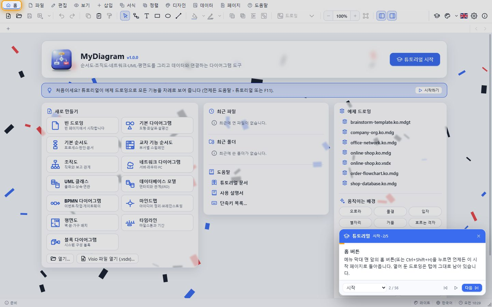
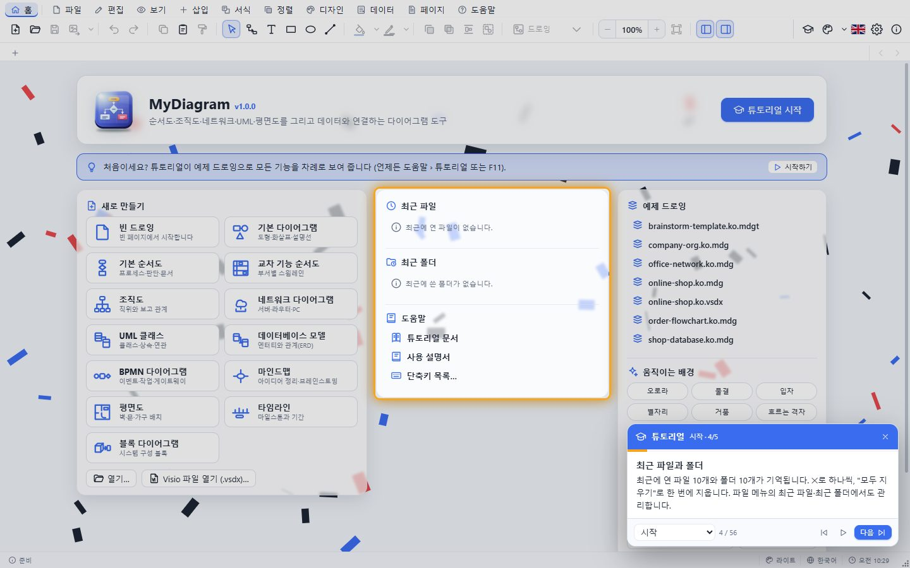
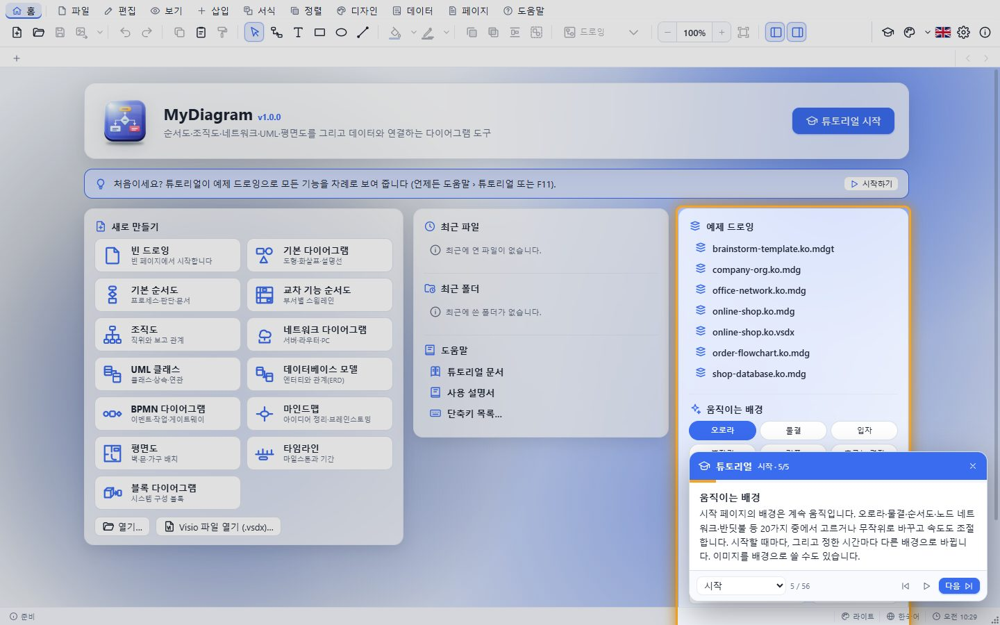
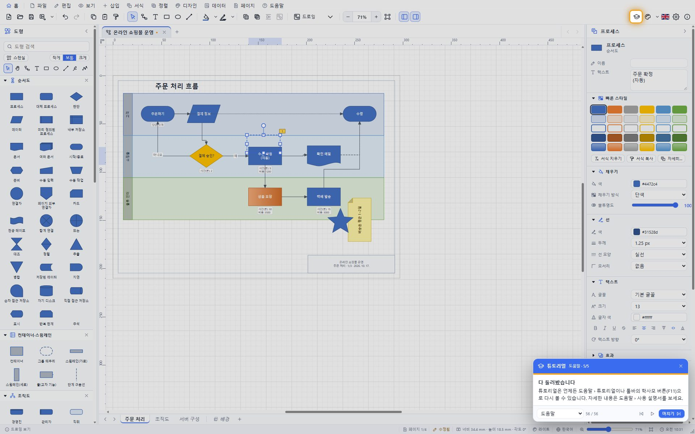

# MyDiagram tutorial

This document follows the in-app **Tutorial** step by step, with a screenshot of each step taken from the real app (`npm run tutorial:docs` makes them again).

## Running the tutorial

- **Start page › Start tutorial**, the **Tutorial** toolbar button, **Help › Tutorial** or **F11**.
- In the card: **Next / Previous** one step at a time, **Auto play** to the end, the chapter list to jump to a chapter, **✕** or **Esc** to stop at any time.
- The tutorial works only in its own sample tab. Your open drawings are not changed, and the theme, language and view settings it changes are put back when it ends.
- A recording of the whole tour is `MyDiagram-Tutorial.mp4` in the project root, made with `npm run tutorial:video` (needs ffmpeg). That file is not committed.

## Contents

1. [Getting started](#1-getting-started)
2. [Drawing shapes](#2-drawing-shapes)
3. [Connecting](#3-connecting)
4. [Formatting](#4-formatting)
5. [Arranging](#5-arranging)
6. [Pages & layers](#6-pages--layers)
7. [Data & reports](#7-data--reports)
8. [Files & printing](#8-files--printing)
9. [Customizing](#9-customizing)
10. [Help](#10-help)

## 1. Getting started

### 1. Welcome to MyDiagram

This tutorial shows every feature of MyDiagram on a sample drawing. Press Next (or Auto play). Your files are not changed, and the settings it changes are put back at the end.

### 2. The Home button

The Home button at the start of the menu bar (or Ctrl+Shift+H) brings you back to this start page at any time; your open drawings stay in their tabs.

### 3. Creating a drawing

Start from a blank drawing or a template: basic diagram, flowchart, cross-functional flowchart, org chart, network, UML, database, BPMN, mind map, floor plan, timeline or block diagram. A template opens the right stencils and starts with an example.

### 4. Recent files and folders

The last 10 files and 10 folders are remembered. ✕ removes one entry, "Clear all" removes them all. The File menu manages them too.

### 5. Moving background

The start page background keeps moving. Pick one of 20 animations (aurora, waves, flowchart, node network, fireflies…) or shuffle them, and set the speed. It changes at every start and after a set time. An image can be the background too.

## 2. Drawing shapes

### 6. The sample drawing

The online shop sample is open. The first page is an order flowchart in swimlanes; other pages hold an org chart and a server diagram. Every page uses a background page with a title block.

### 7. The window

From the top: menus, the toolbar and drawing tabs; then the Shapes panel on the left, the drawing in the middle (with rulers and page tabs), the properties panel on the right and the status bar. Drag the separators to resize the panels.

### 8. The Shapes panel and stencils

About 200 shapes in 15 stencils — basic shapes, arrows, flowchart, UML, ERD, BPMN, network, org chart, floor plan and more. Open and close them under "Stencils" and change the icon size.

### 9. Placing shapes

Drag a shape onto the page, or click it to place it in the middle of the view. It snaps to the grid and to other shapes.

### 10. Searching shapes

Type a name in the search box to find shapes in every stencil, in Korean or English.

### 11. Drawing tools

Pointer, pan, connector, text, rectangle, ellipse, line, pencil and polyline tools. Esc returns to the pointer.

### 12. Typing text

Double-click a shape or press F2 to edit its text — or just start typing with it selected. Enter starts a new line; Ctrl+Enter or a click outside finishes.

### 13. Moving, sizing, rotating

Drag to move (pink smart guides show alignment); use the white squares to resize, the circle on top to rotate, and the yellow diamonds to adjust the shape. Shift keeps proportions and rotates in 15° steps.

### 14. Undo and redo

Every edit can be undone and redone (200 steps per tab). The tooltip names the edit.

## 3. Connecting

### 15. Drawing connectors

With the connector tool, drag from one shape to another to make a glued connector. It follows when shapes move and routes around other shapes.

### 16. AutoConnect

Hover over a shape to see blue arrows. Click one to add a connected copy; drag one to draw a connector anywhere.

### 17. Connector styles

Right-angle, straight and curved connectors; drag the square handles to bend them. There are 16 arrowheads, including UML and ERD ends.

### 18. Connection points and glue

Drop on a connection point (blue ×) to glue to it, or anywhere on the shape to glue dynamically to the nearest point. A green end is glued.

## 4. Formatting

### 19. The properties panel

Edit the selected shape’s text, quick style, fill, line, text, effects, size, data, layers, link, comments and protection right here. With nothing selected it shows the page and drawing settings.

### 20. Quick styles

Pick one of the theme’s six colors with fill, subtle, outline, intense or gradient — in one click.

### 21. Format shape

Fine-tune fill (solid, gradients, patterns, opacity), line (color, weight, pattern, rounding), text, effects, size & position and protection. Only what you change is applied.

### 22. Themes and variants

16 themes with 4 variants each. A theme restyles every shape you have not formatted by hand.

### 23. Format painter

Select a shape, press Format painter (Ctrl+Shift+C), then click another shape to give it the same formatting.

## 5. Arranging

### 24. Align and distribute

Align shapes to the first one selected (left, center, right, top, middle, bottom) and spread them evenly.

### 25. Grouping

Grouped shapes move and resize together. Click again to pick a shape inside a group.

### 26. Automatic layout

Arrange connected shapes automatically as a flowchart, hierarchy, radial, circle or grid.

### 27. Rotating and flipping

Rotate in 90° steps or flip horizontally and vertically; Bring to front / Send to back changes the stacking order.

## 6. Pages & layers

### 28. Several pages

Switch pages with the tabs at the bottom, add one with +, double-click to rename, and drag to reorder.

### 29. Background pages

The border and title block of a background page appear on every page that uses it. Fields such as {page}, {pages} and {date} fill themselves in.

### 30. Layers

Put shapes on layers and set each layer visible, printable, locked or colored.

### 31. Page setup

Paper and orientation, auto size, background page, page color, grid, connector style and line jumps, units.

### 32. Pages view

See every page as a thumbnail; open, duplicate, rename, delete and reorder them.

## 7. Data & reports

### 33. Shape data

Attach text, number, currency, date, yes/no and list data to any shape.

### 34. Data graphics

Show the data values under shapes — per shape or for the whole drawing.

### 35. The shape data table

See every shape’s data in a table and edit it in the cells; export to CSV or link a CSV file to shapes.

### 36. Org chart from data

Paste a table with name, title and manager columns, or open a CSV file, to build an org chart.

### 37. Reports

Reports on the inventory, shape data (with totals), connections, pages, layers and all text — exported as HTML, Markdown, Word or PDF.

### 38. Shape sheet

Edit the position, size, angle, colors, font size and link of every shape on the page as numbers.

## 8. Files & printing

### 39. The File menu

Save (.mdg), save as template (.mdgt), open and save Visio files, export PDF, SVG, pictures, HTML and CSV, recent files and folders, the database and printing.

### 40. Working with Visio

Open Visio .vsdx and .vstx files, and save shapes, text, formatting, data, layers, pictures and connectors back as .vsdx.

### 41. Printing and preview

Print all pages, the current one or a range — fitted to the sheet, at actual size (tiled over several sheets) or a percentage — with paper, orientation, margins, header and footer in a live preview.

### 42. A page as a picture

Export the whole page, the shapes or the selection as PNG, JPEG, WebP, BMP, TIFF or SVG, with a transparent background and a scale.

### 43. Keeping drawings in a database

In Settings › Database pick SQLite, MariaDB, MySQL or PostgreSQL and press Test connection. From then on Save (Ctrl+S) writes both the file and the database, and File › Open from database brings drawings back.

### 44. Managing recent files

Recent files and recent folders on two tabs: open one, remove one, or clear them all. Files that no longer exist are marked "Missing".

### 45. Drag and drop

Drag .mdg or .vsdx files from the file manager to open them; pictures go onto the page and a CSV file opens Link data.

## 9. Customizing

### 46. Themes

The theme button picks a different theme at random on every press. The ▾ next to it lists 20 dark and 20 light themes in two columns; the custom theme is edited color by color in Settings › Theme.

### 47. Language

The flag button switches between Korean and English: the UK flag shows while the UI is Korean, the Korean flag while it is English.

### 48. Collapsing panels

Collapsed, the tool and properties panels leave a narrow rail with icons and a title; the expand button is at the top. Drag the separators to change their width.

### 49. Pan & zoom window

The small window at the bottom right shows the whole page; drag the rectangle to move around. Ctrl+wheel zooms.

### 50. Settings

General, Theme, Font, Background, Drawing (rulers, grid, guides, snapping, AutoConnect), New drawings (theme, paper, units), Database, Recent and Shortcuts tabs. Settings are kept for the next start.

### 51. Status bar

Command results, page number, save state, the size and angle of the selection, the pointer position, theme, language, the zoom slider, Fit page and a clock.

## 10. Help

### 52. Presentation mode

Press F5 to show the pages full screen one by one. Arrow keys or a click move on, shapes with links can be clicked, and Esc ends it.

### 53. Keyboard shortcuts

Settings › Shortcuts lists them all; the menus show them next to each command.

### 54. About

The ⓘ toolbar button shows the version, build information and the author (SHKWON, knix008@naver.com). Errors open a popup with every detail, ready to copy.

### 55. Reading the tutorial document

A document with every step of this tutorial and its screen can be read inside the program: open it from Help › Tutorial document on the home screen or in the Help menu. The bar on top jumps to a chapter, switches 한국어/English, starts the tutorial or opens the document in a browser. Home takes you back.

### 56. That's the tour

Watch it again any time with Help › Tutorial or the graduation-cap toolbar button (F11). See Help › User's guide for the details.

