# MyDiagram 튜토리얼

이 문서는 앱 안의 **튜토리얼**과 같은 내용을 단계별 화면과 함께 보여 줍니다. 그림은 실제 앱에서 튜토리얼을 실행하며 찍은 것입니다 (`npm run tutorial:docs` 로 다시 만듭니다).

## 튜토리얼 실행하기

- **시작 페이지 › 튜토리얼 시작**, 툴바의 **튜토리얼** 버튼, **도움말 › 튜토리얼** 또는 **F11**을 누릅니다.
- 카드의 **다음 / 이전**으로 한 단계씩, **자동 재생**으로 끝까지 봅니다. 장 목록으로 원하는 장으로 바로 가고, **✕** 또는 **Esc**로 언제든 끝냅니다.
- 튜토리얼은 자기 예제 탭에서만 작업합니다. 열어 둔 계획은 바뀌지 않고, 바꾼 테마·언어·보기 설정은 끝날 때 원래대로 돌아갑니다.
- 전체 과정을 녹화한 동영상: 프로젝트 루트의 `MyDiagram-Tutorial.mp4`.

## 차례

1. [시작](#1-시작)
2. [도형 그리기](#2-도형-그리기)
3. [연결하기](#3-연결하기)
4. [서식](#4-서식)
5. [정렬과 배치](#5-정렬과-배치)
6. [페이지와 레이어](#6-페이지와-레이어)
7. [데이터와 보고서](#7-데이터와-보고서)
8. [파일과 인쇄](#8-파일과-인쇄)
9. [사용자 설정](#9-사용자-설정)
10. [도움말](#10-도움말)

## 1. 시작

### 1. MyDiagram에 오신 것을 환영합니다

이 튜토리얼은 예제 드로잉으로 MyDiagram의 모든 기능을 차례로 보여 줍니다. 다음(또는 자동 재생)을 누르세요. 내 파일은 바뀌지 않고, 바꾼 설정은 끝날 때 원래대로 돌아갑니다.

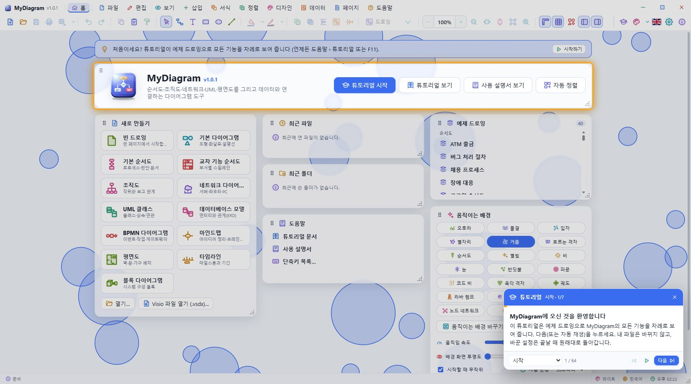

### 2. 홈 버튼

메뉴 막대 맨 앞의 홈 버튼(또는 Ctrl+Shift+H)을 누르면 언제든 이 시작 페이지로 돌아옵니다. 열어 둔 드로잉은 탭에 그대로 남아 있습니다.

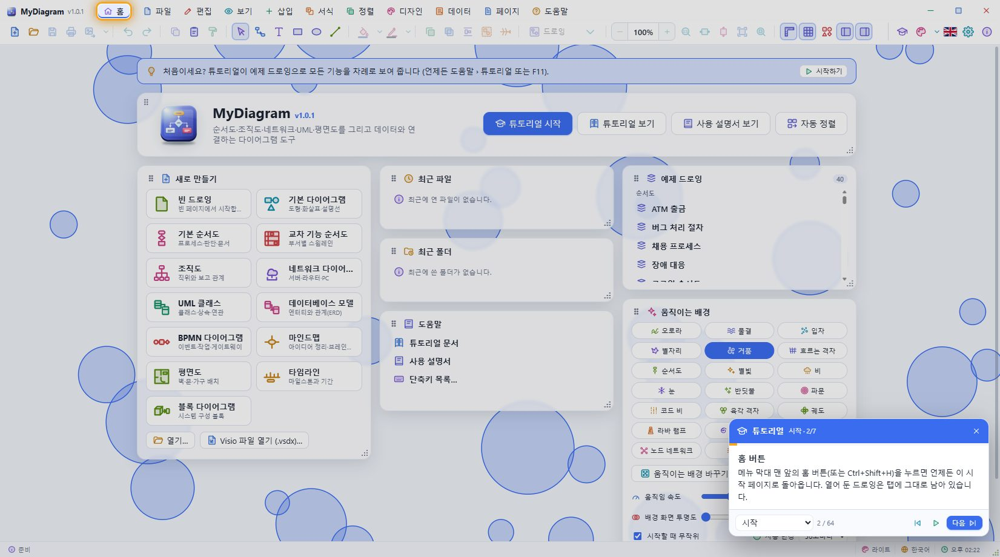

### 3. 새 드로잉 만들기

빈 드로잉이나 기본 다이어그램·순서도·교차 기능 순서도·조직도·네트워크·UML·데이터베이스·BPMN·마인드맵·평면도·타임라인·블록 다이어그램 템플릿으로 시작합니다. 템플릿은 맞는 스텐실을 열고 예제 그림을 넣어 줍니다.

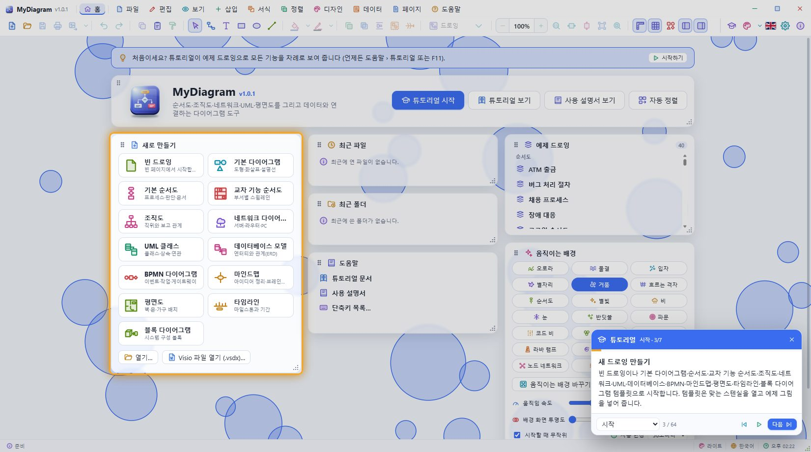

### 4. 최근 파일과 폴더

최근에 연 파일 10개와 폴더 10개가 기억됩니다. ✕로 하나씩, "모두 지우기"로 한 번에 지웁니다. 파일 메뉴의 최근 파일·최근 폴더에서도 관리합니다.

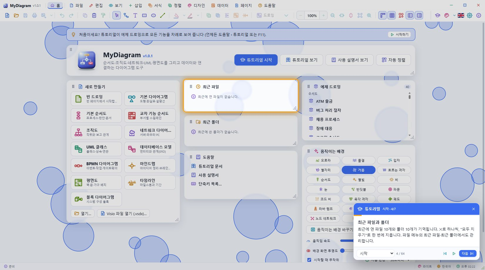

### 5. 카드 옮기기와 크기 바꾸기

시작 화면의 각 영역은 카드입니다. ⠿ 손잡이나 제목 줄을 끌어 옮기고, 오른쪽 아래의 삼각형 점을 끌어 크기를 바꿉니다. 위쪽의 자동 정렬은 카드를 빈틈없이 맞추고, 아래쪽의 카드 배치 초기화는 처음 배치로 돌아갑니다.

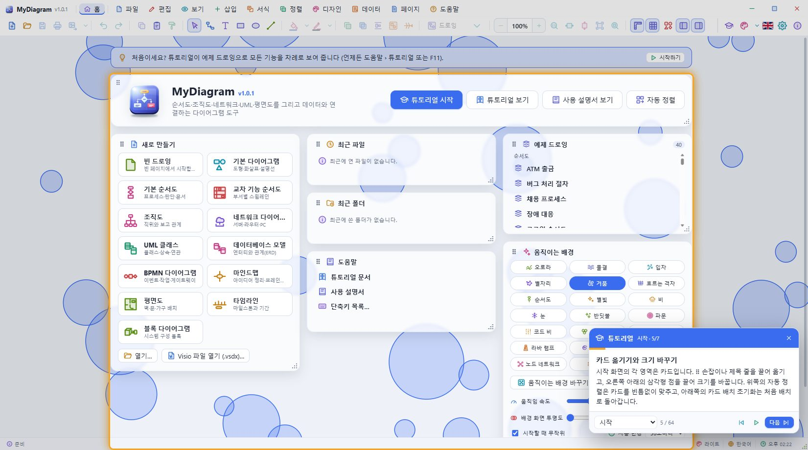

### 6. 예제 드로잉

예제 카드에는 순서도, BPMN, UML, 데이터베이스, 네트워크, 조직도, 마인드맵, 평면도, 일정, 블록, 전기 회로 예제가 분류별로 있습니다. 눌러서 바로 열어 보세요.

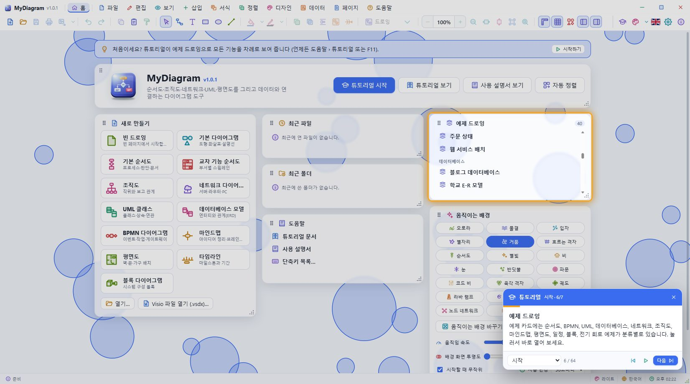

### 7. 움직이는 배경

시작 페이지의 배경은 계속 움직입니다. 오로라·물결·순서도·노드 네트워크·반딧불 등 20가지 중에서 고르거나 무작위로 바꾸고 속도도 조절합니다. 시작할 때마다, 그리고 정한 시간마다 다른 배경으로 바뀝니다. 이미지를 배경으로 쓸 수도 있습니다.

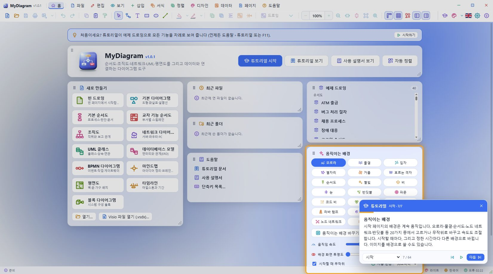

## 2. 도형 그리기

### 8. 예제 드로잉

온라인 쇼핑몰 예제를 열었습니다. 첫 페이지는 스윔레인으로 나눈 주문 처리 순서도이고, 다른 페이지에 조직도와 서버 구성이 있습니다. 모든 페이지는 제목 칸이 있는 배경 페이지를 씁니다.

### 9. 화면 구성

맨 위 줄에 프로그램 이름·드로잉 이름·메뉴·창 버튼, 그 아래 툴바가 있고, 왼쪽 도형 패널·가운데 드로잉(위쪽 페이지 탭과 눈금자)·오른쪽 속성 패널·아래 상태 표시줄로 되어 있습니다. 패널 사이의 구분자를 끌어 너비를 바꿉니다.

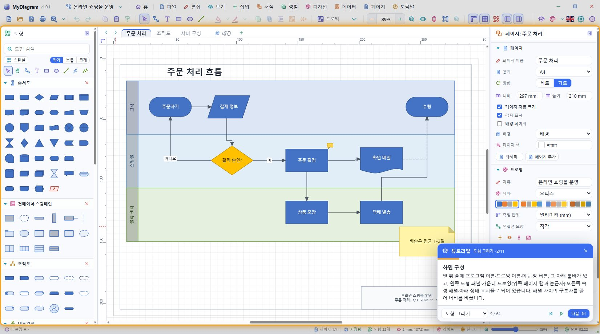

### 10. 도형 패널과 스텐실

기본 도형·화살표·순서도·UML·ERD·BPMN·네트워크·조직도·평면도 등 15가지 스텐실에 200여 개의 도형이 있습니다. "스텐실"로 열고 닫으며, 아이콘 크기를 바꿀 수 있습니다.

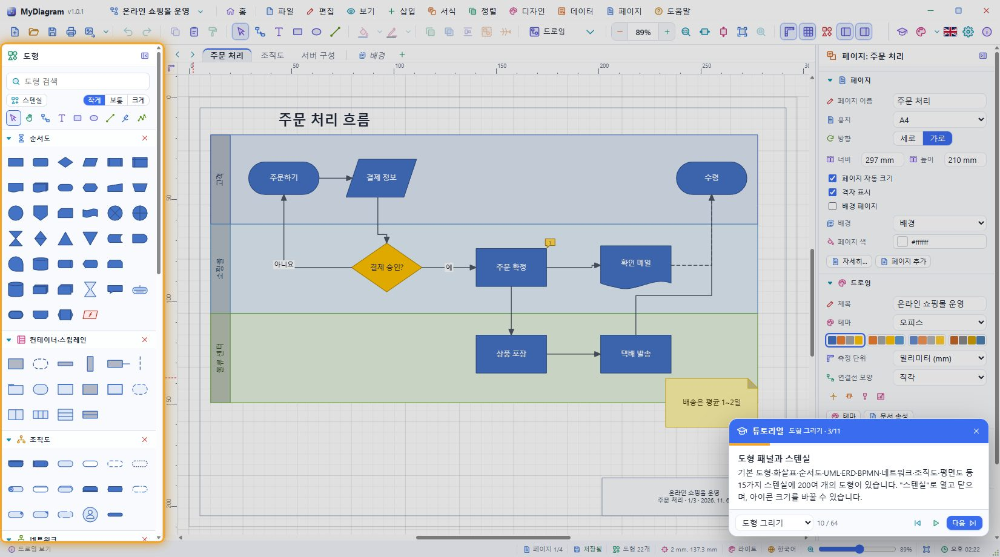

### 11. 도형 놓기

도형을 페이지로 끌어다 놓거나 한 번 클릭하면 화면 가운데에 놓입니다. 격자와 다른 도형에 맞춰집니다.

### 13. 도형 검색

검색 칸에 이름을 쓰면 모든 스텐실에서 도형을 찾습니다. 한국어와 영어 이름 모두 됩니다.

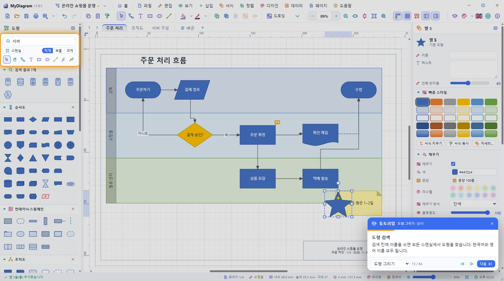

### 14. 스텐실 고르기

툴바의 스텐실 버튼이나 도형 패널의 스텐실에서 필요한 스텐실을 열고 닫습니다. 네트워크, 클라우드, 화면 설계, 비즈니스, 차트, 논리 회로, 공정 배관, 보안 등 많은 스텐실이 있고, 도형 아이콘 크기는 작게가 기본입니다.

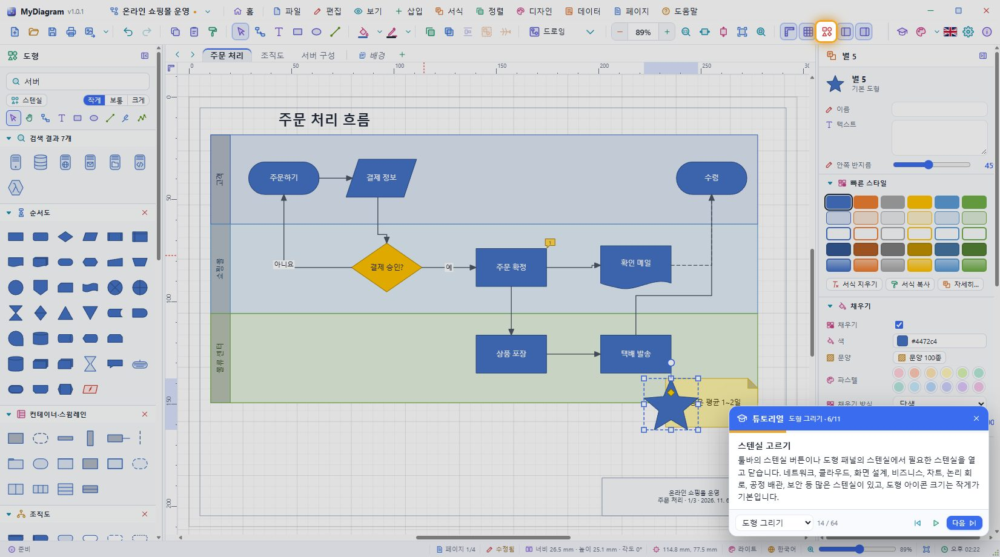

### 15. 회전 각도 보기

위쪽 둥근 손잡이를 끌면 도형이 돌아가면서 각도기와 함께 "+45° → 45°"처럼 얼마나 돌렸는지와 지금 각도를 보여 줍니다. Shift를 누르면 15도씩 돕니다.

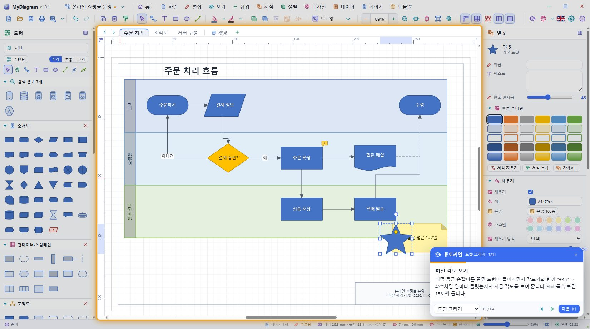

### 16. 그리기 도구

포인터·화면 이동·연결선·텍스트·사각형·타원·선·연필·다각선 도구가 있습니다. Esc를 누르면 포인터로 돌아갑니다.

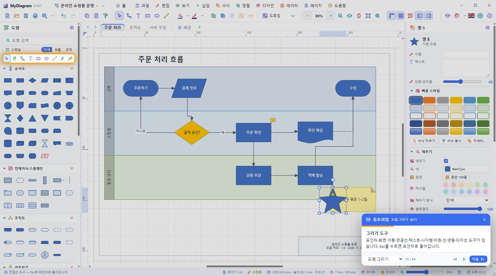

### 17. 텍스트 입력

도형을 두 번 클릭하거나 F2를 누르면 텍스트를 고칩니다. 도형을 선택하고 바로 타이핑해도 됩니다. Enter는 줄 바꿈, Ctrl+Enter나 바깥 클릭으로 끝냅니다.

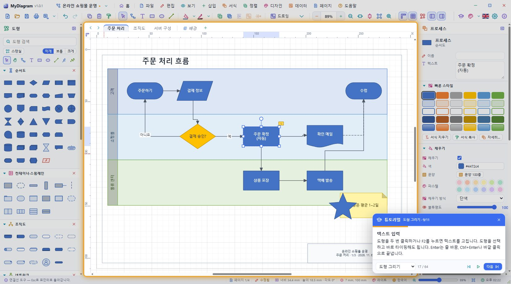

### 18. 이동·크기·회전

끌어서 옮기고(분홍 스마트 안내선이 맞춤을 보여 줌), 흰 사각형 손잡이로 크기를, 위쪽 동그라미로 회전을, 노란 마름모로 모양을 조절합니다. Shift는 비율 유지·15° 회전입니다.

### 19. 실행 취소·다시 실행

모든 편집은 탭마다 200단계까지 실행 취소/다시 실행할 수 있습니다. 툴팁에 되돌릴 작업 이름이 나옵니다.

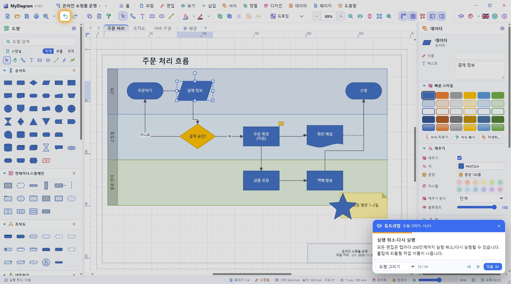

## 3. 연결하기

### 12. Shift로 선 정렬

선으로 연결된 도형을 Shift를 누른 채 끌면, 연결된 도형과 가로나 세로로 줄이 맞아 선이 곧게 펴집니다. 놓으면 꺾임점도 정리됩니다. 선이 없는 도형은 가로·세로로만 움직입니다.

### 20. 연결선 그리기

연결선 도구로 도형에서 도형으로 끌면 붙은 연결선이 생깁니다. 도형이 움직이면 연결선이 따라오고, 다른 도형을 피해 길을 찾습니다.

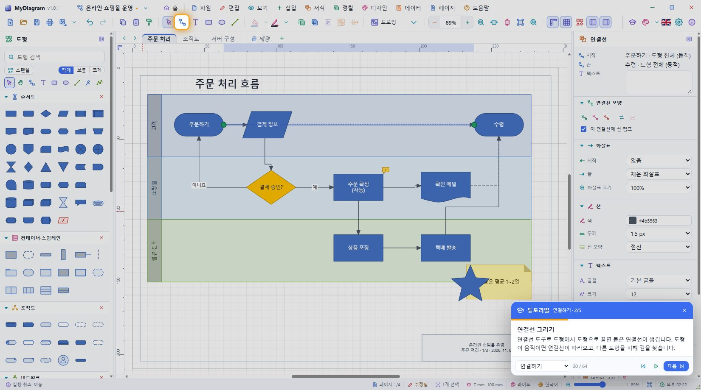

### 21. 자동 연결

도형 위에 마우스를 올리면 파란 화살표가 나옵니다. 클릭하면 같은 도형을 만들어 연결하고, 끌면 원하는 곳으로 연결선을 그립니다.

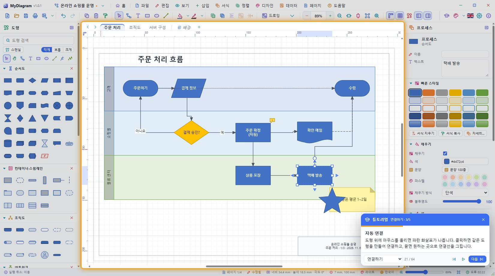

### 22. 연결선 모양

직각·직선·곡선 연결선이 있고, 가운데 사각형 손잡이를 끌어 꺾을 수 있습니다. 화살촉은 UML·ERD용을 포함해 16가지입니다.

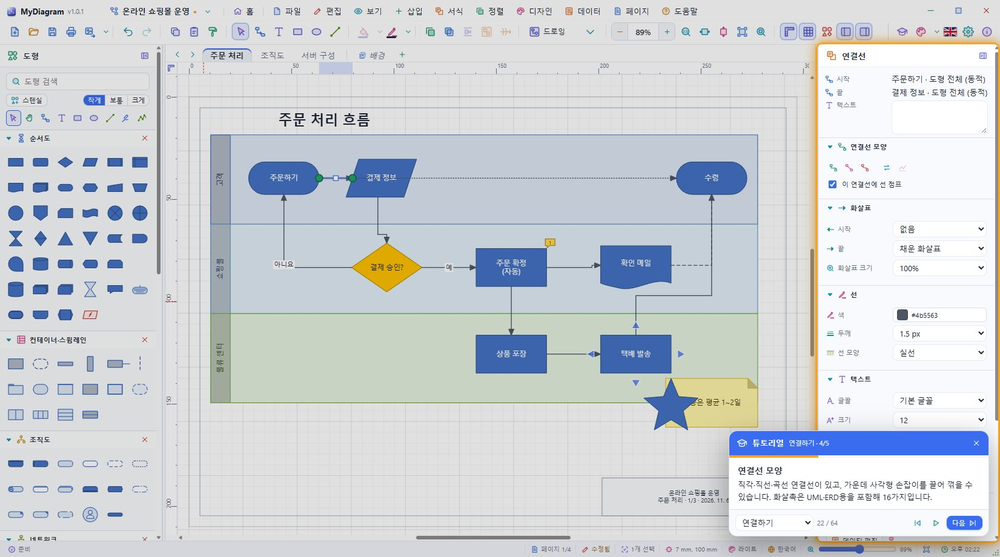

### 23. 연결점과 붙이기

연결점(파란 ×)에 놓으면 그 점에, 도형 위에 놓으면 가장 가까운 점으로 자동 연결됩니다(동적 붙이기). 초록 끝점은 붙어 있다는 뜻입니다.

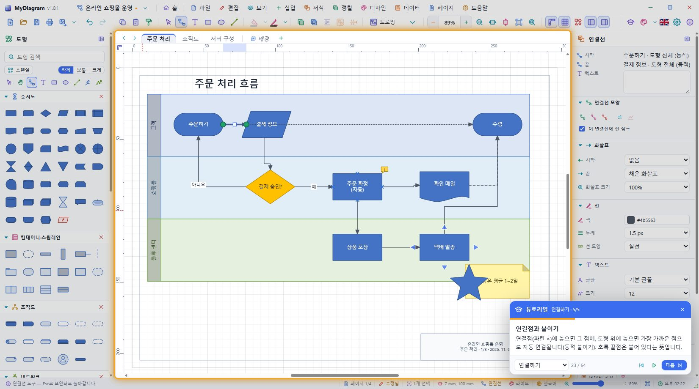

## 4. 서식

### 24. 속성 패널

선택한 도형의 텍스트·빠른 스타일·채우기·선·텍스트·효과·크기·데이터·레이어·링크·메모·보호를 바로 고칩니다. 아무것도 선택하지 않으면 페이지와 드로잉 설정이 나옵니다.

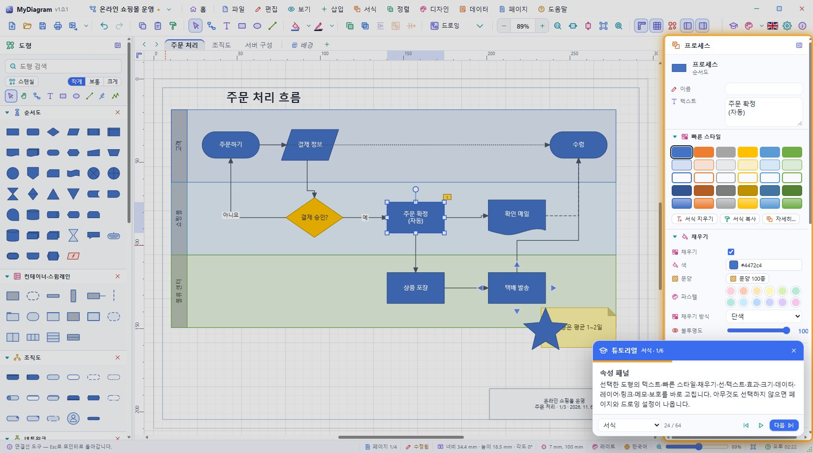

### 25. 빠른 스타일

테마 색 6가지와 채우기·연하게·윤곽선·진하게·그라데이션을 골라 한 번에 꾸밉니다.

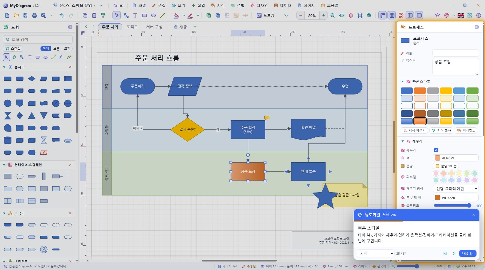

### 26. 도형 서식

채우기(단색·그라데이션·무늬·불투명도)·선(색·두께·모양·모서리)·텍스트·효과·크기 및 위치·보호를 자세히 설정합니다. 바꾼 항목만 적용됩니다.

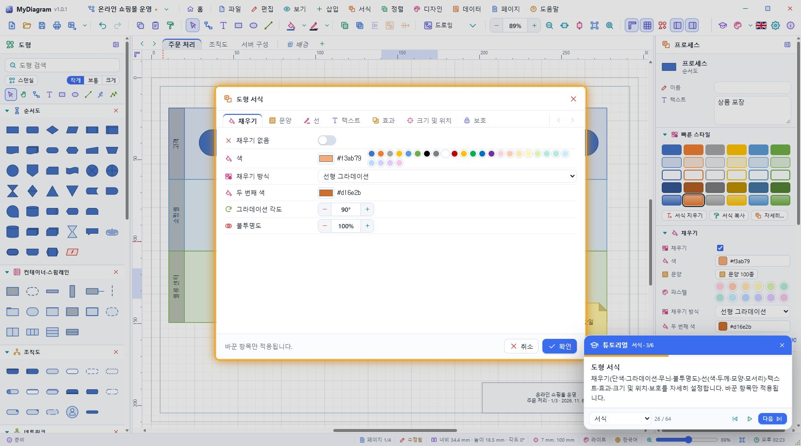

### 27. 테마와 변형

16가지 테마와 각 4가지 변형이 있습니다. 테마를 바꾸면 직접 서식을 바꾸지 않은 모든 도형이 함께 바뀝니다.

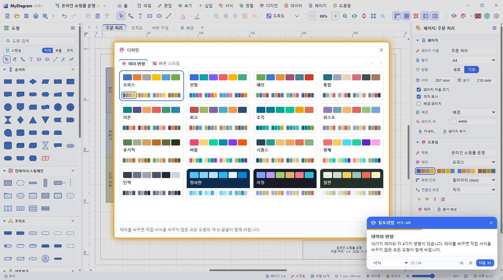

### 28. 서식 복사

도형을 선택하고 서식 복사(Ctrl+Shift+C)를 누른 뒤 다른 도형을 클릭하면 같은 서식이 됩니다.

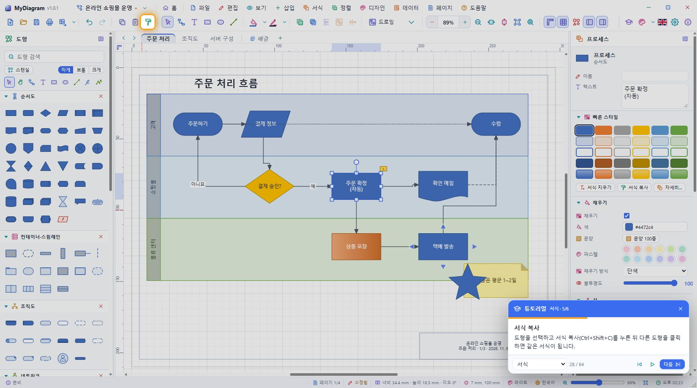

### 29. 채우기와 파스텔 색

속성 패널의 채우기에서 채우기를 켜고 끄고, 파스텔 프리셋을 눌러 바로 색을 바꿉니다. 색 고르기 창에도 파스텔 색이 있습니다.

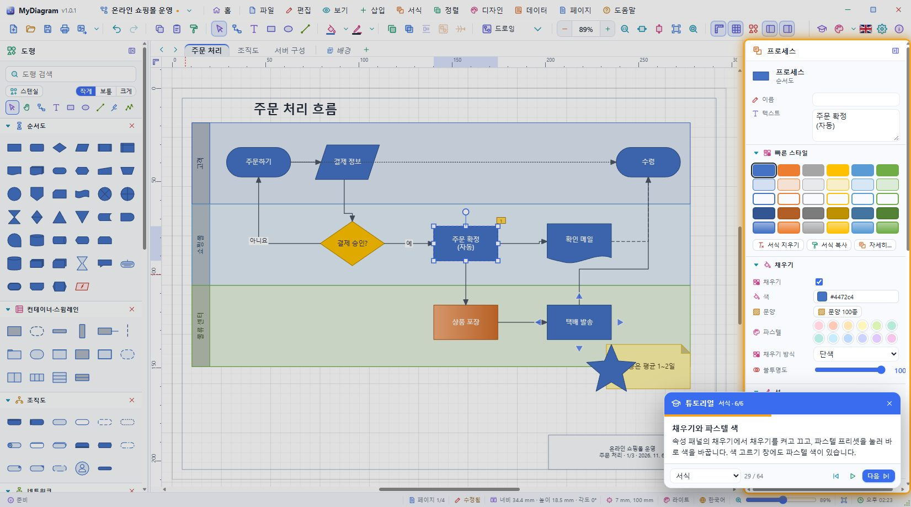

## 5. 정렬과 배치

### 30. 맞춤과 분배

여러 도형을 처음 선택한 도형에 왼쪽·가운데·오른쪽·위·중간·아래로 맞추고, 간격을 균등하게 분배합니다.

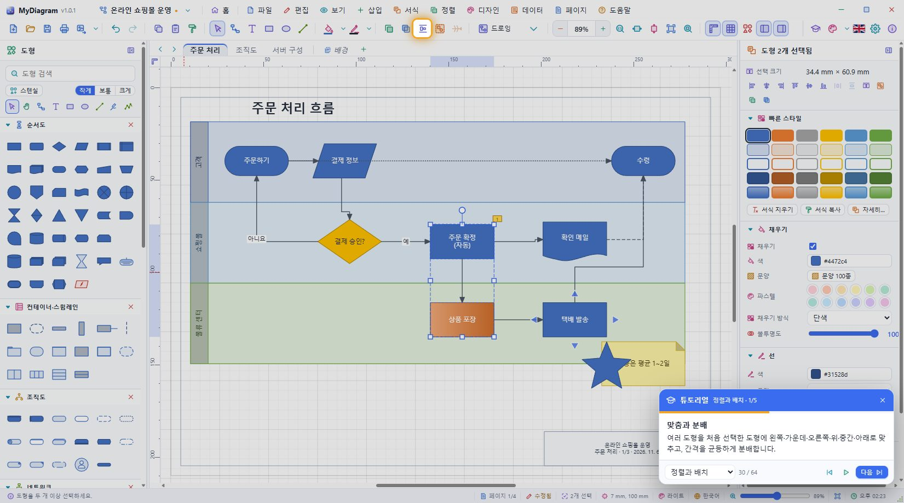

### 31. 그룹

도형을 그룹으로 묶으면 함께 움직이고 크기가 바뀝니다. 그룹 안의 도형은 한 번 더 클릭해 고릅니다.

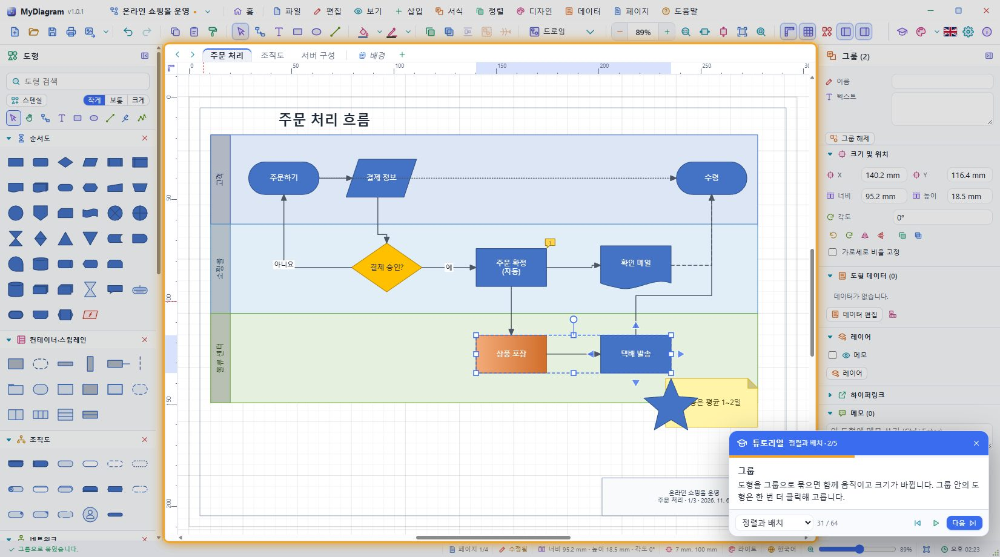

### 32. 자동 레이아웃

연결된 도형을 순서도·계층·방사형·원형·격자로 자동 배치합니다.

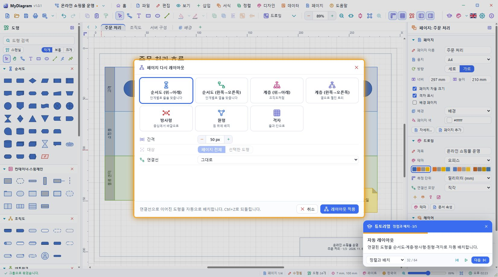

### 33. 회전과 대칭

90°씩 회전하거나 좌우·상하로 뒤집습니다. 맨 앞으로/맨 뒤로로 겹치는 순서를 바꿉니다.

### 34. Fishbone으로 변환

마인드맵을 그린 페이지에서는 툴바의 Fishbone 변환 버튼이 켜집니다. 누르면 중심 주제가 머리, 주요 주제가 가시가 되는 Fishbone 다이어그램으로 바뀌고, 다시 누르면 마인드맵으로 돌아갑니다.

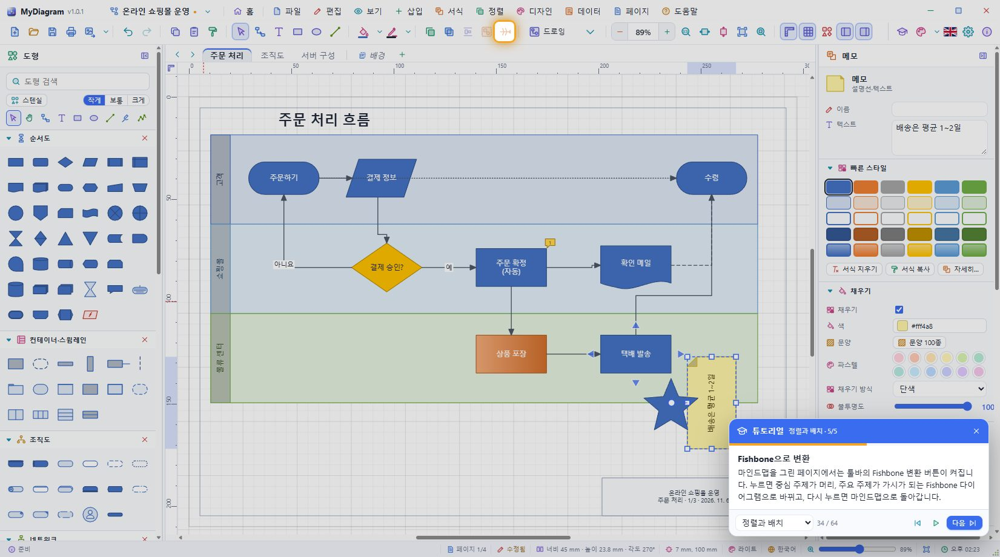

## 6. 페이지와 레이어

### 35. 여러 페이지

위쪽 페이지 탭으로 페이지를 바꾸고, +로 추가하며, 두 번 클릭해 이름을 바꾸고, 끌어서 순서를 바꿉니다.

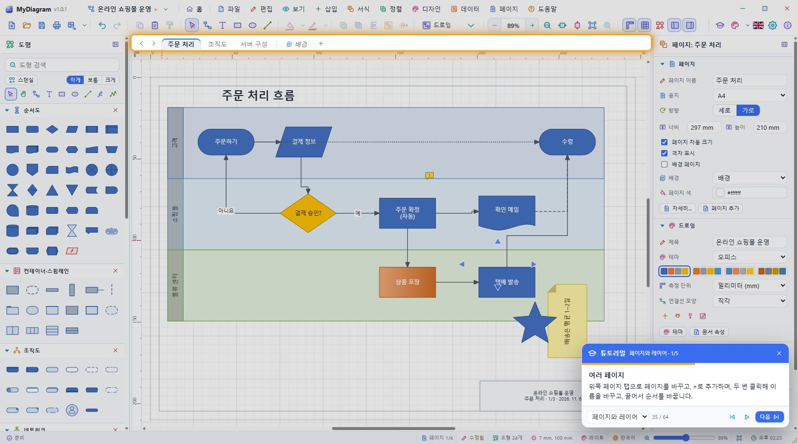

### 36. 배경 페이지

배경 페이지의 테두리와 제목 칸은 그 배경을 쓰는 모든 페이지에 나타납니다. {page}, {pages}, {date} 같은 필드가 자동으로 채워집니다.

### 37. 레이어

도형을 레이어에 나눠 담고 레이어마다 보이기·인쇄·잠금·색을 정합니다.

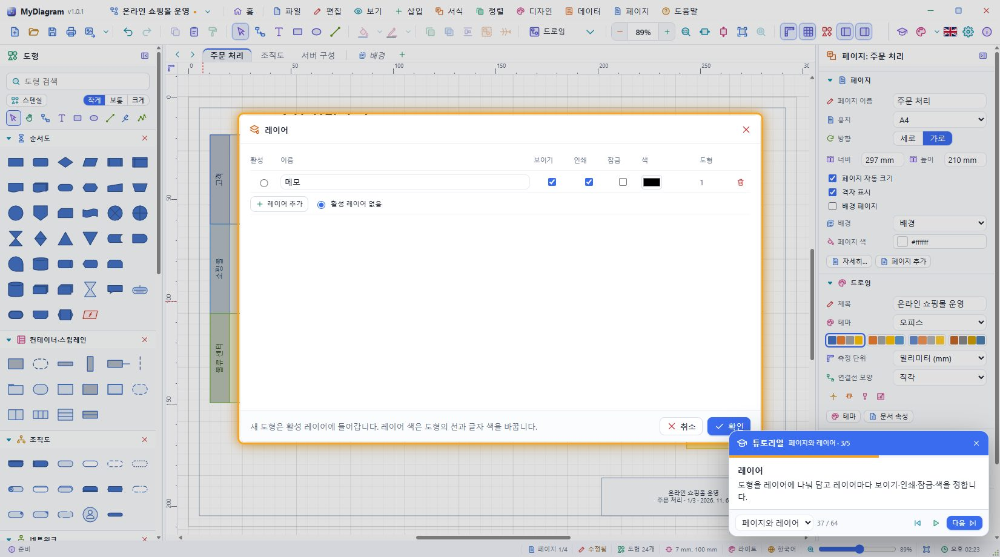

### 38. 페이지 설정

용지와 방향, 자동 크기, 배경 페이지, 페이지 색, 격자, 연결선 모양과 선 점프, 측정 단위를 정합니다.

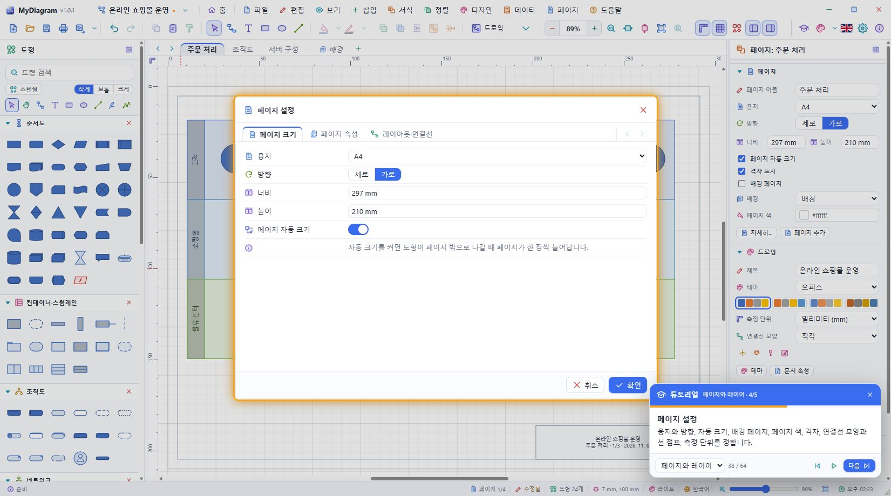

### 39. 페이지 개요

모든 페이지를 축소판으로 보고 열기·복제·이름 바꾸기·삭제·순서 바꾸기를 합니다.

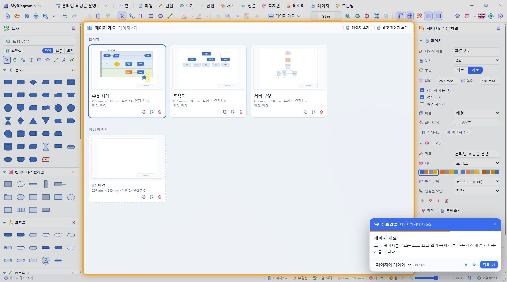

## 7. 데이터와 보고서

### 40. 도형 데이터

도형마다 텍스트·숫자·통화·날짜·예/아니요·목록 데이터를 붙입니다.

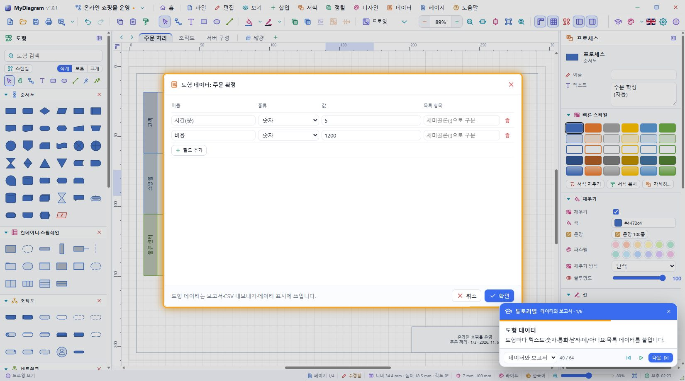

### 41. 데이터 표시

도형 아래에 데이터 값을 보여 줍니다. 도형마다 또는 드로잉 전체에 켭니다.

### 42. 도형 데이터 표

모든 도형의 데이터를 표로 보고 칸에서 바로 고칩니다. CSV로 내보내고, CSV를 도형에 연결합니다.

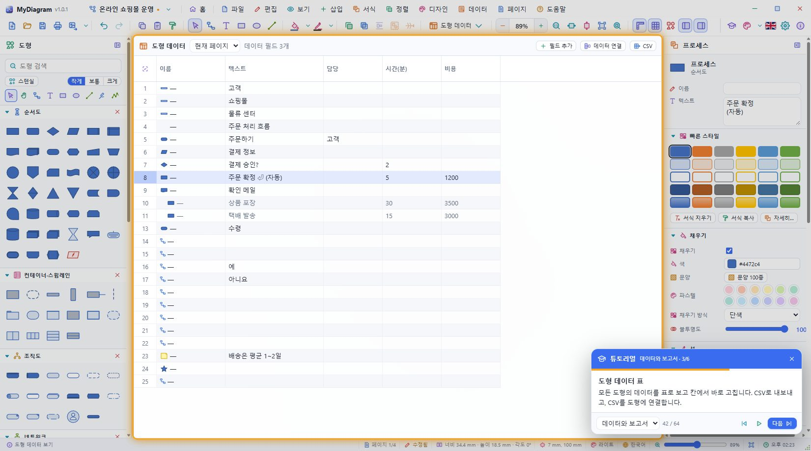

### 43. 데이터로 조직도

이름·직함·상사 열이 있는 표를 붙여넣거나 CSV를 열면 조직도가 만들어집니다.

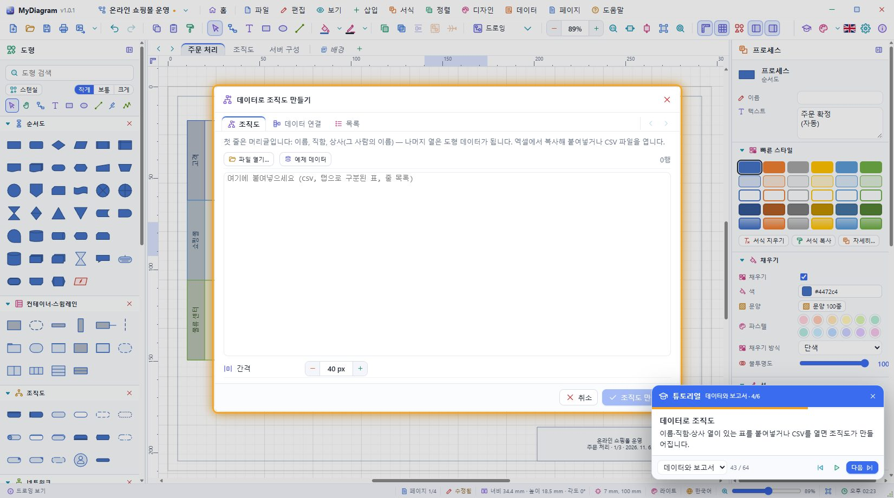

### 44. 보고서

도형 목록·도형 데이터(숫자 합계)·연결 관계·페이지·레이어·모든 텍스트 보고서를 만들고 HTML·Markdown·Word·PDF로 내보냅니다.

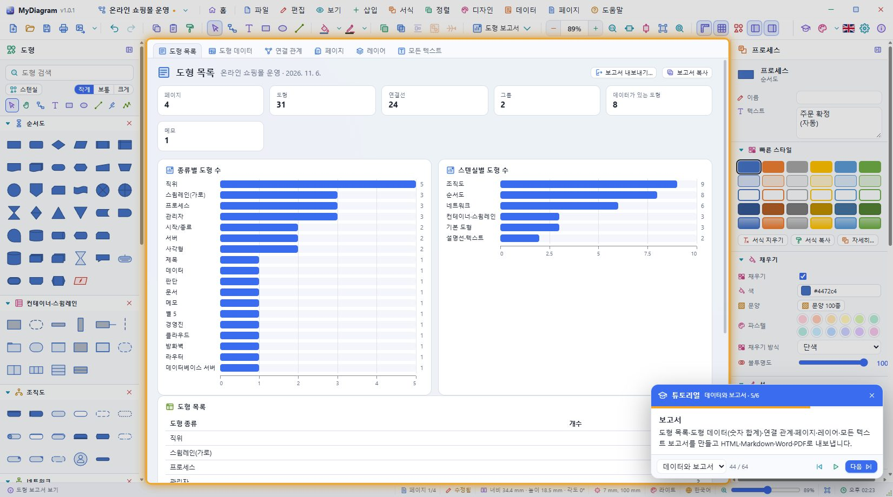

### 45. 도형 시트

현재 페이지의 모든 도형의 위치·크기·각도·색·글꼴 크기·링크를 표에서 숫자로 고칩니다.

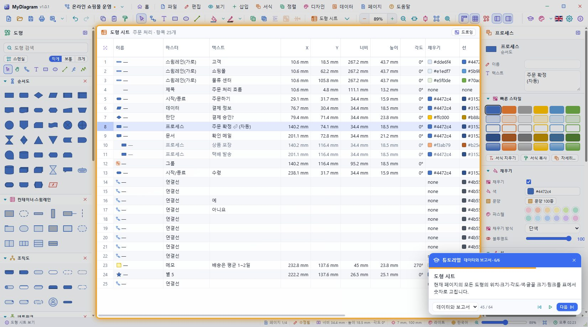

## 8. 파일과 인쇄

### 46. 파일 메뉴

저장(.mdg), 템플릿으로 저장(.mdgt), Visio 열기·저장, PDF·SVG·그림·HTML·CSV 내보내기, 최근 파일·폴더, 데이터베이스, 인쇄가 있습니다.

### 47. Visio와 주고받기

Visio .vsdx·.vstx 파일을 열고, 도형·텍스트·서식·데이터·레이어·그림·연결선을 그대로 .vsdx로 저장합니다.

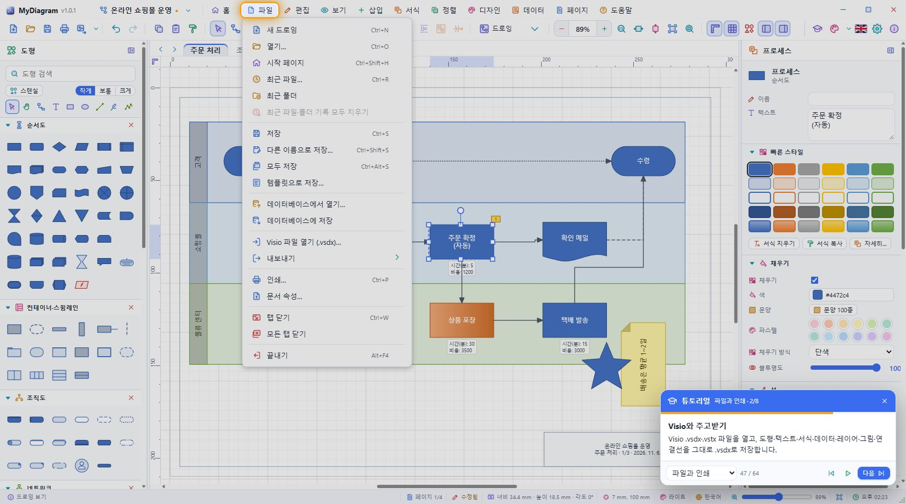

### 48. 인쇄와 미리 보기

모든 페이지·현재 페이지·페이지 범위를 고르고, 용지에 맞춤·실제 크기(여러 장에 나눠)·배율, 용지·방향·여백·머리글·바닥글을 미리 보며 인쇄합니다.

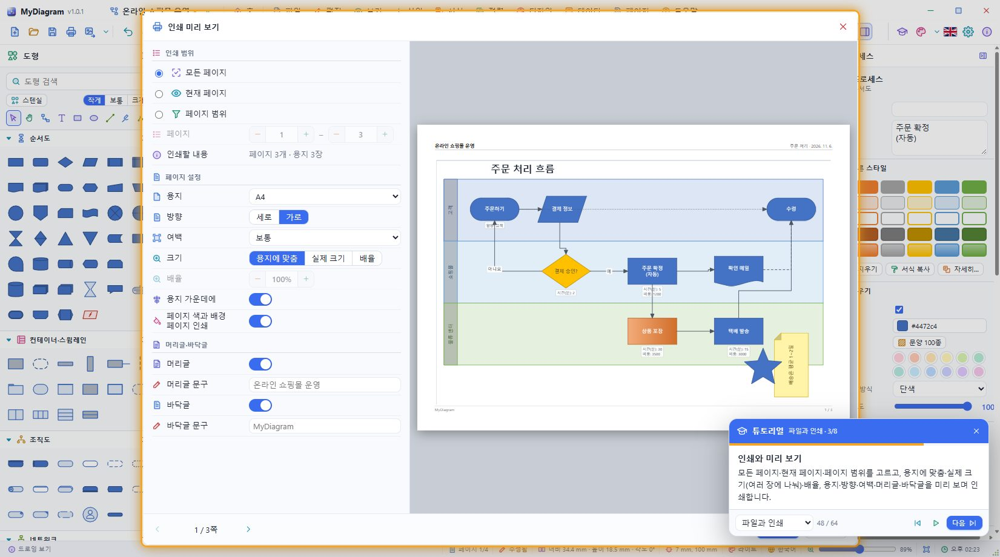

### 49. 페이지를 그림으로

페이지 전체·도형 부분·선택을 PNG·JPEG·WebP·BMP·TIFF·SVG로, 투명 배경과 배율을 골라 내보냅니다.

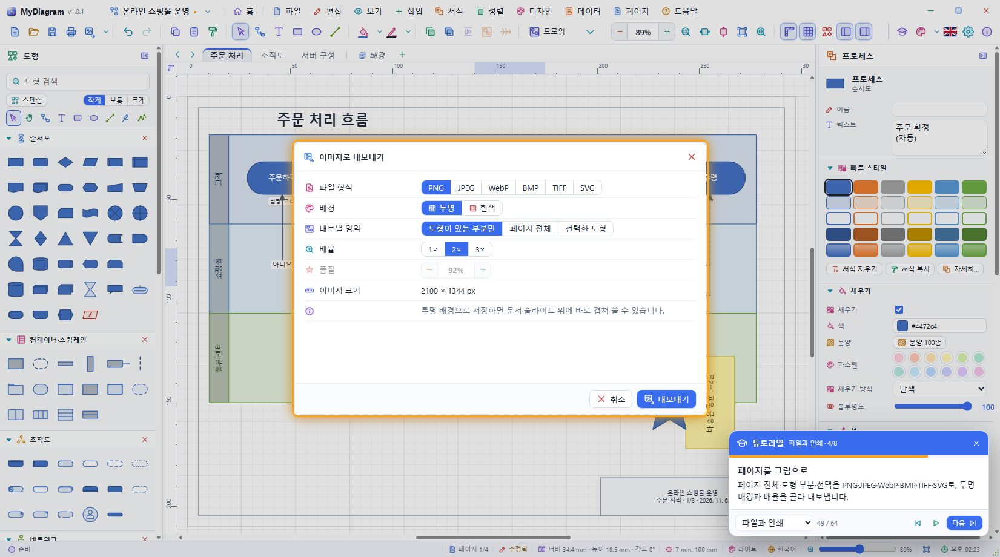

### 50. 데이터베이스에 저장하기

설정 › 데이터베이스에서 SQLite·MariaDB·MySQL·PostgreSQL을 고르고 연결 시험을 누릅니다. 그다음부터 저장(Ctrl+S)은 파일과 데이터베이스에 함께 저장하고, 파일 › 데이터베이스에서 열기로 꺼내 씁니다.

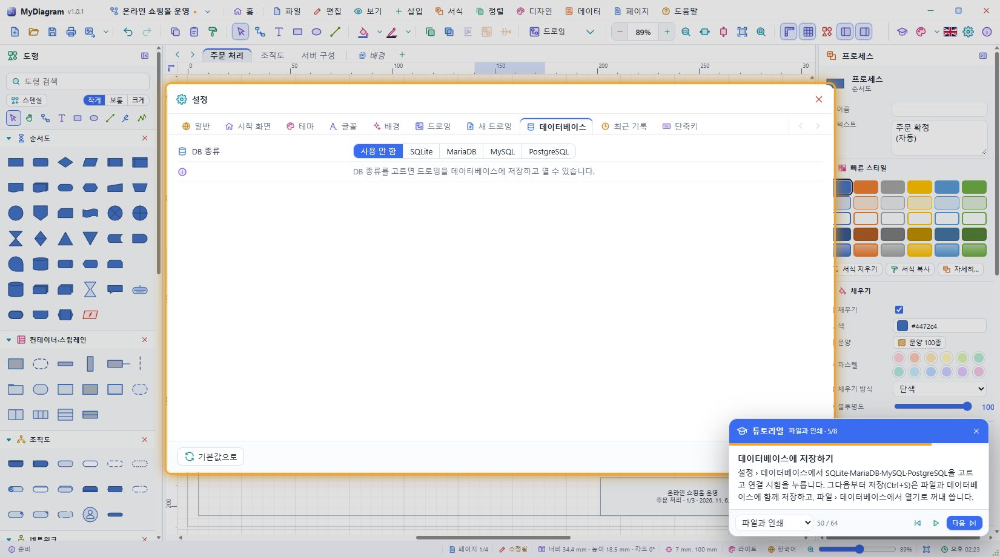

### 51. 최근 파일 관리

최근 파일과 최근 폴더를 탭으로 나눠 보여 줍니다. 열거나, 하나씩 지우거나, 모두 지웁니다. 없어진 파일은 "없음"으로 표시됩니다.

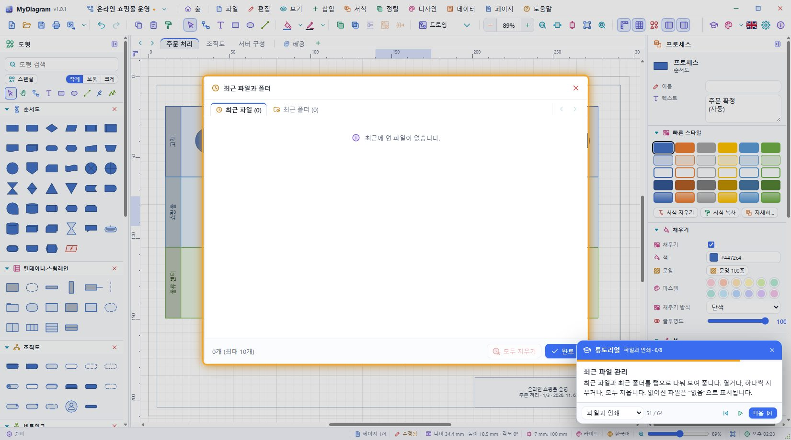

### 52. 끌어다 놓기

탐색기에서 .mdg·.vsdx 파일을 끌어오면 열리고, 그림은 페이지에 들어가며, CSV는 데이터 연결 창을 엽니다.

### 53. 그림 끌어다 놓기

탐색기에서 그림 파일을 드로잉으로 끌어다 놓으면 그 자리에 들어갑니다. PNG, JPEG, GIF, WebP, AVIF, HEIC, JPEG XL, JPEG 2000, TIFF, SVG, QOI, TGA 등을 받습니다.

## 9. 사용자 설정

### 54. 테마

테마 버튼은 누를 때마다 무작위로 다른 테마를 고릅니다. 옆의 ▾는 다크 20개와 라이트 20개를 두 줄로 보여 주고, 사용자 정의 테마는 설정의 테마 탭에서 색을 직접 고칩니다.

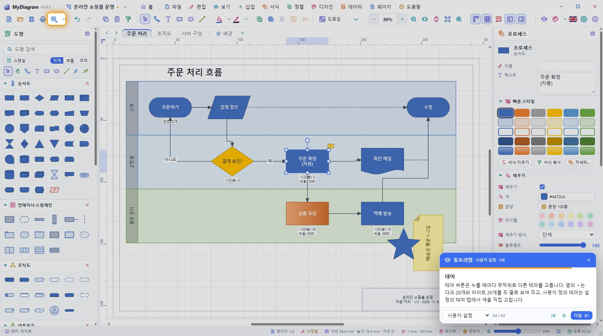

### 55. 언어

국기 버튼으로 한국어와 영어를 바꿉니다. 한국어일 때는 영국 국기, 영어일 때는 태극기가 보입니다.

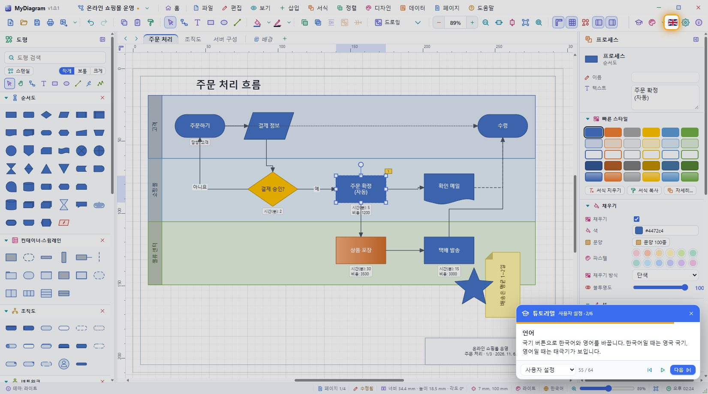

### 56. 패널 접기

도구 모음과 속성 패널은 접으면 아이콘과 제목만 남은 좁은 줄이 되고, 맨 위의 펼치기 버튼으로 다시 엽니다. 패널 사이 구분자를 끌어 너비를 바꿉니다.

### 57. 이동·확대 창

오른쪽 아래의 작은 창에서 전체 페이지를 보고 사각형을 끌어 원하는 곳으로 이동합니다. Ctrl+휠로 확대/축소합니다.

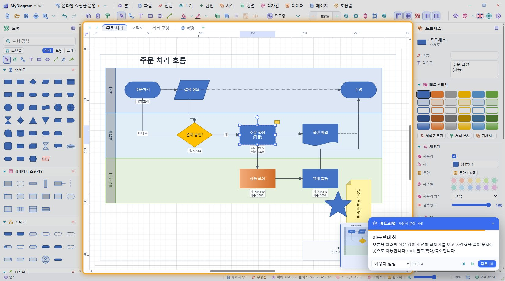

### 58. 설정

일반·테마·글꼴·배경·드로잉(눈금자·격자·안내선·맞추기·자동 연결)·새 드로잉(기본 테마·용지·단위)·데이터베이스·최근 기록·단축키 탭이 있습니다. 설정은 다음 실행에도 남습니다.

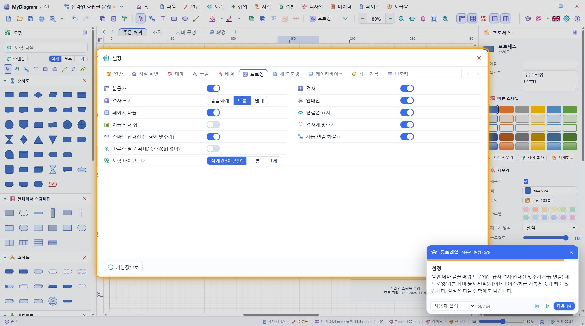

### 59. 상태 표시줄

명령 결과, 페이지 번호, 저장 상태, 선택한 도형의 크기·각도, 포인터 위치, 테마, 언어, 확대 슬라이더, 페이지 맞춤, 시계를 보여 줍니다.

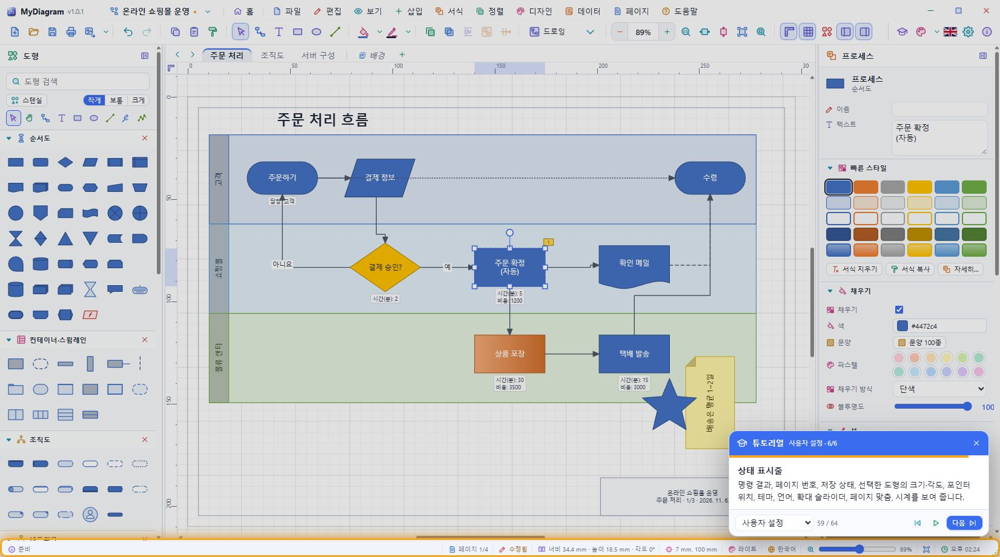

## 10. 도움말

### 60. 프레젠테이션 모드

F5를 누르면 페이지를 전체 화면으로 차례로 보여 줍니다. 방향키·클릭으로 넘기고, 링크가 있는 도형은 클릭해 이동하며, Esc로 끝냅니다.

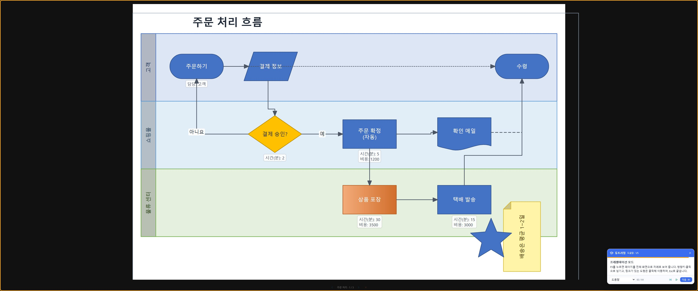

### 61. 단축키

설정 › 단축키에 모든 단축키가 있습니다. 메뉴에도 단축키가 함께 표시됩니다.

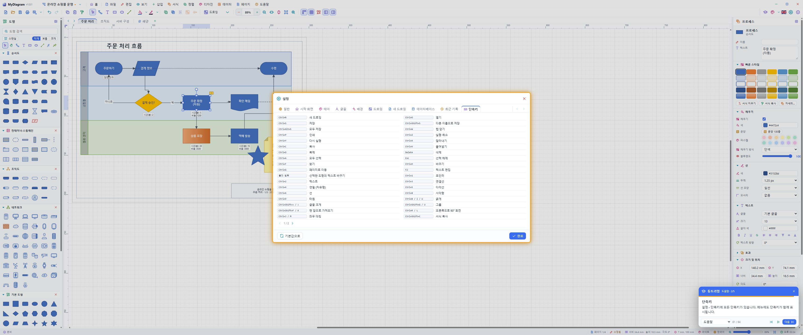

### 62. 프로그램 정보

툴바의 ⓘ 버튼은 버전, 빌드 정보, 제작자(SHKWON, knix008@naver.com)를 보여 줍니다. 오류가 나면 자세한 내용이 팝업으로 뜨고 그대로 복사할 수 있습니다.

### 63. 튜토리얼 문서 읽기

이 튜토리얼의 모든 단계를 화면과 함께 정리한 문서는 별도의 창으로 열립니다. 홈 화면의 도움말 › 튜토리얼 문서나 도움말 메뉴에서 엽니다. 창 위쪽에서 글꼴 크기와 언어를 바꿀 수 있습니다.

### 64. 다 둘러봤습니다

튜토리얼은 언제든 도움말 › 튜토리얼이나 툴바의 학사모 버튼(F11)으로 다시 볼 수 있습니다. 자세한 내용은 도움말 › 사용 설명서를 보세요.

