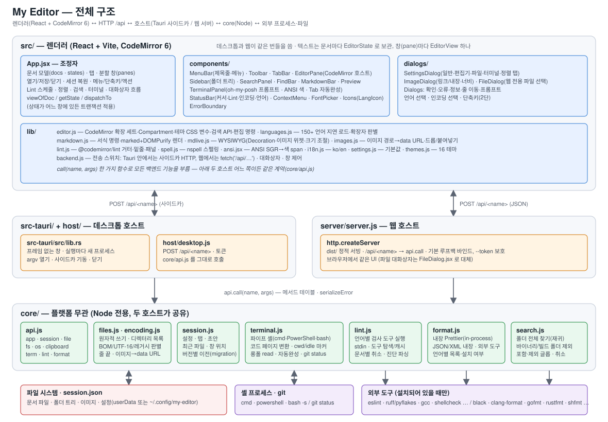

# My Editor — 아키텍처



위 그림은 네 층 — 렌더러(React + CodeMirror 6) → 전송(데스크톱은 Tauri 가 띄운 Node 서비스의 HTTP `/api`, 웹은 같은 HTTP) → 호스트(`src-tauri/` + `host/` · `server/`) → core(Node, 두 호스트가 공유) — 와 core 가 다루는 바깥 세계(파일 시스템·세션, 셸·git 프로세스, 설치된 검사/정렬 도구)를 보여 줍니다. 렌더러의 모든 백엔드 호출은 lib/backend.js 의 call(name, args) 하나를 거치고, 호스트가 무엇이든 core/api.js 의 같은 메서드 테이블에 닿습니다.

```
MyEditorMultiOSV20/
├ core/                 플랫폼 무관 (Node 전용, 두 호스트가 공유)
│  ├ encoding.js        인코딩 감지·변환(iconv-lite), 줄 끝 감지·정규화
│  ├ files.js           읽기/쓰기(원자적), 디렉터리 목록, 드라이브, mkdir/rename/remove, 이미지 → data URL (HEIC/HEIF/DICOM 은 PNG 로 디코드)
│  ├ png.js             RGBA → PNG (HEIC·DICOM 미리보기)
│  ├ heic.js            HEIC/HEIF 디코드(libheif-js wasm-bundle) → PNG, 여러 장
│  ├ dicom.js           DICOM 파싱·프레임 디코드·윈도우/레벨·시리즈 목록, 샘플 인코더
│  ├ session.js         session.json (설정 · 탭 · 초안 · 최근 파일 · 창 위치)
│  ├ search.js          폴더 전체 찾기(재귀 탐색, 바이너리/대용량/빌드 폴더 제외, 포함·제외 글롭, 취소, 결과 상한)
│  ├ install.js         정렬 도구 자동 설치(레시피: npm→<config>/tools/node · pip --user · cargo · go · gem · rustup · Install-Module; 진행 로그 롱폴, 취소)
│  ├ format.js          문서 정렬: 언어별 도구 목록·설치 여부, stdin/stdout 실행, 내장 Prettier(in-process)·JSON·XML
│  ├ lint.js            언어별 검사 도구 실행(별도 프로세스, stdin, 도구 탐색·캐시, 문서별 취소) → { line, col, severity, message }
│  ├ terminal.js        터미널 세션(파이프 셸 — 프롬프트·에코 없이 기동, 명령은 스크립트 파일로 source/call, 콘솔 코드 페이지 변환, SGR 색 유지, 단독 CR 은 통과, 출력 버퍼, cwd/종료 코드/idle 마커) + Tab 자동완성(내장 명령·PATH·경로) + git status 파싱
│  ├ browser.js         HTML 파일을 Edge · Chrome · Firefox 등 외부 브라우저로 열기
│  └ api.js             메서드 테이블 `api.call(name, args)` + 오류 직렬화
├ src-tauri/            Tauri 2 데스크톱 셸 (Rust)
│  ├ src/lib.rs         창, 명령줄 파일 열기, Node 사이드카 기동·종료. 실행할 때마다 프로세스가 따로 뜬다
│  └ tauri.conf.json    번들, 개발 서버(5189), 파일 연결
├ host/                 데스크톱 Node 서비스 (사이드카)
│  ├ desktop.js         127.0.0.1 임의 포트의 POST /api/<name>, 인쇄
│  └ print.js           인쇄 작업
├ server/server.js      웹 호스트: dist/ 정적 서빙 + POST /api/<name>
├ src/                  React UI (Vite)
│  ├ App.jsx            문서 모델·탭·열기/저장/닫기·세션 복원·메뉴·단축키·대화상자 흐름·인쇄 HTML 생성
│  ├ PopupWindow.jsx    별도 창 페이지(설정·정보·단축키): 세션 읽기, settings:patch 로 창 간 동기화
│  ├ lib/editor.js      CodeMirror 확장 세트, Compartment, 테마(CSS 변수), 검색 API, 편집 명령
│  ├ lib/indentguides.js 탭 크기마다 세로 안내선 (현재 줄의 들여쓰기 강조)
│  ├ lib/languages.js   @codemirror/language-data 150+ 언어 지연 로드, 확장자 판별
│  ├ lib/markdown.js    Markdown 서식 명령(감싸기/접두사 토글/블록 삽입), marked+DOMPurify 렌더러
│  ├ lib/mdlive.js      Markdown WYSIWYG: 구문 트리 기반 Decoration(기호 숨김·위젯·줄 스타일), 이미지 위젯(크기 조절 → )
│  ├ dialogs/ImageDialog.jsx  이미지 넣기(파일/URL, 링크 또는 Base64 내장, 너비, 미리보기)
│  ├ lib/lint.js        진단 표시(@codemirror/lint: 거터 마커·밑줄·툴팁·패널), 백엔드 결과 → Diagnostic 변환
│  ├ lib/ansi.jsx       ANSI SGR(16/256/트루컬러·굵게·밑줄 …) → 색 span + 색 없는 출력의 강조(오류/경고/완료 줄, 링크, 파일:줄, dir/ls -l/Get-ChildItem 목록) (터미널 출력)
│  ├ lib/images.js      이미지 경로 해석(문서 폴더 기준 → file.dataUrl, 캐시), 드롭/붙여넣기 파일 → data URL (HEIC/HEIF/DCM 포함)
│  ├ lib/dicomview.js   DICOM 윈도우/레벨·HU 읽기 (렌더러)
│  ├ lib/spell.js       스펠링 체크: nspell + assets/dict/en.{aff,dic}(지연 로드), 가시 범위만 검사, 제안·사용자 사전
│  ├ lib/backend.js     전송 스위치(Tauri 호스트 또는 fetch), 대화상자, 창 제어
│  ├ lib/tauri-host.js  창·대화상자·메뉴·팝업·인쇄 창 (Tauri API)
│  ├ lib/i18n.js        ko / en 사전
│  ├ lib/settings.js    설정 기본값
│  ├ lib/print.js       코드 목록 인쇄 HTML(구문 강조·줄무늬·여백·글꼴 크기, 경로·줄 번호·테두리·페이지 번호, A4 쪽 나누기)
│  ├ themes.js          40 테마(어두운 20 · 밝은 20) + 사용자 정의 테마(setCustomThemes) → CSS 변수(구문 색 --syn-* 포함)
│  ├ lib/prompt.js      프롬프트 테마 모델: 프리셋 20종, Go 스타일 템플릿 렌더, 세그먼트 컨텍스트
│  ├ lib/termtext.js    터미널 출력의 CR 처리(덮어쓰기/줄 바꿈/제거)
│  ├ components/        MenuBar · Toolbar · TabBar · EditorPane · FindBar · MarkdownBar · Preview · HtmlPreview · ImagePreview(래스터·HEIC·DICOM 슬라이더·윈도우/레벨) · Prompt · Sidebar · SearchPanel · TerminalPanel · FontPicker · StatusBar · ContextMenu · Icons
│  └ dialogs/           Dialogs(확인·오류·정보·줄 이동·프롬프트·언어·인코딩·단축키) · SettingsDialog(일반·테마·터미널·정렬·검사·인쇄) · PromptEditor(프리셋·사용자 정의·간단/고급 편집) · FileDialog(웹) · PrintPreviewDialog(인쇄 미리보기)
├ scripts/              free-port · generate-icons · sync-tauri-icons · stage-tauri-sidecar · build-info · smoke · clean …
├ test/                 단위 테스트 (npm test, 결과 문구는 영어)
└ build/icons/          assets/icon.svg 에서 생성. Tauri 아이콘은 src-tauri/icons/ 로 복사
```

## 1. 계층

### core/ — 플랫폼 무관, Node 전용
- `encoding.decode(buf)` 는 BOM → 엄격한 UTF-8 → UTF-16 NUL 패턴 → 이진 판별 → 시스템 레거시 코드 페이지 순으로 판별하고, 텍스트를 `\n` 으로 정규화한 뒤 `{ text, encoding, eol }` 를 돌려줍니다. `encode(text, enc, eol)` 는 반대 방향이며 BOM 은 직접 붙입니다. `canEncode` 로 손실 여부를 미리 확인합니다.
- `files.write` 는 임시 파일 + rename 으로 원자적으로 쓰고(네트워크 공유 등에서 rename 이 실패하면 직접 쓰기) 새 mtime 을 돌려줍니다. 렌더러는 이 mtime 으로 외부 변경을 감지합니다.
- `session.js` 는 512 KB 를 넘는 초안을 버리는 것 외에는 단순한 JSON 저장소입니다.
- `api.js` 의 메서드 테이블(`app.info`, `session.*`, `recent.*`, `file.*`, `fs.*`, `os.*`, `clipboard.*`)이 두 호스트의 공통 계약입니다. 오류는 `serializeError` 로 code · path · stack 을 담아 전달됩니다.

### src-tauri/ 와 host/
- `lib.rs` 는 프레임 없는 창을 만들고 Node 사이드카(`host/desktop.js`)를 띄웁니다. 사이드카는 `MED_READY` 로 포트와 토큰을 알리고, 렌더러는 그 주소로 `POST /api/<name>` 을 호출합니다. 명령줄로 넘긴 파일은 그 프로세스의 창에서 엽니다. 이미 실행 중인 창이 있어도 새 프로세스가 따로 뜹니다.
- 설정·정보·단축키·인쇄 미리보기는 렌더러가 Tauri 웹뷰 창으로 엽니다. 설정 창은 닫아도 숨기기만 해서 다시 열 때 바로 나타납니다.
- 네이티브 열기/저장/폴더 대화상자는 Tauri dialog 플러그인으로 엽니다.

### server/server.js
- `dist/` 를 서빙하고 `/api/<name>` 을 `api.call` 로 연결합니다. 기본 바인드는 루프백이며 `--token` 으로 보호합니다. 문서 전체가 JSON 본문으로 오가므로 본문 한도는 256 MB 입니다.

### src/ — React UI
- **문서 모델**: `docs[]` 에는 메타데이터(경로 · 인코딩 · 줄 끝 · 언어 · dirty · mtime …)만 있고, 텍스트는 CodeMirror `EditorState` 에 있습니다. 활성 문서의 상태는 단 하나의 `EditorView` 안에, 나머지는 `statesRef` 맵에 보관되며 탭을 바꾸면 `view.setState()` 로 교체합니다. 그래서 탭마다 실행 취소 기록 · 선택 · 접기가 유지됩니다. `dispatchTo(id, spec)` 은 상태가 어디에 있든 트랜잭션을 적용합니다.
- **dirty 판정**은 마지막으로 읽거나 저장한 `Text` 와 `doc.eq()` 비교(구조 공유 덕분에 빠름)로 합니다.
- **설정 변경**은 Compartment 재구성 효과(`settingsEffects`)를 활성 뷰와 보관된 모든 상태에 적용합니다.
- **언어**는 `LanguageDescription.load()` 로 지연 로드되어 Vite 가 문법마다 청크로 나눕니다. Markdown 이면 `markdownLive` 확장을 함께 넣습니다.
- **찾기**는 CodeMirror 의 search 상태를 그대로 쓰되 내장 패널은 보이지 않는 빈 DOM 으로 대체하고(`.cm-panels{display:none}`) FindBar 가 `SearchQuery` 를 밀어 넣습니다. 패널이 "열려" 있어야 일치 강조가 동작하기 때문입니다.
- **Markdown WYSIWYG**(`mdlive.js`)는 ViewPlugin 이 보이는 범위의 구문 트리를 훑어 `Decoration.replace`(기호 숨김 · 위젯) 와 `Decoration.line`(제목/인용/코드 줄 스타일) 을 만듭니다. 선택 영역이 닿은 줄은 원본을 그대로 보여 줍니다. 이미지(`Image` 노드와 `` HTMLTag/HTMLBlock)는 커서 줄에서도 항상 ImageWidget 으로 바뀌고, 같은 범위를 `EditorView.atomicRanges` 로도 제공해 커서 이동·삭제가 그림 단위로 이루어집니다. 로컬 이미지는 렌더러가 직접 읽을 수 없으므로(file:// · dev 서버 · 웹) `file.dataUrl` 로 받아 옵니다.
- **외부 변경 감지**: 창 포커스 · 탭 활성화 시 `file.stat` 으로 mtime/size 를 비교합니다(1.5초 스로틀).
- **세션 저장**은 1초 디바운스로, 탭 목록 · 커서 · dirty 문서의 초안을 씁니다.

## 2. 흐름

```
열기:  nativeDialog('open') ─┬ Tauri: 플러그인 대화상자
                             └ 웹: FileDialog.jsx (fs.list / fs.drives)
       → call('file.read') → addDoc(meta, text) → applyLanguage → activate
저장:  applySaveTransforms → (utf 아니면 file.canEncode → 경고) → call('file.write', {force})
       → savedRef 갱신, mtime 갱신, recent.touch
닫기:  confirmDiscard(저장/저장 안 함/취소) → removeDocs → 탭이 없으면 새 문서
종료:  메인 창을 닫으면 사이드카를 끝내고 프로세스가 종료된다
미리보기: HTML · Markdown · SVG 미리보기는 그 문서가 있는 창(pane) 안에서 소스 오른쪽에 붙는다
```

## 3. 테스트

- `npm test` — 단위 테스트. 결과 표의 문구는 영어입니다.
- `npm run smoke` — 개발 서버의 UI 를 `window.__med` 훅으로 실행하고 `.smoke/*.png` 를 남깁니다. 시나리오마다 별도 프로필을 씁니다.

## 4. 빌드 · 패키징

- `npm run build:web` 는 웹 화면을 `dist/` 에 만듭니다. `npm run web` 이 그 결과를 서버로 띄웁니다.
- `npm run build:win` · `build:linux` · `build:mac` 은 각 운영체제에서 설치 파일을 만듭니다(Windows 는 NSIS 설치 파일 하나이고 설치를 시작할 때 언어를 고릅니다. Linux deb·AppImage, macOS app·dmg). 아이콘을 맞추고 사이드카(`core/`, `host/`, 운영에 필요한 `node_modules`, Node 실행 파일)를 준비한 뒤 `vite build` → `dist/` 를 Tauri 가 묶습니다. 패키지는 `src-tauri/target/release/bundle/` 에 만들어진 뒤 프로젝트 루트로 복사됩니다. `src/build-info.json`(빌드 시각 · git 커밋) 은 사이드카와 함께 들어가 정보 대화상자에 표시됩니다.
- `MED_USER_DATA` 환경 변수로 프로필 위치를 바꿀 수 있습니다(테스트용).
