# MyHeatManager 튜토리얼

이 튜토리얼은 시작 화면부터 모델 그리기, 해석, 결과 읽기까지 MyHeatManager 를 실제 화면으로 따라갑니다. 같은 단계가 프로그램 안에서도 실행됩니다 — **도움말 › 튜토리얼** (또는 시작 화면의 **튜토리얼 시작**) 을 누르면 오른쪽 아래 카드의 이전 / 다음, 자동 재생, 장 목록으로 화면이 직접 움직입니다.

## 차례

1. 시작 화면
2. 화면 둘러보기
3. 모델 그리기
4. 재료
5. 열원과 경계 조건
6. 해석
7. 결과 보기
8. 고급 해석
9. SimScale 방식 해석
10. 신뢰성 · U-값 · 히트맵
11. 파일과 출력
12. 꾸미기

## 1. 시작 화면

### 1. 환영합니다

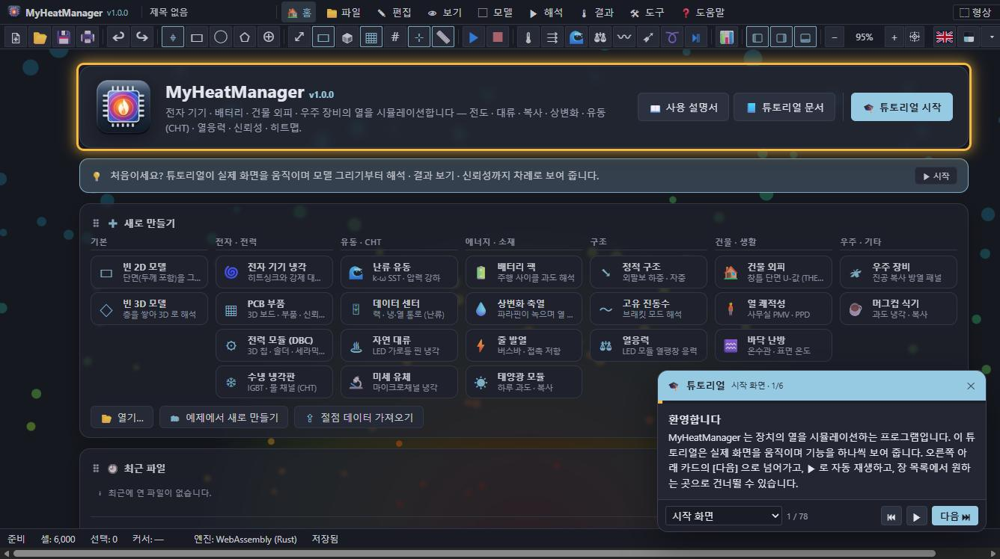

MyHeatManager 는 장치의 열을 시뮬레이션하는 프로그램입니다. 이 튜토리얼은 실제 화면을 움직이며 기능을 하나씩 보여 줍니다. 오른쪽 아래 카드의 [다음] 으로 넘어가고, ▶ 로 자동 재생하고, 장 목록에서 원하는 곳으로 건너뛸 수 있습니다.

### 2. 새로 만들기

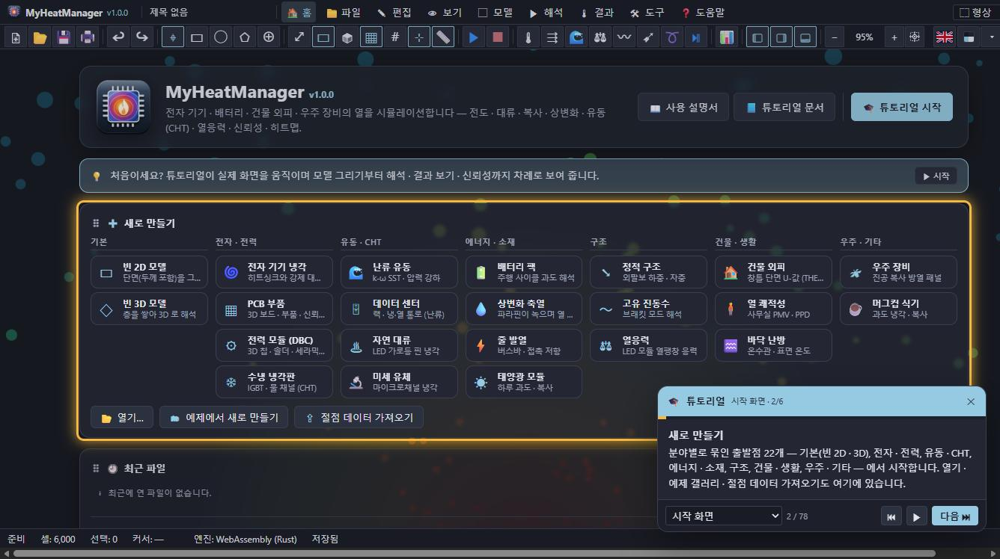

분야별로 묶인 출발점 22개 — 기본(빈 2D · 3D), 전자 · 전력, 유동 · CHT, 에너지 · 소재, 구조, 건물 · 생활, 우주 · 기타 — 에서 시작합니다. 열기 · 예제 갤러리 · 절점 데이터 가져오기도 여기에 있습니다.

### 3. 최근 파일과 도움말

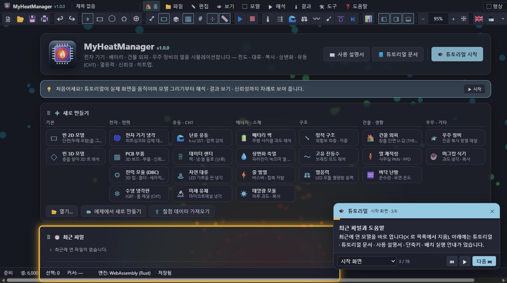

최근에 연 모델을 바로 엽니다(✕ 로 목록에서 지움). 아래에는 튜토리얼 · 튜토리얼 문서 · 사용 설명서 · 단축키 · 배치 실행 안내가 있습니다.

### 4. 예제와 배경

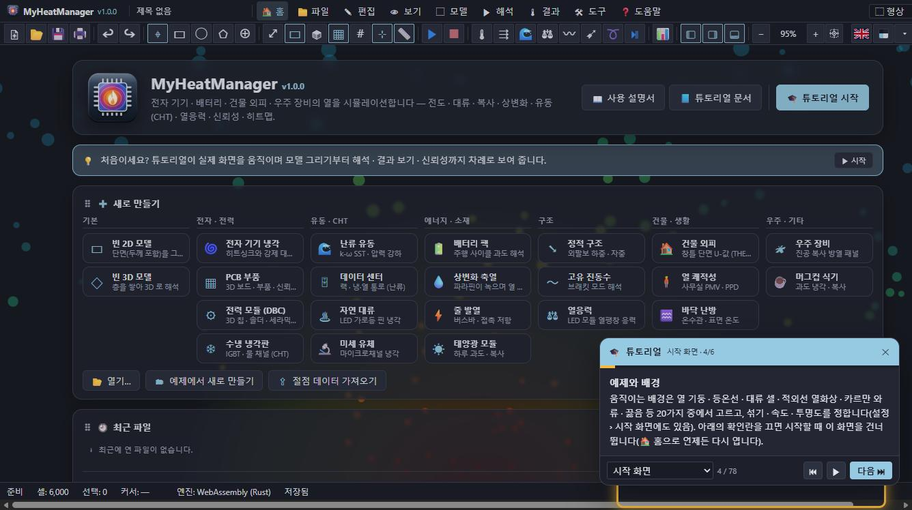

움직이는 배경은 열 기둥 · 등온선 · 대류 셀 · 적외선 열화상 · 카르만 와류 · 끓음 등 20가지 중에서 고르고, 섞기 · 속도 · 투명도를 정합니다(설정 › 시작 화면에도 있음). 아래의 확인란을 끄면 시작할 때 이 화면을 건너뜁니다(🏠 홈으로 언제든 다시 엽니다).

### 5. 카드 옮기기와 크기

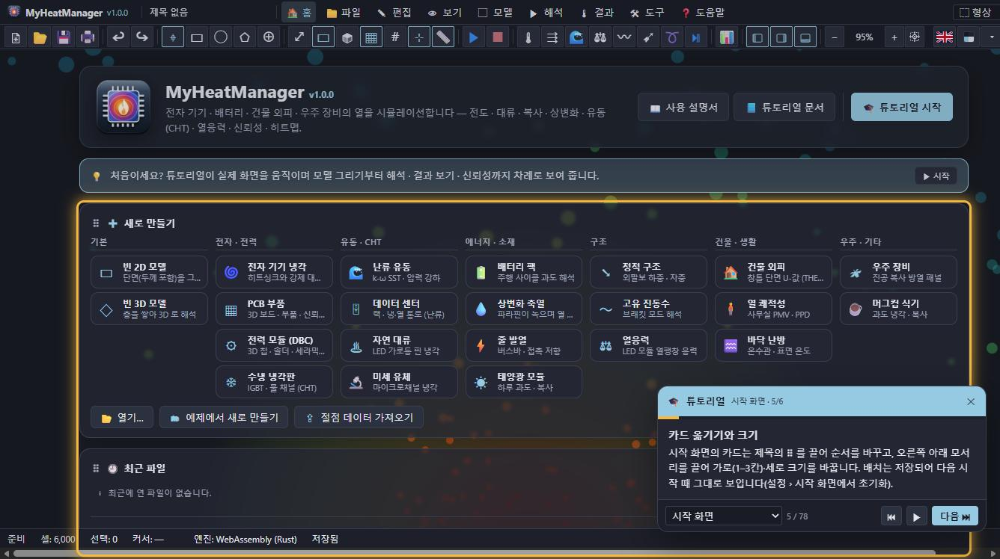

시작 화면의 카드는 제목의 ⠿ 를 끌어 순서를 바꾸고, 오른쪽 아래 모서리를 끌어 가로(1–3칸)·세로 크기를 바꿉니다. 배치는 저장되어 다음 시작 때 그대로 보입니다(설정 › 시작 화면에서 초기화).

### 6. 예제 구역

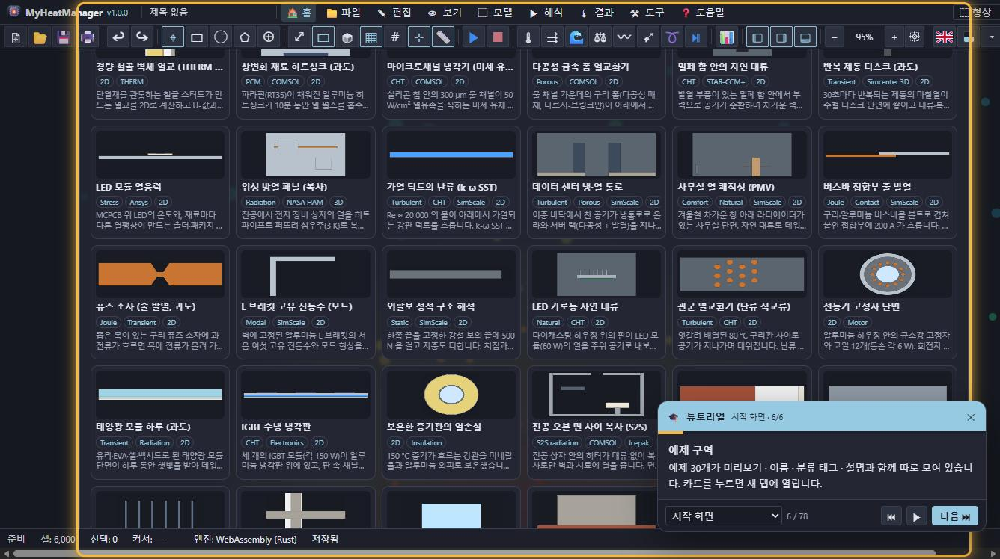

예제 30개가 미리보기 · 이름 · 분류 태그 · 설명과 함께 따로 모여 있습니다. 카드를 누르면 새 탭에 열립니다.

## 2. 화면 둘러보기

### 7. 튜토리얼 예제

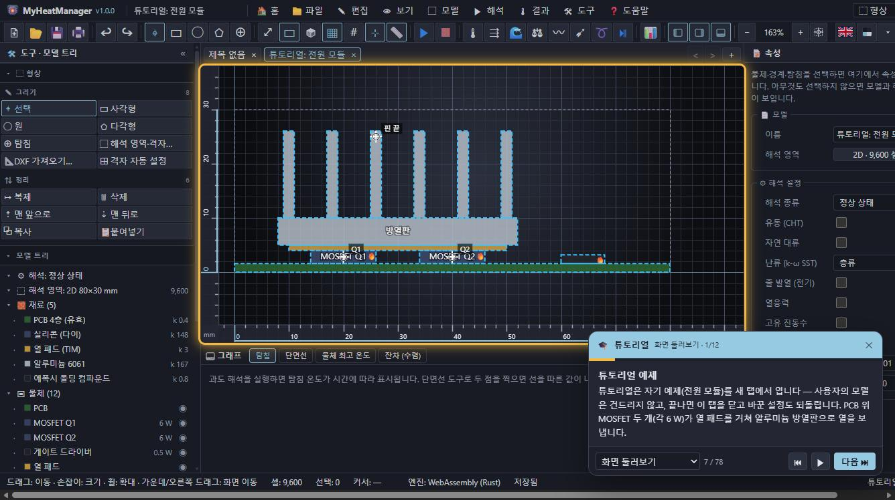

튜토리얼은 자기 예제(전원 모듈)를 새 탭에서 엽니다 — 사용자의 모델은 건드리지 않고, 끝나면 이 탭을 닫고 바꾼 설정도 되돌립니다. PCB 위 MOSFET 두 개(각 6 W)가 열 패드를 거쳐 알루미늄 방열판으로 열을 보냅니다.

### 8. 메뉴 막대

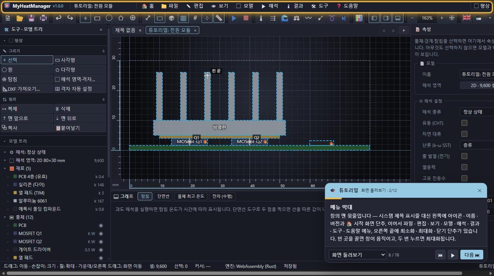

창의 맨 윗줄입니다 — 시스템 제목 표시줄 대신 왼쪽에 아이콘 · 이름 · 버전과 🏠 시작 화면 단추, 이어서 파일 · 편집 · 보기 · 모델 · 해석 · 결과 · 도구 · 도움말 메뉴, 오른쪽 끝에 최소화 · 최대화 · 닫기 단추가 있습니다. 빈 곳을 끌면 창이 움직이고, 두 번 누르면 최대화됩니다.

### 9. 작업대

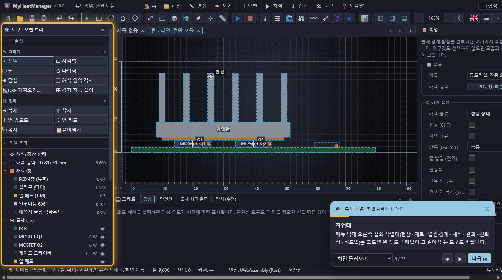

메뉴 막대 오른쪽 끝의 작업대(형상 · 재료 · 열원·경계 · 해석 · 결과 · 신뢰성 · 히트맵)를 고르면 왼쪽 도구 패널이 그 일에 맞는 도구로 바뀝니다.

### 10. 도구 모음

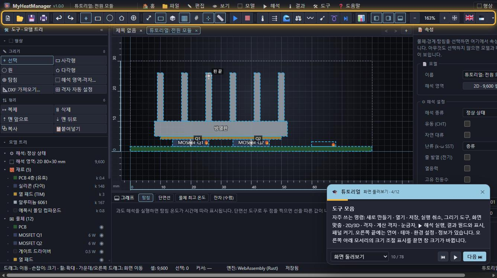

자주 쓰는 명령: 새로 만들기 · 열기 · 저장, 실행 취소, 그리기 도구, 화면 맞춤 · 2D/3D · 격자 · 계산 격자 · 눈금자, ▶ 해석 실행, 결과 필드와 표시, 패널 켜기. 오른쪽 끝에는 언어 · 테마 · 환경 설정 · 정보가 있습니다. 오른쪽 아래 모서리의 크기 조절 표시를 끌면 창 크기가 바뀝니다.

### 11. 원위치

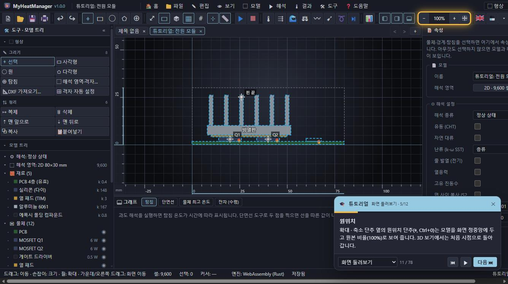

확대 · 축소 단추 옆의 원위치 단추(⌖, Ctrl+0)는 모델을 화면 정중앙에 두고 원본 비율(100%)로 보여 줍니다. 3D 보기에서는 처음 시점으로 돌아갑니다.

### 12. 모델 트리

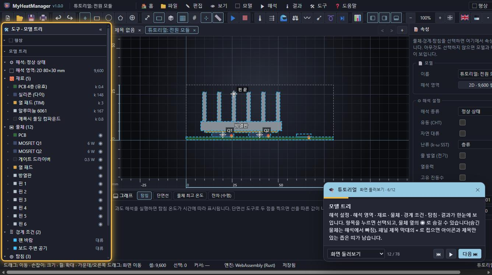

해석 설정 · 해석 영역 · 재료 · 물체 · 경계 조건 · 탐침 · 결과가 한눈에 보입니다. 항목을 누르면 선택되고, 물체 옆의 ◉ 로 숨길 수 있습니다(숨긴 물체는 해석에서 빠짐). 패널 제목 막대의 « 로 접으면 아이콘과 제목만 있는 좁은 띠가 남습니다.

### 13. 속성 패널

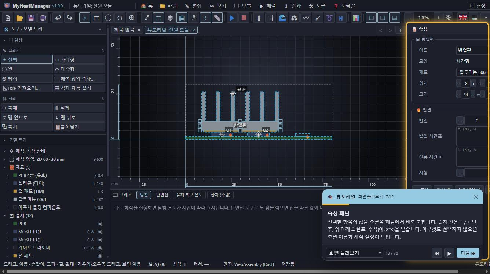

선택한 항목의 값을 오른쪽 패널에서 바로 고칩니다. 숫자 칸은 − / + 단추, 위·아래 화살표, 수식(예: 2*3)을 받습니다. 아무것도 선택하지 않으면 모델 이름과 해석 설정이 보입니다.

### 14. 상태 표시줄

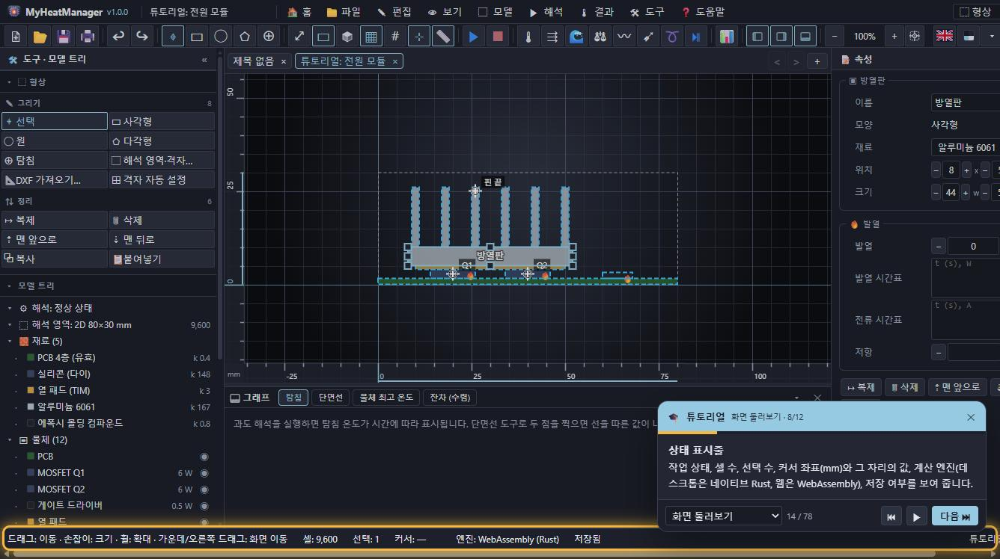

작업 상태, 셀 수, 선택 수, 커서 좌표(mm)와 그 자리의 값, 계산 엔진(데스크톱은 네이티브 Rust, 웹은 WebAssembly), 저장 여부를 보여 줍니다.

### 15. 패널 접기와 펼치기

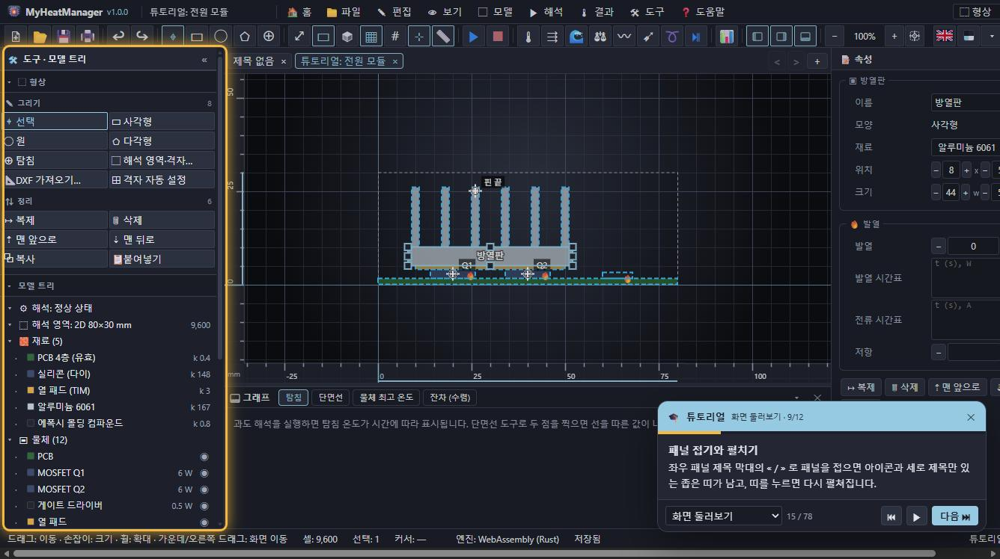

좌우 패널 제목 막대의 « / » 로 패널을 접으면 아이콘과 세로 제목만 있는 좁은 띠가 남고, 띠를 누르면 다시 펼쳐집니다.

### 16. 격자 · 계산 격자 · 눈금자

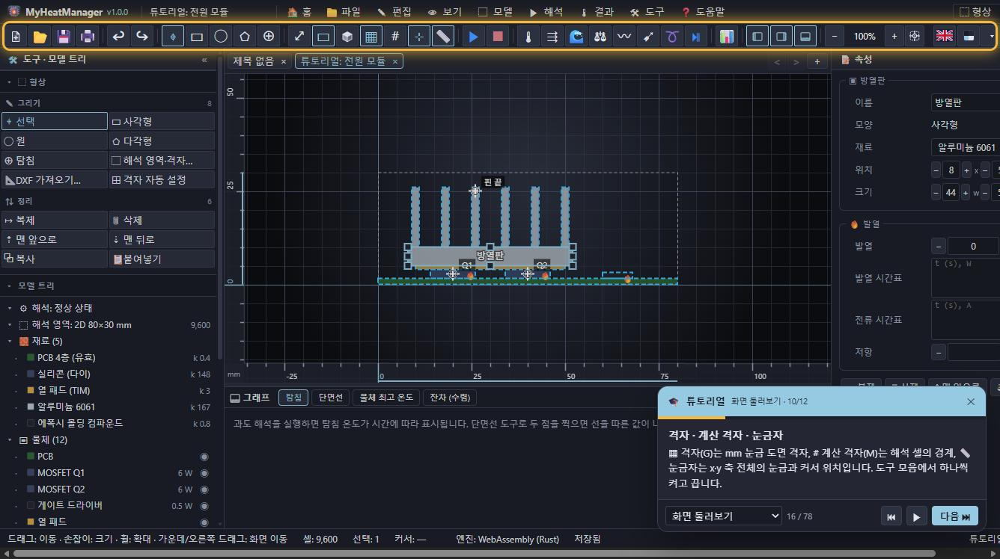

▦ 격자(G)는 mm 눈금 도면 격자, # 계산 격자(M)는 해석 셀의 경계, 📏 눈금자는 x·y 축 전체의 눈금과 커서 위치입니다. 도구 모음에서 하나씩 켜고 끕니다.

### 17. 오른쪽 단추 메뉴

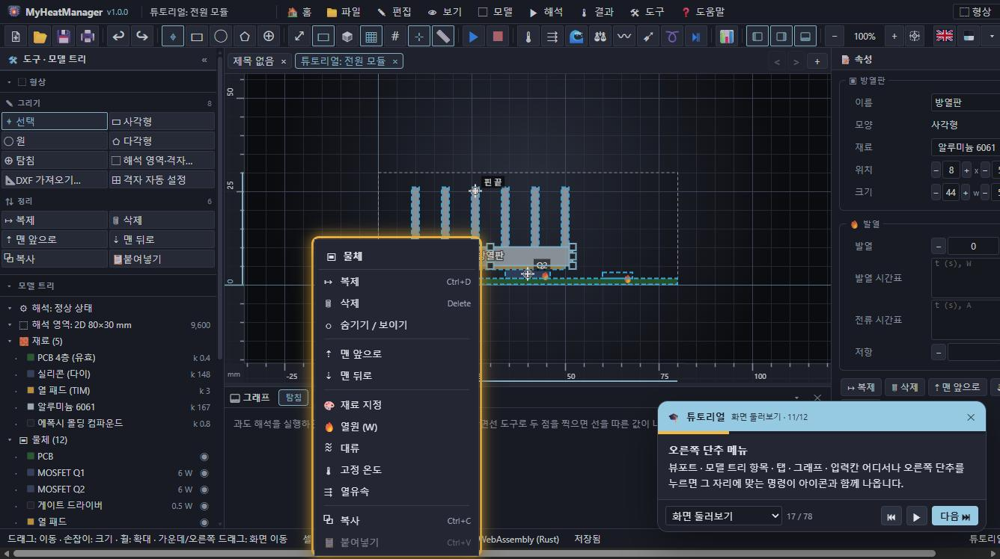

뷰포트 · 모델 트리 항목 · 탭 · 그래프 · 입력칸 어디서나 오른쪽 단추를 누르면 그 자리에 맞는 명령이 아이콘과 함께 나옵니다.

### 18. 탭과 < > 이동

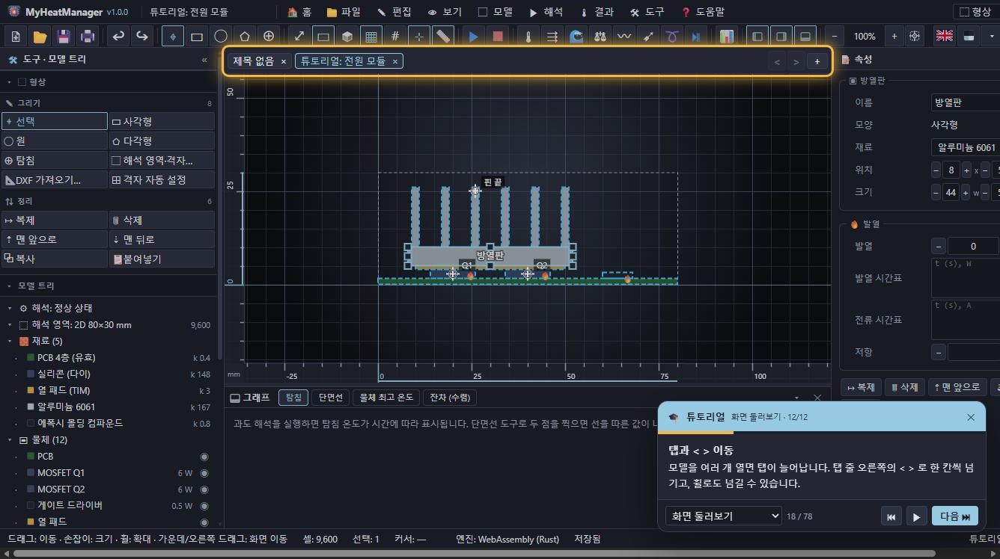

모델을 여러 개 열면 탭이 늘어납니다. 탭 줄 오른쪽의 < > 로 한 칸씩 넘기고, 휠로도 넘길 수 있습니다.

## 3. 모델 그리기

### 19. 해석 영역과 격자

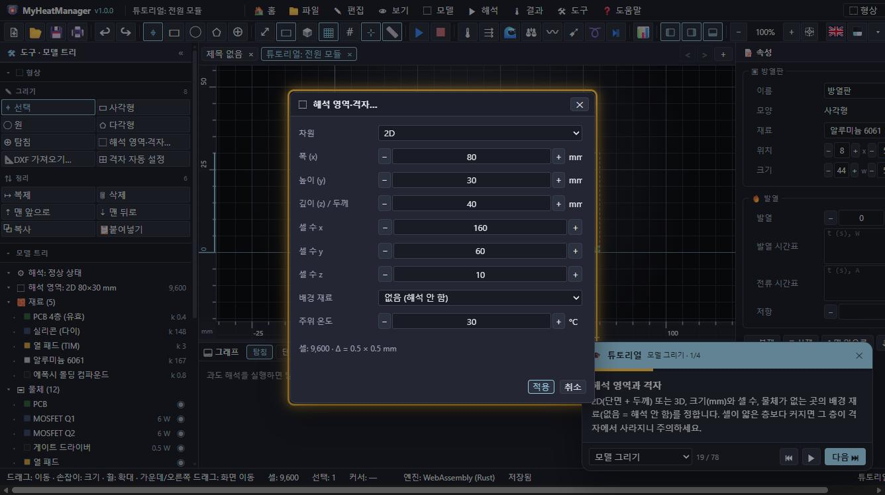

2D(단면 + 두께) 또는 3D, 크기(mm)와 셀 수, 물체가 없는 곳의 배경 재료(없음 = 해석 안 함)를 정합니다. 셀이 얇은 층보다 커지면 그 층이 격자에서 사라지니 주의하세요.

### 20. 사각형 그리기

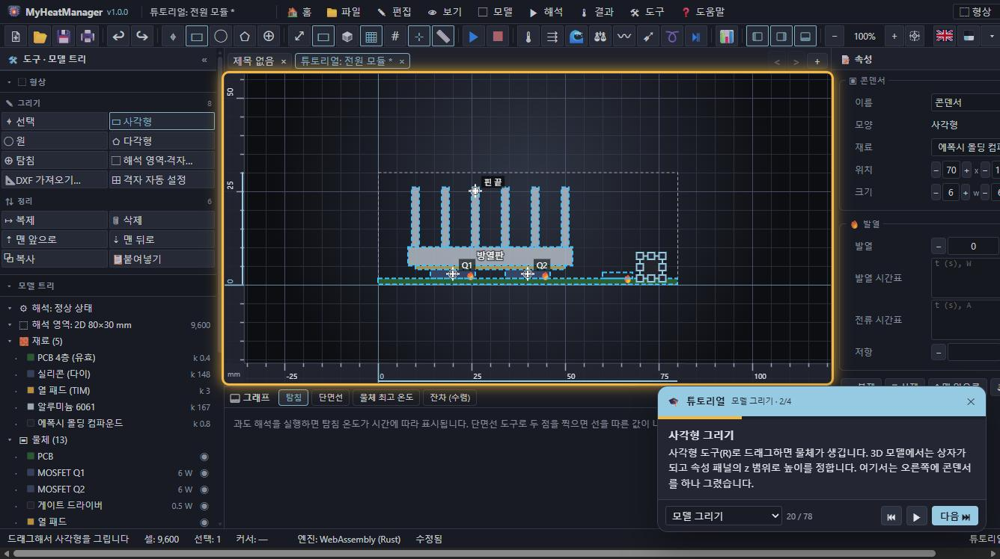

사각형 도구(R)로 드래그하면 물체가 생깁니다. 3D 모델에서는 상자가 되고 속성 패널의 z 범위로 높이를 정합니다. 여기서는 오른쪽에 콘덴서를 하나 그렸습니다.

### 21. 원과 다각형

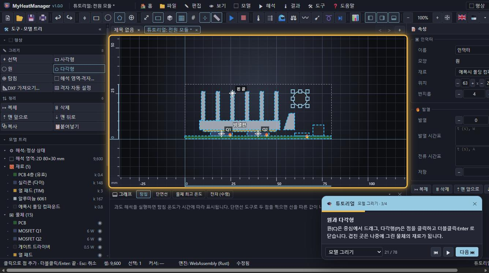

원(C)은 중심에서 드래그, 다각형(P)은 점을 클릭하고 더블클릭·Enter 로 닫습니다. 겹친 곳은 나중에 그린 물체의 재료가 됩니다.

### 22. 이동 · 크기 · 순서

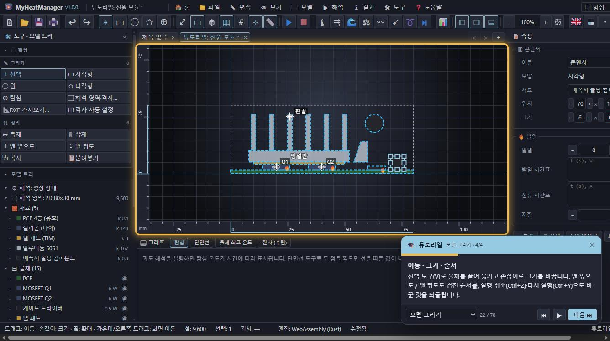

선택 도구(V)로 물체를 끌어 옮기고 손잡이로 크기를 바꿉니다. 맨 앞으로 / 맨 뒤로로 겹친 순서를, 실행 취소(Ctrl+Z)·다시 실행(Ctrl+Y)으로 바꾼 것을 되돌립니다.

## 4. 재료

### 23. 재료 라이브러리

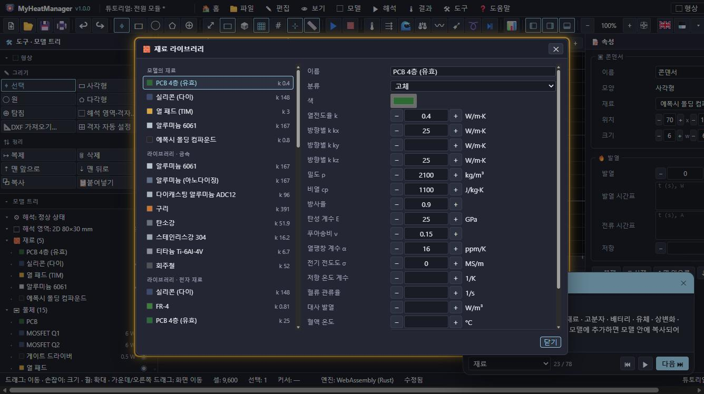

금속 · 전자 재료 · 세라믹 · 건축 재료 · 고분자 · 배터리 · 유체 · 상변화 · 다공성 매체 50가지가 있습니다. 모델에 추가하면 모델 안에 복사되어 파일만으로도 열립니다.

### 24. 재료 지정

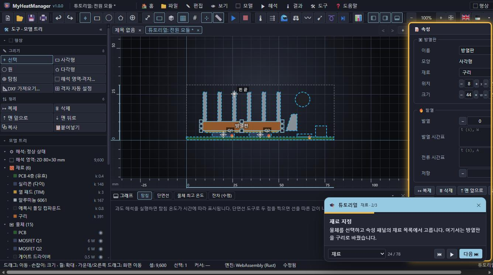

물체를 선택하고 속성 패널의 재료 목록에서 고릅니다. 여기서는 방열판을 구리로 바꿨습니다.

### 25. 재료 속성과 방향별 k

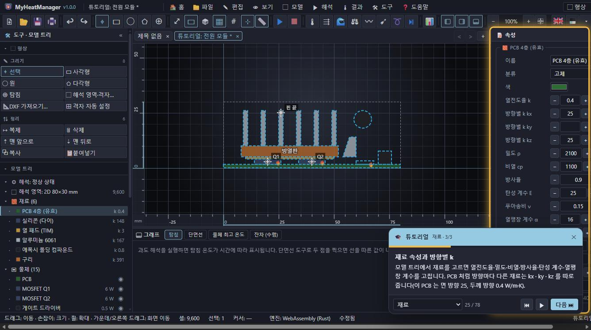

모델 트리에서 재료를 고르면 열전도율·밀도·비열·방사율·탄성 계수·열팽창 계수를 고칩니다. PCB 처럼 방향마다 다른 재료는 kx · ky · kz 를 따로 줍니다(이 PCB 는 면 방향 25, 두께 방향 0.4 W/m·K).

## 5. 열원과 경계 조건

### 26. 열원

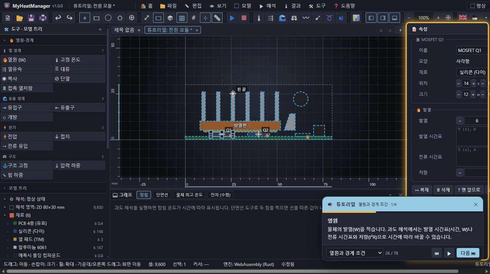

물체의 발열(W)을 적습니다. 과도 해석에서는 발열 시간표(시간, W)나 전류 시간표와 저항(I²R)으로 시간에 따라 바꿀 수 있습니다.

### 27. 경계 조건

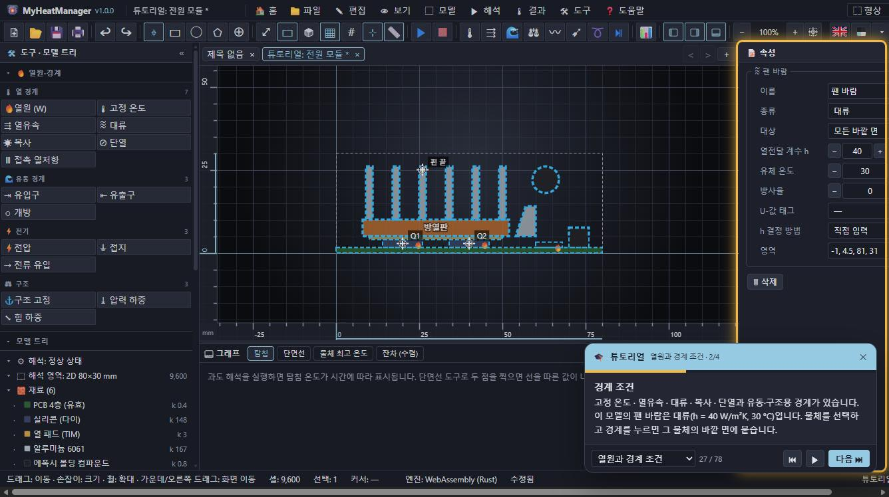

고정 온도 · 열유속 · 대류 · 복사 · 단열과 유동·구조용 경계가 있습니다. 이 모델의 팬 바람은 대류(h = 40 W/m²K, 30 °C)입니다. 물체를 선택하고 경계를 누르면 그 물체의 바깥 면에 붙습니다.

### 28. 경계의 대상과 영역

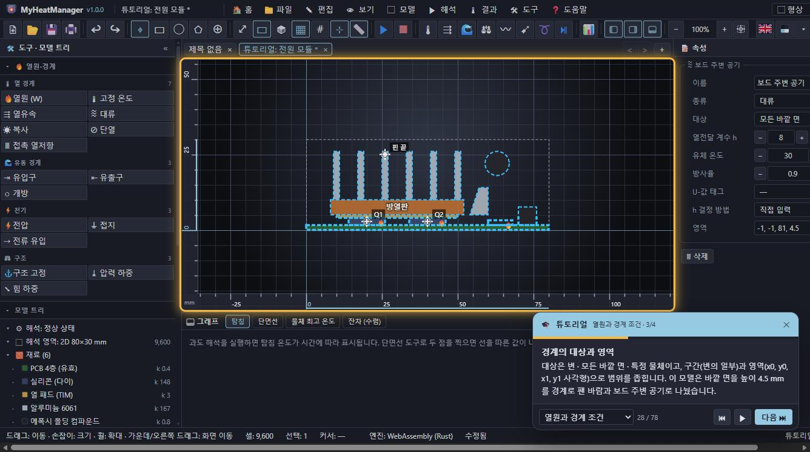

대상은 변 · 모든 바깥 면 · 특정 물체이고, 구간(변의 일부)과 영역(x0, y0, x1, y1 사각형)으로 범위를 좁힙니다. 이 모델은 바깥 면을 높이 4.5 mm 를 경계로 팬 바람과 보드 주변 공기로 나눴습니다.

### 29. 탐침

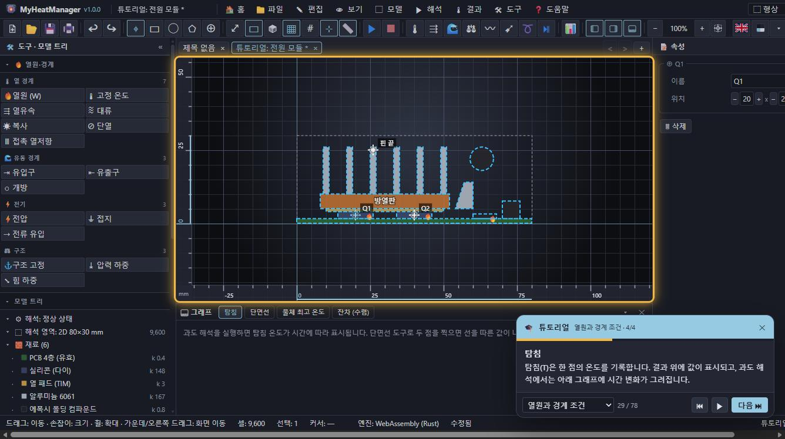

탐침(T)은 한 점의 온도를 기록합니다. 결과 위에 값이 표시되고, 과도 해석에서는 아래 그래프에 시간 변화가 그려집니다.

## 6. 해석

### 30. 해석 설정

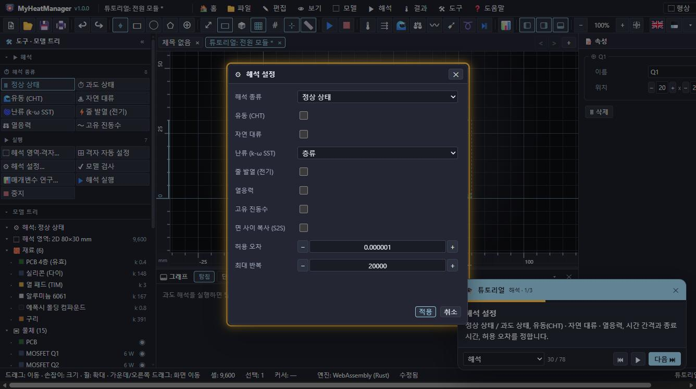

정상 상태 / 과도 상태, 유동(CHT) · 자연 대류 · 열응력, 시간 간격과 종료 시간, 허용 오차를 정합니다.

### 31. 모델 검사

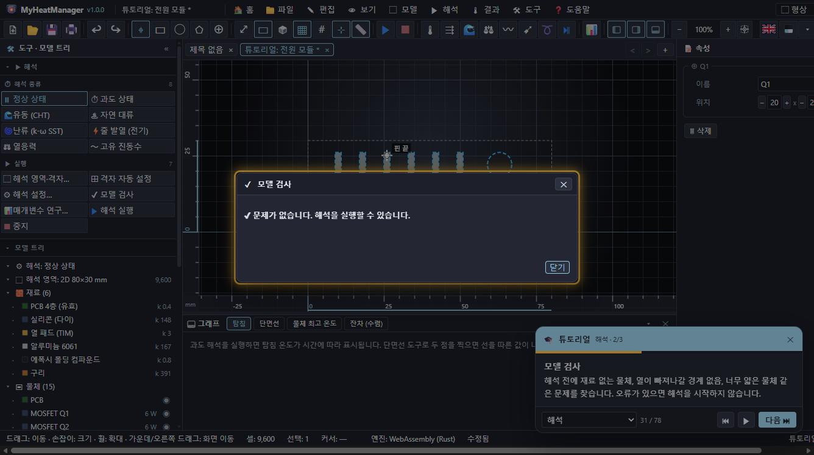

해석 전에 재료 없는 물체, 열이 빠져나갈 경계 없음, 너무 얇은 물체 같은 문제를 찾습니다. 오류가 있으면 해석을 시작하지 않습니다.

### 32. 해석 실행

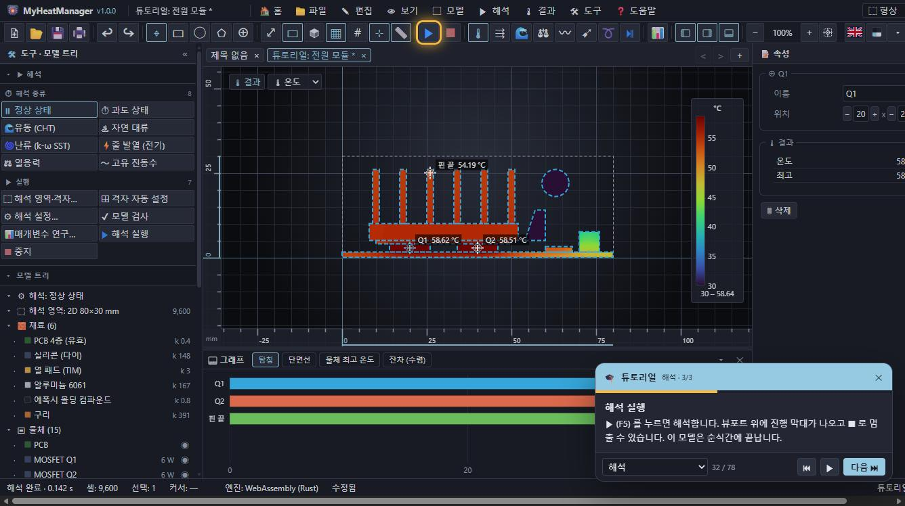

▶ (F5) 를 누르면 해석합니다. 뷰포트 위에 진행 막대가 나오고 ■ 로 멈출 수 있습니다. 이 모델은 순식간에 끝납니다.

## 7. 결과 보기

### 33. 온도 분포

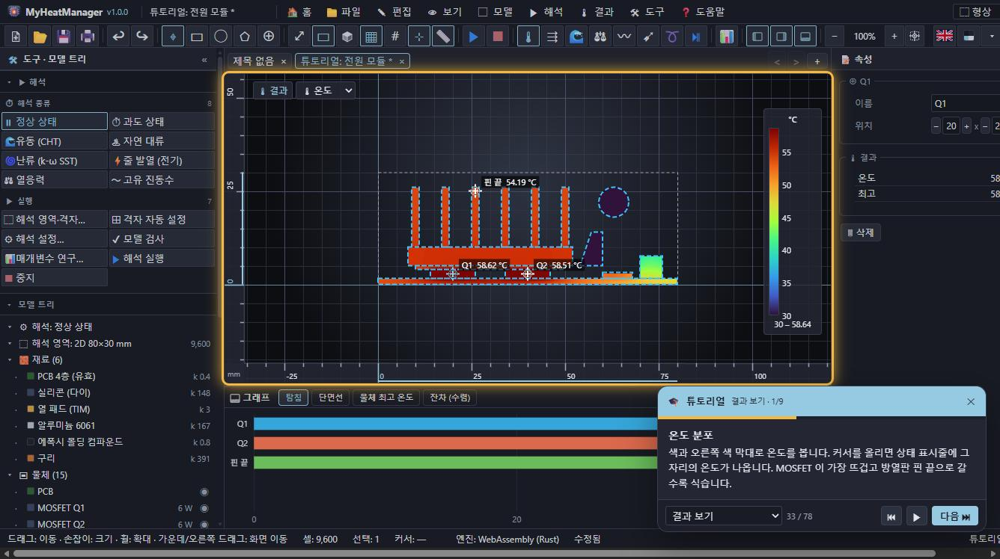

색과 오른쪽 색 막대로 온도를 봅니다. 커서를 올리면 상태 표시줄에 그 자리의 온도가 나옵니다. MOSFET 이 가장 뜨겁고 방열판 핀 끝으로 갈수록 식습니다.

### 34. 열유속과 벡터

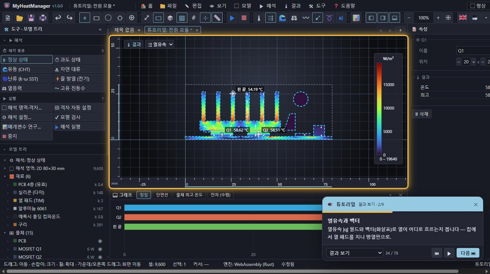

열유속 |q| 필드와 벡터(화살표)로 열이 어디로 흐르는지 봅니다 — 칩에서 열 패드를 지나 방열판으로.

### 35. 등온선

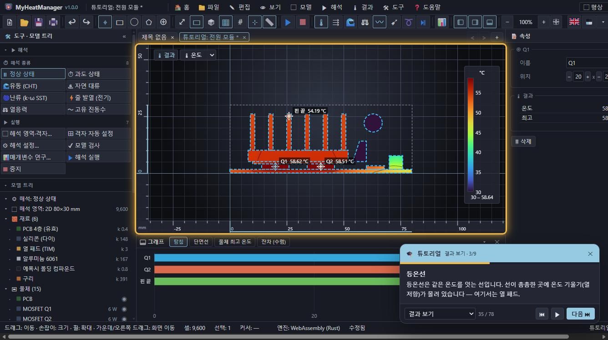

등온선은 같은 온도를 잇는 선입니다. 선이 촘촘한 곳에 온도 기울기(열저항)가 몰려 있습니다 — 여기서는 열 패드.

### 36. 단면선

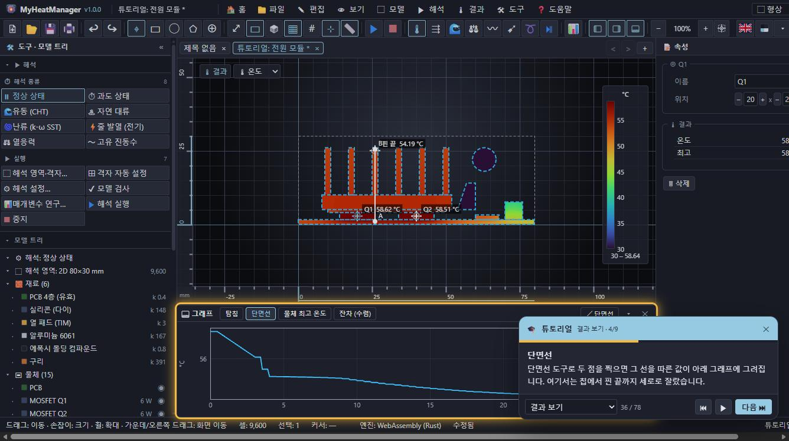

단면선 도구로 두 점을 찍으면 그 선을 따른 값이 아래 그래프에 그려집니다. 여기서는 칩에서 핀 끝까지 세로로 잘랐습니다.

### 37. 3D 보기

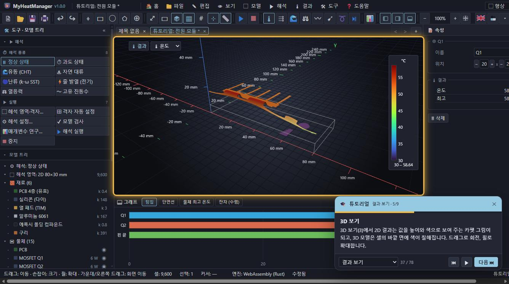

3D 보기(3)에서 2D 결과는 값을 높이와 색으로 보여 주는 카펫 그림이 되고, 3D 모델은 셀의 바깥 면에 색이 칠해집니다. 드래그로 회전, 휠로 확대합니다.

### 38. 3D 격자와 좌표축

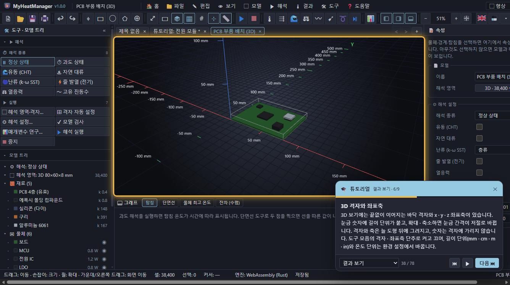

3D 보기에는 끝없이 이어지는 바닥 격자와 x · y · z 좌표축이 있습니다. 눈금 숫자에 길이 단위가 붙고, 확대 · 축소하면 눈금 간격이 저절로 바뀝니다. 격자와 축은 늘 도형 뒤에 그려지고, 숫자는 격자에 가리지 않습니다. 도구 모음의 격자 · 좌표축 단추로 켜고 끄며, 길이 단위(mm · cm · m · in)와 온도 단위는 환경 설정에서 바꿉니다.

### 39. 3D 단면과 등치면

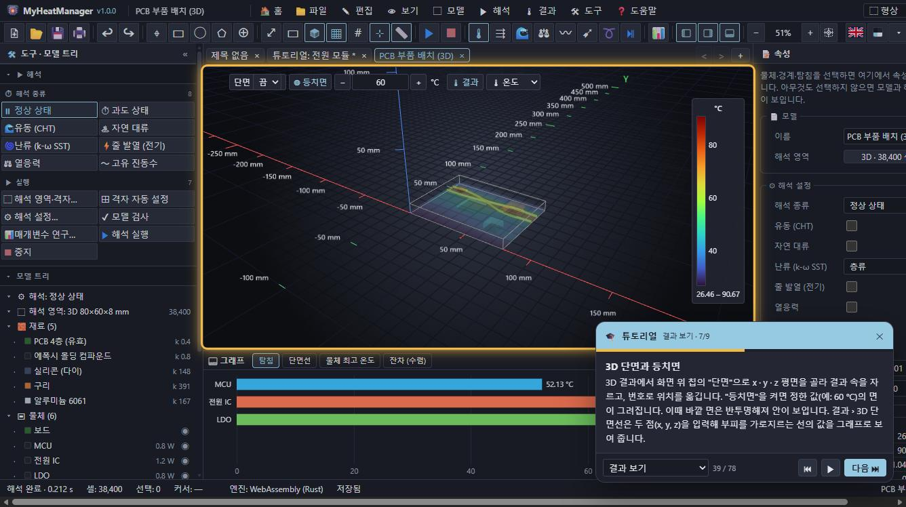

3D 결과에서 화면 위 칩의 "단면"으로 x · y · z 평면을 골라 결과 속을 자르고, 번호로 위치를 옮깁니다. "등치면"을 켜면 정한 값(예: 60 °C)의 면이 그려집니다. 이때 바깥 면은 반투명해져 안이 보입니다. 결과 › 3D 단면선은 두 점(x, y, z)을 입력해 부피를 가로지르는 선의 값을 그래프로 보여 줍니다.

### 40. 아래쪽 그래프 패널

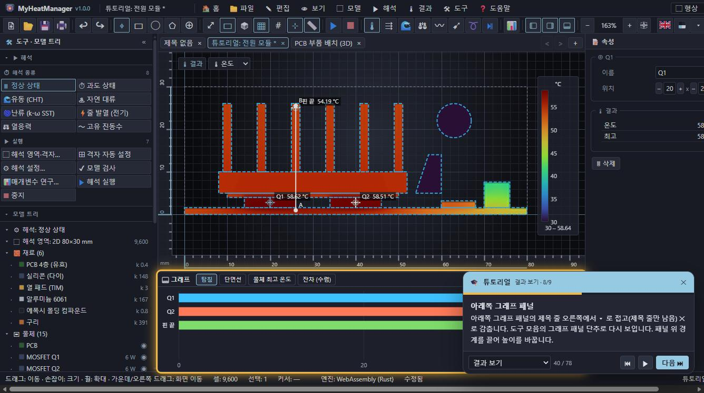

아래쪽 그래프 패널의 제목 줄 오른쪽에서 ▾ 로 접고(제목 줄만 남음) ✕ 로 감춥니다. 도구 모음의 그래프 패널 단추로 다시 보입니다. 패널 위 경계를 끌어 높이를 바꿉니다.

### 41. 해석 보고서

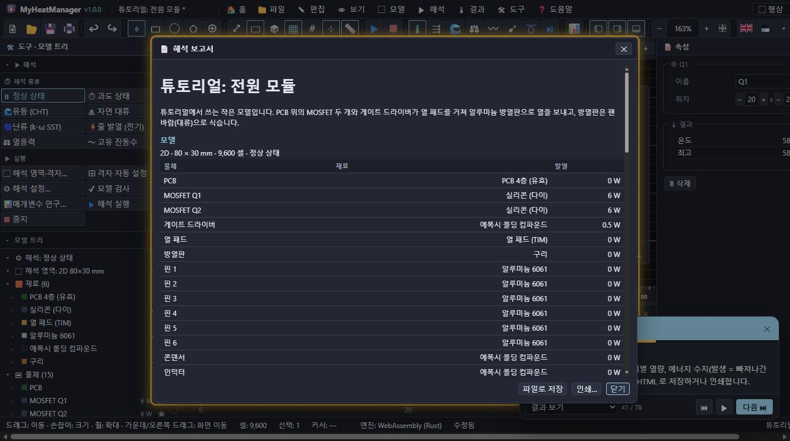

물체별 최저·평균·최고 온도, 경계별 열량, 에너지 수지(발생 = 빠져나간 열), 계산 기록을 한 장으로 보고 HTML 로 저장하거나 인쇄합니다.

## 8. 고급 해석

### 42. 과도 해석과 애니메이션

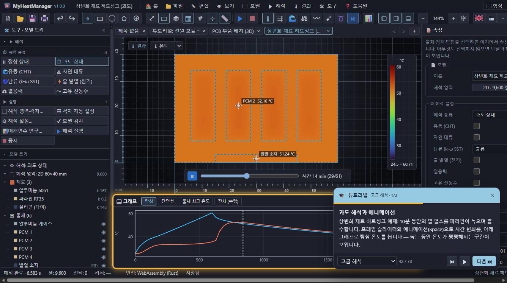

상변화 재료 히트싱크 예제: 10분 동안의 열 펄스를 파라핀이 녹으며 흡수합니다. 프레임 슬라이더와 애니메이션(Space)으로 시간 변화를, 아래 그래프로 탐침 온도를 봅니다 — 녹는 동안 온도가 평평해지는 구간이 보입니다.

### 43. 유동과 연성 열전달 (CHT)

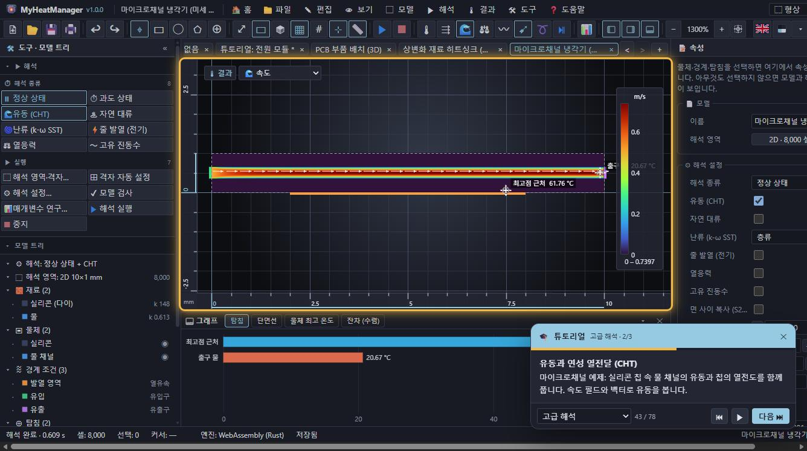

마이크로채널 예제: 실리콘 칩 속 물 채널의 유동과 칩의 열전도를 함께 풉니다. 속도 필드와 벡터로 유동을 봅니다.

### 44. 열응력

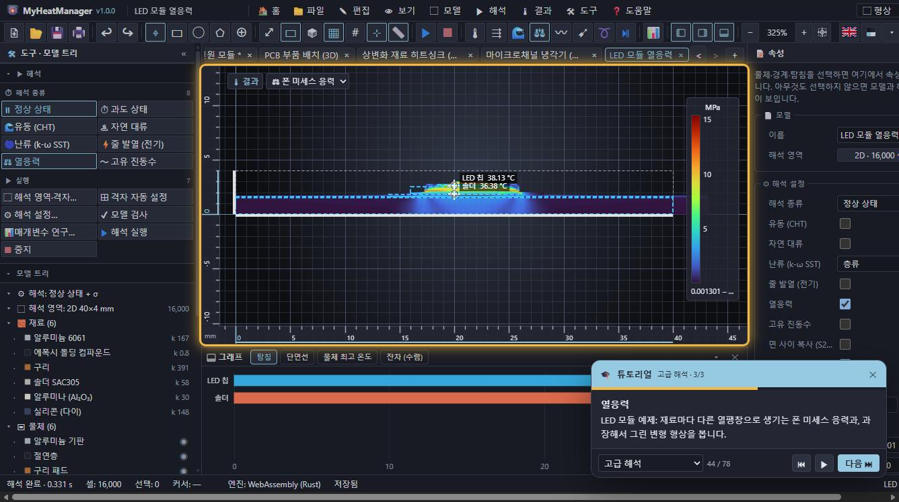

LED 모듈 예제: 재료마다 다른 열팽창으로 생기는 폰 미세스 응력과, 과장해서 그린 변형 형상을 봅니다.

## 9. SimScale 방식 해석

### 45. 난류 유동 (k-ω SST)

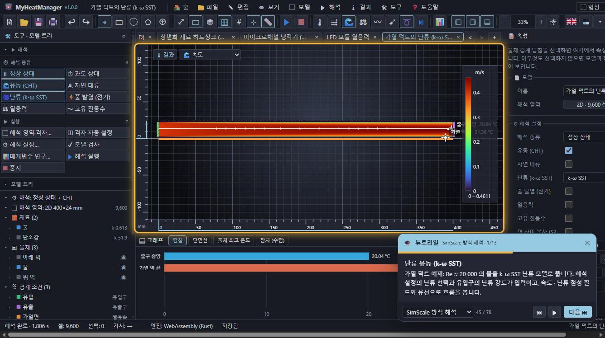

가열 덕트 예제: Re ≈ 20 000 의 물을 k-ω SST 난류 모델로 풉니다. 해석 설정의 난류 선택과 유입구의 난류 강도가 입력이고, 속도 · 난류 점성 필드와 유선으로 흐름을 봅니다.

### 46. 수렴 곡선

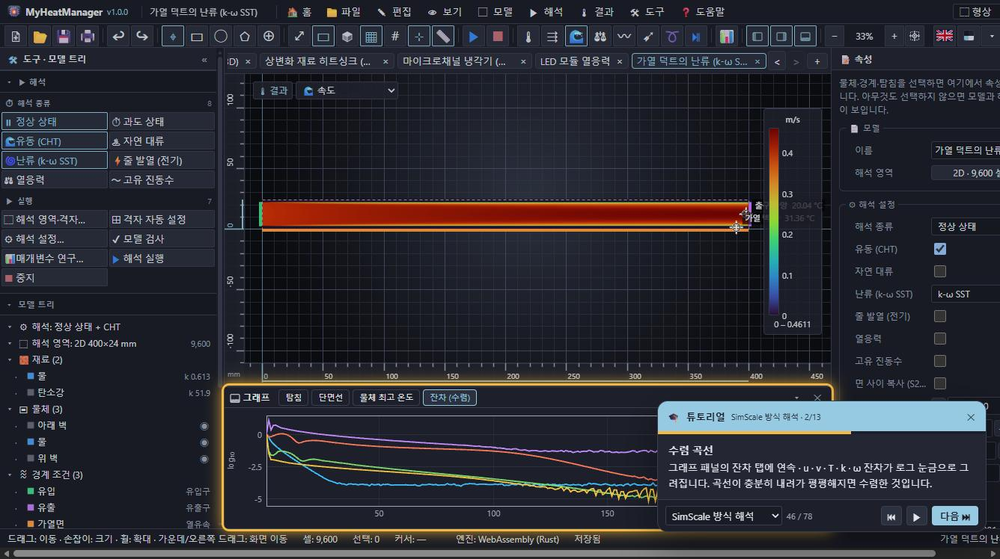

그래프 패널의 잔차 탭에 연속 · u · v · T · k · ω 잔차가 로그 눈금으로 그려집니다. 곡선이 충분히 내려가 평평해지면 수렴한 것입니다.

### 47. 유량과 압력 강하

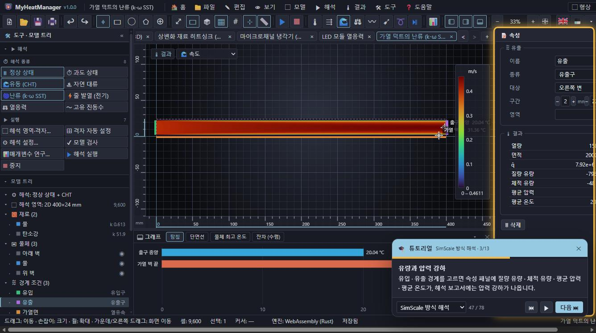

유입 · 유출 경계를 고르면 속성 패널에 질량 유량 · 체적 유량 · 평균 압력 · 평균 온도가, 해석 보고서에는 압력 강하가 나옵니다.

### 48. 줄 발열 (전기)

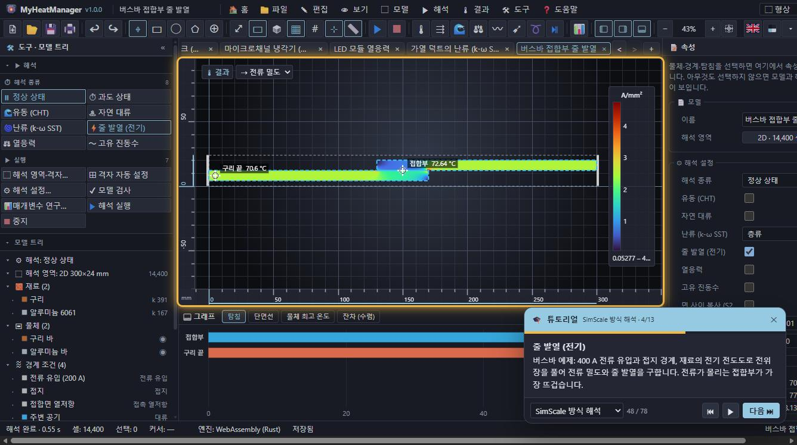

버스바 예제: 400 A 전류 유입과 접지 경계, 재료의 전기 전도도로 전위장을 풀어 전류 밀도와 줄 발열을 구합니다. 전류가 몰리는 접합부가 가장 뜨겁습니다.

### 49. 접촉 열저항

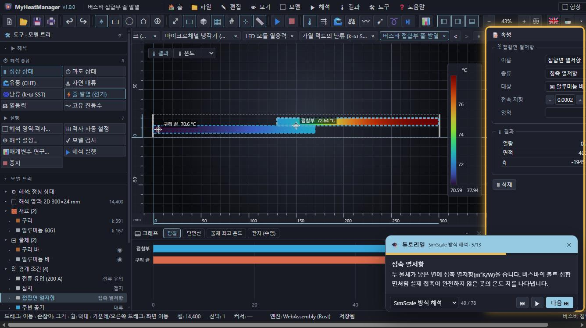

두 물체가 닿은 면에 접촉 열저항(m²K/W)을 줍니다. 버스바의 볼트 접합면처럼 실제 접촉이 완전하지 않은 곳의 온도 차를 나타냅니다.

### 50. 정적 구조 해석

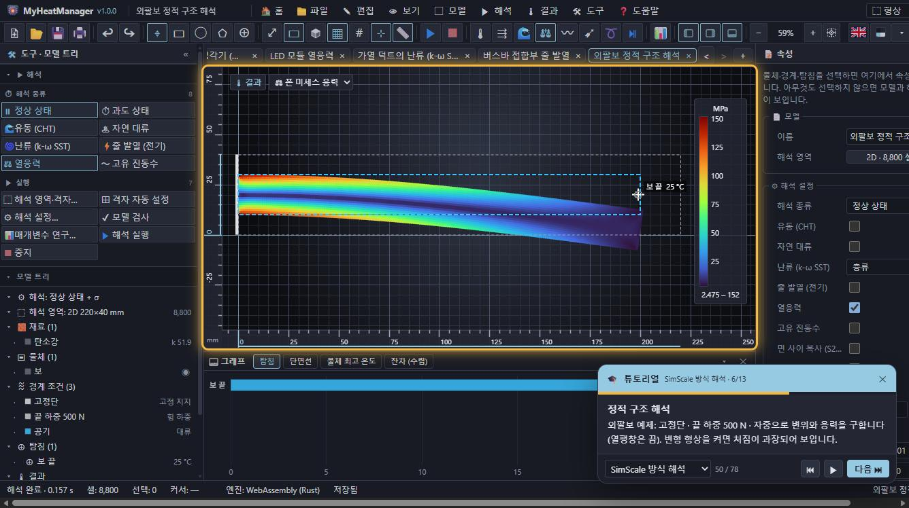

외팔보 예제: 고정단 · 끝 하중 500 N · 자중으로 변위와 응력을 구합니다(열팽창은 끔). 변형 형상을 켜면 처짐이 과장되어 보입니다.

### 51. 고유 진동수 (모드)

L 브래킷 예제: 처음 여섯 고유 진동수와 모드 형상입니다. 뷰포트 위의 모드 선택으로 형상을 바꿔 봅니다.

### 52. 열 쾌적성 (PMV)

사무실 예제: 자연 대류로 움직이는 공기의 온도 · 속도로 ISO 7730 PMV 를 계산합니다. 0 에 가까울수록 쾌적하고, 창가처럼 파란 곳은 춥게 느껴집니다.

### 53. 생체 열전달 (Pennes)

종양 고주파 소작 예제: 재료에 혈류 관류율 · 대사열 · 혈액 온도를 넣으면 Pennes 생체 열전달식으로 풉니다. 전극이 10분 동안 열을 내는 동안 종양 가장자리가 50 °C 를 넘는지 탐침 그래프로 봅니다.

### 54. 팬 곡선

팬 함체 예제의 팬 경계는 고정 유속 대신 팬 곡선(유량–압력)을 씁니다. 해석기는 팬 곡선과 함체의 저항이 만나는 운전점을 찾아 유량을 정하고, 그 공기로 부품 온도를 구합니다.

### 55. 면 사이 복사 (S2S)

진공 오븐 예제: 해석 설정에서 "면 사이 복사"를 켜면 물체 표면끼리 뷰 팩터와 복사도로 열을 주고받습니다(재료의 방사율 사용). 대류가 없는 진공이나 공동에서 중요합니다. 결과에는 순 복사 열 흐름 qrad 가 함께 나옵니다.

### 56. 매개변수 연구

값 하나(발열 · 열전달 계수 · 유입 속도 · 열전도율 · 격자 배율 …)를 범위 안에서 바꿔 가며 여러 번 풀고 결과를 표와 그래프로 비교합니다. 여기서는 팬의 열전달 계수에 따른 MOSFET 최고 온도입니다.

### 57. 격자 자동 설정

격자 자동 설정은 가장 얇은 물체가 셀 두 개 이상이 되도록 셀 수를 정합니다. 그 뒤 격자를 두 배로 해 다시 풀어 결과가 거의 같으면 충분히 촘촘한 것입니다.

## 10. 신뢰성 · U-값 · 히트맵

### 58. 신뢰성 (수명)

해석한 부품 온도로 아레니우스 MTTF · FIT 와 코핀-맨슨 솔더 피로 수명을 계산합니다. 시스템 수명과 5년 생존 확률도 나옵니다.

### 59. U-값 (건물 외피)

창틀 단면 예제의 열관류율 U, R-값, 선 열관류 L2D 를 실내·실외 대류 경계로부터 구합니다(THERM 방식).

### 60. 절점 데이터 히트맵

Thermal Desktop · SINDA 같은 절점 모델이나 열전대 측정값의 CSV 를 가져와 히트맵과 통계, 한계 온도 초과 절점을 봅니다.

### 61. 열분석 (DSC / TGA)

DSC 곡선의 피크를 기준선 위에서 적분해 잠열 · 시작 · 피크 · 끝 온도를 구하고, 인듐 같은 표준 물질로 보정한 뒤 상변화 재료로 모델에 넣습니다. TGA 에서는 감량 온도와 잔류량을 구합니다.

### 62. DSC 반응 속도론 · Tg · cp

열분석 창의 반응 속도론 탭: 가열 속도가 다른 DSC 곡선 여러 개를 넣으면 Kissinger 와 Ozawa–Flynn–Wall 로 활성화 에너지 Ea 를 구합니다. DSC 탭에서는 유리 전이(Tg), 미분 곡선, 시그모이드 기준선과 전환율, 여러 피크를, TGA 탭에서는 질량 감소 단계를, cp 탭에서는 사파이어 법(ASTM E1269)으로 비열 cp(T)를 구해 재료로 넣습니다.

### 63. 전자 냉각 도우미

도구 메뉴의 JEDEC 2저항 패키지 · 방열판 만들기 · PCB 적층 계산기 · 발열 지도 가져오기는 값만 넣으면 물체와 재료를 모델에 만들어 줍니다(Icepak 방식). 방열판 창은 핀 배치를 미리 보여 주고, 핀이 맞지 않으면 알려 줍니다.

### 64. 솔더 피로 · 수명

도구 › 솔더 피로 · 수명 분석(Sherlock 방식): 과도 해석의 온도 이력을 레인플로로 세어 Coffin–Manson · Engelmaier 로 마이너 손상과 수명을 구하고, Norris–Landzberg 가속 계수, Weibull 신뢰도 곡선(B10), 고유 진동수로 Steinberg 진동 피로를 계산합니다.

### 65. CalculiX · DXF

파일 메뉴의 CalculiX 내보내기는 격자 · 재료 · 경계 조건을 CalculiX 입력 파일(.inp)로 저장하고(FreeCAD · Gmsh · ParaView 워크플로), DXF 가져오기는 도면의 닫힌 폴리라인과 원을 물체로 가져옵니다.

### 66. 배치 실행 (API)

설치한 프로그램은 --batch 로 창 없이 여러 모델을 풀고 요약 JSON · CSV · 히트맵 PNG 를 씁니다. 스크립트나 CI 에서 설계안을 비교할 때 씁니다.

## 11. 파일과 출력

### 67. 저장

모델은 .myheat(JSON) 파일입니다. 저장(Ctrl+S), 다른 이름으로 저장(Ctrl+Shift+S). 웹판에서는 내려받기로 저장합니다.

### 68. 내보내기

파일 메뉴에서 결과를 CSV(셀 값) · PNG(화면) · VTK(ParaView) 로 내보내고, 보고서를 저장하거나 인쇄합니다.

### 69. 다른 제품의 파일 형식

파일 메뉴에서 THERM .thmx · Gmsh .msh · DXF 를 새 모델로 가져오고, CalculiX .inp · Nastran .bdf · Ansys .cdb · COMSOL .mphtxt · Gmsh .msh · THERM .thmx · STL · DXF · VTU · VTK 로 내보냅니다. 파일 › 지원 파일 형식 에서 전체 목록과 지원하지 않는 형식(.mph · .sldprt 등 독점 바이너리)을 봅니다. samples/formats 폴더에 형식마다 예제 파일이 있습니다.

### 70. 인쇄

도구 모음의 인쇄 단추(저장 오른쪽, Ctrl+P)는 인쇄 창을 엽니다. 왼쪽에서 용지 크기 · 방향 · 여백 · 인쇄할 내용(제목, 뷰포트 그림, 색 범례, 차트, 모델 표, 결과 요약, 해석 기록) · 머리글과 바닥글 · 컬러/흑백 · 글자 크기를 고르면 오른쪽 미리보기에 쪽마다 바로 나타납니다. 인쇄를 누르면 시스템 인쇄 창에서 프린터와 매수를 고릅니다.

### 71. 예제 갤러리

해석 종류와 분야마다 대표적인 예제 40개가 있습니다 — 미리보기와 설명을 보고 고릅니다.

## 12. 꾸미기

### 72. 테마

테마 단추를 누르면 다음 테마로, ▾ 를 누르면 어두운 20 · 밝은 20 테마가 색 띠(배경 · 패널 · 단추 · 강조 · 글자)와 이름의 두 줄로 펼쳐집니다.

### 73. 테마 목록

▾ 를 누르면 어두운 테마와 밝은 테마가 두 열로 내려옵니다. 테마마다 두 줄 — 색 띠와 이름 — 으로 보이고, 맨 아래에 사용자 정의 테마와 "사용자 정의 테마 설정…", "테마 설정…" 이 있어 설정 창의 그 탭으로 바로 갑니다.

### 74. 환경 설정

일반 · 테마 · 사용자 테마 · 글꼴 · 시작 화면 · 결과 표시 · 편집기 · 패널 · 파일 탭에 모든 설정이 있습니다. 바꾸는 즉시 적용되어 보이고, 적용 · 취소(열었을 때로) · Reset(기본값) 단추가 있습니다. 국기 단추는 한국어 ↔ English 를 바꾸며, 캔버스의 이름도 함께 바뀝니다.

### 75. 사용자 테마

설정 › 사용자 테마에서 기본 테마를 고른 뒤 배경 · 패널 · 강조 등 13가지 색을 바꿔 자신의 테마를 만듭니다. 바꾸는 즉시 화면에 보입니다.

### 76. 설명서 창

도움말 › 사용 설명서와 튜토리얼 문서는 별도의 창에서 열리고 앱 테마를 그대로 따릅니다. 테마를 바꾸면 열린 문서 창도 함께 바뀝니다.

### 77. 창 밖으로 나오는 창과 메뉴

데스크톱 판에서 대화 상자와 드롭다운 메뉴(메뉴 막대, 오른쪽 클릭, 테마 목록)는 각자의 창으로 열려 주 창 밖으로 나올 수 있습니다. 대화 상자가 열려 있는 동안 주 창은 어두워지고, 누르면 대화 상자가 앞으로 옵니다. 대화 상자의 제목 줄을 끌어 옮깁니다. 웹 판과 튜토리얼에서는 창 안에 그려집니다.

### 78. 끝

튜토리얼을 마쳤습니다! 바뀐 설정은 되돌리고 튜토리얼 탭은 닫습니다. 🏠 시작 화면이나 도움말 메뉴에서 언제든 다시 볼 수 있고, 튜토리얼 문서와 사용 설명서에 더 자세한 설명이 있습니다.

---

모든 기능의 자세한 설명은 [사용 설명서](UsersGuide.md) 에 있습니다.

© SHKWON (knix008@naver.com)
