# MyHexaMaster User's Guide

MyHexaMaster is a hex editor for viewing and editing files, disks and process memory byte by byte. It brings together the features of UltraEdit, HxD, 010 Editor, ImHex, WinHex, Hex Fiend, Okteta, Free Hex Editor Neo, MiTeC and Hackman in one program. It runs with the same screen as a desktop program (Tauri) on Windows, macOS and Linux and in a web browser, and all byte handling is done by a Rust core.

## 1. Screen layout

| Part | Contents |
| --- | --- |
| Menu bar | File, Edit, Search, View, Data, Tools, Help. Panel buttons and window buttons on the right |
| Toolbar | File, undo, clipboard, edit mode, fill, byte operations, read-only, find, go to, bookmarks, **Tools** (Strings, Disassembler, Demangler, Calculator, Recovery, File systems, YARA, Data visualizer, Script, Patches, Disks and memory, Compare, Template, Data processor, Edit history, File tools), checksums, text view |
| Left panel | **Explorer**: favorites, home folder, drives, open documents |
| Center | Document tabs. Hex view below the tab bar (source, size, format, INS/OVR, character set, bytes per row, number base, byte order) |
| Right panel | **Properties**: Data inspector, Structure (template), File information, Checksums and hashes, Statistics and entropy, Bookmarks |
| Bottom panel | **Log** and **Information** |
| Status bar | Cursor offset (hex and decimal), selection size, byte value at the cursor, file size, INS/OVR, character set, theme, language |

Every dialog and tool opens in its own movable window (on the web, a window inside the page).

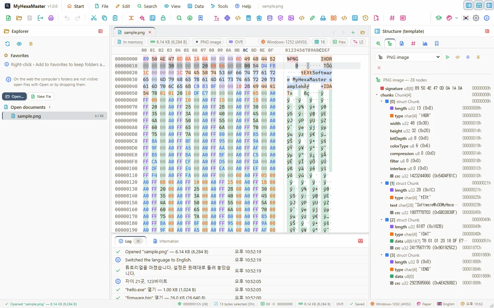

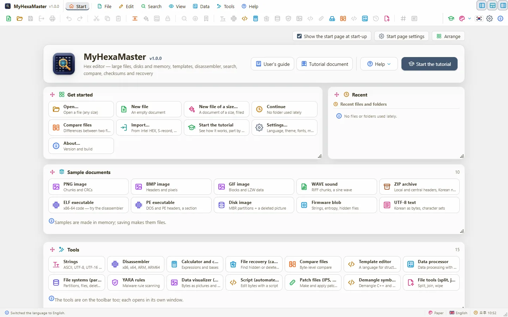

## 2. Opening and saving files

- **Open** (Ctrl+O): there is no size limit. Only the visible part is read, not the whole file, so even multi-GB files open instantly. You can also double-click a file in the Explorer or drag it onto the window.
- **New file** (Ctrl+N), **New file with size**: a document filled with zeros, a pattern, random bytes or an increasing sequence.
- **Open read-only**, **Open disk**, **Open image file as disk** (a raw image such as dd or .img, read and written in sectors like a disk), **Open process memory** (desktop).
- **Writing to disks**: disks, volumes and disk images open read-only. Turn read-only off (Ctrl+R), confirm the warning, and edit; saving writes only the changed sectors to the disk (a volume is locked and dismounted first; administrator rights are needed). **Save as image** saves a whole disk or process memory to a file.
- **Large files**: opening, saving and long work (find, hashes, statistics, recovery, YARA …) show a progress window after a moment, and can be cancelled.
- **Save** (Ctrl+S): if no byte positions have moved, only the changed parts are written in place (fast even for large files). If there are insertions or deletions, the file is written to a temporary file and then swapped in.
- **Save as** (Ctrl+Shift+S), **Save all**, **Save selection as…**, **Reload from disk**.
- On the web, Chrome and Edge save back to the same file through the File System Access API; other browsers save by downloading.
- For each file, the last cursor position, bookmarks and template are remembered.

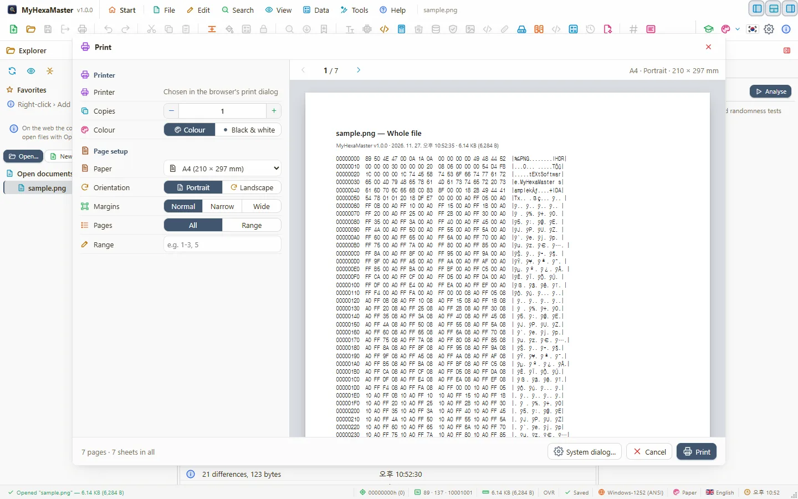

## 3. Hex view and editing

- From left to right: the offset, byte and text columns. Bytes are colored by kind (00, printable characters, control characters, 80–FF, FF), and changed bytes are shown in red.
- The row and column with the cursor are highlighted, and the column header also marks the cursor column.
- **Typing**: in the hex column, typing hex digits changes the high nibble, then the low nibble. Press **Tab** to move to the text column; characters you type there become bytes in the current character set (input method editors work too).
- The **Insert** key switches between **Insert mode / Overwrite**. Disks and process memory have a fixed size, so only Overwrite is available.
- **Backspace / Delete**: delete the selection or a byte.
- **Selecting**: drag, Shift+arrow keys, **Select block** (Ctrl+B: start and length/end), **Select all** (Ctrl+A). A single byte can be selected too (find results, block selection, structure items). Double-clicking in the hex column selects one group; in the text column it selects a word.
- **Fill** (Ctrl+E), **Insert bytes** (Ctrl+I): pattern (hex), zeros, random, or an increasing sequence (start, step, unit size).
- **Undo / Redo** (Ctrl+Z / Ctrl+Y) have no step limit, and bytes typed in a row are grouped into one step. In the **Edit history** window you can jump straight to any step.
- A **Read-only** (Ctrl+R) document cannot be changed.
- **Split view** (Ctrl+Shift+E): the same document in two views, one above the other, each with its own caret and scroll; an edit in one shows in the other at once. Menus and tools follow the view used last.
- **Keystroke macros** (UltraEdit): **Record macro** (Ctrl+Shift+M) records the keys, text and commands used in the hex view until you choose it again (● Recording in the status bar). **Play macro** (Ctrl+Shift+G), **Repeat macro** (a number of times or to the end of the file), **Save** and **Saved macros** (load, play or delete by name).
- **View and edit as text** (Ctrl+M): opens the document as text in the current character set in a text editor with line numbers; edit it and choose "Apply as bytes" to make it a single edit step (up to 32 MB). It has **column (block) selection mode** (Alt+C, or drag with Alt held), **wrap long lines**, find and replace (Ctrl+F) and go to line (Ctrl+L). Line endings (CR LF, LF, CR) are kept; a document that mixes them is pointed out before applying.

### View settings (View menu, chips on the tab bar)

- Bytes per row: 4, 8, 12, 16, 20, 24, 32, 48, 64, or fit to window width
- Grouping: 1, 2, 4, 8 or 16 bytes
- Offset base: hex, decimal, octal; value display: hex, decimal, octal, binary; uppercase, 0x before offsets, display start address
- Character set: ASCII, Latin-1, Windows-1252, CP437, EBCDIC, UTF-8, UTF-16 LE/BE, EUC-KR, Shift_JIS
- Text column, offset column, column header, byte colors, changed-byte highlight, cursor row/column highlight, hex font and size (Ctrl+= / Ctrl+-)

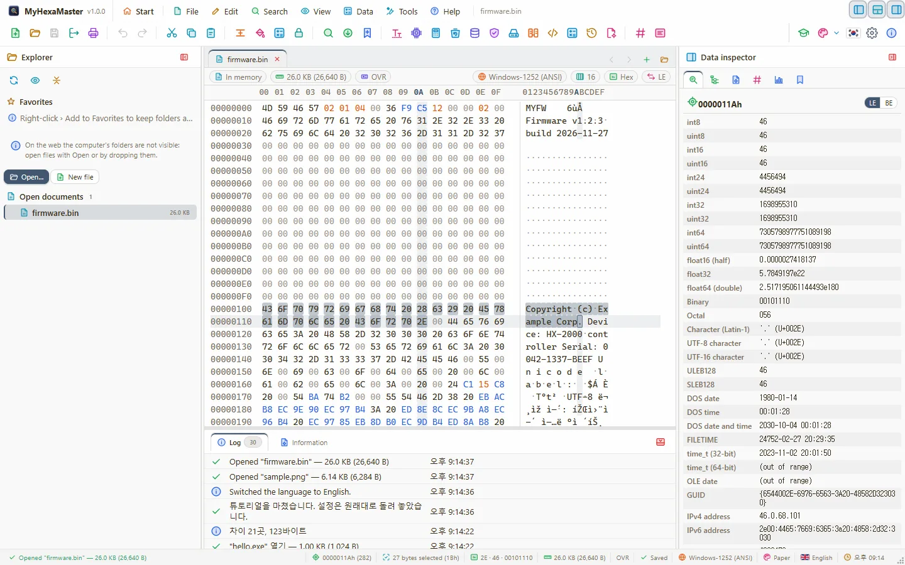

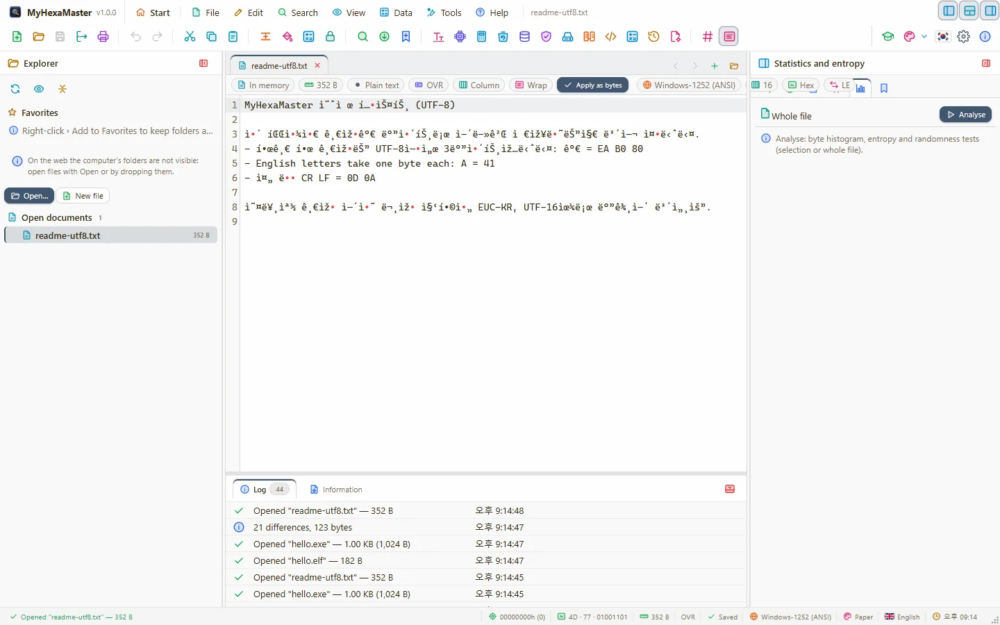

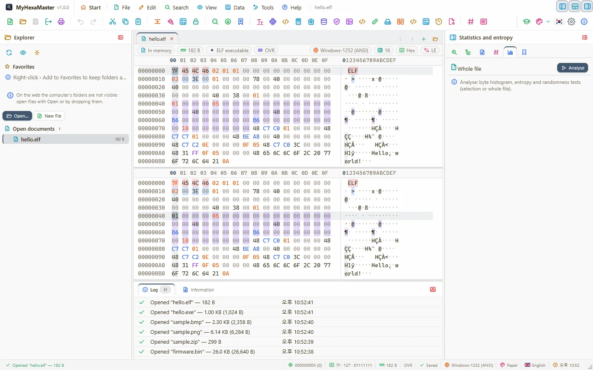

## 4. Clipboard

- **Copy** (Ctrl+C) copies in the format set in the settings (default: hex). **Copy as**: hex, spaced hex, text, C array, Python bytes, Base64, escaped (\x4D).
- **Paste** (Ctrl+V): in automatic mode, hex text is pasted as bytes and anything else as text. There are also **Paste as hex / Paste as text** (Ctrl+Shift+V). In Insert mode the data is inserted; in Overwrite mode it overwrites.
- **Cut** (Ctrl+X).

## 5. Find, replace, go to, bookmarks

- **Find and replace** (Ctrl+F, Ctrl+H) window:
  - Hex: wildcards such as `??` (one byte) and `4?` or `?F` (one nibble), as in `4D 5A ?? 00`
  - Text: 14 encodings, optional case sensitivity
  - Regular expression: byte regular expressions (`\x50\x4B\x03\x04`, `[\x00-\x1F]+`)
  - Integer (1, 2, 3, 4 or 8 bytes, signed, byte order), floating point (4 or 8 bytes)
  - Scope (whole file / selection only), search backward from the end
  - Next, previous, **Find all** (results list and marks in the hex view), count, replace, **Replace all** (undone in one step)
- **Several terms at once** (WinHex): choose the kind "Several terms at once" and enter one term per line: `4D 5A ?? 00` (hex), `"text"` or `/regex/`. Find all searches every term and lists the places in offset order with their term; Find next goes to the nearest place of any term.
- **Find in files**: set the scope of the Find window to "Files", pick files or a folder (sub-folders included), and every file is searched with the same pattern. Click a result to open that file with the match selected. **Replace in files** replaces every match and writes the files (after a confirmation; on the desktop optionally keeping `.bak` backups; on the web, files picked in Chrome or Edge are written back, others are downloaded).
- **Find next / previous**: F3 / Shift+F3.
- **Go to offset** (Ctrl+G): from the start, forward, backward, from the end; hex or decimal; select from the cursor. A value with `0x` or `h` is read as hex.
- **Bookmarks**: Ctrl+D adds one at the cursor or selection, and F2 / Shift+F2 move between them. In the Bookmarks tab of the right panel you can change their color and name or delete them.

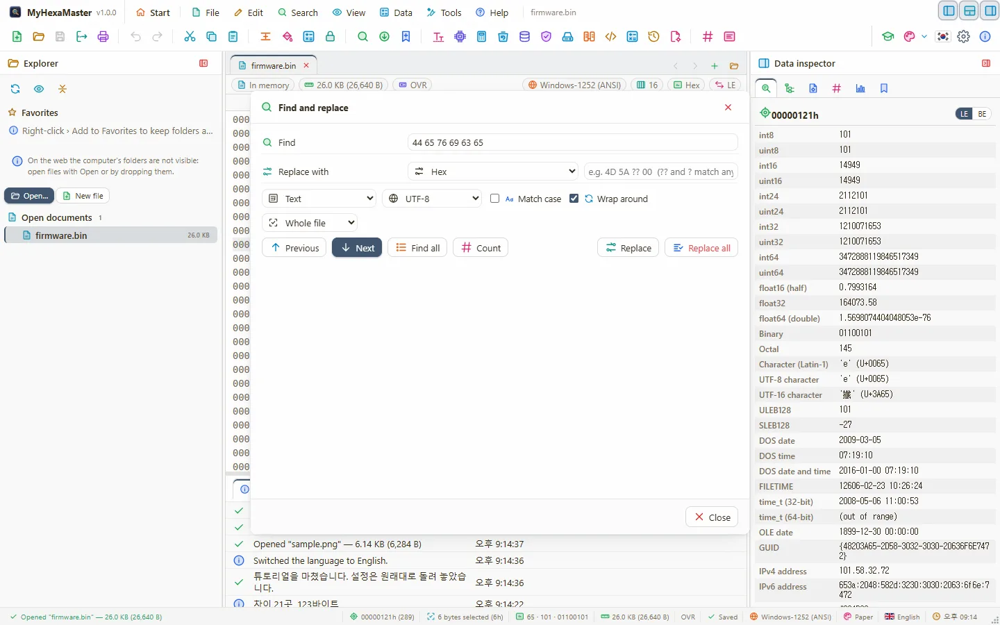

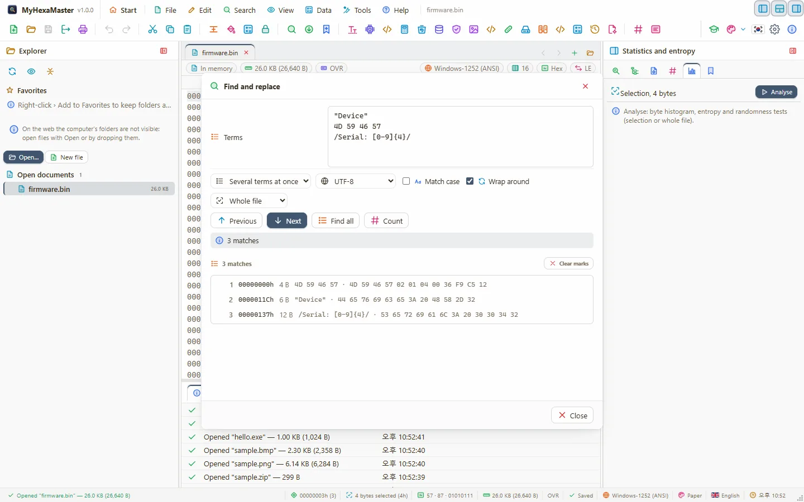

## 6. Properties (right panel)

- **Data inspector**: reads the bytes at the cursor as int8 to int64 (signed/unsigned), int24, float16/32/64, binary, octal, characters (Latin-1, UTF-8, UTF-16), ULEB128, SLEB128, DOS date and time, FILETIME, time_t (32 and 64), OLE date, GUID, IPv4, IPv6, RGB565, RGB, RGBA, and true/false. Switch the byte order with LE/BE, and **double-click** a value to type a new value and write it in place.
- **Structure (template)**: shows the structure found by the template as a tree. Clicking an item selects its bytes, and items with a color are also painted in the hex view. The pencil button edits a value: it is written with the field's own type and byte order and the tree is drawn again (010 Editor, ImHex).
- **File information**: name, path, source, size, file type and details (image size, executable type …), MIME type, modified, read-only, undo steps, cursor and selection.
- **Checksums and hashes**: computes the chosen algorithms at once for the selection (or the whole file if nothing is selected). Click a value to copy it.
  - Checksums: Checksum-8/16/32/64, XOR-8
  - CRC and similar: CRC-8, CRC-16 (ARC, CCITT-FALSE, XMODEM, MODBUS), CRC-32, CRC-32C, CRC-32 BZIP2, CRC-64 (ECMA, XZ), Adler-32, Fletcher-16/32
  - Hashes: MD2, MD4, MD5, SHA-1, SHA-224/256/384/512, SHA-512/256, SHA3-224/256/384/512, Keccak-256, RIPEMD-160, BLAKE2b-512, BLAKE2s-256, BLAKE3
- **Hash database** (WinHex hash sets, NSRL): add any hash value with ＋ as "Known (ignore)" or "Notable", or import md5sum, sha1sum, sha256sum, BSD or CSV (NSRL) lists. A computed hash found in the database is flagged by its row colour and a note. Export and clear all are there too.
- **Statistics and entropy**: byte distribution (square-root scale), per-block entropy graph (click to go to that block), entropy, distinct values, ratios of 00, printable, control and 80–FF bytes, mean, median, chi-square, Monte Carlo π, serial correlation, most common values. Compressed or encrypted areas have an entropy close to 8.
- **Bookmarks**: list, color, name, go to, delete.

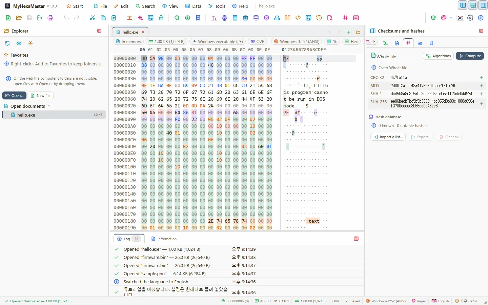

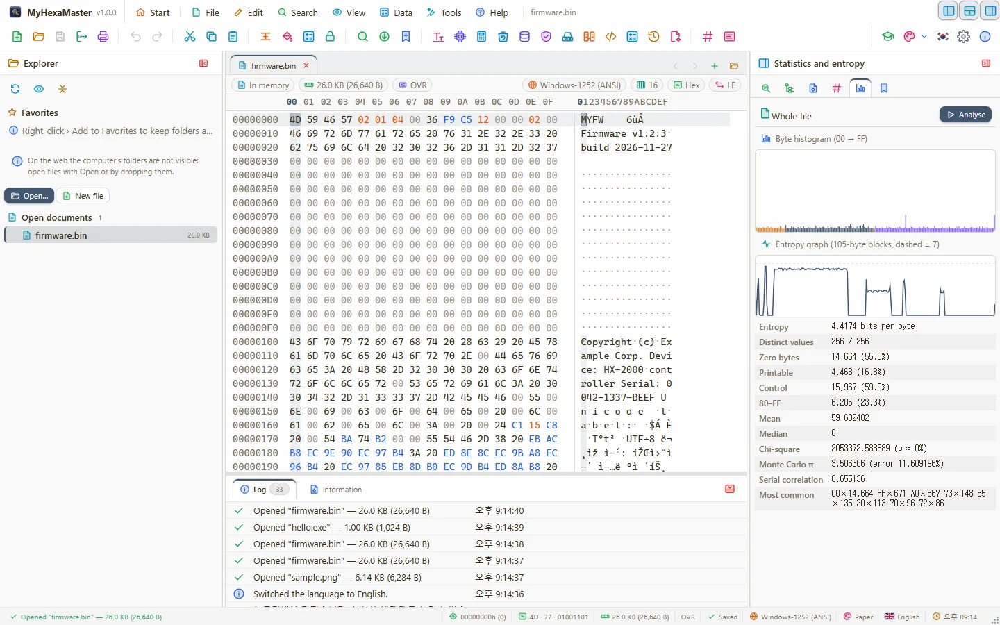

## 7. Templates

When a file is opened, its format is detected and the matching template runs automatically (you can turn this off in the settings). Built-in templates: PNG, BMP, GIF, JPEG, ZIP (including DOCX, XLSX, JAR, APK), GZIP, WAVE, ELF, PE (EXE, DLL), MBR/GPT, ICO, TAR, Java class, SQLite, Mach-O, MP3 (ID3), WebAssembly, raw data.

In the **Template editor** (Ctrl+T) you can write and run templates yourself, "Save as my template", or save and load them as files (.hexpat).

**Script** (Ctrl+Shift+R, 010 Editor scripts): the same language changes the document. `WriteU8/U16/U32/U64`, `WriteS…`, `WriteFloat/Double` (…BE/…LE), `WriteBytes(o, "DE AD")`, `WriteString`, `InsertBytes(o, n, fill)`, `DeleteBytes(o, n)`, `Printf("%08X %d %s", …)`, `Print`, `Selection()`, `Cursor()`, `FileSize()`, `Hash("sha256")`, `Checksum("crc32")`, `FindAll`, `FindAt`, `Exit`, `Assert`. Bytes written earlier are seen by later reads; all changes are undone in one step, and a script stopped by an error changes nothing. Five examples; save and load as .hexscript.

### Template language (010 Editor / ImHex style)

- Comments `// …`, `/* … */`. Byte order: `#pragma endian big`, `endian little;`, or per field `be u32` / `le u16` (default little)
- Types: `u8 u16 u24 u32 u48 u64`, `s8…s64` (`i8…`), `float` (f32) `double` (f64) `f16` `bool` `char` `wchar` `uleb128` `sleb128`. C and 010 names work too: `uchar byte ushort short uint int ulong long uint64 int64 DWORD WORD BYTE unsigned char …`
- `struct Name { fields; … } [[color("blue")]];`, `union` (all fields at the same position), `enum Name : u8 { A = 1, B };`, `bitfield F { a : 1; b : 3; };`, `using Word = u16;`, `typedef u32 DWORD;`
- Fields: `type name;`, arrays `type name[expr];`, `type name[while(condition)];`, `char s[];` (characters up to a 0), `type name @ offset;` (the cursor does not move). char/wchar arrays are shown as text; a u8 array is a single node
- Statements: `if/else`, `while`, `for (let i = 0; i < n; i++)`, `let x = expr;`, `x += 1;`, `break`, `continue`, `return`
- User functions: `fn pad(n, a) { let r = n % a; return r ? n + a - r : n; }` (own locals, `return expr;`, recursion up to 64 deep)
- Multi-dimensional arrays `u8 grid[3][4];`, `Cell c[2][n];` (`grid[1][2]`, `c[i][j].f`), the enclosing struct through `parent.size`, `parent.parent.x` and `this`, and `sizeof(Header)` of a fixed-size struct
- Expressions: `12 0x1F 0b101 0o17 1.5 'A' "text"`, `+ - * / % & | ^ ~ << >> && || ! == != < <= > >= ?:`, `a.b`, `a[i]`, `$` (current offset), `Enum::Value`
- Functions: `sizeof addressof endof size() eof() pos() seek(o) skip(n)`, `ReadU8…ReadU64 / ReadS8…S64 / ReadFloat / ReadDouble(o)`, `ReadU32BE/LE`, `ReadString(o, n)`, `find(o, "FF D9")`, `ParseInt(text, base)`, `strlen min max abs str hex`, `Warning()`, `Error()`
- Attributes: `[[color("#rrggbb"|"red"|0xRRGGBB), comment("…"), name(expr), hidden]]` or `<bgcolor=0xRRGGBB, comment="…">`
- Errors are shown with the line and column, and the nodes built up to that point are kept.

Example:

    struct Header {
        char magic[4] [[color("#e5484d")]];
        be u32 length;
        u8 data[length] [[comment("payload")]];
    };
    Header header;

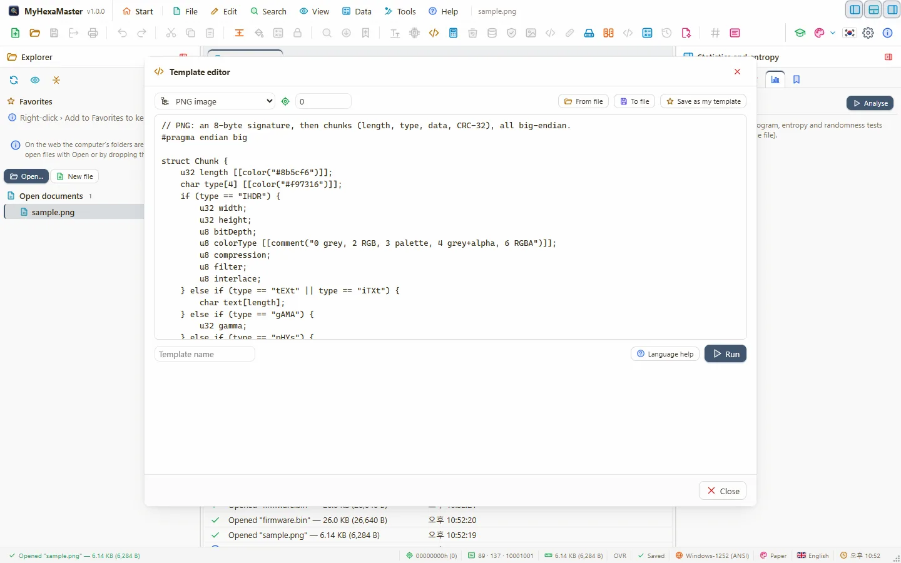

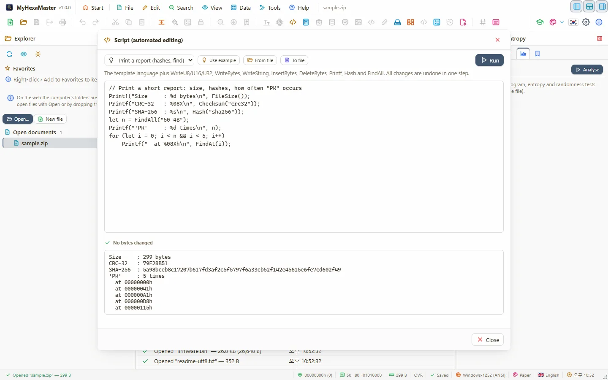

## 8. Tools (toolbar)

| Tool | What it does |
| --- | --- |
| Find and replace | Section 5 |
| Go to offset | Section 5 |
| Strings (Ctrl+Shift+T) | ASCII, UTF-8, UTF-16 LE/BE strings, minimum length, filter, copy all. Click a row to go there |
| Disassembler (Ctrl+Shift+D) | x86 16, 32 and 64-bit (Intel, NASM, MASM, AT&T syntax), ARM 32, Thumb, ARM64, MIPS32/64 (big and little endian), RISC-V RV32GC/RV64GC, PowerPC 32/64, SuperH SH-4, 6502, AVR, MSP430, Z80, 8080. Starts at the cursor or selection, set address, follow cursor, load more, copy |
| Calculator and converter | Evaluates expressions (arithmetic, `%`, `**`, bitwise AND, OR, XOR, NOT, `<<`, `>>`, `0x 0b 0o 'A'`, abs, min, max) at 8, 16, 32 or 64 bits and shows hex, decimal, octal, binary, signed, float32/64 and text. Get the value at the cursor, write to the cursor |
| File recovery (carving) (Ctrl+Shift+F) | Finds files inside disk images and memory dumps by their headers (PNG, JPEG, GIF, BMP, TIFF, WebP, PSD, PDF, ZIP, GZIP, BZIP2, XZ, 7z, RAR, CAB, ELF, PE, Java class, SQLite, MP3, WAV, AVI, MP4, MKV, OGG, FLAC). The length comes from the format structure or an end marker. Go to, open in a new tab, save to file, save all |
| File systems | MBR (with extended partitions) and GPT partitions of a disk or image, and the folders and files of FAT12/16/32, exFAT, NTFS (attribute lists, LZNT1 compression, named streams, encryption marks), ext2/3/4 (inline and htree folders) and HFS+/HFSX (zlib, LZVN and LZFSE compression, hard links, resource forks) volumes, **deleted files** too. Go to a file's data, open it in a new tab, or save (extract) it |
| YARA rules (Ctrl+Shift+Y) | Runs YARA rules (text, hex with wildcards and jumps, and regex strings with `nocase`, `wide`, `fullword`, `xor`, `base64`, `private`; `at`, `in`, `of`, `for`, counts, `filesize`, `entrypoint`, `uint32()` conditions; the `pe`, `elf`, `macho`, `dotnet`, `dex`, `math`, `hash`, `magic`, `console` and `time` modules) over the document or the selection. Matching rules and places are listed; click one to select it. Rules are saved and loaded as .yar, and errors show their line and column |
| Disks and memory (desktop) | Drives, volumes and physical disks (opened read-only; once unlocked, written sector by sector; administrator rights may be needed), and the memory of running processes (unreadable areas show `??`; saving writes the changed bytes into the process). On macOS, process memory opens through Mach (task_for_pid) and needs sudo; protected (SIP) programs cannot be opened |
| Compare files (Ctrl+K) | Places two documents side by side and paints the bytes that differ. "Same positions" or "Find insertions and deletions" (up to 4 MB). F8 / Shift+F8 go to the next and previous difference, and scrolling is synchronized |
| Template editor (Ctrl+T) | Section 7 |
| Data visualizer | Bytes as a picture (ImHex): 8-bit grey, RGB, BGR, RGBA, BGRA, RGB565, RGB555, 1-bit, 4-bit palette, a digram (which byte follows which) and an entropy map. Choose width, zoom and range; click a pixel to select its bytes |
| Patch files | Make an IPS, IPS32, UPS or BPS patch, or a list of differences, from two documents and save it; apply a patch file to this document (a new tab or in place; UPS and BPS check CRCs) |
| Demangler | C++ (Itanium, MSVC) and Rust mangled names, typed in or found in the document's strings with their offsets |
| Data processor | An ImHex-style node graph: selection, document and values → byte operations, transforms (ciphers, compression, encodings), slice, concatenate, repeat, XOR, hash → preview, new tab, write at the caret. Drag nodes, connect them and run; each node shows its result. The graph is kept for next time |
| Edit history | List of undo steps. Click one to go back to that step |
| File tools (split, join, wipe) | Split (equal-size pieces .001 …), join (several files in order), wipe (overwrite 1, 3 or 7 times with zeros, random data or the DoD method, then delete; desktop) |

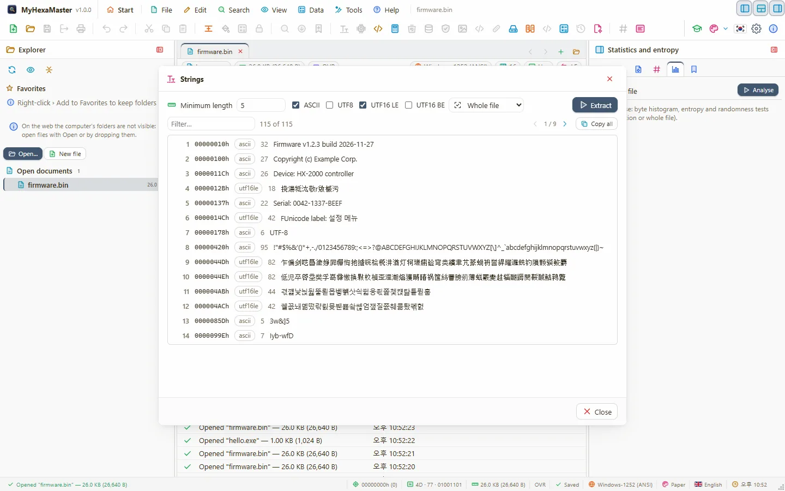

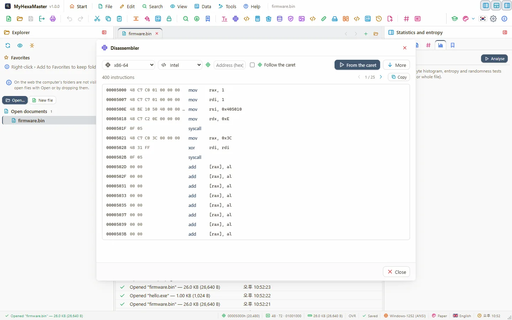

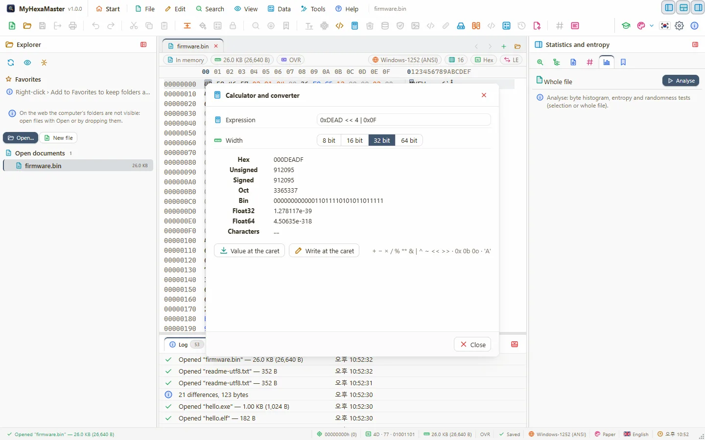

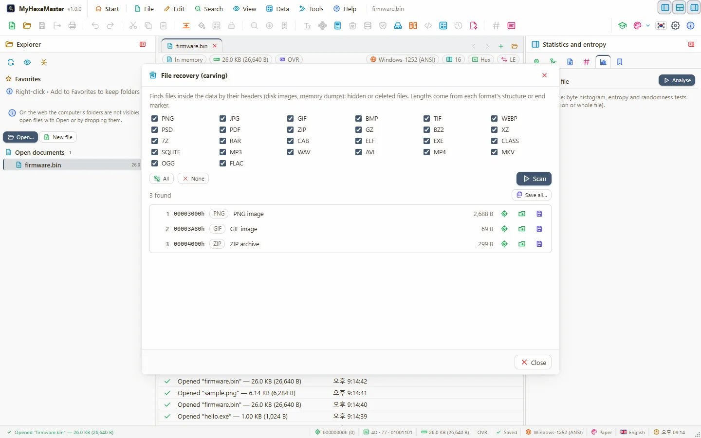

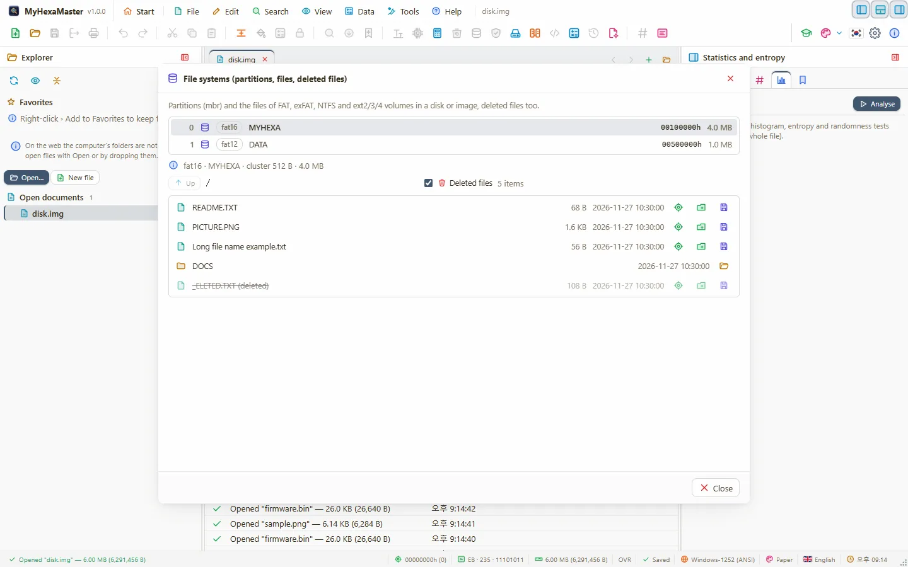

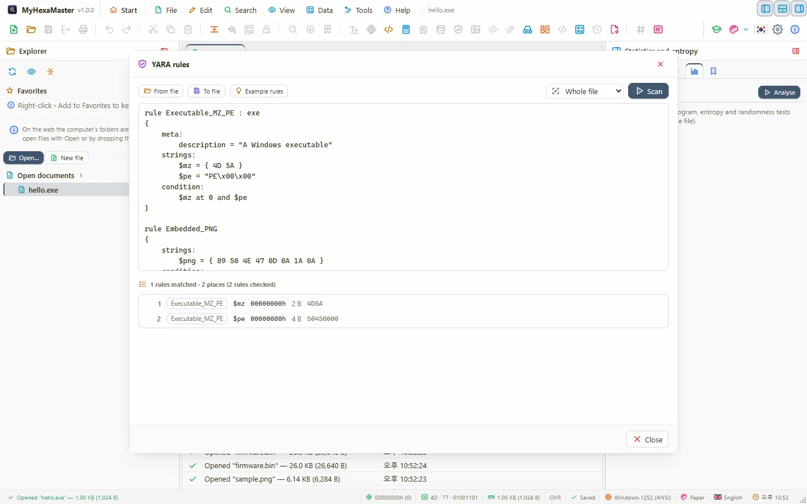

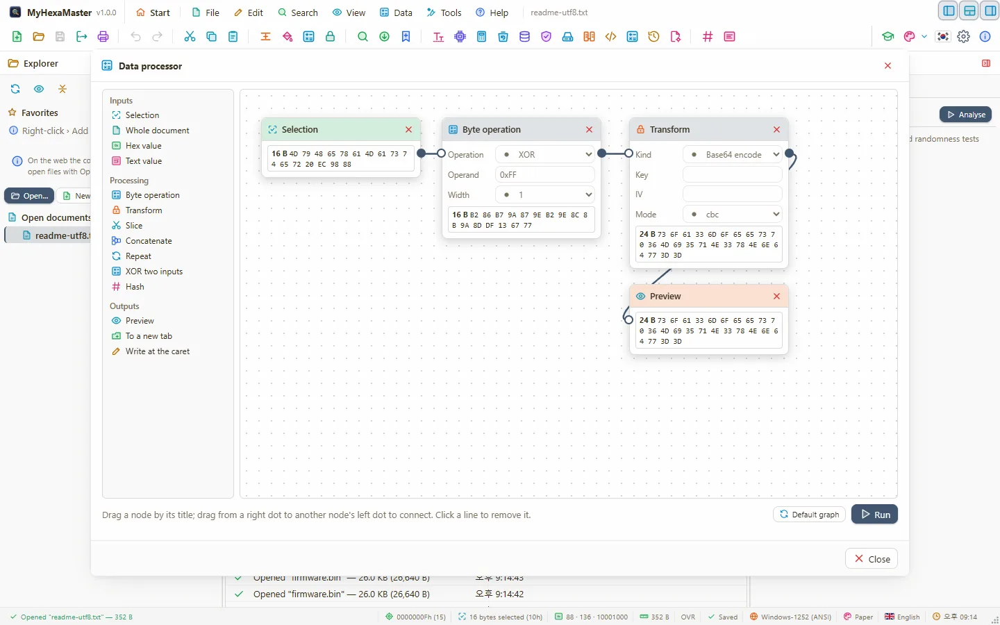

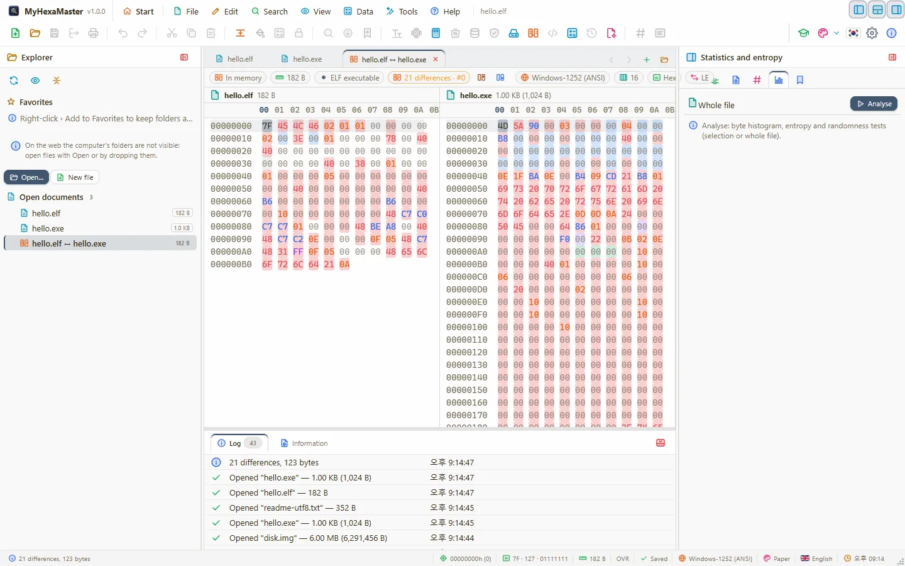

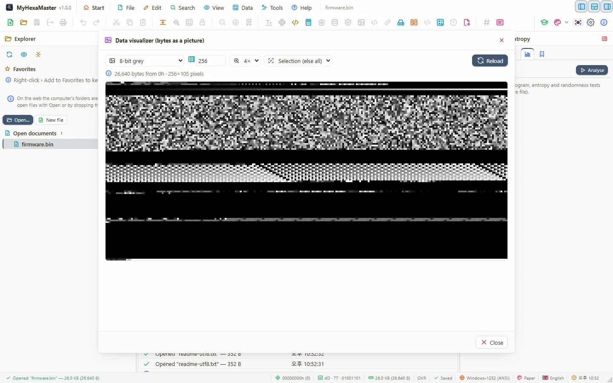

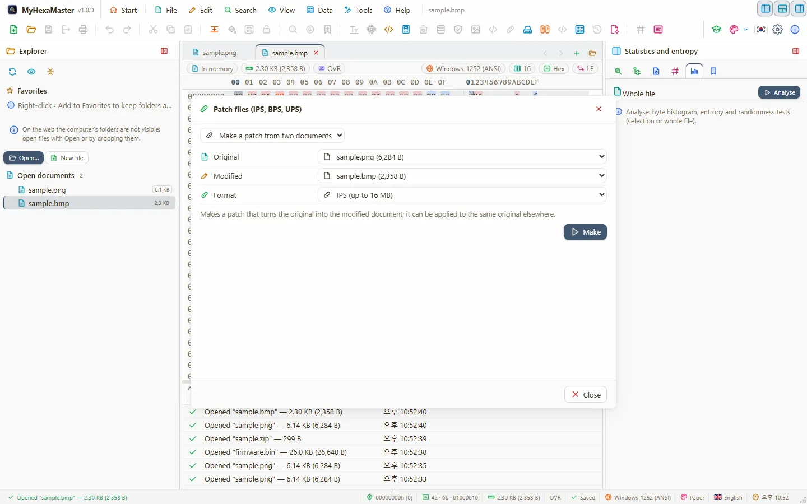

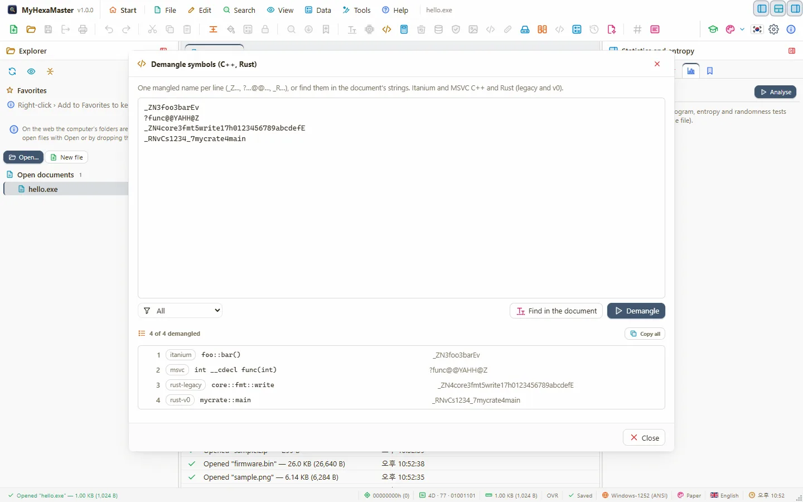

## 9. Data menu

- **Byte operations** (selection or whole file): XOR, AND, OR, NOT, add, subtract, multiply, divide, remainder, negate, shift, rotate, fill with value, reverse order, reverse bit order, swap nibbles. Choose the unit size (8, 16, 32 or 64 bits) and byte order. The operand can be decimal, hex with `0x`, hex containing letters (`FF`), or a repeating pattern such as `DE AD`.
- **Swap byte order**: 16, 32 or 64 bits.
- **Encrypt and decrypt**: repeating-key XOR, ROT13, AES (128, 192, 256; ECB, CBC, CTR; PKCS#7), DES, 3DES (ECB, CBC), Blowfish, Twofish, CAST5 and Camellia (ECB, CBC, CTR), TEA and XTEA (ECB, CBC), RC4, ChaCha20 (12-byte nonce), Salsa20 (8-byte nonce). Key and IV as hex or text.
- **Compress and decompress**: zlib, Deflate, gzip (level 0–10).
- **Encoding**: Base64, hex text, URL.
- The result is put in place or opened in a new tab. Every operation is undone in one step.
- **Compute checksums and hashes** (Ctrl+Shift+K), **Statistics and entropy**, **Selection to new tab**.

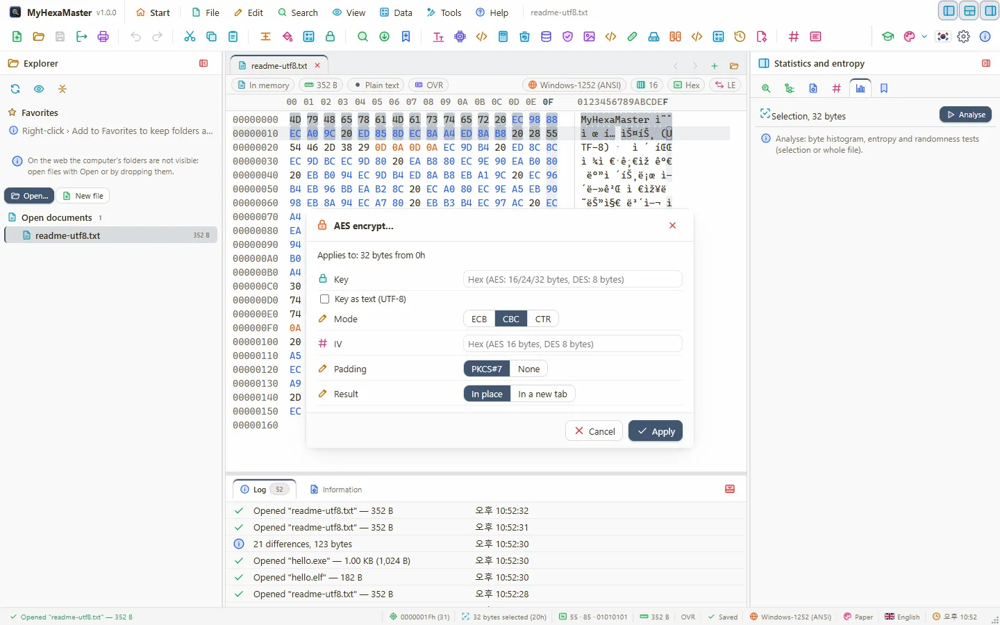

## 10. Export, import, print

- **Export**: hex dump, hex text, C, C++, C#, Java, JavaScript, Python, Rust, Go, Pascal, Visual Basic, assembly (db), Base64, Base32, Ascii85, UUencode, Intel HEX, Motorola S-record, HTML, RTF, Markdown table, JSON, escaped string, binary. If there is a selection, only the selection is exported. You can also send the output straight to the clipboard.
- **Import**: hex text, hex dump, Base64, Base32, Ascii85, UUencode, Intel HEX, S-record (checksums verified, start address shown), source code arrays, JSON, escaped strings — from the clipboard, a file or typed input, into a new tab or at the cursor.
- **Print** (Ctrl+P): prints a hex dump of the selection (or the whole file if nothing is selected). In the print window you choose the printer, paper, orientation, margins and range, preview, then print. A PDF printer saves a PDF file.

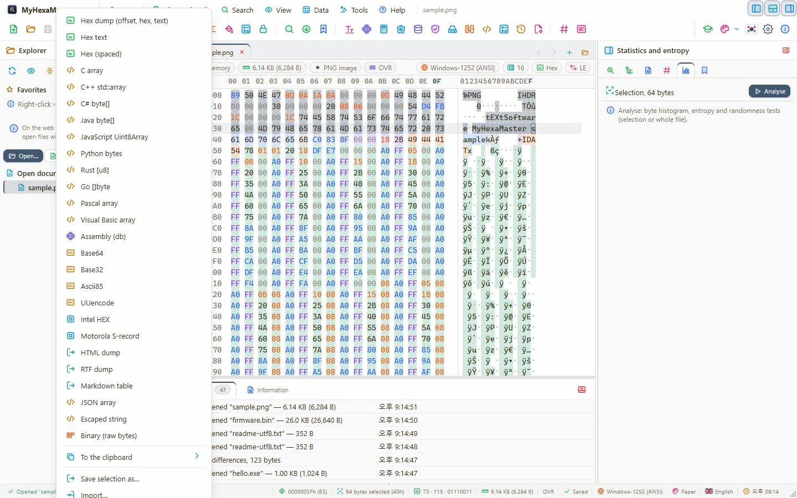

## 11. Settings

| Tab | Contents |
| --- | --- |
| General | Language, restore session, open read-only, remember cursor, clock |
| Hex view | Bytes per row, grouping, number base, character set, font, size and line height, start address, columns and colors |
| Editing | Input mode, byte order, copy format, paste, undo steps, run template on open |
| Tools | Number of find results, minimum string length, disassembler architecture and syntax, entropy graph blocks, compare method |
| Theme, fonts, start screen, background, recent files, shortcuts | Program appearance and start screen. The background animation speed runs from 0 (still) to 100; 33 is the former default speed (rescaled in proportion) |

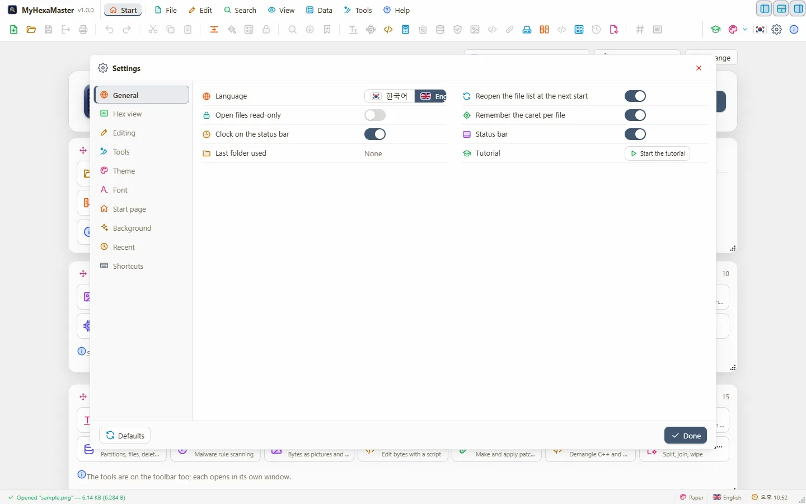

## 12. Keyboard shortcuts

| Key | Action |
| --- | --- |
| Ctrl+N / Ctrl+O / Ctrl+S / Ctrl+Shift+S / Ctrl+W | New file / Open / Save / Save as / Close |
| Ctrl+Z / Ctrl+Y | Undo / Redo |
| Ctrl+X / C / V, Ctrl+Shift+C / V | Cut / Copy / Paste, as text |
| Ctrl+A / Ctrl+B | Select all / Select block |
| Ctrl+F / Ctrl+H / F3 / Shift+F3 | Find / Replace / Next / Previous |
| Ctrl+G / Ctrl+D / F2 / Shift+F2 | Go to offset / Bookmark / Next / Previous bookmark |
| Insert / Tab | Insert mode or Overwrite / Hex column ↔ text column |
| Ctrl+E / Ctrl+I / Ctrl+R / Ctrl+M | Fill / Insert / Read-only / Text view |
| Ctrl+K / F8 / Shift+F8 | Compare / Next / Previous difference |
| Ctrl+T / Ctrl+Shift+D / Ctrl+Shift+T / Ctrl+Shift+F / Ctrl+Shift+Y / Ctrl+Shift+K | Template / Disassembler / Strings / Recovery / YARA / Checksums |
| Alt+C / Ctrl+L | Text editor: column selection mode / go to line |
| Ctrl+Shift+R / Ctrl+Shift+E | Script / Split view |
| Ctrl+Shift+M / Ctrl+Shift+G | Record macro (start/stop) / Play macro |
| Ctrl+P / Ctrl+Shift+P | Print / Command palette |
| Ctrl+= / Ctrl+- / Ctrl+0 | Hex text larger / smaller / default |
| Ctrl+Shift+1 / 2, Ctrl+J | Left / right / bottom panel |
| F1 / Shift+F1 / F11 | Information / Tutorial / Full screen |

## 13. Installing and development

    npm run setup     # or npm install — installs and prepares what is needed (not kept in git)
    npm start         # run the desktop app for development
    npm run dev       # web development server
    npm test          # tests
    npm run build:win # installer (build:mac, build:linux, build:all)

Requirements: Node 22+, Rust (rustup). Linux needs the WebKitGTK development packages (`npm run setup` shows the command).
