# MyHexaMaster 사용 설명서

MyHexaMaster는 파일·디스크·프로세스 메모리를 바이트 단위로 보고 고치는 헥사 편집기입니다. UltraEdit·HxD·010 Editor·ImHex·WinHex·Hex Fiend·Okteta·Free Hex Editor Neo·MiTeC·Hackman의 기능을 한 프로그램에 모았습니다. Windows·macOS·Linux 데스크톱 프로그램(Tauri)과 웹 브라우저에서 같은 화면으로 동작하며, 바이트를 다루는 모든 일은 Rust 코어가 합니다.

## 1. 화면 구성

| 부분 | 내용 |
| --- | --- |
| 메뉴 막대 | 파일·편집·검색·보기·데이터·도구·도움말. 오른쪽에 패널 단추와 창 단추 |
| 툴바 | 파일, 실행 취소, 클립보드, 편집 모드·채우기·바이트 연산·읽기 전용, 찾기·이동·책갈피, **도구**(문자열·디스어셈블러·계산기·복구·파일 시스템·YARA·디스크/메모리·비교·템플릿·데이터 처리기·편집 기록·파일 도구), 체크섬·텍스트 보기 |
| 왼쪽 패널 | **탐색기**: 즐겨찾기, 홈 폴더, 드라이브, 열린 문서 |
| 가운데 | 문서 탭. 탭 막대(출처·크기·형식·INS/OVR·문자 집합·한 줄 바이트·진법·바이트 순서) 아래 헥사 보기 |
| 오른쪽 패널 | **속성**: 데이터 검사기, 구조(템플릿), 파일 정보, 체크섬·해시, 통계·엔트로피, 책갈피 |
| 아래 패널 | **로그**와 **정보** |
| 상태 표시줄 | 커서 오프셋(16진·10진), 선택 크기, 커서의 바이트 값, 파일 크기, INS/OVR, 문자 집합, 테마, 언어 |

모든 대화 상자와 도구는 따로 움직일 수 있는 창으로 열립니다(웹에서는 페이지 안의 창).

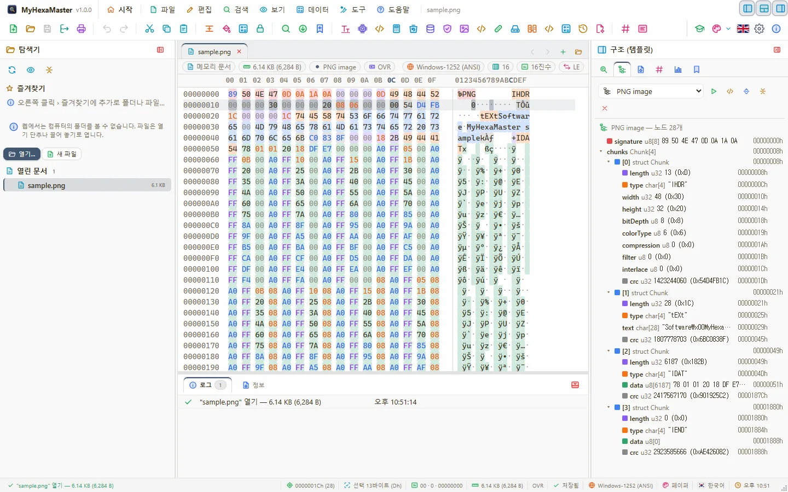

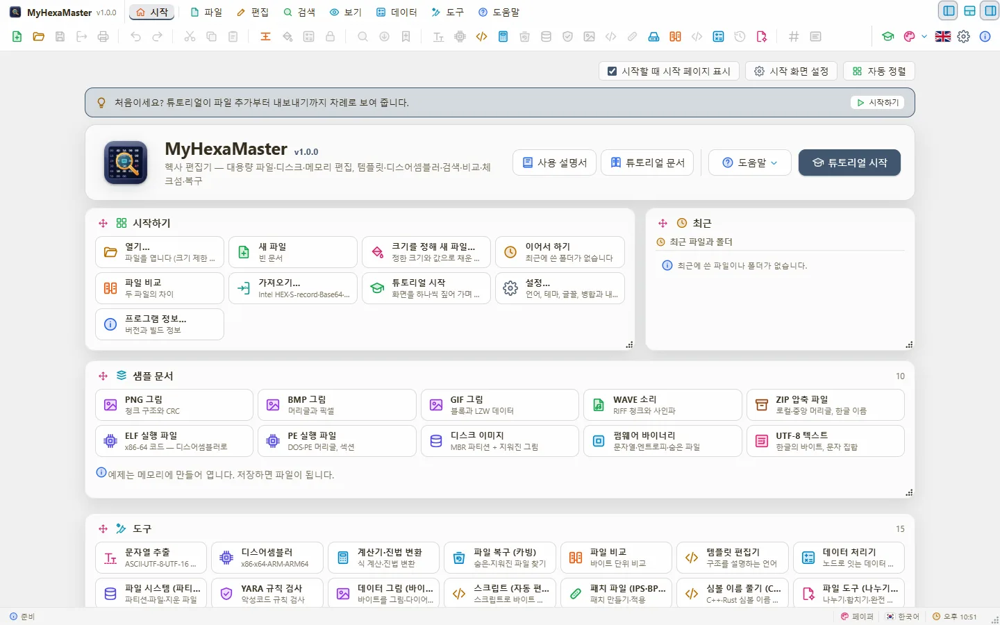

## 2. 파일 열기와 저장

- **열기**(Ctrl+O): 크기 제한이 없습니다. 파일 전체를 읽지 않고 보이는 부분만 읽으므로 수 GB 파일도 바로 열립니다. 탐색기에서 두 번 클릭하거나 창에 끌어 놓아도 됩니다.
- **새 파일**(Ctrl+N), **크기를 정해 새 파일**: 0·패턴·무작위·증가하는 수로 채운 문서.
- **읽기 전용으로 열기**, **디스크 열기**, **프로세스 메모리 열기**(데스크톱).
- **디스크 쓰기**: 디스크·볼륨·디스크 이미지는 읽기 전용으로 열립니다. 읽기 전용(Ctrl+R)을 풀면 경고를 한 번 더 확인한 뒤 고칠 수 있고, 저장하면 바뀐 섹터만 디스크에 씁니다(볼륨은 잠그고 마운트를 해제한 뒤 씀, 관리자 권한 필요). **이미지로 저장**은 디스크나 프로세스 메모리 전체를 파일로 저장합니다.
- **큰 파일**: 열기·저장·긴 작업(찾기, 해시, 통계, 복구, YARA …)은 잠시 뒤 진행률 창을 띄우고 취소할 수 있습니다.
- **저장**(Ctrl+S): 바이트 위치가 바뀌지 않았으면 바뀐 부분만 그 자리에 씁니다(큰 파일도 빠름). 끼워 넣기·삭제가 있으면 임시 파일에 쓴 뒤 바꿔 끼웁니다.
- **다른 이름으로 저장**(Ctrl+Shift+S), **모두 저장**, **선택 영역을 파일로**, **디스크에서 다시 읽기**.
- 웹에서는 Chrome·Edge의 파일 시스템 접근으로 같은 파일에 다시 저장하고, 그 밖의 브라우저는 내려받기로 저장합니다.
- 파일마다 마지막 커서 위치, 책갈피, 템플릿을 기억합니다.

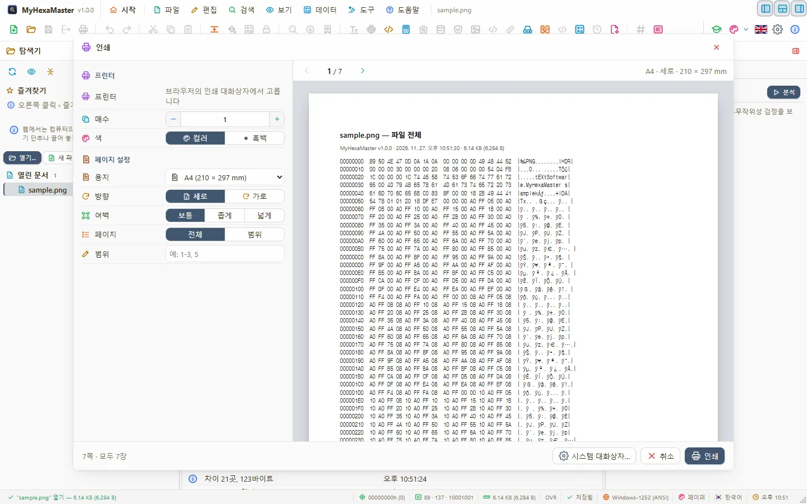

## 3. 헥사 보기와 편집

- 왼쪽부터 오프셋, 바이트, 글자 열입니다. 바이트는 종류별 색(00, 인쇄 문자, 제어 문자, 80–FF, FF)으로 나뉘고, 바뀐 바이트는 빨갛게 보입니다.
- 커서가 있는 줄과 열이 밝게 표시되고, 열 머리글에도 커서 열이 나옵니다.
- **입력**: 헥사 칸에서 16진수를 치면 위 니블, 아래 니블 순서로 바뀝니다. **Tab**으로 글자 칸으로 옮겨 글자를 치면 현재 문자 집합으로 바이트가 됩니다(한글 입력기도 됨).
- **Insert** 키로 **끼워 넣기 / 덮어쓰기**를 바꿉니다. 디스크와 프로세스 메모리는 크기가 고정되어 덮어쓰기만 됩니다.
- **Backspace / Delete**: 선택 영역이나 바이트를 지웁니다.
- **선택**: 끌기, Shift+화살표, **블록 선택**(Ctrl+B: 시작과 길이/끝), **모두 선택**(Ctrl+A). 헥사 칸에서 두 번 클릭은 한 묶음, 글자 칸에서는 낱말을 선택합니다.
- **채우기**(Ctrl+E), **바이트 끼워 넣기**(Ctrl+I): 패턴(16진수)·0·무작위·증가하는 수(시작·증가량·단위 크기).
- **실행 취소 / 다시 실행**(Ctrl+Z / Ctrl+Y)은 단계 제한이 없고, 연속해서 친 바이트는 한 단계로 묶입니다. **편집 기록** 창에서 원하는 단계로 바로 돌아갈 수 있습니다.
- **읽기 전용**(Ctrl+R) 문서는 고칠 수 없습니다.
- **텍스트로 보기·편집**(Ctrl+M): 문서를 현재 문자 집합의 텍스트로 열어 줄 번호가 있는 텍스트 편집기에서 고치고 "바이트로 적용"하면 한 단계 편집이 됩니다(32 MB까지). **열(사각형) 선택 모드**(Alt+C, 또는 Alt를 누른 채 끌기), **긴 줄 바꿈**, 찾기·바꾸기(Ctrl+F), 줄로 이동(Ctrl+L)을 씁니다.

### 보기 설정 (보기 메뉴, 탭 막대의 칩)

- 한 줄 바이트 수: 4·8·12·16·20·24·32·48·64 또는 창 폭에 맞춤
- 묶음: 1·2·4·8·16바이트
- 오프셋 진법: 16·10·8진수, 값 표시: 16·10·8·2진수, 대문자, 오프셋 앞 0x, 표시용 시작 주소
- 문자 집합: ASCII, Latin-1, Windows-1252, CP437, EBCDIC, UTF-8, UTF-16 LE/BE, EUC-KR, Shift_JIS
- 글자 열·오프셋 열·열 머리글, 바이트 색, 바뀐 바이트 강조, 커서 줄·열 강조, 헥사 글꼴과 크기(Ctrl+= / Ctrl+-)

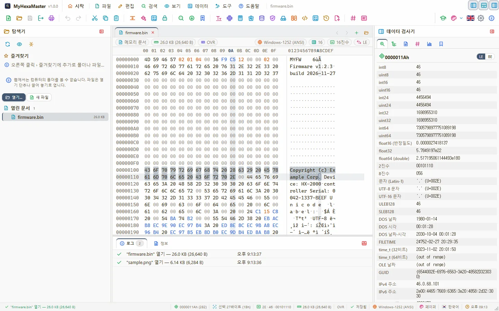

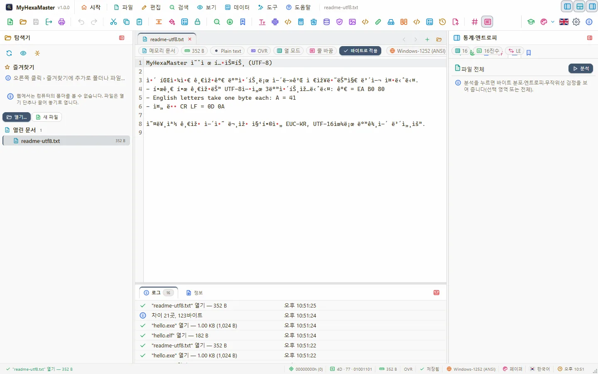

## 4. 클립보드

- **복사**(Ctrl+C)는 설정의 형식(기본: 16진수)으로 복사합니다. **다른 형식으로 복사**: 16진수, 띄어 쓴 16진수, 텍스트, C 배열, Python bytes, Base64, 이스케이프(\x4D).
- **붙여넣기**(Ctrl+V): 자동 모드에서는 16진수 글자면 바이트로, 아니면 텍스트로 붙입니다. **16진수로 / 텍스트로 붙여넣기**(Ctrl+Shift+V)도 있습니다. 끼워 넣기 모드면 끼워 넣고, 덮어쓰기 모드면 덮어씁니다.
- **잘라내기**(Ctrl+X).

## 5. 찾기·바꾸기·이동·책갈피

- **찾기·바꾸기**(Ctrl+F, Ctrl+H) 창:
  - 16진수: `4D 5A ?? 00`처럼 `??`(한 바이트)와 `4?`·`?F`(한 니블) 와일드카드
  - 텍스트: 14가지 인코딩, 대소문자 구분 선택
  - 정규식: 바이트 정규식(`\x50\x4B\x03\x04`, `[\x00-\x1F]+`)
  - 정수(1·2·3·4·8바이트, 부호, 바이트 순서), 실수(4·8바이트)
  - 범위(파일 전체 / 선택 영역만), 끝에서 처음으로
  - 다음·이전·**모두 찾기**(결과 목록과 헥사 보기 표시)·개수·바꾸기·**모두 바꾸기**(한 번에 실행 취소)
- **파일에서 찾기**: 찾기 창의 범위를 "여러 파일"로 바꾸고 파일이나 폴더(하위 폴더 포함)를 고르면 모든 파일에서 같은 조건으로 찾습니다. 결과를 누르면 그 파일을 열고 위치를 선택합니다.
- **다음/이전 찾기**: F3 / Shift+F3.
- **이동**(Ctrl+G): 처음·앞으로·뒤로·끝에서, 16/10진수, 커서부터 선택. `0x`나 `h`가 붙으면 16진수입니다.
- **책갈피**: Ctrl+D로 커서나 선택 영역에 넣고, F2 / Shift+F2로 오갑니다. 오른쪽 패널 책갈피 탭에서 색·이름을 바꾸거나 지웁니다.

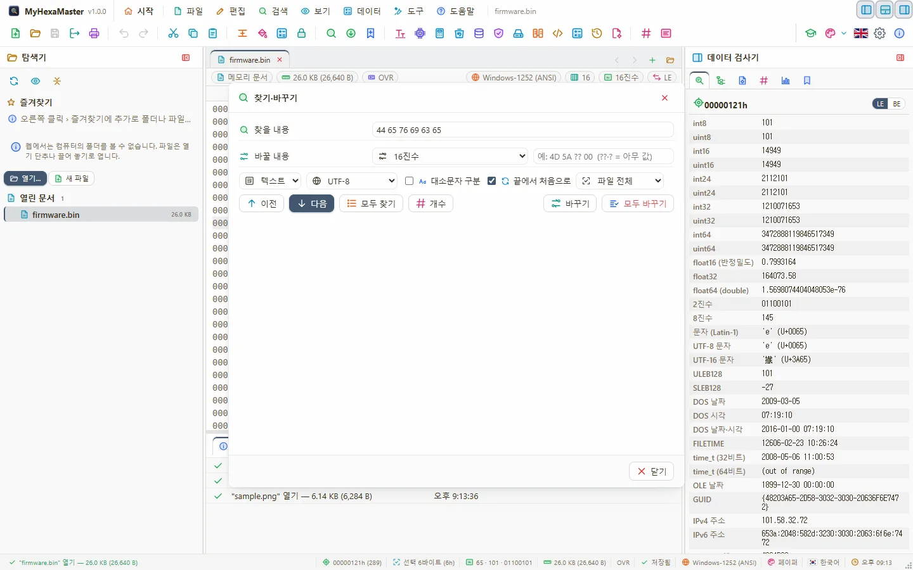

## 6. 속성 (오른쪽 패널)

- **데이터 검사기**: 커서 위치의 바이트를 int8~int64(부호 있음/없음), int24, float16/32/64, 2진·8진, 문자(Latin-1·UTF-8·UTF-16), ULEB128·SLEB128, DOS 날짜·시각, FILETIME, time_t(32·64), OLE 날짜, GUID, IPv4·IPv6, RGB565·RGB·RGBA, 참/거짓으로 읽습니다. LE/BE로 바이트 순서를 바꾸고, 값을 **두 번 클릭**하면 새 값을 입력해 그 자리에 씁니다.
- **구조(템플릿)**: 템플릿이 찾은 구조를 나무로 보여 줍니다. 항목을 누르면 그 바이트를 선택하고, 색이 있는 항목은 헥사 보기에도 칠해집니다.
- **파일 정보**: 이름, 경로, 출처, 크기, 파일 형식과 세부 정보(그림 크기, 실행 파일 종류 …), MIME, 바뀜, 읽기 전용, 실행 취소 단계, 커서와 선택.
- **체크섬·해시**: 선택 영역(없으면 전체)에 대해 고른 알고리즘을 한 번에 계산합니다. 값을 누르면 복사합니다.
  - 체크섬: Checksum-8/16/32/64, XOR-8
  - CRC 등: CRC-8, CRC-16(ARC·CCITT-FALSE·XMODEM·MODBUS), CRC-32, CRC-32C, CRC-32 BZIP2, CRC-64(ECMA·XZ), Adler-32, Fletcher-16/32
  - 해시: MD2, MD4, MD5, SHA-1, SHA-224/256/384/512, SHA-512/256, SHA3-224/256/384/512, Keccak-256, RIPEMD-160, BLAKE2b-512, BLAKE2s-256, BLAKE3
- **해시 데이터베이스**(WinHex 해시 세트·NSRL): 해시 값마다 ＋로 "알려진 파일(무시)" 또는 "주의할 파일"로 넣거나, md5sum·sha1sum·sha256sum·BSD·CSV(NSRL) 목록을 가져옵니다. 계산한 해시가 데이터베이스에 있으면 줄 색과 표시로 알려 줍니다. 내보내기·모두 지우기도 됩니다.
- **통계·엔트로피**: 바이트 분포(제곱근 눈금), 블록별 엔트로피 그래프(누르면 그 블록으로 이동), 엔트로피, 서로 다른 값, 00·인쇄 문자·제어 문자·80–FF 비율, 평균, 중앙값, 카이제곱, 몬테카를로 π, 연속 상관, 많은 값. 압축되거나 암호화된 부분은 엔트로피가 8에 가깝습니다.
- **책갈피**: 목록, 색, 이름, 이동, 삭제.

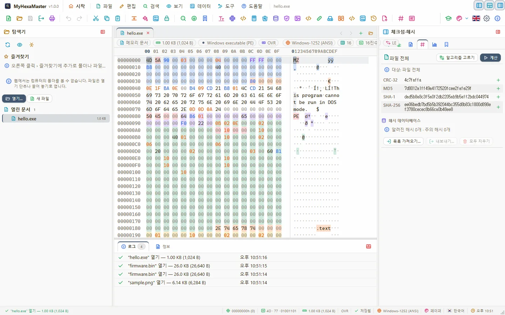

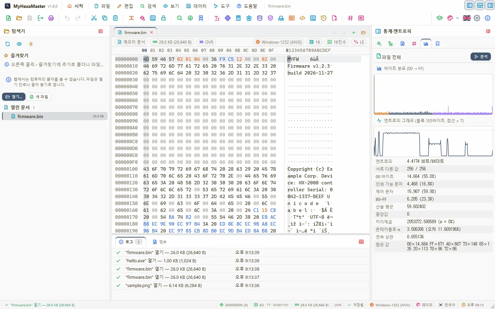

## 7. 템플릿

파일을 열 때 형식을 알아보고 맞는 템플릿을 자동으로 실행합니다(설정에서 끌 수 있음). 내장 템플릿: PNG, BMP, GIF, JPEG, ZIP(DOCX·XLSX·JAR·APK 포함), GZIP, WAVE, ELF, PE(EXE·DLL), MBR/GPT, ICO, TAR, Java class, SQLite, Mach-O, MP3(ID3), WebAssembly, 원시 데이터.

**템플릿 편집기**(Ctrl+T)에서 직접 쓰고 실행하며, "내 템플릿으로 저장"하거나 파일(.hexpat)로 저장·불러옵니다.

### 템플릿 언어 (010 Editor / ImHex 식)

- 주석 `// …`, `/* … */`. 바이트 순서: `#pragma endian big`, `endian little;`, 필드마다 `be u32` / `le u16` (기본 little)
- 자료형: `u8 u16 u24 u32 u48 u64`, `s8…s64`(`i8…`), `float`(f32) `double`(f64) `f16` `bool` `char` `wchar` `uleb128` `sleb128`. C·010 이름도 됩니다: `uchar byte ushort short uint int ulong long uint64 int64 DWORD WORD BYTE unsigned char …`
- `struct 이름 { 필드; … } [[color("blue")]];`, `union`(모든 필드가 같은 위치), `enum 이름 : u8 { A = 1, B };`, `bitfield F { a : 1; b : 3; };`, `using Word = u16;`, `typedef u32 DWORD;`
- 필드: `형 이름;`, 배열 `형 이름[식];`, `형 이름[while(조건)];`, `char s[];`(0까지 글자), `형 이름 @ 오프셋;`(커서는 그대로). char/wchar 배열은 글자, u8 배열은 노드 하나
- 문장: `if/else`, `while`, `for (let i = 0; i < n; i++)`, `let x = 식;`, `x += 1;`, `break`, `continue`, `return`
- 사용자 함수: `fn pad(n, a) { let r = n % a; return r ? n + a - r : n; }` (지역 변수, `return 식;`, 재귀 64단계)
- 다차원 배열 `u8 grid[3][4];`, `Cell c[2][n];` (`grid[1][2]`, `c[i][j].f`), 바깥 구조체 `parent.size`·`parent.parent.x`·`this`, 크기가 고정된 구조체의 `sizeof(Header)`
- 식: `12 0x1F 0b101 0o17 1.5 'A' "글자"`, `+ - * / % & | ^ ~ << >> && || ! == != < <= > >= ?:`, `a.b`, `a[i]`, `$`(현재 오프셋), `Enum::값`
- 함수: `sizeof addressof endof size() eof() pos() seek(o) skip(n)`, `ReadU8…ReadU64 / ReadS8…S64 / ReadFloat / ReadDouble(o)`, `ReadU32BE/LE`, `ReadString(o, n)`, `find(o, "FF D9")`, `ParseInt(글자, 진법)`, `strlen min max abs str hex`, `Warning()`, `Error()`
- 속성: `[[color("#rrggbb"|"red"|0xRRGGBB), comment("…"), name(식), hidden]]` 또는 `<bgcolor=0xRRGGBB, comment="…">`
- 오류는 줄·칸과 함께 표시되고, 그때까지 만든 노드는 남습니다.

예:

    struct Header {
        char magic[4] [[color("#e5484d")]];
        be u32 length;
        u8 data[length] [[comment("payload")]];
    };
    Header header;

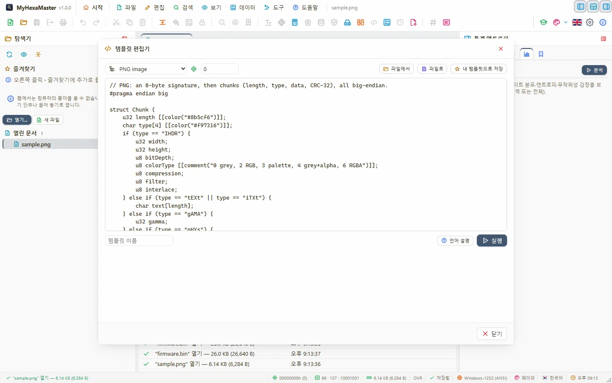

## 8. 도구 (툴바)

| 도구 | 하는 일 |
| --- | --- |
| 찾기·바꾸기 | 5장 |
| 이동 | 5장 |
| 문자열 추출 (Ctrl+Shift+T) | ASCII·UTF-8·UTF-16 LE/BE 문자열, 최소 길이, 걸러 보기, 모두 복사. 줄을 누르면 이동 |
| 디스어셈블러 (Ctrl+Shift+D) | x86 16·32·64비트(Intel·NASM·MASM·AT&T 문법), ARM 32·Thumb·ARM64. 커서 또는 선택 영역부터, 주소 지정, 커서 따라가기, 더 보기, 복사 |
| 계산기·진법 변환 | 식(사칙 연산·`%`·`**`, 비트 AND·OR·XOR·NOT, `<<`·`>>`, `0x 0b 0o 'A'`, abs·min·max)을 8·16·32·64비트로 계산해 16·10·8·2진수, 부호, float32/64, 글자로 보여 줍니다. 커서 값 가져오기·커서에 쓰기 |
| 파일 복구 (카빙, Ctrl+Shift+F) | 디스크 이미지·메모리 덤프 안의 파일을 머리글로 찾습니다(PNG, JPEG, GIF, BMP, TIFF, WebP, PSD, PDF, ZIP, GZIP, BZIP2, XZ, 7z, RAR, CAB, ELF, PE, Java class, SQLite, MP3, WAV, AVI, MP4, MKV, OGG, FLAC). 길이는 형식 구조나 끝 표지로 정합니다. 이동·새 탭으로 열기·파일로 저장·모두 저장 |
| 파일 시스템 | 디스크·이미지의 MBR(확장 파티션 포함)·GPT 파티션과 FAT12/16/32·exFAT·NTFS·ext2/3/4 볼륨의 폴더와 파일을 봅니다. **지운 파일**도 보여 주고, 파일 위치로 이동·새 탭으로 열기·파일로 저장(꺼내기)을 합니다 |
| YARA 규칙 (Ctrl+Shift+Y) | YARA 규칙(텍스트·16진수 와일드카드와 점프·정규식 문자열, `at`·`in`·`of`·`for`·개수·`filesize`·`entrypoint`·`uint32()` 조건)을 문서나 선택 영역에 적용합니다. 맞은 규칙과 위치를 목록으로 보여 주고 누르면 선택합니다. 규칙은 .yar로 저장·불러오고, 오류는 줄·칸으로 알려 줍니다 |
| 디스크·메모리 (데스크톱) | 드라이브·볼륨·물리 디스크(읽기 전용으로 열고, 풀면 섹터 단위로 씀, 관리자 권한이 필요할 수 있음), 실행 중인 프로세스의 메모리(읽을 수 없는 곳은 `??`, 저장하면 바꾼 바이트를 프로세스에 씀). macOS는 Mach(task_for_pid)로 열며 sudo가 필요하고, 보호된(SIP) 프로그램은 열 수 없습니다 |
| 파일 비교 (Ctrl+K) | 두 문서를 나란히 놓고 다른 바이트를 칠합니다. "같은 위치끼리" 또는 "끼워 넣기·삭제 찾기"(4 MB까지). F8 / Shift+F8로 다음·이전 차이, 스크롤이 함께 움직입니다 |
| 템플릿 편집기 (Ctrl+T) | 7장 |
| 데이터 처리기 | ImHex 식 노드 그래프: 선택 영역·문서·값 → 바이트 연산·변환(암호·압축·인코딩)·자르기·잇기·반복·XOR·해시 → 미리 보기·새 탭·커서에 쓰기. 노드를 끌어 잇고 실행하면 노드마다 결과를 보여 줍니다. 그래프는 저장되어 다음에도 남습니다 |
| 편집 기록 | 실행 취소 단계 목록. 누르면 그 단계로 돌아갑니다 |
| 파일 도구 | 나누기(같은 크기 조각 .001 …), 합치기(여러 파일을 순서대로), 완전 삭제(0·무작위·DoD 방식으로 1·3·7번 덮어쓴 뒤 지움, 데스크톱) |

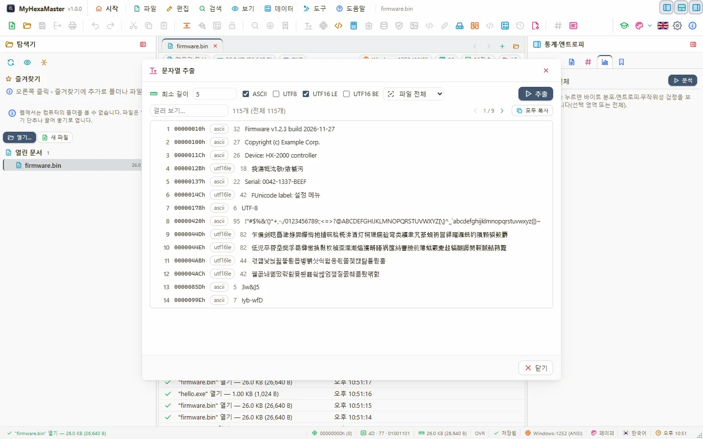

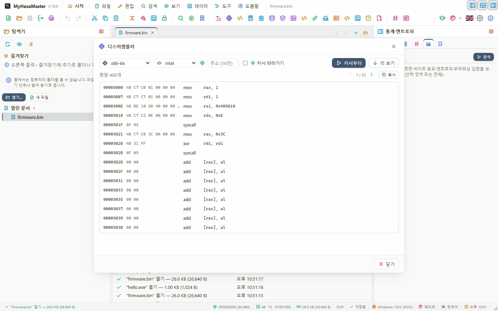

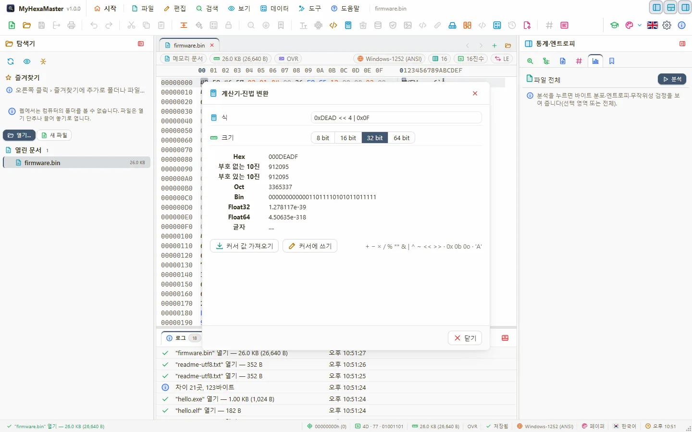

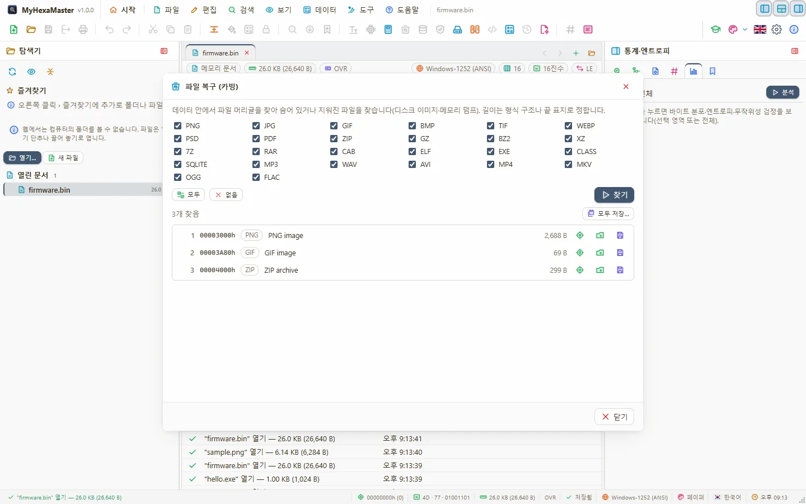

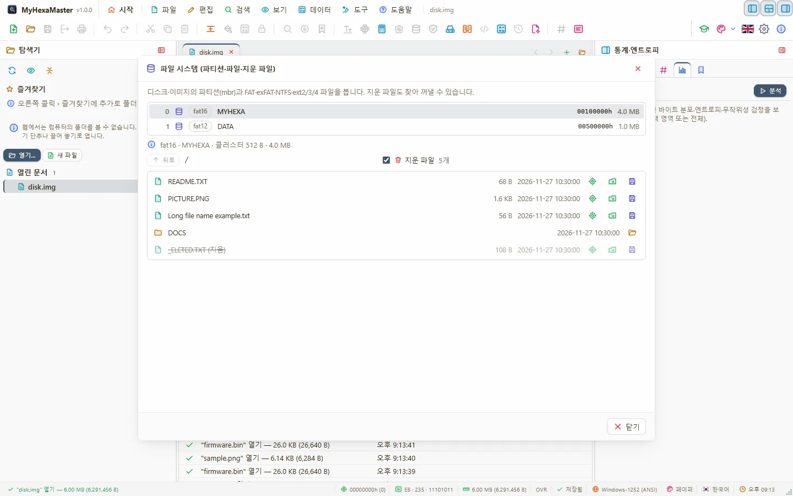

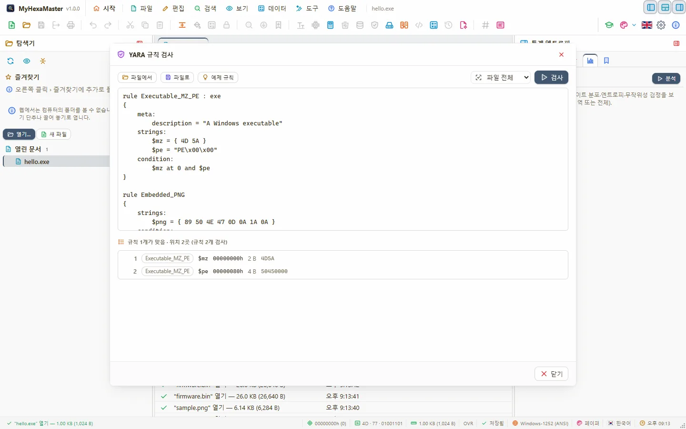

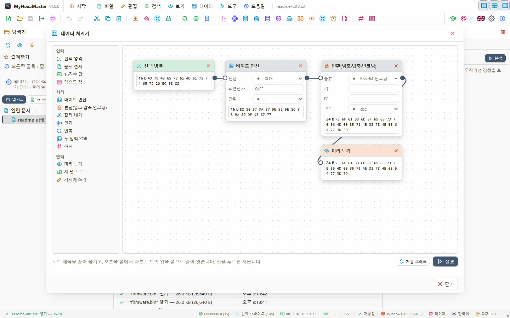

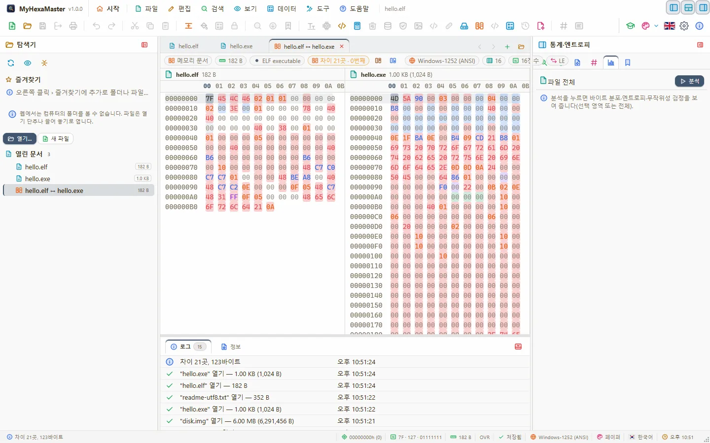

## 9. 데이터 메뉴

- **바이트 연산**(선택 영역 또는 전체): XOR·AND·OR·NOT, 더하기·빼기·곱하기·나누기·나머지·부호 바꾸기, 시프트·회전, 값으로 채우기, 순서 뒤집기, 비트 순서 뒤집기, 니블 바꾸기. 단위 크기(8·16·32·64비트)와 바이트 순서를 고릅니다. 피연산자는 10진수, `0x`16진수, 글자가 섞인 16진수(`FF`), 또는 `DE AD` 같은 반복 패턴입니다.
- **바이트 순서 바꾸기**: 16·32·64비트.
- **암호화·복호화**: 반복 키 XOR, ROT13, AES(128·192·256, ECB·CBC·CTR, PKCS#7), DES, 3DES(ECB·CBC), Blowfish·Twofish·CAST5·Camellia(ECB·CBC·CTR), TEA·XTEA(ECB·CBC), RC4, ChaCha20(논스 12바이트), Salsa20(논스 8바이트). 키·IV는 16진수 또는 글자.
- **압축·풀기**: zlib, Deflate, gzip (수준 0–10).
- **인코딩**: Base64, 16진수 글자, URL.
- 결과는 그 자리에 넣거나 새 탭으로 엽니다. 모두 한 단계로 실행 취소됩니다.
- **체크섬·해시 계산**(Ctrl+Shift+K), **통계·엔트로피**, **선택 영역을 새 탭으로**.

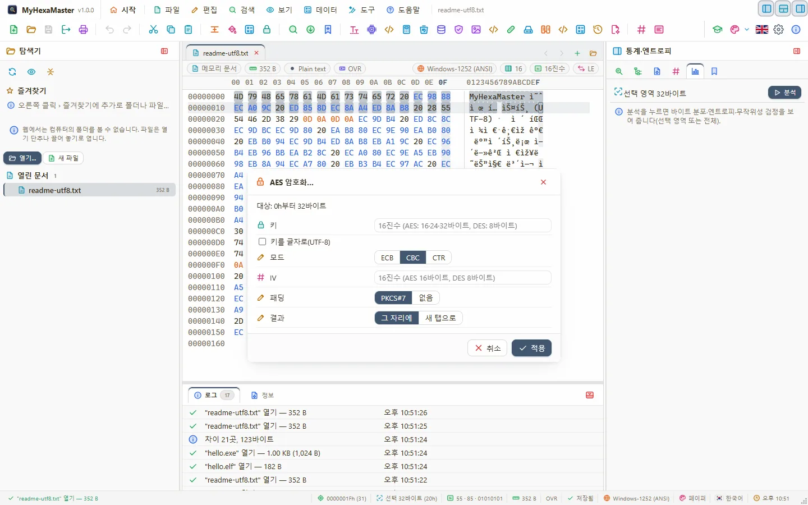

## 10. 내보내기·가져오기·인쇄

- **내보내기**: 헥스 덤프, 16진수 글자, C, C++, C#, Java, JavaScript, Python, Rust, Go, Pascal, Visual Basic, 어셈블리(db), Base64, Base32, Ascii85, UUencode, Intel HEX, Motorola S-record, HTML, RTF, Markdown 표, JSON, 이스케이프 문자열, 바이너리. 선택 영역이 있으면 선택 영역만. 클립보드로 바로 보낼 수도 있습니다.
- **가져오기**: 16진수 글자, 헥스 덤프, Base64·Base32·Ascii85·UUencode, Intel HEX, S-record(체크섬 확인, 시작 주소 표시), 소스 코드 배열, JSON, 이스케이프 문자열 — 클립보드·파일·직접 입력에서, 새 탭 또는 커서 위치로.
- **인쇄**(Ctrl+P): 선택 영역(없으면 전체)의 헥스 덤프를 인쇄 창에서 프린터·용지·방향·여백·범위를 고르고 미리 본 뒤 인쇄합니다. PDF 프린터는 PDF 파일로 저장합니다.

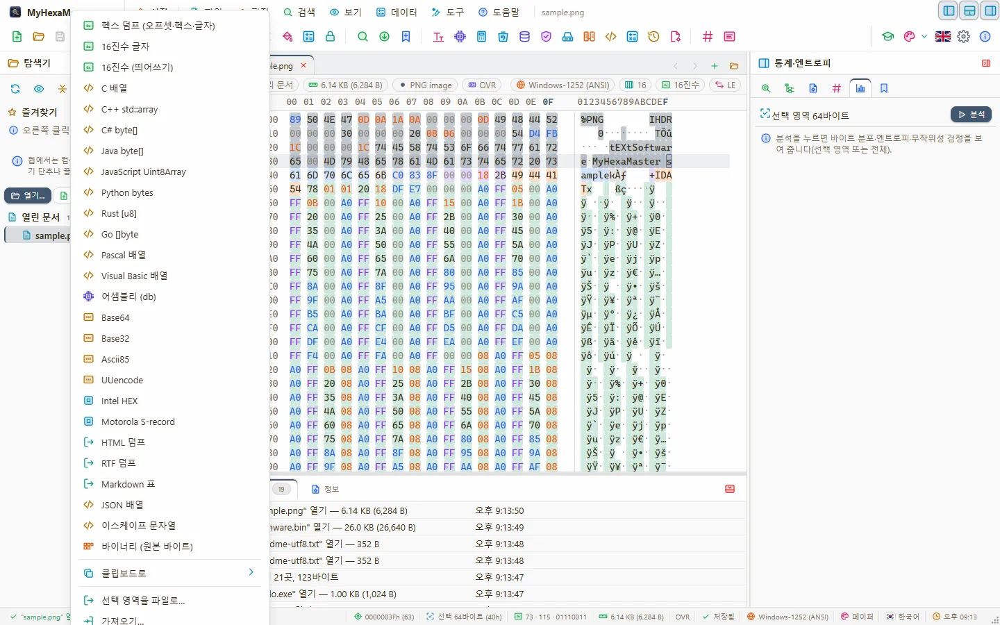

## 11. 설정

| 탭 | 내용 |
| --- | --- |
| 일반 | 언어, 세션 복원, 읽기 전용으로 열기, 커서 기억, 시계 |
| 헥사 보기 | 한 줄 바이트, 묶음, 진법, 문자 집합, 글꼴·크기·줄 높이, 시작 주소, 열과 색 |
| 편집 | 입력 모드, 바이트 순서, 복사 형식, 붙여넣기, 실행 취소 단계, 열 때 템플릿 실행 |
| 도구 | 찾기 결과 수, 문자열 최소 길이, 디스어셈블러 아키텍처·문법, 엔트로피 그래프 칸 수, 비교 방식 |
| 테마·글꼴·시작 화면·배경·최근 파일·단축키 | 프로그램 모양과 시작 화면. 배경 움직임 속도는 0(멈춤)–100이며 33이 예전 기본 속도입니다(비율 그대로 다시 계산) |

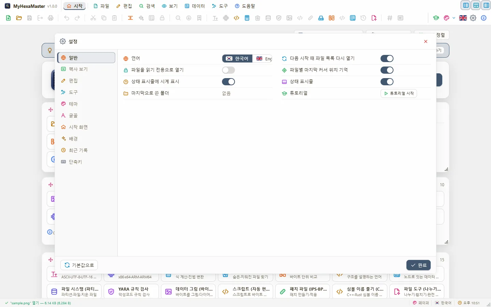

## 12. 단축키

| 키 | 동작 |
| --- | --- |
| Ctrl+N / Ctrl+O / Ctrl+S / Ctrl+Shift+S / Ctrl+W | 새 파일 / 열기 / 저장 / 다른 이름으로 / 닫기 |
| Ctrl+Z / Ctrl+Y | 실행 취소 / 다시 실행 |
| Ctrl+X / C / V, Ctrl+Shift+C / V | 잘라내기 / 복사 / 붙여넣기, 텍스트로 |
| Ctrl+A / Ctrl+B | 모두 선택 / 블록 선택 |
| Ctrl+F / Ctrl+H / F3 / Shift+F3 | 찾기 / 바꾸기 / 다음 / 이전 |
| Ctrl+G / Ctrl+D / F2 / Shift+F2 | 이동 / 책갈피 / 다음 / 이전 책갈피 |
| Insert / Tab | 끼워 넣기·덮어쓰기 / 헥사 칸 ↔ 글자 칸 |
| Ctrl+E / Ctrl+I / Ctrl+R / Ctrl+M | 채우기 / 끼워 넣기 / 읽기 전용 / 텍스트 보기 |
| Ctrl+K / F8 / Shift+F8 | 비교 / 다음 / 이전 차이 |
| Ctrl+T / Ctrl+Shift+D / Ctrl+Shift+T / Ctrl+Shift+F / Ctrl+Shift+Y / Ctrl+Shift+K | 템플릿 / 디스어셈블러 / 문자열 / 복구 / YARA / 체크섬 |
| Alt+C / Ctrl+L | 텍스트 편집기: 열 선택 모드 / 줄로 이동 |
| Ctrl+P / Ctrl+Shift+P | 인쇄 / 명령 팔레트 |
| Ctrl+= / Ctrl+- / Ctrl+0 | 헥사 글자 크게 / 작게 / 기본 |
| Ctrl+Shift+1 / 2, Ctrl+J | 왼쪽 / 오른쪽 / 아래 패널 |
| F1 / Shift+F1 / F11 | 정보 / 튜토리얼 / 전체 화면 |

## 13. 설치와 개발

    npm run setup     # 또는 npm install — 필요한 것을 설치하고 준비(git에는 들어가지 않음)
    npm start         # 데스크톱 개발 실행
    npm run dev       # 웹 개발 서버
    npm test          # 시험
    npm run build:win # 설치 프로그램 (build:mac, build:linux, build:all)

필요: Node 22+, Rust(rustup). Linux는 WebKitGTK 개발 패키지가 필요합니다(`npm run setup`이 명령을 알려 줍니다).
