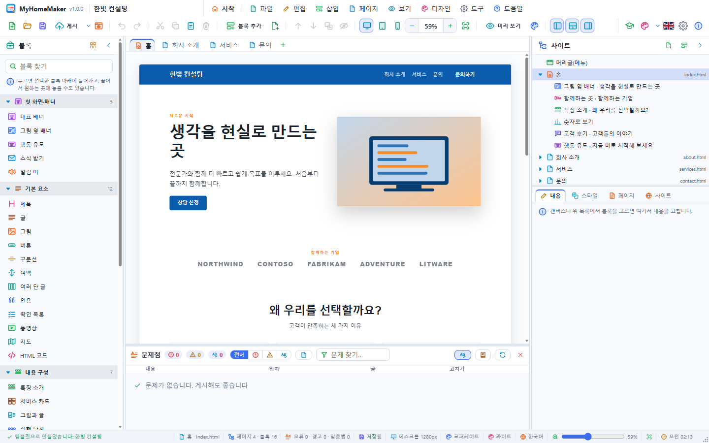

# MyHomeMaker

블록을 끌어다 놓아 홈페이지를 만드는 그래픽 웹사이트 제작 도구 — Windows · macOS · Linux 데스크톱(Tauri)과 웹 버전.
A graphical website builder: drag blocks onto pages, change the design at once, publish static HTML/CSS — desktop (Tauri) for Windows, macOS, Linux, and a web version.



- 블록 34가지와 사이트 머리글·바닥글, 사이트 디자인 36가지, 템플릿 12가지, 예제 사이트 36가지 (네 분야 × 9, 한국어·영어)
- 캔버스에서 바로 글 고치기, 내용·스타일·페이지·사이트 편집기, 실행 취소
- 데스크톱·태블릿·휴대폰 너비, 미리 보기 모드, 브라우저 미리 보기
- 문제점 패널(Ctrl+J): 게시 전 오류·경고와 영어·한국어 맞춤법 검사(조사·어미 분석), 내 사전, 더블클릭으로 위치 이동
- 게시: 폴더 · ZIP · 한 페이지 HTML (그림은 assets/ 파일로)
- 시작 화면(카드 보드), 프로그램 테마, 앱 안 튜토리얼 37단계(빈 사이트에서 4개 페이지 홈페이지 만들기)와 동영상(MyHomeMaker-Tutorial.mp4), 사용 설명서·튜토리얼 문서 창

문서 / Documents: [사용 설명서](doc/UsersGuide.md) · [User's guide](doc/UsersGuide.en.md) · [튜토리얼](doc/Tutorial.md) · [Tutorial](doc/Tutorial.en.md)

## 개발 / Development

```
npm install
npm start              # 데스크톱 앱 (tauri dev, http://localhost:1460)
npm run dev            # 웹 버전만 (Vite)
npm test               # 단위(js) · Rust · 웹 · 데스크톱 검사 / every test
npm test -- --quick    # 단위 · Rust 만
npm run tutorial:video # 튜토리얼 동영상 (doc/video/, 프로젝트 폴더에 복사)
npm run tutorial:docs  # 튜토리얼 문서와 단계별 그림
npm run build:dict     # 맞춤법 사전 (public/dict/)
```

## 설치 파일 / Installers

```
npm run build:win      # MyHomeMaker-Setup-<version>.exe
npm run build:mac      # MyHomeMaker-<version>-<arch>.dmg
npm run build:linux    # .deb · .rpm · .AppImage
npm run build:webapp   # MyHomeMaker-Web-<version>.zip
npm run build:all      # 웹 버전 + 이 운영 체제의 설치 파일
```

결과는 `release/` 와 프로젝트 루트에 복사됩니다. Tauri 는 자기 운영 체제용 설치 파일만 만듭니다.

## 기타 스크립트 / Other scripts

| 명령 | 하는 일 |
|---|---|
| `npm run build:docs` | `doc/*.md` → `public/docs/*.html` (그림 포함) |
| `npm run guide:images` | 설명서 그림을 실제 앱(웹 빌드)에서 찍어 `doc/images/{ko,en}/` 에 저장 |
| `npm run build:icons` | `assets/*.svg` → 앱·문서 아이콘, 설치 프로그램 그림 |
| `npm run i18n:check` | 소스가 쓰는 번역 키가 모두 있는지 |
| `npm run smoke` / `npm run smoke:desktop` | 웹 / 데스크톱 스모크 검사 |

## 구조 / Layout

| 경로 | 내용 |
|---|---|
| `src/domain/` | 사이트 모델(site.js), 블록(blocks.js), HTML·CSS(render.js), 디자인, 템플릿, 예제, 게시(publish.js), 그림(art.js) |
| `src/views/canvas.js` | 편집 캔버스 (iframe + 선택·끌어 놓기 겹침층) |
| `src/app.js` · `src/popup.js` | 메인 창 · 팝업 창 (설정, 메뉴, 디자인, 새 사이트, 게시 …) |
| `src/ui/` | 시작 화면, 튜토리얼, 편집기, 드롭다운, 툴팁, 배경 |
| `src-tauri/` | Rust 백엔드: 창, 팝업, 파일, 사이트 쓰기·미리 보기, 설치 훅 |
| `doc/` | 사용 설명서와 튜토리얼 (한국어·영어) |
| `test/` | 단위 테스트, 웹·데스크톱 스모크 |

© SHKWON (knix008@naver.com)
