# MyHomeMaker Tutorial — your first website

This tutorial builds the website of a neighbourhood café, **"Daily Coffee"**, from scratch and publishes it. It takes about 30 minutes. Menu and button names are written as the app shows them. Every feature is described in the [user's guide](UsersGuide.en.md).

> The tour in the app (**Help › Tutorial**, F11) shows the same on the real screen. This document is a hands-on exercise.

## 1. Create a site

1. Start MyHomeMaker; the start page appears.
2. Press **New site…** on the toolbar (or **File › New site…**, Ctrl+N).
3. Pick **Templates** on the left and the **Café** card.
4. Type `Daily Coffee` into **Site name** and press **Create**.

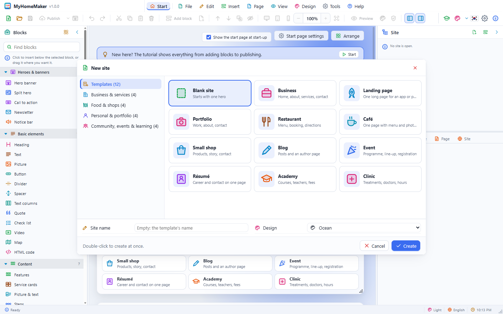

The café template has one page with a split hero, a menu, a gallery and a contact block. The header already carries the site name.

## 2. Look around

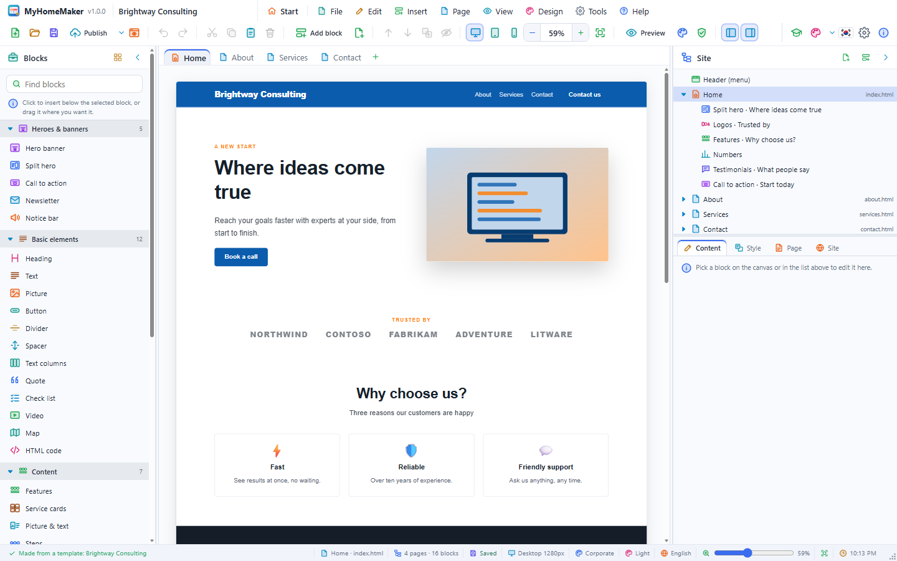

- **Blocks panel** (left): the blocks you can add
- **Page tabs and canvas** (centre): the real site
- **Site panel** (right): the header, pages, blocks and footer at the top, the **Content · Style · Page · Site** editors below

**Fit width** on the toolbar (Ctrl+Shift+W) shows the whole page width on the canvas.

## 3. Change the headline

1. Click the banner at the top of the canvas once. A blue outline and a name tab appear.
2. Click the big title **once more**: the text is selected and can be typed over.
3. Type `Start your day with a good cup` and press **Enter**.

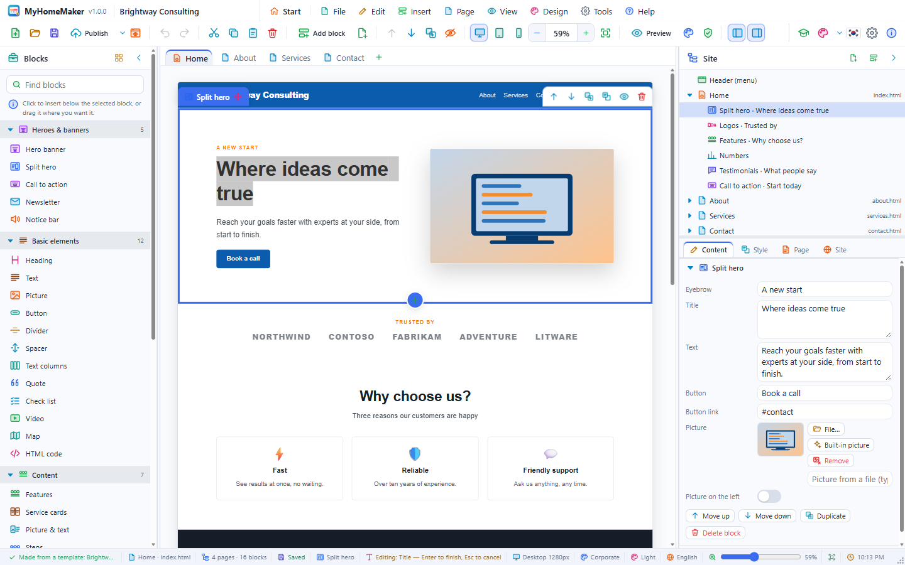

The small title, the text and the button work the same way. The **Content** tab on the right has the same fields. Press **Ctrl+Z** to undo a change.

## 4. Change the picture

1. **Double-click** the banner's picture: a file window opens. Choose a photo of your café.
2. No photo yet? In the **Content** tab, use **Built-in picture › Café** of the picture field.

Large photos are scaled so their longest side is 1920 px. You can also drop a picture file onto the selected block.

## 5. Edit the menu

1. Click the **Menu** block.
2. In the **Dishes** list at the bottom of the **Content** tab, change each item's name, description and price.
3. Press **Add** and enter `Vanilla latte · Sweet vanilla · 5.50`.
4. Reorder items with their ↑ ↓ buttons; the bin deletes one.

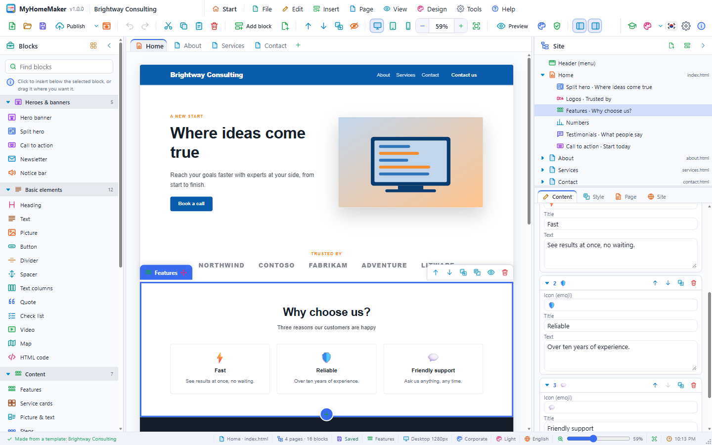

## 6. Add and move blocks

1. Drag **Content › Features** from the Blocks panel onto the canvas, above the menu. A blue line shows where it will go.
2. Change the three features to `Roasted here`, `Baked every morning` and `A quiet upstairs`. The icon field takes emoji (☕ 🥐 🪑).
3. Click **Showcase › Testimonials** to add it (it goes right below the selected block).
4. **Drag a block's name tab** to move it, or use **Move up · Move down** on the toolbar (Ctrl+↑/↓).

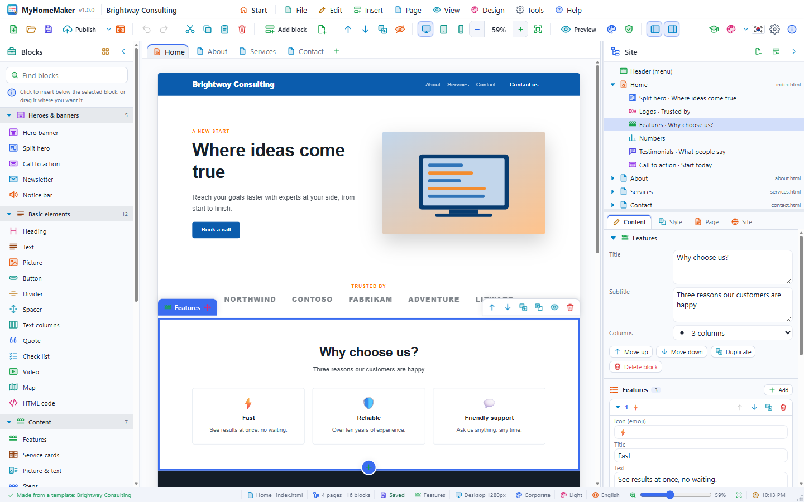

## 7. Style a block

1. Select the testimonials and open the **Style** tab on the right.
2. Set **Background** to **Light surface**, and **Space above** and **Space below** to 96 px.
3. Set **Alignment** to **Centre**.

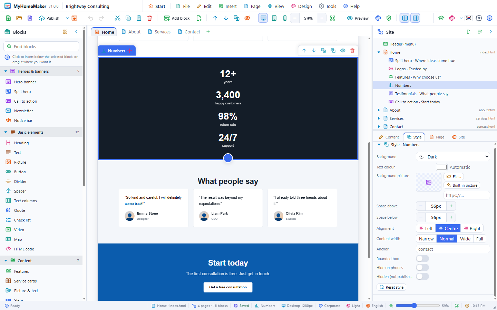

## 8. Add a page

1. Press the **+** at the end of the tabs (or **Page › Add page…**).
2. Name it `Visit us`, choose **Contact** to start with, and press **OK**.
3. In the new page's **Contact** block, change the address, phone and opening hours, and put the café's address into **Map place**.
4. See `Visit us` appear in the header menu by itself.

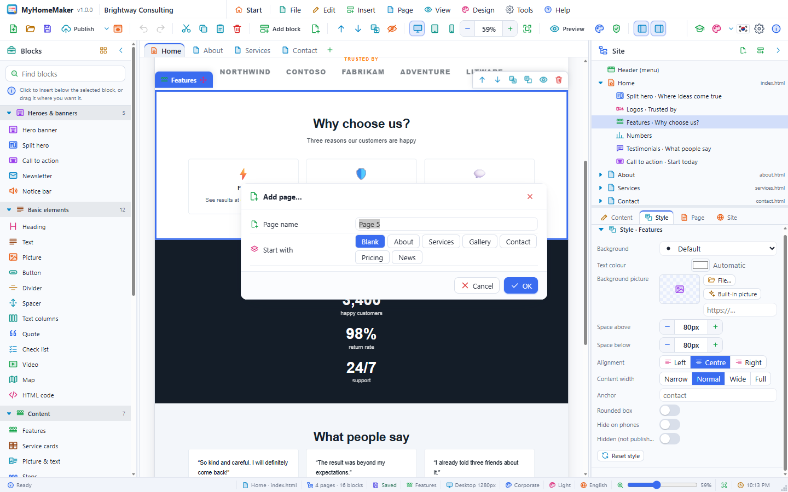

The **Page** tab sets the file name (`visit-us` → `visit-us.html`), the browser title and the search description.

## 9. Change the design

1. Open **Design › Change design…** (Ctrl+Shift+D).
2. Double-click **Wood** or **Peach** among the **Light designs** to use it at once.
3. Try others until you like one: the content stays, only colours and fonts change.
4. To fine-tune, change **Main colour** or **Heading font** in the **Site** tab.

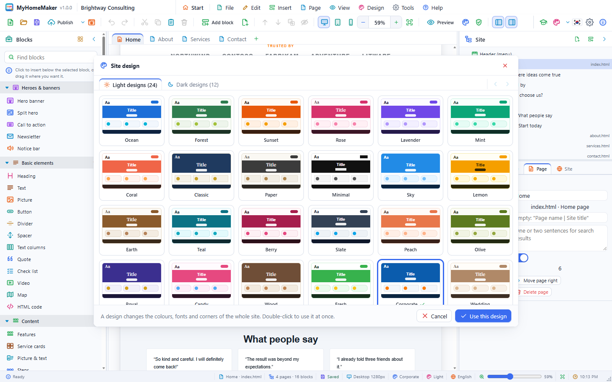

## 10. Check it on a phone

1. Press the **Phone** button on the toolbar. The canvas becomes 390 px wide and the menu folds into ☰.
2. For a block you do not need on phones, turn on **Style › Hide on phones**.
3. Go back with the **Desktop** button.

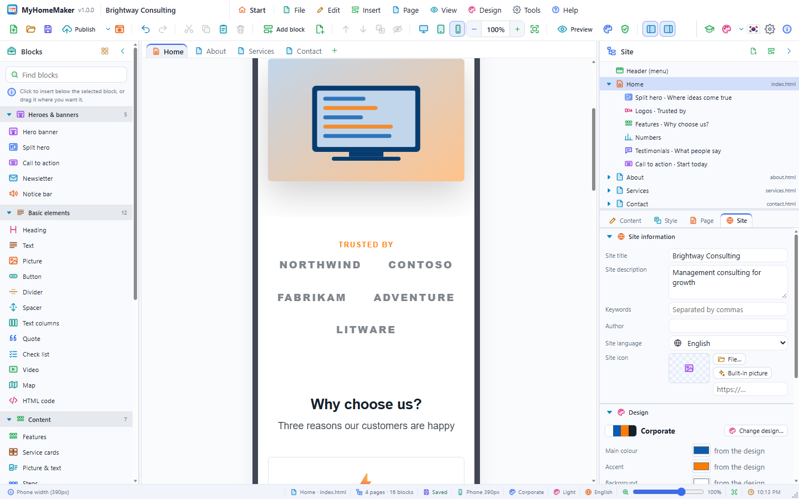

## 11. Preview

1. **Preview** (Ctrl+E) shows the site as visitors see it. Click `Visit us` in the menu to switch pages; **Esc** goes back.
2. **Preview in browser** (F5) opens the site in the system browser.

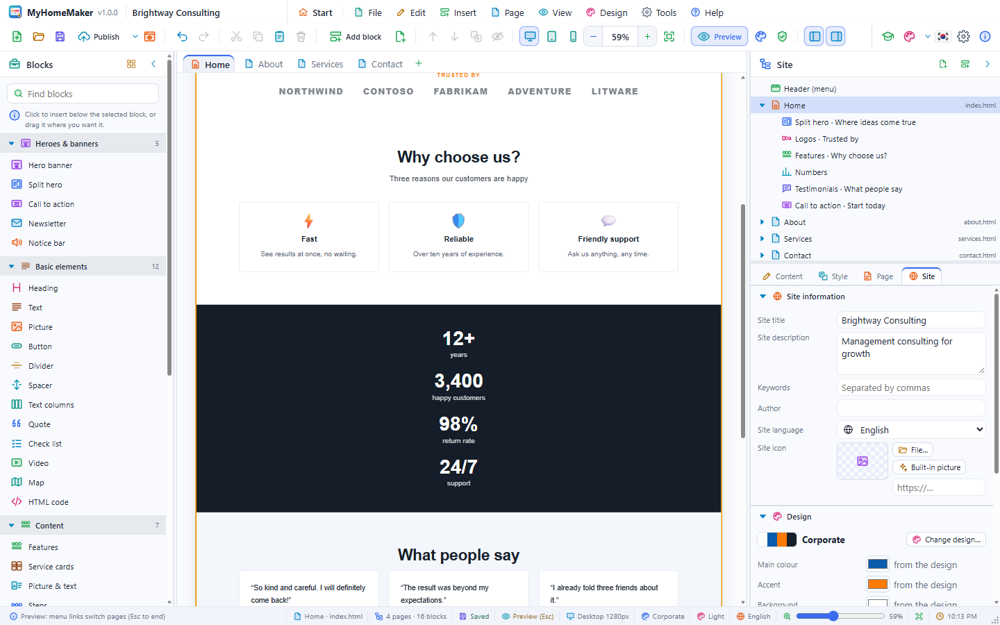

## 12. Site information and saving

1. Clear the selection (Esc) and, in the **Site** tab, write a **Site description**: `Daily Coffee — beans roasted here, bread baked every morning`.
2. **Save** (Ctrl+S) as `Daily Coffee.myhome`. The pictures are inside this one file too.

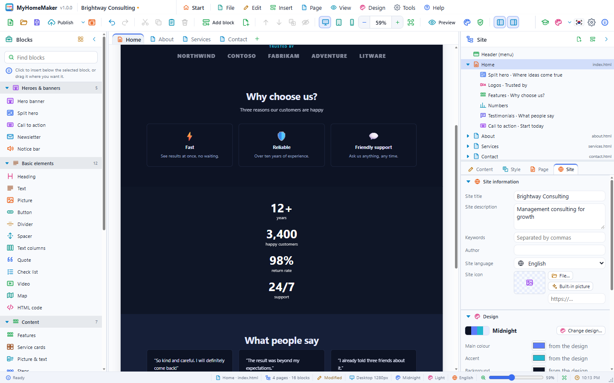

## 13. Check and publish

1. **Tools › Check the site** lists anything to fix.
2. Press **Publish** on the toolbar (Ctrl+Shift+P).
3. Choose **Folder** (desktop) or **ZIP file**, keep **Pictures as files** on, and press **Publish**.
4. After publishing to a folder, press **Open in browser** to see the result.

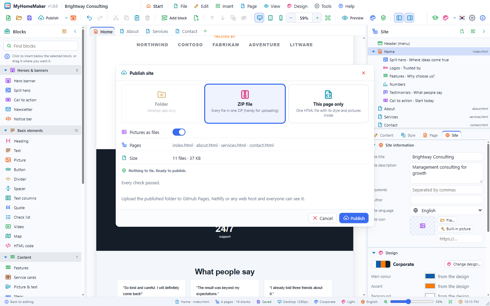

The published folder holds `index.html`, `visit-us.html`, `style.css` and `assets/`.

## 14. Put it online

- **GitHub Pages**: create a repository, upload the published files, and turn it on in Settings › Pages.
- **Netlify**: drop the folder or the ZIP onto Sites at app.netlify.com.
- **Web hosting**: upload the files with FTP into the web root (`public_html` or similar).

To get the contact form by e-mail, get an address from a form service such as Formspree, put it into the **Form endpoint** of the **Contact** block and publish again.

## Next steps

- Open the 16 samples from **File › Open sample site** and see how they are built.

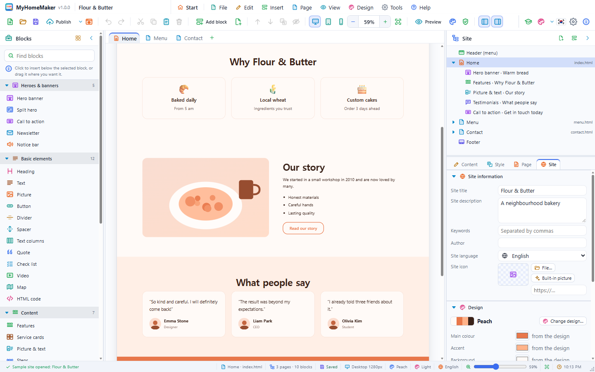

- Save layouts you use often as a template with **File › Save as template…** (.mhomt).
- **Help › Keyboard shortcuts…** lists every keyboard shortcut.
